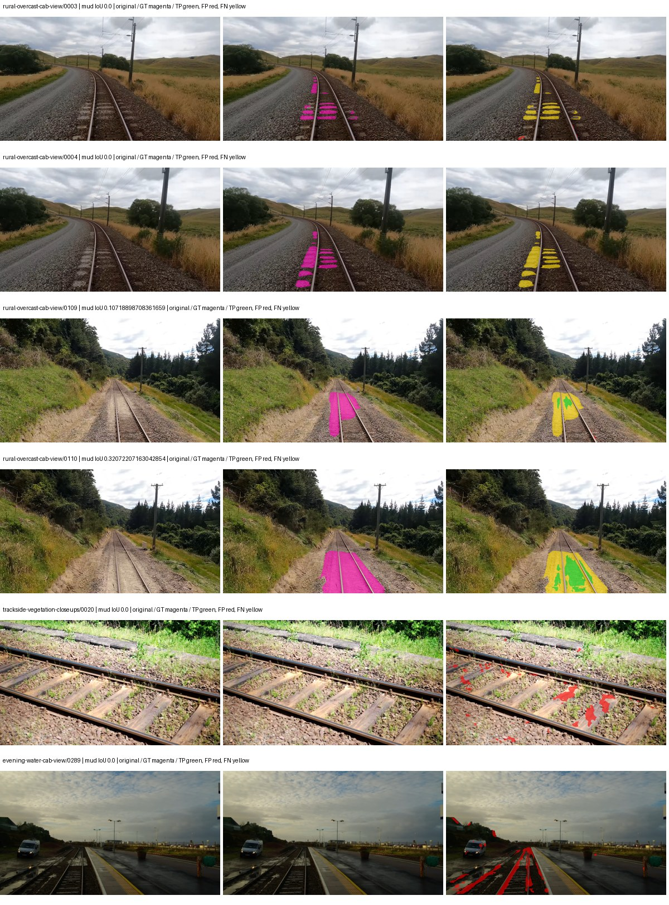

# bisenetv2 — rad_9_24_2026-fixed-grouped

[RAD 9/24: Scene-grouped split](../../README.md) · [Full model records](record.json)

Primary result: the **final checkpoint** after the full step budget (no early stopping). The checkpoint with the best **mud-pumping validation IoU, pixels pooled over all validation images**, is kept as secondary evidence. A job is complete only after full statistics and isolated profiling are verified.

Study metrics of the final checkpoint, counting each class only on the validation images that contain it: mud-pumping IoU is the mean per-image IoU over the images with mud-pumping, precision and recall sum pixels over those images, and mIoU averages each class over the images that contain it, then over the classes present.

| Initialization path | Seed | Mud-pumping IoU, train-camera images with mud (%, n=17) | Mud-pumping IoU, all images with mud (%, n=18) | Mud precision, all images with mud (%) | Mud recall, all images with mud (%) | mIoU (each class over images that contain it) (%) |
| --- | --- | --- | --- | --- | --- | --- |
| rtis_only | 0 | 3.96 | 3.91 | 33.96 | 6.20 | 19.26 |

Per-class IoU: IoU (%) of every class, each averaged only over the validation images that contain the class (n = those images); — = no image contains it. mIoU averages the classes with at least one such image.

| Initialization path | Seed | mIoU (each class over images that contain it) | person (n=0) | truck (n=0) | rail-track (n=37) | vegetation-overgrowth (n=13) | car (n=3) | on-rails (n=0) | traffic-sign (n=9) | road (n=11) | sidewalk (n=12) | construction (n=12) | tram-track (n=2) | pole (n=21) | traffic-light (n=3) | mud-pumping (n=18) | fence (n=7) | terrain (n=35) | sky (n=28) | rail-embedded (n=3) | rail-raised (n=37) | trackbed (n=37) | standing-water (n=9) |
| --- | --- | --- | --- | --- | --- | --- | --- | --- | --- | --- | --- | --- | --- | --- | --- | --- | --- | --- | --- | --- | --- | --- | --- |
| rtis_only | 0 | 19.26 | — | — | 31.99 | 12.74 | 0.00 | — | 0.00 | 3.36 | 2.92 | 5.36 | 0.00 | 41.47 | 0.00 | 3.91 | 0.97 | 62.17 | 88.66 | 0.01 | 54.20 | 38.75 | 0.22 |

Everything below is the campaign's own record, with pixels pooled over all validation images: its evaluation is the checkpoint that scored best on that pooled mud IoU (secondary evidence here); the diagnostics also cover the final checkpoint (`final-auto-val`).

| Model | Initialization path | Seed | Status | Steps | Best step | Best-checkpoint mud IoU, pixels pooled (%) | Best-checkpoint mud precision, pixels pooled (%) | Best-checkpoint mud recall, pixels pooled (%) | Final mud IoU (trainer val, pixels pooled, %) | Best-checkpoint mIoU, pixels pooled (%) | Best-checkpoint fixed GT-class mIoU, pixels pooled (%) |
| --- | --- | --- | --- | --- | --- | --- | --- | --- | --- | --- | --- |
| bisenetv2 | rtis_only | 0 | completed | 4000 | 3370 | 4.16 | 12.71 | 5.83 | 3.25 | 16.38 | 18.20 |

Training: 217 images. Validation: 37 images. Test: 60 held out. Seeds: [0]. Seed variation measures optimization variability, not independent-recording uncertainty. Historical source checkpoints stay fixed across adaptation seeds.

Training code: `fce0ea0ac50b334d4252812c396e0e593def375d`. Split SHA-256: `12d7b367c72cda61d57686ff2ac28223530d0af49debd9fb7a0fbc68b908bc93`.

## rtis_only — seed 0

Status: **completed**. Started: 2026-10-10T22:04:17.478071+00:00. Finished: 2026-10-10T23:04:54.732255+00:00.

Recipe pretrained initializer: `none (BiSeNet V2 trained from scratch)`.

`rtis_only` uses the recipe initializer, which may include pretrained segmentation components. Transfer paths load the exact historical source checkpoint below and reset the classifier; they do not reset all query/decoder features.

Source checkpoint: `Recipe pretrained initialization`.

Config SHA-256: `6f001b64858241862f4b7596d6255697022cb2226a0af9d56edb41e838f9f429`. Weights used for validation: `raw`.

### Mud-pumping and aggregate quality

| Metric | Selected checkpoint | Final training validation |
| --- | --- | --- |
| Mud IoU | 4.16 | 3.25 |
| Mud precision | 12.71 | 6.42 |
| Mud recall | 5.83 | 6.19 |
| Mud Dice/F1 | 7.99 | 6.30 |
| mIoU | 16.38 | 16.25 |
| Mean accuracy | 22.92 | 24.51 |
| Mean precision | 27.20 | 26.14 |
| Mean Dice | 21.09 | 21.10 |
| Mean specificity | 97.92 | 98.13 |
| Pixel accuracy | 66.10 | 68.70 |
| Frequency-weighted IoU | 55.82 | 58.40 |
| Fixed GT-present class mIoU | 18.20 | 18.96 |
| Boundary F1 | 20.80 | 21.10 |

The selected checkpoint has independent evaluation evidence. Final values are the trainer's final validation record, not a new independent evaluation. mIoU averages classes with nonzero union, so false positives on absent classes can change its denominator. The fixed GT-class mean is supplementary and excludes absent classes; their false positives remain in the confusion matrix.

### Resource usage and timing

| Measurement | Value |
| --- | --- |
| Peak training VRAM, retained training invocation (GiB) | 8.70 |
| Peak evaluation VRAM (GiB) | 6.62 |
| Retained training invocation wall time (seconds) | 3523.29 |
| Retained training invocation GPU-hours (one GPU) | 0.98 |
| Evaluation wall time (seconds) | 9.31 |
| Full evaluation pipeline images/second | 3.97 |
| Best full-state checkpoint (MiB) | 80.48 |
| Final full-state checkpoint (MiB) | 80.47 |
| Verified periodic checkpoints removed (GiB) | 0.63 |

VRAM uses the recorded allocator high-water mark; it is not total device usage including CUDA context. Resumed jobs' retained training invocation times and peaks are **not whole-campaign totals**. Earlier invocation resource records are not reconstructed here. Evaluation throughput includes loader, sliding-window inference and metrics; it is not model-only latency/FPS. Missing measurements are shown as —, never inferred from another dataset's run.

### Standardized inference performance

Dedicated model-only profiling waits for an idle worker-locked L40S: BF16, batch 1, 1024x1024, 20 warmup and 100 CUDA-event-timed public forwards. It excludes loading, preprocessing, tiling and metrics.

| Status | Parameters | Weight MiB | FPS | p50 ms | p95 ms | Peak reserved GiB |
| --- | --- | --- | --- | --- | --- | --- |
| complete | 5236265 | 19.97 | 258.17 | 3.84 | 4.11 | 0.31 |

```json
{
  "schema_version": 1,
  "model_id": "bisenetv2",
  "measured_at": "2026-10-10T23:04:52+00:00",
  "status": "complete",
  "benchmark_scope": "rtis_selected_checkpoint_model_only",
  "applies_to": [
    "bisenetv2--rtis_only--seed-0"
  ],
  "source": {
    "campaign_git_sha": "fce0ea0ac50b334d4252812c396e0e593def375d",
    "git_dirty": false,
    "config_hash": "b4690b9d2737",
    "resolved_config": "/data/izadia1/projects/segmentary-runs/rad_9_24_2026/fgall-seed0-20261007/configs/bisenetv2--rtis_only--seed-0.yaml",
    "config_sha256": "6f001b64858241862f4b7596d6255697022cb2226a0af9d56edb41e838f9f429",
    "checkpoint_sha256": "96515e8d35a45a184641d31533b69eb413179e0134d9ca97e24f9ff4a36d8a98",
    "checkpoint_global_step": 3370,
    "checkpoint_bytes": 84390280,
    "checkpoint_kind": "resume checkpoint with optimizer and EMA state",
    "weights": "raw",
    "measured_checkpoint_job_id": "bisenetv2--rtis_only--seed-0",
    "result_sha256": "03697e4d6bed18e5541013d00ec8e8d88c474c186c8ba86cf4e412c4a1ac1eab",
    "result_git_sha": "fce0ea0ac50b334d4252812c396e0e593def375d",
    "result_stage": "eval:rad_9_24_2026-fixed-grouped:val",
    "result_seed": 0
  },
  "hardware": {
    "gpu_name": "NVIDIA L40S",
    "gpu_uuid": "GPU-fc5dde96-210d-0afa-ac74-7f88477d622b",
    "logical_device": "cuda:0",
    "physical_visibility_token": "4",
    "compute_capability": [
      8,
      9
    ],
    "total_memory_bytes": 47677177856
  },
  "model": {
    "parameter_count": 5236265,
    "trainable_parameter_count": 5236265,
    "resident_parameter_bytes": 20945060,
    "parameter_dtype_counts": {
      "float32": 5236265
    }
  },
  "contract": {
    "backend": "pytorch",
    "precision": "bf16_autocast",
    "batch_size": 1,
    "input_shape_nchw": [
      1,
      3,
      1024,
      1024
    ],
    "warmup_iterations": 20,
    "measured_iterations": 100,
    "timing": "per-forward CUDA events with end-event synchronization",
    "includes_preprocessing": false,
    "includes_data_loader": false,
    "includes_sliding_window": false,
    "input_resident_on_gpu": true,
    "model_only": true,
    "entrypoint": "public model(image) dense-logits forward"
  },
  "measurements": {
    "latency": {
      "p50_ms": 3.8426079750061035,
      "p95_ms": 4.106857395172119,
      "mean_ms": 3.8733999943733215,
      "minimum_ms": 3.7908480167388916,
      "maximum_ms": 4.137983798980713,
      "fps": 258.17111619059375,
      "raw_ms": [
        3.8850560188293457,
        3.842047929763794,
        3.842047929763794,
        3.8359038829803467,
        3.8563199043273926,
        4.106143951416016,
        3.865600109100342,
        3.8421759605407715,
        3.8297600746154785,
        3.8256640434265137,
        3.824512004852295,
        3.827712059020996,
        3.851263999938965,
        3.830751895904541,
        3.8195838928222656,
        3.8451199531555176,
        3.9864320755004883,
        3.8359038829803467,
        3.7908480167388916,
        3.812351942062378,
        3.861504077911377,
        3.8411200046539307,
        3.8348801136016846,
        3.856384038925171,
        3.916800022125244,
        3.8737919330596924,
        4.120448112487793,
        3.8297600746154785,
        3.8430399894714355,
        3.8307840824127197,
        3.832832098007202,
        3.8246400356292725,
        3.84716796875,
        3.8400321006774902,
        3.843071937561035,
        3.846143960952759,
        4.088831901550293,
        3.8932480812072754,
        3.8901760578155518,
        3.837951898574829,
        3.8460159301757812,
        3.846143960952759,
        3.851263999938965,
        3.8850560188293457,
        3.8645761013031006,
        3.8348801136016846,
        3.861504077911377,
        4.083712100982666,
        4.1062397956848145,
        4.025343894958496,
        3.841952085494995,
        3.818527936935425,
        3.8143999576568604,
        3.8287360668182373,
        3.8185598850250244,
        3.8246400356292725,
        3.8278400897979736,
        4.118591785430908,
        3.827712059020996,
        3.9127039909362793,
        3.8533120155334473,
        3.8195199966430664,
        3.82259202003479,
        3.846143960952759,
        3.8686718940734863,
        3.848223924636841,
        3.8634560108184814,
        4.137983798980713,
        3.8862080574035645,
        3.8338561058044434,
        3.8307840824127197,
        3.8410239219665527,
        3.8389759063720703,
        3.7949440479278564,
        3.82259202003479,
        3.837951898574829,
        3.8553600311279297,
        3.84716796875,
        4.082687854766846,
        3.831808090209961,
        3.8502399921417236,
        3.8410239219665527,
        3.852288007736206,
        3.830687999725342,
        3.8307840824127197,
        3.847104072570801,
        3.82259202003479,
        3.8645119667053223,
        4.137983798980713,
        3.842047929763794,
        3.9075839519500732,
        3.843071937561035,
        3.837951898574829,
        3.8010880947113037,
        3.803136110305786,
        3.802112102508545,
        3.8389759063720703,
        3.860447883605957,
        4.119552135467529,
        3.8973441123962402
      ],
      "percentile_method": "numpy linear interpolation"
    },
    "peak_reserved_bytes": 337641472,
    "memory_kind": "pytorch_cuda_allocator_peak_reserved_excluding_context",
    "process_total_bytes": 866123776,
    "process_total_kind": "nvidia-smi used_memory of this PID on the benchmark GPU after the timed loop, including the CUDA context; null when the driver could not attribute memory to this PID",
    "benchmark_wall_clock_s": 10.787562929093838
  },
  "started_at": "2026-10-10T23:04:41+00:00",
  "finished_at": "2026-10-10T23:04:52+00:00",
  "environment": {
    "hostname": "hdrfs-app-001",
    "python": "3.11.15",
    "platform": "Linux-5.15.0-139-generic-x86_64-with-glibc2.35",
    "torch": "2.11.0+cu128",
    "torch_cuda": "12.8",
    "cudnn": 91900,
    "driver_version": "570.133.20",
    "cuda_available": true,
    "gpu_count": 1,
    "gpu_names": [
      "NVIDIA L40S"
    ],
    "cuda_visible_devices": "4",
    "packages": {
      "segmentary": "0.1.0",
      "torch": "2.11.0+cu128",
      "torchvision": "0.26.0+cu128",
      "transformers": "5.15.0",
      "timm": "1.0.28",
      "segmentation-models-pytorch": "0.5.0",
      "albumentations": "2.0.8",
      "lightning": "2.6.5",
      "numpy": "2.4.4"
    }
  }
}
```

### Per-class validation results

| Class | GT pixels | IoU (%) | Precision (%) | Recall (%) | Dice (%) | Boundary F1 (%) |
| --- | --- | --- | --- | --- | --- | --- |
| car | 29664 | 0.00 | 0.00 | 0.00 | 0.00 | 0.00 |
| construction | 311585 | 1.35 | 1.42 | 20.92 | 2.66 | 8.60 |
| fence | 265137 | 0.54 | 3.06 | 0.65 | 1.07 | 8.14 |
| mud-pumping | 1226250 | 4.16 | 12.71 | 5.83 | 7.99 | 7.85 |
| on-rails | 0 | 0.00 | 0.00 | — | 0.00 | 0.00 |
| person | 0 | — | — | — | — | — |
| pole | 628038 | 41.76 | 79.43 | 46.82 | 58.91 | 74.73 |
| rail-embedded | 16799 | 0.00 | 0.00 | 0.00 | 0.00 | 0.00 |
| rail-raised | 2969797 | 56.26 | 71.70 | 72.31 | 72.01 | 79.88 |
| rail-track | 6323197 | 22.54 | 47.58 | 29.99 | 36.79 | 43.89 |
| road | 1048831 | 0.39 | 2.06 | 0.48 | 0.78 | 4.61 |
| sidewalk | 1297367 | 0.55 | 9.38 | 0.59 | 1.10 | 3.02 |
| sky | 19121606 | 91.62 | 98.98 | 92.49 | 95.63 | 82.79 |
| standing-water | 95802 | 0.03 | 0.03 | 2.25 | 0.06 | 0.65 |
| terrain | 39239306 | 61.40 | 74.92 | 77.28 | 76.08 | 32.83 |
| trackbed | 10643081 | 41.88 | 60.30 | 57.83 | 59.04 | 39.68 |
| traffic-light | 19510 | 0.00 | 0.00 | 0.00 | 0.00 | 0.00 |
| traffic-sign | 13285 | 0.00 | 0.00 | 0.00 | 0.00 | 0.00 |
| tram-track | 56179 | 0.00 | 0.00 | 0.00 | 0.00 | 0.00 |
| truck | 0 | 0.00 | 0.00 | — | 0.00 | 0.00 |
| vegetation-overgrowth | 5901821 | 5.10 | 82.38 | 5.15 | 9.70 | 29.39 |

### Full-run accounting

| Measurement | Value |
| --- | --- |
| Full GPU-reserved wall seconds, all recorded worker attempts | 3649.17 |
| Full reserved GPU-hours | 1.01 |
| Whole-run timing complete | True |

| Phase | Wall seconds including failed attempts |
| --- | --- |
| training | 3529.20 |
| diagnostics | 72.49 |
| performance | 17.87 |

GPU-reserved time includes model loading, training, validation, collection, profiling, checkpoint I/O and orchestration while the worker owns one GPU. It is not GPU kernel-active time. Phase timings and sampled device memory/power/utilization are retained separately; sampled device memory is not the allocator high-water mark.

### Train/validation and raw/EMA diagnostics

| Checkpoint / weights / split | Images | Mud IoU (%) | Mud precision (%) | Mud recall (%) |
| --- | --- | --- | --- | --- |
| best-auto-train / raw | 217 | 48.55 | 92.77 | 50.46 |
| best-auto-val / raw | 37 | 4.16 | 12.71 | 5.83 |
| best-alternate-val / ema | 37 | 1.13 | 1.91 | 2.69 |
| final-auto-val / raw | 37 | 3.25 | 6.39 | 6.20 |

Train uses the evaluation transform without augmentation. Compare mud train/validation metrics for the same selected weights. Alternate EMA on running-stat BatchNorm is explicitly uncalibrated and is diagnostic only. Score-threshold curves use uncalibrated normalized scores and are pixel-level diagnostics, not event detection rates or a selected deployment operating point.

### Downloadable evidence

- best-auto-train: [per-image.csv](rtis_only--seed-0/best-auto-train/per-image.csv) · [per-image-confusion.json.gz](rtis_only--seed-0/best-auto-train/per-image-confusion.json.gz) · [groups.json](rtis_only--seed-0/best-auto-train/groups.json) · [mud-score-curves.json](rtis_only--seed-0/best-auto-train/mud-score-curves.json)
- best-auto-val: [per-image.csv](rtis_only--seed-0/best-auto-val/per-image.csv) · [per-image-confusion.json.gz](rtis_only--seed-0/best-auto-val/per-image-confusion.json.gz) · [groups.json](rtis_only--seed-0/best-auto-val/groups.json) · [mud-score-curves.json](rtis_only--seed-0/best-auto-val/mud-score-curves.json) · [examples.jpg](rtis_only--seed-0/best-auto-val/examples.jpg)
- best-alternate-val: [per-image.csv](rtis_only--seed-0/best-alternate-val/per-image.csv) · [per-image-confusion.json.gz](rtis_only--seed-0/best-alternate-val/per-image-confusion.json.gz) · [groups.json](rtis_only--seed-0/best-alternate-val/groups.json) · [mud-score-curves.json](rtis_only--seed-0/best-alternate-val/mud-score-curves.json)
- final-auto-val: [per-image.csv](rtis_only--seed-0/final-auto-val/per-image.csv) · [per-image-confusion.json.gz](rtis_only--seed-0/final-auto-val/per-image-confusion.json.gz) · [groups.json](rtis_only--seed-0/final-auto-val/groups.json) · [mud-score-curves.json](rtis_only--seed-0/final-auto-val/mud-score-curves.json)
- resources: [telemetry.csv](rtis_only--seed-0/resources/telemetry.csv)



Examples are two lowest and two highest mud-IoU positive images, plus up to two negative images with the most false-positive mud pixels. They are targeted diagnostic examples, not random samples. Green: true positive; red: false positive; yellow: false negative. Full predictions remain on HDRFS.

### Validation tracking

| Logged step | Overall mIoU (%) | Mud IoU (%) |
| --- | --- | --- |
| 258 | 7.68 | 0.64 |
| 518 | 10.75 | 0.72 |
| 777 | 11.77 | 0.21 |
| 1036 | 11.57 | 0.38 |
| 1295 | 13.94 | 1.05 |
| 1555 | 13.58 | 0.21 |
| 1814 | 13.50 | 1.26 |
| 2073 | 14.10 | 0.26 |
| 2332 | 15.76 | 0.26 |
| 2592 | 16.80 | 0.99 |
| 2851 | 15.65 | 3.16 |
| 3110 | 17.09 | 3.96 |
| 3369 | 16.38 | 4.16 |
| 3629 | 17.02 | 4.13 |
| 3888 | 16.70 | 3.18 |
| 4000 | 16.25 | 3.25 |

All retained scalar curves, including training loss and per-class IoU, are in record.json. Observed best mud on a curve is not necessarily a retained checkpoint: the pilot saved its selection-metric-best and final checkpoints. Step logging and checkpoint global_step may differ by one.

### Stopping and checkpoint provenance

```json
{
  "stopping": {
    "actual_steps": 4000,
    "maximum_steps": 4000,
    "min_delta": 0.0,
    "monitor": "val_iou/mud-pumping",
    "patience": null,
    "reason": "budget_complete"
  },
  "checkpoints": {
    "best": {
      "path": "/data/izadia1/projects/segmentary-runs/rad_9_24_2026/fgall-seed0-20261007/future-runs/bisenetv2--rtis_only--seed-0_seed0/rtis/best.ckpt",
      "sha256": "96515e8d35a45a184641d31533b69eb413179e0134d9ca97e24f9ff4a36d8a98",
      "global_step": 3370,
      "bytes": 84390280
    },
    "final": {
      "path": "/data/izadia1/projects/segmentary-runs/rad_9_24_2026/fgall-seed0-20261007/future-runs/bisenetv2--rtis_only--seed-0_seed0/rtis/last.ckpt",
      "sha256": "60ed6a575c3df19963496343b81f29730eb1316c128899458fb68ed5fd4e472e",
      "global_step": 4000,
      "bytes": 84377672
    }
  },
  "cleanup_error": null
}
```

### Resolved training, initialization and evaluation settings

The optimizer block is the base configuration. Stage LR scales are applied at runtime, and stage warmup is capped at min(base warmup, floor(stage budget / 10), stage budget - 1): 400 steps for this 4,000-step pilot. Model-internal native input grids may differ from augmentation crops (EoMT uses its 640 grid).

```json
{
  "name": "bisenetv2--rtis_only--seed-0",
  "model": {
    "arch": "bisenetv2",
    "checkpoint": null,
    "tuning": "full",
    "head": "unified_head",
    "lora_r": 16,
    "lora_alpha": 32,
    "lora_dropout": 0.05,
    "lora_targets": [],
    "drop_path": null,
    "revision": null,
    "subfolder": null,
    "local_files_only": false,
    "trust_remote_code": false,
    "backbone_path": null,
    "head_paths": [],
    "classifier_path": null,
    "inactive_parameter_paths": [],
    "smp_arch": null,
    "encoder_name": null,
    "encoder_weights": null,
    "native": null,
    "batch_norm_momentum": null
  },
  "space": "paul-test-rtis",
  "taxonomy_root": "/data/izadia1/projects/segmentary-rad-fgall-fce0ea0a/taxonomy",
  "output_root": "/data/izadia1/projects/segmentary-runs/rad_9_24_2026/fgall-seed0-20261007/future-runs",
  "optim": {
    "backbone_lr": 0.0005,
    "head_lr_mult": 1.0,
    "weight_decay": 0.05,
    "llrd": 1.0,
    "warmup_iters": 1500,
    "warmup_ratio": 1e-06,
    "poly_power": 0.9,
    "min_lr_ratio": 0.0,
    "betas": [
      0.9,
      0.999
    ],
    "grad_clip": 1.0
  },
  "train": {
    "iters": 4000,
    "batch_size": 2,
    "accum": 8,
    "num_workers": 2,
    "precision": "bf16-mixed",
    "ema_decay": 0.9998,
    "val_every": 250,
    "ckpt_every": 500,
    "selection_metric": "val_iou/mud-pumping",
    "early_stopping_patience": null,
    "early_stopping_min_delta": 0.0,
    "seed": 0,
    "devices": 1
  },
  "eval": {
    "sliding_window": true,
    "window": [
      1024,
      1024
    ],
    "stride": [
      768,
      768
    ],
    "batch_size": 1,
    "num_workers": 2,
    "tta_scales": [],
    "tta_flip": false,
    "threshold": 0.5,
    "boundary_tolerance_frac": 0.0075,
    "save_confusion": true
  },
  "loss": {
    "task": "multiclass",
    "activation": "auto",
    "terms": [],
    "aux": "none",
    "aux_weight": 0.0,
    "ce_weight": 1.0,
    "label_smoothing": 0.0,
    "class_weights": null,
    "query": null
  },
  "aug": {
    "crop": [
      1024,
      1024
    ],
    "scale_min": 0.5,
    "scale_max": 2.0,
    "hflip_p": 0.5,
    "color_jitter_p": 0.5,
    "brightness": 0.25,
    "contrast": 0.25,
    "saturation": 0.25,
    "hue": 0.05
  },
  "stages": [
    {
      "name": "rtis",
      "data": [
        {
          "name": "rad_9_24_2026-fixed-grouped",
          "root": "/data/izadia1/datasets/rad_9_24_2026-fixed-grouped",
          "variant": null,
          "split_file": "splits.json",
          "train_split": "train",
          "val_split": "val",
          "limit": null,
          "loader": "folder",
          "mapping": "paul-test-rtis",
          "loader_options": {
            "require_groups": true
          }
        }
      ],
      "iters": null,
      "lr_scale": 1.0,
      "head_group_lr_scale": 1.0,
      "init_from": "pretrained",
      "reset_head": false,
      "freeze": null,
      "sample_weights": null
    }
  ]
}
```

### Hardware and software provenance

```json
{
  "training": {
    "cuda_available": true,
    "cuda_visible_devices": "4",
    "cudnn": 91900,
    "driver_version": "570.133.20",
    "gpu_count": 1,
    "gpu_names": [
      "NVIDIA L40S"
    ],
    "hostname": "hdrfs-app-001",
    "input_normalization": {
      "channel_order": "rgb",
      "mean": [
        0.485,
        0.456,
        0.406
      ],
      "source": "imagenet_scratch_default",
      "std": [
        0.229,
        0.224,
        0.225
      ]
    },
    "model_origins": [],
    "model_parameter_count": 5236265,
    "packages": {
      "albumentations": "2.0.8",
      "lightning": "2.6.5",
      "numpy": "2.4.4",
      "segmentary": "0.1.0",
      "segmentation-models-pytorch": "0.5.0",
      "timm": "1.0.28",
      "torch": "2.11.0+cu128",
      "torchvision": "0.26.0+cu128",
      "transformers": "5.15.0"
    },
    "platform": "Linux-5.15.0-139-generic-x86_64-with-glibc2.35",
    "python": "3.11.15",
    "torch": "2.11.0+cu128",
    "torch_cuda": "12.8",
    "trainable_parameter_count": 5236265,
    "training_stop": {
      "actual_steps": 4000,
      "maximum_steps": 4000,
      "min_delta": 0.0,
      "monitor": "val_iou/mud-pumping",
      "patience": null,
      "reason": "budget_complete"
    },
    "validation_weights": "raw"
  },
  "evaluation": {
    "cuda_available": true,
    "cuda_visible_devices": "4",
    "cudnn": 91900,
    "driver_version": "570.133.20",
    "gpu_count": 1,
    "gpu_names": [
      "NVIDIA L40S"
    ],
    "hostname": "hdrfs-app-001",
    "input_normalization": {
      "channel_order": "rgb",
      "mean": [
        0.485,
        0.456,
        0.406
      ],
      "source": "imagenet_scratch_default",
      "std": [
        0.229,
        0.224,
        0.225
      ]
    },
    "packages": {
      "albumentations": "2.0.8",
      "lightning": "2.6.5",
      "numpy": "2.4.4",
      "segmentary": "0.1.0",
      "segmentation-models-pytorch": "0.5.0",
      "timm": "1.0.28",
      "torch": "2.11.0+cu128",
      "torchvision": "0.26.0+cu128",
      "transformers": "5.15.0"
    },
    "platform": "Linux-5.15.0-139-generic-x86_64-with-glibc2.35",
    "python": "3.11.15",
    "torch": "2.11.0+cu128",
    "torch_cuda": "12.8"
  }
}
```
