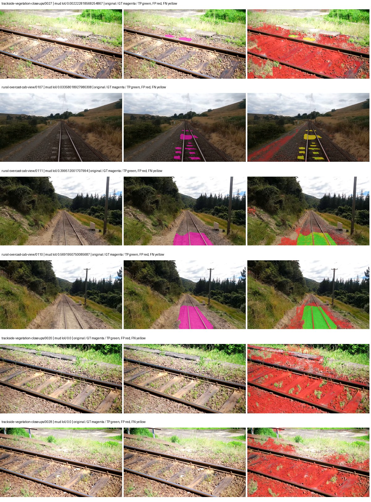

# espnet — rad_9_24_2026-fixed-grouped

[RAD 9/24: Scene-grouped split](../../README.md) · [Full model records](record.json)

Primary result: the **final checkpoint** after the full step budget (no early stopping). The checkpoint with the best **mud-pumping validation IoU, pixels pooled over all validation images**, is kept as secondary evidence. A job is complete only after full statistics and isolated profiling are verified.

Study metrics of the final checkpoint, counting each class only on the validation images that contain it: mud-pumping IoU is the mean per-image IoU over the images with mud-pumping, precision and recall sum pixels over those images, and mIoU averages each class over the images that contain it, then over the classes present.

| Initialization path | Seed | Mud-pumping IoU, train-camera images with mud (%, n=17) | Mud-pumping IoU, all images with mud (%, n=18) | Mud precision, all images with mud (%) | Mud recall, all images with mud (%) | mIoU (each class over images that contain it) (%) |
| --- | --- | --- | --- | --- | --- | --- |
| rtis_only | 0 | 4.10 | 3.88 | 19.88 | 5.43 | 18.77 |

Per-class IoU: IoU (%) of every class, each averaged only over the validation images that contain the class (n = those images); — = no image contains it. mIoU averages the classes with at least one such image.

| Initialization path | Seed | mIoU (each class over images that contain it) | person (n=0) | truck (n=0) | rail-track (n=37) | vegetation-overgrowth (n=13) | car (n=3) | on-rails (n=0) | traffic-sign (n=9) | road (n=11) | sidewalk (n=12) | construction (n=12) | tram-track (n=2) | pole (n=21) | traffic-light (n=3) | mud-pumping (n=18) | fence (n=7) | terrain (n=35) | sky (n=28) | rail-embedded (n=3) | rail-raised (n=37) | trackbed (n=37) | standing-water (n=9) |
| --- | --- | --- | --- | --- | --- | --- | --- | --- | --- | --- | --- | --- | --- | --- | --- | --- | --- | --- | --- | --- | --- | --- | --- |
| rtis_only | 0 | 18.77 | — | — | 44.31 | 4.79 | 0.00 | — | 0.00 | 0.01 | 0.41 | 7.01 | 0.00 | 32.13 | 0.00 | 3.88 | 0.00 | 68.29 | 79.01 | 0.00 | 51.03 | 44.87 | 2.10 |

Everything below is the campaign's own record, with pixels pooled over all validation images: its evaluation is the checkpoint that scored best on that pooled mud IoU (secondary evidence here); the diagnostics also cover the final checkpoint (`final-auto-val`).

| Model | Initialization path | Seed | Status | Steps | Best step | Best-checkpoint mud IoU, pixels pooled (%) | Best-checkpoint mud precision, pixels pooled (%) | Best-checkpoint mud recall, pixels pooled (%) | Final mud IoU (trainer val, pixels pooled, %) | Best-checkpoint mIoU, pixels pooled (%) | Best-checkpoint fixed GT-class mIoU, pixels pooled (%) |
| --- | --- | --- | --- | --- | --- | --- | --- | --- | --- | --- | --- |
| espnet | rtis_only | 0 | completed | 4000 | 259 | 4.41 | 4.87 | 31.67 | 2.43 | 9.27 | 10.82 |

Training: 217 images. Validation: 37 images. Test: 60 held out. Seeds: [0]. Seed variation measures optimization variability, not independent-recording uncertainty. Historical source checkpoints stay fixed across adaptation seeds.

Training code: `fce0ea0ac50b334d4252812c396e0e593def375d`. Split SHA-256: `12d7b367c72cda61d57686ff2ac28223530d0af49debd9fb7a0fbc68b908bc93`.

## rtis_only — seed 0

Status: **completed**. Started: 2026-10-11T00:00:12.219032+00:00. Finished: 2026-10-11T00:41:22.481258+00:00.

Recipe pretrained initializer: `none (ESPNet trained from scratch)`.

`rtis_only` uses the recipe initializer, which may include pretrained segmentation components. Transfer paths load the exact historical source checkpoint below and reset the classifier; they do not reset all query/decoder features.

Source checkpoint: `Recipe pretrained initialization`.

Config SHA-256: `45afc727aec39df71b8bb83d987868877976fed576544f07442b5900bc399e67`. Weights used for validation: `raw`.

### Mud-pumping and aggregate quality

| Metric | Selected checkpoint | Final training validation |
| --- | --- | --- |
| Mud IoU | 4.41 | 2.43 |
| Mud precision | 4.87 | 4.23 |
| Mud recall | 31.67 | 5.43 |
| Mud Dice/F1 | 8.44 | 4.75 |
| mIoU | 9.27 | 16.05 |
| Mean accuracy | 14.92 | 22.39 |
| Mean precision | 12.31 | 28.73 |
| Mean Dice | 11.87 | 20.94 |
| Mean specificity | 97.66 | 98.03 |
| Pixel accuracy | 61.54 | 68.50 |
| Frequency-weighted IoU | 50.10 | 57.52 |
| Fixed GT-present class mIoU | 10.82 | 16.94 |
| Boundary F1 | 8.71 | 17.21 |

The selected checkpoint has independent evaluation evidence. Final values are the trainer's final validation record, not a new independent evaluation. mIoU averages classes with nonzero union, so false positives on absent classes can change its denominator. The fixed GT-class mean is supplementary and excludes absent classes; their false positives remain in the confusion matrix.

### Resource usage and timing

| Measurement | Value |
| --- | --- |
| Peak training VRAM, retained training invocation (GiB) | 6.77 |
| Peak evaluation VRAM (GiB) | 6.23 |
| Retained training invocation wall time (seconds) | 2354.02 |
| Retained training invocation GPU-hours (one GPU) | 0.65 |
| Evaluation wall time (seconds) | 9.00 |
| Full evaluation pipeline images/second | 4.11 |
| Best full-state checkpoint (MiB) | 5.88 |
| Final full-state checkpoint (MiB) | 5.88 |
| Verified periodic checkpoints removed (GiB) | 0.05 |

VRAM uses the recorded allocator high-water mark; it is not total device usage including CUDA context. Resumed jobs' retained training invocation times and peaks are **not whole-campaign totals**. Earlier invocation resource records are not reconstructed here. Evaluation throughput includes loader, sliding-window inference and metrics; it is not model-only latency/FPS. Missing measurements are shown as —, never inferred from another dataset's run.

### Standardized inference performance

Dedicated model-only profiling waits for an idle worker-locked L40S: BF16, batch 1, 1024x1024, 20 warmup and 100 CUDA-event-timed public forwards. It excludes loading, preprocessing, tiling and metrics.

| Status | Parameters | Weight MiB | FPS | p50 ms | p95 ms | Peak reserved GiB |
| --- | --- | --- | --- | --- | --- | --- |
| complete | 366589 | 1.40 | 189.30 | 5.26 | 5.53 | 0.34 |

```json
{
  "schema_version": 1,
  "model_id": "espnet",
  "measured_at": "2026-10-11T00:41:21+00:00",
  "status": "complete",
  "benchmark_scope": "rtis_selected_checkpoint_model_only",
  "applies_to": [
    "espnet--rtis_only--seed-0"
  ],
  "source": {
    "campaign_git_sha": "fce0ea0ac50b334d4252812c396e0e593def375d",
    "git_dirty": false,
    "config_hash": "3c63b9acac46",
    "resolved_config": "/data/izadia1/projects/segmentary-runs/rad_9_24_2026/fgall-seed0-20261007/configs/espnet--rtis_only--seed-0.yaml",
    "config_sha256": "45afc727aec39df71b8bb83d987868877976fed576544f07442b5900bc399e67",
    "checkpoint_sha256": "edb6f927c6a14da26983b74f18f7c1b217818727ccba0160e48c286d72859841",
    "checkpoint_global_step": 259,
    "checkpoint_bytes": 6169345,
    "checkpoint_kind": "resume checkpoint with optimizer and EMA state",
    "weights": "raw",
    "measured_checkpoint_job_id": "espnet--rtis_only--seed-0",
    "result_sha256": "a634b5224a4034ff7778405caafc54eb1328b59a133a247719e90b4483458980",
    "result_git_sha": "fce0ea0ac50b334d4252812c396e0e593def375d",
    "result_stage": "eval:rad_9_24_2026-fixed-grouped:val",
    "result_seed": 0
  },
  "hardware": {
    "gpu_name": "NVIDIA L40S",
    "gpu_uuid": "GPU-c76642eb-64c1-b0ac-b051-d2efd47b32c4",
    "logical_device": "cuda:0",
    "physical_visibility_token": "9",
    "compute_capability": [
      8,
      9
    ],
    "total_memory_bytes": 47677177856
  },
  "model": {
    "parameter_count": 366589,
    "trainable_parameter_count": 366589,
    "resident_parameter_bytes": 1466356,
    "parameter_dtype_counts": {
      "float32": 366589
    }
  },
  "contract": {
    "backend": "pytorch",
    "precision": "bf16_autocast",
    "batch_size": 1,
    "input_shape_nchw": [
      1,
      3,
      1024,
      1024
    ],
    "warmup_iterations": 20,
    "measured_iterations": 100,
    "timing": "per-forward CUDA events with end-event synchronization",
    "includes_preprocessing": false,
    "includes_data_loader": false,
    "includes_sliding_window": false,
    "input_resident_on_gpu": true,
    "model_only": true,
    "entrypoint": "public model(image) dense-logits forward"
  },
  "measurements": {
    "latency": {
      "p50_ms": 5.257728099822998,
      "p95_ms": 5.533235120773315,
      "mean_ms": 5.282691826820374,
      "minimum_ms": 5.199872016906738,
      "maximum_ms": 5.786623954772949,
      "fps": 189.29743259354484,
      "raw_ms": [
        5.281792163848877,
        5.285888195037842,
        5.264383792877197,
        5.273600101470947,
        5.246975898742676,
        5.296127796173096,
        5.263360023498535,
        5.249023914337158,
        5.2500481605529785,
        5.2520318031311035,
        5.277696132659912,
        5.223423957824707,
        5.27564811706543,
        5.566463947296143,
        5.2797441482543945,
        5.199872016906738,
        5.21011209487915,
        5.260287761688232,
        5.271552085876465,
        5.227519989013672,
        5.230591773986816,
        5.269504070281982,
        5.2500481605529785,
        5.246975898742676,
        5.2797441482543945,
        5.257215976715088,
        5.387263774871826,
        5.282815933227539,
        5.244927883148193,
        5.215231895446777,
        5.259232044219971,
        5.234687805175781,
        5.223423957824707,
        5.246975898742676,
        5.472256183624268,
        5.367807865142822,
        5.298175811767578,
        5.228544235229492,
        5.25926399230957,
        5.288959980010986,
        5.338111877441406,
        5.568511962890625,
        5.252096176147461,
        5.215231895446777,
        5.608448028564453,
        5.280767917633057,
        5.2254719734191895,
        5.207039833068848,
        5.249023914337158,
        5.236735820770264,
        5.3002238273620605,
        5.543935775756836,
        5.258240222930908,
        5.253119945526123,
        5.276671886444092,
        5.245952129364014,
        5.233664035797119,
        5.223423957824707,
        5.222400188446045,
        5.21830415725708,
        5.2244157791137695,
        5.260287761688232,
        5.234687805175781,
        5.229568004608154,
        5.231616020202637,
        5.269504070281982,
        5.273600101470947,
        5.313536167144775,
        5.277696132659912,
        5.248000144958496,
        5.260287761688232,
        5.242879867553711,
        5.245952129364014,
        5.238783836364746,
        5.241856098175049,
        5.238783836364746,
        5.269504070281982,
        5.269504070281982,
        5.244927883148193,
        5.214208126068115,
        5.238783836364746,
        5.22649621963501,
        5.5265278816223145,
        5.283840179443359,
        5.271552085876465,
        5.229568004608154,
        5.2500481605529785,
        5.320703983306885,
        5.3094401359558105,
        5.282815933227539,
        5.258240222930908,
        5.532671928405762,
        5.258240222930908,
        5.232639789581299,
        5.230591773986816,
        5.236735820770264,
        5.243904113769531,
        5.786623954772949,
        5.296127796173096,
        5.2674560546875
      ],
      "percentile_method": "numpy linear interpolation"
    },
    "peak_reserved_bytes": 369098752,
    "memory_kind": "pytorch_cuda_allocator_peak_reserved_excluding_context",
    "process_total_bytes": 897581056,
    "process_total_kind": "nvidia-smi used_memory of this PID on the benchmark GPU after the timed loop, including the CUDA context; null when the driver could not attribute memory to this PID",
    "benchmark_wall_clock_s": 7.59724697470665
  },
  "started_at": "2026-10-11T00:41:13+00:00",
  "finished_at": "2026-10-11T00:41:21+00:00",
  "environment": {
    "hostname": "hdrfs-app-001",
    "python": "3.11.15",
    "platform": "Linux-5.15.0-139-generic-x86_64-with-glibc2.35",
    "torch": "2.11.0+cu128",
    "torch_cuda": "12.8",
    "cudnn": 91900,
    "driver_version": "570.133.20",
    "cuda_available": true,
    "gpu_count": 1,
    "gpu_names": [
      "NVIDIA L40S"
    ],
    "cuda_visible_devices": "9",
    "packages": {
      "segmentary": "0.1.0",
      "torch": "2.11.0+cu128",
      "torchvision": "0.26.0+cu128",
      "transformers": "5.15.0",
      "timm": "1.0.28",
      "segmentation-models-pytorch": "0.5.0",
      "albumentations": "2.0.8",
      "lightning": "2.6.5",
      "numpy": "2.4.4"
    }
  }
}
```

### Per-class validation results

| Class | GT pixels | IoU (%) | Precision (%) | Recall (%) | Dice (%) | Boundary F1 (%) |
| --- | --- | --- | --- | --- | --- | --- |
| car | 29664 | 0.00 | 0.00 | 0.00 | 0.00 | 0.00 |
| construction | 311585 | 0.09 | 0.64 | 0.11 | 0.19 | 1.86 |
| fence | 265137 | 0.16 | 0.18 | 1.23 | 0.32 | 0.72 |
| mud-pumping | 1226250 | 4.41 | 4.87 | 31.67 | 8.44 | 7.74 |
| on-rails | 0 | 0.00 | 0.00 | — | 0.00 | 0.00 |
| person | 0 | 0.00 | 0.00 | — | 0.00 | 0.00 |
| pole | 628038 | 0.40 | 1.41 | 0.56 | 0.80 | 2.66 |
| rail-embedded | 16799 | 0.00 | 0.00 | 0.07 | 0.00 | 0.23 |
| rail-raised | 2969797 | 6.62 | 15.55 | 10.33 | 12.41 | 39.67 |
| rail-track | 6323197 | 6.32 | 18.71 | 8.72 | 11.89 | 25.86 |
| road | 1048831 | 0.00 | 0.22 | 0.00 | 0.01 | 0.55 |
| sidewalk | 1297367 | 0.00 | 0.55 | 0.00 | 0.01 | 2.08 |
| sky | 19121606 | 82.10 | 89.77 | 90.57 | 90.17 | 35.96 |
| standing-water | 95802 | 0.04 | 0.31 | 0.04 | 0.08 | 1.31 |
| terrain | 39239306 | 63.93 | 75.55 | 80.61 | 78.00 | 17.44 |
| trackbed | 10643081 | 30.58 | 49.95 | 44.09 | 46.84 | 39.97 |
| traffic-light | 19510 | 0.01 | 0.01 | 0.03 | 0.01 | 0.00 |
| traffic-sign | 13285 | 0.01 | 0.01 | 0.47 | 0.02 | 0.10 |
| tram-track | 56179 | 0.00 | 0.00 | 0.00 | 0.00 | 0.00 |
| truck | 0 | 0.00 | 0.00 | — | 0.00 | 0.00 |
| vegetation-overgrowth | 5901821 | 0.03 | 0.79 | 0.04 | 0.07 | 6.68 |

### Full-run accounting

| Measurement | Value |
| --- | --- |
| Full GPU-reserved wall seconds, all recorded worker attempts | 2478.29 |
| Full reserved GPU-hours | 0.69 |
| Whole-run timing complete | True |

| Phase | Wall seconds including failed attempts |
| --- | --- |
| training | 2360.36 |
| diagnostics | 79.45 |
| performance | 14.62 |

GPU-reserved time includes model loading, training, validation, collection, profiling, checkpoint I/O and orchestration while the worker owns one GPU. It is not GPU kernel-active time. Phase timings and sampled device memory/power/utilization are retained separately; sampled device memory is not the allocator high-water mark.

### Train/validation and raw/EMA diagnostics

| Checkpoint / weights / split | Images | Mud IoU (%) | Mud precision (%) | Mud recall (%) |
| --- | --- | --- | --- | --- |
| best-auto-train / raw | 217 | 41.13 | 49.45 | 70.97 |
| best-auto-val / raw | 37 | 4.41 | 4.87 | 31.67 |
| best-alternate-val / ema | 37 | 2.35 | 2.80 | 12.61 |
| final-auto-val / raw | 37 | 2.43 | 4.23 | 5.43 |

Train uses the evaluation transform without augmentation. Compare mud train/validation metrics for the same selected weights. Alternate EMA on running-stat BatchNorm is explicitly uncalibrated and is diagnostic only. Score-threshold curves use uncalibrated normalized scores and are pixel-level diagnostics, not event detection rates or a selected deployment operating point.

### Downloadable evidence

- best-auto-train: [per-image.csv](rtis_only--seed-0/best-auto-train/per-image.csv) · [per-image-confusion.json.gz](rtis_only--seed-0/best-auto-train/per-image-confusion.json.gz) · [groups.json](rtis_only--seed-0/best-auto-train/groups.json) · [mud-score-curves.json](rtis_only--seed-0/best-auto-train/mud-score-curves.json)
- best-auto-val: [per-image.csv](rtis_only--seed-0/best-auto-val/per-image.csv) · [per-image-confusion.json.gz](rtis_only--seed-0/best-auto-val/per-image-confusion.json.gz) · [groups.json](rtis_only--seed-0/best-auto-val/groups.json) · [mud-score-curves.json](rtis_only--seed-0/best-auto-val/mud-score-curves.json) · [examples.jpg](rtis_only--seed-0/best-auto-val/examples.jpg)
- best-alternate-val: [per-image.csv](rtis_only--seed-0/best-alternate-val/per-image.csv) · [per-image-confusion.json.gz](rtis_only--seed-0/best-alternate-val/per-image-confusion.json.gz) · [groups.json](rtis_only--seed-0/best-alternate-val/groups.json) · [mud-score-curves.json](rtis_only--seed-0/best-alternate-val/mud-score-curves.json)
- final-auto-val: [per-image.csv](rtis_only--seed-0/final-auto-val/per-image.csv) · [per-image-confusion.json.gz](rtis_only--seed-0/final-auto-val/per-image-confusion.json.gz) · [groups.json](rtis_only--seed-0/final-auto-val/groups.json) · [mud-score-curves.json](rtis_only--seed-0/final-auto-val/mud-score-curves.json)
- resources: [telemetry.csv](rtis_only--seed-0/resources/telemetry.csv)



Examples are two lowest and two highest mud-IoU positive images, plus up to two negative images with the most false-positive mud pixels. They are targeted diagnostic examples, not random samples. Green: true positive; red: false positive; yellow: false negative. Full predictions remain on HDRFS.

### Validation tracking

| Logged step | Overall mIoU (%) | Mud IoU (%) |
| --- | --- | --- |
| 258 | 9.27 | 4.41 |
| 518 | 8.82 | 2.09 |
| 777 | 11.52 | 0.96 |
| 1036 | 11.30 | 0.24 |
| 1295 | 12.28 | 3.32 |
| 1555 | 13.11 | 0.35 |
| 1814 | 14.53 | 3.51 |
| 2073 | 13.53 | 0.37 |
| 2332 | 15.81 | 0.17 |
| 2592 | 15.62 | 3.04 |
| 2851 | 15.55 | 1.43 |
| 3110 | 15.41 | 0.73 |
| 3369 | 16.13 | 1.46 |
| 3629 | 15.25 | 1.09 |
| 3888 | 15.40 | 1.64 |
| 4000 | 16.05 | 2.43 |

All retained scalar curves, including training loss and per-class IoU, are in record.json. Observed best mud on a curve is not necessarily a retained checkpoint: the pilot saved its selection-metric-best and final checkpoints. Step logging and checkpoint global_step may differ by one.

### Stopping and checkpoint provenance

```json
{
  "stopping": {
    "actual_steps": 4000,
    "maximum_steps": 4000,
    "min_delta": 0.0,
    "monitor": "val_iou/mud-pumping",
    "patience": null,
    "reason": "budget_complete"
  },
  "checkpoints": {
    "best": {
      "path": "/data/izadia1/projects/segmentary-runs/rad_9_24_2026/fgall-seed0-20261007/future-runs/espnet--rtis_only--seed-0_seed0/rtis/best.ckpt",
      "sha256": "edb6f927c6a14da26983b74f18f7c1b217818727ccba0160e48c286d72859841",
      "global_step": 259,
      "bytes": 6169345
    },
    "final": {
      "path": "/data/izadia1/projects/segmentary-runs/rad_9_24_2026/fgall-seed0-20261007/future-runs/espnet--rtis_only--seed-0_seed0/rtis/last.ckpt",
      "sha256": "35a23ea386c4450cd88d485f24b1d7e15fe285dc348d81c2fae1bd1c8f3e76c4",
      "global_step": 4000,
      "bytes": 6161537
    }
  },
  "cleanup_error": null
}
```

### Resolved training, initialization and evaluation settings

The optimizer block is the base configuration. Stage LR scales are applied at runtime, and stage warmup is capped at min(base warmup, floor(stage budget / 10), stage budget - 1): 400 steps for this 4,000-step pilot. Model-internal native input grids may differ from augmentation crops (EoMT uses its 640 grid).

```json
{
  "name": "espnet--rtis_only--seed-0",
  "model": {
    "arch": "espnet",
    "checkpoint": null,
    "tuning": "full",
    "head": "unified_head",
    "lora_r": 16,
    "lora_alpha": 32,
    "lora_dropout": 0.05,
    "lora_targets": [],
    "drop_path": null,
    "revision": null,
    "subfolder": null,
    "local_files_only": false,
    "trust_remote_code": false,
    "backbone_path": null,
    "head_paths": [],
    "classifier_path": null,
    "inactive_parameter_paths": [],
    "smp_arch": null,
    "encoder_name": null,
    "encoder_weights": null,
    "native": null,
    "batch_norm_momentum": null
  },
  "space": "paul-test-rtis",
  "taxonomy_root": "/data/izadia1/projects/segmentary-rad-fgall-fce0ea0a/taxonomy",
  "output_root": "/data/izadia1/projects/segmentary-runs/rad_9_24_2026/fgall-seed0-20261007/future-runs",
  "optim": {
    "backbone_lr": 0.0005,
    "head_lr_mult": 1.0,
    "weight_decay": 0.05,
    "llrd": 1.0,
    "warmup_iters": 1500,
    "warmup_ratio": 1e-06,
    "poly_power": 0.9,
    "min_lr_ratio": 0.0,
    "betas": [
      0.9,
      0.999
    ],
    "grad_clip": 1.0
  },
  "train": {
    "iters": 4000,
    "batch_size": 2,
    "accum": 8,
    "num_workers": 2,
    "precision": "bf16-mixed",
    "ema_decay": 0.9998,
    "val_every": 250,
    "ckpt_every": 500,
    "selection_metric": "val_iou/mud-pumping",
    "early_stopping_patience": null,
    "early_stopping_min_delta": 0.0,
    "seed": 0,
    "devices": 1
  },
  "eval": {
    "sliding_window": true,
    "window": [
      1024,
      1024
    ],
    "stride": [
      768,
      768
    ],
    "batch_size": 1,
    "num_workers": 2,
    "tta_scales": [],
    "tta_flip": false,
    "threshold": 0.5,
    "boundary_tolerance_frac": 0.0075,
    "save_confusion": true
  },
  "loss": {
    "task": "multiclass",
    "activation": "auto",
    "terms": [],
    "aux": "none",
    "aux_weight": 0.0,
    "ce_weight": 1.0,
    "label_smoothing": 0.0,
    "class_weights": null,
    "query": null
  },
  "aug": {
    "crop": [
      1024,
      1024
    ],
    "scale_min": 0.5,
    "scale_max": 2.0,
    "hflip_p": 0.5,
    "color_jitter_p": 0.5,
    "brightness": 0.25,
    "contrast": 0.25,
    "saturation": 0.25,
    "hue": 0.05
  },
  "stages": [
    {
      "name": "rtis",
      "data": [
        {
          "name": "rad_9_24_2026-fixed-grouped",
          "root": "/data/izadia1/datasets/rad_9_24_2026-fixed-grouped",
          "variant": null,
          "split_file": "splits.json",
          "train_split": "train",
          "val_split": "val",
          "limit": null,
          "loader": "folder",
          "mapping": "paul-test-rtis",
          "loader_options": {
            "require_groups": true
          }
        }
      ],
      "iters": null,
      "lr_scale": 1.0,
      "head_group_lr_scale": 1.0,
      "init_from": "pretrained",
      "reset_head": false,
      "freeze": null,
      "sample_weights": null
    }
  ]
}
```

### Hardware and software provenance

```json
{
  "training": {
    "cuda_available": true,
    "cuda_visible_devices": "9",
    "cudnn": 91900,
    "driver_version": "570.133.20",
    "gpu_count": 1,
    "gpu_names": [
      "NVIDIA L40S"
    ],
    "hostname": "hdrfs-app-001",
    "input_normalization": {
      "channel_order": "rgb",
      "mean": [
        0.485,
        0.456,
        0.406
      ],
      "source": "imagenet_scratch_default",
      "std": [
        0.229,
        0.224,
        0.225
      ]
    },
    "model_origins": [],
    "model_parameter_count": 366589,
    "packages": {
      "albumentations": "2.0.8",
      "lightning": "2.6.5",
      "numpy": "2.4.4",
      "segmentary": "0.1.0",
      "segmentation-models-pytorch": "0.5.0",
      "timm": "1.0.28",
      "torch": "2.11.0+cu128",
      "torchvision": "0.26.0+cu128",
      "transformers": "5.15.0"
    },
    "platform": "Linux-5.15.0-139-generic-x86_64-with-glibc2.35",
    "python": "3.11.15",
    "torch": "2.11.0+cu128",
    "torch_cuda": "12.8",
    "trainable_parameter_count": 366589,
    "training_stop": {
      "actual_steps": 4000,
      "maximum_steps": 4000,
      "min_delta": 0.0,
      "monitor": "val_iou/mud-pumping",
      "patience": null,
      "reason": "budget_complete"
    },
    "validation_weights": "raw"
  },
  "evaluation": {
    "cuda_available": true,
    "cuda_visible_devices": "9",
    "cudnn": 91900,
    "driver_version": "570.133.20",
    "gpu_count": 1,
    "gpu_names": [
      "NVIDIA L40S"
    ],
    "hostname": "hdrfs-app-001",
    "input_normalization": {
      "channel_order": "rgb",
      "mean": [
        0.485,
        0.456,
        0.406
      ],
      "source": "imagenet_scratch_default",
      "std": [
        0.229,
        0.224,
        0.225
      ]
    },
    "packages": {
      "albumentations": "2.0.8",
      "lightning": "2.6.5",
      "numpy": "2.4.4",
      "segmentary": "0.1.0",
      "segmentation-models-pytorch": "0.5.0",
      "timm": "1.0.28",
      "torch": "2.11.0+cu128",
      "torchvision": "0.26.0+cu128",
      "transformers": "5.15.0"
    },
    "platform": "Linux-5.15.0-139-generic-x86_64-with-glibc2.35",
    "python": "3.11.15",
    "torch": "2.11.0+cu128",
    "torch_cuda": "12.8"
  }
}
```
