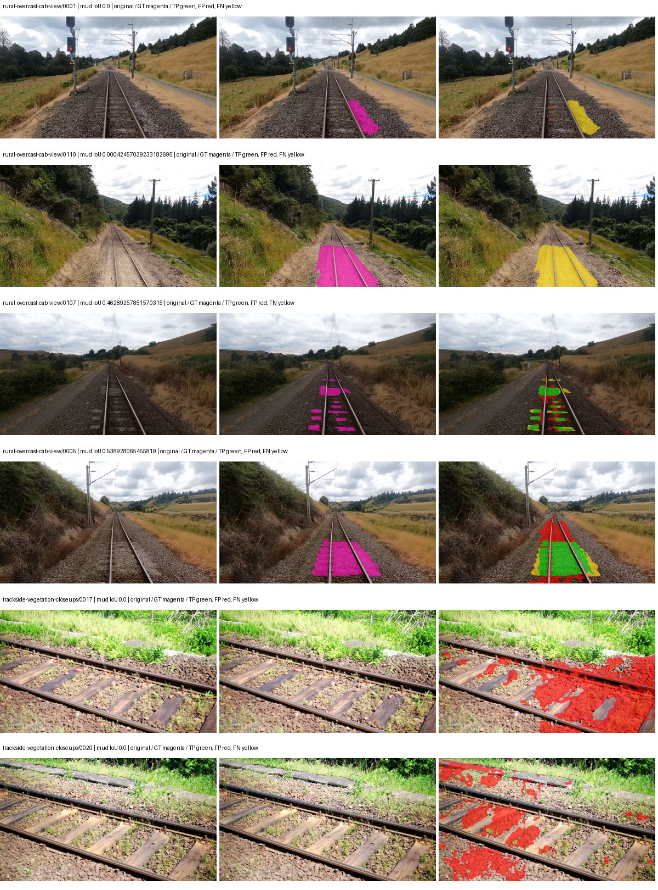
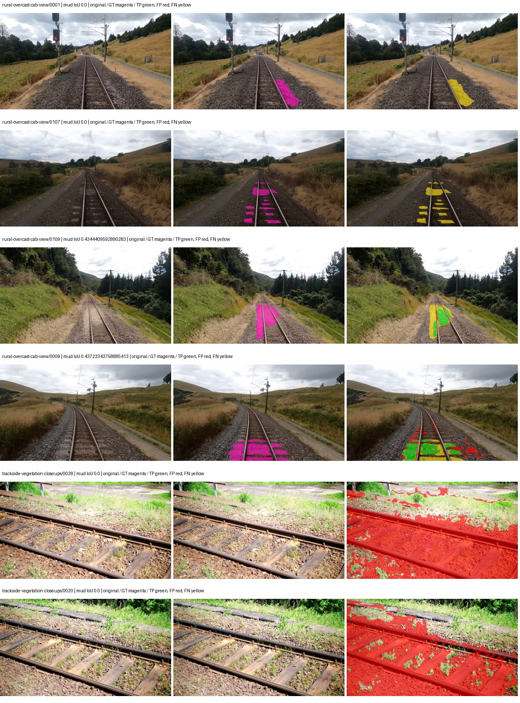
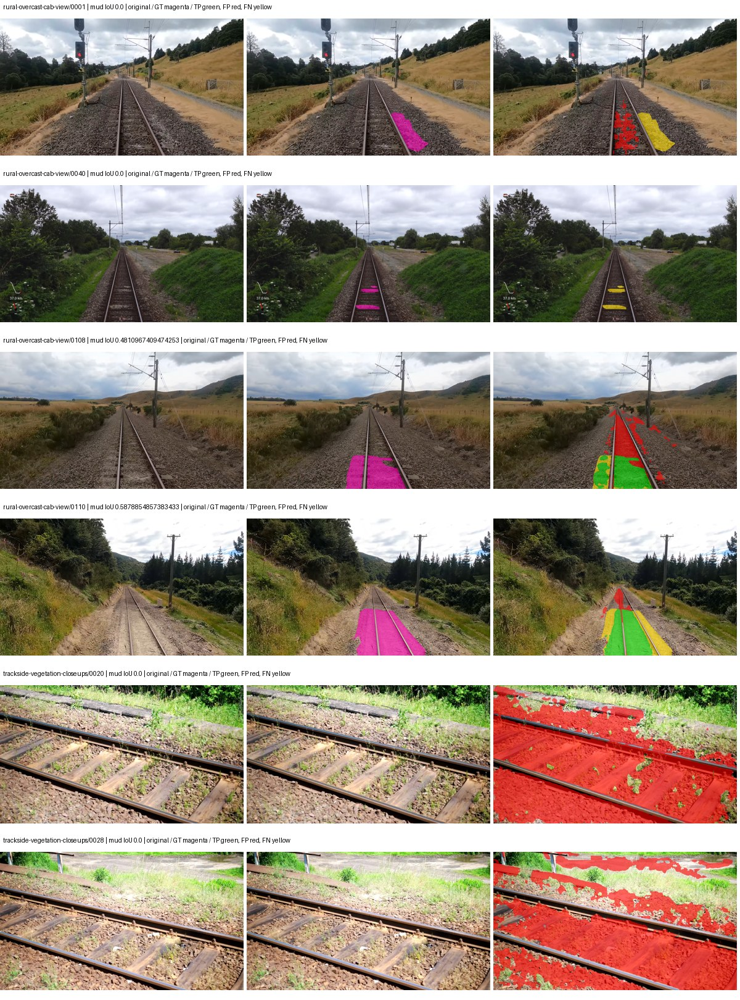

# hf_auto_beit_base_ade — rad_9_24_2026-fixed-grouped

[RAD 9/24: Scene-grouped split](../../README.md) · [Full model records](record.json)

Primary result: the **final checkpoint** after the full step budget (no early stopping). The checkpoint with the best **mud-pumping validation IoU, pixels pooled over all validation images**, is kept as secondary evidence. A job is complete only after full statistics and isolated profiling are verified.

Study metrics of the final checkpoint, counting each class only on the validation images that contain it: mud-pumping IoU is the mean per-image IoU over the images with mud-pumping, precision and recall sum pixels over those images, and mIoU averages each class over the images that contain it, then over the classes present.

| Initialization path | Seed | Mud-pumping IoU, train-camera images with mud (%, n=17) | Mud-pumping IoU, all images with mud (%, n=18) | Mud precision, all images with mud (%) | Mud recall, all images with mud (%) | mIoU (each class over images that contain it) (%) |
| --- | --- | --- | --- | --- | --- | --- |
| rtis_only | 0 | 1.74 | 1.67 | 4.26 | 1.75 | 25.72 |
| cityscapes_to_rtis | 0 | 0.10 | 0.15 | 0.95 | 1.11 | 29.04 |
| railsem19_to_rtis | 0 | 3.80 | 3.78 | 13.21 | 4.36 | 29.98 |
| cityscapes_to_railsem19_to_rtis | 0 | — | — | — | — | — |

Per-class IoU: IoU (%) of every class, each averaged only over the validation images that contain the class (n = those images); — = no image contains it. mIoU averages the classes with at least one such image.

| Initialization path | Seed | mIoU (each class over images that contain it) | person (n=0) | truck (n=0) | rail-track (n=37) | vegetation-overgrowth (n=13) | car (n=3) | on-rails (n=0) | traffic-sign (n=9) | road (n=11) | sidewalk (n=12) | construction (n=12) | tram-track (n=2) | pole (n=21) | traffic-light (n=3) | mud-pumping (n=18) | fence (n=7) | terrain (n=35) | sky (n=28) | rail-embedded (n=3) | rail-raised (n=37) | trackbed (n=37) | standing-water (n=9) |
| --- | --- | --- | --- | --- | --- | --- | --- | --- | --- | --- | --- | --- | --- | --- | --- | --- | --- | --- | --- | --- | --- | --- | --- |
| rtis_only | 0 | 25.72 | — | — | 16.42 | 22.41 | 9.12 | — | 15.96 | 5.04 | 11.70 | 25.31 | 0.00 | 48.22 | 31.22 | 1.67 | 0.73 | 82.23 | 95.88 | 0.00 | 33.90 | 46.84 | 16.25 |
| cityscapes_to_rtis | 0 | 29.04 | — | — | 16.59 | 21.57 | 30.21 | — | 25.41 | 8.00 | 17.86 | 30.62 | 0.00 | 55.16 | 47.81 | 0.15 | 2.48 | 80.73 | 96.90 | 0.70 | 31.29 | 46.16 | 11.13 |
| railsem19_to_rtis | 0 | 29.98 | — | — | 36.00 | 26.98 | 21.27 | — | 22.95 | 7.37 | 12.01 | 30.40 | 0.00 | 64.57 | 31.81 | 3.78 | 10.60 | 78.76 | 96.55 | 0.00 | 51.31 | 44.05 | 1.22 |
| cityscapes_to_railsem19_to_rtis | 0 | — | — | — | — | — | — | — | — | — | — | — | — | — | — | — | — | — | — | — | — | — | — |

Everything below is the campaign's own record, with pixels pooled over all validation images: its evaluation is the checkpoint that scored best on that pooled mud IoU (secondary evidence here); the diagnostics also cover the final checkpoint (`final-auto-val`).

| Model | Initialization path | Seed | Status | Steps | Best step | Best-checkpoint mud IoU, pixels pooled (%) | Best-checkpoint mud precision, pixels pooled (%) | Best-checkpoint mud recall, pixels pooled (%) | Final mud IoU (trainer val, pixels pooled, %) | Best-checkpoint mIoU, pixels pooled (%) | Best-checkpoint fixed GT-class mIoU, pixels pooled (%) |
| --- | --- | --- | --- | --- | --- | --- | --- | --- | --- | --- | --- |
| hf_auto_beit_base_ade | rtis_only | 0 | completed | 4000 | 259 | 13.74 | 15.90 | 50.23 | 0.45 | 21.16 | 22.33 |
| hf_auto_beit_base_ade | cityscapes_to_rtis | 0 | completed | 4000 | 1296 | 4.39 | 4.84 | 32.31 | 0.19 | 26.11 | 30.47 |
| hf_auto_beit_base_ade | railsem19_to_rtis | 0 | completed | 4000 | 259 | 6.61 | 7.31 | 40.86 | 1.99 | 23.34 | 24.64 |
| hf_auto_beit_base_ade | cityscapes_to_railsem19_to_rtis | 0 | collecting | 4000 | 259 | 2.01 | 2.36 | 12.11 | 0.15 | 21.68 | 22.88 |

Training: 217 images. Validation: 37 images. Test: 60 held out. Seeds: [0]. Seed variation measures optimization variability, not independent-recording uncertainty. Historical source checkpoints stay fixed across adaptation seeds.

Training code: `fce0ea0ac50b334d4252812c396e0e593def375d`. Split SHA-256: `12d7b367c72cda61d57686ff2ac28223530d0af49debd9fb7a0fbc68b908bc93`.

## rtis_only — seed 0

Status: **completed**. Started: 2026-10-11T00:06:21.977679+00:00. Finished: 2026-10-11T02:57:45.395319+00:00.

Recipe pretrained initializer: `microsoft/beit-base-finetuned-ade-640-640`.

`rtis_only` uses the recipe initializer, which may include pretrained segmentation components. Transfer paths load the exact historical source checkpoint below and reset the classifier; they do not reset all query/decoder features.

Source checkpoint: `Recipe pretrained initialization`.

Config SHA-256: `3c8a33b817cdb62d183b152f3fdb6685e67d8b5fd3e4cef5a92be33973b86d47`. Weights used for validation: `raw`.

### Mud-pumping and aggregate quality

| Metric | Selected checkpoint | Final training validation |
| --- | --- | --- |
| Mud IoU | 13.74 | 0.45 |
| Mud precision | 15.90 | 0.61 |
| Mud recall | 50.23 | 1.74 |
| Mud Dice/F1 | 24.15 | 0.90 |
| mIoU | 21.16 | 26.02 |
| Mean accuracy | 29.33 | 38.35 |
| Mean precision | 39.39 | 49.39 |
| Mean Dice | 28.28 | 34.00 |
| Mean specificity | 98.42 | 98.72 |
| Pixel accuracy | 74.92 | 78.06 |
| Frequency-weighted IoU | 64.51 | 69.34 |
| Fixed GT-present class mIoU | 22.33 | 28.92 |
| Boundary F1 | 26.56 | 31.65 |

The selected checkpoint has independent evaluation evidence. Final values are the trainer's final validation record, not a new independent evaluation. mIoU averages classes with nonzero union, so false positives on absent classes can change its denominator. The fixed GT-class mean is supplementary and excludes absent classes; their false positives remain in the confusion matrix.

### Resource usage and timing

| Measurement | Value |
| --- | --- |
| Peak training VRAM, retained training invocation (GiB) | 15.36 |
| Peak evaluation VRAM (GiB) | 7.39 |
| Retained training invocation wall time (seconds) | 9065.11 |
| Retained training invocation GPU-hours (one GPU) | 2.52 |
| Evaluation wall time (seconds) | 119.96 |
| Full evaluation pipeline images/second | 0.31 |
| Best full-state checkpoint (MiB) | 2355.56 |
| Final full-state checkpoint (MiB) | 2355.55 |
| Verified periodic checkpoints removed (GiB) | 18.40 |

VRAM uses the recorded allocator high-water mark; it is not total device usage including CUDA context. Resumed jobs' retained training invocation times and peaks are **not whole-campaign totals**. Earlier invocation resource records are not reconstructed here. Evaluation throughput includes loader, sliding-window inference and metrics; it is not model-only latency/FPS. Missing measurements are shown as —, never inferred from another dataset's run.

### Standardized inference performance

Dedicated model-only profiling waits for an idle worker-locked L40S: BF16, batch 1, 1024x1024, 20 warmup and 100 CUDA-event-timed public forwards. It excludes loading, preprocessing, tiling and metrics.

| Status | Parameters | Weight MiB | FPS | p50 ms | p95 ms | Peak reserved GiB |
| --- | --- | --- | --- | --- | --- | --- |
| complete | 161500245 | 616.07 | 2.54 | 392.06 | 395.57 | 3.77 |

```json
{
  "schema_version": 1,
  "model_id": "hf_auto_beit_base_ade",
  "measured_at": "2026-10-11T02:57:21+00:00",
  "status": "complete",
  "benchmark_scope": "rtis_selected_checkpoint_model_only",
  "applies_to": [
    "hf_auto_beit_base_ade--rtis_only--seed-0"
  ],
  "source": {
    "campaign_git_sha": "fce0ea0ac50b334d4252812c396e0e593def375d",
    "git_dirty": false,
    "config_hash": "5ce70fa5a72d",
    "resolved_config": "/data/izadia1/projects/segmentary-runs/rad_9_24_2026/fgall-seed0-20261007/configs/hf_auto_beit_base_ade--rtis_only--seed-0.yaml",
    "config_sha256": "3c8a33b817cdb62d183b152f3fdb6685e67d8b5fd3e4cef5a92be33973b86d47",
    "checkpoint_sha256": "26e8413cafa249e26131504865538f535dd204b0fe05b050c7c0988c3647309a",
    "checkpoint_global_step": 259,
    "checkpoint_bytes": 2469980998,
    "checkpoint_kind": "resume checkpoint with optimizer and EMA state",
    "weights": "raw",
    "measured_checkpoint_job_id": "hf_auto_beit_base_ade--rtis_only--seed-0",
    "result_sha256": "cdcdd117ffb6e0211f311035070a531ed878600442884804a5c853b1d3217c04",
    "result_git_sha": "fce0ea0ac50b334d4252812c396e0e593def375d",
    "result_stage": "eval:rad_9_24_2026-fixed-grouped:val",
    "result_seed": 0
  },
  "hardware": {
    "gpu_name": "NVIDIA L40S",
    "gpu_uuid": "GPU-1c9b612f-e0b5-fbbc-150f-8c2ef13453c9",
    "logical_device": "cuda:0",
    "physical_visibility_token": "5",
    "compute_capability": [
      8,
      9
    ],
    "total_memory_bytes": 47677177856
  },
  "model": {
    "parameter_count": 161500245,
    "trainable_parameter_count": 147173109,
    "resident_parameter_bytes": 646000980,
    "parameter_dtype_counts": {
      "float32": 161500245
    }
  },
  "contract": {
    "backend": "pytorch",
    "precision": "bf16_autocast",
    "batch_size": 1,
    "input_shape_nchw": [
      1,
      3,
      1024,
      1024
    ],
    "warmup_iterations": 20,
    "measured_iterations": 100,
    "timing": "per-forward CUDA events with end-event synchronization",
    "includes_preprocessing": false,
    "includes_data_loader": false,
    "includes_sliding_window": false,
    "input_resident_on_gpu": true,
    "model_only": true,
    "entrypoint": "public model(image) dense-logits forward"
  },
  "measurements": {
    "latency": {
      "p50_ms": 392.0634765625,
      "p95_ms": 395.5703689575195,
      "mean_ms": 392.98694000244143,
      "minimum_ms": 390.5433349609375,
      "maximum_ms": 416.38092041015625,
      "fps": 2.544613823537717,
      "raw_ms": [
        392.87908935546875,
        391.4895324707031,
        392.1162109375,
        392.1377258300781,
        391.2171630859375,
        391.97900390625,
        391.731201171875,
        392.6354064941406,
        393.2333984375,
        391.70458984375,
        391.34002685546875,
        391.15362548828125,
        391.5120544433594,
        392.32000732421875,
        391.96160888671875,
        401.99371337890625,
        391.973876953125,
        391.3922424316406,
        391.2468566894531,
        390.7266540527344,
        391.1127014160156,
        391.625732421875,
        391.65643310546875,
        414.7906494140625,
        391.5223083496094,
        391.0174865722656,
        391.4291076660156,
        391.45880126953125,
        391.42401123046875,
        391.2243347167969,
        390.9990539550781,
        391.1219177246094,
        391.2703857421875,
        391.77215576171875,
        391.0574035644531,
        391.0061950683594,
        391.09326171875,
        391.193603515625,
        391.47930908203125,
        392.1346435546875,
        394.01165771484375,
        392.732666015625,
        391.52435302734375,
        394.5144348144531,
        392.700927734375,
        392.258544921875,
        394.01165771484375,
        392.33331298828125,
        393.7699890136719,
        393.2907409667969,
        390.5433349609375,
        390.5669250488281,
        390.6907958984375,
        391.3615417480469,
        395.4739074707031,
        397.40313720703125,
        392.453125,
        393.7556457519531,
        394.7264099121094,
        392.0107421875,
        391.53460693359375,
        392.1387634277344,
        393.8048095703125,
        392.553466796875,
        394.35467529296875,
        401.9384460449219,
        391.8059387207031,
        391.77728271484375,
        393.13201904296875,
        393.11053466796875,
        393.6583557128906,
        392.2452392578125,
        392.5196838378906,
        391.9308776855469,
        416.38092041015625,
        392.6354064941406,
        392.3804016113281,
        393.7382507324219,
        393.987060546875,
        393.8928527832031,
        394.01470947265625,
        391.67181396484375,
        391.5397033691406,
        392.7449645996094,
        391.8172302246094,
        391.657470703125,
        391.5868225097656,
        392.30462646484375,
        393.3286437988281,
        393.52728271484375,
        394.4601745605469,
        393.06854248046875,
        394.22772216796875,
        392.7173156738281,
        395.4288635253906,
        391.64312744140625,
        392.3947448730469,
        391.38714599609375,
        390.9508972167969,
        391.4352722167969
      ],
      "percentile_method": "numpy linear interpolation"
    },
    "peak_reserved_bytes": 4049600512,
    "memory_kind": "pytorch_cuda_allocator_peak_reserved_excluding_context",
    "process_total_bytes": 4588568576,
    "process_total_kind": "nvidia-smi used_memory of this PID on the benchmark GPU after the timed loop, including the CUDA context; null when the driver could not attribute memory to this PID",
    "benchmark_wall_clock_s": 53.14243844151497
  },
  "started_at": "2026-10-11T02:56:27+00:00",
  "finished_at": "2026-10-11T02:57:21+00:00",
  "environment": {
    "hostname": "hdrfs-app-001",
    "python": "3.11.15",
    "platform": "Linux-5.15.0-139-generic-x86_64-with-glibc2.35",
    "torch": "2.11.0+cu128",
    "torch_cuda": "12.8",
    "cudnn": 91900,
    "driver_version": "570.133.20",
    "cuda_available": true,
    "gpu_count": 1,
    "gpu_names": [
      "NVIDIA L40S"
    ],
    "cuda_visible_devices": "5",
    "packages": {
      "segmentary": "0.1.0",
      "torch": "2.11.0+cu128",
      "torchvision": "0.26.0+cu128",
      "transformers": "5.15.0",
      "timm": "1.0.28",
      "segmentation-models-pytorch": "0.5.0",
      "albumentations": "2.0.8",
      "lightning": "2.6.5",
      "numpy": "2.4.4"
    }
  }
}
```

### Per-class validation results

| Class | GT pixels | IoU (%) | Precision (%) | Recall (%) | Dice (%) | Boundary F1 (%) |
| --- | --- | --- | --- | --- | --- | --- |
| car | 29664 | 0.00 | 0.00 | 0.00 | 0.00 | 0.00 |
| construction | 311585 | 39.53 | 45.01 | 76.45 | 56.66 | 53.85 |
| fence | 265137 | 4.97 | 18.12 | 6.41 | 9.47 | 13.17 |
| mud-pumping | 1226250 | 13.74 | 15.90 | 50.23 | 24.15 | 18.92 |
| on-rails | 0 | — | — | — | — | — |
| person | 0 | — | — | — | — | — |
| pole | 628038 | 43.30 | 71.43 | 52.38 | 60.44 | 63.80 |
| rail-embedded | 16799 | 0.00 | 0.00 | 0.00 | 0.00 | 0.00 |
| rail-raised | 2969797 | 30.10 | 92.98 | 30.80 | 46.27 | 73.82 |
| rail-track | 6323197 | 15.28 | 75.93 | 16.05 | 26.50 | 28.69 |
| road | 1048831 | 11.18 | 24.16 | 17.21 | 20.10 | 24.99 |
| sidewalk | 1297367 | 13.82 | 91.24 | 14.01 | 24.29 | 8.80 |
| sky | 19121606 | 97.70 | 97.94 | 99.75 | 98.84 | 90.89 |
| standing-water | 95802 | 0.00 | 0.00 | 0.07 | 0.00 | 0.03 |
| terrain | 39239306 | 80.21 | 82.36 | 96.84 | 89.02 | 46.27 |
| trackbed | 10643081 | 33.39 | 52.26 | 48.04 | 50.06 | 41.14 |
| traffic-light | 19510 | 0.00 | 0.00 | 0.00 | 0.00 | 0.00 |
| traffic-sign | 13285 | 0.00 | 0.00 | 0.00 | 0.00 | 0.00 |
| tram-track | 56179 | 0.00 | 0.00 | 0.00 | 0.00 | 0.00 |
| truck | 0 | 0.00 | 0.00 | — | 0.00 | 0.00 |
| vegetation-overgrowth | 5901821 | 18.76 | 81.00 | 19.63 | 31.60 | 40.22 |

### Full-run accounting

| Measurement | Value |
| --- | --- |
| Full GPU-reserved wall seconds, all recorded worker attempts | 10291.09 |
| Full reserved GPU-hours | 2.86 |
| Whole-run timing complete | True |

| Phase | Wall seconds including failed attempts |
| --- | --- |
| training | 9072.69 |
| diagnostics | 990.69 |
| performance | 65.10 |

GPU-reserved time includes model loading, training, validation, collection, profiling, checkpoint I/O and orchestration while the worker owns one GPU. It is not GPU kernel-active time. Phase timings and sampled device memory/power/utilization are retained separately; sampled device memory is not the allocator high-water mark.

### Train/validation and raw/EMA diagnostics

| Checkpoint / weights / split | Images | Mud IoU (%) | Mud precision (%) | Mud recall (%) |
| --- | --- | --- | --- | --- |
| best-auto-train / raw | 217 | 69.93 | 71.46 | 97.02 |
| best-auto-val / raw | 37 | 13.74 | 15.90 | 50.23 |
| best-alternate-val / ema | 37 | 17.55 | 19.39 | 64.84 |
| final-auto-val / raw | 37 | 0.45 | 0.61 | 1.75 |

Train uses the evaluation transform without augmentation. Compare mud train/validation metrics for the same selected weights. Alternate EMA on running-stat BatchNorm is explicitly uncalibrated and is diagnostic only. Score-threshold curves use uncalibrated normalized scores and are pixel-level diagnostics, not event detection rates or a selected deployment operating point.

### Downloadable evidence

- best-auto-train: [per-image.csv](rtis_only--seed-0/best-auto-train/per-image.csv) · [per-image-confusion.json.gz](rtis_only--seed-0/best-auto-train/per-image-confusion.json.gz) · [groups.json](rtis_only--seed-0/best-auto-train/groups.json) · [mud-score-curves.json](rtis_only--seed-0/best-auto-train/mud-score-curves.json)
- best-auto-val: [per-image.csv](rtis_only--seed-0/best-auto-val/per-image.csv) · [per-image-confusion.json.gz](rtis_only--seed-0/best-auto-val/per-image-confusion.json.gz) · [groups.json](rtis_only--seed-0/best-auto-val/groups.json) · [mud-score-curves.json](rtis_only--seed-0/best-auto-val/mud-score-curves.json) · [examples.jpg](rtis_only--seed-0/best-auto-val/examples.jpg)
- best-alternate-val: [per-image.csv](rtis_only--seed-0/best-alternate-val/per-image.csv) · [per-image-confusion.json.gz](rtis_only--seed-0/best-alternate-val/per-image-confusion.json.gz) · [groups.json](rtis_only--seed-0/best-alternate-val/groups.json) · [mud-score-curves.json](rtis_only--seed-0/best-alternate-val/mud-score-curves.json)
- final-auto-val: [per-image.csv](rtis_only--seed-0/final-auto-val/per-image.csv) · [per-image-confusion.json.gz](rtis_only--seed-0/final-auto-val/per-image-confusion.json.gz) · [groups.json](rtis_only--seed-0/final-auto-val/groups.json) · [mud-score-curves.json](rtis_only--seed-0/final-auto-val/mud-score-curves.json)
- resources: [telemetry.csv](rtis_only--seed-0/resources/telemetry.csv)



Examples are two lowest and two highest mud-IoU positive images, plus up to two negative images with the most false-positive mud pixels. They are targeted diagnostic examples, not random samples. Green: true positive; red: false positive; yellow: false negative. Full predictions remain on HDRFS.

### Validation tracking

| Logged step | Overall mIoU (%) | Mud IoU (%) |
| --- | --- | --- |
| 258 | 21.15 | 13.76 |
| 518 | 24.95 | 0.77 |
| 777 | 21.75 | 0.00 |
| 1036 | 25.57 | 1.97 |
| 1295 | 25.51 | 0.46 |
| 1555 | 25.10 | 0.00 |
| 1814 | 22.21 | 2.33 |
| 2073 | 28.34 | 4.18 |
| 2332 | 25.99 | 4.99 |
| 2592 | 26.42 | 0.31 |
| 2851 | 26.03 | 0.06 |
| 3110 | 25.37 | 0.15 |
| 3369 | 26.47 | 0.09 |
| 3629 | 25.24 | 0.81 |
| 3888 | 25.30 | 0.19 |
| 4000 | 26.02 | 0.45 |

All retained scalar curves, including training loss and per-class IoU, are in record.json. Observed best mud on a curve is not necessarily a retained checkpoint: the pilot saved its selection-metric-best and final checkpoints. Step logging and checkpoint global_step may differ by one.

### Stopping and checkpoint provenance

```json
{
  "stopping": {
    "actual_steps": 4000,
    "maximum_steps": 4000,
    "min_delta": 0.0,
    "monitor": "val_iou/mud-pumping",
    "patience": null,
    "reason": "budget_complete"
  },
  "checkpoints": {
    "best": {
      "path": "/data/izadia1/projects/segmentary-runs/rad_9_24_2026/fgall-seed0-20261007/future-runs/hf_auto_beit_base_ade--rtis_only--seed-0_seed0/rtis/best.ckpt",
      "sha256": "26e8413cafa249e26131504865538f535dd204b0fe05b050c7c0988c3647309a",
      "global_step": 259,
      "bytes": 2469980998
    },
    "final": {
      "path": "/data/izadia1/projects/segmentary-runs/rad_9_24_2026/fgall-seed0-20261007/future-runs/hf_auto_beit_base_ade--rtis_only--seed-0_seed0/rtis/last.ckpt",
      "sha256": "291695d9f0a4c596fe6c3f82ad5d85417d184b52c13dfdeb437c1b6a06b37db8",
      "global_step": 4000,
      "bytes": 2469969030
    }
  },
  "cleanup_error": null
}
```

### Resolved training, initialization and evaluation settings

The optimizer block is the base configuration. Stage LR scales are applied at runtime, and stage warmup is capped at min(base warmup, floor(stage budget / 10), stage budget - 1): 400 steps for this 4,000-step pilot. Model-internal native input grids may differ from augmentation crops (EoMT uses its 640 grid).

```json
{
  "name": "hf_auto_beit_base_ade--rtis_only--seed-0",
  "model": {
    "arch": "hf_auto",
    "checkpoint": "microsoft/beit-base-finetuned-ade-640-640",
    "tuning": "full",
    "head": "unified_head",
    "lora_r": 16,
    "lora_alpha": 32,
    "lora_dropout": 0.05,
    "lora_targets": [],
    "drop_path": null,
    "revision": "a8b6f5ef4acb2ea55d882989deaa02d39401e2b2",
    "subfolder": null,
    "local_files_only": false,
    "trust_remote_code": false,
    "backbone_path": null,
    "head_paths": [],
    "classifier_path": null,
    "inactive_parameter_paths": [
      "beit.layers.10",
      "beit.layers.11"
    ],
    "smp_arch": null,
    "encoder_name": null,
    "encoder_weights": null,
    "native": null,
    "batch_norm_momentum": null
  },
  "space": "paul-test-rtis",
  "taxonomy_root": "/data/izadia1/projects/segmentary-rad-fgall-fce0ea0a/taxonomy",
  "output_root": "/data/izadia1/projects/segmentary-runs/rad_9_24_2026/fgall-seed0-20261007/future-runs",
  "optim": {
    "backbone_lr": 2e-05,
    "head_lr_mult": 10.0,
    "weight_decay": 0.05,
    "llrd": 0.8,
    "warmup_iters": 1500,
    "warmup_ratio": 1e-06,
    "poly_power": 0.9,
    "min_lr_ratio": 0.0,
    "betas": [
      0.9,
      0.999
    ],
    "grad_clip": 1.0
  },
  "train": {
    "iters": 4000,
    "batch_size": 2,
    "accum": 8,
    "num_workers": 2,
    "precision": "bf16-mixed",
    "ema_decay": 0.9998,
    "val_every": 250,
    "ckpt_every": 500,
    "selection_metric": "val_iou/mud-pumping",
    "early_stopping_patience": null,
    "early_stopping_min_delta": 0.0,
    "seed": 0,
    "devices": 1
  },
  "eval": {
    "sliding_window": true,
    "window": [
      1024,
      1024
    ],
    "stride": [
      768,
      768
    ],
    "batch_size": 1,
    "num_workers": 2,
    "tta_scales": [],
    "tta_flip": false,
    "threshold": 0.5,
    "boundary_tolerance_frac": 0.0075,
    "save_confusion": true
  },
  "loss": {
    "task": "multiclass",
    "activation": "auto",
    "terms": [],
    "aux": "none",
    "aux_weight": 0.0,
    "ce_weight": 1.0,
    "label_smoothing": 0.0,
    "class_weights": null,
    "query": null
  },
  "aug": {
    "crop": [
      640,
      640
    ],
    "scale_min": 0.5,
    "scale_max": 2.0,
    "hflip_p": 0.5,
    "color_jitter_p": 0.5,
    "brightness": 0.25,
    "contrast": 0.25,
    "saturation": 0.25,
    "hue": 0.05
  },
  "stages": [
    {
      "name": "rtis",
      "data": [
        {
          "name": "rad_9_24_2026-fixed-grouped",
          "root": "/data/izadia1/datasets/rad_9_24_2026-fixed-grouped",
          "variant": null,
          "split_file": "splits.json",
          "train_split": "train",
          "val_split": "val",
          "limit": null,
          "loader": "folder",
          "mapping": "paul-test-rtis",
          "loader_options": {
            "require_groups": true
          }
        }
      ],
      "iters": null,
      "lr_scale": 1.0,
      "head_group_lr_scale": 1.0,
      "init_from": "pretrained",
      "reset_head": false,
      "freeze": null,
      "sample_weights": null
    }
  ]
}
```

### Hardware and software provenance

```json
{
  "training": {
    "cuda_available": true,
    "cuda_visible_devices": "5",
    "cudnn": 91900,
    "driver_version": "570.133.20",
    "gpu_count": 1,
    "gpu_names": [
      "NVIDIA L40S"
    ],
    "hostname": "hdrfs-app-001",
    "input_normalization": {
      "channel_order": "rgb",
      "mean": [
        0.5,
        0.5,
        0.5
      ],
      "source": "hf_image_processor",
      "std": [
        0.5,
        0.5,
        0.5
      ]
    },
    "model_origins": [
      {
        "hf_commit": "a8b6f5ef4acb2ea55d882989deaa02d39401e2b2",
        "hf_name_or_path": "microsoft/beit-base-finetuned-ade-640-640",
        "module": "model",
        "timm_pretrained": {}
      },
      {
        "hf_commit": "a8b6f5ef4acb2ea55d882989deaa02d39401e2b2",
        "hf_name_or_path": "microsoft/beit-base-finetuned-ade-640-640",
        "module": "model.beit",
        "timm_pretrained": {}
      },
      {
        "hf_commit": "a8b6f5ef4acb2ea55d882989deaa02d39401e2b2",
        "hf_name_or_path": "microsoft/beit-base-finetuned-ade-640-640",
        "module": "model.beit.layers.0.attention",
        "timm_pretrained": {}
      },
      {
        "hf_commit": "a8b6f5ef4acb2ea55d882989deaa02d39401e2b2",
        "hf_name_or_path": "microsoft/beit-base-finetuned-ade-640-640",
        "module": "model.beit.layers.0.mlp",
        "timm_pretrained": {}
      },
      {
        "hf_commit": "a8b6f5ef4acb2ea55d882989deaa02d39401e2b2",
        "hf_name_or_path": "microsoft/beit-base-finetuned-ade-640-640",
        "module": "model.beit.layers.1.attention",
        "timm_pretrained": {}
      },
      {
        "hf_commit": "a8b6f5ef4acb2ea55d882989deaa02d39401e2b2",
        "hf_name_or_path": "microsoft/beit-base-finetuned-ade-640-640",
        "module": "model.beit.layers.1.mlp",
        "timm_pretrained": {}
      },
      {
        "hf_commit": "a8b6f5ef4acb2ea55d882989deaa02d39401e2b2",
        "hf_name_or_path": "microsoft/beit-base-finetuned-ade-640-640",
        "module": "model.beit.layers.2.attention",
        "timm_pretrained": {}
      },
      {
        "hf_commit": "a8b6f5ef4acb2ea55d882989deaa02d39401e2b2",
        "hf_name_or_path": "microsoft/beit-base-finetuned-ade-640-640",
        "module": "model.beit.layers.2.mlp",
        "timm_pretrained": {}
      },
      {
        "hf_commit": "a8b6f5ef4acb2ea55d882989deaa02d39401e2b2",
        "hf_name_or_path": "microsoft/beit-base-finetuned-ade-640-640",
        "module": "model.beit.layers.3.attention",
        "timm_pretrained": {}
      },
      {
        "hf_commit": "a8b6f5ef4acb2ea55d882989deaa02d39401e2b2",
        "hf_name_or_path": "microsoft/beit-base-finetuned-ade-640-640",
        "module": "model.beit.layers.3.mlp",
        "timm_pretrained": {}
      },
      {
        "hf_commit": "a8b6f5ef4acb2ea55d882989deaa02d39401e2b2",
        "hf_name_or_path": "microsoft/beit-base-finetuned-ade-640-640",
        "module": "model.beit.layers.4.attention",
        "timm_pretrained": {}
      },
      {
        "hf_commit": "a8b6f5ef4acb2ea55d882989deaa02d39401e2b2",
        "hf_name_or_path": "microsoft/beit-base-finetuned-ade-640-640",
        "module": "model.beit.layers.4.mlp",
        "timm_pretrained": {}
      },
      {
        "hf_commit": "a8b6f5ef4acb2ea55d882989deaa02d39401e2b2",
        "hf_name_or_path": "microsoft/beit-base-finetuned-ade-640-640",
        "module": "model.beit.layers.5.attention",
        "timm_pretrained": {}
      },
      {
        "hf_commit": "a8b6f5ef4acb2ea55d882989deaa02d39401e2b2",
        "hf_name_or_path": "microsoft/beit-base-finetuned-ade-640-640",
        "module": "model.beit.layers.5.mlp",
        "timm_pretrained": {}
      },
      {
        "hf_commit": "a8b6f5ef4acb2ea55d882989deaa02d39401e2b2",
        "hf_name_or_path": "microsoft/beit-base-finetuned-ade-640-640",
        "module": "model.beit.layers.6.attention",
        "timm_pretrained": {}
      },
      {
        "hf_commit": "a8b6f5ef4acb2ea55d882989deaa02d39401e2b2",
        "hf_name_or_path": "microsoft/beit-base-finetuned-ade-640-640",
        "module": "model.beit.layers.6.mlp",
        "timm_pretrained": {}
      },
      {
        "hf_commit": "a8b6f5ef4acb2ea55d882989deaa02d39401e2b2",
        "hf_name_or_path": "microsoft/beit-base-finetuned-ade-640-640",
        "module": "model.beit.layers.7.attention",
        "timm_pretrained": {}
      },
      {
        "hf_commit": "a8b6f5ef4acb2ea55d882989deaa02d39401e2b2",
        "hf_name_or_path": "microsoft/beit-base-finetuned-ade-640-640",
        "module": "model.beit.layers.7.mlp",
        "timm_pretrained": {}
      },
      {
        "hf_commit": "a8b6f5ef4acb2ea55d882989deaa02d39401e2b2",
        "hf_name_or_path": "microsoft/beit-base-finetuned-ade-640-640",
        "module": "model.beit.layers.8.attention",
        "timm_pretrained": {}
      },
      {
        "hf_commit": "a8b6f5ef4acb2ea55d882989deaa02d39401e2b2",
        "hf_name_or_path": "microsoft/beit-base-finetuned-ade-640-640",
        "module": "model.beit.layers.8.mlp",
        "timm_pretrained": {}
      },
      {
        "hf_commit": "a8b6f5ef4acb2ea55d882989deaa02d39401e2b2",
        "hf_name_or_path": "microsoft/beit-base-finetuned-ade-640-640",
        "module": "model.beit.layers.9.attention",
        "timm_pretrained": {}
      },
      {
        "hf_commit": "a8b6f5ef4acb2ea55d882989deaa02d39401e2b2",
        "hf_name_or_path": "microsoft/beit-base-finetuned-ade-640-640",
        "module": "model.beit.layers.9.mlp",
        "timm_pretrained": {}
      },
      {
        "hf_commit": "a8b6f5ef4acb2ea55d882989deaa02d39401e2b2",
        "hf_name_or_path": "microsoft/beit-base-finetuned-ade-640-640",
        "module": "model.beit.layers.10.attention",
        "timm_pretrained": {}
      },
      {
        "hf_commit": "a8b6f5ef4acb2ea55d882989deaa02d39401e2b2",
        "hf_name_or_path": "microsoft/beit-base-finetuned-ade-640-640",
        "module": "model.beit.layers.10.mlp",
        "timm_pretrained": {}
      },
      {
        "hf_commit": "a8b6f5ef4acb2ea55d882989deaa02d39401e2b2",
        "hf_name_or_path": "microsoft/beit-base-finetuned-ade-640-640",
        "module": "model.beit.layers.11.attention",
        "timm_pretrained": {}
      },
      {
        "hf_commit": "a8b6f5ef4acb2ea55d882989deaa02d39401e2b2",
        "hf_name_or_path": "microsoft/beit-base-finetuned-ade-640-640",
        "module": "model.beit.layers.11.mlp",
        "timm_pretrained": {}
      }
    ],
    "model_parameter_count": 161500245,
    "packages": {
      "albumentations": "2.0.8",
      "lightning": "2.6.5",
      "numpy": "2.4.4",
      "segmentary": "0.1.0",
      "segmentation-models-pytorch": "0.5.0",
      "timm": "1.0.28",
      "torch": "2.11.0+cu128",
      "torchvision": "0.26.0+cu128",
      "transformers": "5.15.0"
    },
    "platform": "Linux-5.15.0-139-generic-x86_64-with-glibc2.35",
    "python": "3.11.15",
    "torch": "2.11.0+cu128",
    "torch_cuda": "12.8",
    "trainable_parameter_count": 147173109,
    "training_stop": {
      "actual_steps": 4000,
      "maximum_steps": 4000,
      "min_delta": 0.0,
      "monitor": "val_iou/mud-pumping",
      "patience": null,
      "reason": "budget_complete"
    },
    "validation_weights": "raw"
  },
  "evaluation": {
    "cuda_available": true,
    "cuda_visible_devices": "5",
    "cudnn": 91900,
    "driver_version": "570.133.20",
    "gpu_count": 1,
    "gpu_names": [
      "NVIDIA L40S"
    ],
    "hostname": "hdrfs-app-001",
    "input_normalization": {
      "channel_order": "rgb",
      "mean": [
        0.5,
        0.5,
        0.5
      ],
      "source": "hf_image_processor",
      "std": [
        0.5,
        0.5,
        0.5
      ]
    },
    "packages": {
      "albumentations": "2.0.8",
      "lightning": "2.6.5",
      "numpy": "2.4.4",
      "segmentary": "0.1.0",
      "segmentation-models-pytorch": "0.5.0",
      "timm": "1.0.28",
      "torch": "2.11.0+cu128",
      "torchvision": "0.26.0+cu128",
      "transformers": "5.15.0"
    },
    "platform": "Linux-5.15.0-139-generic-x86_64-with-glibc2.35",
    "python": "3.11.15",
    "torch": "2.11.0+cu128",
    "torch_cuda": "12.8"
  }
}
```

## cityscapes_to_rtis — seed 0

Status: **completed**. Started: 2026-10-11T00:09:04.410090+00:00. Finished: 2026-10-11T02:59:13.722986+00:00.

Recipe pretrained initializer: `microsoft/beit-base-finetuned-ade-640-640`.

`rtis_only` uses the recipe initializer, which may include pretrained segmentation components. Transfer paths load the exact historical source checkpoint below and reset the classifier; they do not reset all query/decoder features.

Source checkpoint: `{'name': 'hf_auto_beit_base_ade--cityscapes--seed-0', 'model': 'hf_auto_beit_base_ade', 'protocol': 'cityscapes', 'config': '/data/izadia1/projects/segmentary-runs/all-model-city-rail-seed0-rail20-b9eb3e1/accepted/hf_auto_beit_base_ade--cityscapes--seed-0/resolved-config.yaml', 'checkpoint': '/data/izadia1/projects/segmentary-runs/all-model-city-rail-seed0-a7c0b67/jobs/hf_auto_beit_base_ade--cityscapes--seed-0/attempt-001/train/hf_auto_beit_base_ade--cityscapes_seed0/cityscapes/last.ckpt', 'recorded_sha256': '0a7ecfaf15bb3636cd8873013bef29fa31037c57fb25731b6757caf0e9a42008', 'exists': True}`.

Config SHA-256: `6545882c82d24a517cbaf02e99bec9852380e689b6be6997727cfd266451a088`. Weights used for validation: `raw`.

### Mud-pumping and aggregate quality

| Metric | Selected checkpoint | Final training validation |
| --- | --- | --- |
| Mud IoU | 4.39 | 0.19 |
| Mud precision | 4.84 | 0.22 |
| Mud recall | 32.31 | 1.11 |
| Mud Dice/F1 | 8.41 | 0.37 |
| mIoU | 26.11 | 31.18 |
| Mean accuracy | 36.91 | 42.07 |
| Mean precision | 53.50 | 58.74 |
| Mean Dice | 33.55 | 39.89 |
| Mean specificity | 98.58 | 98.68 |
| Pixel accuracy | 76.59 | 78.30 |
| Frequency-weighted IoU | 67.69 | 69.09 |
| Fixed GT-present class mIoU | 30.47 | 34.65 |
| Boundary F1 | 33.80 | 39.12 |

The selected checkpoint has independent evaluation evidence. Final values are the trainer's final validation record, not a new independent evaluation. mIoU averages classes with nonzero union, so false positives on absent classes can change its denominator. The fixed GT-class mean is supplementary and excludes absent classes; their false positives remain in the confusion matrix.

### Resource usage and timing

| Measurement | Value |
| --- | --- |
| Peak training VRAM, retained training invocation (GiB) | 15.36 |
| Peak evaluation VRAM (GiB) | 7.39 |
| Retained training invocation wall time (seconds) | 8991.76 |
| Retained training invocation GPU-hours (one GPU) | 2.50 |
| Evaluation wall time (seconds) | 119.14 |
| Full evaluation pipeline images/second | 0.31 |
| Best full-state checkpoint (MiB) | 2355.56 |
| Final full-state checkpoint (MiB) | 2355.55 |
| Verified periodic checkpoints removed (GiB) | 18.40 |

VRAM uses the recorded allocator high-water mark; it is not total device usage including CUDA context. Resumed jobs' retained training invocation times and peaks are **not whole-campaign totals**. Earlier invocation resource records are not reconstructed here. Evaluation throughput includes loader, sliding-window inference and metrics; it is not model-only latency/FPS. Missing measurements are shown as —, never inferred from another dataset's run.

### Standardized inference performance

Dedicated model-only profiling waits for an idle worker-locked L40S: BF16, batch 1, 1024x1024, 20 warmup and 100 CUDA-event-timed public forwards. It excludes loading, preprocessing, tiling and metrics.

| Status | Parameters | Weight MiB | FPS | p50 ms | p95 ms | Peak reserved GiB |
| --- | --- | --- | --- | --- | --- | --- |
| complete | 161500245 | 616.07 | 2.54 | 392.55 | 395.15 | 3.77 |

```json
{
  "schema_version": 1,
  "model_id": "hf_auto_beit_base_ade",
  "measured_at": "2026-10-11T02:58:50+00:00",
  "status": "complete",
  "benchmark_scope": "rtis_selected_checkpoint_model_only",
  "applies_to": [
    "hf_auto_beit_base_ade--cityscapes_to_rtis--seed-0"
  ],
  "source": {
    "campaign_git_sha": "fce0ea0ac50b334d4252812c396e0e593def375d",
    "git_dirty": false,
    "config_hash": "d0821e519758",
    "resolved_config": "/data/izadia1/projects/segmentary-runs/rad_9_24_2026/fgall-seed0-20261007/configs/hf_auto_beit_base_ade--cityscapes_to_rtis--seed-0.yaml",
    "config_sha256": "6545882c82d24a517cbaf02e99bec9852380e689b6be6997727cfd266451a088",
    "checkpoint_sha256": "e1594861ba3ada4d759e9eee6c4bbc312e133598c1dc9e0db4b4d9ba5d768b10",
    "checkpoint_global_step": 1296,
    "checkpoint_bytes": 2469981318,
    "checkpoint_kind": "resume checkpoint with optimizer and EMA state",
    "weights": "raw",
    "measured_checkpoint_job_id": "hf_auto_beit_base_ade--cityscapes_to_rtis--seed-0",
    "result_sha256": "01f81cfa0176b1bde0b2308c7957c2656a40650baa08113e8c7dd9f6189df571",
    "result_git_sha": "fce0ea0ac50b334d4252812c396e0e593def375d",
    "result_stage": "eval:rad_9_24_2026-fixed-grouped:val",
    "result_seed": 0
  },
  "hardware": {
    "gpu_name": "NVIDIA L40S",
    "gpu_uuid": "GPU-804aea8b-5f62-423e-72c6-49e1ed15c4e4",
    "logical_device": "cuda:0",
    "physical_visibility_token": "6",
    "compute_capability": [
      8,
      9
    ],
    "total_memory_bytes": 47677177856
  },
  "model": {
    "parameter_count": 161500245,
    "trainable_parameter_count": 147173109,
    "resident_parameter_bytes": 646000980,
    "parameter_dtype_counts": {
      "float32": 161500245
    }
  },
  "contract": {
    "backend": "pytorch",
    "precision": "bf16_autocast",
    "batch_size": 1,
    "input_shape_nchw": [
      1,
      3,
      1024,
      1024
    ],
    "warmup_iterations": 20,
    "measured_iterations": 100,
    "timing": "per-forward CUDA events with end-event synchronization",
    "includes_preprocessing": false,
    "includes_data_loader": false,
    "includes_sliding_window": false,
    "input_resident_on_gpu": true,
    "model_only": true,
    "entrypoint": "public model(image) dense-logits forward"
  },
  "measurements": {
    "latency": {
      "p50_ms": 392.5488739013672,
      "p95_ms": 395.14660797119143,
      "mean_ms": 394.07485931396485,
      "minimum_ms": 391.478271484375,
      "maximum_ms": 430.192626953125,
      "fps": 2.5375889285118953,
      "raw_ms": [
        393.5836181640625,
        393.3572998046875,
        430.192626953125,
        392.5821533203125,
        393.628662109375,
        392.0865173339844,
        392.03533935546875,
        392.4971618652344,
        392.479736328125,
        392.2257995605469,
        394.4857482910156,
        392.7593078613281,
        393.0337219238281,
        391.71380615234375,
        392.7224426269531,
        393.1822204589844,
        392.5565490722656,
        392.8862609863281,
        393.45562744140625,
        391.8171691894531,
        392.0220031738281,
        392.48382568359375,
        391.8796691894531,
        423.984130859375,
        392.13055419921875,
        392.5289001464844,
        392.92620849609375,
        392.5084228515625,
        392.9016418457031,
        392.6333312988281,
        392.0547790527344,
        393.29791259765625,
        392.41522216796875,
        392.4725646972656,
        392.0281677246094,
        392.5821533203125,
        392.3497009277344,
        392.5032958984375,
        391.79058837890625,
        393.34912109375,
        392.25958251953125,
        391.9964294433594,
        392.5975036621094,
        391.9708251953125,
        392.42547607421875,
        394.03009033203125,
        392.2022399902344,
        392.38861083984375,
        391.7383728027344,
        391.478271484375,
        424.8094787597656,
        392.153076171875,
        391.85406494140625,
        392.2657165527344,
        392.74700927734375,
        392.62310791015625,
        391.82952880859375,
        392.6927490234375,
        392.11724853515625,
        392.16845703125,
        391.846923828125,
        392.15924072265625,
        392.7623596191406,
        392.1919860839844,
        391.8940124511719,
        392.1080322265625,
        392.6087646484375,
        392.77874755859375,
        392.09368896484375,
        392.01995849609375,
        393.11053466796875,
        391.80694580078125,
        392.3486633300781,
        392.35174560546875,
        391.9073181152344,
        393.375732421875,
        393.05523681640625,
        392.9374694824219,
        392.9825134277344,
        393.74951171875,
        393.1391906738281,
        393.4443664550781,
        392.3732604980469,
        392.2350158691406,
        393.0757141113281,
        394.67724609375,
        426.60760498046875,
        393.34503173828125,
        393.670654296875,
        393.9174499511719,
        395.2701416015625,
        395.1401062011719,
        394.1273498535156,
        395.0653381347656,
        393.6419982910156,
        393.61126708984375,
        392.54119873046875,
        394.7427978515625,
        392.2749328613281,
        392.0240783691406
      ],
      "percentile_method": "numpy linear interpolation"
    },
    "peak_reserved_bytes": 4049600512,
    "memory_kind": "pytorch_cuda_allocator_peak_reserved_excluding_context",
    "process_total_bytes": 4588568576,
    "process_total_kind": "nvidia-smi used_memory of this PID on the benchmark GPU after the timed loop, including the CUDA context; null when the driver could not attribute memory to this PID",
    "benchmark_wall_clock_s": 53.31242334097624
  },
  "started_at": "2026-10-11T02:57:57+00:00",
  "finished_at": "2026-10-11T02:58:50+00:00",
  "environment": {
    "hostname": "hdrfs-app-001",
    "python": "3.11.15",
    "platform": "Linux-5.15.0-139-generic-x86_64-with-glibc2.35",
    "torch": "2.11.0+cu128",
    "torch_cuda": "12.8",
    "cudnn": 91900,
    "driver_version": "570.133.20",
    "cuda_available": true,
    "gpu_count": 1,
    "gpu_names": [
      "NVIDIA L40S"
    ],
    "cuda_visible_devices": "6",
    "packages": {
      "segmentary": "0.1.0",
      "torch": "2.11.0+cu128",
      "torchvision": "0.26.0+cu128",
      "transformers": "5.15.0",
      "timm": "1.0.28",
      "segmentation-models-pytorch": "0.5.0",
      "albumentations": "2.0.8",
      "lightning": "2.6.5",
      "numpy": "2.4.4"
    }
  }
}
```

### Per-class validation results

| Class | GT pixels | IoU (%) | Precision (%) | Recall (%) | Dice (%) | Boundary F1 (%) |
| --- | --- | --- | --- | --- | --- | --- |
| car | 29664 | 52.29 | 89.20 | 55.83 | 68.67 | 51.78 |
| construction | 311585 | 42.56 | 50.52 | 72.99 | 59.71 | 50.72 |
| fence | 265137 | 3.88 | 63.94 | 3.97 | 7.47 | 11.38 |
| mud-pumping | 1226250 | 4.39 | 4.84 | 32.31 | 8.41 | 13.85 |
| on-rails | 0 | 0.00 | 0.00 | — | 0.00 | 0.00 |
| person | 0 | 0.00 | 0.00 | — | 0.00 | 0.00 |
| pole | 628038 | 58.19 | 90.68 | 61.89 | 73.57 | 83.47 |
| rail-embedded | 16799 | 2.64 | 84.12 | 2.65 | 5.14 | 13.43 |
| rail-raised | 2969797 | 11.14 | 97.92 | 11.16 | 20.04 | 60.70 |
| rail-track | 6323197 | 9.85 | 87.26 | 10.00 | 17.94 | 20.41 |
| road | 1048831 | 6.95 | 13.28 | 12.73 | 13.00 | 18.61 |
| sidewalk | 1297367 | 9.70 | 31.75 | 12.26 | 17.69 | 7.90 |
| sky | 19121606 | 98.48 | 99.12 | 99.34 | 99.23 | 96.06 |
| standing-water | 95802 | 0.00 | 0.00 | 0.00 | 0.00 | 0.00 |
| terrain | 39239306 | 84.06 | 85.81 | 97.64 | 91.34 | 50.08 |
| trackbed | 10643081 | 43.24 | 62.23 | 58.62 | 60.37 | 49.57 |
| traffic-light | 19510 | 68.40 | 86.95 | 76.22 | 81.24 | 79.51 |
| traffic-sign | 13285 | 14.97 | 96.39 | 15.05 | 26.04 | 42.10 |
| tram-track | 56179 | 0.00 | 0.00 | 0.00 | 0.00 | 0.00 |
| truck | 0 | 0.00 | 0.00 | — | 0.00 | 0.00 |
| vegetation-overgrowth | 5901821 | 37.67 | 79.38 | 41.75 | 54.72 | 60.28 |

### Full-run accounting

| Measurement | Value |
| --- | --- |
| Full GPU-reserved wall seconds, all recorded worker attempts | 10219.36 |
| Full reserved GPU-hours | 2.84 |
| Whole-run timing complete | True |

| Phase | Wall seconds including failed attempts |
| --- | --- |
| training | 9000.91 |
| diagnostics | 990.18 |
| performance | 65.67 |

GPU-reserved time includes model loading, training, validation, collection, profiling, checkpoint I/O and orchestration while the worker owns one GPU. It is not GPU kernel-active time. Phase timings and sampled device memory/power/utilization are retained separately; sampled device memory is not the allocator high-water mark.

### Train/validation and raw/EMA diagnostics

| Checkpoint / weights / split | Images | Mud IoU (%) | Mud precision (%) | Mud recall (%) |
| --- | --- | --- | --- | --- |
| best-auto-train / raw | 217 | 67.06 | 68.31 | 97.34 |
| best-auto-val / raw | 37 | 4.39 | 4.84 | 32.31 |
| best-alternate-val / ema | 37 | 0.57 | 0.74 | 2.47 |
| final-auto-val / raw | 37 | 0.19 | 0.22 | 1.11 |

Train uses the evaluation transform without augmentation. Compare mud train/validation metrics for the same selected weights. Alternate EMA on running-stat BatchNorm is explicitly uncalibrated and is diagnostic only. Score-threshold curves use uncalibrated normalized scores and are pixel-level diagnostics, not event detection rates or a selected deployment operating point.

### Downloadable evidence

- best-auto-train: [per-image.csv](cityscapes_to_rtis--seed-0/best-auto-train/per-image.csv) · [per-image-confusion.json.gz](cityscapes_to_rtis--seed-0/best-auto-train/per-image-confusion.json.gz) · [groups.json](cityscapes_to_rtis--seed-0/best-auto-train/groups.json) · [mud-score-curves.json](cityscapes_to_rtis--seed-0/best-auto-train/mud-score-curves.json)
- best-auto-val: [per-image.csv](cityscapes_to_rtis--seed-0/best-auto-val/per-image.csv) · [per-image-confusion.json.gz](cityscapes_to_rtis--seed-0/best-auto-val/per-image-confusion.json.gz) · [groups.json](cityscapes_to_rtis--seed-0/best-auto-val/groups.json) · [mud-score-curves.json](cityscapes_to_rtis--seed-0/best-auto-val/mud-score-curves.json) · [examples.jpg](cityscapes_to_rtis--seed-0/best-auto-val/examples.jpg)
- best-alternate-val: [per-image.csv](cityscapes_to_rtis--seed-0/best-alternate-val/per-image.csv) · [per-image-confusion.json.gz](cityscapes_to_rtis--seed-0/best-alternate-val/per-image-confusion.json.gz) · [groups.json](cityscapes_to_rtis--seed-0/best-alternate-val/groups.json) · [mud-score-curves.json](cityscapes_to_rtis--seed-0/best-alternate-val/mud-score-curves.json)
- final-auto-val: [per-image.csv](cityscapes_to_rtis--seed-0/final-auto-val/per-image.csv) · [per-image-confusion.json.gz](cityscapes_to_rtis--seed-0/final-auto-val/per-image-confusion.json.gz) · [groups.json](cityscapes_to_rtis--seed-0/final-auto-val/groups.json) · [mud-score-curves.json](cityscapes_to_rtis--seed-0/final-auto-val/mud-score-curves.json)
- resources: [telemetry.csv](cityscapes_to_rtis--seed-0/resources/telemetry.csv)



Examples are two lowest and two highest mud-IoU positive images, plus up to two negative images with the most false-positive mud pixels. They are targeted diagnostic examples, not random samples. Green: true positive; red: false positive; yellow: false negative. Full predictions remain on HDRFS.

### Validation tracking

| Logged step | Overall mIoU (%) | Mud IoU (%) |
| --- | --- | --- |
| 258 | 19.61 | 4.19 |
| 518 | 21.28 | 1.23 |
| 777 | 21.12 | 0.98 |
| 1036 | 26.13 | 0.92 |
| 1295 | 26.11 | 4.39 |
| 1555 | 27.63 | 1.91 |
| 1814 | 29.88 | 0.15 |
| 2073 | 28.70 | 0.21 |
| 2332 | 28.19 | 0.19 |
| 2592 | 31.08 | 0.26 |
| 2851 | 29.42 | 0.59 |
| 3110 | 30.70 | 0.48 |
| 3369 | 31.35 | 0.27 |
| 3629 | 31.80 | 0.22 |
| 3888 | 30.66 | 0.18 |
| 4000 | 31.18 | 0.19 |

All retained scalar curves, including training loss and per-class IoU, are in record.json. Observed best mud on a curve is not necessarily a retained checkpoint: the pilot saved its selection-metric-best and final checkpoints. Step logging and checkpoint global_step may differ by one.

### Stopping and checkpoint provenance

```json
{
  "stopping": {
    "actual_steps": 4000,
    "maximum_steps": 4000,
    "min_delta": 0.0,
    "monitor": "val_iou/mud-pumping",
    "patience": null,
    "reason": "budget_complete"
  },
  "checkpoints": {
    "best": {
      "path": "/data/izadia1/projects/segmentary-runs/rad_9_24_2026/fgall-seed0-20261007/future-runs/hf_auto_beit_base_ade--cityscapes_to_rtis--seed-0_seed0/rtis/best.ckpt",
      "sha256": "e1594861ba3ada4d759e9eee6c4bbc312e133598c1dc9e0db4b4d9ba5d768b10",
      "global_step": 1296,
      "bytes": 2469981318
    },
    "final": {
      "path": "/data/izadia1/projects/segmentary-runs/rad_9_24_2026/fgall-seed0-20261007/future-runs/hf_auto_beit_base_ade--cityscapes_to_rtis--seed-0_seed0/rtis/last.ckpt",
      "sha256": "4aa58c09189fd9583c65537c0a62e4427ed1db38409147560d81fac3069ce758",
      "global_step": 4000,
      "bytes": 2469969094
    }
  },
  "cleanup_error": null
}
```

### Resolved training, initialization and evaluation settings

The optimizer block is the base configuration. Stage LR scales are applied at runtime, and stage warmup is capped at min(base warmup, floor(stage budget / 10), stage budget - 1): 400 steps for this 4,000-step pilot. Model-internal native input grids may differ from augmentation crops (EoMT uses its 640 grid).

```json
{
  "name": "hf_auto_beit_base_ade--cityscapes_to_rtis--seed-0",
  "model": {
    "arch": "hf_auto",
    "checkpoint": "microsoft/beit-base-finetuned-ade-640-640",
    "tuning": "full",
    "head": "unified_head",
    "lora_r": 16,
    "lora_alpha": 32,
    "lora_dropout": 0.05,
    "lora_targets": [],
    "drop_path": null,
    "revision": "a8b6f5ef4acb2ea55d882989deaa02d39401e2b2",
    "subfolder": null,
    "local_files_only": false,
    "trust_remote_code": false,
    "backbone_path": null,
    "head_paths": [],
    "classifier_path": null,
    "inactive_parameter_paths": [
      "beit.layers.10",
      "beit.layers.11"
    ],
    "smp_arch": null,
    "encoder_name": null,
    "encoder_weights": null,
    "native": null,
    "batch_norm_momentum": null
  },
  "space": "paul-test-rtis",
  "taxonomy_root": "/data/izadia1/projects/segmentary-rad-fgall-fce0ea0a/taxonomy",
  "output_root": "/data/izadia1/projects/segmentary-runs/rad_9_24_2026/fgall-seed0-20261007/future-runs",
  "optim": {
    "backbone_lr": 2e-05,
    "head_lr_mult": 10.0,
    "weight_decay": 0.05,
    "llrd": 0.8,
    "warmup_iters": 1500,
    "warmup_ratio": 1e-06,
    "poly_power": 0.9,
    "min_lr_ratio": 0.0,
    "betas": [
      0.9,
      0.999
    ],
    "grad_clip": 1.0
  },
  "train": {
    "iters": 4000,
    "batch_size": 2,
    "accum": 8,
    "num_workers": 2,
    "precision": "bf16-mixed",
    "ema_decay": 0.9998,
    "val_every": 250,
    "ckpt_every": 500,
    "selection_metric": "val_iou/mud-pumping",
    "early_stopping_patience": null,
    "early_stopping_min_delta": 0.0,
    "seed": 0,
    "devices": 1
  },
  "eval": {
    "sliding_window": true,
    "window": [
      1024,
      1024
    ],
    "stride": [
      768,
      768
    ],
    "batch_size": 1,
    "num_workers": 2,
    "tta_scales": [],
    "tta_flip": false,
    "threshold": 0.5,
    "boundary_tolerance_frac": 0.0075,
    "save_confusion": true
  },
  "loss": {
    "task": "multiclass",
    "activation": "auto",
    "terms": [],
    "aux": "none",
    "aux_weight": 0.0,
    "ce_weight": 1.0,
    "label_smoothing": 0.0,
    "class_weights": null,
    "query": null
  },
  "aug": {
    "crop": [
      640,
      640
    ],
    "scale_min": 0.5,
    "scale_max": 2.0,
    "hflip_p": 0.5,
    "color_jitter_p": 0.5,
    "brightness": 0.25,
    "contrast": 0.25,
    "saturation": 0.25,
    "hue": 0.05
  },
  "stages": [
    {
      "name": "rtis",
      "data": [
        {
          "name": "rad_9_24_2026-fixed-grouped",
          "root": "/data/izadia1/datasets/rad_9_24_2026-fixed-grouped",
          "variant": null,
          "split_file": "splits.json",
          "train_split": "train",
          "val_split": "val",
          "limit": null,
          "loader": "folder",
          "mapping": "paul-test-rtis",
          "loader_options": {
            "require_groups": true
          }
        }
      ],
      "iters": null,
      "lr_scale": 0.1,
      "head_group_lr_scale": 1.0,
      "init_from": "/data/izadia1/projects/segmentary-runs/all-model-city-rail-seed0-a7c0b67/jobs/hf_auto_beit_base_ade--cityscapes--seed-0/attempt-001/train/hf_auto_beit_base_ade--cityscapes_seed0/cityscapes/last.ckpt",
      "reset_head": true,
      "freeze": null,
      "sample_weights": null
    }
  ]
}
```

### Hardware and software provenance

```json
{
  "training": {
    "cuda_available": true,
    "cuda_visible_devices": "6",
    "cudnn": 91900,
    "driver_version": "570.133.20",
    "gpu_count": 1,
    "gpu_names": [
      "NVIDIA L40S"
    ],
    "hostname": "hdrfs-app-001",
    "input_normalization": {
      "channel_order": "rgb",
      "mean": [
        0.5,
        0.5,
        0.5
      ],
      "source": "hf_image_processor",
      "std": [
        0.5,
        0.5,
        0.5
      ]
    },
    "model_origins": [
      {
        "hf_commit": "a8b6f5ef4acb2ea55d882989deaa02d39401e2b2",
        "hf_name_or_path": "microsoft/beit-base-finetuned-ade-640-640",
        "module": "model",
        "timm_pretrained": {}
      },
      {
        "hf_commit": "a8b6f5ef4acb2ea55d882989deaa02d39401e2b2",
        "hf_name_or_path": "microsoft/beit-base-finetuned-ade-640-640",
        "module": "model.beit",
        "timm_pretrained": {}
      },
      {
        "hf_commit": "a8b6f5ef4acb2ea55d882989deaa02d39401e2b2",
        "hf_name_or_path": "microsoft/beit-base-finetuned-ade-640-640",
        "module": "model.beit.layers.0.attention",
        "timm_pretrained": {}
      },
      {
        "hf_commit": "a8b6f5ef4acb2ea55d882989deaa02d39401e2b2",
        "hf_name_or_path": "microsoft/beit-base-finetuned-ade-640-640",
        "module": "model.beit.layers.0.mlp",
        "timm_pretrained": {}
      },
      {
        "hf_commit": "a8b6f5ef4acb2ea55d882989deaa02d39401e2b2",
        "hf_name_or_path": "microsoft/beit-base-finetuned-ade-640-640",
        "module": "model.beit.layers.1.attention",
        "timm_pretrained": {}
      },
      {
        "hf_commit": "a8b6f5ef4acb2ea55d882989deaa02d39401e2b2",
        "hf_name_or_path": "microsoft/beit-base-finetuned-ade-640-640",
        "module": "model.beit.layers.1.mlp",
        "timm_pretrained": {}
      },
      {
        "hf_commit": "a8b6f5ef4acb2ea55d882989deaa02d39401e2b2",
        "hf_name_or_path": "microsoft/beit-base-finetuned-ade-640-640",
        "module": "model.beit.layers.2.attention",
        "timm_pretrained": {}
      },
      {
        "hf_commit": "a8b6f5ef4acb2ea55d882989deaa02d39401e2b2",
        "hf_name_or_path": "microsoft/beit-base-finetuned-ade-640-640",
        "module": "model.beit.layers.2.mlp",
        "timm_pretrained": {}
      },
      {
        "hf_commit": "a8b6f5ef4acb2ea55d882989deaa02d39401e2b2",
        "hf_name_or_path": "microsoft/beit-base-finetuned-ade-640-640",
        "module": "model.beit.layers.3.attention",
        "timm_pretrained": {}
      },
      {
        "hf_commit": "a8b6f5ef4acb2ea55d882989deaa02d39401e2b2",
        "hf_name_or_path": "microsoft/beit-base-finetuned-ade-640-640",
        "module": "model.beit.layers.3.mlp",
        "timm_pretrained": {}
      },
      {
        "hf_commit": "a8b6f5ef4acb2ea55d882989deaa02d39401e2b2",
        "hf_name_or_path": "microsoft/beit-base-finetuned-ade-640-640",
        "module": "model.beit.layers.4.attention",
        "timm_pretrained": {}
      },
      {
        "hf_commit": "a8b6f5ef4acb2ea55d882989deaa02d39401e2b2",
        "hf_name_or_path": "microsoft/beit-base-finetuned-ade-640-640",
        "module": "model.beit.layers.4.mlp",
        "timm_pretrained": {}
      },
      {
        "hf_commit": "a8b6f5ef4acb2ea55d882989deaa02d39401e2b2",
        "hf_name_or_path": "microsoft/beit-base-finetuned-ade-640-640",
        "module": "model.beit.layers.5.attention",
        "timm_pretrained": {}
      },
      {
        "hf_commit": "a8b6f5ef4acb2ea55d882989deaa02d39401e2b2",
        "hf_name_or_path": "microsoft/beit-base-finetuned-ade-640-640",
        "module": "model.beit.layers.5.mlp",
        "timm_pretrained": {}
      },
      {
        "hf_commit": "a8b6f5ef4acb2ea55d882989deaa02d39401e2b2",
        "hf_name_or_path": "microsoft/beit-base-finetuned-ade-640-640",
        "module": "model.beit.layers.6.attention",
        "timm_pretrained": {}
      },
      {
        "hf_commit": "a8b6f5ef4acb2ea55d882989deaa02d39401e2b2",
        "hf_name_or_path": "microsoft/beit-base-finetuned-ade-640-640",
        "module": "model.beit.layers.6.mlp",
        "timm_pretrained": {}
      },
      {
        "hf_commit": "a8b6f5ef4acb2ea55d882989deaa02d39401e2b2",
        "hf_name_or_path": "microsoft/beit-base-finetuned-ade-640-640",
        "module": "model.beit.layers.7.attention",
        "timm_pretrained": {}
      },
      {
        "hf_commit": "a8b6f5ef4acb2ea55d882989deaa02d39401e2b2",
        "hf_name_or_path": "microsoft/beit-base-finetuned-ade-640-640",
        "module": "model.beit.layers.7.mlp",
        "timm_pretrained": {}
      },
      {
        "hf_commit": "a8b6f5ef4acb2ea55d882989deaa02d39401e2b2",
        "hf_name_or_path": "microsoft/beit-base-finetuned-ade-640-640",
        "module": "model.beit.layers.8.attention",
        "timm_pretrained": {}
      },
      {
        "hf_commit": "a8b6f5ef4acb2ea55d882989deaa02d39401e2b2",
        "hf_name_or_path": "microsoft/beit-base-finetuned-ade-640-640",
        "module": "model.beit.layers.8.mlp",
        "timm_pretrained": {}
      },
      {
        "hf_commit": "a8b6f5ef4acb2ea55d882989deaa02d39401e2b2",
        "hf_name_or_path": "microsoft/beit-base-finetuned-ade-640-640",
        "module": "model.beit.layers.9.attention",
        "timm_pretrained": {}
      },
      {
        "hf_commit": "a8b6f5ef4acb2ea55d882989deaa02d39401e2b2",
        "hf_name_or_path": "microsoft/beit-base-finetuned-ade-640-640",
        "module": "model.beit.layers.9.mlp",
        "timm_pretrained": {}
      },
      {
        "hf_commit": "a8b6f5ef4acb2ea55d882989deaa02d39401e2b2",
        "hf_name_or_path": "microsoft/beit-base-finetuned-ade-640-640",
        "module": "model.beit.layers.10.attention",
        "timm_pretrained": {}
      },
      {
        "hf_commit": "a8b6f5ef4acb2ea55d882989deaa02d39401e2b2",
        "hf_name_or_path": "microsoft/beit-base-finetuned-ade-640-640",
        "module": "model.beit.layers.10.mlp",
        "timm_pretrained": {}
      },
      {
        "hf_commit": "a8b6f5ef4acb2ea55d882989deaa02d39401e2b2",
        "hf_name_or_path": "microsoft/beit-base-finetuned-ade-640-640",
        "module": "model.beit.layers.11.attention",
        "timm_pretrained": {}
      },
      {
        "hf_commit": "a8b6f5ef4acb2ea55d882989deaa02d39401e2b2",
        "hf_name_or_path": "microsoft/beit-base-finetuned-ade-640-640",
        "module": "model.beit.layers.11.mlp",
        "timm_pretrained": {}
      }
    ],
    "model_parameter_count": 161500245,
    "packages": {
      "albumentations": "2.0.8",
      "lightning": "2.6.5",
      "numpy": "2.4.4",
      "segmentary": "0.1.0",
      "segmentation-models-pytorch": "0.5.0",
      "timm": "1.0.28",
      "torch": "2.11.0+cu128",
      "torchvision": "0.26.0+cu128",
      "transformers": "5.15.0"
    },
    "platform": "Linux-5.15.0-139-generic-x86_64-with-glibc2.35",
    "python": "3.11.15",
    "torch": "2.11.0+cu128",
    "torch_cuda": "12.8",
    "trainable_parameter_count": 147173109,
    "training_stop": {
      "actual_steps": 4000,
      "maximum_steps": 4000,
      "min_delta": 0.0,
      "monitor": "val_iou/mud-pumping",
      "patience": null,
      "reason": "budget_complete"
    },
    "validation_weights": "raw"
  },
  "evaluation": {
    "cuda_available": true,
    "cuda_visible_devices": "6",
    "cudnn": 91900,
    "driver_version": "570.133.20",
    "gpu_count": 1,
    "gpu_names": [
      "NVIDIA L40S"
    ],
    "hostname": "hdrfs-app-001",
    "input_normalization": {
      "channel_order": "rgb",
      "mean": [
        0.5,
        0.5,
        0.5
      ],
      "source": "hf_image_processor",
      "std": [
        0.5,
        0.5,
        0.5
      ]
    },
    "packages": {
      "albumentations": "2.0.8",
      "lightning": "2.6.5",
      "numpy": "2.4.4",
      "segmentary": "0.1.0",
      "segmentation-models-pytorch": "0.5.0",
      "timm": "1.0.28",
      "torch": "2.11.0+cu128",
      "torchvision": "0.26.0+cu128",
      "transformers": "5.15.0"
    },
    "platform": "Linux-5.15.0-139-generic-x86_64-with-glibc2.35",
    "python": "3.11.15",
    "torch": "2.11.0+cu128",
    "torch_cuda": "12.8"
  }
}
```

## railsem19_to_rtis — seed 0

Status: **completed**. Started: 2026-10-11T00:25:07.490739+00:00. Finished: 2026-10-11T03:15:08.542312+00:00.

Recipe pretrained initializer: `microsoft/beit-base-finetuned-ade-640-640`.

`rtis_only` uses the recipe initializer, which may include pretrained segmentation components. Transfer paths load the exact historical source checkpoint below and reset the classifier; they do not reset all query/decoder features.

Source checkpoint: `{'name': 'hf_auto_beit_base_ade--railsem19--seed-0', 'model': 'hf_auto_beit_base_ade', 'protocol': 'railsem19', 'config': '/data/izadia1/projects/segmentary-runs/all-model-city-rail-seed0-rail20-b9eb3e1/accepted/hf_auto_beit_base_ade--railsem19--seed-0/resolved-config.yaml', 'checkpoint': '/data/izadia1/projects/segmentary-runs/all-model-city-rail-seed0-a7c0b67/jobs/hf_auto_beit_base_ade--railsem19--seed-0/attempt-001/train/hf_auto_beit_base_ade--railsem19_seed0/railsem19/last.ckpt', 'recorded_sha256': '0e15a6c4ff02f245b1381862a98f63a79d470468f9a16ee8be7c1535568fd224', 'exists': True}`.

Config SHA-256: `c1862c4aa489b28df017eab0e9cad32ba5fb10d569cb01dd1a2eca38b0f9e064`. Weights used for validation: `raw`.

### Mud-pumping and aggregate quality

| Metric | Selected checkpoint | Final training validation |
| --- | --- | --- |
| Mud IoU | 6.61 | 1.99 |
| Mud precision | 7.31 | 3.55 |
| Mud recall | 40.86 | 4.35 |
| Mud Dice/F1 | 12.40 | 3.91 |
| mIoU | 23.34 | 31.71 |
| Mean accuracy | 30.73 | 42.68 |
| Mean precision | 40.82 | 51.50 |
| Mean Dice | 30.09 | 41.15 |
| Mean specificity | 98.52 | 98.74 |
| Pixel accuracy | 77.25 | 80.25 |
| Frequency-weighted IoU | 66.38 | 69.80 |
| Fixed GT-present class mIoU | 24.64 | 35.23 |
| Boundary F1 | 26.01 | 38.36 |

The selected checkpoint has independent evaluation evidence. Final values are the trainer's final validation record, not a new independent evaluation. mIoU averages classes with nonzero union, so false positives on absent classes can change its denominator. The fixed GT-class mean is supplementary and excludes absent classes; their false positives remain in the confusion matrix.

### Resource usage and timing

| Measurement | Value |
| --- | --- |
| Peak training VRAM, retained training invocation (GiB) | 15.36 |
| Peak evaluation VRAM (GiB) | 7.39 |
| Retained training invocation wall time (seconds) | 8983.49 |
| Retained training invocation GPU-hours (one GPU) | 2.50 |
| Evaluation wall time (seconds) | 118.71 |
| Full evaluation pipeline images/second | 0.31 |
| Best full-state checkpoint (MiB) | 2355.56 |
| Final full-state checkpoint (MiB) | 2355.55 |
| Verified periodic checkpoints removed (GiB) | 18.40 |

VRAM uses the recorded allocator high-water mark; it is not total device usage including CUDA context. Resumed jobs' retained training invocation times and peaks are **not whole-campaign totals**. Earlier invocation resource records are not reconstructed here. Evaluation throughput includes loader, sliding-window inference and metrics; it is not model-only latency/FPS. Missing measurements are shown as —, never inferred from another dataset's run.

### Standardized inference performance

Dedicated model-only profiling waits for an idle worker-locked L40S: BF16, batch 1, 1024x1024, 20 warmup and 100 CUDA-event-timed public forwards. It excludes loading, preprocessing, tiling and metrics.

| Status | Parameters | Weight MiB | FPS | p50 ms | p95 ms | Peak reserved GiB |
| --- | --- | --- | --- | --- | --- | --- |
| complete | 161500245 | 616.07 | 2.53 | 393.31 | 406.33 | 3.77 |

```json
{
  "schema_version": 1,
  "model_id": "hf_auto_beit_base_ade",
  "measured_at": "2026-10-11T03:14:45+00:00",
  "status": "complete",
  "benchmark_scope": "rtis_selected_checkpoint_model_only",
  "applies_to": [
    "hf_auto_beit_base_ade--railsem19_to_rtis--seed-0"
  ],
  "source": {
    "campaign_git_sha": "fce0ea0ac50b334d4252812c396e0e593def375d",
    "git_dirty": false,
    "config_hash": "88b470d80c4e",
    "resolved_config": "/data/izadia1/projects/segmentary-runs/rad_9_24_2026/fgall-seed0-20261007/configs/hf_auto_beit_base_ade--railsem19_to_rtis--seed-0.yaml",
    "config_sha256": "c1862c4aa489b28df017eab0e9cad32ba5fb10d569cb01dd1a2eca38b0f9e064",
    "checkpoint_sha256": "e17afe683e3e9b319d19a27196ed3ff0ec96ed8e0a90f02992747a7b9f966177",
    "checkpoint_global_step": 259,
    "checkpoint_bytes": 2469980998,
    "checkpoint_kind": "resume checkpoint with optimizer and EMA state",
    "weights": "raw",
    "measured_checkpoint_job_id": "hf_auto_beit_base_ade--railsem19_to_rtis--seed-0",
    "result_sha256": "9b976c81c7e7e992f47b45ee92553e549e170566a088ecd6f7b96206f7717da2",
    "result_git_sha": "fce0ea0ac50b334d4252812c396e0e593def375d",
    "result_stage": "eval:rad_9_24_2026-fixed-grouped:val",
    "result_seed": 0
  },
  "hardware": {
    "gpu_name": "NVIDIA L40S",
    "gpu_uuid": "GPU-a5ad49e5-0536-5229-ba8a-f8a902808f53",
    "logical_device": "cuda:0",
    "physical_visibility_token": "7",
    "compute_capability": [
      8,
      9
    ],
    "total_memory_bytes": 47677177856
  },
  "model": {
    "parameter_count": 161500245,
    "trainable_parameter_count": 147173109,
    "resident_parameter_bytes": 646000980,
    "parameter_dtype_counts": {
      "float32": 161500245
    }
  },
  "contract": {
    "backend": "pytorch",
    "precision": "bf16_autocast",
    "batch_size": 1,
    "input_shape_nchw": [
      1,
      3,
      1024,
      1024
    ],
    "warmup_iterations": 20,
    "measured_iterations": 100,
    "timing": "per-forward CUDA events with end-event synchronization",
    "includes_preprocessing": false,
    "includes_data_loader": false,
    "includes_sliding_window": false,
    "input_resident_on_gpu": true,
    "model_only": true,
    "entrypoint": "public model(image) dense-logits forward"
  },
  "measurements": {
    "latency": {
      "p50_ms": 393.30970764160156,
      "p95_ms": 406.3301147460937,
      "mean_ms": 395.03426666259764,
      "minimum_ms": 392.1510009765625,
      "maximum_ms": 421.7210998535156,
      "fps": 2.531425965773519,
      "raw_ms": [
        421.7210998535156,
        393.0705871582031,
        392.5872497558594,
        393.4433288574219,
        393.3183898925781,
        393.5416259765625,
        392.8381652832031,
        393.15252685546875,
        393.2538757324219,
        393.8642272949219,
        393.83551025390625,
        394.2901611328125,
        405.5695495605469,
        393.565185546875,
        419.1006774902344,
        393.39111328125,
        393.5631408691406,
        395.82720947265625,
        393.34808349609375,
        393.30816650390625,
        393.9348449707031,
        394.1048278808594,
        392.9989013671875,
        392.9139099121094,
        393.65631103515625,
        394.4683532714844,
        393.52728271484375,
        393.122802734375,
        403.63006591796875,
        393.0941467285156,
        392.6292419433594,
        392.5596008300781,
        418.1811218261719,
        393.4658508300781,
        393.354248046875,
        393.4975891113281,
        393.3921203613281,
        393.58770751953125,
        393.3112487792969,
        392.958984375,
        392.853515625,
        393.5580139160156,
        393.7228698730469,
        392.82586669921875,
        392.6701965332031,
        392.9569396972656,
        393.9850158691406,
        392.8924255371094,
        405.8255920410156,
        393.91949462890625,
        392.742919921875,
        393.3511657714844,
        415.9160461425781,
        393.4361572265625,
        393.23443603515625,
        393.1115417480469,
        392.78900146484375,
        393.1934814453125,
        392.9938049316406,
        392.8176574707031,
        393.0572814941406,
        395.4851989746094,
        395.82720947265625,
        392.1510009765625,
        393.4248962402344,
        393.70751953125,
        392.6384582519531,
        392.40704345703125,
        393.2180480957031,
        392.9559020996094,
        392.4469909667969,
        392.9559020996094,
        392.5688171386719,
        403.5205078125,
        392.71014404296875,
        393.24261474609375,
        393.5160217285156,
        416.9635925292969,
        392.7112121582031,
        392.44903564453125,
        392.6640625,
        392.98663330078125,
        392.27801513671875,
        393.9450988769531,
        393.175048828125,
        393.2590026855469,
        392.48590087890625,
        393.47406005859375,
        393.58258056640625,
        393.5467529296875,
        392.85760498046875,
        393.2630920410156,
        392.4920349121094,
        392.1971130371094,
        393.9921875,
        392.8320007324219,
        392.9825134277344,
        394.0946044921875,
        393.6174011230469,
        397.9683837890625
      ],
      "percentile_method": "numpy linear interpolation"
    },
    "peak_reserved_bytes": 4049600512,
    "memory_kind": "pytorch_cuda_allocator_peak_reserved_excluding_context",
    "process_total_bytes": 4588568576,
    "process_total_kind": "nvidia-smi used_memory of this PID on the benchmark GPU after the timed loop, including the CUDA context; null when the driver could not attribute memory to this PID",
    "benchmark_wall_clock_s": 53.547208949923515
  },
  "started_at": "2026-10-11T03:13:51+00:00",
  "finished_at": "2026-10-11T03:14:45+00:00",
  "environment": {
    "hostname": "hdrfs-app-001",
    "python": "3.11.15",
    "platform": "Linux-5.15.0-139-generic-x86_64-with-glibc2.35",
    "torch": "2.11.0+cu128",
    "torch_cuda": "12.8",
    "cudnn": 91900,
    "driver_version": "570.133.20",
    "cuda_available": true,
    "gpu_count": 1,
    "gpu_names": [
      "NVIDIA L40S"
    ],
    "cuda_visible_devices": "7",
    "packages": {
      "segmentary": "0.1.0",
      "torch": "2.11.0+cu128",
      "torchvision": "0.26.0+cu128",
      "transformers": "5.15.0",
      "timm": "1.0.28",
      "segmentation-models-pytorch": "0.5.0",
      "albumentations": "2.0.8",
      "lightning": "2.6.5",
      "numpy": "2.4.4"
    }
  }
}
```

### Per-class validation results

| Class | GT pixels | IoU (%) | Precision (%) | Recall (%) | Dice (%) | Boundary F1 (%) |
| --- | --- | --- | --- | --- | --- | --- |
| car | 29664 | 0.00 | 0.00 | 0.00 | 0.00 | 0.00 |
| construction | 311585 | 49.68 | 65.05 | 67.76 | 66.38 | 53.04 |
| fence | 265137 | 16.26 | 37.26 | 22.39 | 27.97 | 22.82 |
| mud-pumping | 1226250 | 6.61 | 7.31 | 40.86 | 12.40 | 11.63 |
| on-rails | 0 | 0.00 | 0.00 | — | 0.00 | 0.00 |
| person | 0 | — | — | — | — | — |
| pole | 628038 | 48.79 | 82.43 | 54.46 | 65.58 | 68.75 |
| rail-embedded | 16799 | 0.00 | 0.00 | 0.00 | 0.00 | 0.00 |
| rail-raised | 2969797 | 46.27 | 93.35 | 47.85 | 63.27 | 79.44 |
| rail-track | 6323197 | 19.79 | 85.40 | 20.48 | 33.04 | 30.50 |
| road | 1048831 | 1.95 | 5.79 | 2.86 | 3.83 | 9.58 |
| sidewalk | 1297367 | 18.80 | 84.52 | 19.47 | 31.65 | 6.35 |
| sky | 19121606 | 98.40 | 98.99 | 99.40 | 99.20 | 94.85 |
| standing-water | 95802 | 6.95 | 14.49 | 11.77 | 12.99 | 15.32 |
| terrain | 39239306 | 80.75 | 81.85 | 98.37 | 89.35 | 49.26 |
| trackbed | 10643081 | 49.15 | 64.44 | 67.44 | 65.90 | 50.19 |
| traffic-light | 19510 | 0.00 | 0.00 | 0.00 | 0.00 | 0.00 |
| traffic-sign | 13285 | 0.00 | 0.00 | 0.00 | 0.00 | 0.00 |
| tram-track | 56179 | 0.00 | 0.00 | 0.00 | 0.00 | 0.00 |
| truck | 0 | — | — | — | — | — |
| vegetation-overgrowth | 5901821 | 0.07 | 54.63 | 0.07 | 0.14 | 2.42 |

### Full-run accounting

| Measurement | Value |
| --- | --- |
| Full GPU-reserved wall seconds, all recorded worker attempts | 10211.30 |
| Full reserved GPU-hours | 2.84 |
| Whole-run timing complete | True |

| Phase | Wall seconds including failed attempts |
| --- | --- |
| training | 8992.17 |
| diagnostics | 990.09 |
| performance | 65.95 |

GPU-reserved time includes model loading, training, validation, collection, profiling, checkpoint I/O and orchestration while the worker owns one GPU. It is not GPU kernel-active time. Phase timings and sampled device memory/power/utilization are retained separately; sampled device memory is not the allocator high-water mark.

### Train/validation and raw/EMA diagnostics

| Checkpoint / weights / split | Images | Mud IoU (%) | Mud precision (%) | Mud recall (%) |
| --- | --- | --- | --- | --- |
| best-auto-train / raw | 217 | 70.84 | 72.78 | 96.37 |
| best-auto-val / raw | 37 | 6.61 | 7.31 | 40.86 |
| best-alternate-val / ema | 37 | 4.29 | 4.93 | 25.04 |
| final-auto-val / raw | 37 | 1.99 | 3.55 | 4.36 |

Train uses the evaluation transform without augmentation. Compare mud train/validation metrics for the same selected weights. Alternate EMA on running-stat BatchNorm is explicitly uncalibrated and is diagnostic only. Score-threshold curves use uncalibrated normalized scores and are pixel-level diagnostics, not event detection rates or a selected deployment operating point.

### Downloadable evidence

- best-auto-train: [per-image.csv](railsem19_to_rtis--seed-0/best-auto-train/per-image.csv) · [per-image-confusion.json.gz](railsem19_to_rtis--seed-0/best-auto-train/per-image-confusion.json.gz) · [groups.json](railsem19_to_rtis--seed-0/best-auto-train/groups.json) · [mud-score-curves.json](railsem19_to_rtis--seed-0/best-auto-train/mud-score-curves.json)
- best-auto-val: [per-image.csv](railsem19_to_rtis--seed-0/best-auto-val/per-image.csv) · [per-image-confusion.json.gz](railsem19_to_rtis--seed-0/best-auto-val/per-image-confusion.json.gz) · [groups.json](railsem19_to_rtis--seed-0/best-auto-val/groups.json) · [mud-score-curves.json](railsem19_to_rtis--seed-0/best-auto-val/mud-score-curves.json) · [examples.jpg](railsem19_to_rtis--seed-0/best-auto-val/examples.jpg)
- best-alternate-val: [per-image.csv](railsem19_to_rtis--seed-0/best-alternate-val/per-image.csv) · [per-image-confusion.json.gz](railsem19_to_rtis--seed-0/best-alternate-val/per-image-confusion.json.gz) · [groups.json](railsem19_to_rtis--seed-0/best-alternate-val/groups.json) · [mud-score-curves.json](railsem19_to_rtis--seed-0/best-alternate-val/mud-score-curves.json)
- final-auto-val: [per-image.csv](railsem19_to_rtis--seed-0/final-auto-val/per-image.csv) · [per-image-confusion.json.gz](railsem19_to_rtis--seed-0/final-auto-val/per-image-confusion.json.gz) · [groups.json](railsem19_to_rtis--seed-0/final-auto-val/groups.json) · [mud-score-curves.json](railsem19_to_rtis--seed-0/final-auto-val/mud-score-curves.json)
- resources: [telemetry.csv](railsem19_to_rtis--seed-0/resources/telemetry.csv)



Examples are two lowest and two highest mud-IoU positive images, plus up to two negative images with the most false-positive mud pixels. They are targeted diagnostic examples, not random samples. Green: true positive; red: false positive; yellow: false negative. Full predictions remain on HDRFS.

### Validation tracking

| Logged step | Overall mIoU (%) | Mud IoU (%) |
| --- | --- | --- |
| 258 | 23.34 | 6.61 |
| 518 | 24.61 | 5.61 |
| 777 | 24.71 | 3.54 |
| 1036 | 26.46 | 2.46 |
| 1295 | 28.69 | 6.25 |
| 1555 | 26.23 | 3.55 |
| 1814 | 29.07 | 1.13 |
| 2073 | 28.74 | 0.81 |
| 2332 | 27.31 | 2.07 |
| 2592 | 29.44 | 3.72 |
| 2851 | 28.98 | 3.07 |
| 3110 | 29.29 | 0.39 |
| 3369 | 32.91 | 1.48 |
| 3629 | 29.74 | 1.87 |
| 3888 | 30.57 | 2.41 |
| 4000 | 31.71 | 1.99 |

All retained scalar curves, including training loss and per-class IoU, are in record.json. Observed best mud on a curve is not necessarily a retained checkpoint: the pilot saved its selection-metric-best and final checkpoints. Step logging and checkpoint global_step may differ by one.

### Stopping and checkpoint provenance

```json
{
  "stopping": {
    "actual_steps": 4000,
    "maximum_steps": 4000,
    "min_delta": 0.0,
    "monitor": "val_iou/mud-pumping",
    "patience": null,
    "reason": "budget_complete"
  },
  "checkpoints": {
    "best": {
      "path": "/data/izadia1/projects/segmentary-runs/rad_9_24_2026/fgall-seed0-20261007/future-runs/hf_auto_beit_base_ade--railsem19_to_rtis--seed-0_seed0/rtis/best.ckpt",
      "sha256": "e17afe683e3e9b319d19a27196ed3ff0ec96ed8e0a90f02992747a7b9f966177",
      "global_step": 259,
      "bytes": 2469980998
    },
    "final": {
      "path": "/data/izadia1/projects/segmentary-runs/rad_9_24_2026/fgall-seed0-20261007/future-runs/hf_auto_beit_base_ade--railsem19_to_rtis--seed-0_seed0/rtis/last.ckpt",
      "sha256": "5aab733a39c58be0a3f78d8bb34937d5e1bab0b73b479f360d645864aa0e714c",
      "global_step": 4000,
      "bytes": 2469969094
    }
  },
  "cleanup_error": null
}
```

### Resolved training, initialization and evaluation settings

The optimizer block is the base configuration. Stage LR scales are applied at runtime, and stage warmup is capped at min(base warmup, floor(stage budget / 10), stage budget - 1): 400 steps for this 4,000-step pilot. Model-internal native input grids may differ from augmentation crops (EoMT uses its 640 grid).

```json
{
  "name": "hf_auto_beit_base_ade--railsem19_to_rtis--seed-0",
  "model": {
    "arch": "hf_auto",
    "checkpoint": "microsoft/beit-base-finetuned-ade-640-640",
    "tuning": "full",
    "head": "unified_head",
    "lora_r": 16,
    "lora_alpha": 32,
    "lora_dropout": 0.05,
    "lora_targets": [],
    "drop_path": null,
    "revision": "a8b6f5ef4acb2ea55d882989deaa02d39401e2b2",
    "subfolder": null,
    "local_files_only": false,
    "trust_remote_code": false,
    "backbone_path": null,
    "head_paths": [],
    "classifier_path": null,
    "inactive_parameter_paths": [
      "beit.layers.10",
      "beit.layers.11"
    ],
    "smp_arch": null,
    "encoder_name": null,
    "encoder_weights": null,
    "native": null,
    "batch_norm_momentum": null
  },
  "space": "paul-test-rtis",
  "taxonomy_root": "/data/izadia1/projects/segmentary-rad-fgall-fce0ea0a/taxonomy",
  "output_root": "/data/izadia1/projects/segmentary-runs/rad_9_24_2026/fgall-seed0-20261007/future-runs",
  "optim": {
    "backbone_lr": 2e-05,
    "head_lr_mult": 10.0,
    "weight_decay": 0.05,
    "llrd": 0.8,
    "warmup_iters": 1500,
    "warmup_ratio": 1e-06,
    "poly_power": 0.9,
    "min_lr_ratio": 0.0,
    "betas": [
      0.9,
      0.999
    ],
    "grad_clip": 1.0
  },
  "train": {
    "iters": 4000,
    "batch_size": 2,
    "accum": 8,
    "num_workers": 2,
    "precision": "bf16-mixed",
    "ema_decay": 0.9998,
    "val_every": 250,
    "ckpt_every": 500,
    "selection_metric": "val_iou/mud-pumping",
    "early_stopping_patience": null,
    "early_stopping_min_delta": 0.0,
    "seed": 0,
    "devices": 1
  },
  "eval": {
    "sliding_window": true,
    "window": [
      1024,
      1024
    ],
    "stride": [
      768,
      768
    ],
    "batch_size": 1,
    "num_workers": 2,
    "tta_scales": [],
    "tta_flip": false,
    "threshold": 0.5,
    "boundary_tolerance_frac": 0.0075,
    "save_confusion": true
  },
  "loss": {
    "task": "multiclass",
    "activation": "auto",
    "terms": [],
    "aux": "none",
    "aux_weight": 0.0,
    "ce_weight": 1.0,
    "label_smoothing": 0.0,
    "class_weights": null,
    "query": null
  },
  "aug": {
    "crop": [
      640,
      640
    ],
    "scale_min": 0.5,
    "scale_max": 2.0,
    "hflip_p": 0.5,
    "color_jitter_p": 0.5,
    "brightness": 0.25,
    "contrast": 0.25,
    "saturation": 0.25,
    "hue": 0.05
  },
  "stages": [
    {
      "name": "rtis",
      "data": [
        {
          "name": "rad_9_24_2026-fixed-grouped",
          "root": "/data/izadia1/datasets/rad_9_24_2026-fixed-grouped",
          "variant": null,
          "split_file": "splits.json",
          "train_split": "train",
          "val_split": "val",
          "limit": null,
          "loader": "folder",
          "mapping": "paul-test-rtis",
          "loader_options": {
            "require_groups": true
          }
        }
      ],
      "iters": null,
      "lr_scale": 0.1,
      "head_group_lr_scale": 1.0,
      "init_from": "/data/izadia1/projects/segmentary-runs/all-model-city-rail-seed0-a7c0b67/jobs/hf_auto_beit_base_ade--railsem19--seed-0/attempt-001/train/hf_auto_beit_base_ade--railsem19_seed0/railsem19/last.ckpt",
      "reset_head": true,
      "freeze": null,
      "sample_weights": null
    }
  ]
}
```

### Hardware and software provenance

```json
{
  "training": {
    "cuda_available": true,
    "cuda_visible_devices": "7",
    "cudnn": 91900,
    "driver_version": "570.133.20",
    "gpu_count": 1,
    "gpu_names": [
      "NVIDIA L40S"
    ],
    "hostname": "hdrfs-app-001",
    "input_normalization": {
      "channel_order": "rgb",
      "mean": [
        0.5,
        0.5,
        0.5
      ],
      "source": "hf_image_processor",
      "std": [
        0.5,
        0.5,
        0.5
      ]
    },
    "model_origins": [
      {
        "hf_commit": "a8b6f5ef4acb2ea55d882989deaa02d39401e2b2",
        "hf_name_or_path": "microsoft/beit-base-finetuned-ade-640-640",
        "module": "model",
        "timm_pretrained": {}
      },
      {
        "hf_commit": "a8b6f5ef4acb2ea55d882989deaa02d39401e2b2",
        "hf_name_or_path": "microsoft/beit-base-finetuned-ade-640-640",
        "module": "model.beit",
        "timm_pretrained": {}
      },
      {
        "hf_commit": "a8b6f5ef4acb2ea55d882989deaa02d39401e2b2",
        "hf_name_or_path": "microsoft/beit-base-finetuned-ade-640-640",
        "module": "model.beit.layers.0.attention",
        "timm_pretrained": {}
      },
      {
        "hf_commit": "a8b6f5ef4acb2ea55d882989deaa02d39401e2b2",
        "hf_name_or_path": "microsoft/beit-base-finetuned-ade-640-640",
        "module": "model.beit.layers.0.mlp",
        "timm_pretrained": {}
      },
      {
        "hf_commit": "a8b6f5ef4acb2ea55d882989deaa02d39401e2b2",
        "hf_name_or_path": "microsoft/beit-base-finetuned-ade-640-640",
        "module": "model.beit.layers.1.attention",
        "timm_pretrained": {}
      },
      {
        "hf_commit": "a8b6f5ef4acb2ea55d882989deaa02d39401e2b2",
        "hf_name_or_path": "microsoft/beit-base-finetuned-ade-640-640",
        "module": "model.beit.layers.1.mlp",
        "timm_pretrained": {}
      },
      {
        "hf_commit": "a8b6f5ef4acb2ea55d882989deaa02d39401e2b2",
        "hf_name_or_path": "microsoft/beit-base-finetuned-ade-640-640",
        "module": "model.beit.layers.2.attention",
        "timm_pretrained": {}
      },
      {
        "hf_commit": "a8b6f5ef4acb2ea55d882989deaa02d39401e2b2",
        "hf_name_or_path": "microsoft/beit-base-finetuned-ade-640-640",
        "module": "model.beit.layers.2.mlp",
        "timm_pretrained": {}
      },
      {
        "hf_commit": "a8b6f5ef4acb2ea55d882989deaa02d39401e2b2",
        "hf_name_or_path": "microsoft/beit-base-finetuned-ade-640-640",
        "module": "model.beit.layers.3.attention",
        "timm_pretrained": {}
      },
      {
        "hf_commit": "a8b6f5ef4acb2ea55d882989deaa02d39401e2b2",
        "hf_name_or_path": "microsoft/beit-base-finetuned-ade-640-640",
        "module": "model.beit.layers.3.mlp",
        "timm_pretrained": {}
      },
      {
        "hf_commit": "a8b6f5ef4acb2ea55d882989deaa02d39401e2b2",
        "hf_name_or_path": "microsoft/beit-base-finetuned-ade-640-640",
        "module": "model.beit.layers.4.attention",
        "timm_pretrained": {}
      },
      {
        "hf_commit": "a8b6f5ef4acb2ea55d882989deaa02d39401e2b2",
        "hf_name_or_path": "microsoft/beit-base-finetuned-ade-640-640",
        "module": "model.beit.layers.4.mlp",
        "timm_pretrained": {}
      },
      {
        "hf_commit": "a8b6f5ef4acb2ea55d882989deaa02d39401e2b2",
        "hf_name_or_path": "microsoft/beit-base-finetuned-ade-640-640",
        "module": "model.beit.layers.5.attention",
        "timm_pretrained": {}
      },
      {
        "hf_commit": "a8b6f5ef4acb2ea55d882989deaa02d39401e2b2",
        "hf_name_or_path": "microsoft/beit-base-finetuned-ade-640-640",
        "module": "model.beit.layers.5.mlp",
        "timm_pretrained": {}
      },
      {
        "hf_commit": "a8b6f5ef4acb2ea55d882989deaa02d39401e2b2",
        "hf_name_or_path": "microsoft/beit-base-finetuned-ade-640-640",
        "module": "model.beit.layers.6.attention",
        "timm_pretrained": {}
      },
      {
        "hf_commit": "a8b6f5ef4acb2ea55d882989deaa02d39401e2b2",
        "hf_name_or_path": "microsoft/beit-base-finetuned-ade-640-640",
        "module": "model.beit.layers.6.mlp",
        "timm_pretrained": {}
      },
      {
        "hf_commit": "a8b6f5ef4acb2ea55d882989deaa02d39401e2b2",
        "hf_name_or_path": "microsoft/beit-base-finetuned-ade-640-640",
        "module": "model.beit.layers.7.attention",
        "timm_pretrained": {}
      },
      {
        "hf_commit": "a8b6f5ef4acb2ea55d882989deaa02d39401e2b2",
        "hf_name_or_path": "microsoft/beit-base-finetuned-ade-640-640",
        "module": "model.beit.layers.7.mlp",
        "timm_pretrained": {}
      },
      {
        "hf_commit": "a8b6f5ef4acb2ea55d882989deaa02d39401e2b2",
        "hf_name_or_path": "microsoft/beit-base-finetuned-ade-640-640",
        "module": "model.beit.layers.8.attention",
        "timm_pretrained": {}
      },
      {
        "hf_commit": "a8b6f5ef4acb2ea55d882989deaa02d39401e2b2",
        "hf_name_or_path": "microsoft/beit-base-finetuned-ade-640-640",
        "module": "model.beit.layers.8.mlp",
        "timm_pretrained": {}
      },
      {
        "hf_commit": "a8b6f5ef4acb2ea55d882989deaa02d39401e2b2",
        "hf_name_or_path": "microsoft/beit-base-finetuned-ade-640-640",
        "module": "model.beit.layers.9.attention",
        "timm_pretrained": {}
      },
      {
        "hf_commit": "a8b6f5ef4acb2ea55d882989deaa02d39401e2b2",
        "hf_name_or_path": "microsoft/beit-base-finetuned-ade-640-640",
        "module": "model.beit.layers.9.mlp",
        "timm_pretrained": {}
      },
      {
        "hf_commit": "a8b6f5ef4acb2ea55d882989deaa02d39401e2b2",
        "hf_name_or_path": "microsoft/beit-base-finetuned-ade-640-640",
        "module": "model.beit.layers.10.attention",
        "timm_pretrained": {}
      },
      {
        "hf_commit": "a8b6f5ef4acb2ea55d882989deaa02d39401e2b2",
        "hf_name_or_path": "microsoft/beit-base-finetuned-ade-640-640",
        "module": "model.beit.layers.10.mlp",
        "timm_pretrained": {}
      },
      {
        "hf_commit": "a8b6f5ef4acb2ea55d882989deaa02d39401e2b2",
        "hf_name_or_path": "microsoft/beit-base-finetuned-ade-640-640",
        "module": "model.beit.layers.11.attention",
        "timm_pretrained": {}
      },
      {
        "hf_commit": "a8b6f5ef4acb2ea55d882989deaa02d39401e2b2",
        "hf_name_or_path": "microsoft/beit-base-finetuned-ade-640-640",
        "module": "model.beit.layers.11.mlp",
        "timm_pretrained": {}
      }
    ],
    "model_parameter_count": 161500245,
    "packages": {
      "albumentations": "2.0.8",
      "lightning": "2.6.5",
      "numpy": "2.4.4",
      "segmentary": "0.1.0",
      "segmentation-models-pytorch": "0.5.0",
      "timm": "1.0.28",
      "torch": "2.11.0+cu128",
      "torchvision": "0.26.0+cu128",
      "transformers": "5.15.0"
    },
    "platform": "Linux-5.15.0-139-generic-x86_64-with-glibc2.35",
    "python": "3.11.15",
    "torch": "2.11.0+cu128",
    "torch_cuda": "12.8",
    "trainable_parameter_count": 147173109,
    "training_stop": {
      "actual_steps": 4000,
      "maximum_steps": 4000,
      "min_delta": 0.0,
      "monitor": "val_iou/mud-pumping",
      "patience": null,
      "reason": "budget_complete"
    },
    "validation_weights": "raw"
  },
  "evaluation": {
    "cuda_available": true,
    "cuda_visible_devices": "7",
    "cudnn": 91900,
    "driver_version": "570.133.20",
    "gpu_count": 1,
    "gpu_names": [
      "NVIDIA L40S"
    ],
    "hostname": "hdrfs-app-001",
    "input_normalization": {
      "channel_order": "rgb",
      "mean": [
        0.5,
        0.5,
        0.5
      ],
      "source": "hf_image_processor",
      "std": [
        0.5,
        0.5,
        0.5
      ]
    },
    "packages": {
      "albumentations": "2.0.8",
      "lightning": "2.6.5",
      "numpy": "2.4.4",
      "segmentary": "0.1.0",
      "segmentation-models-pytorch": "0.5.0",
      "timm": "1.0.28",
      "torch": "2.11.0+cu128",
      "torchvision": "0.26.0+cu128",
      "transformers": "5.15.0"
    },
    "platform": "Linux-5.15.0-139-generic-x86_64-with-glibc2.35",
    "python": "3.11.15",
    "torch": "2.11.0+cu128",
    "torch_cuda": "12.8"
  }
}
```

## cityscapes_to_railsem19_to_rtis — seed 0

Status: **collecting**. Started: 2026-10-11T00:32:13.409443+00:00. Finished: —.

Recipe pretrained initializer: `microsoft/beit-base-finetuned-ade-640-640`.

`rtis_only` uses the recipe initializer, which may include pretrained segmentation components. Transfer paths load the exact historical source checkpoint below and reset the classifier; they do not reset all query/decoder features.

Source checkpoint: `{'name': 'hf_auto_beit_base_ade--cityscapes_to_railsem19--seed-0', 'model': 'hf_auto_beit_base_ade', 'protocol': 'cityscapes_to_railsem19', 'config': '/data/izadia1/projects/segmentary-runs/all-model-city-rail-seed0-rail20-b9eb3e1/jobs/hf_auto_beit_base_ade--cityscapes_to_railsem19--seed-0/attempt-001/resolved-config.yaml', 'checkpoint': '/data/izadia1/projects/segmentary-runs/all-model-city-rail-seed0-rail20-b9eb3e1/jobs/hf_auto_beit_base_ade--cityscapes_to_railsem19--seed-0/attempt-001/train/hf_auto_beit_base_ade--cityscapes_to_railsem19_seed0/railsem19/last.ckpt', 'recorded_sha256': '5bed2a6c77050ecedb0cba428814edf73f0130c7d50bfae68584830b74e102b0', 'exists': True}`.

Config SHA-256: `3cecff9f7f8f6338aec11866e3dc50a581089a87026d7e2990623acabd648e6d`. Weights used for validation: `raw`.

### Mud-pumping and aggregate quality

| Metric | Selected checkpoint | Final training validation |
| --- | --- | --- |
| Mud IoU | 2.01 | 0.15 |
| Mud precision | 2.36 | 0.19 |
| Mud recall | 12.11 | 0.61 |
| Mud Dice/F1 | 3.95 | 0.29 |
| mIoU | 21.68 | 31.75 |
| Mean accuracy | 28.47 | 45.38 |
| Mean precision | 46.27 | 50.79 |
| Mean Dice | 28.53 | 40.66 |
| Mean specificity | 98.32 | 98.70 |
| Pixel accuracy | 75.28 | 78.58 |
| Frequency-weighted IoU | 63.48 | 69.34 |
| Fixed GT-present class mIoU | 22.88 | 35.28 |
| Boundary F1 | 25.68 | 38.65 |

The selected checkpoint has independent evaluation evidence. Final values are the trainer's final validation record, not a new independent evaluation. mIoU averages classes with nonzero union, so false positives on absent classes can change its denominator. The fixed GT-class mean is supplementary and excludes absent classes; their false positives remain in the confusion matrix.

### Resource usage and timing

| Measurement | Value |
| --- | --- |
| Peak training VRAM, retained training invocation (GiB) | 15.36 |
| Peak evaluation VRAM (GiB) | 7.39 |
| Retained training invocation wall time (seconds) | 8924.00 |
| Retained training invocation GPU-hours (one GPU) | 2.48 |
| Evaluation wall time (seconds) | 119.62 |
| Full evaluation pipeline images/second | 0.31 |
| Best full-state checkpoint (MiB) | 2355.56 |
| Final full-state checkpoint (MiB) | 2355.55 |
| Verified periodic checkpoints removed (GiB) | — |

VRAM uses the recorded allocator high-water mark; it is not total device usage including CUDA context. Resumed jobs' retained training invocation times and peaks are **not whole-campaign totals**. Earlier invocation resource records are not reconstructed here. Evaluation throughput includes loader, sliding-window inference and metrics; it is not model-only latency/FPS. Missing measurements are shown as —, never inferred from another dataset's run.

### Standardized inference performance

Dedicated model-only profiling waits for an idle worker-locked L40S: BF16, batch 1, 1024x1024, 20 warmup and 100 CUDA-event-timed public forwards. It excludes loading, preprocessing, tiling and metrics.

| Status | Parameters | Weight MiB | FPS | p50 ms | p95 ms | Peak reserved GiB |
| --- | --- | --- | --- | --- | --- | --- |
| waiting_for_idle_gpu | — | — | — | — | — | — |

```json
{
  "status": "waiting_for_idle_gpu",
  "contract": "L40S; batch 1; 1024x1024; BF16; 20 warmup; 100 timed forwards"
}
```

### Per-class validation results

| Class | GT pixels | IoU (%) | Precision (%) | Recall (%) | Dice (%) | Boundary F1 (%) |
| --- | --- | --- | --- | --- | --- | --- |
| car | 29664 | 0.00 | 0.00 | 0.00 | 0.00 | 0.00 |
| construction | 311585 | 42.74 | 50.44 | 73.67 | 59.88 | 46.53 |
| fence | 265137 | 13.65 | 38.26 | 17.50 | 24.02 | 23.75 |
| mud-pumping | 1226250 | 2.01 | 2.36 | 12.11 | 3.95 | 6.05 |
| on-rails | 0 | 0.00 | 0.00 | — | 0.00 | 0.00 |
| person | 0 | — | — | — | — | — |
| pole | 628038 | 46.61 | 83.94 | 51.17 | 63.58 | 67.63 |
| rail-embedded | 16799 | 0.00 | 0.00 | 0.00 | 0.00 | 0.00 |
| rail-raised | 2969797 | 37.92 | 96.40 | 38.46 | 54.99 | 74.35 |
| rail-track | 6323197 | 19.35 | 79.56 | 20.36 | 32.42 | 27.01 |
| road | 1048831 | 7.41 | 18.37 | 11.04 | 13.79 | 14.06 |
| sidewalk | 1297367 | 15.97 | 88.48 | 16.31 | 27.54 | 6.75 |
| sky | 19121606 | 98.14 | 98.56 | 99.57 | 99.06 | 93.76 |
| standing-water | 95802 | 4.41 | 5.85 | 15.15 | 8.44 | 8.77 |
| terrain | 39239306 | 76.59 | 77.43 | 98.60 | 86.75 | 42.58 |
| trackbed | 10643081 | 43.63 | 67.68 | 55.12 | 60.75 | 49.35 |
| traffic-light | 19510 | 0.00 | 0.00 | 0.00 | 0.00 | 0.00 |
| traffic-sign | 13285 | 2.84 | 100.00 | 2.84 | 5.52 | 19.82 |
| tram-track | 56179 | 0.00 | 0.00 | 0.00 | 0.00 | 0.00 |
| truck | 0 | — | — | — | — | — |
| vegetation-overgrowth | 5901821 | 0.64 | 71.88 | 0.64 | 1.28 | 7.49 |

### Validation tracking

| Logged step | Overall mIoU (%) | Mud IoU (%) |
| --- | --- | --- |
| 258 | 21.68 | 2.01 |
| 518 | 22.73 | 0.57 |
| 777 | 25.63 | 0.20 |
| 1036 | 26.77 | 0.11 |
| 1295 | 27.31 | 0.34 |
| 1555 | 26.01 | 0.21 |
| 1814 | 27.40 | 0.13 |
| 2073 | 27.99 | 0.34 |
| 2332 | 27.77 | 0.16 |
| 2592 | 28.96 | 0.15 |
| 2851 | 30.03 | 0.16 |
| 3110 | 27.67 | 0.14 |
| 3369 | 31.12 | 0.11 |
| 3629 | 31.53 | 0.21 |
| 3888 | 30.91 | 0.14 |
| 4000 | 31.75 | 0.15 |

All retained scalar curves, including training loss and per-class IoU, are in record.json. Observed best mud on a curve is not necessarily a retained checkpoint: the pilot saved its selection-metric-best and final checkpoints. Step logging and checkpoint global_step may differ by one.

### Stopping and checkpoint provenance

```json
{
  "stopping": {
    "actual_steps": 4000,
    "maximum_steps": 4000,
    "min_delta": 0.0,
    "monitor": "val_iou/mud-pumping",
    "patience": null,
    "reason": "budget_complete"
  },
  "checkpoints": {
    "best": {
      "path": "/data/izadia1/projects/segmentary-runs/rad_9_24_2026/fgall-seed0-20261007/future-runs/hf_auto_beit_base_ade--cityscapes_to_railsem19_to_rtis--seed-0_seed0/rtis/best.ckpt",
      "sha256": "f834d7ec09806f01a44fed0d13c463f224b440a57a1a9f6cb8656b3dc2e69e87",
      "global_step": 259,
      "bytes": 2469981062
    },
    "final": {
      "path": "/data/izadia1/projects/segmentary-runs/rad_9_24_2026/fgall-seed0-20261007/future-runs/hf_auto_beit_base_ade--cityscapes_to_railsem19_to_rtis--seed-0_seed0/rtis/last.ckpt",
      "sha256": "4b959ee40efe34bdf76e80d65fc61a958a55cc1faa57d2992a32f637cb4ef50c",
      "global_step": 4000,
      "bytes": 2469969158
    }
  },
  "cleanup_error": null
}
```

### Resolved training, initialization and evaluation settings

The optimizer block is the base configuration. Stage LR scales are applied at runtime, and stage warmup is capped at min(base warmup, floor(stage budget / 10), stage budget - 1): 400 steps for this 4,000-step pilot. Model-internal native input grids may differ from augmentation crops (EoMT uses its 640 grid).

```json
{
  "name": "hf_auto_beit_base_ade--cityscapes_to_railsem19_to_rtis--seed-0",
  "model": {
    "arch": "hf_auto",
    "checkpoint": "microsoft/beit-base-finetuned-ade-640-640",
    "tuning": "full",
    "head": "unified_head",
    "lora_r": 16,
    "lora_alpha": 32,
    "lora_dropout": 0.05,
    "lora_targets": [],
    "drop_path": null,
    "revision": "a8b6f5ef4acb2ea55d882989deaa02d39401e2b2",
    "subfolder": null,
    "local_files_only": false,
    "trust_remote_code": false,
    "backbone_path": null,
    "head_paths": [],
    "classifier_path": null,
    "inactive_parameter_paths": [
      "beit.layers.10",
      "beit.layers.11"
    ],
    "smp_arch": null,
    "encoder_name": null,
    "encoder_weights": null,
    "native": null,
    "batch_norm_momentum": null
  },
  "space": "paul-test-rtis",
  "taxonomy_root": "/data/izadia1/projects/segmentary-rad-fgall-fce0ea0a/taxonomy",
  "output_root": "/data/izadia1/projects/segmentary-runs/rad_9_24_2026/fgall-seed0-20261007/future-runs",
  "optim": {
    "backbone_lr": 2e-05,
    "head_lr_mult": 10.0,
    "weight_decay": 0.05,
    "llrd": 0.8,
    "warmup_iters": 1500,
    "warmup_ratio": 1e-06,
    "poly_power": 0.9,
    "min_lr_ratio": 0.0,
    "betas": [
      0.9,
      0.999
    ],
    "grad_clip": 1.0
  },
  "train": {
    "iters": 4000,
    "batch_size": 2,
    "accum": 8,
    "num_workers": 2,
    "precision": "bf16-mixed",
    "ema_decay": 0.9998,
    "val_every": 250,
    "ckpt_every": 500,
    "selection_metric": "val_iou/mud-pumping",
    "early_stopping_patience": null,
    "early_stopping_min_delta": 0.0,
    "seed": 0,
    "devices": 1
  },
  "eval": {
    "sliding_window": true,
    "window": [
      1024,
      1024
    ],
    "stride": [
      768,
      768
    ],
    "batch_size": 1,
    "num_workers": 2,
    "tta_scales": [],
    "tta_flip": false,
    "threshold": 0.5,
    "boundary_tolerance_frac": 0.0075,
    "save_confusion": true
  },
  "loss": {
    "task": "multiclass",
    "activation": "auto",
    "terms": [],
    "aux": "none",
    "aux_weight": 0.0,
    "ce_weight": 1.0,
    "label_smoothing": 0.0,
    "class_weights": null,
    "query": null
  },
  "aug": {
    "crop": [
      640,
      640
    ],
    "scale_min": 0.5,
    "scale_max": 2.0,
    "hflip_p": 0.5,
    "color_jitter_p": 0.5,
    "brightness": 0.25,
    "contrast": 0.25,
    "saturation": 0.25,
    "hue": 0.05
  },
  "stages": [
    {
      "name": "rtis",
      "data": [
        {
          "name": "rad_9_24_2026-fixed-grouped",
          "root": "/data/izadia1/datasets/rad_9_24_2026-fixed-grouped",
          "variant": null,
          "split_file": "splits.json",
          "train_split": "train",
          "val_split": "val",
          "limit": null,
          "loader": "folder",
          "mapping": "paul-test-rtis",
          "loader_options": {
            "require_groups": true
          }
        }
      ],
      "iters": null,
      "lr_scale": 0.1,
      "head_group_lr_scale": 1.0,
      "init_from": "/data/izadia1/projects/segmentary-runs/all-model-city-rail-seed0-rail20-b9eb3e1/jobs/hf_auto_beit_base_ade--cityscapes_to_railsem19--seed-0/attempt-001/train/hf_auto_beit_base_ade--cityscapes_to_railsem19_seed0/railsem19/last.ckpt",
      "reset_head": true,
      "freeze": null,
      "sample_weights": null
    }
  ]
}
```

### Hardware and software provenance

```json
{
  "training": {
    "cuda_available": true,
    "cuda_visible_devices": "3",
    "cudnn": 91900,
    "driver_version": "570.133.20",
    "gpu_count": 1,
    "gpu_names": [
      "NVIDIA L40S"
    ],
    "hostname": "hdrfs-app-001",
    "input_normalization": {
      "channel_order": "rgb",
      "mean": [
        0.5,
        0.5,
        0.5
      ],
      "source": "hf_image_processor",
      "std": [
        0.5,
        0.5,
        0.5
      ]
    },
    "model_origins": [
      {
        "hf_commit": "a8b6f5ef4acb2ea55d882989deaa02d39401e2b2",
        "hf_name_or_path": "microsoft/beit-base-finetuned-ade-640-640",
        "module": "model",
        "timm_pretrained": {}
      },
      {
        "hf_commit": "a8b6f5ef4acb2ea55d882989deaa02d39401e2b2",
        "hf_name_or_path": "microsoft/beit-base-finetuned-ade-640-640",
        "module": "model.beit",
        "timm_pretrained": {}
      },
      {
        "hf_commit": "a8b6f5ef4acb2ea55d882989deaa02d39401e2b2",
        "hf_name_or_path": "microsoft/beit-base-finetuned-ade-640-640",
        "module": "model.beit.layers.0.attention",
        "timm_pretrained": {}
      },
      {
        "hf_commit": "a8b6f5ef4acb2ea55d882989deaa02d39401e2b2",
        "hf_name_or_path": "microsoft/beit-base-finetuned-ade-640-640",
        "module": "model.beit.layers.0.mlp",
        "timm_pretrained": {}
      },
      {
        "hf_commit": "a8b6f5ef4acb2ea55d882989deaa02d39401e2b2",
        "hf_name_or_path": "microsoft/beit-base-finetuned-ade-640-640",
        "module": "model.beit.layers.1.attention",
        "timm_pretrained": {}
      },
      {
        "hf_commit": "a8b6f5ef4acb2ea55d882989deaa02d39401e2b2",
        "hf_name_or_path": "microsoft/beit-base-finetuned-ade-640-640",
        "module": "model.beit.layers.1.mlp",
        "timm_pretrained": {}
      },
      {
        "hf_commit": "a8b6f5ef4acb2ea55d882989deaa02d39401e2b2",
        "hf_name_or_path": "microsoft/beit-base-finetuned-ade-640-640",
        "module": "model.beit.layers.2.attention",
        "timm_pretrained": {}
      },
      {
        "hf_commit": "a8b6f5ef4acb2ea55d882989deaa02d39401e2b2",
        "hf_name_or_path": "microsoft/beit-base-finetuned-ade-640-640",
        "module": "model.beit.layers.2.mlp",
        "timm_pretrained": {}
      },
      {
        "hf_commit": "a8b6f5ef4acb2ea55d882989deaa02d39401e2b2",
        "hf_name_or_path": "microsoft/beit-base-finetuned-ade-640-640",
        "module": "model.beit.layers.3.attention",
        "timm_pretrained": {}
      },
      {
        "hf_commit": "a8b6f5ef4acb2ea55d882989deaa02d39401e2b2",
        "hf_name_or_path": "microsoft/beit-base-finetuned-ade-640-640",
        "module": "model.beit.layers.3.mlp",
        "timm_pretrained": {}
      },
      {
        "hf_commit": "a8b6f5ef4acb2ea55d882989deaa02d39401e2b2",
        "hf_name_or_path": "microsoft/beit-base-finetuned-ade-640-640",
        "module": "model.beit.layers.4.attention",
        "timm_pretrained": {}
      },
      {
        "hf_commit": "a8b6f5ef4acb2ea55d882989deaa02d39401e2b2",
        "hf_name_or_path": "microsoft/beit-base-finetuned-ade-640-640",
        "module": "model.beit.layers.4.mlp",
        "timm_pretrained": {}
      },
      {
        "hf_commit": "a8b6f5ef4acb2ea55d882989deaa02d39401e2b2",
        "hf_name_or_path": "microsoft/beit-base-finetuned-ade-640-640",
        "module": "model.beit.layers.5.attention",
        "timm_pretrained": {}
      },
      {
        "hf_commit": "a8b6f5ef4acb2ea55d882989deaa02d39401e2b2",
        "hf_name_or_path": "microsoft/beit-base-finetuned-ade-640-640",
        "module": "model.beit.layers.5.mlp",
        "timm_pretrained": {}
      },
      {
        "hf_commit": "a8b6f5ef4acb2ea55d882989deaa02d39401e2b2",
        "hf_name_or_path": "microsoft/beit-base-finetuned-ade-640-640",
        "module": "model.beit.layers.6.attention",
        "timm_pretrained": {}
      },
      {
        "hf_commit": "a8b6f5ef4acb2ea55d882989deaa02d39401e2b2",
        "hf_name_or_path": "microsoft/beit-base-finetuned-ade-640-640",
        "module": "model.beit.layers.6.mlp",
        "timm_pretrained": {}
      },
      {
        "hf_commit": "a8b6f5ef4acb2ea55d882989deaa02d39401e2b2",
        "hf_name_or_path": "microsoft/beit-base-finetuned-ade-640-640",
        "module": "model.beit.layers.7.attention",
        "timm_pretrained": {}
      },
      {
        "hf_commit": "a8b6f5ef4acb2ea55d882989deaa02d39401e2b2",
        "hf_name_or_path": "microsoft/beit-base-finetuned-ade-640-640",
        "module": "model.beit.layers.7.mlp",
        "timm_pretrained": {}
      },
      {
        "hf_commit": "a8b6f5ef4acb2ea55d882989deaa02d39401e2b2",
        "hf_name_or_path": "microsoft/beit-base-finetuned-ade-640-640",
        "module": "model.beit.layers.8.attention",
        "timm_pretrained": {}
      },
      {
        "hf_commit": "a8b6f5ef4acb2ea55d882989deaa02d39401e2b2",
        "hf_name_or_path": "microsoft/beit-base-finetuned-ade-640-640",
        "module": "model.beit.layers.8.mlp",
        "timm_pretrained": {}
      },
      {
        "hf_commit": "a8b6f5ef4acb2ea55d882989deaa02d39401e2b2",
        "hf_name_or_path": "microsoft/beit-base-finetuned-ade-640-640",
        "module": "model.beit.layers.9.attention",
        "timm_pretrained": {}
      },
      {
        "hf_commit": "a8b6f5ef4acb2ea55d882989deaa02d39401e2b2",
        "hf_name_or_path": "microsoft/beit-base-finetuned-ade-640-640",
        "module": "model.beit.layers.9.mlp",
        "timm_pretrained": {}
      },
      {
        "hf_commit": "a8b6f5ef4acb2ea55d882989deaa02d39401e2b2",
        "hf_name_or_path": "microsoft/beit-base-finetuned-ade-640-640",
        "module": "model.beit.layers.10.attention",
        "timm_pretrained": {}
      },
      {
        "hf_commit": "a8b6f5ef4acb2ea55d882989deaa02d39401e2b2",
        "hf_name_or_path": "microsoft/beit-base-finetuned-ade-640-640",
        "module": "model.beit.layers.10.mlp",
        "timm_pretrained": {}
      },
      {
        "hf_commit": "a8b6f5ef4acb2ea55d882989deaa02d39401e2b2",
        "hf_name_or_path": "microsoft/beit-base-finetuned-ade-640-640",
        "module": "model.beit.layers.11.attention",
        "timm_pretrained": {}
      },
      {
        "hf_commit": "a8b6f5ef4acb2ea55d882989deaa02d39401e2b2",
        "hf_name_or_path": "microsoft/beit-base-finetuned-ade-640-640",
        "module": "model.beit.layers.11.mlp",
        "timm_pretrained": {}
      }
    ],
    "model_parameter_count": 161500245,
    "packages": {
      "albumentations": "2.0.8",
      "lightning": "2.6.5",
      "numpy": "2.4.4",
      "segmentary": "0.1.0",
      "segmentation-models-pytorch": "0.5.0",
      "timm": "1.0.28",
      "torch": "2.11.0+cu128",
      "torchvision": "0.26.0+cu128",
      "transformers": "5.15.0"
    },
    "platform": "Linux-5.15.0-139-generic-x86_64-with-glibc2.35",
    "python": "3.11.15",
    "torch": "2.11.0+cu128",
    "torch_cuda": "12.8",
    "trainable_parameter_count": 147173109,
    "training_stop": {
      "actual_steps": 4000,
      "maximum_steps": 4000,
      "min_delta": 0.0,
      "monitor": "val_iou/mud-pumping",
      "patience": null,
      "reason": "budget_complete"
    },
    "validation_weights": "raw"
  },
  "evaluation": {
    "cuda_available": true,
    "cuda_visible_devices": "3",
    "cudnn": 91900,
    "driver_version": "570.133.20",
    "gpu_count": 1,
    "gpu_names": [
      "NVIDIA L40S"
    ],
    "hostname": "hdrfs-app-001",
    "input_normalization": {
      "channel_order": "rgb",
      "mean": [
        0.5,
        0.5,
        0.5
      ],
      "source": "hf_image_processor",
      "std": [
        0.5,
        0.5,
        0.5
      ]
    },
    "packages": {
      "albumentations": "2.0.8",
      "lightning": "2.6.5",
      "numpy": "2.4.4",
      "segmentary": "0.1.0",
      "segmentation-models-pytorch": "0.5.0",
      "timm": "1.0.28",
      "torch": "2.11.0+cu128",
      "torchvision": "0.26.0+cu128",
      "transformers": "5.15.0"
    },
    "platform": "Linux-5.15.0-139-generic-x86_64-with-glibc2.35",
    "python": "3.11.15",
    "torch": "2.11.0+cu128",
    "torch_cuda": "12.8"
  }
}
```
