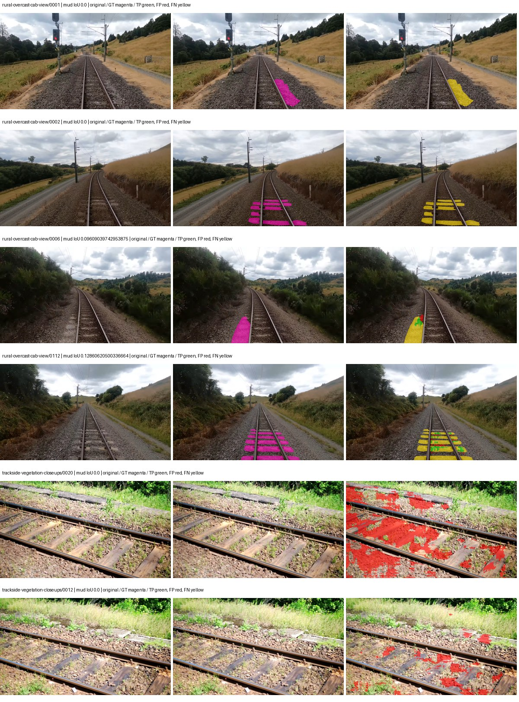
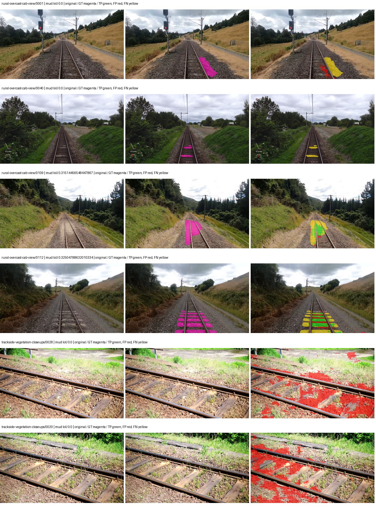
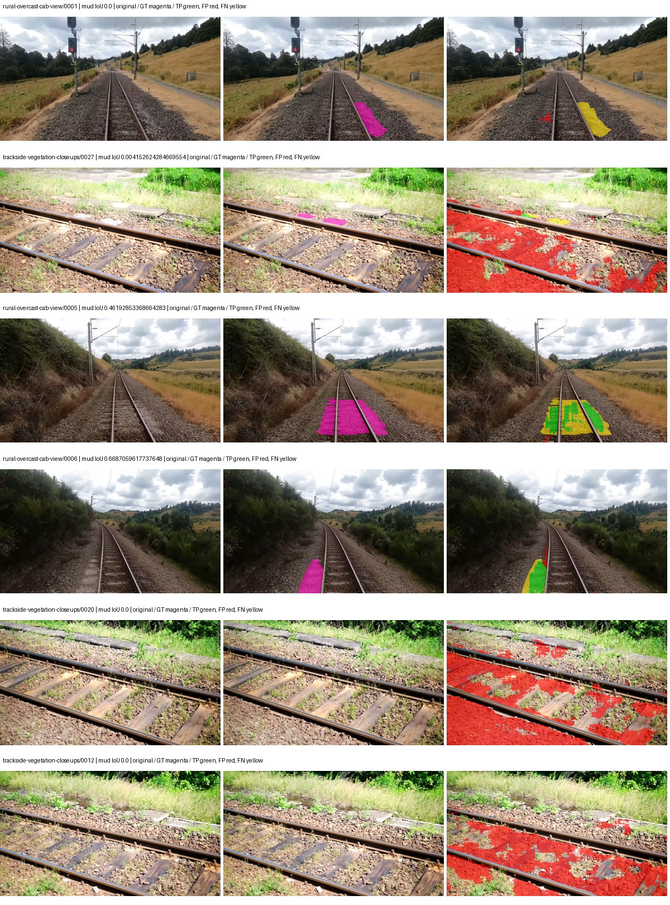
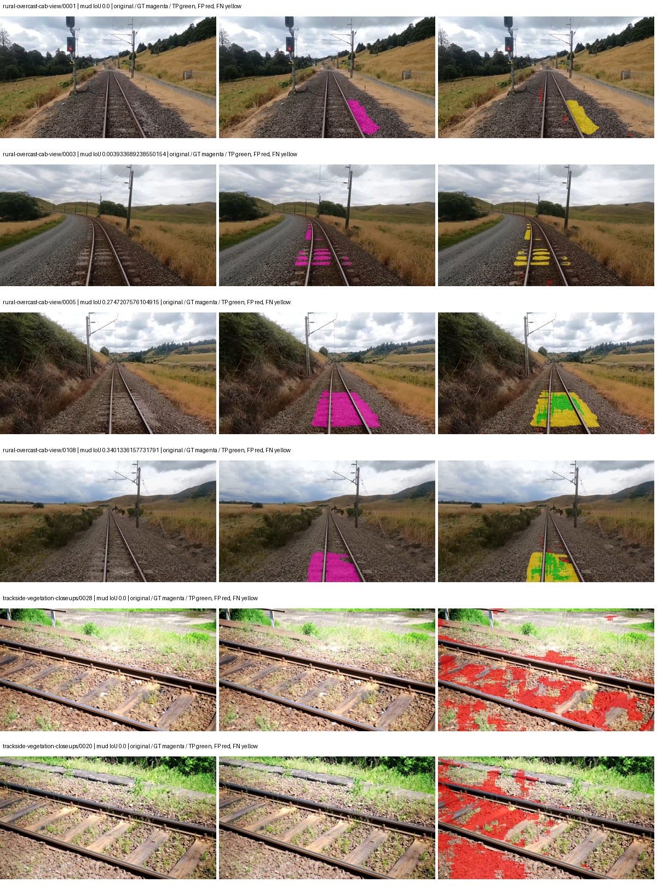

# hf_auto_mobilenetv2_deeplabv3 — rad_9_24_2026-fixed-grouped

[RAD 9/24: Scene-grouped split](../../README.md) · [Full model records](record.json)

Primary result: the **final checkpoint** after the full step budget (no early stopping). The checkpoint with the best **mud-pumping validation IoU, pixels pooled over all validation images**, is kept as secondary evidence. A job is complete only after full statistics and isolated profiling are verified.

Study metrics of the final checkpoint, counting each class only on the validation images that contain it: mud-pumping IoU is the mean per-image IoU over the images with mud-pumping, precision and recall sum pixels over those images, and mIoU averages each class over the images that contain it, then over the classes present.

| Initialization path | Seed | Mud-pumping IoU, train-camera images with mud (%, n=17) | Mud-pumping IoU, all images with mud (%, n=18) | Mud precision, all images with mud (%) | Mud recall, all images with mud (%) | mIoU (each class over images that contain it) (%) |
| --- | --- | --- | --- | --- | --- | --- |
| rtis_only | 0 | 0.50 | 0.54 | 3.42 | 1.06 | 25.07 |
| cityscapes_to_rtis | 0 | 6.46 | 6.24 | 21.30 | 9.16 | 25.33 |
| railsem19_to_rtis | 0 | 9.70 | 9.20 | 21.31 | 10.93 | 29.71 |
| cityscapes_to_railsem19_to_rtis | 0 | 12.31 | 11.72 | 24.24 | 16.28 | 30.12 |

Per-class IoU: IoU (%) of every class, each averaged only over the validation images that contain the class (n = those images); — = no image contains it. mIoU averages the classes with at least one such image.

| Initialization path | Seed | mIoU (each class over images that contain it) | person (n=0) | truck (n=0) | rail-track (n=37) | vegetation-overgrowth (n=13) | car (n=3) | on-rails (n=0) | traffic-sign (n=9) | road (n=11) | sidewalk (n=12) | construction (n=12) | tram-track (n=2) | pole (n=21) | traffic-light (n=3) | mud-pumping (n=18) | fence (n=7) | terrain (n=35) | sky (n=28) | rail-embedded (n=3) | rail-raised (n=37) | trackbed (n=37) | standing-water (n=9) |
| --- | --- | --- | --- | --- | --- | --- | --- | --- | --- | --- | --- | --- | --- | --- | --- | --- | --- | --- | --- | --- | --- | --- | --- |
| rtis_only | 0 | 25.07 | — | — | 51.61 | 18.27 | 0.00 | — | 0.00 | 7.77 | 7.73 | 21.01 | 0.46 | 48.65 | 0.00 | 0.54 | 7.03 | 74.78 | 90.29 | 0.00 | 67.21 | 55.63 | 0.28 |
| cityscapes_to_rtis | 0 | 25.33 | — | — | 42.73 | 5.46 | 0.00 | — | 3.33 | 6.92 | 1.81 | 20.24 | 0.00 | 56.89 | 2.85 | 6.24 | 22.49 | 77.13 | 89.24 | 0.00 | 66.67 | 53.54 | 0.49 |
| railsem19_to_rtis | 0 | 29.71 | — | — | 52.55 | 11.26 | 0.76 | — | 15.68 | 10.91 | 5.89 | 30.82 | 0.02 | 60.40 | 24.62 | 9.20 | 10.20 | 78.87 | 88.46 | 1.08 | 71.36 | 62.73 | 0.07 |
| cityscapes_to_railsem19_to_rtis | 0 | 30.12 | — | — | 51.05 | 11.16 | 1.91 | — | 17.71 | 13.08 | 3.82 | 34.54 | 0.62 | 54.23 | 25.22 | 11.72 | 24.53 | 79.33 | 84.37 | 0.00 | 68.72 | 60.08 | 0.12 |

Everything below is the campaign's own record, with pixels pooled over all validation images: its evaluation is the checkpoint that scored best on that pooled mud IoU (secondary evidence here); the diagnostics also cover the final checkpoint (`final-auto-val`).

| Model | Initialization path | Seed | Status | Steps | Best step | Best-checkpoint mud IoU, pixels pooled (%) | Best-checkpoint mud precision, pixels pooled (%) | Best-checkpoint mud recall, pixels pooled (%) | Final mud IoU (trainer val, pixels pooled, %) | Best-checkpoint mIoU, pixels pooled (%) | Best-checkpoint fixed GT-class mIoU, pixels pooled (%) |
| --- | --- | --- | --- | --- | --- | --- | --- | --- | --- | --- | --- |
| hf_auto_mobilenetv2_deeplabv3 | rtis_only | 0 | completed | 4000 | 2592 | 2.36 | 4.62 | 4.59 | 0.41 | 21.16 | 23.51 |
| hf_auto_mobilenetv2_deeplabv3 | cityscapes_to_rtis | 0 | completed | 4000 | 2592 | 5.94 | 8.52 | 16.38 | 4.58 | 20.98 | 24.48 |
| hf_auto_mobilenetv2_deeplabv3 | railsem19_to_rtis | 0 | completed | 4000 | 2333 | 6.45 | 7.93 | 25.65 | 3.47 | 26.04 | 28.93 |
| hf_auto_mobilenetv2_deeplabv3 | cityscapes_to_railsem19_to_rtis | 0 | completed | 4000 | 2851 | 7.15 | 10.38 | 18.69 | 5.22 | 28.13 | 31.25 |

Training: 217 images. Validation: 37 images. Test: 60 held out. Seeds: [0]. Seed variation measures optimization variability, not independent-recording uncertainty. Historical source checkpoints stay fixed across adaptation seeds.

Training code: `fce0ea0ac50b334d4252812c396e0e593def375d`. Split SHA-256: `12d7b367c72cda61d57686ff2ac28223530d0af49debd9fb7a0fbc68b908bc93`.

## rtis_only — seed 0

Status: **completed**. Started: 2026-10-11T00:41:30.624633+00:00. Finished: 2026-10-11T01:38:33.037652+00:00.

Recipe pretrained initializer: `google/deeplabv3_mobilenet_v2_1.0_513`.

`rtis_only` uses the recipe initializer, which may include pretrained segmentation components. Transfer paths load the exact historical source checkpoint below and reset the classifier; they do not reset all query/decoder features.

Source checkpoint: `Recipe pretrained initialization`.

Config SHA-256: `e4cd4320a4d8eec1938dd5062bacd031ba00cc0a7786b493d6fcda061923a521`. Weights used for validation: `raw`.

### Mud-pumping and aggregate quality

| Metric | Selected checkpoint | Final training validation |
| --- | --- | --- |
| Mud IoU | 2.36 | 0.41 |
| Mud precision | 4.62 | 0.68 |
| Mud recall | 4.59 | 1.05 |
| Mud Dice/F1 | 4.60 | 0.83 |
| mIoU | 21.16 | 22.62 |
| Mean accuracy | 30.33 | 31.68 |
| Mean precision | 39.82 | 40.89 |
| Mean Dice | 26.93 | 28.83 |
| Mean specificity | 98.45 | 98.61 |
| Pixel accuracy | 75.17 | 77.10 |
| Frequency-weighted IoU | 64.51 | 67.47 |
| Fixed GT-present class mIoU | 23.51 | 25.14 |
| Boundary F1 | 23.92 | 25.52 |

The selected checkpoint has independent evaluation evidence. Final values are the trainer's final validation record, not a new independent evaluation. mIoU averages classes with nonzero union, so false positives on absent classes can change its denominator. The fixed GT-class mean is supplementary and excludes absent classes; their false positives remain in the confusion matrix.

### Resource usage and timing

| Measurement | Value |
| --- | --- |
| Peak training VRAM, retained training invocation (GiB) | 9.88 |
| Peak evaluation VRAM (GiB) | 6.55 |
| Retained training invocation wall time (seconds) | 3302.57 |
| Retained training invocation GPU-hours (one GPU) | 0.92 |
| Evaluation wall time (seconds) | 10.23 |
| Full evaluation pipeline images/second | 3.62 |
| Best full-state checkpoint (MiB) | 36.06 |
| Final full-state checkpoint (MiB) | 36.05 |
| Verified periodic checkpoints removed (GiB) | 0.28 |

VRAM uses the recorded allocator high-water mark; it is not total device usage including CUDA context. Resumed jobs' retained training invocation times and peaks are **not whole-campaign totals**. Earlier invocation resource records are not reconstructed here. Evaluation throughput includes loader, sliding-window inference and metrics; it is not model-only latency/FPS. Missing measurements are shown as —, never inferred from another dataset's run.

### Standardized inference performance

Dedicated model-only profiling waits for an idle worker-locked L40S: BF16, batch 1, 1024x1024, 20 warmup and 100 CUDA-event-timed public forwards. It excludes loading, preprocessing, tiling and metrics.

| Status | Parameters | Weight MiB | FPS | p50 ms | p95 ms | Peak reserved GiB |
| --- | --- | --- | --- | --- | --- | --- |
| complete | 2525717 | 9.63 | 174.47 | 5.68 | 6.18 | 0.45 |

```json
{
  "schema_version": 1,
  "model_id": "hf_auto_mobilenetv2_deeplabv3",
  "measured_at": "2026-10-11T01:38:31+00:00",
  "status": "complete",
  "benchmark_scope": "rtis_selected_checkpoint_model_only",
  "applies_to": [
    "hf_auto_mobilenetv2_deeplabv3--rtis_only--seed-0"
  ],
  "source": {
    "campaign_git_sha": "fce0ea0ac50b334d4252812c396e0e593def375d",
    "git_dirty": false,
    "config_hash": "4287b5ed7d3b",
    "resolved_config": "/data/izadia1/projects/segmentary-runs/rad_9_24_2026/fgall-seed0-20261007/configs/hf_auto_mobilenetv2_deeplabv3--rtis_only--seed-0.yaml",
    "config_sha256": "e4cd4320a4d8eec1938dd5062bacd031ba00cc0a7786b493d6fcda061923a521",
    "checkpoint_sha256": "5a55b2fd4f5711152dc1c341362df838234a98d50059398bbd6818ee78cb9c0b",
    "checkpoint_global_step": 2592,
    "checkpoint_bytes": 37807889,
    "checkpoint_kind": "resume checkpoint with optimizer and EMA state",
    "weights": "raw",
    "measured_checkpoint_job_id": "hf_auto_mobilenetv2_deeplabv3--rtis_only--seed-0",
    "result_sha256": "1c4638dffa4b513b70bfc43b6c3ca68b7cedc0400700d284bfc1fadc4188ed17",
    "result_git_sha": "fce0ea0ac50b334d4252812c396e0e593def375d",
    "result_stage": "eval:rad_9_24_2026-fixed-grouped:val",
    "result_seed": 0
  },
  "hardware": {
    "gpu_name": "NVIDIA L40S",
    "gpu_uuid": "GPU-c76642eb-64c1-b0ac-b051-d2efd47b32c4",
    "logical_device": "cuda:0",
    "physical_visibility_token": "9",
    "compute_capability": [
      8,
      9
    ],
    "total_memory_bytes": 47677177856
  },
  "model": {
    "parameter_count": 2525717,
    "trainable_parameter_count": 2113557,
    "resident_parameter_bytes": 10102868,
    "parameter_dtype_counts": {
      "float32": 2525717
    }
  },
  "contract": {
    "backend": "pytorch",
    "precision": "bf16_autocast",
    "batch_size": 1,
    "input_shape_nchw": [
      1,
      3,
      1024,
      1024
    ],
    "warmup_iterations": 20,
    "measured_iterations": 100,
    "timing": "per-forward CUDA events with end-event synchronization",
    "includes_preprocessing": false,
    "includes_data_loader": false,
    "includes_sliding_window": false,
    "input_resident_on_gpu": true,
    "model_only": true,
    "entrypoint": "public model(image) dense-logits forward"
  },
  "measurements": {
    "latency": {
      "p50_ms": 5.677567958831787,
      "p95_ms": 6.182758498191833,
      "mean_ms": 5.731562881469727,
      "minimum_ms": 5.596159934997559,
      "maximum_ms": 6.459392070770264,
      "fps": 174.47248170878885,
      "raw_ms": [
        5.785600185394287,
        5.6453118324279785,
        5.609471797943115,
        5.63097620010376,
        5.640192031860352,
        5.661695957183838,
        5.679103851318359,
        6.044672012329102,
        5.611519813537598,
        5.682176113128662,
        5.691391944885254,
        5.953536033630371,
        5.651455879211426,
        5.646336078643799,
        5.648384094238281,
        5.692448139190674,
        5.695456027984619,
        5.601280212402344,
        5.596159934997559,
        5.664768218994141,
        5.727231979370117,
        5.68009614944458,
        6.048768043518066,
        6.459392070770264,
        5.646336078643799,
        5.701632022857666,
        5.646336078643799,
        5.695487976074219,
        5.607423782348633,
        5.608448028564453,
        5.625855922698975,
        5.9310078620910645,
        6.2259202003479,
        5.639167785644531,
        5.672959804534912,
        5.706751823425293,
        5.661695957183838,
        5.655551910400391,
        5.601280212402344,
        5.736447811126709,
        5.649407863616943,
        5.63097620010376,
        5.793791770935059,
        5.730303764343262,
        5.616640090942383,
        5.699584007263184,
        5.713888168334961,
        5.611519813537598,
        5.709824085235596,
        5.692416191101074,
        5.606400012969971,
        5.694464206695557,
        5.689407825469971,
        5.7487359046936035,
        5.618688106536865,
        5.706751823425293,
        5.6156158447265625,
        5.631999969482422,
        5.637119770050049,
        5.681151866912842,
        5.664768218994141,
        5.681151866912842,
        5.667840003967285,
        5.599232196807861,
        5.676032066345215,
        5.953536033630371,
        6.380544185638428,
        5.647359848022461,
        5.640192031860352,
        5.648352146148682,
        5.653503894805908,
        5.742591857910156,
        5.604351997375488,
        5.612544059753418,
        5.699584007263184,
        5.640192031860352,
        5.67193603515625,
        5.627903938293457,
        5.623807907104492,
        6.199295997619629,
        5.82144021987915,
        5.726208209991455,
        5.700607776641846,
        5.67091178894043,
        5.6453118324279785,
        5.66374397277832,
        5.710783958435059,
        6.136832237243652,
        5.680160045623779,
        5.639167785644531,
        6.181888103485107,
        5.724160194396973,
        5.761023998260498,
        6.255616188049316,
        5.974016189575195,
        5.755904197692871,
        5.620736122131348,
        5.784575939178467,
        5.695487976074219,
        5.784575939178467
      ],
      "percentile_method": "numpy linear interpolation"
    },
    "peak_reserved_bytes": 484442112,
    "memory_kind": "pytorch_cuda_allocator_peak_reserved_excluding_context",
    "process_total_bytes": 1012924416,
    "process_total_kind": "nvidia-smi used_memory of this PID on the benchmark GPU after the timed loop, including the CUDA context; null when the driver could not attribute memory to this PID",
    "benchmark_wall_clock_s": 9.635654024779797
  },
  "started_at": "2026-10-11T01:38:21+00:00",
  "finished_at": "2026-10-11T01:38:31+00:00",
  "environment": {
    "hostname": "hdrfs-app-001",
    "python": "3.11.15",
    "platform": "Linux-5.15.0-139-generic-x86_64-with-glibc2.35",
    "torch": "2.11.0+cu128",
    "torch_cuda": "12.8",
    "cudnn": 91900,
    "driver_version": "570.133.20",
    "cuda_available": true,
    "gpu_count": 1,
    "gpu_names": [
      "NVIDIA L40S"
    ],
    "cuda_visible_devices": "9",
    "packages": {
      "segmentary": "0.1.0",
      "torch": "2.11.0+cu128",
      "torchvision": "0.26.0+cu128",
      "transformers": "5.15.0",
      "timm": "1.0.28",
      "segmentation-models-pytorch": "0.5.0",
      "albumentations": "2.0.8",
      "lightning": "2.6.5",
      "numpy": "2.4.4"
    }
  }
}
```

### Per-class validation results

| Class | GT pixels | IoU (%) | Precision (%) | Recall (%) | Dice (%) | Boundary F1 (%) |
| --- | --- | --- | --- | --- | --- | --- |
| car | 29664 | 0.00 | 0.00 | 0.00 | 0.00 | 0.00 |
| construction | 311585 | 11.34 | 12.27 | 60.01 | 20.37 | 16.49 |
| fence | 265137 | 2.84 | 29.90 | 3.04 | 5.52 | 19.11 |
| mud-pumping | 1226250 | 2.36 | 4.62 | 4.59 | 4.60 | 6.81 |
| on-rails | 0 | 0.00 | 0.00 | — | 0.00 | 0.00 |
| person | 0 | — | — | — | — | — |
| pole | 628038 | 50.12 | 78.07 | 58.33 | 66.77 | 78.67 |
| rail-embedded | 16799 | 0.00 | 0.00 | 0.00 | 0.00 | 0.00 |
| rail-raised | 2969797 | 71.41 | 80.06 | 86.86 | 83.32 | 89.05 |
| rail-track | 6323197 | 32.25 | 62.90 | 39.82 | 48.77 | 46.03 |
| road | 1048831 | 3.76 | 22.00 | 4.34 | 7.25 | 13.06 |
| sidewalk | 1297367 | 22.49 | 87.16 | 23.26 | 36.72 | 9.84 |
| sky | 19121606 | 91.66 | 98.72 | 92.76 | 95.65 | 71.12 |
| standing-water | 95802 | 0.02 | 0.02 | 0.90 | 0.04 | 0.23 |
| terrain | 39239306 | 74.16 | 81.84 | 88.77 | 85.17 | 37.80 |
| trackbed | 10643081 | 52.29 | 63.66 | 74.53 | 68.67 | 46.03 |
| traffic-light | 19510 | 0.00 | 0.00 | 0.00 | 0.00 | 0.00 |
| traffic-sign | 13285 | 0.00 | 0.00 | 0.00 | 0.00 | 0.00 |
| tram-track | 56179 | 0.35 | 100.00 | 0.35 | 0.69 | 10.60 |
| truck | 0 | 0.00 | 0.00 | — | 0.00 | 0.00 |
| vegetation-overgrowth | 5901821 | 8.13 | 75.18 | 8.36 | 15.05 | 33.68 |

### Full-run accounting

| Measurement | Value |
| --- | --- |
| Full GPU-reserved wall seconds, all recorded worker attempts | 3430.20 |
| Full reserved GPU-hours | 0.95 |
| Whole-run timing complete | True |

| Phase | Wall seconds including failed attempts |
| --- | --- |
| training | 3309.42 |
| diagnostics | 77.78 |
| performance | 16.61 |

GPU-reserved time includes model loading, training, validation, collection, profiling, checkpoint I/O and orchestration while the worker owns one GPU. It is not GPU kernel-active time. Phase timings and sampled device memory/power/utilization are retained separately; sampled device memory is not the allocator high-water mark.

### Train/validation and raw/EMA diagnostics

| Checkpoint / weights / split | Images | Mud IoU (%) | Mud precision (%) | Mud recall (%) |
| --- | --- | --- | --- | --- |
| best-auto-train / raw | 217 | 86.12 | 95.03 | 90.18 |
| best-auto-val / raw | 37 | 2.36 | 4.62 | 4.59 |
| best-alternate-val / ema | 37 | 0.61 | 2.76 | 0.77 |
| final-auto-val / raw | 37 | 0.42 | 0.69 | 1.06 |

Train uses the evaluation transform without augmentation. Compare mud train/validation metrics for the same selected weights. Alternate EMA on running-stat BatchNorm is explicitly uncalibrated and is diagnostic only. Score-threshold curves use uncalibrated normalized scores and are pixel-level diagnostics, not event detection rates or a selected deployment operating point.

### Downloadable evidence

- best-auto-train: [per-image.csv](rtis_only--seed-0/best-auto-train/per-image.csv) · [per-image-confusion.json.gz](rtis_only--seed-0/best-auto-train/per-image-confusion.json.gz) · [groups.json](rtis_only--seed-0/best-auto-train/groups.json) · [mud-score-curves.json](rtis_only--seed-0/best-auto-train/mud-score-curves.json)
- best-auto-val: [per-image.csv](rtis_only--seed-0/best-auto-val/per-image.csv) · [per-image-confusion.json.gz](rtis_only--seed-0/best-auto-val/per-image-confusion.json.gz) · [groups.json](rtis_only--seed-0/best-auto-val/groups.json) · [mud-score-curves.json](rtis_only--seed-0/best-auto-val/mud-score-curves.json) · [examples.jpg](rtis_only--seed-0/best-auto-val/examples.jpg)
- best-alternate-val: [per-image.csv](rtis_only--seed-0/best-alternate-val/per-image.csv) · [per-image-confusion.json.gz](rtis_only--seed-0/best-alternate-val/per-image-confusion.json.gz) · [groups.json](rtis_only--seed-0/best-alternate-val/groups.json) · [mud-score-curves.json](rtis_only--seed-0/best-alternate-val/mud-score-curves.json)
- final-auto-val: [per-image.csv](rtis_only--seed-0/final-auto-val/per-image.csv) · [per-image-confusion.json.gz](rtis_only--seed-0/final-auto-val/per-image-confusion.json.gz) · [groups.json](rtis_only--seed-0/final-auto-val/groups.json) · [mud-score-curves.json](rtis_only--seed-0/final-auto-val/mud-score-curves.json)
- resources: [telemetry.csv](rtis_only--seed-0/resources/telemetry.csv)



Examples are two lowest and two highest mud-IoU positive images, plus up to two negative images with the most false-positive mud pixels. They are targeted diagnostic examples, not random samples. Green: true positive; red: false positive; yellow: false negative. Full predictions remain on HDRFS.

### Validation tracking

| Logged step | Overall mIoU (%) | Mud IoU (%) |
| --- | --- | --- |
| 258 | 14.40 | 0.16 |
| 518 | 18.83 | 0.23 |
| 777 | 18.05 | 0.20 |
| 1036 | 19.98 | 0.10 |
| 1295 | 20.17 | 1.95 |
| 1555 | 19.06 | 0.12 |
| 1814 | 20.05 | 0.71 |
| 2073 | 20.87 | 0.60 |
| 2332 | 20.80 | 0.42 |
| 2592 | 21.15 | 2.36 |
| 2851 | 20.91 | 0.30 |
| 3110 | 21.56 | 0.18 |
| 3369 | 20.81 | 0.41 |
| 3629 | 22.32 | 0.32 |
| 3888 | 22.48 | 0.42 |
| 4000 | 22.62 | 0.41 |

All retained scalar curves, including training loss and per-class IoU, are in record.json. Observed best mud on a curve is not necessarily a retained checkpoint: the pilot saved its selection-metric-best and final checkpoints. Step logging and checkpoint global_step may differ by one.

### Stopping and checkpoint provenance

```json
{
  "stopping": {
    "actual_steps": 4000,
    "maximum_steps": 4000,
    "min_delta": 0.0,
    "monitor": "val_iou/mud-pumping",
    "patience": null,
    "reason": "budget_complete"
  },
  "checkpoints": {
    "best": {
      "path": "/data/izadia1/projects/segmentary-runs/rad_9_24_2026/fgall-seed0-20261007/future-runs/hf_auto_mobilenetv2_deeplabv3--rtis_only--seed-0_seed0/rtis/best.ckpt",
      "sha256": "5a55b2fd4f5711152dc1c341362df838234a98d50059398bbd6818ee78cb9c0b",
      "global_step": 2592,
      "bytes": 37807889
    },
    "final": {
      "path": "/data/izadia1/projects/segmentary-runs/rad_9_24_2026/fgall-seed0-20261007/future-runs/hf_auto_mobilenetv2_deeplabv3--rtis_only--seed-0_seed0/rtis/last.ckpt",
      "sha256": "b3213c2f8e9317640889c42aeab133912445db05aac3366dc59a0f2038fcd4c1",
      "global_step": 4000,
      "bytes": 37797137
    }
  },
  "cleanup_error": null
}
```

### Resolved training, initialization and evaluation settings

The optimizer block is the base configuration. Stage LR scales are applied at runtime, and stage warmup is capped at min(base warmup, floor(stage budget / 10), stage budget - 1): 400 steps for this 4,000-step pilot. Model-internal native input grids may differ from augmentation crops (EoMT uses its 640 grid).

```json
{
  "name": "hf_auto_mobilenetv2_deeplabv3--rtis_only--seed-0",
  "model": {
    "arch": "hf_auto",
    "checkpoint": "google/deeplabv3_mobilenet_v2_1.0_513",
    "tuning": "full",
    "head": "unified_head",
    "lora_r": 16,
    "lora_alpha": 32,
    "lora_dropout": 0.05,
    "lora_targets": [],
    "drop_path": null,
    "revision": "5282e0eaf10de7cc7f35ee5e40f47981b801bf63",
    "subfolder": null,
    "local_files_only": false,
    "trust_remote_code": false,
    "backbone_path": null,
    "head_paths": [],
    "classifier_path": null,
    "inactive_parameter_paths": [
      "mobilenet_v2.conv_1x1"
    ],
    "smp_arch": null,
    "encoder_name": null,
    "encoder_weights": null,
    "native": null,
    "batch_norm_momentum": 0.003
  },
  "space": "paul-test-rtis",
  "taxonomy_root": "/data/izadia1/projects/segmentary-rad-fgall-fce0ea0a/taxonomy",
  "output_root": "/data/izadia1/projects/segmentary-runs/rad_9_24_2026/fgall-seed0-20261007/future-runs",
  "optim": {
    "backbone_lr": 0.0001,
    "head_lr_mult": 10.0,
    "weight_decay": 0.05,
    "llrd": 1.0,
    "warmup_iters": 1500,
    "warmup_ratio": 1e-06,
    "poly_power": 0.9,
    "min_lr_ratio": 0.0,
    "betas": [
      0.9,
      0.999
    ],
    "grad_clip": 1.0
  },
  "train": {
    "iters": 4000,
    "batch_size": 2,
    "accum": 8,
    "num_workers": 2,
    "precision": "bf16-mixed",
    "ema_decay": 0.9998,
    "val_every": 250,
    "ckpt_every": 500,
    "selection_metric": "val_iou/mud-pumping",
    "early_stopping_patience": null,
    "early_stopping_min_delta": 0.0,
    "seed": 0,
    "devices": 1
  },
  "eval": {
    "sliding_window": true,
    "window": [
      1024,
      1024
    ],
    "stride": [
      768,
      768
    ],
    "batch_size": 1,
    "num_workers": 2,
    "tta_scales": [],
    "tta_flip": false,
    "threshold": 0.5,
    "boundary_tolerance_frac": 0.0075,
    "save_confusion": true
  },
  "loss": {
    "task": "multiclass",
    "activation": "auto",
    "terms": [],
    "aux": "none",
    "aux_weight": 0.0,
    "ce_weight": 1.0,
    "label_smoothing": 0.0,
    "class_weights": null,
    "query": null
  },
  "aug": {
    "crop": [
      1024,
      1024
    ],
    "scale_min": 0.5,
    "scale_max": 2.0,
    "hflip_p": 0.5,
    "color_jitter_p": 0.5,
    "brightness": 0.25,
    "contrast": 0.25,
    "saturation": 0.25,
    "hue": 0.05
  },
  "stages": [
    {
      "name": "rtis",
      "data": [
        {
          "name": "rad_9_24_2026-fixed-grouped",
          "root": "/data/izadia1/datasets/rad_9_24_2026-fixed-grouped",
          "variant": null,
          "split_file": "splits.json",
          "train_split": "train",
          "val_split": "val",
          "limit": null,
          "loader": "folder",
          "mapping": "paul-test-rtis",
          "loader_options": {
            "require_groups": true
          }
        }
      ],
      "iters": null,
      "lr_scale": 1.0,
      "head_group_lr_scale": 1.0,
      "init_from": "pretrained",
      "reset_head": false,
      "freeze": null,
      "sample_weights": null
    }
  ]
}
```

### Hardware and software provenance

```json
{
  "training": {
    "cuda_available": true,
    "cuda_visible_devices": "9",
    "cudnn": 91900,
    "driver_version": "570.133.20",
    "gpu_count": 1,
    "gpu_names": [
      "NVIDIA L40S"
    ],
    "hostname": "hdrfs-app-001",
    "input_normalization": {
      "channel_order": "rgb",
      "mean": [
        0.5,
        0.5,
        0.5
      ],
      "source": "hf_image_processor",
      "std": [
        0.5,
        0.5,
        0.5
      ]
    },
    "model_origins": [
      {
        "hf_commit": "5282e0eaf10de7cc7f35ee5e40f47981b801bf63",
        "hf_name_or_path": "google/deeplabv3_mobilenet_v2_1.0_513",
        "module": "model",
        "timm_pretrained": {}
      },
      {
        "hf_commit": "5282e0eaf10de7cc7f35ee5e40f47981b801bf63",
        "hf_name_or_path": "google/deeplabv3_mobilenet_v2_1.0_513",
        "module": "model.mobilenet_v2",
        "timm_pretrained": {}
      },
      {
        "hf_commit": "5282e0eaf10de7cc7f35ee5e40f47981b801bf63",
        "hf_name_or_path": "google/deeplabv3_mobilenet_v2_1.0_513",
        "module": "model.mobilenet_v2.conv_stem.first_conv",
        "timm_pretrained": {}
      },
      {
        "hf_commit": "5282e0eaf10de7cc7f35ee5e40f47981b801bf63",
        "hf_name_or_path": "google/deeplabv3_mobilenet_v2_1.0_513",
        "module": "model.mobilenet_v2.conv_stem.conv_3x3",
        "timm_pretrained": {}
      },
      {
        "hf_commit": "5282e0eaf10de7cc7f35ee5e40f47981b801bf63",
        "hf_name_or_path": "google/deeplabv3_mobilenet_v2_1.0_513",
        "module": "model.mobilenet_v2.conv_stem.reduce_1x1",
        "timm_pretrained": {}
      },
      {
        "hf_commit": "5282e0eaf10de7cc7f35ee5e40f47981b801bf63",
        "hf_name_or_path": "google/deeplabv3_mobilenet_v2_1.0_513",
        "module": "model.mobilenet_v2.layer.0.expand_1x1",
        "timm_pretrained": {}
      },
      {
        "hf_commit": "5282e0eaf10de7cc7f35ee5e40f47981b801bf63",
        "hf_name_or_path": "google/deeplabv3_mobilenet_v2_1.0_513",
        "module": "model.mobilenet_v2.layer.0.conv_3x3",
        "timm_pretrained": {}
      },
      {
        "hf_commit": "5282e0eaf10de7cc7f35ee5e40f47981b801bf63",
        "hf_name_or_path": "google/deeplabv3_mobilenet_v2_1.0_513",
        "module": "model.mobilenet_v2.layer.0.reduce_1x1",
        "timm_pretrained": {}
      },
      {
        "hf_commit": "5282e0eaf10de7cc7f35ee5e40f47981b801bf63",
        "hf_name_or_path": "google/deeplabv3_mobilenet_v2_1.0_513",
        "module": "model.mobilenet_v2.layer.1.expand_1x1",
        "timm_pretrained": {}
      },
      {
        "hf_commit": "5282e0eaf10de7cc7f35ee5e40f47981b801bf63",
        "hf_name_or_path": "google/deeplabv3_mobilenet_v2_1.0_513",
        "module": "model.mobilenet_v2.layer.1.conv_3x3",
        "timm_pretrained": {}
      },
      {
        "hf_commit": "5282e0eaf10de7cc7f35ee5e40f47981b801bf63",
        "hf_name_or_path": "google/deeplabv3_mobilenet_v2_1.0_513",
        "module": "model.mobilenet_v2.layer.1.reduce_1x1",
        "timm_pretrained": {}
      },
      {
        "hf_commit": "5282e0eaf10de7cc7f35ee5e40f47981b801bf63",
        "hf_name_or_path": "google/deeplabv3_mobilenet_v2_1.0_513",
        "module": "model.mobilenet_v2.layer.2.expand_1x1",
        "timm_pretrained": {}
      },
      {
        "hf_commit": "5282e0eaf10de7cc7f35ee5e40f47981b801bf63",
        "hf_name_or_path": "google/deeplabv3_mobilenet_v2_1.0_513",
        "module": "model.mobilenet_v2.layer.2.conv_3x3",
        "timm_pretrained": {}
      },
      {
        "hf_commit": "5282e0eaf10de7cc7f35ee5e40f47981b801bf63",
        "hf_name_or_path": "google/deeplabv3_mobilenet_v2_1.0_513",
        "module": "model.mobilenet_v2.layer.2.reduce_1x1",
        "timm_pretrained": {}
      },
      {
        "hf_commit": "5282e0eaf10de7cc7f35ee5e40f47981b801bf63",
        "hf_name_or_path": "google/deeplabv3_mobilenet_v2_1.0_513",
        "module": "model.mobilenet_v2.layer.3.expand_1x1",
        "timm_pretrained": {}
      },
      {
        "hf_commit": "5282e0eaf10de7cc7f35ee5e40f47981b801bf63",
        "hf_name_or_path": "google/deeplabv3_mobilenet_v2_1.0_513",
        "module": "model.mobilenet_v2.layer.3.conv_3x3",
        "timm_pretrained": {}
      },
      {
        "hf_commit": "5282e0eaf10de7cc7f35ee5e40f47981b801bf63",
        "hf_name_or_path": "google/deeplabv3_mobilenet_v2_1.0_513",
        "module": "model.mobilenet_v2.layer.3.reduce_1x1",
        "timm_pretrained": {}
      },
      {
        "hf_commit": "5282e0eaf10de7cc7f35ee5e40f47981b801bf63",
        "hf_name_or_path": "google/deeplabv3_mobilenet_v2_1.0_513",
        "module": "model.mobilenet_v2.layer.4.expand_1x1",
        "timm_pretrained": {}
      },
      {
        "hf_commit": "5282e0eaf10de7cc7f35ee5e40f47981b801bf63",
        "hf_name_or_path": "google/deeplabv3_mobilenet_v2_1.0_513",
        "module": "model.mobilenet_v2.layer.4.conv_3x3",
        "timm_pretrained": {}
      },
      {
        "hf_commit": "5282e0eaf10de7cc7f35ee5e40f47981b801bf63",
        "hf_name_or_path": "google/deeplabv3_mobilenet_v2_1.0_513",
        "module": "model.mobilenet_v2.layer.4.reduce_1x1",
        "timm_pretrained": {}
      },
      {
        "hf_commit": "5282e0eaf10de7cc7f35ee5e40f47981b801bf63",
        "hf_name_or_path": "google/deeplabv3_mobilenet_v2_1.0_513",
        "module": "model.mobilenet_v2.layer.5.expand_1x1",
        "timm_pretrained": {}
      },
      {
        "hf_commit": "5282e0eaf10de7cc7f35ee5e40f47981b801bf63",
        "hf_name_or_path": "google/deeplabv3_mobilenet_v2_1.0_513",
        "module": "model.mobilenet_v2.layer.5.conv_3x3",
        "timm_pretrained": {}
      },
      {
        "hf_commit": "5282e0eaf10de7cc7f35ee5e40f47981b801bf63",
        "hf_name_or_path": "google/deeplabv3_mobilenet_v2_1.0_513",
        "module": "model.mobilenet_v2.layer.5.reduce_1x1",
        "timm_pretrained": {}
      },
      {
        "hf_commit": "5282e0eaf10de7cc7f35ee5e40f47981b801bf63",
        "hf_name_or_path": "google/deeplabv3_mobilenet_v2_1.0_513",
        "module": "model.mobilenet_v2.layer.6.expand_1x1",
        "timm_pretrained": {}
      },
      {
        "hf_commit": "5282e0eaf10de7cc7f35ee5e40f47981b801bf63",
        "hf_name_or_path": "google/deeplabv3_mobilenet_v2_1.0_513",
        "module": "model.mobilenet_v2.layer.6.conv_3x3",
        "timm_pretrained": {}
      },
      {
        "hf_commit": "5282e0eaf10de7cc7f35ee5e40f47981b801bf63",
        "hf_name_or_path": "google/deeplabv3_mobilenet_v2_1.0_513",
        "module": "model.mobilenet_v2.layer.6.reduce_1x1",
        "timm_pretrained": {}
      },
      {
        "hf_commit": "5282e0eaf10de7cc7f35ee5e40f47981b801bf63",
        "hf_name_or_path": "google/deeplabv3_mobilenet_v2_1.0_513",
        "module": "model.mobilenet_v2.layer.7.expand_1x1",
        "timm_pretrained": {}
      },
      {
        "hf_commit": "5282e0eaf10de7cc7f35ee5e40f47981b801bf63",
        "hf_name_or_path": "google/deeplabv3_mobilenet_v2_1.0_513",
        "module": "model.mobilenet_v2.layer.7.conv_3x3",
        "timm_pretrained": {}
      },
      {
        "hf_commit": "5282e0eaf10de7cc7f35ee5e40f47981b801bf63",
        "hf_name_or_path": "google/deeplabv3_mobilenet_v2_1.0_513",
        "module": "model.mobilenet_v2.layer.7.reduce_1x1",
        "timm_pretrained": {}
      },
      {
        "hf_commit": "5282e0eaf10de7cc7f35ee5e40f47981b801bf63",
        "hf_name_or_path": "google/deeplabv3_mobilenet_v2_1.0_513",
        "module": "model.mobilenet_v2.layer.8.expand_1x1",
        "timm_pretrained": {}
      },
      {
        "hf_commit": "5282e0eaf10de7cc7f35ee5e40f47981b801bf63",
        "hf_name_or_path": "google/deeplabv3_mobilenet_v2_1.0_513",
        "module": "model.mobilenet_v2.layer.8.conv_3x3",
        "timm_pretrained": {}
      },
      {
        "hf_commit": "5282e0eaf10de7cc7f35ee5e40f47981b801bf63",
        "hf_name_or_path": "google/deeplabv3_mobilenet_v2_1.0_513",
        "module": "model.mobilenet_v2.layer.8.reduce_1x1",
        "timm_pretrained": {}
      },
      {
        "hf_commit": "5282e0eaf10de7cc7f35ee5e40f47981b801bf63",
        "hf_name_or_path": "google/deeplabv3_mobilenet_v2_1.0_513",
        "module": "model.mobilenet_v2.layer.9.expand_1x1",
        "timm_pretrained": {}
      },
      {
        "hf_commit": "5282e0eaf10de7cc7f35ee5e40f47981b801bf63",
        "hf_name_or_path": "google/deeplabv3_mobilenet_v2_1.0_513",
        "module": "model.mobilenet_v2.layer.9.conv_3x3",
        "timm_pretrained": {}
      },
      {
        "hf_commit": "5282e0eaf10de7cc7f35ee5e40f47981b801bf63",
        "hf_name_or_path": "google/deeplabv3_mobilenet_v2_1.0_513",
        "module": "model.mobilenet_v2.layer.9.reduce_1x1",
        "timm_pretrained": {}
      },
      {
        "hf_commit": "5282e0eaf10de7cc7f35ee5e40f47981b801bf63",
        "hf_name_or_path": "google/deeplabv3_mobilenet_v2_1.0_513",
        "module": "model.mobilenet_v2.layer.10.expand_1x1",
        "timm_pretrained": {}
      },
      {
        "hf_commit": "5282e0eaf10de7cc7f35ee5e40f47981b801bf63",
        "hf_name_or_path": "google/deeplabv3_mobilenet_v2_1.0_513",
        "module": "model.mobilenet_v2.layer.10.conv_3x3",
        "timm_pretrained": {}
      },
      {
        "hf_commit": "5282e0eaf10de7cc7f35ee5e40f47981b801bf63",
        "hf_name_or_path": "google/deeplabv3_mobilenet_v2_1.0_513",
        "module": "model.mobilenet_v2.layer.10.reduce_1x1",
        "timm_pretrained": {}
      },
      {
        "hf_commit": "5282e0eaf10de7cc7f35ee5e40f47981b801bf63",
        "hf_name_or_path": "google/deeplabv3_mobilenet_v2_1.0_513",
        "module": "model.mobilenet_v2.layer.11.expand_1x1",
        "timm_pretrained": {}
      },
      {
        "hf_commit": "5282e0eaf10de7cc7f35ee5e40f47981b801bf63",
        "hf_name_or_path": "google/deeplabv3_mobilenet_v2_1.0_513",
        "module": "model.mobilenet_v2.layer.11.conv_3x3",
        "timm_pretrained": {}
      },
      {
        "hf_commit": "5282e0eaf10de7cc7f35ee5e40f47981b801bf63",
        "hf_name_or_path": "google/deeplabv3_mobilenet_v2_1.0_513",
        "module": "model.mobilenet_v2.layer.11.reduce_1x1",
        "timm_pretrained": {}
      },
      {
        "hf_commit": "5282e0eaf10de7cc7f35ee5e40f47981b801bf63",
        "hf_name_or_path": "google/deeplabv3_mobilenet_v2_1.0_513",
        "module": "model.mobilenet_v2.layer.12.expand_1x1",
        "timm_pretrained": {}
      },
      {
        "hf_commit": "5282e0eaf10de7cc7f35ee5e40f47981b801bf63",
        "hf_name_or_path": "google/deeplabv3_mobilenet_v2_1.0_513",
        "module": "model.mobilenet_v2.layer.12.conv_3x3",
        "timm_pretrained": {}
      },
      {
        "hf_commit": "5282e0eaf10de7cc7f35ee5e40f47981b801bf63",
        "hf_name_or_path": "google/deeplabv3_mobilenet_v2_1.0_513",
        "module": "model.mobilenet_v2.layer.12.reduce_1x1",
        "timm_pretrained": {}
      },
      {
        "hf_commit": "5282e0eaf10de7cc7f35ee5e40f47981b801bf63",
        "hf_name_or_path": "google/deeplabv3_mobilenet_v2_1.0_513",
        "module": "model.mobilenet_v2.layer.13.expand_1x1",
        "timm_pretrained": {}
      },
      {
        "hf_commit": "5282e0eaf10de7cc7f35ee5e40f47981b801bf63",
        "hf_name_or_path": "google/deeplabv3_mobilenet_v2_1.0_513",
        "module": "model.mobilenet_v2.layer.13.conv_3x3",
        "timm_pretrained": {}
      },
      {
        "hf_commit": "5282e0eaf10de7cc7f35ee5e40f47981b801bf63",
        "hf_name_or_path": "google/deeplabv3_mobilenet_v2_1.0_513",
        "module": "model.mobilenet_v2.layer.13.reduce_1x1",
        "timm_pretrained": {}
      },
      {
        "hf_commit": "5282e0eaf10de7cc7f35ee5e40f47981b801bf63",
        "hf_name_or_path": "google/deeplabv3_mobilenet_v2_1.0_513",
        "module": "model.mobilenet_v2.layer.14.expand_1x1",
        "timm_pretrained": {}
      },
      {
        "hf_commit": "5282e0eaf10de7cc7f35ee5e40f47981b801bf63",
        "hf_name_or_path": "google/deeplabv3_mobilenet_v2_1.0_513",
        "module": "model.mobilenet_v2.layer.14.conv_3x3",
        "timm_pretrained": {}
      },
      {
        "hf_commit": "5282e0eaf10de7cc7f35ee5e40f47981b801bf63",
        "hf_name_or_path": "google/deeplabv3_mobilenet_v2_1.0_513",
        "module": "model.mobilenet_v2.layer.14.reduce_1x1",
        "timm_pretrained": {}
      },
      {
        "hf_commit": "5282e0eaf10de7cc7f35ee5e40f47981b801bf63",
        "hf_name_or_path": "google/deeplabv3_mobilenet_v2_1.0_513",
        "module": "model.mobilenet_v2.layer.15.expand_1x1",
        "timm_pretrained": {}
      },
      {
        "hf_commit": "5282e0eaf10de7cc7f35ee5e40f47981b801bf63",
        "hf_name_or_path": "google/deeplabv3_mobilenet_v2_1.0_513",
        "module": "model.mobilenet_v2.layer.15.conv_3x3",
        "timm_pretrained": {}
      },
      {
        "hf_commit": "5282e0eaf10de7cc7f35ee5e40f47981b801bf63",
        "hf_name_or_path": "google/deeplabv3_mobilenet_v2_1.0_513",
        "module": "model.mobilenet_v2.layer.15.reduce_1x1",
        "timm_pretrained": {}
      },
      {
        "hf_commit": "5282e0eaf10de7cc7f35ee5e40f47981b801bf63",
        "hf_name_or_path": "google/deeplabv3_mobilenet_v2_1.0_513",
        "module": "model.mobilenet_v2.conv_1x1",
        "timm_pretrained": {}
      },
      {
        "hf_commit": "5282e0eaf10de7cc7f35ee5e40f47981b801bf63",
        "hf_name_or_path": "google/deeplabv3_mobilenet_v2_1.0_513",
        "module": "model.segmentation_head.conv_pool",
        "timm_pretrained": {}
      },
      {
        "hf_commit": "5282e0eaf10de7cc7f35ee5e40f47981b801bf63",
        "hf_name_or_path": "google/deeplabv3_mobilenet_v2_1.0_513",
        "module": "model.segmentation_head.conv_aspp",
        "timm_pretrained": {}
      },
      {
        "hf_commit": "5282e0eaf10de7cc7f35ee5e40f47981b801bf63",
        "hf_name_or_path": "google/deeplabv3_mobilenet_v2_1.0_513",
        "module": "model.segmentation_head.conv_projection",
        "timm_pretrained": {}
      },
      {
        "hf_commit": "5282e0eaf10de7cc7f35ee5e40f47981b801bf63",
        "hf_name_or_path": "google/deeplabv3_mobilenet_v2_1.0_513",
        "module": "model.segmentation_head.classifier",
        "timm_pretrained": {}
      }
    ],
    "model_parameter_count": 2525717,
    "packages": {
      "albumentations": "2.0.8",
      "lightning": "2.6.5",
      "numpy": "2.4.4",
      "segmentary": "0.1.0",
      "segmentation-models-pytorch": "0.5.0",
      "timm": "1.0.28",
      "torch": "2.11.0+cu128",
      "torchvision": "0.26.0+cu128",
      "transformers": "5.15.0"
    },
    "platform": "Linux-5.15.0-139-generic-x86_64-with-glibc2.35",
    "python": "3.11.15",
    "torch": "2.11.0+cu128",
    "torch_cuda": "12.8",
    "trainable_parameter_count": 2113557,
    "training_stop": {
      "actual_steps": 4000,
      "maximum_steps": 4000,
      "min_delta": 0.0,
      "monitor": "val_iou/mud-pumping",
      "patience": null,
      "reason": "budget_complete"
    },
    "validation_weights": "raw"
  },
  "evaluation": {
    "cuda_available": true,
    "cuda_visible_devices": "9",
    "cudnn": 91900,
    "driver_version": "570.133.20",
    "gpu_count": 1,
    "gpu_names": [
      "NVIDIA L40S"
    ],
    "hostname": "hdrfs-app-001",
    "input_normalization": {
      "channel_order": "rgb",
      "mean": [
        0.5,
        0.5,
        0.5
      ],
      "source": "hf_image_processor",
      "std": [
        0.5,
        0.5,
        0.5
      ]
    },
    "packages": {
      "albumentations": "2.0.8",
      "lightning": "2.6.5",
      "numpy": "2.4.4",
      "segmentary": "0.1.0",
      "segmentation-models-pytorch": "0.5.0",
      "timm": "1.0.28",
      "torch": "2.11.0+cu128",
      "torchvision": "0.26.0+cu128",
      "transformers": "5.15.0"
    },
    "platform": "Linux-5.15.0-139-generic-x86_64-with-glibc2.35",
    "python": "3.11.15",
    "torch": "2.11.0+cu128",
    "torch_cuda": "12.8"
  }
}
```

## cityscapes_to_rtis — seed 0

Status: **completed**. Started: 2026-10-11T00:50:06.489477+00:00. Finished: 2026-10-11T01:47:31.968239+00:00.

Recipe pretrained initializer: `google/deeplabv3_mobilenet_v2_1.0_513`.

`rtis_only` uses the recipe initializer, which may include pretrained segmentation components. Transfer paths load the exact historical source checkpoint below and reset the classifier; they do not reset all query/decoder features.

Source checkpoint: `{'name': 'hf_auto_mobilenetv2_deeplabv3--cityscapes--seed-0', 'model': 'hf_auto_mobilenetv2_deeplabv3', 'protocol': 'cityscapes', 'config': '/data/izadia1/projects/segmentary-runs/all-model-city-rail-seed0-rail20-b9eb3e1/jobs/hf_auto_mobilenetv2_deeplabv3--cityscapes--seed-0/attempt-001/resolved-config.yaml', 'checkpoint': '/data/izadia1/projects/segmentary-runs/all-model-city-rail-seed0-rail20-b9eb3e1/jobs/hf_auto_mobilenetv2_deeplabv3--cityscapes--seed-0/attempt-001/train/hf_auto_mobilenetv2_deeplabv3--cityscapes_seed0/cityscapes/last.bn-recalibrated.ckpt', 'recorded_sha256': '4f3711930ae1df9eaa26a222ba7652799b210f3a244770289a5e58a1c8bf3aa5', 'exists': True}`.

Config SHA-256: `347cfa46204bfaa6a41cd2c9ca8ee4d9763d9d9f0ebea84b8f26d8e54b72d936`. Weights used for validation: `raw`.

### Mud-pumping and aggregate quality

| Metric | Selected checkpoint | Final training validation |
| --- | --- | --- |
| Mud IoU | 5.94 | 4.58 |
| Mud precision | 8.52 | 8.40 |
| Mud recall | 16.38 | 9.16 |
| Mud Dice/F1 | 11.21 | 8.77 |
| mIoU | 20.98 | 21.27 |
| Mean accuracy | 31.77 | 31.98 |
| Mean precision | 42.46 | 40.79 |
| Mean Dice | 26.92 | 27.40 |
| Mean specificity | 98.43 | 98.45 |
| Pixel accuracy | 76.19 | 76.16 |
| Frequency-weighted IoU | 64.52 | 64.64 |
| Fixed GT-present class mIoU | 24.48 | 24.82 |
| Boundary F1 | 25.62 | 25.89 |

The selected checkpoint has independent evaluation evidence. Final values are the trainer's final validation record, not a new independent evaluation. mIoU averages classes with nonzero union, so false positives on absent classes can change its denominator. The fixed GT-class mean is supplementary and excludes absent classes; their false positives remain in the confusion matrix.

### Resource usage and timing

| Measurement | Value |
| --- | --- |
| Peak training VRAM, retained training invocation (GiB) | 9.88 |
| Peak evaluation VRAM (GiB) | 6.55 |
| Retained training invocation wall time (seconds) | 3321.84 |
| Retained training invocation GPU-hours (one GPU) | 0.92 |
| Evaluation wall time (seconds) | 10.20 |
| Full evaluation pipeline images/second | 3.63 |
| Best full-state checkpoint (MiB) | 36.06 |
| Final full-state checkpoint (MiB) | 36.05 |
| Verified periodic checkpoints removed (GiB) | 0.28 |

VRAM uses the recorded allocator high-water mark; it is not total device usage including CUDA context. Resumed jobs' retained training invocation times and peaks are **not whole-campaign totals**. Earlier invocation resource records are not reconstructed here. Evaluation throughput includes loader, sliding-window inference and metrics; it is not model-only latency/FPS. Missing measurements are shown as —, never inferred from another dataset's run.

### Standardized inference performance

Dedicated model-only profiling waits for an idle worker-locked L40S: BF16, batch 1, 1024x1024, 20 warmup and 100 CUDA-event-timed public forwards. It excludes loading, preprocessing, tiling and metrics.

| Status | Parameters | Weight MiB | FPS | p50 ms | p95 ms | Peak reserved GiB |
| --- | --- | --- | --- | --- | --- | --- |
| complete | 2525717 | 9.63 | 174.54 | 5.68 | 6.04 | 0.45 |

```json
{
  "schema_version": 1,
  "model_id": "hf_auto_mobilenetv2_deeplabv3",
  "measured_at": "2026-10-11T01:47:29+00:00",
  "status": "complete",
  "benchmark_scope": "rtis_selected_checkpoint_model_only",
  "applies_to": [
    "hf_auto_mobilenetv2_deeplabv3--cityscapes_to_rtis--seed-0"
  ],
  "source": {
    "campaign_git_sha": "fce0ea0ac50b334d4252812c396e0e593def375d",
    "git_dirty": false,
    "config_hash": "33426c0c5ee1",
    "resolved_config": "/data/izadia1/projects/segmentary-runs/rad_9_24_2026/fgall-seed0-20261007/configs/hf_auto_mobilenetv2_deeplabv3--cityscapes_to_rtis--seed-0.yaml",
    "config_sha256": "347cfa46204bfaa6a41cd2c9ca8ee4d9763d9d9f0ebea84b8f26d8e54b72d936",
    "checkpoint_sha256": "92cc7a0d4a657aa0ae0df90fa4bef021e36673373ea2175befdb7620960a15af",
    "checkpoint_global_step": 2592,
    "checkpoint_bytes": 37807889,
    "checkpoint_kind": "resume checkpoint with optimizer and EMA state",
    "weights": "raw",
    "measured_checkpoint_job_id": "hf_auto_mobilenetv2_deeplabv3--cityscapes_to_rtis--seed-0",
    "result_sha256": "ee7df6d2930e191d177523905c32719bbc803fd72a85d6ed27818de9023421c1",
    "result_git_sha": "fce0ea0ac50b334d4252812c396e0e593def375d",
    "result_stage": "eval:rad_9_24_2026-fixed-grouped:val",
    "result_seed": 0
  },
  "hardware": {
    "gpu_name": "NVIDIA L40S",
    "gpu_uuid": "GPU-fc5dde96-210d-0afa-ac74-7f88477d622b",
    "logical_device": "cuda:0",
    "physical_visibility_token": "4",
    "compute_capability": [
      8,
      9
    ],
    "total_memory_bytes": 47677177856
  },
  "model": {
    "parameter_count": 2525717,
    "trainable_parameter_count": 2113557,
    "resident_parameter_bytes": 10102868,
    "parameter_dtype_counts": {
      "float32": 2525717
    }
  },
  "contract": {
    "backend": "pytorch",
    "precision": "bf16_autocast",
    "batch_size": 1,
    "input_shape_nchw": [
      1,
      3,
      1024,
      1024
    ],
    "warmup_iterations": 20,
    "measured_iterations": 100,
    "timing": "per-forward CUDA events with end-event synchronization",
    "includes_preprocessing": false,
    "includes_data_loader": false,
    "includes_sliding_window": false,
    "input_resident_on_gpu": true,
    "model_only": true,
    "entrypoint": "public model(image) dense-logits forward"
  },
  "measurements": {
    "latency": {
      "p50_ms": 5.683199882507324,
      "p95_ms": 6.037054276466369,
      "mean_ms": 5.729321284294128,
      "minimum_ms": 5.62175989151001,
      "maximum_ms": 6.314911842346191,
      "fps": 174.54074407405193,
      "raw_ms": [
        5.874688148498535,
        5.683199882507324,
        5.647359848022461,
        5.657599925994873,
        5.673984050750732,
        6.035359859466553,
        5.692416191101074,
        5.740543842315674,
        5.707776069641113,
        5.673984050750732,
        5.865600109100342,
        5.894144058227539,
        5.666816234588623,
        5.737472057342529,
        5.6750078201293945,
        5.672959804534912,
        5.678976058959961,
        5.664768218994141,
        5.6893439292907715,
        6.132800102233887,
        5.62175989151001,
        5.639232158660889,
        5.6985602378845215,
        5.703680038452148,
        5.6985602378845215,
        5.765120029449463,
        5.687295913696289,
        5.6248321533203125,
        5.660672187805176,
        6.166528224945068,
        5.7292799949646,
        5.72214412689209,
        5.641215801239014,
        5.67091178894043,
        5.714943885803223,
        5.68012809753418,
        5.734399795532227,
        5.677055835723877,
        5.666816234588623,
        5.9115519523620605,
        6.013919830322266,
        5.691391944885254,
        5.672959804534912,
        5.710847854614258,
        5.6985602378845215,
        5.694464206695557,
        5.66374397277832,
        5.932960033416748,
        6.314911842346191,
        5.761023998260498,
        5.650432109832764,
        5.681151866912842,
        6.070271968841553,
        5.7876482009887695,
        5.685247898101807,
        5.699584007263184,
        5.6750078201293945,
        5.67193603515625,
        5.7047038078308105,
        5.662720203399658,
        5.665791988372803,
        5.7190399169921875,
        5.666816234588623,
        6.069248199462891,
        5.735424041748047,
        5.661695957183838,
        5.692416191101074,
        5.686272144317627,
        5.652639865875244,
        5.672959804534912,
        5.669888019561768,
        5.649407863616943,
        5.669888019561768,
        5.681151866912842,
        5.658624172210693,
        5.667840003967285,
        5.668863773345947,
        5.875648021697998,
        5.788671970367432,
        5.662720203399658,
        5.660672187805176,
        5.730303764343262,
        5.659743785858154,
        5.7139201164245605,
        5.67091178894043,
        5.77023983001709,
        5.635072231292725,
        5.66374397277832,
        5.687295913696289,
        5.661695957183838,
        5.667840003967285,
        5.7190399169921875,
        5.804031848907471,
        5.661695957183838,
        5.677055835723877,
        5.67193603515625,
        5.683199882507324,
        5.6985602378845215,
        5.6985602378845215,
        5.658624172210693
      ],
      "percentile_method": "numpy linear interpolation"
    },
    "peak_reserved_bytes": 484442112,
    "memory_kind": "pytorch_cuda_allocator_peak_reserved_excluding_context",
    "process_total_bytes": 1012924416,
    "process_total_kind": "nvidia-smi used_memory of this PID on the benchmark GPU after the timed loop, including the CUDA context; null when the driver could not attribute memory to this PID",
    "benchmark_wall_clock_s": 9.817120559513569
  },
  "started_at": "2026-10-11T01:47:19+00:00",
  "finished_at": "2026-10-11T01:47:29+00:00",
  "environment": {
    "hostname": "hdrfs-app-001",
    "python": "3.11.15",
    "platform": "Linux-5.15.0-139-generic-x86_64-with-glibc2.35",
    "torch": "2.11.0+cu128",
    "torch_cuda": "12.8",
    "cudnn": 91900,
    "driver_version": "570.133.20",
    "cuda_available": true,
    "gpu_count": 1,
    "gpu_names": [
      "NVIDIA L40S"
    ],
    "cuda_visible_devices": "4",
    "packages": {
      "segmentary": "0.1.0",
      "torch": "2.11.0+cu128",
      "torchvision": "0.26.0+cu128",
      "transformers": "5.15.0",
      "timm": "1.0.28",
      "segmentation-models-pytorch": "0.5.0",
      "albumentations": "2.0.8",
      "lightning": "2.6.5",
      "numpy": "2.4.4"
    }
  }
}
```

### Per-class validation results

| Class | GT pixels | IoU (%) | Precision (%) | Recall (%) | Dice (%) | Boundary F1 (%) |
| --- | --- | --- | --- | --- | --- | --- |
| car | 29664 | 0.00 | 0.00 | 0.00 | 0.00 | 0.00 |
| construction | 311585 | 12.54 | 13.98 | 54.93 | 22.29 | 14.50 |
| fence | 265137 | 19.10 | 51.01 | 23.39 | 32.08 | 38.06 |
| mud-pumping | 1226250 | 5.94 | 8.52 | 16.38 | 11.21 | 11.81 |
| on-rails | 0 | 0.00 | 0.00 | — | 0.00 | 0.00 |
| person | 0 | 0.00 | 0.00 | — | 0.00 | 0.00 |
| pole | 628038 | 61.02 | 82.81 | 69.86 | 75.79 | 83.83 |
| rail-embedded | 16799 | 0.00 | 0.00 | 0.00 | 0.00 | 0.00 |
| rail-raised | 2969797 | 68.24 | 76.24 | 86.68 | 81.12 | 83.77 |
| rail-track | 6323197 | 25.33 | 69.03 | 28.58 | 40.42 | 37.58 |
| road | 1048831 | 5.19 | 37.07 | 5.69 | 9.86 | 15.87 |
| sidewalk | 1297367 | 9.46 | 51.05 | 10.40 | 17.28 | 7.97 |
| sky | 19121606 | 90.31 | 99.23 | 90.95 | 94.91 | 72.73 |
| standing-water | 95802 | 0.18 | 0.18 | 5.39 | 0.35 | 0.56 |
| terrain | 39239306 | 76.28 | 79.51 | 94.94 | 86.54 | 41.13 |
| trackbed | 10643081 | 55.38 | 69.81 | 72.83 | 71.28 | 47.56 |
| traffic-light | 19510 | 3.56 | 98.03 | 3.56 | 6.87 | 43.31 |
| traffic-sign | 13285 | 6.17 | 70.97 | 6.33 | 11.62 | 28.99 |
| tram-track | 56179 | 0.00 | 0.00 | 0.00 | 0.00 | 0.00 |
| truck | 0 | 0.00 | 0.00 | — | 0.00 | 0.00 |
| vegetation-overgrowth | 5901821 | 1.91 | 84.16 | 1.92 | 3.75 | 10.30 |

### Full-run accounting

| Measurement | Value |
| --- | --- |
| Full GPU-reserved wall seconds, all recorded worker attempts | 3459.63 |
| Full reserved GPU-hours | 0.96 |
| Whole-run timing complete | True |

| Phase | Wall seconds including failed attempts |
| --- | --- |
| training | 3329.00 |
| diagnostics | 79.53 |
| performance | 17.71 |

GPU-reserved time includes model loading, training, validation, collection, profiling, checkpoint I/O and orchestration while the worker owns one GPU. It is not GPU kernel-active time. Phase timings and sampled device memory/power/utilization are retained separately; sampled device memory is not the allocator high-water mark.

### Train/validation and raw/EMA diagnostics

| Checkpoint / weights / split | Images | Mud IoU (%) | Mud precision (%) | Mud recall (%) |
| --- | --- | --- | --- | --- |
| best-auto-train / raw | 217 | 72.80 | 76.02 | 94.50 |
| best-auto-val / raw | 37 | 5.94 | 8.52 | 16.38 |
| best-alternate-val / ema | 37 | 5.30 | 7.84 | 14.07 |
| final-auto-val / raw | 37 | 4.58 | 8.38 | 9.16 |

Train uses the evaluation transform without augmentation. Compare mud train/validation metrics for the same selected weights. Alternate EMA on running-stat BatchNorm is explicitly uncalibrated and is diagnostic only. Score-threshold curves use uncalibrated normalized scores and are pixel-level diagnostics, not event detection rates or a selected deployment operating point.

### Downloadable evidence

- best-auto-train: [per-image.csv](cityscapes_to_rtis--seed-0/best-auto-train/per-image.csv) · [per-image-confusion.json.gz](cityscapes_to_rtis--seed-0/best-auto-train/per-image-confusion.json.gz) · [groups.json](cityscapes_to_rtis--seed-0/best-auto-train/groups.json) · [mud-score-curves.json](cityscapes_to_rtis--seed-0/best-auto-train/mud-score-curves.json)
- best-auto-val: [per-image.csv](cityscapes_to_rtis--seed-0/best-auto-val/per-image.csv) · [per-image-confusion.json.gz](cityscapes_to_rtis--seed-0/best-auto-val/per-image-confusion.json.gz) · [groups.json](cityscapes_to_rtis--seed-0/best-auto-val/groups.json) · [mud-score-curves.json](cityscapes_to_rtis--seed-0/best-auto-val/mud-score-curves.json) · [examples.jpg](cityscapes_to_rtis--seed-0/best-auto-val/examples.jpg)
- best-alternate-val: [per-image.csv](cityscapes_to_rtis--seed-0/best-alternate-val/per-image.csv) · [per-image-confusion.json.gz](cityscapes_to_rtis--seed-0/best-alternate-val/per-image-confusion.json.gz) · [groups.json](cityscapes_to_rtis--seed-0/best-alternate-val/groups.json) · [mud-score-curves.json](cityscapes_to_rtis--seed-0/best-alternate-val/mud-score-curves.json)
- final-auto-val: [per-image.csv](cityscapes_to_rtis--seed-0/final-auto-val/per-image.csv) · [per-image-confusion.json.gz](cityscapes_to_rtis--seed-0/final-auto-val/per-image-confusion.json.gz) · [groups.json](cityscapes_to_rtis--seed-0/final-auto-val/groups.json) · [mud-score-curves.json](cityscapes_to_rtis--seed-0/final-auto-val/mud-score-curves.json)
- resources: [telemetry.csv](cityscapes_to_rtis--seed-0/resources/telemetry.csv)



Examples are two lowest and two highest mud-IoU positive images, plus up to two negative images with the most false-positive mud pixels. They are targeted diagnostic examples, not random samples. Green: true positive; red: false positive; yellow: false negative. Full predictions remain on HDRFS.

### Validation tracking

| Logged step | Overall mIoU (%) | Mud IoU (%) |
| --- | --- | --- |
| 258 | 16.54 | 0.55 |
| 518 | 19.40 | 0.80 |
| 777 | 21.45 | 3.57 |
| 1036 | 19.21 | 1.33 |
| 1295 | 19.70 | 1.53 |
| 1555 | 20.64 | 2.64 |
| 1814 | 20.10 | 2.89 |
| 2073 | 20.94 | 2.29 |
| 2332 | 21.03 | 4.82 |
| 2592 | 20.98 | 5.94 |
| 2851 | 20.95 | 5.09 |
| 3110 | 21.22 | 4.43 |
| 3369 | 21.10 | 3.36 |
| 3629 | 21.21 | 5.41 |
| 3888 | 21.32 | 4.45 |
| 4000 | 21.27 | 4.58 |

All retained scalar curves, including training loss and per-class IoU, are in record.json. Observed best mud on a curve is not necessarily a retained checkpoint: the pilot saved its selection-metric-best and final checkpoints. Step logging and checkpoint global_step may differ by one.

### Stopping and checkpoint provenance

```json
{
  "stopping": {
    "actual_steps": 4000,
    "maximum_steps": 4000,
    "min_delta": 0.0,
    "monitor": "val_iou/mud-pumping",
    "patience": null,
    "reason": "budget_complete"
  },
  "checkpoints": {
    "best": {
      "path": "/data/izadia1/projects/segmentary-runs/rad_9_24_2026/fgall-seed0-20261007/future-runs/hf_auto_mobilenetv2_deeplabv3--cityscapes_to_rtis--seed-0_seed0/rtis/best.ckpt",
      "sha256": "92cc7a0d4a657aa0ae0df90fa4bef021e36673373ea2175befdb7620960a15af",
      "global_step": 2592,
      "bytes": 37807889
    },
    "final": {
      "path": "/data/izadia1/projects/segmentary-runs/rad_9_24_2026/fgall-seed0-20261007/future-runs/hf_auto_mobilenetv2_deeplabv3--cityscapes_to_rtis--seed-0_seed0/rtis/last.ckpt",
      "sha256": "448d8adb35ea567b166a461438152a7c05da2f21f85c49eb174006f028bc63c3",
      "global_step": 4000,
      "bytes": 37797201
    }
  },
  "cleanup_error": null
}
```

### Resolved training, initialization and evaluation settings

The optimizer block is the base configuration. Stage LR scales are applied at runtime, and stage warmup is capped at min(base warmup, floor(stage budget / 10), stage budget - 1): 400 steps for this 4,000-step pilot. Model-internal native input grids may differ from augmentation crops (EoMT uses its 640 grid).

```json
{
  "name": "hf_auto_mobilenetv2_deeplabv3--cityscapes_to_rtis--seed-0",
  "model": {
    "arch": "hf_auto",
    "checkpoint": "google/deeplabv3_mobilenet_v2_1.0_513",
    "tuning": "full",
    "head": "unified_head",
    "lora_r": 16,
    "lora_alpha": 32,
    "lora_dropout": 0.05,
    "lora_targets": [],
    "drop_path": null,
    "revision": "5282e0eaf10de7cc7f35ee5e40f47981b801bf63",
    "subfolder": null,
    "local_files_only": false,
    "trust_remote_code": false,
    "backbone_path": null,
    "head_paths": [],
    "classifier_path": null,
    "inactive_parameter_paths": [
      "mobilenet_v2.conv_1x1"
    ],
    "smp_arch": null,
    "encoder_name": null,
    "encoder_weights": null,
    "native": null,
    "batch_norm_momentum": 0.003
  },
  "space": "paul-test-rtis",
  "taxonomy_root": "/data/izadia1/projects/segmentary-rad-fgall-fce0ea0a/taxonomy",
  "output_root": "/data/izadia1/projects/segmentary-runs/rad_9_24_2026/fgall-seed0-20261007/future-runs",
  "optim": {
    "backbone_lr": 0.0001,
    "head_lr_mult": 10.0,
    "weight_decay": 0.05,
    "llrd": 1.0,
    "warmup_iters": 1500,
    "warmup_ratio": 1e-06,
    "poly_power": 0.9,
    "min_lr_ratio": 0.0,
    "betas": [
      0.9,
      0.999
    ],
    "grad_clip": 1.0
  },
  "train": {
    "iters": 4000,
    "batch_size": 2,
    "accum": 8,
    "num_workers": 2,
    "precision": "bf16-mixed",
    "ema_decay": 0.9998,
    "val_every": 250,
    "ckpt_every": 500,
    "selection_metric": "val_iou/mud-pumping",
    "early_stopping_patience": null,
    "early_stopping_min_delta": 0.0,
    "seed": 0,
    "devices": 1
  },
  "eval": {
    "sliding_window": true,
    "window": [
      1024,
      1024
    ],
    "stride": [
      768,
      768
    ],
    "batch_size": 1,
    "num_workers": 2,
    "tta_scales": [],
    "tta_flip": false,
    "threshold": 0.5,
    "boundary_tolerance_frac": 0.0075,
    "save_confusion": true
  },
  "loss": {
    "task": "multiclass",
    "activation": "auto",
    "terms": [],
    "aux": "none",
    "aux_weight": 0.0,
    "ce_weight": 1.0,
    "label_smoothing": 0.0,
    "class_weights": null,
    "query": null
  },
  "aug": {
    "crop": [
      1024,
      1024
    ],
    "scale_min": 0.5,
    "scale_max": 2.0,
    "hflip_p": 0.5,
    "color_jitter_p": 0.5,
    "brightness": 0.25,
    "contrast": 0.25,
    "saturation": 0.25,
    "hue": 0.05
  },
  "stages": [
    {
      "name": "rtis",
      "data": [
        {
          "name": "rad_9_24_2026-fixed-grouped",
          "root": "/data/izadia1/datasets/rad_9_24_2026-fixed-grouped",
          "variant": null,
          "split_file": "splits.json",
          "train_split": "train",
          "val_split": "val",
          "limit": null,
          "loader": "folder",
          "mapping": "paul-test-rtis",
          "loader_options": {
            "require_groups": true
          }
        }
      ],
      "iters": null,
      "lr_scale": 0.1,
      "head_group_lr_scale": 1.0,
      "init_from": "/data/izadia1/projects/segmentary-runs/all-model-city-rail-seed0-rail20-b9eb3e1/jobs/hf_auto_mobilenetv2_deeplabv3--cityscapes--seed-0/attempt-001/train/hf_auto_mobilenetv2_deeplabv3--cityscapes_seed0/cityscapes/last.bn-recalibrated.ckpt",
      "reset_head": true,
      "freeze": null,
      "sample_weights": null
    }
  ]
}
```

### Hardware and software provenance

```json
{
  "training": {
    "cuda_available": true,
    "cuda_visible_devices": "4",
    "cudnn": 91900,
    "driver_version": "570.133.20",
    "gpu_count": 1,
    "gpu_names": [
      "NVIDIA L40S"
    ],
    "hostname": "hdrfs-app-001",
    "input_normalization": {
      "channel_order": "rgb",
      "mean": [
        0.5,
        0.5,
        0.5
      ],
      "source": "hf_image_processor",
      "std": [
        0.5,
        0.5,
        0.5
      ]
    },
    "model_origins": [
      {
        "hf_commit": "5282e0eaf10de7cc7f35ee5e40f47981b801bf63",
        "hf_name_or_path": "google/deeplabv3_mobilenet_v2_1.0_513",
        "module": "model",
        "timm_pretrained": {}
      },
      {
        "hf_commit": "5282e0eaf10de7cc7f35ee5e40f47981b801bf63",
        "hf_name_or_path": "google/deeplabv3_mobilenet_v2_1.0_513",
        "module": "model.mobilenet_v2",
        "timm_pretrained": {}
      },
      {
        "hf_commit": "5282e0eaf10de7cc7f35ee5e40f47981b801bf63",
        "hf_name_or_path": "google/deeplabv3_mobilenet_v2_1.0_513",
        "module": "model.mobilenet_v2.conv_stem.first_conv",
        "timm_pretrained": {}
      },
      {
        "hf_commit": "5282e0eaf10de7cc7f35ee5e40f47981b801bf63",
        "hf_name_or_path": "google/deeplabv3_mobilenet_v2_1.0_513",
        "module": "model.mobilenet_v2.conv_stem.conv_3x3",
        "timm_pretrained": {}
      },
      {
        "hf_commit": "5282e0eaf10de7cc7f35ee5e40f47981b801bf63",
        "hf_name_or_path": "google/deeplabv3_mobilenet_v2_1.0_513",
        "module": "model.mobilenet_v2.conv_stem.reduce_1x1",
        "timm_pretrained": {}
      },
      {
        "hf_commit": "5282e0eaf10de7cc7f35ee5e40f47981b801bf63",
        "hf_name_or_path": "google/deeplabv3_mobilenet_v2_1.0_513",
        "module": "model.mobilenet_v2.layer.0.expand_1x1",
        "timm_pretrained": {}
      },
      {
        "hf_commit": "5282e0eaf10de7cc7f35ee5e40f47981b801bf63",
        "hf_name_or_path": "google/deeplabv3_mobilenet_v2_1.0_513",
        "module": "model.mobilenet_v2.layer.0.conv_3x3",
        "timm_pretrained": {}
      },
      {
        "hf_commit": "5282e0eaf10de7cc7f35ee5e40f47981b801bf63",
        "hf_name_or_path": "google/deeplabv3_mobilenet_v2_1.0_513",
        "module": "model.mobilenet_v2.layer.0.reduce_1x1",
        "timm_pretrained": {}
      },
      {
        "hf_commit": "5282e0eaf10de7cc7f35ee5e40f47981b801bf63",
        "hf_name_or_path": "google/deeplabv3_mobilenet_v2_1.0_513",
        "module": "model.mobilenet_v2.layer.1.expand_1x1",
        "timm_pretrained": {}
      },
      {
        "hf_commit": "5282e0eaf10de7cc7f35ee5e40f47981b801bf63",
        "hf_name_or_path": "google/deeplabv3_mobilenet_v2_1.0_513",
        "module": "model.mobilenet_v2.layer.1.conv_3x3",
        "timm_pretrained": {}
      },
      {
        "hf_commit": "5282e0eaf10de7cc7f35ee5e40f47981b801bf63",
        "hf_name_or_path": "google/deeplabv3_mobilenet_v2_1.0_513",
        "module": "model.mobilenet_v2.layer.1.reduce_1x1",
        "timm_pretrained": {}
      },
      {
        "hf_commit": "5282e0eaf10de7cc7f35ee5e40f47981b801bf63",
        "hf_name_or_path": "google/deeplabv3_mobilenet_v2_1.0_513",
        "module": "model.mobilenet_v2.layer.2.expand_1x1",
        "timm_pretrained": {}
      },
      {
        "hf_commit": "5282e0eaf10de7cc7f35ee5e40f47981b801bf63",
        "hf_name_or_path": "google/deeplabv3_mobilenet_v2_1.0_513",
        "module": "model.mobilenet_v2.layer.2.conv_3x3",
        "timm_pretrained": {}
      },
      {
        "hf_commit": "5282e0eaf10de7cc7f35ee5e40f47981b801bf63",
        "hf_name_or_path": "google/deeplabv3_mobilenet_v2_1.0_513",
        "module": "model.mobilenet_v2.layer.2.reduce_1x1",
        "timm_pretrained": {}
      },
      {
        "hf_commit": "5282e0eaf10de7cc7f35ee5e40f47981b801bf63",
        "hf_name_or_path": "google/deeplabv3_mobilenet_v2_1.0_513",
        "module": "model.mobilenet_v2.layer.3.expand_1x1",
        "timm_pretrained": {}
      },
      {
        "hf_commit": "5282e0eaf10de7cc7f35ee5e40f47981b801bf63",
        "hf_name_or_path": "google/deeplabv3_mobilenet_v2_1.0_513",
        "module": "model.mobilenet_v2.layer.3.conv_3x3",
        "timm_pretrained": {}
      },
      {
        "hf_commit": "5282e0eaf10de7cc7f35ee5e40f47981b801bf63",
        "hf_name_or_path": "google/deeplabv3_mobilenet_v2_1.0_513",
        "module": "model.mobilenet_v2.layer.3.reduce_1x1",
        "timm_pretrained": {}
      },
      {
        "hf_commit": "5282e0eaf10de7cc7f35ee5e40f47981b801bf63",
        "hf_name_or_path": "google/deeplabv3_mobilenet_v2_1.0_513",
        "module": "model.mobilenet_v2.layer.4.expand_1x1",
        "timm_pretrained": {}
      },
      {
        "hf_commit": "5282e0eaf10de7cc7f35ee5e40f47981b801bf63",
        "hf_name_or_path": "google/deeplabv3_mobilenet_v2_1.0_513",
        "module": "model.mobilenet_v2.layer.4.conv_3x3",
        "timm_pretrained": {}
      },
      {
        "hf_commit": "5282e0eaf10de7cc7f35ee5e40f47981b801bf63",
        "hf_name_or_path": "google/deeplabv3_mobilenet_v2_1.0_513",
        "module": "model.mobilenet_v2.layer.4.reduce_1x1",
        "timm_pretrained": {}
      },
      {
        "hf_commit": "5282e0eaf10de7cc7f35ee5e40f47981b801bf63",
        "hf_name_or_path": "google/deeplabv3_mobilenet_v2_1.0_513",
        "module": "model.mobilenet_v2.layer.5.expand_1x1",
        "timm_pretrained": {}
      },
      {
        "hf_commit": "5282e0eaf10de7cc7f35ee5e40f47981b801bf63",
        "hf_name_or_path": "google/deeplabv3_mobilenet_v2_1.0_513",
        "module": "model.mobilenet_v2.layer.5.conv_3x3",
        "timm_pretrained": {}
      },
      {
        "hf_commit": "5282e0eaf10de7cc7f35ee5e40f47981b801bf63",
        "hf_name_or_path": "google/deeplabv3_mobilenet_v2_1.0_513",
        "module": "model.mobilenet_v2.layer.5.reduce_1x1",
        "timm_pretrained": {}
      },
      {
        "hf_commit": "5282e0eaf10de7cc7f35ee5e40f47981b801bf63",
        "hf_name_or_path": "google/deeplabv3_mobilenet_v2_1.0_513",
        "module": "model.mobilenet_v2.layer.6.expand_1x1",
        "timm_pretrained": {}
      },
      {
        "hf_commit": "5282e0eaf10de7cc7f35ee5e40f47981b801bf63",
        "hf_name_or_path": "google/deeplabv3_mobilenet_v2_1.0_513",
        "module": "model.mobilenet_v2.layer.6.conv_3x3",
        "timm_pretrained": {}
      },
      {
        "hf_commit": "5282e0eaf10de7cc7f35ee5e40f47981b801bf63",
        "hf_name_or_path": "google/deeplabv3_mobilenet_v2_1.0_513",
        "module": "model.mobilenet_v2.layer.6.reduce_1x1",
        "timm_pretrained": {}
      },
      {
        "hf_commit": "5282e0eaf10de7cc7f35ee5e40f47981b801bf63",
        "hf_name_or_path": "google/deeplabv3_mobilenet_v2_1.0_513",
        "module": "model.mobilenet_v2.layer.7.expand_1x1",
        "timm_pretrained": {}
      },
      {
        "hf_commit": "5282e0eaf10de7cc7f35ee5e40f47981b801bf63",
        "hf_name_or_path": "google/deeplabv3_mobilenet_v2_1.0_513",
        "module": "model.mobilenet_v2.layer.7.conv_3x3",
        "timm_pretrained": {}
      },
      {
        "hf_commit": "5282e0eaf10de7cc7f35ee5e40f47981b801bf63",
        "hf_name_or_path": "google/deeplabv3_mobilenet_v2_1.0_513",
        "module": "model.mobilenet_v2.layer.7.reduce_1x1",
        "timm_pretrained": {}
      },
      {
        "hf_commit": "5282e0eaf10de7cc7f35ee5e40f47981b801bf63",
        "hf_name_or_path": "google/deeplabv3_mobilenet_v2_1.0_513",
        "module": "model.mobilenet_v2.layer.8.expand_1x1",
        "timm_pretrained": {}
      },
      {
        "hf_commit": "5282e0eaf10de7cc7f35ee5e40f47981b801bf63",
        "hf_name_or_path": "google/deeplabv3_mobilenet_v2_1.0_513",
        "module": "model.mobilenet_v2.layer.8.conv_3x3",
        "timm_pretrained": {}
      },
      {
        "hf_commit": "5282e0eaf10de7cc7f35ee5e40f47981b801bf63",
        "hf_name_or_path": "google/deeplabv3_mobilenet_v2_1.0_513",
        "module": "model.mobilenet_v2.layer.8.reduce_1x1",
        "timm_pretrained": {}
      },
      {
        "hf_commit": "5282e0eaf10de7cc7f35ee5e40f47981b801bf63",
        "hf_name_or_path": "google/deeplabv3_mobilenet_v2_1.0_513",
        "module": "model.mobilenet_v2.layer.9.expand_1x1",
        "timm_pretrained": {}
      },
      {
        "hf_commit": "5282e0eaf10de7cc7f35ee5e40f47981b801bf63",
        "hf_name_or_path": "google/deeplabv3_mobilenet_v2_1.0_513",
        "module": "model.mobilenet_v2.layer.9.conv_3x3",
        "timm_pretrained": {}
      },
      {
        "hf_commit": "5282e0eaf10de7cc7f35ee5e40f47981b801bf63",
        "hf_name_or_path": "google/deeplabv3_mobilenet_v2_1.0_513",
        "module": "model.mobilenet_v2.layer.9.reduce_1x1",
        "timm_pretrained": {}
      },
      {
        "hf_commit": "5282e0eaf10de7cc7f35ee5e40f47981b801bf63",
        "hf_name_or_path": "google/deeplabv3_mobilenet_v2_1.0_513",
        "module": "model.mobilenet_v2.layer.10.expand_1x1",
        "timm_pretrained": {}
      },
      {
        "hf_commit": "5282e0eaf10de7cc7f35ee5e40f47981b801bf63",
        "hf_name_or_path": "google/deeplabv3_mobilenet_v2_1.0_513",
        "module": "model.mobilenet_v2.layer.10.conv_3x3",
        "timm_pretrained": {}
      },
      {
        "hf_commit": "5282e0eaf10de7cc7f35ee5e40f47981b801bf63",
        "hf_name_or_path": "google/deeplabv3_mobilenet_v2_1.0_513",
        "module": "model.mobilenet_v2.layer.10.reduce_1x1",
        "timm_pretrained": {}
      },
      {
        "hf_commit": "5282e0eaf10de7cc7f35ee5e40f47981b801bf63",
        "hf_name_or_path": "google/deeplabv3_mobilenet_v2_1.0_513",
        "module": "model.mobilenet_v2.layer.11.expand_1x1",
        "timm_pretrained": {}
      },
      {
        "hf_commit": "5282e0eaf10de7cc7f35ee5e40f47981b801bf63",
        "hf_name_or_path": "google/deeplabv3_mobilenet_v2_1.0_513",
        "module": "model.mobilenet_v2.layer.11.conv_3x3",
        "timm_pretrained": {}
      },
      {
        "hf_commit": "5282e0eaf10de7cc7f35ee5e40f47981b801bf63",
        "hf_name_or_path": "google/deeplabv3_mobilenet_v2_1.0_513",
        "module": "model.mobilenet_v2.layer.11.reduce_1x1",
        "timm_pretrained": {}
      },
      {
        "hf_commit": "5282e0eaf10de7cc7f35ee5e40f47981b801bf63",
        "hf_name_or_path": "google/deeplabv3_mobilenet_v2_1.0_513",
        "module": "model.mobilenet_v2.layer.12.expand_1x1",
        "timm_pretrained": {}
      },
      {
        "hf_commit": "5282e0eaf10de7cc7f35ee5e40f47981b801bf63",
        "hf_name_or_path": "google/deeplabv3_mobilenet_v2_1.0_513",
        "module": "model.mobilenet_v2.layer.12.conv_3x3",
        "timm_pretrained": {}
      },
      {
        "hf_commit": "5282e0eaf10de7cc7f35ee5e40f47981b801bf63",
        "hf_name_or_path": "google/deeplabv3_mobilenet_v2_1.0_513",
        "module": "model.mobilenet_v2.layer.12.reduce_1x1",
        "timm_pretrained": {}
      },
      {
        "hf_commit": "5282e0eaf10de7cc7f35ee5e40f47981b801bf63",
        "hf_name_or_path": "google/deeplabv3_mobilenet_v2_1.0_513",
        "module": "model.mobilenet_v2.layer.13.expand_1x1",
        "timm_pretrained": {}
      },
      {
        "hf_commit": "5282e0eaf10de7cc7f35ee5e40f47981b801bf63",
        "hf_name_or_path": "google/deeplabv3_mobilenet_v2_1.0_513",
        "module": "model.mobilenet_v2.layer.13.conv_3x3",
        "timm_pretrained": {}
      },
      {
        "hf_commit": "5282e0eaf10de7cc7f35ee5e40f47981b801bf63",
        "hf_name_or_path": "google/deeplabv3_mobilenet_v2_1.0_513",
        "module": "model.mobilenet_v2.layer.13.reduce_1x1",
        "timm_pretrained": {}
      },
      {
        "hf_commit": "5282e0eaf10de7cc7f35ee5e40f47981b801bf63",
        "hf_name_or_path": "google/deeplabv3_mobilenet_v2_1.0_513",
        "module": "model.mobilenet_v2.layer.14.expand_1x1",
        "timm_pretrained": {}
      },
      {
        "hf_commit": "5282e0eaf10de7cc7f35ee5e40f47981b801bf63",
        "hf_name_or_path": "google/deeplabv3_mobilenet_v2_1.0_513",
        "module": "model.mobilenet_v2.layer.14.conv_3x3",
        "timm_pretrained": {}
      },
      {
        "hf_commit": "5282e0eaf10de7cc7f35ee5e40f47981b801bf63",
        "hf_name_or_path": "google/deeplabv3_mobilenet_v2_1.0_513",
        "module": "model.mobilenet_v2.layer.14.reduce_1x1",
        "timm_pretrained": {}
      },
      {
        "hf_commit": "5282e0eaf10de7cc7f35ee5e40f47981b801bf63",
        "hf_name_or_path": "google/deeplabv3_mobilenet_v2_1.0_513",
        "module": "model.mobilenet_v2.layer.15.expand_1x1",
        "timm_pretrained": {}
      },
      {
        "hf_commit": "5282e0eaf10de7cc7f35ee5e40f47981b801bf63",
        "hf_name_or_path": "google/deeplabv3_mobilenet_v2_1.0_513",
        "module": "model.mobilenet_v2.layer.15.conv_3x3",
        "timm_pretrained": {}
      },
      {
        "hf_commit": "5282e0eaf10de7cc7f35ee5e40f47981b801bf63",
        "hf_name_or_path": "google/deeplabv3_mobilenet_v2_1.0_513",
        "module": "model.mobilenet_v2.layer.15.reduce_1x1",
        "timm_pretrained": {}
      },
      {
        "hf_commit": "5282e0eaf10de7cc7f35ee5e40f47981b801bf63",
        "hf_name_or_path": "google/deeplabv3_mobilenet_v2_1.0_513",
        "module": "model.mobilenet_v2.conv_1x1",
        "timm_pretrained": {}
      },
      {
        "hf_commit": "5282e0eaf10de7cc7f35ee5e40f47981b801bf63",
        "hf_name_or_path": "google/deeplabv3_mobilenet_v2_1.0_513",
        "module": "model.segmentation_head.conv_pool",
        "timm_pretrained": {}
      },
      {
        "hf_commit": "5282e0eaf10de7cc7f35ee5e40f47981b801bf63",
        "hf_name_or_path": "google/deeplabv3_mobilenet_v2_1.0_513",
        "module": "model.segmentation_head.conv_aspp",
        "timm_pretrained": {}
      },
      {
        "hf_commit": "5282e0eaf10de7cc7f35ee5e40f47981b801bf63",
        "hf_name_or_path": "google/deeplabv3_mobilenet_v2_1.0_513",
        "module": "model.segmentation_head.conv_projection",
        "timm_pretrained": {}
      },
      {
        "hf_commit": "5282e0eaf10de7cc7f35ee5e40f47981b801bf63",
        "hf_name_or_path": "google/deeplabv3_mobilenet_v2_1.0_513",
        "module": "model.segmentation_head.classifier",
        "timm_pretrained": {}
      }
    ],
    "model_parameter_count": 2525717,
    "packages": {
      "albumentations": "2.0.8",
      "lightning": "2.6.5",
      "numpy": "2.4.4",
      "segmentary": "0.1.0",
      "segmentation-models-pytorch": "0.5.0",
      "timm": "1.0.28",
      "torch": "2.11.0+cu128",
      "torchvision": "0.26.0+cu128",
      "transformers": "5.15.0"
    },
    "platform": "Linux-5.15.0-139-generic-x86_64-with-glibc2.35",
    "python": "3.11.15",
    "torch": "2.11.0+cu128",
    "torch_cuda": "12.8",
    "trainable_parameter_count": 2113557,
    "training_stop": {
      "actual_steps": 4000,
      "maximum_steps": 4000,
      "min_delta": 0.0,
      "monitor": "val_iou/mud-pumping",
      "patience": null,
      "reason": "budget_complete"
    },
    "validation_weights": "raw"
  },
  "evaluation": {
    "cuda_available": true,
    "cuda_visible_devices": "4",
    "cudnn": 91900,
    "driver_version": "570.133.20",
    "gpu_count": 1,
    "gpu_names": [
      "NVIDIA L40S"
    ],
    "hostname": "hdrfs-app-001",
    "input_normalization": {
      "channel_order": "rgb",
      "mean": [
        0.5,
        0.5,
        0.5
      ],
      "source": "hf_image_processor",
      "std": [
        0.5,
        0.5,
        0.5
      ]
    },
    "packages": {
      "albumentations": "2.0.8",
      "lightning": "2.6.5",
      "numpy": "2.4.4",
      "segmentary": "0.1.0",
      "segmentation-models-pytorch": "0.5.0",
      "timm": "1.0.28",
      "torch": "2.11.0+cu128",
      "torchvision": "0.26.0+cu128",
      "transformers": "5.15.0"
    },
    "platform": "Linux-5.15.0-139-generic-x86_64-with-glibc2.35",
    "python": "3.11.15",
    "torch": "2.11.0+cu128",
    "torch_cuda": "12.8"
  }
}
```

## railsem19_to_rtis — seed 0

Status: **completed**. Started: 2026-10-11T00:55:31.414137+00:00. Finished: 2026-10-11T01:52:22.391323+00:00.

Recipe pretrained initializer: `google/deeplabv3_mobilenet_v2_1.0_513`.

`rtis_only` uses the recipe initializer, which may include pretrained segmentation components. Transfer paths load the exact historical source checkpoint below and reset the classifier; they do not reset all query/decoder features.

Source checkpoint: `{'name': 'hf_auto_mobilenetv2_deeplabv3--railsem19--seed-0', 'model': 'hf_auto_mobilenetv2_deeplabv3', 'protocol': 'railsem19', 'config': '/data/izadia1/projects/segmentary-runs/all-model-city-rail-seed0-rail20-b9eb3e1/jobs/hf_auto_mobilenetv2_deeplabv3--railsem19--seed-0/attempt-001/resolved-config.yaml', 'checkpoint': '/data/izadia1/projects/segmentary-runs/all-model-city-rail-seed0-rail20-b9eb3e1/jobs/hf_auto_mobilenetv2_deeplabv3--railsem19--seed-0/attempt-001/train/hf_auto_mobilenetv2_deeplabv3--railsem19_seed0/railsem19/last.bn-recalibrated.ckpt', 'recorded_sha256': '79a6185e64264a8fa64a4bca840b7536c498c9e989fae15c821957420f97e768', 'exists': True}`.

Config SHA-256: `065c6aa87bef66fdfc26c87157667fcdf198ce479598be1b571190036efbe4ff`. Weights used for validation: `raw`.

### Mud-pumping and aggregate quality

| Metric | Selected checkpoint | Final training validation |
| --- | --- | --- |
| Mud IoU | 6.45 | 3.47 |
| Mud precision | 7.93 | 4.84 |
| Mud recall | 25.65 | 10.94 |
| Mud Dice/F1 | 12.12 | 6.71 |
| mIoU | 26.04 | 27.15 |
| Mean accuracy | 35.39 | 37.00 |
| Mean precision | 52.82 | 55.42 |
| Mean Dice | 33.56 | 35.13 |
| Mean specificity | 98.51 | 98.53 |
| Pixel accuracy | 78.45 | 78.58 |
| Frequency-weighted IoU | 66.97 | 67.02 |
| Fixed GT-present class mIoU | 28.93 | 30.16 |
| Boundary F1 | 31.74 | 34.29 |

The selected checkpoint has independent evaluation evidence. Final values are the trainer's final validation record, not a new independent evaluation. mIoU averages classes with nonzero union, so false positives on absent classes can change its denominator. The fixed GT-class mean is supplementary and excludes absent classes; their false positives remain in the confusion matrix.

### Resource usage and timing

| Measurement | Value |
| --- | --- |
| Peak training VRAM, retained training invocation (GiB) | 9.88 |
| Peak evaluation VRAM (GiB) | 6.55 |
| Retained training invocation wall time (seconds) | 3291.69 |
| Retained training invocation GPU-hours (one GPU) | 0.91 |
| Evaluation wall time (seconds) | 10.05 |
| Full evaluation pipeline images/second | 3.68 |
| Best full-state checkpoint (MiB) | 36.06 |
| Final full-state checkpoint (MiB) | 36.05 |
| Verified periodic checkpoints removed (GiB) | 0.28 |

VRAM uses the recorded allocator high-water mark; it is not total device usage including CUDA context. Resumed jobs' retained training invocation times and peaks are **not whole-campaign totals**. Earlier invocation resource records are not reconstructed here. Evaluation throughput includes loader, sliding-window inference and metrics; it is not model-only latency/FPS. Missing measurements are shown as —, never inferred from another dataset's run.

### Standardized inference performance

Dedicated model-only profiling waits for an idle worker-locked L40S: BF16, batch 1, 1024x1024, 20 warmup and 100 CUDA-event-timed public forwards. It excludes loading, preprocessing, tiling and metrics.

| Status | Parameters | Weight MiB | FPS | p50 ms | p95 ms | Peak reserved GiB |
| --- | --- | --- | --- | --- | --- | --- |
| complete | 2525717 | 9.63 | 169.45 | 5.75 | 6.40 | 0.45 |

```json
{
  "schema_version": 1,
  "model_id": "hf_auto_mobilenetv2_deeplabv3",
  "measured_at": "2026-10-11T01:52:20+00:00",
  "status": "complete",
  "benchmark_scope": "rtis_selected_checkpoint_model_only",
  "applies_to": [
    "hf_auto_mobilenetv2_deeplabv3--railsem19_to_rtis--seed-0"
  ],
  "source": {
    "campaign_git_sha": "fce0ea0ac50b334d4252812c396e0e593def375d",
    "git_dirty": false,
    "config_hash": "fc626e572b41",
    "resolved_config": "/data/izadia1/projects/segmentary-runs/rad_9_24_2026/fgall-seed0-20261007/configs/hf_auto_mobilenetv2_deeplabv3--railsem19_to_rtis--seed-0.yaml",
    "config_sha256": "065c6aa87bef66fdfc26c87157667fcdf198ce479598be1b571190036efbe4ff",
    "checkpoint_sha256": "3abab7bd8c73a1cf1550cb846dac821f98876b9fe72bb2374f6627ed41feaf2e",
    "checkpoint_global_step": 2333,
    "checkpoint_bytes": 37807889,
    "checkpoint_kind": "resume checkpoint with optimizer and EMA state",
    "weights": "raw",
    "measured_checkpoint_job_id": "hf_auto_mobilenetv2_deeplabv3--railsem19_to_rtis--seed-0",
    "result_sha256": "889e317f136db62b7fd2cac6306362b9228dfea073243ab0d0827b5d9eb0ae79",
    "result_git_sha": "fce0ea0ac50b334d4252812c396e0e593def375d",
    "result_stage": "eval:rad_9_24_2026-fixed-grouped:val",
    "result_seed": 0
  },
  "hardware": {
    "gpu_name": "NVIDIA L40S",
    "gpu_uuid": "GPU-931d0911-fc78-1638-e3d7-1ba868cbd286",
    "logical_device": "cuda:0",
    "physical_visibility_token": "2",
    "compute_capability": [
      8,
      9
    ],
    "total_memory_bytes": 47677177856
  },
  "model": {
    "parameter_count": 2525717,
    "trainable_parameter_count": 2113557,
    "resident_parameter_bytes": 10102868,
    "parameter_dtype_counts": {
      "float32": 2525717
    }
  },
  "contract": {
    "backend": "pytorch",
    "precision": "bf16_autocast",
    "batch_size": 1,
    "input_shape_nchw": [
      1,
      3,
      1024,
      1024
    ],
    "warmup_iterations": 20,
    "measured_iterations": 100,
    "timing": "per-forward CUDA events with end-event synchronization",
    "includes_preprocessing": false,
    "includes_data_loader": false,
    "includes_sliding_window": false,
    "input_resident_on_gpu": true,
    "model_only": true,
    "entrypoint": "public model(image) dense-logits forward"
  },
  "measurements": {
    "latency": {
      "p50_ms": 5.751296043395996,
      "p95_ms": 6.404443168640136,
      "mean_ms": 5.901371202468872,
      "minimum_ms": 5.673984050750732,
      "maximum_ms": 8.243264198303223,
      "fps": 169.45214352583758,
      "raw_ms": [
        5.755904197692871,
        5.709951877593994,
        5.6893439292907715,
        5.743616104125977,
        5.9402241706848145,
        6.293504238128662,
        7.1536641120910645,
        6.223872184753418,
        6.101056098937988,
        6.078464031219482,
        5.766143798828125,
        5.739520072937012,
        6.048672199249268,
        6.361087799072266,
        5.731328010559082,
        5.815296173095703,
        6.028255939483643,
        5.730303764343262,
        5.730303764343262,
        5.766143798828125,
        5.734335899353027,
        6.372352123260498,
        6.26585578918457,
        5.782527923583984,
        5.7282562255859375,
        5.718016147613525,
        5.71289587020874,
        5.727231979370117,
        5.685247898101807,
        5.705728054046631,
        5.699584007263184,
        5.983232021331787,
        6.4481282234191895,
        5.832704067230225,
        5.833727836608887,
        5.804031848907471,
        5.691391944885254,
        5.751808166503906,
        5.764095783233643,
        5.862400054931641,
        5.740447998046875,
        5.742591857910156,
        6.214655876159668,
        6.402143955230713,
        8.243264198303223,
        5.68723201751709,
        5.685247898101807,
        5.7005438804626465,
        5.706719875335693,
        5.825535774230957,
        5.7539520263671875,
        5.726208209991455,
        5.699584007263184,
        5.688384056091309,
        5.7487359046936035,
        5.97811222076416,
        5.951488018035889,
        5.758975982666016,
        5.86956787109375,
        5.9626240730285645,
        6.020031929016113,
        6.00051212310791,
        6.002687931060791,
        5.7630720138549805,
        5.71289587020874,
        5.6985602378845215,
        5.696512222290039,
        5.678080081939697,
        5.72211217880249,
        5.708735942840576,
        6.169600009918213,
        5.907455921173096,
        5.7487359046936035,
        5.6750078201293945,
        5.699584007263184,
        6.956031799316406,
        6.139904022216797,
        7.376959800720215,
        5.912576198577881,
        5.745664119720459,
        5.6842241287231445,
        5.938176155090332,
        5.699520111083984,
        5.7292799949646,
        5.707776069641113,
        5.7488322257995605,
        5.696512222290039,
        5.71289587020874,
        5.703680038452148,
        5.673984050750732,
        5.714943885803223,
        5.710847854614258,
        5.736447811126709,
        5.686272144317627,
        5.796864032745361,
        5.782527923583984,
        5.953536033630371,
        5.988351821899414,
        5.750783920288086,
        5.790719985961914
      ],
      "percentile_method": "numpy linear interpolation"
    },
    "peak_reserved_bytes": 484442112,
    "memory_kind": "pytorch_cuda_allocator_peak_reserved_excluding_context",
    "process_total_bytes": 1012924416,
    "process_total_kind": "nvidia-smi used_memory of this PID on the benchmark GPU after the timed loop, including the CUDA context; null when the driver could not attribute memory to this PID",
    "benchmark_wall_clock_s": 9.814016841351986
  },
  "started_at": "2026-10-11T01:52:10+00:00",
  "finished_at": "2026-10-11T01:52:20+00:00",
  "environment": {
    "hostname": "hdrfs-app-001",
    "python": "3.11.15",
    "platform": "Linux-5.15.0-139-generic-x86_64-with-glibc2.35",
    "torch": "2.11.0+cu128",
    "torch_cuda": "12.8",
    "cudnn": 91900,
    "driver_version": "570.133.20",
    "cuda_available": true,
    "gpu_count": 1,
    "gpu_names": [
      "NVIDIA L40S"
    ],
    "cuda_visible_devices": "2",
    "packages": {
      "segmentary": "0.1.0",
      "torch": "2.11.0+cu128",
      "torchvision": "0.26.0+cu128",
      "transformers": "5.15.0",
      "timm": "1.0.28",
      "segmentation-models-pytorch": "0.5.0",
      "albumentations": "2.0.8",
      "lightning": "2.6.5",
      "numpy": "2.4.4"
    }
  }
}
```

### Per-class validation results

| Class | GT pixels | IoU (%) | Precision (%) | Recall (%) | Dice (%) | Boundary F1 (%) |
| --- | --- | --- | --- | --- | --- | --- |
| car | 29664 | 0.00 | 0.00 | 0.00 | 0.00 | 0.00 |
| construction | 311585 | 29.43 | 36.96 | 59.08 | 45.48 | 33.83 |
| fence | 265137 | 10.58 | 41.21 | 12.46 | 19.13 | 31.99 |
| mud-pumping | 1226250 | 6.45 | 7.93 | 25.65 | 12.12 | 13.17 |
| on-rails | 0 | 0.00 | 0.00 | — | 0.00 | 0.00 |
| person | 0 | — | — | — | — | — |
| pole | 628038 | 64.86 | 87.08 | 71.77 | 78.69 | 87.05 |
| rail-embedded | 16799 | 0.23 | 100.00 | 0.23 | 0.46 | 7.03 |
| rail-raised | 2969797 | 73.23 | 80.01 | 89.63 | 84.55 | 89.47 |
| rail-track | 6323197 | 32.72 | 78.54 | 35.94 | 49.31 | 41.32 |
| road | 1048831 | 8.61 | 15.97 | 15.75 | 15.86 | 12.75 |
| sidewalk | 1297367 | 16.77 | 79.54 | 17.52 | 28.72 | 10.82 |
| sky | 19121606 | 89.38 | 99.25 | 89.99 | 94.39 | 73.29 |
| standing-water | 95802 | 0.24 | 0.27 | 2.75 | 0.49 | 3.54 |
| terrain | 39239306 | 78.20 | 78.70 | 99.19 | 87.76 | 46.57 |
| trackbed | 10643081 | 61.79 | 86.12 | 68.62 | 76.38 | 58.61 |
| traffic-light | 19510 | 32.23 | 99.64 | 32.27 | 48.75 | 66.48 |
| traffic-sign | 13285 | 12.24 | 92.82 | 12.36 | 21.81 | 45.95 |
| tram-track | 56179 | 0.00 | 0.00 | 0.00 | 0.00 | 0.00 |
| truck | 0 | 0.00 | 0.00 | — | 0.00 | 0.00 |
| vegetation-overgrowth | 5901821 | 3.78 | 72.31 | 3.83 | 7.28 | 12.83 |

### Full-run accounting

| Measurement | Value |
| --- | --- |
| Full GPU-reserved wall seconds, all recorded worker attempts | 3418.73 |
| Full reserved GPU-hours | 0.95 |
| Whole-run timing complete | True |

| Phase | Wall seconds including failed attempts |
| --- | --- |
| training | 3298.49 |
| diagnostics | 77.54 |
| performance | 16.89 |

GPU-reserved time includes model loading, training, validation, collection, profiling, checkpoint I/O and orchestration while the worker owns one GPU. It is not GPU kernel-active time. Phase timings and sampled device memory/power/utilization are retained separately; sampled device memory is not the allocator high-water mark.

### Train/validation and raw/EMA diagnostics

| Checkpoint / weights / split | Images | Mud IoU (%) | Mud precision (%) | Mud recall (%) |
| --- | --- | --- | --- | --- |
| best-auto-train / raw | 217 | 83.97 | 89.77 | 92.86 |
| best-auto-val / raw | 37 | 6.45 | 7.93 | 25.65 |
| best-alternate-val / ema | 37 | 7.38 | 9.83 | 22.82 |
| final-auto-val / raw | 37 | 3.47 | 4.84 | 10.93 |

Train uses the evaluation transform without augmentation. Compare mud train/validation metrics for the same selected weights. Alternate EMA on running-stat BatchNorm is explicitly uncalibrated and is diagnostic only. Score-threshold curves use uncalibrated normalized scores and are pixel-level diagnostics, not event detection rates or a selected deployment operating point.

### Downloadable evidence

- best-auto-train: [per-image.csv](railsem19_to_rtis--seed-0/best-auto-train/per-image.csv) · [per-image-confusion.json.gz](railsem19_to_rtis--seed-0/best-auto-train/per-image-confusion.json.gz) · [groups.json](railsem19_to_rtis--seed-0/best-auto-train/groups.json) · [mud-score-curves.json](railsem19_to_rtis--seed-0/best-auto-train/mud-score-curves.json)
- best-auto-val: [per-image.csv](railsem19_to_rtis--seed-0/best-auto-val/per-image.csv) · [per-image-confusion.json.gz](railsem19_to_rtis--seed-0/best-auto-val/per-image-confusion.json.gz) · [groups.json](railsem19_to_rtis--seed-0/best-auto-val/groups.json) · [mud-score-curves.json](railsem19_to_rtis--seed-0/best-auto-val/mud-score-curves.json) · [examples.jpg](railsem19_to_rtis--seed-0/best-auto-val/examples.jpg)
- best-alternate-val: [per-image.csv](railsem19_to_rtis--seed-0/best-alternate-val/per-image.csv) · [per-image-confusion.json.gz](railsem19_to_rtis--seed-0/best-alternate-val/per-image-confusion.json.gz) · [groups.json](railsem19_to_rtis--seed-0/best-alternate-val/groups.json) · [mud-score-curves.json](railsem19_to_rtis--seed-0/best-alternate-val/mud-score-curves.json)
- final-auto-val: [per-image.csv](railsem19_to_rtis--seed-0/final-auto-val/per-image.csv) · [per-image-confusion.json.gz](railsem19_to_rtis--seed-0/final-auto-val/per-image-confusion.json.gz) · [groups.json](railsem19_to_rtis--seed-0/final-auto-val/groups.json) · [mud-score-curves.json](railsem19_to_rtis--seed-0/final-auto-val/mud-score-curves.json)
- resources: [telemetry.csv](railsem19_to_rtis--seed-0/resources/telemetry.csv)



Examples are two lowest and two highest mud-IoU positive images, plus up to two negative images with the most false-positive mud pixels. They are targeted diagnostic examples, not random samples. Green: true positive; red: false positive; yellow: false negative. Full predictions remain on HDRFS.

### Validation tracking

| Logged step | Overall mIoU (%) | Mud IoU (%) |
| --- | --- | --- |
| 258 | 24.16 | 0.79 |
| 518 | 24.33 | 1.62 |
| 777 | 23.32 | 1.73 |
| 1036 | 23.39 | 1.45 |
| 1295 | 22.46 | 3.86 |
| 1555 | 23.81 | 2.96 |
| 1814 | 24.13 | 4.55 |
| 2073 | 25.24 | 3.76 |
| 2332 | 26.04 | 6.46 |
| 2592 | 26.71 | 3.26 |
| 2851 | 26.83 | 3.54 |
| 3110 | 27.26 | 2.14 |
| 3369 | 27.69 | 3.09 |
| 3629 | 27.46 | 2.94 |
| 3888 | 27.47 | 3.89 |
| 4000 | 27.15 | 3.47 |

All retained scalar curves, including training loss and per-class IoU, are in record.json. Observed best mud on a curve is not necessarily a retained checkpoint: the pilot saved its selection-metric-best and final checkpoints. Step logging and checkpoint global_step may differ by one.

### Stopping and checkpoint provenance

```json
{
  "stopping": {
    "actual_steps": 4000,
    "maximum_steps": 4000,
    "min_delta": 0.0,
    "monitor": "val_iou/mud-pumping",
    "patience": null,
    "reason": "budget_complete"
  },
  "checkpoints": {
    "best": {
      "path": "/data/izadia1/projects/segmentary-runs/rad_9_24_2026/fgall-seed0-20261007/future-runs/hf_auto_mobilenetv2_deeplabv3--railsem19_to_rtis--seed-0_seed0/rtis/best.ckpt",
      "sha256": "3abab7bd8c73a1cf1550cb846dac821f98876b9fe72bb2374f6627ed41feaf2e",
      "global_step": 2333,
      "bytes": 37807889
    },
    "final": {
      "path": "/data/izadia1/projects/segmentary-runs/rad_9_24_2026/fgall-seed0-20261007/future-runs/hf_auto_mobilenetv2_deeplabv3--railsem19_to_rtis--seed-0_seed0/rtis/last.ckpt",
      "sha256": "c3e28a4d0e566728dfb2ef8dec030da8e362f2ae4c4a8cc4a5b85f91985545e8",
      "global_step": 4000,
      "bytes": 37797201
    }
  },
  "cleanup_error": null
}
```

### Resolved training, initialization and evaluation settings

The optimizer block is the base configuration. Stage LR scales are applied at runtime, and stage warmup is capped at min(base warmup, floor(stage budget / 10), stage budget - 1): 400 steps for this 4,000-step pilot. Model-internal native input grids may differ from augmentation crops (EoMT uses its 640 grid).

```json
{
  "name": "hf_auto_mobilenetv2_deeplabv3--railsem19_to_rtis--seed-0",
  "model": {
    "arch": "hf_auto",
    "checkpoint": "google/deeplabv3_mobilenet_v2_1.0_513",
    "tuning": "full",
    "head": "unified_head",
    "lora_r": 16,
    "lora_alpha": 32,
    "lora_dropout": 0.05,
    "lora_targets": [],
    "drop_path": null,
    "revision": "5282e0eaf10de7cc7f35ee5e40f47981b801bf63",
    "subfolder": null,
    "local_files_only": false,
    "trust_remote_code": false,
    "backbone_path": null,
    "head_paths": [],
    "classifier_path": null,
    "inactive_parameter_paths": [
      "mobilenet_v2.conv_1x1"
    ],
    "smp_arch": null,
    "encoder_name": null,
    "encoder_weights": null,
    "native": null,
    "batch_norm_momentum": 0.003
  },
  "space": "paul-test-rtis",
  "taxonomy_root": "/data/izadia1/projects/segmentary-rad-fgall-fce0ea0a/taxonomy",
  "output_root": "/data/izadia1/projects/segmentary-runs/rad_9_24_2026/fgall-seed0-20261007/future-runs",
  "optim": {
    "backbone_lr": 0.0001,
    "head_lr_mult": 10.0,
    "weight_decay": 0.05,
    "llrd": 1.0,
    "warmup_iters": 1500,
    "warmup_ratio": 1e-06,
    "poly_power": 0.9,
    "min_lr_ratio": 0.0,
    "betas": [
      0.9,
      0.999
    ],
    "grad_clip": 1.0
  },
  "train": {
    "iters": 4000,
    "batch_size": 2,
    "accum": 8,
    "num_workers": 2,
    "precision": "bf16-mixed",
    "ema_decay": 0.9998,
    "val_every": 250,
    "ckpt_every": 500,
    "selection_metric": "val_iou/mud-pumping",
    "early_stopping_patience": null,
    "early_stopping_min_delta": 0.0,
    "seed": 0,
    "devices": 1
  },
  "eval": {
    "sliding_window": true,
    "window": [
      1024,
      1024
    ],
    "stride": [
      768,
      768
    ],
    "batch_size": 1,
    "num_workers": 2,
    "tta_scales": [],
    "tta_flip": false,
    "threshold": 0.5,
    "boundary_tolerance_frac": 0.0075,
    "save_confusion": true
  },
  "loss": {
    "task": "multiclass",
    "activation": "auto",
    "terms": [],
    "aux": "none",
    "aux_weight": 0.0,
    "ce_weight": 1.0,
    "label_smoothing": 0.0,
    "class_weights": null,
    "query": null
  },
  "aug": {
    "crop": [
      1024,
      1024
    ],
    "scale_min": 0.5,
    "scale_max": 2.0,
    "hflip_p": 0.5,
    "color_jitter_p": 0.5,
    "brightness": 0.25,
    "contrast": 0.25,
    "saturation": 0.25,
    "hue": 0.05
  },
  "stages": [
    {
      "name": "rtis",
      "data": [
        {
          "name": "rad_9_24_2026-fixed-grouped",
          "root": "/data/izadia1/datasets/rad_9_24_2026-fixed-grouped",
          "variant": null,
          "split_file": "splits.json",
          "train_split": "train",
          "val_split": "val",
          "limit": null,
          "loader": "folder",
          "mapping": "paul-test-rtis",
          "loader_options": {
            "require_groups": true
          }
        }
      ],
      "iters": null,
      "lr_scale": 0.1,
      "head_group_lr_scale": 1.0,
      "init_from": "/data/izadia1/projects/segmentary-runs/all-model-city-rail-seed0-rail20-b9eb3e1/jobs/hf_auto_mobilenetv2_deeplabv3--railsem19--seed-0/attempt-001/train/hf_auto_mobilenetv2_deeplabv3--railsem19_seed0/railsem19/last.bn-recalibrated.ckpt",
      "reset_head": true,
      "freeze": null,
      "sample_weights": null
    }
  ]
}
```

### Hardware and software provenance

```json
{
  "training": {
    "cuda_available": true,
    "cuda_visible_devices": "2",
    "cudnn": 91900,
    "driver_version": "570.133.20",
    "gpu_count": 1,
    "gpu_names": [
      "NVIDIA L40S"
    ],
    "hostname": "hdrfs-app-001",
    "input_normalization": {
      "channel_order": "rgb",
      "mean": [
        0.5,
        0.5,
        0.5
      ],
      "source": "hf_image_processor",
      "std": [
        0.5,
        0.5,
        0.5
      ]
    },
    "model_origins": [
      {
        "hf_commit": "5282e0eaf10de7cc7f35ee5e40f47981b801bf63",
        "hf_name_or_path": "google/deeplabv3_mobilenet_v2_1.0_513",
        "module": "model",
        "timm_pretrained": {}
      },
      {
        "hf_commit": "5282e0eaf10de7cc7f35ee5e40f47981b801bf63",
        "hf_name_or_path": "google/deeplabv3_mobilenet_v2_1.0_513",
        "module": "model.mobilenet_v2",
        "timm_pretrained": {}
      },
      {
        "hf_commit": "5282e0eaf10de7cc7f35ee5e40f47981b801bf63",
        "hf_name_or_path": "google/deeplabv3_mobilenet_v2_1.0_513",
        "module": "model.mobilenet_v2.conv_stem.first_conv",
        "timm_pretrained": {}
      },
      {
        "hf_commit": "5282e0eaf10de7cc7f35ee5e40f47981b801bf63",
        "hf_name_or_path": "google/deeplabv3_mobilenet_v2_1.0_513",
        "module": "model.mobilenet_v2.conv_stem.conv_3x3",
        "timm_pretrained": {}
      },
      {
        "hf_commit": "5282e0eaf10de7cc7f35ee5e40f47981b801bf63",
        "hf_name_or_path": "google/deeplabv3_mobilenet_v2_1.0_513",
        "module": "model.mobilenet_v2.conv_stem.reduce_1x1",
        "timm_pretrained": {}
      },
      {
        "hf_commit": "5282e0eaf10de7cc7f35ee5e40f47981b801bf63",
        "hf_name_or_path": "google/deeplabv3_mobilenet_v2_1.0_513",
        "module": "model.mobilenet_v2.layer.0.expand_1x1",
        "timm_pretrained": {}
      },
      {
        "hf_commit": "5282e0eaf10de7cc7f35ee5e40f47981b801bf63",
        "hf_name_or_path": "google/deeplabv3_mobilenet_v2_1.0_513",
        "module": "model.mobilenet_v2.layer.0.conv_3x3",
        "timm_pretrained": {}
      },
      {
        "hf_commit": "5282e0eaf10de7cc7f35ee5e40f47981b801bf63",
        "hf_name_or_path": "google/deeplabv3_mobilenet_v2_1.0_513",
        "module": "model.mobilenet_v2.layer.0.reduce_1x1",
        "timm_pretrained": {}
      },
      {
        "hf_commit": "5282e0eaf10de7cc7f35ee5e40f47981b801bf63",
        "hf_name_or_path": "google/deeplabv3_mobilenet_v2_1.0_513",
        "module": "model.mobilenet_v2.layer.1.expand_1x1",
        "timm_pretrained": {}
      },
      {
        "hf_commit": "5282e0eaf10de7cc7f35ee5e40f47981b801bf63",
        "hf_name_or_path": "google/deeplabv3_mobilenet_v2_1.0_513",
        "module": "model.mobilenet_v2.layer.1.conv_3x3",
        "timm_pretrained": {}
      },
      {
        "hf_commit": "5282e0eaf10de7cc7f35ee5e40f47981b801bf63",
        "hf_name_or_path": "google/deeplabv3_mobilenet_v2_1.0_513",
        "module": "model.mobilenet_v2.layer.1.reduce_1x1",
        "timm_pretrained": {}
      },
      {
        "hf_commit": "5282e0eaf10de7cc7f35ee5e40f47981b801bf63",
        "hf_name_or_path": "google/deeplabv3_mobilenet_v2_1.0_513",
        "module": "model.mobilenet_v2.layer.2.expand_1x1",
        "timm_pretrained": {}
      },
      {
        "hf_commit": "5282e0eaf10de7cc7f35ee5e40f47981b801bf63",
        "hf_name_or_path": "google/deeplabv3_mobilenet_v2_1.0_513",
        "module": "model.mobilenet_v2.layer.2.conv_3x3",
        "timm_pretrained": {}
      },
      {
        "hf_commit": "5282e0eaf10de7cc7f35ee5e40f47981b801bf63",
        "hf_name_or_path": "google/deeplabv3_mobilenet_v2_1.0_513",
        "module": "model.mobilenet_v2.layer.2.reduce_1x1",
        "timm_pretrained": {}
      },
      {
        "hf_commit": "5282e0eaf10de7cc7f35ee5e40f47981b801bf63",
        "hf_name_or_path": "google/deeplabv3_mobilenet_v2_1.0_513",
        "module": "model.mobilenet_v2.layer.3.expand_1x1",
        "timm_pretrained": {}
      },
      {
        "hf_commit": "5282e0eaf10de7cc7f35ee5e40f47981b801bf63",
        "hf_name_or_path": "google/deeplabv3_mobilenet_v2_1.0_513",
        "module": "model.mobilenet_v2.layer.3.conv_3x3",
        "timm_pretrained": {}
      },
      {
        "hf_commit": "5282e0eaf10de7cc7f35ee5e40f47981b801bf63",
        "hf_name_or_path": "google/deeplabv3_mobilenet_v2_1.0_513",
        "module": "model.mobilenet_v2.layer.3.reduce_1x1",
        "timm_pretrained": {}
      },
      {
        "hf_commit": "5282e0eaf10de7cc7f35ee5e40f47981b801bf63",
        "hf_name_or_path": "google/deeplabv3_mobilenet_v2_1.0_513",
        "module": "model.mobilenet_v2.layer.4.expand_1x1",
        "timm_pretrained": {}
      },
      {
        "hf_commit": "5282e0eaf10de7cc7f35ee5e40f47981b801bf63",
        "hf_name_or_path": "google/deeplabv3_mobilenet_v2_1.0_513",
        "module": "model.mobilenet_v2.layer.4.conv_3x3",
        "timm_pretrained": {}
      },
      {
        "hf_commit": "5282e0eaf10de7cc7f35ee5e40f47981b801bf63",
        "hf_name_or_path": "google/deeplabv3_mobilenet_v2_1.0_513",
        "module": "model.mobilenet_v2.layer.4.reduce_1x1",
        "timm_pretrained": {}
      },
      {
        "hf_commit": "5282e0eaf10de7cc7f35ee5e40f47981b801bf63",
        "hf_name_or_path": "google/deeplabv3_mobilenet_v2_1.0_513",
        "module": "model.mobilenet_v2.layer.5.expand_1x1",
        "timm_pretrained": {}
      },
      {
        "hf_commit": "5282e0eaf10de7cc7f35ee5e40f47981b801bf63",
        "hf_name_or_path": "google/deeplabv3_mobilenet_v2_1.0_513",
        "module": "model.mobilenet_v2.layer.5.conv_3x3",
        "timm_pretrained": {}
      },
      {
        "hf_commit": "5282e0eaf10de7cc7f35ee5e40f47981b801bf63",
        "hf_name_or_path": "google/deeplabv3_mobilenet_v2_1.0_513",
        "module": "model.mobilenet_v2.layer.5.reduce_1x1",
        "timm_pretrained": {}
      },
      {
        "hf_commit": "5282e0eaf10de7cc7f35ee5e40f47981b801bf63",
        "hf_name_or_path": "google/deeplabv3_mobilenet_v2_1.0_513",
        "module": "model.mobilenet_v2.layer.6.expand_1x1",
        "timm_pretrained": {}
      },
      {
        "hf_commit": "5282e0eaf10de7cc7f35ee5e40f47981b801bf63",
        "hf_name_or_path": "google/deeplabv3_mobilenet_v2_1.0_513",
        "module": "model.mobilenet_v2.layer.6.conv_3x3",
        "timm_pretrained": {}
      },
      {
        "hf_commit": "5282e0eaf10de7cc7f35ee5e40f47981b801bf63",
        "hf_name_or_path": "google/deeplabv3_mobilenet_v2_1.0_513",
        "module": "model.mobilenet_v2.layer.6.reduce_1x1",
        "timm_pretrained": {}
      },
      {
        "hf_commit": "5282e0eaf10de7cc7f35ee5e40f47981b801bf63",
        "hf_name_or_path": "google/deeplabv3_mobilenet_v2_1.0_513",
        "module": "model.mobilenet_v2.layer.7.expand_1x1",
        "timm_pretrained": {}
      },
      {
        "hf_commit": "5282e0eaf10de7cc7f35ee5e40f47981b801bf63",
        "hf_name_or_path": "google/deeplabv3_mobilenet_v2_1.0_513",
        "module": "model.mobilenet_v2.layer.7.conv_3x3",
        "timm_pretrained": {}
      },
      {
        "hf_commit": "5282e0eaf10de7cc7f35ee5e40f47981b801bf63",
        "hf_name_or_path": "google/deeplabv3_mobilenet_v2_1.0_513",
        "module": "model.mobilenet_v2.layer.7.reduce_1x1",
        "timm_pretrained": {}
      },
      {
        "hf_commit": "5282e0eaf10de7cc7f35ee5e40f47981b801bf63",
        "hf_name_or_path": "google/deeplabv3_mobilenet_v2_1.0_513",
        "module": "model.mobilenet_v2.layer.8.expand_1x1",
        "timm_pretrained": {}
      },
      {
        "hf_commit": "5282e0eaf10de7cc7f35ee5e40f47981b801bf63",
        "hf_name_or_path": "google/deeplabv3_mobilenet_v2_1.0_513",
        "module": "model.mobilenet_v2.layer.8.conv_3x3",
        "timm_pretrained": {}
      },
      {
        "hf_commit": "5282e0eaf10de7cc7f35ee5e40f47981b801bf63",
        "hf_name_or_path": "google/deeplabv3_mobilenet_v2_1.0_513",
        "module": "model.mobilenet_v2.layer.8.reduce_1x1",
        "timm_pretrained": {}
      },
      {
        "hf_commit": "5282e0eaf10de7cc7f35ee5e40f47981b801bf63",
        "hf_name_or_path": "google/deeplabv3_mobilenet_v2_1.0_513",
        "module": "model.mobilenet_v2.layer.9.expand_1x1",
        "timm_pretrained": {}
      },
      {
        "hf_commit": "5282e0eaf10de7cc7f35ee5e40f47981b801bf63",
        "hf_name_or_path": "google/deeplabv3_mobilenet_v2_1.0_513",
        "module": "model.mobilenet_v2.layer.9.conv_3x3",
        "timm_pretrained": {}
      },
      {
        "hf_commit": "5282e0eaf10de7cc7f35ee5e40f47981b801bf63",
        "hf_name_or_path": "google/deeplabv3_mobilenet_v2_1.0_513",
        "module": "model.mobilenet_v2.layer.9.reduce_1x1",
        "timm_pretrained": {}
      },
      {
        "hf_commit": "5282e0eaf10de7cc7f35ee5e40f47981b801bf63",
        "hf_name_or_path": "google/deeplabv3_mobilenet_v2_1.0_513",
        "module": "model.mobilenet_v2.layer.10.expand_1x1",
        "timm_pretrained": {}
      },
      {
        "hf_commit": "5282e0eaf10de7cc7f35ee5e40f47981b801bf63",
        "hf_name_or_path": "google/deeplabv3_mobilenet_v2_1.0_513",
        "module": "model.mobilenet_v2.layer.10.conv_3x3",
        "timm_pretrained": {}
      },
      {
        "hf_commit": "5282e0eaf10de7cc7f35ee5e40f47981b801bf63",
        "hf_name_or_path": "google/deeplabv3_mobilenet_v2_1.0_513",
        "module": "model.mobilenet_v2.layer.10.reduce_1x1",
        "timm_pretrained": {}
      },
      {
        "hf_commit": "5282e0eaf10de7cc7f35ee5e40f47981b801bf63",
        "hf_name_or_path": "google/deeplabv3_mobilenet_v2_1.0_513",
        "module": "model.mobilenet_v2.layer.11.expand_1x1",
        "timm_pretrained": {}
      },
      {
        "hf_commit": "5282e0eaf10de7cc7f35ee5e40f47981b801bf63",
        "hf_name_or_path": "google/deeplabv3_mobilenet_v2_1.0_513",
        "module": "model.mobilenet_v2.layer.11.conv_3x3",
        "timm_pretrained": {}
      },
      {
        "hf_commit": "5282e0eaf10de7cc7f35ee5e40f47981b801bf63",
        "hf_name_or_path": "google/deeplabv3_mobilenet_v2_1.0_513",
        "module": "model.mobilenet_v2.layer.11.reduce_1x1",
        "timm_pretrained": {}
      },
      {
        "hf_commit": "5282e0eaf10de7cc7f35ee5e40f47981b801bf63",
        "hf_name_or_path": "google/deeplabv3_mobilenet_v2_1.0_513",
        "module": "model.mobilenet_v2.layer.12.expand_1x1",
        "timm_pretrained": {}
      },
      {
        "hf_commit": "5282e0eaf10de7cc7f35ee5e40f47981b801bf63",
        "hf_name_or_path": "google/deeplabv3_mobilenet_v2_1.0_513",
        "module": "model.mobilenet_v2.layer.12.conv_3x3",
        "timm_pretrained": {}
      },
      {
        "hf_commit": "5282e0eaf10de7cc7f35ee5e40f47981b801bf63",
        "hf_name_or_path": "google/deeplabv3_mobilenet_v2_1.0_513",
        "module": "model.mobilenet_v2.layer.12.reduce_1x1",
        "timm_pretrained": {}
      },
      {
        "hf_commit": "5282e0eaf10de7cc7f35ee5e40f47981b801bf63",
        "hf_name_or_path": "google/deeplabv3_mobilenet_v2_1.0_513",
        "module": "model.mobilenet_v2.layer.13.expand_1x1",
        "timm_pretrained": {}
      },
      {
        "hf_commit": "5282e0eaf10de7cc7f35ee5e40f47981b801bf63",
        "hf_name_or_path": "google/deeplabv3_mobilenet_v2_1.0_513",
        "module": "model.mobilenet_v2.layer.13.conv_3x3",
        "timm_pretrained": {}
      },
      {
        "hf_commit": "5282e0eaf10de7cc7f35ee5e40f47981b801bf63",
        "hf_name_or_path": "google/deeplabv3_mobilenet_v2_1.0_513",
        "module": "model.mobilenet_v2.layer.13.reduce_1x1",
        "timm_pretrained": {}
      },
      {
        "hf_commit": "5282e0eaf10de7cc7f35ee5e40f47981b801bf63",
        "hf_name_or_path": "google/deeplabv3_mobilenet_v2_1.0_513",
        "module": "model.mobilenet_v2.layer.14.expand_1x1",
        "timm_pretrained": {}
      },
      {
        "hf_commit": "5282e0eaf10de7cc7f35ee5e40f47981b801bf63",
        "hf_name_or_path": "google/deeplabv3_mobilenet_v2_1.0_513",
        "module": "model.mobilenet_v2.layer.14.conv_3x3",
        "timm_pretrained": {}
      },
      {
        "hf_commit": "5282e0eaf10de7cc7f35ee5e40f47981b801bf63",
        "hf_name_or_path": "google/deeplabv3_mobilenet_v2_1.0_513",
        "module": "model.mobilenet_v2.layer.14.reduce_1x1",
        "timm_pretrained": {}
      },
      {
        "hf_commit": "5282e0eaf10de7cc7f35ee5e40f47981b801bf63",
        "hf_name_or_path": "google/deeplabv3_mobilenet_v2_1.0_513",
        "module": "model.mobilenet_v2.layer.15.expand_1x1",
        "timm_pretrained": {}
      },
      {
        "hf_commit": "5282e0eaf10de7cc7f35ee5e40f47981b801bf63",
        "hf_name_or_path": "google/deeplabv3_mobilenet_v2_1.0_513",
        "module": "model.mobilenet_v2.layer.15.conv_3x3",
        "timm_pretrained": {}
      },
      {
        "hf_commit": "5282e0eaf10de7cc7f35ee5e40f47981b801bf63",
        "hf_name_or_path": "google/deeplabv3_mobilenet_v2_1.0_513",
        "module": "model.mobilenet_v2.layer.15.reduce_1x1",
        "timm_pretrained": {}
      },
      {
        "hf_commit": "5282e0eaf10de7cc7f35ee5e40f47981b801bf63",
        "hf_name_or_path": "google/deeplabv3_mobilenet_v2_1.0_513",
        "module": "model.mobilenet_v2.conv_1x1",
        "timm_pretrained": {}
      },
      {
        "hf_commit": "5282e0eaf10de7cc7f35ee5e40f47981b801bf63",
        "hf_name_or_path": "google/deeplabv3_mobilenet_v2_1.0_513",
        "module": "model.segmentation_head.conv_pool",
        "timm_pretrained": {}
      },
      {
        "hf_commit": "5282e0eaf10de7cc7f35ee5e40f47981b801bf63",
        "hf_name_or_path": "google/deeplabv3_mobilenet_v2_1.0_513",
        "module": "model.segmentation_head.conv_aspp",
        "timm_pretrained": {}
      },
      {
        "hf_commit": "5282e0eaf10de7cc7f35ee5e40f47981b801bf63",
        "hf_name_or_path": "google/deeplabv3_mobilenet_v2_1.0_513",
        "module": "model.segmentation_head.conv_projection",
        "timm_pretrained": {}
      },
      {
        "hf_commit": "5282e0eaf10de7cc7f35ee5e40f47981b801bf63",
        "hf_name_or_path": "google/deeplabv3_mobilenet_v2_1.0_513",
        "module": "model.segmentation_head.classifier",
        "timm_pretrained": {}
      }
    ],
    "model_parameter_count": 2525717,
    "packages": {
      "albumentations": "2.0.8",
      "lightning": "2.6.5",
      "numpy": "2.4.4",
      "segmentary": "0.1.0",
      "segmentation-models-pytorch": "0.5.0",
      "timm": "1.0.28",
      "torch": "2.11.0+cu128",
      "torchvision": "0.26.0+cu128",
      "transformers": "5.15.0"
    },
    "platform": "Linux-5.15.0-139-generic-x86_64-with-glibc2.35",
    "python": "3.11.15",
    "torch": "2.11.0+cu128",
    "torch_cuda": "12.8",
    "trainable_parameter_count": 2113557,
    "training_stop": {
      "actual_steps": 4000,
      "maximum_steps": 4000,
      "min_delta": 0.0,
      "monitor": "val_iou/mud-pumping",
      "patience": null,
      "reason": "budget_complete"
    },
    "validation_weights": "raw"
  },
  "evaluation": {
    "cuda_available": true,
    "cuda_visible_devices": "2",
    "cudnn": 91900,
    "driver_version": "570.133.20",
    "gpu_count": 1,
    "gpu_names": [
      "NVIDIA L40S"
    ],
    "hostname": "hdrfs-app-001",
    "input_normalization": {
      "channel_order": "rgb",
      "mean": [
        0.5,
        0.5,
        0.5
      ],
      "source": "hf_image_processor",
      "std": [
        0.5,
        0.5,
        0.5
      ]
    },
    "packages": {
      "albumentations": "2.0.8",
      "lightning": "2.6.5",
      "numpy": "2.4.4",
      "segmentary": "0.1.0",
      "segmentation-models-pytorch": "0.5.0",
      "timm": "1.0.28",
      "torch": "2.11.0+cu128",
      "torchvision": "0.26.0+cu128",
      "transformers": "5.15.0"
    },
    "platform": "Linux-5.15.0-139-generic-x86_64-with-glibc2.35",
    "python": "3.11.15",
    "torch": "2.11.0+cu128",
    "torch_cuda": "12.8"
  }
}
```

## cityscapes_to_railsem19_to_rtis — seed 0

Status: **completed**. Started: 2026-10-11T01:34:45.896170+00:00. Finished: 2026-10-11T02:31:54.219807+00:00.

Recipe pretrained initializer: `google/deeplabv3_mobilenet_v2_1.0_513`.

`rtis_only` uses the recipe initializer, which may include pretrained segmentation components. Transfer paths load the exact historical source checkpoint below and reset the classifier; they do not reset all query/decoder features.

Source checkpoint: `{'name': 'hf_auto_mobilenetv2_deeplabv3--cityscapes_to_railsem19--seed-0', 'model': 'hf_auto_mobilenetv2_deeplabv3', 'protocol': 'cityscapes_to_railsem19', 'config': '/data/izadia1/projects/segmentary-runs/all-model-city-rail-seed0-rail20-b9eb3e1/jobs/hf_auto_mobilenetv2_deeplabv3--cityscapes_to_railsem19--seed-0/attempt-001/resolved-config.yaml', 'checkpoint': '/data/izadia1/projects/segmentary-runs/all-model-city-rail-seed0-rail20-b9eb3e1/jobs/hf_auto_mobilenetv2_deeplabv3--cityscapes_to_railsem19--seed-0/attempt-001/train/hf_auto_mobilenetv2_deeplabv3--cityscapes_to_railsem19_seed0/railsem19/last.bn-recalibrated.ckpt', 'recorded_sha256': '2671491cfd7ee6602687c37110da7b0e85183c7fe0bb5aa429ca8541f2a7ce35', 'exists': True}`.

Config SHA-256: `2e8bf48e36bb671a794469a2fd86dbf486dae3d4f0b0add13d3b05bc81ddafcc`. Weights used for validation: `raw`.

### Mud-pumping and aggregate quality

| Metric | Selected checkpoint | Final training validation |
| --- | --- | --- |
| Mud IoU | 7.15 | 5.22 |
| Mud precision | 10.38 | 7.13 |
| Mud recall | 18.69 | 16.29 |
| Mud Dice/F1 | 13.35 | 9.92 |
| mIoU | 28.13 | 28.96 |
| Mean accuracy | 38.35 | 39.27 |
| Mean precision | 53.01 | 58.43 |
| Mean Dice | 36.35 | 37.38 |
| Mean specificity | 98.53 | 98.51 |
| Pixel accuracy | 77.93 | 77.09 |
| Frequency-weighted IoU | 66.11 | 65.82 |
| Fixed GT-present class mIoU | 31.25 | 32.18 |
| Boundary F1 | 32.23 | 35.85 |

The selected checkpoint has independent evaluation evidence. Final values are the trainer's final validation record, not a new independent evaluation. mIoU averages classes with nonzero union, so false positives on absent classes can change its denominator. The fixed GT-class mean is supplementary and excludes absent classes; their false positives remain in the confusion matrix.

### Resource usage and timing

| Measurement | Value |
| --- | --- |
| Peak training VRAM, retained training invocation (GiB) | 9.88 |
| Peak evaluation VRAM (GiB) | 6.55 |
| Retained training invocation wall time (seconds) | 3308.12 |
| Retained training invocation GPU-hours (one GPU) | 0.92 |
| Evaluation wall time (seconds) | 10.56 |
| Full evaluation pipeline images/second | 3.50 |
| Best full-state checkpoint (MiB) | 36.06 |
| Final full-state checkpoint (MiB) | 36.05 |
| Verified periodic checkpoints removed (GiB) | 0.28 |

VRAM uses the recorded allocator high-water mark; it is not total device usage including CUDA context. Resumed jobs' retained training invocation times and peaks are **not whole-campaign totals**. Earlier invocation resource records are not reconstructed here. Evaluation throughput includes loader, sliding-window inference and metrics; it is not model-only latency/FPS. Missing measurements are shown as —, never inferred from another dataset's run.

### Standardized inference performance

Dedicated model-only profiling waits for an idle worker-locked L40S: BF16, batch 1, 1024x1024, 20 warmup and 100 CUDA-event-timed public forwards. It excludes loading, preprocessing, tiling and metrics.

| Status | Parameters | Weight MiB | FPS | p50 ms | p95 ms | Peak reserved GiB |
| --- | --- | --- | --- | --- | --- | --- |
| complete | 2525717 | 9.63 | 173.50 | 5.70 | 6.10 | 0.45 |

```json
{
  "schema_version": 1,
  "model_id": "hf_auto_mobilenetv2_deeplabv3",
  "measured_at": "2026-10-11T02:31:52+00:00",
  "status": "complete",
  "benchmark_scope": "rtis_selected_checkpoint_model_only",
  "applies_to": [
    "hf_auto_mobilenetv2_deeplabv3--cityscapes_to_railsem19_to_rtis--seed-0"
  ],
  "source": {
    "campaign_git_sha": "fce0ea0ac50b334d4252812c396e0e593def375d",
    "git_dirty": false,
    "config_hash": "2304fa3ba4bd",
    "resolved_config": "/data/izadia1/projects/segmentary-runs/rad_9_24_2026/fgall-seed0-20261007/configs/hf_auto_mobilenetv2_deeplabv3--cityscapes_to_railsem19_to_rtis--seed-0.yaml",
    "config_sha256": "2e8bf48e36bb671a794469a2fd86dbf486dae3d4f0b0add13d3b05bc81ddafcc",
    "checkpoint_sha256": "34140747fc78d3a7d0cfd6d1511d7742f9cb240ae999116267b4185b7037251e",
    "checkpoint_global_step": 2851,
    "checkpoint_bytes": 37807953,
    "checkpoint_kind": "resume checkpoint with optimizer and EMA state",
    "weights": "raw",
    "measured_checkpoint_job_id": "hf_auto_mobilenetv2_deeplabv3--cityscapes_to_railsem19_to_rtis--seed-0",
    "result_sha256": "d203dd4798109577d39fff15703ca671cc86994e5e45ef27544656eae2503239",
    "result_git_sha": "fce0ea0ac50b334d4252812c396e0e593def375d",
    "result_stage": "eval:rad_9_24_2026-fixed-grouped:val",
    "result_seed": 0
  },
  "hardware": {
    "gpu_name": "NVIDIA L40S",
    "gpu_uuid": "GPU-e2e96741-aec9-e90b-5c46-d0d58be90a56",
    "logical_device": "cuda:0",
    "physical_visibility_token": "8",
    "compute_capability": [
      8,
      9
    ],
    "total_memory_bytes": 47677177856
  },
  "model": {
    "parameter_count": 2525717,
    "trainable_parameter_count": 2113557,
    "resident_parameter_bytes": 10102868,
    "parameter_dtype_counts": {
      "float32": 2525717
    }
  },
  "contract": {
    "backend": "pytorch",
    "precision": "bf16_autocast",
    "batch_size": 1,
    "input_shape_nchw": [
      1,
      3,
      1024,
      1024
    ],
    "warmup_iterations": 20,
    "measured_iterations": 100,
    "timing": "per-forward CUDA events with end-event synchronization",
    "includes_preprocessing": false,
    "includes_data_loader": false,
    "includes_sliding_window": false,
    "input_resident_on_gpu": true,
    "model_only": true,
    "entrypoint": "public model(image) dense-logits forward"
  },
  "measurements": {
    "latency": {
      "p50_ms": 5.696512222290039,
      "p95_ms": 6.102937579154968,
      "mean_ms": 5.76368480682373,
      "minimum_ms": 5.640192031860352,
      "maximum_ms": 6.995967864990234,
      "fps": 173.50011902387203,
      "raw_ms": [
        5.8224639892578125,
        5.737472057342529,
        5.720064163208008,
        5.7927680015563965,
        5.706751823425293,
        5.690368175506592,
        5.6893439292907715,
        6.071296215057373,
        5.68012809753418,
        5.693439960479736,
        6.510591983795166,
        5.66374397277832,
        6.120448112487793,
        5.644288063049316,
        5.679103851318359,
        5.643263816833496,
        6.057983875274658,
        5.6893439292907715,
        5.695487976074219,
        5.720064163208008,
        5.68012809753418,
        5.660672187805176,
        5.701632022857666,
        5.6842241287231445,
        5.737472057342529,
        5.68012809753418,
        5.679103851318359,
        5.664768218994141,
        5.67193603515625,
        5.696512222290039,
        5.687295913696289,
        5.700607776641846,
        5.732351779937744,
        5.690336227416992,
        5.723135948181152,
        5.669888019561768,
        5.707776069641113,
        5.727231979370117,
        5.696479797363281,
        5.701632022857666,
        5.669888019561768,
        5.666816234588623,
        5.640192031860352,
        5.669888019561768,
        5.691391944885254,
        6.995967864990234,
        5.71289587020874,
        5.660672187805176,
        5.684192180633545,
        5.775360107421875,
        5.702655792236328,
        6.6211838722229,
        5.691391944885254,
        5.68012809753418,
        5.696512222290039,
        5.694464206695557,
        5.692416191101074,
        5.732351779937744,
        5.698527812957764,
        5.707776069641113,
        5.700607776641846,
        5.6842241287231445,
        6.03545618057251,
        5.696512222290039,
        5.683199882507324,
        5.686272144317627,
        5.749760150909424,
        5.710847854614258,
        5.696512222290039,
        5.683199882507324,
        6.238207817077637,
        5.855231761932373,
        5.951488018035889,
        5.681151866912842,
        5.941247940063477,
        5.792736053466797,
        5.734399795532227,
        5.685247898101807,
        6.102015972137451,
        5.856256008148193,
        5.709824085235596,
        5.697535991668701,
        5.68012809753418,
        5.677055835723877,
        5.7047038078308105,
        5.71289587020874,
        5.6750078201293945,
        5.6842241287231445,
        5.716991901397705,
        5.686272144317627,
        5.691391944885254,
        5.7139201164245605,
        5.690368175506592,
        5.665791988372803,
        5.683199882507324,
        5.664768218994141,
        5.676032066345215,
        6.039552211761475,
        5.706751823425293,
        5.72108793258667
      ],
      "percentile_method": "numpy linear interpolation"
    },
    "peak_reserved_bytes": 484442112,
    "memory_kind": "pytorch_cuda_allocator_peak_reserved_excluding_context",
    "process_total_bytes": 1012924416,
    "process_total_kind": "nvidia-smi used_memory of this PID on the benchmark GPU after the timed loop, including the CUDA context; null when the driver could not attribute memory to this PID",
    "benchmark_wall_clock_s": 9.680958941578865
  },
  "started_at": "2026-10-11T02:31:42+00:00",
  "finished_at": "2026-10-11T02:31:52+00:00",
  "environment": {
    "hostname": "hdrfs-app-001",
    "python": "3.11.15",
    "platform": "Linux-5.15.0-139-generic-x86_64-with-glibc2.35",
    "torch": "2.11.0+cu128",
    "torch_cuda": "12.8",
    "cudnn": 91900,
    "driver_version": "570.133.20",
    "cuda_available": true,
    "gpu_count": 1,
    "gpu_names": [
      "NVIDIA L40S"
    ],
    "cuda_visible_devices": "8",
    "packages": {
      "segmentary": "0.1.0",
      "torch": "2.11.0+cu128",
      "torchvision": "0.26.0+cu128",
      "transformers": "5.15.0",
      "timm": "1.0.28",
      "segmentation-models-pytorch": "0.5.0",
      "albumentations": "2.0.8",
      "lightning": "2.6.5",
      "numpy": "2.4.4"
    }
  }
}
```

### Per-class validation results

| Class | GT pixels | IoU (%) | Precision (%) | Recall (%) | Dice (%) | Boundary F1 (%) |
| --- | --- | --- | --- | --- | --- | --- |
| car | 29664 | 0.00 | 0.00 | 0.00 | 0.00 | 0.00 |
| construction | 311585 | 30.61 | 35.93 | 67.39 | 46.87 | 27.60 |
| fence | 265137 | 17.21 | 51.10 | 20.61 | 29.37 | 36.43 |
| mud-pumping | 1226250 | 7.15 | 10.38 | 18.69 | 13.35 | 13.74 |
| on-rails | 0 | 0.00 | 0.00 | — | 0.00 | 0.00 |
| person | 0 | — | — | — | — | — |
| pole | 628038 | 55.24 | 87.82 | 59.82 | 71.17 | 83.14 |
| rail-embedded | 16799 | 0.00 | 0.00 | 0.00 | 0.00 | 0.00 |
| rail-raised | 2969797 | 68.23 | 73.09 | 91.11 | 81.11 | 83.92 |
| rail-track | 6323197 | 31.44 | 74.54 | 35.22 | 47.84 | 45.62 |
| road | 1048831 | 10.44 | 26.15 | 14.81 | 18.91 | 11.47 |
| sidewalk | 1297367 | 15.43 | 86.10 | 15.82 | 26.73 | 14.30 |
| sky | 19121606 | 84.34 | 99.23 | 84.89 | 91.50 | 68.06 |
| standing-water | 95802 | 0.00 | 0.00 | 0.10 | 0.01 | 0.72 |
| terrain | 39239306 | 79.60 | 80.71 | 98.30 | 88.64 | 44.79 |
| trackbed | 10643081 | 60.01 | 72.93 | 77.20 | 75.00 | 52.18 |
| traffic-light | 19510 | 68.42 | 98.28 | 69.25 | 81.25 | 79.65 |
| traffic-sign | 13285 | 29.16 | 78.72 | 31.65 | 45.15 | 62.36 |
| tram-track | 56179 | 0.01 | 100.00 | 0.01 | 0.01 | 0.00 |
| truck | 0 | 0.00 | 0.00 | — | 0.00 | 0.00 |
| vegetation-overgrowth | 5901821 | 5.31 | 85.14 | 5.36 | 10.08 | 20.67 |

### Full-run accounting

| Measurement | Value |
| --- | --- |
| Full GPU-reserved wall seconds, all recorded worker attempts | 3435.99 |
| Full reserved GPU-hours | 0.95 |
| Whole-run timing complete | True |

| Phase | Wall seconds including failed attempts |
| --- | --- |
| training | 3315.19 |
| diagnostics | 77.69 |
| performance | 16.98 |

GPU-reserved time includes model loading, training, validation, collection, profiling, checkpoint I/O and orchestration while the worker owns one GPU. It is not GPU kernel-active time. Phase timings and sampled device memory/power/utilization are retained separately; sampled device memory is not the allocator high-water mark.

### Train/validation and raw/EMA diagnostics

| Checkpoint / weights / split | Images | Mud IoU (%) | Mud precision (%) | Mud recall (%) |
| --- | --- | --- | --- | --- |
| best-auto-train / raw | 217 | 80.23 | 85.17 | 93.26 |
| best-auto-val / raw | 37 | 7.15 | 10.38 | 18.69 |
| best-alternate-val / ema | 37 | 4.60 | 7.07 | 11.66 |
| final-auto-val / raw | 37 | 5.21 | 7.12 | 16.28 |

Train uses the evaluation transform without augmentation. Compare mud train/validation metrics for the same selected weights. Alternate EMA on running-stat BatchNorm is explicitly uncalibrated and is diagnostic only. Score-threshold curves use uncalibrated normalized scores and are pixel-level diagnostics, not event detection rates or a selected deployment operating point.

### Downloadable evidence

- best-auto-train: [per-image.csv](cityscapes_to_railsem19_to_rtis--seed-0/best-auto-train/per-image.csv) · [per-image-confusion.json.gz](cityscapes_to_railsem19_to_rtis--seed-0/best-auto-train/per-image-confusion.json.gz) · [groups.json](cityscapes_to_railsem19_to_rtis--seed-0/best-auto-train/groups.json) · [mud-score-curves.json](cityscapes_to_railsem19_to_rtis--seed-0/best-auto-train/mud-score-curves.json)
- best-auto-val: [per-image.csv](cityscapes_to_railsem19_to_rtis--seed-0/best-auto-val/per-image.csv) · [per-image-confusion.json.gz](cityscapes_to_railsem19_to_rtis--seed-0/best-auto-val/per-image-confusion.json.gz) · [groups.json](cityscapes_to_railsem19_to_rtis--seed-0/best-auto-val/groups.json) · [mud-score-curves.json](cityscapes_to_railsem19_to_rtis--seed-0/best-auto-val/mud-score-curves.json) · [examples.jpg](cityscapes_to_railsem19_to_rtis--seed-0/best-auto-val/examples.jpg)
- best-alternate-val: [per-image.csv](cityscapes_to_railsem19_to_rtis--seed-0/best-alternate-val/per-image.csv) · [per-image-confusion.json.gz](cityscapes_to_railsem19_to_rtis--seed-0/best-alternate-val/per-image-confusion.json.gz) · [groups.json](cityscapes_to_railsem19_to_rtis--seed-0/best-alternate-val/groups.json) · [mud-score-curves.json](cityscapes_to_railsem19_to_rtis--seed-0/best-alternate-val/mud-score-curves.json)
- final-auto-val: [per-image.csv](cityscapes_to_railsem19_to_rtis--seed-0/final-auto-val/per-image.csv) · [per-image-confusion.json.gz](cityscapes_to_railsem19_to_rtis--seed-0/final-auto-val/per-image-confusion.json.gz) · [groups.json](cityscapes_to_railsem19_to_rtis--seed-0/final-auto-val/groups.json) · [mud-score-curves.json](cityscapes_to_railsem19_to_rtis--seed-0/final-auto-val/mud-score-curves.json)
- resources: [telemetry.csv](cityscapes_to_railsem19_to_rtis--seed-0/resources/telemetry.csv)



Examples are two lowest and two highest mud-IoU positive images, plus up to two negative images with the most false-positive mud pixels. They are targeted diagnostic examples, not random samples. Green: true positive; red: false positive; yellow: false negative. Full predictions remain on HDRFS.

### Validation tracking

| Logged step | Overall mIoU (%) | Mud IoU (%) |
| --- | --- | --- |
| 258 | 23.59 | 0.56 |
| 518 | 21.88 | 2.47 |
| 777 | 22.88 | 2.43 |
| 1036 | 21.53 | 2.16 |
| 1295 | 23.25 | 4.74 |
| 1555 | 26.81 | 4.60 |
| 1814 | 26.79 | 3.94 |
| 2073 | 29.14 | 6.91 |
| 2332 | 27.43 | 5.76 |
| 2592 | 28.74 | 6.14 |
| 2851 | 28.13 | 7.15 |
| 3110 | 28.31 | 6.26 |
| 3369 | 28.80 | 4.41 |
| 3629 | 28.74 | 5.59 |
| 3888 | 29.10 | 5.73 |
| 4000 | 28.96 | 5.22 |

All retained scalar curves, including training loss and per-class IoU, are in record.json. Observed best mud on a curve is not necessarily a retained checkpoint: the pilot saved its selection-metric-best and final checkpoints. Step logging and checkpoint global_step may differ by one.

### Stopping and checkpoint provenance

```json
{
  "stopping": {
    "actual_steps": 4000,
    "maximum_steps": 4000,
    "min_delta": 0.0,
    "monitor": "val_iou/mud-pumping",
    "patience": null,
    "reason": "budget_complete"
  },
  "checkpoints": {
    "best": {
      "path": "/data/izadia1/projects/segmentary-runs/rad_9_24_2026/fgall-seed0-20261007/future-runs/hf_auto_mobilenetv2_deeplabv3--cityscapes_to_railsem19_to_rtis--seed-0_seed0/rtis/best.ckpt",
      "sha256": "34140747fc78d3a7d0cfd6d1511d7742f9cb240ae999116267b4185b7037251e",
      "global_step": 2851,
      "bytes": 37807953
    },
    "final": {
      "path": "/data/izadia1/projects/segmentary-runs/rad_9_24_2026/fgall-seed0-20261007/future-runs/hf_auto_mobilenetv2_deeplabv3--cityscapes_to_railsem19_to_rtis--seed-0_seed0/rtis/last.ckpt",
      "sha256": "e67f2dd6e381b208a1dc513f6a32adc2b1f6f6dcc82c47ecb36baf8113b6d86e",
      "global_step": 4000,
      "bytes": 37797265
    }
  },
  "cleanup_error": null
}
```

### Resolved training, initialization and evaluation settings

The optimizer block is the base configuration. Stage LR scales are applied at runtime, and stage warmup is capped at min(base warmup, floor(stage budget / 10), stage budget - 1): 400 steps for this 4,000-step pilot. Model-internal native input grids may differ from augmentation crops (EoMT uses its 640 grid).

```json
{
  "name": "hf_auto_mobilenetv2_deeplabv3--cityscapes_to_railsem19_to_rtis--seed-0",
  "model": {
    "arch": "hf_auto",
    "checkpoint": "google/deeplabv3_mobilenet_v2_1.0_513",
    "tuning": "full",
    "head": "unified_head",
    "lora_r": 16,
    "lora_alpha": 32,
    "lora_dropout": 0.05,
    "lora_targets": [],
    "drop_path": null,
    "revision": "5282e0eaf10de7cc7f35ee5e40f47981b801bf63",
    "subfolder": null,
    "local_files_only": false,
    "trust_remote_code": false,
    "backbone_path": null,
    "head_paths": [],
    "classifier_path": null,
    "inactive_parameter_paths": [
      "mobilenet_v2.conv_1x1"
    ],
    "smp_arch": null,
    "encoder_name": null,
    "encoder_weights": null,
    "native": null,
    "batch_norm_momentum": 0.003
  },
  "space": "paul-test-rtis",
  "taxonomy_root": "/data/izadia1/projects/segmentary-rad-fgall-fce0ea0a/taxonomy",
  "output_root": "/data/izadia1/projects/segmentary-runs/rad_9_24_2026/fgall-seed0-20261007/future-runs",
  "optim": {
    "backbone_lr": 0.0001,
    "head_lr_mult": 10.0,
    "weight_decay": 0.05,
    "llrd": 1.0,
    "warmup_iters": 1500,
    "warmup_ratio": 1e-06,
    "poly_power": 0.9,
    "min_lr_ratio": 0.0,
    "betas": [
      0.9,
      0.999
    ],
    "grad_clip": 1.0
  },
  "train": {
    "iters": 4000,
    "batch_size": 2,
    "accum": 8,
    "num_workers": 2,
    "precision": "bf16-mixed",
    "ema_decay": 0.9998,
    "val_every": 250,
    "ckpt_every": 500,
    "selection_metric": "val_iou/mud-pumping",
    "early_stopping_patience": null,
    "early_stopping_min_delta": 0.0,
    "seed": 0,
    "devices": 1
  },
  "eval": {
    "sliding_window": true,
    "window": [
      1024,
      1024
    ],
    "stride": [
      768,
      768
    ],
    "batch_size": 1,
    "num_workers": 2,
    "tta_scales": [],
    "tta_flip": false,
    "threshold": 0.5,
    "boundary_tolerance_frac": 0.0075,
    "save_confusion": true
  },
  "loss": {
    "task": "multiclass",
    "activation": "auto",
    "terms": [],
    "aux": "none",
    "aux_weight": 0.0,
    "ce_weight": 1.0,
    "label_smoothing": 0.0,
    "class_weights": null,
    "query": null
  },
  "aug": {
    "crop": [
      1024,
      1024
    ],
    "scale_min": 0.5,
    "scale_max": 2.0,
    "hflip_p": 0.5,
    "color_jitter_p": 0.5,
    "brightness": 0.25,
    "contrast": 0.25,
    "saturation": 0.25,
    "hue": 0.05
  },
  "stages": [
    {
      "name": "rtis",
      "data": [
        {
          "name": "rad_9_24_2026-fixed-grouped",
          "root": "/data/izadia1/datasets/rad_9_24_2026-fixed-grouped",
          "variant": null,
          "split_file": "splits.json",
          "train_split": "train",
          "val_split": "val",
          "limit": null,
          "loader": "folder",
          "mapping": "paul-test-rtis",
          "loader_options": {
            "require_groups": true
          }
        }
      ],
      "iters": null,
      "lr_scale": 0.1,
      "head_group_lr_scale": 1.0,
      "init_from": "/data/izadia1/projects/segmentary-runs/all-model-city-rail-seed0-rail20-b9eb3e1/jobs/hf_auto_mobilenetv2_deeplabv3--cityscapes_to_railsem19--seed-0/attempt-001/train/hf_auto_mobilenetv2_deeplabv3--cityscapes_to_railsem19_seed0/railsem19/last.bn-recalibrated.ckpt",
      "reset_head": true,
      "freeze": null,
      "sample_weights": null
    }
  ]
}
```

### Hardware and software provenance

```json
{
  "training": {
    "cuda_available": true,
    "cuda_visible_devices": "8",
    "cudnn": 91900,
    "driver_version": "570.133.20",
    "gpu_count": 1,
    "gpu_names": [
      "NVIDIA L40S"
    ],
    "hostname": "hdrfs-app-001",
    "input_normalization": {
      "channel_order": "rgb",
      "mean": [
        0.5,
        0.5,
        0.5
      ],
      "source": "hf_image_processor",
      "std": [
        0.5,
        0.5,
        0.5
      ]
    },
    "model_origins": [
      {
        "hf_commit": "5282e0eaf10de7cc7f35ee5e40f47981b801bf63",
        "hf_name_or_path": "google/deeplabv3_mobilenet_v2_1.0_513",
        "module": "model",
        "timm_pretrained": {}
      },
      {
        "hf_commit": "5282e0eaf10de7cc7f35ee5e40f47981b801bf63",
        "hf_name_or_path": "google/deeplabv3_mobilenet_v2_1.0_513",
        "module": "model.mobilenet_v2",
        "timm_pretrained": {}
      },
      {
        "hf_commit": "5282e0eaf10de7cc7f35ee5e40f47981b801bf63",
        "hf_name_or_path": "google/deeplabv3_mobilenet_v2_1.0_513",
        "module": "model.mobilenet_v2.conv_stem.first_conv",
        "timm_pretrained": {}
      },
      {
        "hf_commit": "5282e0eaf10de7cc7f35ee5e40f47981b801bf63",
        "hf_name_or_path": "google/deeplabv3_mobilenet_v2_1.0_513",
        "module": "model.mobilenet_v2.conv_stem.conv_3x3",
        "timm_pretrained": {}
      },
      {
        "hf_commit": "5282e0eaf10de7cc7f35ee5e40f47981b801bf63",
        "hf_name_or_path": "google/deeplabv3_mobilenet_v2_1.0_513",
        "module": "model.mobilenet_v2.conv_stem.reduce_1x1",
        "timm_pretrained": {}
      },
      {
        "hf_commit": "5282e0eaf10de7cc7f35ee5e40f47981b801bf63",
        "hf_name_or_path": "google/deeplabv3_mobilenet_v2_1.0_513",
        "module": "model.mobilenet_v2.layer.0.expand_1x1",
        "timm_pretrained": {}
      },
      {
        "hf_commit": "5282e0eaf10de7cc7f35ee5e40f47981b801bf63",
        "hf_name_or_path": "google/deeplabv3_mobilenet_v2_1.0_513",
        "module": "model.mobilenet_v2.layer.0.conv_3x3",
        "timm_pretrained": {}
      },
      {
        "hf_commit": "5282e0eaf10de7cc7f35ee5e40f47981b801bf63",
        "hf_name_or_path": "google/deeplabv3_mobilenet_v2_1.0_513",
        "module": "model.mobilenet_v2.layer.0.reduce_1x1",
        "timm_pretrained": {}
      },
      {
        "hf_commit": "5282e0eaf10de7cc7f35ee5e40f47981b801bf63",
        "hf_name_or_path": "google/deeplabv3_mobilenet_v2_1.0_513",
        "module": "model.mobilenet_v2.layer.1.expand_1x1",
        "timm_pretrained": {}
      },
      {
        "hf_commit": "5282e0eaf10de7cc7f35ee5e40f47981b801bf63",
        "hf_name_or_path": "google/deeplabv3_mobilenet_v2_1.0_513",
        "module": "model.mobilenet_v2.layer.1.conv_3x3",
        "timm_pretrained": {}
      },
      {
        "hf_commit": "5282e0eaf10de7cc7f35ee5e40f47981b801bf63",
        "hf_name_or_path": "google/deeplabv3_mobilenet_v2_1.0_513",
        "module": "model.mobilenet_v2.layer.1.reduce_1x1",
        "timm_pretrained": {}
      },
      {
        "hf_commit": "5282e0eaf10de7cc7f35ee5e40f47981b801bf63",
        "hf_name_or_path": "google/deeplabv3_mobilenet_v2_1.0_513",
        "module": "model.mobilenet_v2.layer.2.expand_1x1",
        "timm_pretrained": {}
      },
      {
        "hf_commit": "5282e0eaf10de7cc7f35ee5e40f47981b801bf63",
        "hf_name_or_path": "google/deeplabv3_mobilenet_v2_1.0_513",
        "module": "model.mobilenet_v2.layer.2.conv_3x3",
        "timm_pretrained": {}
      },
      {
        "hf_commit": "5282e0eaf10de7cc7f35ee5e40f47981b801bf63",
        "hf_name_or_path": "google/deeplabv3_mobilenet_v2_1.0_513",
        "module": "model.mobilenet_v2.layer.2.reduce_1x1",
        "timm_pretrained": {}
      },
      {
        "hf_commit": "5282e0eaf10de7cc7f35ee5e40f47981b801bf63",
        "hf_name_or_path": "google/deeplabv3_mobilenet_v2_1.0_513",
        "module": "model.mobilenet_v2.layer.3.expand_1x1",
        "timm_pretrained": {}
      },
      {
        "hf_commit": "5282e0eaf10de7cc7f35ee5e40f47981b801bf63",
        "hf_name_or_path": "google/deeplabv3_mobilenet_v2_1.0_513",
        "module": "model.mobilenet_v2.layer.3.conv_3x3",
        "timm_pretrained": {}
      },
      {
        "hf_commit": "5282e0eaf10de7cc7f35ee5e40f47981b801bf63",
        "hf_name_or_path": "google/deeplabv3_mobilenet_v2_1.0_513",
        "module": "model.mobilenet_v2.layer.3.reduce_1x1",
        "timm_pretrained": {}
      },
      {
        "hf_commit": "5282e0eaf10de7cc7f35ee5e40f47981b801bf63",
        "hf_name_or_path": "google/deeplabv3_mobilenet_v2_1.0_513",
        "module": "model.mobilenet_v2.layer.4.expand_1x1",
        "timm_pretrained": {}
      },
      {
        "hf_commit": "5282e0eaf10de7cc7f35ee5e40f47981b801bf63",
        "hf_name_or_path": "google/deeplabv3_mobilenet_v2_1.0_513",
        "module": "model.mobilenet_v2.layer.4.conv_3x3",
        "timm_pretrained": {}
      },
      {
        "hf_commit": "5282e0eaf10de7cc7f35ee5e40f47981b801bf63",
        "hf_name_or_path": "google/deeplabv3_mobilenet_v2_1.0_513",
        "module": "model.mobilenet_v2.layer.4.reduce_1x1",
        "timm_pretrained": {}
      },
      {
        "hf_commit": "5282e0eaf10de7cc7f35ee5e40f47981b801bf63",
        "hf_name_or_path": "google/deeplabv3_mobilenet_v2_1.0_513",
        "module": "model.mobilenet_v2.layer.5.expand_1x1",
        "timm_pretrained": {}
      },
      {
        "hf_commit": "5282e0eaf10de7cc7f35ee5e40f47981b801bf63",
        "hf_name_or_path": "google/deeplabv3_mobilenet_v2_1.0_513",
        "module": "model.mobilenet_v2.layer.5.conv_3x3",
        "timm_pretrained": {}
      },
      {
        "hf_commit": "5282e0eaf10de7cc7f35ee5e40f47981b801bf63",
        "hf_name_or_path": "google/deeplabv3_mobilenet_v2_1.0_513",
        "module": "model.mobilenet_v2.layer.5.reduce_1x1",
        "timm_pretrained": {}
      },
      {
        "hf_commit": "5282e0eaf10de7cc7f35ee5e40f47981b801bf63",
        "hf_name_or_path": "google/deeplabv3_mobilenet_v2_1.0_513",
        "module": "model.mobilenet_v2.layer.6.expand_1x1",
        "timm_pretrained": {}
      },
      {
        "hf_commit": "5282e0eaf10de7cc7f35ee5e40f47981b801bf63",
        "hf_name_or_path": "google/deeplabv3_mobilenet_v2_1.0_513",
        "module": "model.mobilenet_v2.layer.6.conv_3x3",
        "timm_pretrained": {}
      },
      {
        "hf_commit": "5282e0eaf10de7cc7f35ee5e40f47981b801bf63",
        "hf_name_or_path": "google/deeplabv3_mobilenet_v2_1.0_513",
        "module": "model.mobilenet_v2.layer.6.reduce_1x1",
        "timm_pretrained": {}
      },
      {
        "hf_commit": "5282e0eaf10de7cc7f35ee5e40f47981b801bf63",
        "hf_name_or_path": "google/deeplabv3_mobilenet_v2_1.0_513",
        "module": "model.mobilenet_v2.layer.7.expand_1x1",
        "timm_pretrained": {}
      },
      {
        "hf_commit": "5282e0eaf10de7cc7f35ee5e40f47981b801bf63",
        "hf_name_or_path": "google/deeplabv3_mobilenet_v2_1.0_513",
        "module": "model.mobilenet_v2.layer.7.conv_3x3",
        "timm_pretrained": {}
      },
      {
        "hf_commit": "5282e0eaf10de7cc7f35ee5e40f47981b801bf63",
        "hf_name_or_path": "google/deeplabv3_mobilenet_v2_1.0_513",
        "module": "model.mobilenet_v2.layer.7.reduce_1x1",
        "timm_pretrained": {}
      },
      {
        "hf_commit": "5282e0eaf10de7cc7f35ee5e40f47981b801bf63",
        "hf_name_or_path": "google/deeplabv3_mobilenet_v2_1.0_513",
        "module": "model.mobilenet_v2.layer.8.expand_1x1",
        "timm_pretrained": {}
      },
      {
        "hf_commit": "5282e0eaf10de7cc7f35ee5e40f47981b801bf63",
        "hf_name_or_path": "google/deeplabv3_mobilenet_v2_1.0_513",
        "module": "model.mobilenet_v2.layer.8.conv_3x3",
        "timm_pretrained": {}
      },
      {
        "hf_commit": "5282e0eaf10de7cc7f35ee5e40f47981b801bf63",
        "hf_name_or_path": "google/deeplabv3_mobilenet_v2_1.0_513",
        "module": "model.mobilenet_v2.layer.8.reduce_1x1",
        "timm_pretrained": {}
      },
      {
        "hf_commit": "5282e0eaf10de7cc7f35ee5e40f47981b801bf63",
        "hf_name_or_path": "google/deeplabv3_mobilenet_v2_1.0_513",
        "module": "model.mobilenet_v2.layer.9.expand_1x1",
        "timm_pretrained": {}
      },
      {
        "hf_commit": "5282e0eaf10de7cc7f35ee5e40f47981b801bf63",
        "hf_name_or_path": "google/deeplabv3_mobilenet_v2_1.0_513",
        "module": "model.mobilenet_v2.layer.9.conv_3x3",
        "timm_pretrained": {}
      },
      {
        "hf_commit": "5282e0eaf10de7cc7f35ee5e40f47981b801bf63",
        "hf_name_or_path": "google/deeplabv3_mobilenet_v2_1.0_513",
        "module": "model.mobilenet_v2.layer.9.reduce_1x1",
        "timm_pretrained": {}
      },
      {
        "hf_commit": "5282e0eaf10de7cc7f35ee5e40f47981b801bf63",
        "hf_name_or_path": "google/deeplabv3_mobilenet_v2_1.0_513",
        "module": "model.mobilenet_v2.layer.10.expand_1x1",
        "timm_pretrained": {}
      },
      {
        "hf_commit": "5282e0eaf10de7cc7f35ee5e40f47981b801bf63",
        "hf_name_or_path": "google/deeplabv3_mobilenet_v2_1.0_513",
        "module": "model.mobilenet_v2.layer.10.conv_3x3",
        "timm_pretrained": {}
      },
      {
        "hf_commit": "5282e0eaf10de7cc7f35ee5e40f47981b801bf63",
        "hf_name_or_path": "google/deeplabv3_mobilenet_v2_1.0_513",
        "module": "model.mobilenet_v2.layer.10.reduce_1x1",
        "timm_pretrained": {}
      },
      {
        "hf_commit": "5282e0eaf10de7cc7f35ee5e40f47981b801bf63",
        "hf_name_or_path": "google/deeplabv3_mobilenet_v2_1.0_513",
        "module": "model.mobilenet_v2.layer.11.expand_1x1",
        "timm_pretrained": {}
      },
      {
        "hf_commit": "5282e0eaf10de7cc7f35ee5e40f47981b801bf63",
        "hf_name_or_path": "google/deeplabv3_mobilenet_v2_1.0_513",
        "module": "model.mobilenet_v2.layer.11.conv_3x3",
        "timm_pretrained": {}
      },
      {
        "hf_commit": "5282e0eaf10de7cc7f35ee5e40f47981b801bf63",
        "hf_name_or_path": "google/deeplabv3_mobilenet_v2_1.0_513",
        "module": "model.mobilenet_v2.layer.11.reduce_1x1",
        "timm_pretrained": {}
      },
      {
        "hf_commit": "5282e0eaf10de7cc7f35ee5e40f47981b801bf63",
        "hf_name_or_path": "google/deeplabv3_mobilenet_v2_1.0_513",
        "module": "model.mobilenet_v2.layer.12.expand_1x1",
        "timm_pretrained": {}
      },
      {
        "hf_commit": "5282e0eaf10de7cc7f35ee5e40f47981b801bf63",
        "hf_name_or_path": "google/deeplabv3_mobilenet_v2_1.0_513",
        "module": "model.mobilenet_v2.layer.12.conv_3x3",
        "timm_pretrained": {}
      },
      {
        "hf_commit": "5282e0eaf10de7cc7f35ee5e40f47981b801bf63",
        "hf_name_or_path": "google/deeplabv3_mobilenet_v2_1.0_513",
        "module": "model.mobilenet_v2.layer.12.reduce_1x1",
        "timm_pretrained": {}
      },
      {
        "hf_commit": "5282e0eaf10de7cc7f35ee5e40f47981b801bf63",
        "hf_name_or_path": "google/deeplabv3_mobilenet_v2_1.0_513",
        "module": "model.mobilenet_v2.layer.13.expand_1x1",
        "timm_pretrained": {}
      },
      {
        "hf_commit": "5282e0eaf10de7cc7f35ee5e40f47981b801bf63",
        "hf_name_or_path": "google/deeplabv3_mobilenet_v2_1.0_513",
        "module": "model.mobilenet_v2.layer.13.conv_3x3",
        "timm_pretrained": {}
      },
      {
        "hf_commit": "5282e0eaf10de7cc7f35ee5e40f47981b801bf63",
        "hf_name_or_path": "google/deeplabv3_mobilenet_v2_1.0_513",
        "module": "model.mobilenet_v2.layer.13.reduce_1x1",
        "timm_pretrained": {}
      },
      {
        "hf_commit": "5282e0eaf10de7cc7f35ee5e40f47981b801bf63",
        "hf_name_or_path": "google/deeplabv3_mobilenet_v2_1.0_513",
        "module": "model.mobilenet_v2.layer.14.expand_1x1",
        "timm_pretrained": {}
      },
      {
        "hf_commit": "5282e0eaf10de7cc7f35ee5e40f47981b801bf63",
        "hf_name_or_path": "google/deeplabv3_mobilenet_v2_1.0_513",
        "module": "model.mobilenet_v2.layer.14.conv_3x3",
        "timm_pretrained": {}
      },
      {
        "hf_commit": "5282e0eaf10de7cc7f35ee5e40f47981b801bf63",
        "hf_name_or_path": "google/deeplabv3_mobilenet_v2_1.0_513",
        "module": "model.mobilenet_v2.layer.14.reduce_1x1",
        "timm_pretrained": {}
      },
      {
        "hf_commit": "5282e0eaf10de7cc7f35ee5e40f47981b801bf63",
        "hf_name_or_path": "google/deeplabv3_mobilenet_v2_1.0_513",
        "module": "model.mobilenet_v2.layer.15.expand_1x1",
        "timm_pretrained": {}
      },
      {
        "hf_commit": "5282e0eaf10de7cc7f35ee5e40f47981b801bf63",
        "hf_name_or_path": "google/deeplabv3_mobilenet_v2_1.0_513",
        "module": "model.mobilenet_v2.layer.15.conv_3x3",
        "timm_pretrained": {}
      },
      {
        "hf_commit": "5282e0eaf10de7cc7f35ee5e40f47981b801bf63",
        "hf_name_or_path": "google/deeplabv3_mobilenet_v2_1.0_513",
        "module": "model.mobilenet_v2.layer.15.reduce_1x1",
        "timm_pretrained": {}
      },
      {
        "hf_commit": "5282e0eaf10de7cc7f35ee5e40f47981b801bf63",
        "hf_name_or_path": "google/deeplabv3_mobilenet_v2_1.0_513",
        "module": "model.mobilenet_v2.conv_1x1",
        "timm_pretrained": {}
      },
      {
        "hf_commit": "5282e0eaf10de7cc7f35ee5e40f47981b801bf63",
        "hf_name_or_path": "google/deeplabv3_mobilenet_v2_1.0_513",
        "module": "model.segmentation_head.conv_pool",
        "timm_pretrained": {}
      },
      {
        "hf_commit": "5282e0eaf10de7cc7f35ee5e40f47981b801bf63",
        "hf_name_or_path": "google/deeplabv3_mobilenet_v2_1.0_513",
        "module": "model.segmentation_head.conv_aspp",
        "timm_pretrained": {}
      },
      {
        "hf_commit": "5282e0eaf10de7cc7f35ee5e40f47981b801bf63",
        "hf_name_or_path": "google/deeplabv3_mobilenet_v2_1.0_513",
        "module": "model.segmentation_head.conv_projection",
        "timm_pretrained": {}
      },
      {
        "hf_commit": "5282e0eaf10de7cc7f35ee5e40f47981b801bf63",
        "hf_name_or_path": "google/deeplabv3_mobilenet_v2_1.0_513",
        "module": "model.segmentation_head.classifier",
        "timm_pretrained": {}
      }
    ],
    "model_parameter_count": 2525717,
    "packages": {
      "albumentations": "2.0.8",
      "lightning": "2.6.5",
      "numpy": "2.4.4",
      "segmentary": "0.1.0",
      "segmentation-models-pytorch": "0.5.0",
      "timm": "1.0.28",
      "torch": "2.11.0+cu128",
      "torchvision": "0.26.0+cu128",
      "transformers": "5.15.0"
    },
    "platform": "Linux-5.15.0-139-generic-x86_64-with-glibc2.35",
    "python": "3.11.15",
    "torch": "2.11.0+cu128",
    "torch_cuda": "12.8",
    "trainable_parameter_count": 2113557,
    "training_stop": {
      "actual_steps": 4000,
      "maximum_steps": 4000,
      "min_delta": 0.0,
      "monitor": "val_iou/mud-pumping",
      "patience": null,
      "reason": "budget_complete"
    },
    "validation_weights": "raw"
  },
  "evaluation": {
    "cuda_available": true,
    "cuda_visible_devices": "8",
    "cudnn": 91900,
    "driver_version": "570.133.20",
    "gpu_count": 1,
    "gpu_names": [
      "NVIDIA L40S"
    ],
    "hostname": "hdrfs-app-001",
    "input_normalization": {
      "channel_order": "rgb",
      "mean": [
        0.5,
        0.5,
        0.5
      ],
      "source": "hf_image_processor",
      "std": [
        0.5,
        0.5,
        0.5
      ]
    },
    "packages": {
      "albumentations": "2.0.8",
      "lightning": "2.6.5",
      "numpy": "2.4.4",
      "segmentary": "0.1.0",
      "segmentation-models-pytorch": "0.5.0",
      "timm": "1.0.28",
      "torch": "2.11.0+cu128",
      "torchvision": "0.26.0+cu128",
      "transformers": "5.15.0"
    },
    "platform": "Linux-5.15.0-139-generic-x86_64-with-glibc2.35",
    "python": "3.11.15",
    "torch": "2.11.0+cu128",
    "torch_cuda": "12.8"
  }
}
```
