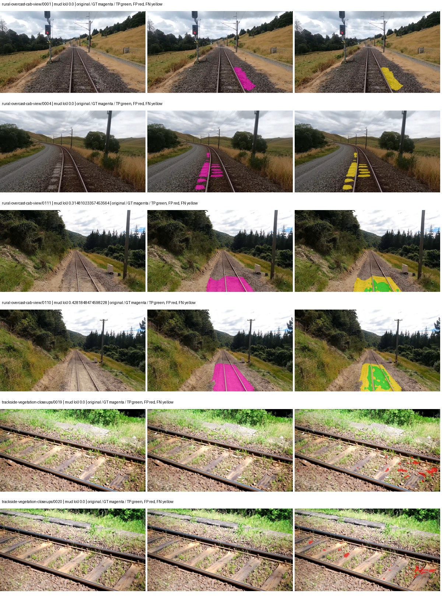
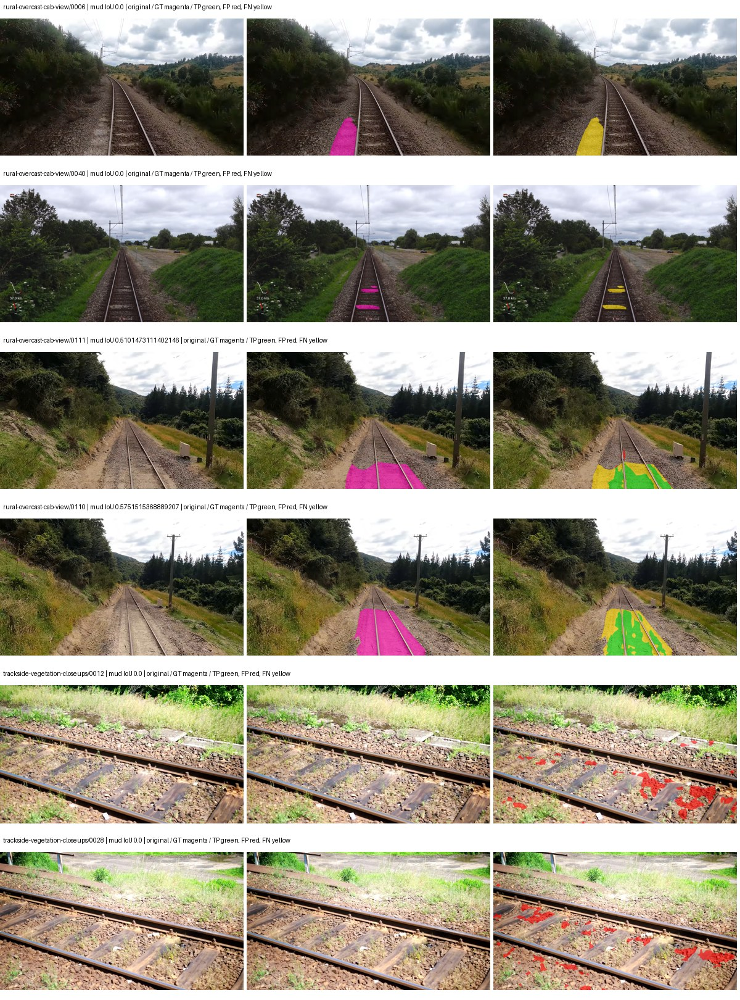
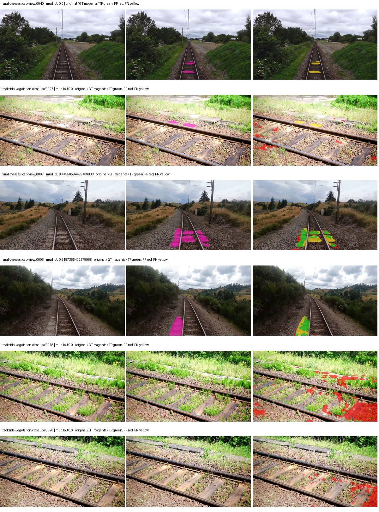
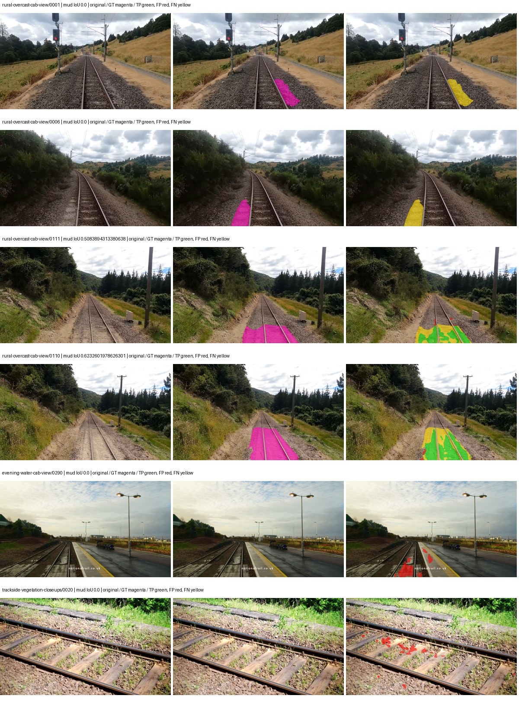

# hf_auto_mobilevit_xxs_deeplabv3 — rad_9_24_2026-fixed-grouped

[RAD 9/24: Scene-grouped split](../../README.md) · [Full model records](record.json)

Primary result: the **final checkpoint** after the full step budget (no early stopping). The checkpoint with the best **mud-pumping validation IoU, pixels pooled over all validation images**, is kept as secondary evidence. A job is complete only after full statistics and isolated profiling are verified.

Study metrics of the final checkpoint, counting each class only on the validation images that contain it: mud-pumping IoU is the mean per-image IoU over the images with mud-pumping, precision and recall sum pixels over those images, and mIoU averages each class over the images that contain it, then over the classes present.

| Initialization path | Seed | Mud-pumping IoU, train-camera images with mud (%, n=17) | Mud-pumping IoU, all images with mud (%, n=18) | Mud precision, all images with mud (%) | Mud recall, all images with mud (%) | mIoU (each class over images that contain it) (%) |
| --- | --- | --- | --- | --- | --- | --- |
| rtis_only | 0 | 6.23 | 5.88 | 85.06 | 8.72 | 27.61 |
| cityscapes_to_rtis | 0 | 17.32 | 16.36 | 64.29 | 21.66 | 31.19 |
| railsem19_to_rtis | 0 | 16.24 | 15.34 | 72.07 | 18.88 | 33.35 |
| cityscapes_to_railsem19_to_rtis | 0 | 10.65 | 10.15 | 60.13 | 14.91 | 32.31 |

Per-class IoU: IoU (%) of every class, each averaged only over the validation images that contain the class (n = those images); — = no image contains it. mIoU averages the classes with at least one such image.

| Initialization path | Seed | mIoU (each class over images that contain it) | person (n=0) | truck (n=0) | rail-track (n=37) | vegetation-overgrowth (n=13) | car (n=3) | on-rails (n=0) | traffic-sign (n=9) | road (n=11) | sidewalk (n=12) | construction (n=12) | tram-track (n=2) | pole (n=21) | traffic-light (n=3) | mud-pumping (n=18) | fence (n=7) | terrain (n=35) | sky (n=28) | rail-embedded (n=3) | rail-raised (n=37) | trackbed (n=37) | standing-water (n=9) |
| --- | --- | --- | --- | --- | --- | --- | --- | --- | --- | --- | --- | --- | --- | --- | --- | --- | --- | --- | --- | --- | --- | --- | --- |
| rtis_only | 0 | 27.61 | — | — | 49.98 | 18.21 | 2.32 | — | 0.33 | 7.77 | 6.92 | 33.62 | 0.00 | 50.37 | 21.31 | 5.88 | 5.61 | 77.63 | 94.89 | 0.00 | 63.03 | 58.62 | 0.52 |
| cityscapes_to_rtis | 0 | 31.19 | — | — | 52.02 | 25.96 | 22.81 | — | 9.15 | 6.50 | 5.83 | 31.82 | 0.00 | 54.24 | 31.38 | 16.36 | 9.31 | 80.91 | 94.44 | 0.00 | 67.49 | 52.56 | 0.69 |
| railsem19_to_rtis | 0 | 33.35 | — | — | 55.71 | 12.24 | 9.84 | — | 18.62 | 6.57 | 15.05 | 44.98 | 16.29 | 56.14 | 23.96 | 15.34 | 13.20 | 83.32 | 96.51 | 2.84 | 66.81 | 62.66 | 0.27 |
| cityscapes_to_railsem19_to_rtis | 0 | 32.31 | — | — | 53.98 | 21.89 | 16.95 | — | 16.04 | 9.74 | 8.51 | 43.51 | 0.00 | 54.00 | 31.05 | 10.15 | 13.53 | 80.48 | 95.85 | 2.25 | 69.03 | 53.99 | 0.55 |

Everything below is the campaign's own record, with pixels pooled over all validation images: its evaluation is the checkpoint that scored best on that pooled mud IoU (secondary evidence here); the diagnostics also cover the final checkpoint (`final-auto-val`).

| Model | Initialization path | Seed | Status | Steps | Best step | Best-checkpoint mud IoU, pixels pooled (%) | Best-checkpoint mud precision, pixels pooled (%) | Best-checkpoint mud recall, pixels pooled (%) | Final mud IoU (trainer val, pixels pooled, %) | Best-checkpoint mIoU, pixels pooled (%) | Best-checkpoint fixed GT-class mIoU, pixels pooled (%) |
| --- | --- | --- | --- | --- | --- | --- | --- | --- | --- | --- | --- |
| hf_auto_mobilevit_xxs_deeplabv3 | rtis_only | 0 | completed | 4000 | 3629 | 11.12 | 63.09 | 11.90 | 6.24 | 24.74 | 28.87 |
| hf_auto_mobilevit_xxs_deeplabv3 | cityscapes_to_rtis | 0 | completed | 4000 | 3629 | 22.68 | 53.08 | 28.38 | 13.68 | 29.35 | 34.24 |
| hf_auto_mobilevit_xxs_deeplabv3 | railsem19_to_rtis | 0 | completed | 4000 | 3629 | 14.13 | 27.98 | 22.20 | 12.51 | 28.86 | 33.67 |
| hf_auto_mobilevit_xxs_deeplabv3 | cityscapes_to_railsem19_to_rtis | 0 | completed | 4000 | 777 | 14.61 | 51.56 | 16.93 | 8.70 | 22.92 | 26.74 |

Training: 217 images. Validation: 37 images. Test: 60 held out. Seeds: [0]. Seed variation measures optimization variability, not independent-recording uncertainty. Historical source checkpoints stay fixed across adaptation seeds.

Training code: `fce0ea0ac50b334d4252812c396e0e593def375d`. Split SHA-256: `12d7b367c72cda61d57686ff2ac28223530d0af49debd9fb7a0fbc68b908bc93`.

## rtis_only — seed 0

Status: **completed**. Started: 2026-10-11T01:38:41.078064+00:00. Finished: 2026-10-11T03:31:16.291465+00:00.

Recipe pretrained initializer: `apple/deeplabv3-mobilevit-xx-small`.

`rtis_only` uses the recipe initializer, which may include pretrained segmentation components. Transfer paths load the exact historical source checkpoint below and reset the classifier; they do not reset all query/decoder features.

Source checkpoint: `Recipe pretrained initialization`.

Config SHA-256: `3c0a380e58a8bcefe88aaac4bfbfd1c11be856a5c1f6d88f571e0b7f09f20f9b`. Weights used for validation: `raw`.

### Mud-pumping and aggregate quality

| Metric | Selected checkpoint | Final training validation |
| --- | --- | --- |
| Mud IoU | 11.12 | 6.24 |
| Mud precision | 63.09 | 17.84 |
| Mud recall | 11.90 | 8.76 |
| Mud Dice/F1 | 20.02 | 11.75 |
| mIoU | 24.74 | 24.00 |
| Mean accuracy | 36.20 | 36.56 |
| Mean precision | 39.57 | 38.08 |
| Mean Dice | 31.61 | 30.63 |
| Mean specificity | 98.69 | 98.70 |
| Pixel accuracy | 80.86 | 79.94 |
| Frequency-weighted IoU | 69.05 | 69.09 |
| Fixed GT-present class mIoU | 28.87 | 28.00 |
| Boundary F1 | 27.68 | 29.10 |

The selected checkpoint has independent evaluation evidence. Final values are the trainer's final validation record, not a new independent evaluation. mIoU averages classes with nonzero union, so false positives on absent classes can change its denominator. The fixed GT-class mean is supplementary and excludes absent classes; their false positives remain in the confusion matrix.

### Resource usage and timing

| Measurement | Value |
| --- | --- |
| Peak training VRAM, retained training invocation (GiB) | 15.78 |
| Peak evaluation VRAM (GiB) | 6.64 |
| Retained training invocation wall time (seconds) | 6564.47 |
| Retained training invocation GPU-hours (one GPU) | 1.82 |
| Evaluation wall time (seconds) | 17.05 |
| Full evaluation pipeline images/second | 2.17 |
| Best full-state checkpoint (MiB) | 28.88 |
| Final full-state checkpoint (MiB) | 28.87 |
| Verified periodic checkpoints removed (GiB) | 0.23 |

VRAM uses the recorded allocator high-water mark; it is not total device usage including CUDA context. Resumed jobs' retained training invocation times and peaks are **not whole-campaign totals**. Earlier invocation resource records are not reconstructed here. Evaluation throughput includes loader, sliding-window inference and metrics; it is not model-only latency/FPS. Missing measurements are shown as —, never inferred from another dataset's run.

### Standardized inference performance

Dedicated model-only profiling waits for an idle worker-locked L40S: BF16, batch 1, 1024x1024, 20 warmup and 100 CUDA-event-timed public forwards. It excludes loading, preprocessing, tiling and metrics.

| Status | Parameters | Weight MiB | FPS | p50 ms | p95 ms | Peak reserved GiB |
| --- | --- | --- | --- | --- | --- | --- |
| complete | 1854853 | 7.08 | 34.67 | 28.77 | 29.15 | 3.30 |

```json
{
  "schema_version": 1,
  "model_id": "hf_auto_mobilevit_xxs_deeplabv3",
  "measured_at": "2026-10-11T03:31:14+00:00",
  "status": "complete",
  "benchmark_scope": "rtis_selected_checkpoint_model_only",
  "applies_to": [
    "hf_auto_mobilevit_xxs_deeplabv3--rtis_only--seed-0"
  ],
  "source": {
    "campaign_git_sha": "fce0ea0ac50b334d4252812c396e0e593def375d",
    "git_dirty": false,
    "config_hash": "e0654fa1282e",
    "resolved_config": "/data/izadia1/projects/segmentary-runs/rad_9_24_2026/fgall-seed0-20261007/configs/hf_auto_mobilevit_xxs_deeplabv3--rtis_only--seed-0.yaml",
    "config_sha256": "3c0a380e58a8bcefe88aaac4bfbfd1c11be856a5c1f6d88f571e0b7f09f20f9b",
    "checkpoint_sha256": "b89411497363b710040456420e8833f0029b902488b39ab11ad4055c63ac5301",
    "checkpoint_global_step": 3629,
    "checkpoint_bytes": 30284549,
    "checkpoint_kind": "resume checkpoint with optimizer and EMA state",
    "weights": "raw",
    "measured_checkpoint_job_id": "hf_auto_mobilevit_xxs_deeplabv3--rtis_only--seed-0",
    "result_sha256": "e0b082346bda75e7e230973c53267fa28d34c181b4c2f4a3638a4f7b87ec9b26",
    "result_git_sha": "fce0ea0ac50b334d4252812c396e0e593def375d",
    "result_stage": "eval:rad_9_24_2026-fixed-grouped:val",
    "result_seed": 0
  },
  "hardware": {
    "gpu_name": "NVIDIA L40S",
    "gpu_uuid": "GPU-c76642eb-64c1-b0ac-b051-d2efd47b32c4",
    "logical_device": "cuda:0",
    "physical_visibility_token": "9",
    "compute_capability": [
      8,
      9
    ],
    "total_memory_bytes": 47677177856
  },
  "model": {
    "parameter_count": 1854853,
    "trainable_parameter_count": 1854853,
    "resident_parameter_bytes": 7419412,
    "parameter_dtype_counts": {
      "float32": 1854853
    }
  },
  "contract": {
    "backend": "pytorch",
    "precision": "bf16_autocast",
    "batch_size": 1,
    "input_shape_nchw": [
      1,
      3,
      1024,
      1024
    ],
    "warmup_iterations": 20,
    "measured_iterations": 100,
    "timing": "per-forward CUDA events with end-event synchronization",
    "includes_preprocessing": false,
    "includes_data_loader": false,
    "includes_sliding_window": false,
    "input_resident_on_gpu": true,
    "model_only": true,
    "entrypoint": "public model(image) dense-logits forward"
  },
  "measurements": {
    "latency": {
      "p50_ms": 28.773375511169434,
      "p95_ms": 29.154099464416504,
      "mean_ms": 28.845250492095946,
      "minimum_ms": 28.604415893554688,
      "maximum_ms": 30.078975677490234,
      "fps": 34.667752331497894,
      "raw_ms": [
        29.030399322509766,
        28.78873634338379,
        28.78156852722168,
        28.645376205444336,
        28.729312896728516,
        28.917760848999023,
        28.940319061279297,
        28.74470329284668,
        28.699647903442383,
        28.881919860839844,
        28.696575164794922,
        28.925952911376953,
        28.874719619750977,
        28.95462417602539,
        28.635135650634766,
        28.96076774597168,
        28.697599411010742,
        28.943359375,
        28.95667266845703,
        28.669952392578125,
        28.676095962524414,
        28.663808822631836,
        28.705791473388672,
        28.669952392578125,
        28.637184143066406,
        28.706815719604492,
        28.655616760253906,
        28.639232635498047,
        28.681215286254883,
        28.683263778686523,
        28.839935302734375,
        28.646400451660156,
        28.652544021606445,
        28.717056274414062,
        28.840959548950195,
        28.850175857543945,
        28.871679306030273,
        28.810239791870117,
        28.709888458251953,
        28.97920036315918,
        29.025279998779297,
        28.974079132080078,
        28.632064819335938,
        28.709888458251953,
        28.915712356567383,
        28.96793556213379,
        28.696575164794922,
        28.701696395874023,
        28.816383361816406,
        29.336576461791992,
        28.878847122192383,
        29.039648056030273,
        28.941312789916992,
        28.660736083984375,
        28.670976638793945,
        28.640256881713867,
        28.656639099121094,
        28.915712356567383,
        29.038591384887695,
        28.634111404418945,
        29.103103637695312,
        29.6232967376709,
        29.13587188720703,
        29.80556869506836,
        30.078975677490234,
        28.76416015625,
        29.16966438293457,
        28.71295928955078,
        28.718080520629883,
        28.77132797241211,
        28.95974349975586,
        28.832767486572266,
        28.682239532470703,
        28.604415893554688,
        28.649471282958984,
        28.626943588256836,
        28.97203254699707,
        29.046783447265625,
        28.73651123046875,
        28.74367904663086,
        29.019136428833008,
        28.610559463500977,
        28.76927947998047,
        28.75596809387207,
        29.15328025817871,
        28.705791473388672,
        28.70476722717285,
        28.687360763549805,
        29.122560501098633,
        28.705791473388672,
        28.93619155883789,
        28.98534393310547,
        28.943359375,
        28.803071975708008,
        28.682239532470703,
        28.917760848999023,
        28.775423049926758,
        28.821504592895508,
        29.033472061157227,
        28.689407348632812
      ],
      "percentile_method": "numpy linear interpolation"
    },
    "peak_reserved_bytes": 3548381184,
    "memory_kind": "pytorch_cuda_allocator_peak_reserved_excluding_context",
    "process_total_bytes": 4085252096,
    "process_total_kind": "nvidia-smi used_memory of this PID on the benchmark GPU after the timed loop, including the CUDA context; null when the driver could not attribute memory to this PID",
    "benchmark_wall_clock_s": 15.154907613992691
  },
  "started_at": "2026-10-11T03:30:59+00:00",
  "finished_at": "2026-10-11T03:31:14+00:00",
  "environment": {
    "hostname": "hdrfs-app-001",
    "python": "3.11.15",
    "platform": "Linux-5.15.0-139-generic-x86_64-with-glibc2.35",
    "torch": "2.11.0+cu128",
    "torch_cuda": "12.8",
    "cudnn": 91900,
    "driver_version": "570.133.20",
    "cuda_available": true,
    "gpu_count": 1,
    "gpu_names": [
      "NVIDIA L40S"
    ],
    "cuda_visible_devices": "9",
    "packages": {
      "segmentary": "0.1.0",
      "torch": "2.11.0+cu128",
      "torchvision": "0.26.0+cu128",
      "transformers": "5.15.0",
      "timm": "1.0.28",
      "segmentation-models-pytorch": "0.5.0",
      "albumentations": "2.0.8",
      "lightning": "2.6.5",
      "numpy": "2.4.4"
    }
  }
}
```

### Per-class validation results

| Class | GT pixels | IoU (%) | Precision (%) | Recall (%) | Dice (%) | Boundary F1 (%) |
| --- | --- | --- | --- | --- | --- | --- |
| car | 29664 | 0.03 | 3.40 | 0.03 | 0.05 | 13.24 |
| construction | 311585 | 11.81 | 13.12 | 54.05 | 21.12 | 22.70 |
| fence | 265137 | 4.41 | 18.92 | 5.43 | 8.44 | 12.45 |
| mud-pumping | 1226250 | 11.12 | 63.09 | 11.90 | 20.02 | 15.02 |
| on-rails | 0 | 0.00 | 0.00 | — | 0.00 | 0.00 |
| person | 0 | 0.00 | 0.00 | — | 0.00 | 0.00 |
| pole | 628038 | 59.40 | 82.14 | 68.20 | 74.53 | 83.94 |
| rail-embedded | 16799 | 0.00 | 0.00 | 0.00 | 0.00 | 0.00 |
| rail-raised | 2969797 | 66.82 | 77.36 | 83.06 | 80.11 | 86.78 |
| rail-track | 6323197 | 32.53 | 74.19 | 36.68 | 49.09 | 41.98 |
| road | 1048831 | 5.94 | 31.31 | 6.82 | 11.21 | 7.99 |
| sidewalk | 1297367 | 38.39 | 79.47 | 42.61 | 55.48 | 12.47 |
| sky | 19121606 | 97.78 | 98.80 | 98.95 | 98.88 | 94.97 |
| standing-water | 95802 | 0.20 | 0.30 | 0.58 | 0.39 | 1.53 |
| terrain | 39239306 | 79.31 | 81.59 | 96.60 | 88.46 | 49.55 |
| trackbed | 10643081 | 54.09 | 64.29 | 77.32 | 70.21 | 53.06 |
| traffic-light | 19510 | 43.31 | 68.48 | 54.09 | 60.44 | 52.05 |
| traffic-sign | 13285 | 0.00 | 0.00 | 0.00 | 0.00 | 0.00 |
| tram-track | 56179 | 0.00 | 0.00 | 0.00 | 0.00 | 0.00 |
| truck | 0 | 0.00 | 0.00 | — | 0.00 | 0.00 |
| vegetation-overgrowth | 5901821 | 14.49 | 74.53 | 15.24 | 25.31 | 33.52 |

### Full-run accounting

| Measurement | Value |
| --- | --- |
| Full GPU-reserved wall seconds, all recorded worker attempts | 6762.94 |
| Full reserved GPU-hours | 1.88 |
| Whole-run timing complete | True |

| Phase | Wall seconds including failed attempts |
| --- | --- |
| training | 6571.53 |
| diagnostics | 135.25 |
| performance | 22.55 |

GPU-reserved time includes model loading, training, validation, collection, profiling, checkpoint I/O and orchestration while the worker owns one GPU. It is not GPU kernel-active time. Phase timings and sampled device memory/power/utilization are retained separately; sampled device memory is not the allocator high-water mark.

### Train/validation and raw/EMA diagnostics

| Checkpoint / weights / split | Images | Mud IoU (%) | Mud precision (%) | Mud recall (%) |
| --- | --- | --- | --- | --- |
| best-auto-train / raw | 217 | 89.80 | 94.81 | 94.45 |
| best-auto-val / raw | 37 | 11.12 | 63.09 | 11.90 |
| best-alternate-val / ema | 37 | 0.11 | 100.00 | 0.11 |
| final-auto-val / raw | 37 | 6.20 | 17.68 | 8.72 |

Train uses the evaluation transform without augmentation. Compare mud train/validation metrics for the same selected weights. Alternate EMA on running-stat BatchNorm is explicitly uncalibrated and is diagnostic only. Score-threshold curves use uncalibrated normalized scores and are pixel-level diagnostics, not event detection rates or a selected deployment operating point.

### Downloadable evidence

- best-auto-train: [per-image.csv](rtis_only--seed-0/best-auto-train/per-image.csv) · [per-image-confusion.json.gz](rtis_only--seed-0/best-auto-train/per-image-confusion.json.gz) · [groups.json](rtis_only--seed-0/best-auto-train/groups.json) · [mud-score-curves.json](rtis_only--seed-0/best-auto-train/mud-score-curves.json)
- best-auto-val: [per-image.csv](rtis_only--seed-0/best-auto-val/per-image.csv) · [per-image-confusion.json.gz](rtis_only--seed-0/best-auto-val/per-image-confusion.json.gz) · [groups.json](rtis_only--seed-0/best-auto-val/groups.json) · [mud-score-curves.json](rtis_only--seed-0/best-auto-val/mud-score-curves.json) · [examples.jpg](rtis_only--seed-0/best-auto-val/examples.jpg)
- best-alternate-val: [per-image.csv](rtis_only--seed-0/best-alternate-val/per-image.csv) · [per-image-confusion.json.gz](rtis_only--seed-0/best-alternate-val/per-image-confusion.json.gz) · [groups.json](rtis_only--seed-0/best-alternate-val/groups.json) · [mud-score-curves.json](rtis_only--seed-0/best-alternate-val/mud-score-curves.json)
- final-auto-val: [per-image.csv](rtis_only--seed-0/final-auto-val/per-image.csv) · [per-image-confusion.json.gz](rtis_only--seed-0/final-auto-val/per-image-confusion.json.gz) · [groups.json](rtis_only--seed-0/final-auto-val/groups.json) · [mud-score-curves.json](rtis_only--seed-0/final-auto-val/mud-score-curves.json)
- resources: [telemetry.csv](rtis_only--seed-0/resources/telemetry.csv)



Examples are two lowest and two highest mud-IoU positive images, plus up to two negative images with the most false-positive mud pixels. They are targeted diagnostic examples, not random samples. Green: true positive; red: false positive; yellow: false negative. Full predictions remain on HDRFS.

### Validation tracking

| Logged step | Overall mIoU (%) | Mud IoU (%) |
| --- | --- | --- |
| 258 | 11.28 | 0.01 |
| 518 | 17.70 | 0.00 |
| 777 | 20.19 | 0.34 |
| 1036 | 21.81 | 2.77 |
| 1295 | 21.82 | 1.58 |
| 1555 | 22.15 | 3.58 |
| 1814 | 23.34 | 5.34 |
| 2073 | 22.53 | 5.43 |
| 2332 | 23.27 | 8.81 |
| 2592 | 23.50 | 3.27 |
| 2851 | 24.99 | 6.33 |
| 3110 | 23.48 | 4.80 |
| 3369 | 24.82 | 4.39 |
| 3629 | 24.74 | 11.08 |
| 3888 | 24.97 | 9.85 |
| 4000 | 24.00 | 6.24 |

All retained scalar curves, including training loss and per-class IoU, are in record.json. Observed best mud on a curve is not necessarily a retained checkpoint: the pilot saved its selection-metric-best and final checkpoints. Step logging and checkpoint global_step may differ by one.

### Stopping and checkpoint provenance

```json
{
  "stopping": {
    "actual_steps": 4000,
    "maximum_steps": 4000,
    "min_delta": 0.0,
    "monitor": "val_iou/mud-pumping",
    "patience": null,
    "reason": "budget_complete"
  },
  "checkpoints": {
    "best": {
      "path": "/data/izadia1/projects/segmentary-runs/rad_9_24_2026/fgall-seed0-20261007/future-runs/hf_auto_mobilevit_xxs_deeplabv3--rtis_only--seed-0_seed0/rtis/best.ckpt",
      "sha256": "b89411497363b710040456420e8833f0029b902488b39ab11ad4055c63ac5301",
      "global_step": 3629,
      "bytes": 30284549
    },
    "final": {
      "path": "/data/izadia1/projects/segmentary-runs/rad_9_24_2026/fgall-seed0-20261007/future-runs/hf_auto_mobilevit_xxs_deeplabv3--rtis_only--seed-0_seed0/rtis/last.ckpt",
      "sha256": "9ede534683fd9e96ccf8a169fc54b1c3f4a15f9d197c56a0056fac250dbcc9ce",
      "global_step": 4000,
      "bytes": 30269893
    }
  },
  "cleanup_error": null
}
```

### Resolved training, initialization and evaluation settings

The optimizer block is the base configuration. Stage LR scales are applied at runtime, and stage warmup is capped at min(base warmup, floor(stage budget / 10), stage budget - 1): 400 steps for this 4,000-step pilot. Model-internal native input grids may differ from augmentation crops (EoMT uses its 640 grid).

```json
{
  "name": "hf_auto_mobilevit_xxs_deeplabv3--rtis_only--seed-0",
  "model": {
    "arch": "hf_auto",
    "checkpoint": "apple/deeplabv3-mobilevit-xx-small",
    "tuning": "full",
    "head": "unified_head",
    "lora_r": 16,
    "lora_alpha": 32,
    "lora_dropout": 0.05,
    "lora_targets": [],
    "drop_path": null,
    "revision": "2bece0a6464b15913c1f2c82cb5ab11bc5b7b3ad",
    "subfolder": null,
    "local_files_only": false,
    "trust_remote_code": false,
    "backbone_path": null,
    "head_paths": [],
    "classifier_path": null,
    "inactive_parameter_paths": [],
    "smp_arch": null,
    "encoder_name": null,
    "encoder_weights": null,
    "native": null,
    "batch_norm_momentum": null
  },
  "space": "paul-test-rtis",
  "taxonomy_root": "/data/izadia1/projects/segmentary-rad-fgall-fce0ea0a/taxonomy",
  "output_root": "/data/izadia1/projects/segmentary-runs/rad_9_24_2026/fgall-seed0-20261007/future-runs",
  "optim": {
    "backbone_lr": 0.0001,
    "head_lr_mult": 10.0,
    "weight_decay": 0.05,
    "llrd": 1.0,
    "warmup_iters": 1500,
    "warmup_ratio": 1e-06,
    "poly_power": 0.9,
    "min_lr_ratio": 0.0,
    "betas": [
      0.9,
      0.999
    ],
    "grad_clip": 1.0
  },
  "train": {
    "iters": 4000,
    "batch_size": 2,
    "accum": 8,
    "num_workers": 2,
    "precision": "bf16-mixed",
    "ema_decay": 0.9998,
    "val_every": 250,
    "ckpt_every": 500,
    "selection_metric": "val_iou/mud-pumping",
    "early_stopping_patience": null,
    "early_stopping_min_delta": 0.0,
    "seed": 0,
    "devices": 1
  },
  "eval": {
    "sliding_window": true,
    "window": [
      1024,
      1024
    ],
    "stride": [
      768,
      768
    ],
    "batch_size": 1,
    "num_workers": 2,
    "tta_scales": [],
    "tta_flip": false,
    "threshold": 0.5,
    "boundary_tolerance_frac": 0.0075,
    "save_confusion": true
  },
  "loss": {
    "task": "multiclass",
    "activation": "auto",
    "terms": [],
    "aux": "none",
    "aux_weight": 0.0,
    "ce_weight": 1.0,
    "label_smoothing": 0.0,
    "class_weights": null,
    "query": null
  },
  "aug": {
    "crop": [
      1024,
      1024
    ],
    "scale_min": 0.5,
    "scale_max": 2.0,
    "hflip_p": 0.5,
    "color_jitter_p": 0.5,
    "brightness": 0.25,
    "contrast": 0.25,
    "saturation": 0.25,
    "hue": 0.05
  },
  "stages": [
    {
      "name": "rtis",
      "data": [
        {
          "name": "rad_9_24_2026-fixed-grouped",
          "root": "/data/izadia1/datasets/rad_9_24_2026-fixed-grouped",
          "variant": null,
          "split_file": "splits.json",
          "train_split": "train",
          "val_split": "val",
          "limit": null,
          "loader": "folder",
          "mapping": "paul-test-rtis",
          "loader_options": {
            "require_groups": true
          }
        }
      ],
      "iters": null,
      "lr_scale": 1.0,
      "head_group_lr_scale": 1.0,
      "init_from": "pretrained",
      "reset_head": false,
      "freeze": null,
      "sample_weights": null
    }
  ]
}
```

### Hardware and software provenance

```json
{
  "training": {
    "cuda_available": true,
    "cuda_visible_devices": "9",
    "cudnn": 91900,
    "driver_version": "570.133.20",
    "gpu_count": 1,
    "gpu_names": [
      "NVIDIA L40S"
    ],
    "hostname": "hdrfs-app-001",
    "input_normalization": {
      "channel_order": "bgr",
      "mean": [
        0.0,
        0.0,
        0.0
      ],
      "source": "hf_image_processor",
      "std": [
        1.0,
        1.0,
        1.0
      ]
    },
    "model_origins": [
      {
        "hf_commit": "2bece0a6464b15913c1f2c82cb5ab11bc5b7b3ad",
        "hf_name_or_path": "apple/deeplabv3-mobilevit-xx-small",
        "module": "model",
        "timm_pretrained": {}
      },
      {
        "hf_commit": "2bece0a6464b15913c1f2c82cb5ab11bc5b7b3ad",
        "hf_name_or_path": "apple/deeplabv3-mobilevit-xx-small",
        "module": "model.mobilevit",
        "timm_pretrained": {}
      },
      {
        "hf_commit": "2bece0a6464b15913c1f2c82cb5ab11bc5b7b3ad",
        "hf_name_or_path": "apple/deeplabv3-mobilevit-xx-small",
        "module": "model.mobilevit.encoder",
        "timm_pretrained": {}
      }
    ],
    "model_parameter_count": 1854853,
    "packages": {
      "albumentations": "2.0.8",
      "lightning": "2.6.5",
      "numpy": "2.4.4",
      "segmentary": "0.1.0",
      "segmentation-models-pytorch": "0.5.0",
      "timm": "1.0.28",
      "torch": "2.11.0+cu128",
      "torchvision": "0.26.0+cu128",
      "transformers": "5.15.0"
    },
    "platform": "Linux-5.15.0-139-generic-x86_64-with-glibc2.35",
    "python": "3.11.15",
    "torch": "2.11.0+cu128",
    "torch_cuda": "12.8",
    "trainable_parameter_count": 1854853,
    "training_stop": {
      "actual_steps": 4000,
      "maximum_steps": 4000,
      "min_delta": 0.0,
      "monitor": "val_iou/mud-pumping",
      "patience": null,
      "reason": "budget_complete"
    },
    "validation_weights": "raw"
  },
  "evaluation": {
    "cuda_available": true,
    "cuda_visible_devices": "9",
    "cudnn": 91900,
    "driver_version": "570.133.20",
    "gpu_count": 1,
    "gpu_names": [
      "NVIDIA L40S"
    ],
    "hostname": "hdrfs-app-001",
    "input_normalization": {
      "channel_order": "bgr",
      "mean": [
        0.0,
        0.0,
        0.0
      ],
      "source": "hf_image_processor",
      "std": [
        1.0,
        1.0,
        1.0
      ]
    },
    "packages": {
      "albumentations": "2.0.8",
      "lightning": "2.6.5",
      "numpy": "2.4.4",
      "segmentary": "0.1.0",
      "segmentation-models-pytorch": "0.5.0",
      "timm": "1.0.28",
      "torch": "2.11.0+cu128",
      "torchvision": "0.26.0+cu128",
      "transformers": "5.15.0"
    },
    "platform": "Linux-5.15.0-139-generic-x86_64-with-glibc2.35",
    "python": "3.11.15",
    "torch": "2.11.0+cu128",
    "torch_cuda": "12.8"
  }
}
```

## cityscapes_to_rtis — seed 0

Status: **completed**. Started: 2026-10-11T01:47:40.066620+00:00. Finished: 2026-10-11T03:39:55.472424+00:00.

Recipe pretrained initializer: `apple/deeplabv3-mobilevit-xx-small`.

`rtis_only` uses the recipe initializer, which may include pretrained segmentation components. Transfer paths load the exact historical source checkpoint below and reset the classifier; they do not reset all query/decoder features.

Source checkpoint: `{'name': 'hf_auto_mobilevit_xxs_deeplabv3--cityscapes--seed-0', 'model': 'hf_auto_mobilevit_xxs_deeplabv3', 'protocol': 'cityscapes', 'config': '/data/izadia1/projects/segmentary-runs/all-model-city-rail-seed0-rail20-b9eb3e1/jobs/hf_auto_mobilevit_xxs_deeplabv3--cityscapes--seed-0/attempt-001/resolved-config.yaml', 'checkpoint': '/data/izadia1/projects/segmentary-runs/all-model-city-rail-seed0-rail20-b9eb3e1/jobs/hf_auto_mobilevit_xxs_deeplabv3--cityscapes--seed-0/attempt-001/train/hf_auto_mobilevit_xxs_deeplabv3--cityscapes_seed0/cityscapes/last.ckpt', 'recorded_sha256': '01d26e2baac106b0f31d7180ff889bc67cb7eaaed954174221aca62b4f1c726f', 'exists': True}`.

Config SHA-256: `c058f07695ed5db0356f997ffb9ea8e5ee82cd4f1fafc20fe51d7ebc0e9c986e`. Weights used for validation: `raw`.

### Mud-pumping and aggregate quality

| Metric | Selected checkpoint | Final training validation |
| --- | --- | --- |
| Mud IoU | 22.68 | 13.68 |
| Mud precision | 53.08 | 26.97 |
| Mud recall | 28.38 | 21.73 |
| Mud Dice/F1 | 36.98 | 24.07 |
| mIoU | 29.35 | 28.75 |
| Mean accuracy | 42.83 | 41.76 |
| Mean precision | 46.11 | 44.54 |
| Mean Dice | 38.29 | 37.21 |
| Mean specificity | 98.82 | 98.80 |
| Pixel accuracy | 81.63 | 81.55 |
| Frequency-weighted IoU | 71.39 | 71.11 |
| Fixed GT-present class mIoU | 34.24 | 33.54 |
| Boundary F1 | 36.16 | 35.55 |

The selected checkpoint has independent evaluation evidence. Final values are the trainer's final validation record, not a new independent evaluation. mIoU averages classes with nonzero union, so false positives on absent classes can change its denominator. The fixed GT-class mean is supplementary and excludes absent classes; their false positives remain in the confusion matrix.

### Resource usage and timing

| Measurement | Value |
| --- | --- |
| Peak training VRAM, retained training invocation (GiB) | 15.78 |
| Peak evaluation VRAM (GiB) | 6.64 |
| Retained training invocation wall time (seconds) | 6542.56 |
| Retained training invocation GPU-hours (one GPU) | 1.82 |
| Evaluation wall time (seconds) | 17.38 |
| Full evaluation pipeline images/second | 2.13 |
| Best full-state checkpoint (MiB) | 28.88 |
| Final full-state checkpoint (MiB) | 28.87 |
| Verified periodic checkpoints removed (GiB) | 0.23 |

VRAM uses the recorded allocator high-water mark; it is not total device usage including CUDA context. Resumed jobs' retained training invocation times and peaks are **not whole-campaign totals**. Earlier invocation resource records are not reconstructed here. Evaluation throughput includes loader, sliding-window inference and metrics; it is not model-only latency/FPS. Missing measurements are shown as —, never inferred from another dataset's run.

### Standardized inference performance

Dedicated model-only profiling waits for an idle worker-locked L40S: BF16, batch 1, 1024x1024, 20 warmup and 100 CUDA-event-timed public forwards. It excludes loading, preprocessing, tiling and metrics.

| Status | Parameters | Weight MiB | FPS | p50 ms | p95 ms | Peak reserved GiB |
| --- | --- | --- | --- | --- | --- | --- |
| complete | 1854853 | 7.08 | 34.69 | 28.74 | 29.17 | 3.30 |

```json
{
  "schema_version": 1,
  "model_id": "hf_auto_mobilevit_xxs_deeplabv3",
  "measured_at": "2026-10-11T03:39:53+00:00",
  "status": "complete",
  "benchmark_scope": "rtis_selected_checkpoint_model_only",
  "applies_to": [
    "hf_auto_mobilevit_xxs_deeplabv3--cityscapes_to_rtis--seed-0"
  ],
  "source": {
    "campaign_git_sha": "fce0ea0ac50b334d4252812c396e0e593def375d",
    "git_dirty": false,
    "config_hash": "4f2240c0c39a",
    "resolved_config": "/data/izadia1/projects/segmentary-runs/rad_9_24_2026/fgall-seed0-20261007/configs/hf_auto_mobilevit_xxs_deeplabv3--cityscapes_to_rtis--seed-0.yaml",
    "config_sha256": "c058f07695ed5db0356f997ffb9ea8e5ee82cd4f1fafc20fe51d7ebc0e9c986e",
    "checkpoint_sha256": "9ecb0df417f54734bd8bece19f3a97b78a4c5f4a0529d8cf4769bc8704c3bffa",
    "checkpoint_global_step": 3629,
    "checkpoint_bytes": 30284549,
    "checkpoint_kind": "resume checkpoint with optimizer and EMA state",
    "weights": "raw",
    "measured_checkpoint_job_id": "hf_auto_mobilevit_xxs_deeplabv3--cityscapes_to_rtis--seed-0",
    "result_sha256": "6a460069e63464b46cdcc71250af5dec765d08ae1c3cae5f93c9088bc65d84b8",
    "result_git_sha": "fce0ea0ac50b334d4252812c396e0e593def375d",
    "result_stage": "eval:rad_9_24_2026-fixed-grouped:val",
    "result_seed": 0
  },
  "hardware": {
    "gpu_name": "NVIDIA L40S",
    "gpu_uuid": "GPU-fc5dde96-210d-0afa-ac74-7f88477d622b",
    "logical_device": "cuda:0",
    "physical_visibility_token": "4",
    "compute_capability": [
      8,
      9
    ],
    "total_memory_bytes": 47677177856
  },
  "model": {
    "parameter_count": 1854853,
    "trainable_parameter_count": 1854853,
    "resident_parameter_bytes": 7419412,
    "parameter_dtype_counts": {
      "float32": 1854853
    }
  },
  "contract": {
    "backend": "pytorch",
    "precision": "bf16_autocast",
    "batch_size": 1,
    "input_shape_nchw": [
      1,
      3,
      1024,
      1024
    ],
    "warmup_iterations": 20,
    "measured_iterations": 100,
    "timing": "per-forward CUDA events with end-event synchronization",
    "includes_preprocessing": false,
    "includes_data_loader": false,
    "includes_sliding_window": false,
    "input_resident_on_gpu": true,
    "model_only": true,
    "entrypoint": "public model(image) dense-logits forward"
  },
  "measurements": {
    "latency": {
      "p50_ms": 28.73952007293701,
      "p95_ms": 29.172480583190918,
      "mean_ms": 28.827825622558592,
      "minimum_ms": 28.58291244506836,
      "maximum_ms": 29.57414436340332,
      "fps": 34.68870712251956,
      "raw_ms": [
        28.892160415649414,
        28.708864212036133,
        28.890111923217773,
        28.99558448791504,
        28.96998405456543,
        29.247488021850586,
        28.99558448791504,
        28.887039184570312,
        29.137920379638672,
        29.147136688232422,
        29.035520553588867,
        29.138015747070312,
        28.96895980834961,
        28.9300479888916,
        29.1276798248291,
        29.206527709960938,
        28.794879913330078,
        28.888063430786133,
        29.256799697875977,
        29.57414436340332,
        28.97100830078125,
        28.75596809387207,
        29.045759201049805,
        29.148160934448242,
        28.661760330200195,
        29.044736862182617,
        29.12665557861328,
        28.606464385986328,
        28.667903900146484,
        28.824480056762695,
        28.58291244506836,
        28.91878318786621,
        28.647424697875977,
        28.692480087280273,
        28.625919342041016,
        28.843008041381836,
        28.58905601501465,
        28.98534393310547,
        28.677120208740234,
        28.655616760253906,
        28.647424697875977,
        28.725248336791992,
        28.99456024169922,
        29.119487762451172,
        28.661760330200195,
        28.64838409423828,
        28.839807510375977,
        28.72831916809082,
        28.674047470092773,
        28.649471282958984,
        28.653663635253906,
        28.58393669128418,
        28.645376205444336,
        28.742528915405273,
        28.903423309326172,
        28.653568267822266,
        28.990463256835938,
        28.649471282958984,
        28.679168701171875,
        29.089792251586914,
        29.038591384887695,
        28.632991790771484,
        28.638080596923828,
        29.32419204711914,
        28.605440139770508,
        28.90233612060547,
        28.96793556213379,
        28.705791473388672,
        29.053855895996094,
        28.699647903442383,
        28.64748764038086,
        28.611583709716797,
        28.856319427490234,
        28.638240814208984,
        28.695552825927734,
        28.670879364013672,
        28.660736083984375,
        28.923904418945312,
        28.628992080688477,
        28.647424697875977,
        29.0119686126709,
        28.689407348632812,
        28.678144454956055,
        28.745664596557617,
        28.9617919921875,
        28.60851287841797,
        28.999679565429688,
        28.687360763549805,
        28.673023223876953,
        28.831743240356445,
        28.637184143066406,
        28.652544021606445,
        28.685312271118164,
        28.664831161499023,
        29.17068862915039,
        28.630016326904297,
        28.659711837768555,
        28.77030372619629,
        28.73651123046875,
        28.595199584960938
      ],
      "percentile_method": "numpy linear interpolation"
    },
    "peak_reserved_bytes": 3548381184,
    "memory_kind": "pytorch_cuda_allocator_peak_reserved_excluding_context",
    "process_total_bytes": 4085252096,
    "process_total_kind": "nvidia-smi used_memory of this PID on the benchmark GPU after the timed loop, including the CUDA context; null when the driver could not attribute memory to this PID",
    "benchmark_wall_clock_s": 15.375458553433418
  },
  "started_at": "2026-10-11T03:39:38+00:00",
  "finished_at": "2026-10-11T03:39:53+00:00",
  "environment": {
    "hostname": "hdrfs-app-001",
    "python": "3.11.15",
    "platform": "Linux-5.15.0-139-generic-x86_64-with-glibc2.35",
    "torch": "2.11.0+cu128",
    "torch_cuda": "12.8",
    "cudnn": 91900,
    "driver_version": "570.133.20",
    "cuda_available": true,
    "gpu_count": 1,
    "gpu_names": [
      "NVIDIA L40S"
    ],
    "cuda_visible_devices": "4",
    "packages": {
      "segmentary": "0.1.0",
      "torch": "2.11.0+cu128",
      "torchvision": "0.26.0+cu128",
      "transformers": "5.15.0",
      "timm": "1.0.28",
      "segmentation-models-pytorch": "0.5.0",
      "albumentations": "2.0.8",
      "lightning": "2.6.5",
      "numpy": "2.4.4"
    }
  }
}
```

### Per-class validation results

| Class | GT pixels | IoU (%) | Precision (%) | Recall (%) | Dice (%) | Boundary F1 (%) |
| --- | --- | --- | --- | --- | --- | --- |
| car | 29664 | 35.26 | 79.53 | 38.78 | 52.14 | 54.48 |
| construction | 311585 | 31.37 | 35.47 | 73.06 | 47.76 | 39.84 |
| fence | 265137 | 5.46 | 7.78 | 15.49 | 10.35 | 9.77 |
| mud-pumping | 1226250 | 22.68 | 53.08 | 28.38 | 36.98 | 33.34 |
| on-rails | 0 | 0.00 | 0.00 | — | 0.00 | 0.00 |
| person | 0 | 0.00 | 0.00 | — | 0.00 | 0.00 |
| pole | 628038 | 62.36 | 79.34 | 74.45 | 76.82 | 86.52 |
| rail-embedded | 16799 | 0.00 | 0.00 | 0.00 | 0.00 | 0.00 |
| rail-raised | 2969797 | 71.48 | 78.49 | 88.90 | 83.37 | 89.08 |
| rail-track | 6323197 | 36.01 | 61.32 | 46.59 | 52.95 | 50.99 |
| road | 1048831 | 2.39 | 11.63 | 2.91 | 4.66 | 11.13 |
| sidewalk | 1297367 | 24.37 | 85.98 | 25.37 | 39.18 | 7.64 |
| sky | 19121606 | 96.82 | 98.89 | 97.89 | 98.38 | 89.34 |
| standing-water | 95802 | 0.93 | 1.07 | 6.83 | 1.85 | 2.15 |
| terrain | 39239306 | 83.40 | 86.02 | 96.48 | 90.95 | 53.38 |
| trackbed | 10643081 | 48.44 | 63.76 | 66.84 | 65.26 | 47.87 |
| traffic-light | 19510 | 41.63 | 74.20 | 48.68 | 58.79 | 63.73 |
| traffic-sign | 13285 | 24.29 | 87.09 | 25.19 | 39.08 | 61.80 |
| tram-track | 56179 | 0.00 | 0.00 | 0.00 | 0.00 | 0.00 |
| truck | 0 | 0.00 | 0.00 | — | 0.00 | 0.00 |
| vegetation-overgrowth | 5901821 | 29.50 | 64.71 | 35.16 | 45.56 | 58.36 |

### Full-run accounting

| Measurement | Value |
| --- | --- |
| Full GPU-reserved wall seconds, all recorded worker attempts | 6743.17 |
| Full reserved GPU-hours | 1.87 |
| Whole-run timing complete | True |

| Phase | Wall seconds including failed attempts |
| --- | --- |
| training | 6550.18 |
| diagnostics | 136.97 |
| performance | 23.02 |

GPU-reserved time includes model loading, training, validation, collection, profiling, checkpoint I/O and orchestration while the worker owns one GPU. It is not GPU kernel-active time. Phase timings and sampled device memory/power/utilization are retained separately; sampled device memory is not the allocator high-water mark.

### Train/validation and raw/EMA diagnostics

| Checkpoint / weights / split | Images | Mud IoU (%) | Mud precision (%) | Mud recall (%) |
| --- | --- | --- | --- | --- |
| best-auto-train / raw | 217 | 88.54 | 92.48 | 95.41 |
| best-auto-val / raw | 37 | 22.68 | 53.08 | 28.38 |
| best-alternate-val / ema | 37 | 5.39 | 5.73 | 47.26 |
| final-auto-val / raw | 37 | 13.62 | 26.84 | 21.66 |

Train uses the evaluation transform without augmentation. Compare mud train/validation metrics for the same selected weights. Alternate EMA on running-stat BatchNorm is explicitly uncalibrated and is diagnostic only. Score-threshold curves use uncalibrated normalized scores and are pixel-level diagnostics, not event detection rates or a selected deployment operating point.

### Downloadable evidence

- best-auto-train: [per-image.csv](cityscapes_to_rtis--seed-0/best-auto-train/per-image.csv) · [per-image-confusion.json.gz](cityscapes_to_rtis--seed-0/best-auto-train/per-image-confusion.json.gz) · [groups.json](cityscapes_to_rtis--seed-0/best-auto-train/groups.json) · [mud-score-curves.json](cityscapes_to_rtis--seed-0/best-auto-train/mud-score-curves.json)
- best-auto-val: [per-image.csv](cityscapes_to_rtis--seed-0/best-auto-val/per-image.csv) · [per-image-confusion.json.gz](cityscapes_to_rtis--seed-0/best-auto-val/per-image-confusion.json.gz) · [groups.json](cityscapes_to_rtis--seed-0/best-auto-val/groups.json) · [mud-score-curves.json](cityscapes_to_rtis--seed-0/best-auto-val/mud-score-curves.json) · [examples.jpg](cityscapes_to_rtis--seed-0/best-auto-val/examples.jpg)
- best-alternate-val: [per-image.csv](cityscapes_to_rtis--seed-0/best-alternate-val/per-image.csv) · [per-image-confusion.json.gz](cityscapes_to_rtis--seed-0/best-alternate-val/per-image-confusion.json.gz) · [groups.json](cityscapes_to_rtis--seed-0/best-alternate-val/groups.json) · [mud-score-curves.json](cityscapes_to_rtis--seed-0/best-alternate-val/mud-score-curves.json)
- final-auto-val: [per-image.csv](cityscapes_to_rtis--seed-0/final-auto-val/per-image.csv) · [per-image-confusion.json.gz](cityscapes_to_rtis--seed-0/final-auto-val/per-image-confusion.json.gz) · [groups.json](cityscapes_to_rtis--seed-0/final-auto-val/groups.json) · [mud-score-curves.json](cityscapes_to_rtis--seed-0/final-auto-val/mud-score-curves.json)
- resources: [telemetry.csv](cityscapes_to_rtis--seed-0/resources/telemetry.csv)



Examples are two lowest and two highest mud-IoU positive images, plus up to two negative images with the most false-positive mud pixels. They are targeted diagnostic examples, not random samples. Green: true positive; red: false positive; yellow: false negative. Full predictions remain on HDRFS.

### Validation tracking

| Logged step | Overall mIoU (%) | Mud IoU (%) |
| --- | --- | --- |
| 258 | 17.29 | 1.67 |
| 518 | 22.82 | 4.76 |
| 777 | 20.95 | 8.22 |
| 1036 | 23.97 | 5.35 |
| 1295 | 21.65 | 15.07 |
| 1555 | 22.47 | 14.43 |
| 1814 | 26.09 | 16.67 |
| 2073 | 24.88 | 18.69 |
| 2332 | 27.21 | 3.39 |
| 2592 | 27.05 | 15.96 |
| 2851 | 27.97 | 16.64 |
| 3110 | 26.88 | 14.96 |
| 3369 | 27.08 | 14.39 |
| 3629 | 29.28 | 22.74 |
| 3888 | 29.81 | 21.97 |
| 4000 | 28.75 | 13.68 |

All retained scalar curves, including training loss and per-class IoU, are in record.json. Observed best mud on a curve is not necessarily a retained checkpoint: the pilot saved its selection-metric-best and final checkpoints. Step logging and checkpoint global_step may differ by one.

### Stopping and checkpoint provenance

```json
{
  "stopping": {
    "actual_steps": 4000,
    "maximum_steps": 4000,
    "min_delta": 0.0,
    "monitor": "val_iou/mud-pumping",
    "patience": null,
    "reason": "budget_complete"
  },
  "checkpoints": {
    "best": {
      "path": "/data/izadia1/projects/segmentary-runs/rad_9_24_2026/fgall-seed0-20261007/future-runs/hf_auto_mobilevit_xxs_deeplabv3--cityscapes_to_rtis--seed-0_seed0/rtis/best.ckpt",
      "sha256": "9ecb0df417f54734bd8bece19f3a97b78a4c5f4a0529d8cf4769bc8704c3bffa",
      "global_step": 3629,
      "bytes": 30284549
    },
    "final": {
      "path": "/data/izadia1/projects/segmentary-runs/rad_9_24_2026/fgall-seed0-20261007/future-runs/hf_auto_mobilevit_xxs_deeplabv3--cityscapes_to_rtis--seed-0_seed0/rtis/last.ckpt",
      "sha256": "6acfcf9fe3a7dffd7dc15ee2cf4359db2afd4595dbcea13e6d035107d690360e",
      "global_step": 4000,
      "bytes": 30269893
    }
  },
  "cleanup_error": null
}
```

### Resolved training, initialization and evaluation settings

The optimizer block is the base configuration. Stage LR scales are applied at runtime, and stage warmup is capped at min(base warmup, floor(stage budget / 10), stage budget - 1): 400 steps for this 4,000-step pilot. Model-internal native input grids may differ from augmentation crops (EoMT uses its 640 grid).

```json
{
  "name": "hf_auto_mobilevit_xxs_deeplabv3--cityscapes_to_rtis--seed-0",
  "model": {
    "arch": "hf_auto",
    "checkpoint": "apple/deeplabv3-mobilevit-xx-small",
    "tuning": "full",
    "head": "unified_head",
    "lora_r": 16,
    "lora_alpha": 32,
    "lora_dropout": 0.05,
    "lora_targets": [],
    "drop_path": null,
    "revision": "2bece0a6464b15913c1f2c82cb5ab11bc5b7b3ad",
    "subfolder": null,
    "local_files_only": false,
    "trust_remote_code": false,
    "backbone_path": null,
    "head_paths": [],
    "classifier_path": null,
    "inactive_parameter_paths": [],
    "smp_arch": null,
    "encoder_name": null,
    "encoder_weights": null,
    "native": null,
    "batch_norm_momentum": null
  },
  "space": "paul-test-rtis",
  "taxonomy_root": "/data/izadia1/projects/segmentary-rad-fgall-fce0ea0a/taxonomy",
  "output_root": "/data/izadia1/projects/segmentary-runs/rad_9_24_2026/fgall-seed0-20261007/future-runs",
  "optim": {
    "backbone_lr": 0.0001,
    "head_lr_mult": 10.0,
    "weight_decay": 0.05,
    "llrd": 1.0,
    "warmup_iters": 1500,
    "warmup_ratio": 1e-06,
    "poly_power": 0.9,
    "min_lr_ratio": 0.0,
    "betas": [
      0.9,
      0.999
    ],
    "grad_clip": 1.0
  },
  "train": {
    "iters": 4000,
    "batch_size": 2,
    "accum": 8,
    "num_workers": 2,
    "precision": "bf16-mixed",
    "ema_decay": 0.9998,
    "val_every": 250,
    "ckpt_every": 500,
    "selection_metric": "val_iou/mud-pumping",
    "early_stopping_patience": null,
    "early_stopping_min_delta": 0.0,
    "seed": 0,
    "devices": 1
  },
  "eval": {
    "sliding_window": true,
    "window": [
      1024,
      1024
    ],
    "stride": [
      768,
      768
    ],
    "batch_size": 1,
    "num_workers": 2,
    "tta_scales": [],
    "tta_flip": false,
    "threshold": 0.5,
    "boundary_tolerance_frac": 0.0075,
    "save_confusion": true
  },
  "loss": {
    "task": "multiclass",
    "activation": "auto",
    "terms": [],
    "aux": "none",
    "aux_weight": 0.0,
    "ce_weight": 1.0,
    "label_smoothing": 0.0,
    "class_weights": null,
    "query": null
  },
  "aug": {
    "crop": [
      1024,
      1024
    ],
    "scale_min": 0.5,
    "scale_max": 2.0,
    "hflip_p": 0.5,
    "color_jitter_p": 0.5,
    "brightness": 0.25,
    "contrast": 0.25,
    "saturation": 0.25,
    "hue": 0.05
  },
  "stages": [
    {
      "name": "rtis",
      "data": [
        {
          "name": "rad_9_24_2026-fixed-grouped",
          "root": "/data/izadia1/datasets/rad_9_24_2026-fixed-grouped",
          "variant": null,
          "split_file": "splits.json",
          "train_split": "train",
          "val_split": "val",
          "limit": null,
          "loader": "folder",
          "mapping": "paul-test-rtis",
          "loader_options": {
            "require_groups": true
          }
        }
      ],
      "iters": null,
      "lr_scale": 0.1,
      "head_group_lr_scale": 1.0,
      "init_from": "/data/izadia1/projects/segmentary-runs/all-model-city-rail-seed0-rail20-b9eb3e1/jobs/hf_auto_mobilevit_xxs_deeplabv3--cityscapes--seed-0/attempt-001/train/hf_auto_mobilevit_xxs_deeplabv3--cityscapes_seed0/cityscapes/last.ckpt",
      "reset_head": true,
      "freeze": null,
      "sample_weights": null
    }
  ]
}
```

### Hardware and software provenance

```json
{
  "training": {
    "cuda_available": true,
    "cuda_visible_devices": "4",
    "cudnn": 91900,
    "driver_version": "570.133.20",
    "gpu_count": 1,
    "gpu_names": [
      "NVIDIA L40S"
    ],
    "hostname": "hdrfs-app-001",
    "input_normalization": {
      "channel_order": "bgr",
      "mean": [
        0.0,
        0.0,
        0.0
      ],
      "source": "hf_image_processor",
      "std": [
        1.0,
        1.0,
        1.0
      ]
    },
    "model_origins": [
      {
        "hf_commit": "2bece0a6464b15913c1f2c82cb5ab11bc5b7b3ad",
        "hf_name_or_path": "apple/deeplabv3-mobilevit-xx-small",
        "module": "model",
        "timm_pretrained": {}
      },
      {
        "hf_commit": "2bece0a6464b15913c1f2c82cb5ab11bc5b7b3ad",
        "hf_name_or_path": "apple/deeplabv3-mobilevit-xx-small",
        "module": "model.mobilevit",
        "timm_pretrained": {}
      },
      {
        "hf_commit": "2bece0a6464b15913c1f2c82cb5ab11bc5b7b3ad",
        "hf_name_or_path": "apple/deeplabv3-mobilevit-xx-small",
        "module": "model.mobilevit.encoder",
        "timm_pretrained": {}
      }
    ],
    "model_parameter_count": 1854853,
    "packages": {
      "albumentations": "2.0.8",
      "lightning": "2.6.5",
      "numpy": "2.4.4",
      "segmentary": "0.1.0",
      "segmentation-models-pytorch": "0.5.0",
      "timm": "1.0.28",
      "torch": "2.11.0+cu128",
      "torchvision": "0.26.0+cu128",
      "transformers": "5.15.0"
    },
    "platform": "Linux-5.15.0-139-generic-x86_64-with-glibc2.35",
    "python": "3.11.15",
    "torch": "2.11.0+cu128",
    "torch_cuda": "12.8",
    "trainable_parameter_count": 1854853,
    "training_stop": {
      "actual_steps": 4000,
      "maximum_steps": 4000,
      "min_delta": 0.0,
      "monitor": "val_iou/mud-pumping",
      "patience": null,
      "reason": "budget_complete"
    },
    "validation_weights": "raw"
  },
  "evaluation": {
    "cuda_available": true,
    "cuda_visible_devices": "4",
    "cudnn": 91900,
    "driver_version": "570.133.20",
    "gpu_count": 1,
    "gpu_names": [
      "NVIDIA L40S"
    ],
    "hostname": "hdrfs-app-001",
    "input_normalization": {
      "channel_order": "bgr",
      "mean": [
        0.0,
        0.0,
        0.0
      ],
      "source": "hf_image_processor",
      "std": [
        1.0,
        1.0,
        1.0
      ]
    },
    "packages": {
      "albumentations": "2.0.8",
      "lightning": "2.6.5",
      "numpy": "2.4.4",
      "segmentary": "0.1.0",
      "segmentation-models-pytorch": "0.5.0",
      "timm": "1.0.28",
      "torch": "2.11.0+cu128",
      "torchvision": "0.26.0+cu128",
      "transformers": "5.15.0"
    },
    "platform": "Linux-5.15.0-139-generic-x86_64-with-glibc2.35",
    "python": "3.11.15",
    "torch": "2.11.0+cu128",
    "torch_cuda": "12.8"
  }
}
```

## railsem19_to_rtis — seed 0

Status: **completed**. Started: 2026-10-11T01:52:30.439351+00:00. Finished: 2026-10-11T03:44:24.738719+00:00.

Recipe pretrained initializer: `apple/deeplabv3-mobilevit-xx-small`.

`rtis_only` uses the recipe initializer, which may include pretrained segmentation components. Transfer paths load the exact historical source checkpoint below and reset the classifier; they do not reset all query/decoder features.

Source checkpoint: `{'name': 'hf_auto_mobilevit_xxs_deeplabv3--railsem19--seed-0', 'model': 'hf_auto_mobilevit_xxs_deeplabv3', 'protocol': 'railsem19', 'config': '/data/izadia1/projects/segmentary-runs/all-model-city-rail-seed0-rail20-b9eb3e1/jobs/hf_auto_mobilevit_xxs_deeplabv3--railsem19--seed-0/attempt-001/resolved-config.yaml', 'checkpoint': '/data/izadia1/projects/segmentary-runs/all-model-city-rail-seed0-rail20-b9eb3e1/jobs/hf_auto_mobilevit_xxs_deeplabv3--railsem19--seed-0/attempt-001/train/hf_auto_mobilevit_xxs_deeplabv3--railsem19_seed0/railsem19/last.ckpt', 'recorded_sha256': '9a4a000c2398260d53a1e1fb0e073bbc3fde8d64049cb54dc0895da390ce5131', 'exists': True}`.

Config SHA-256: `b4dd6bdccbeb7f005d96aa84733c8c909d0dd3d6bf2eda20b43283dcc149aeb4`. Weights used for validation: `raw`.

### Mud-pumping and aggregate quality

| Metric | Selected checkpoint | Final training validation |
| --- | --- | --- |
| Mud IoU | 14.13 | 12.51 |
| Mud precision | 27.98 | 27.10 |
| Mud recall | 22.20 | 18.86 |
| Mud Dice/F1 | 24.76 | 22.24 |
| mIoU | 28.86 | 29.21 |
| Mean accuracy | 41.96 | 43.28 |
| Mean precision | 48.89 | 48.36 |
| Mean Dice | 37.28 | 37.98 |
| Mean specificity | 98.80 | 98.85 |
| Pixel accuracy | 81.81 | 82.23 |
| Frequency-weighted IoU | 71.01 | 71.68 |
| Fixed GT-present class mIoU | 33.67 | 34.08 |
| Boundary F1 | 34.50 | 34.61 |

The selected checkpoint has independent evaluation evidence. Final values are the trainer's final validation record, not a new independent evaluation. mIoU averages classes with nonzero union, so false positives on absent classes can change its denominator. The fixed GT-class mean is supplementary and excludes absent classes; their false positives remain in the confusion matrix.

### Resource usage and timing

| Measurement | Value |
| --- | --- |
| Peak training VRAM, retained training invocation (GiB) | 15.78 |
| Peak evaluation VRAM (GiB) | 6.64 |
| Retained training invocation wall time (seconds) | 6522.17 |
| Retained training invocation GPU-hours (one GPU) | 1.81 |
| Evaluation wall time (seconds) | 17.08 |
| Full evaluation pipeline images/second | 2.17 |
| Best full-state checkpoint (MiB) | 28.88 |
| Final full-state checkpoint (MiB) | 28.87 |
| Verified periodic checkpoints removed (GiB) | 0.23 |

VRAM uses the recorded allocator high-water mark; it is not total device usage including CUDA context. Resumed jobs' retained training invocation times and peaks are **not whole-campaign totals**. Earlier invocation resource records are not reconstructed here. Evaluation throughput includes loader, sliding-window inference and metrics; it is not model-only latency/FPS. Missing measurements are shown as —, never inferred from another dataset's run.

### Standardized inference performance

Dedicated model-only profiling waits for an idle worker-locked L40S: BF16, batch 1, 1024x1024, 20 warmup and 100 CUDA-event-timed public forwards. It excludes loading, preprocessing, tiling and metrics.

| Status | Parameters | Weight MiB | FPS | p50 ms | p95 ms | Peak reserved GiB |
| --- | --- | --- | --- | --- | --- | --- |
| complete | 1854853 | 7.08 | 34.64 | 28.80 | 29.18 | 3.30 |

```json
{
  "schema_version": 1,
  "model_id": "hf_auto_mobilevit_xxs_deeplabv3",
  "measured_at": "2026-10-11T03:44:22+00:00",
  "status": "complete",
  "benchmark_scope": "rtis_selected_checkpoint_model_only",
  "applies_to": [
    "hf_auto_mobilevit_xxs_deeplabv3--railsem19_to_rtis--seed-0"
  ],
  "source": {
    "campaign_git_sha": "fce0ea0ac50b334d4252812c396e0e593def375d",
    "git_dirty": false,
    "config_hash": "705282885711",
    "resolved_config": "/data/izadia1/projects/segmentary-runs/rad_9_24_2026/fgall-seed0-20261007/configs/hf_auto_mobilevit_xxs_deeplabv3--railsem19_to_rtis--seed-0.yaml",
    "config_sha256": "b4dd6bdccbeb7f005d96aa84733c8c909d0dd3d6bf2eda20b43283dcc149aeb4",
    "checkpoint_sha256": "a85a83c3e27987ee6fdd12abfa46437af4a26799f7f952043f5cbe46352df7ea",
    "checkpoint_global_step": 3629,
    "checkpoint_bytes": 30284549,
    "checkpoint_kind": "resume checkpoint with optimizer and EMA state",
    "weights": "raw",
    "measured_checkpoint_job_id": "hf_auto_mobilevit_xxs_deeplabv3--railsem19_to_rtis--seed-0",
    "result_sha256": "b263d205b08742d656f35072fa619b29171c55b41499de7de9792675e6c92f71",
    "result_git_sha": "fce0ea0ac50b334d4252812c396e0e593def375d",
    "result_stage": "eval:rad_9_24_2026-fixed-grouped:val",
    "result_seed": 0
  },
  "hardware": {
    "gpu_name": "NVIDIA L40S",
    "gpu_uuid": "GPU-931d0911-fc78-1638-e3d7-1ba868cbd286",
    "logical_device": "cuda:0",
    "physical_visibility_token": "2",
    "compute_capability": [
      8,
      9
    ],
    "total_memory_bytes": 47677177856
  },
  "model": {
    "parameter_count": 1854853,
    "trainable_parameter_count": 1854853,
    "resident_parameter_bytes": 7419412,
    "parameter_dtype_counts": {
      "float32": 1854853
    }
  },
  "contract": {
    "backend": "pytorch",
    "precision": "bf16_autocast",
    "batch_size": 1,
    "input_shape_nchw": [
      1,
      3,
      1024,
      1024
    ],
    "warmup_iterations": 20,
    "measured_iterations": 100,
    "timing": "per-forward CUDA events with end-event synchronization",
    "includes_preprocessing": false,
    "includes_data_loader": false,
    "includes_sliding_window": false,
    "input_resident_on_gpu": true,
    "model_only": true,
    "entrypoint": "public model(image) dense-logits forward"
  },
  "measurements": {
    "latency": {
      "p50_ms": 28.803584098815918,
      "p95_ms": 29.181232929229736,
      "mean_ms": 28.865165786743162,
      "minimum_ms": 28.57574462890625,
      "maximum_ms": 29.75129508972168,
      "fps": 34.64383358779348,
      "raw_ms": [
        28.98534393310547,
        28.734464645385742,
        29.050880432128906,
        28.816383361816406,
        28.990463256835938,
        29.100128173828125,
        28.802047729492188,
        28.652544021606445,
        28.628992080688477,
        29.17990493774414,
        28.716032028198242,
        29.36422348022461,
        29.104127883911133,
        29.105152130126953,
        28.775423049926758,
        28.686336517333984,
        29.049856185913086,
        29.208576202392578,
        29.065216064453125,
        28.970943450927734,
        28.77952003479004,
        28.75801658630371,
        28.618783950805664,
        29.034496307373047,
        28.666879653930664,
        28.77337646484375,
        28.635135650634766,
        28.647424697875977,
        28.890111923217773,
        28.57574462890625,
        28.708864212036133,
        28.610559463500977,
        28.652511596679688,
        28.610559463500977,
        28.631040573120117,
        28.639135360717773,
        28.632064819335938,
        28.992511749267578,
        28.660736083984375,
        28.682239532470703,
        28.631168365478516,
        28.667903900146484,
        28.699615478515625,
        28.661760330200195,
        28.73958396911621,
        29.081600189208984,
        28.820480346679688,
        29.55571174621582,
        29.100032806396484,
        29.02230453491211,
        29.072383880615234,
        28.836864471435547,
        29.75129508972168,
        29.064191818237305,
        29.121536254882812,
        28.95462417602539,
        28.93619155883789,
        29.044736862182617,
        29.053951263427734,
        28.799999237060547,
        28.826623916625977,
        28.791807174682617,
        28.803071975708008,
        28.931072235107422,
        29.206464767456055,
        28.659711837768555,
        28.78668785095215,
        28.601343154907227,
        28.81839942932129,
        29.068288803100586,
        29.051904678344727,
        28.659584045410156,
        28.829696655273438,
        29.082624435424805,
        28.909568786621094,
        29.020160675048828,
        28.781503677368164,
        28.719104766845703,
        28.74367904663086,
        29.047807693481445,
        28.93824005126953,
        29.082624435424805,
        28.93619155883789,
        28.662784576416016,
        28.95462417602539,
        28.95769691467285,
        28.76416015625,
        28.667903900146484,
        28.96691131591797,
        28.705791473388672,
        28.678144454956055,
        28.691455841064453,
        28.705791473388672,
        28.804096221923828,
        29.15123176574707,
        28.76211166381836,
        28.602367401123047,
        28.648448944091797,
        28.78156852722168,
        28.912639617919922
      ],
      "percentile_method": "numpy linear interpolation"
    },
    "peak_reserved_bytes": 3548381184,
    "memory_kind": "pytorch_cuda_allocator_peak_reserved_excluding_context",
    "process_total_bytes": 4085252096,
    "process_total_kind": "nvidia-smi used_memory of this PID on the benchmark GPU after the timed loop, including the CUDA context; null when the driver could not attribute memory to this PID",
    "benchmark_wall_clock_s": 15.327457822859287
  },
  "started_at": "2026-10-11T03:44:07+00:00",
  "finished_at": "2026-10-11T03:44:22+00:00",
  "environment": {
    "hostname": "hdrfs-app-001",
    "python": "3.11.15",
    "platform": "Linux-5.15.0-139-generic-x86_64-with-glibc2.35",
    "torch": "2.11.0+cu128",
    "torch_cuda": "12.8",
    "cudnn": 91900,
    "driver_version": "570.133.20",
    "cuda_available": true,
    "gpu_count": 1,
    "gpu_names": [
      "NVIDIA L40S"
    ],
    "cuda_visible_devices": "2",
    "packages": {
      "segmentary": "0.1.0",
      "torch": "2.11.0+cu128",
      "torchvision": "0.26.0+cu128",
      "transformers": "5.15.0",
      "timm": "1.0.28",
      "segmentation-models-pytorch": "0.5.0",
      "albumentations": "2.0.8",
      "lightning": "2.6.5",
      "numpy": "2.4.4"
    }
  }
}
```

### Per-class validation results

| Class | GT pixels | IoU (%) | Precision (%) | Recall (%) | Dice (%) | Boundary F1 (%) |
| --- | --- | --- | --- | --- | --- | --- |
| car | 29664 | 5.18 | 32.73 | 5.80 | 9.86 | 34.24 |
| construction | 311585 | 47.09 | 56.24 | 74.31 | 64.02 | 54.43 |
| fence | 265137 | 4.96 | 6.63 | 16.42 | 9.45 | 11.06 |
| mud-pumping | 1226250 | 14.13 | 27.98 | 22.20 | 24.76 | 20.75 |
| on-rails | 0 | 0.00 | 0.00 | — | 0.00 | 0.00 |
| person | 0 | 0.00 | 0.00 | — | 0.00 | 0.00 |
| pole | 628038 | 63.84 | 82.32 | 73.98 | 77.93 | 87.48 |
| rail-embedded | 16799 | 3.11 | 94.40 | 3.11 | 6.03 | 7.79 |
| rail-raised | 2969797 | 67.93 | 73.95 | 89.30 | 80.90 | 86.22 |
| rail-track | 6323197 | 34.53 | 72.88 | 39.63 | 51.34 | 44.27 |
| road | 1048831 | 1.44 | 15.51 | 1.56 | 2.84 | 11.73 |
| sidewalk | 1297367 | 45.64 | 82.21 | 50.64 | 62.67 | 13.78 |
| sky | 19121606 | 97.94 | 99.06 | 98.86 | 98.96 | 96.07 |
| standing-water | 95802 | 0.06 | 0.06 | 0.56 | 0.12 | 0.75 |
| terrain | 39239306 | 83.96 | 84.96 | 98.62 | 91.28 | 56.34 |
| trackbed | 10643081 | 53.54 | 64.41 | 76.04 | 69.74 | 55.14 |
| traffic-light | 19510 | 31.11 | 56.99 | 40.65 | 47.45 | 52.27 |
| traffic-sign | 13285 | 26.72 | 58.08 | 33.11 | 42.17 | 56.08 |
| tram-track | 56179 | 18.04 | 44.07 | 23.40 | 30.57 | 15.22 |
| truck | 0 | 0.00 | 0.00 | — | 0.00 | 0.00 |
| vegetation-overgrowth | 5901821 | 6.86 | 74.13 | 7.03 | 12.85 | 20.98 |

### Full-run accounting

| Measurement | Value |
| --- | --- |
| Full GPU-reserved wall seconds, all recorded worker attempts | 6722.02 |
| Full reserved GPU-hours | 1.87 |
| Whole-run timing complete | True |

| Phase | Wall seconds including failed attempts |
| --- | --- |
| training | 6529.56 |
| diagnostics | 136.43 |
| performance | 22.99 |

GPU-reserved time includes model loading, training, validation, collection, profiling, checkpoint I/O and orchestration while the worker owns one GPU. It is not GPU kernel-active time. Phase timings and sampled device memory/power/utilization are retained separately; sampled device memory is not the allocator high-water mark.

### Train/validation and raw/EMA diagnostics

| Checkpoint / weights / split | Images | Mud IoU (%) | Mud precision (%) | Mud recall (%) |
| --- | --- | --- | --- | --- |
| best-auto-train / raw | 217 | 89.60 | 93.23 | 95.83 |
| best-auto-val / raw | 37 | 14.13 | 27.98 | 22.20 |
| best-alternate-val / ema | 37 | 0.00 | — | 0.00 |
| final-auto-val / raw | 37 | 12.51 | 27.05 | 18.88 |

Train uses the evaluation transform without augmentation. Compare mud train/validation metrics for the same selected weights. Alternate EMA on running-stat BatchNorm is explicitly uncalibrated and is diagnostic only. Score-threshold curves use uncalibrated normalized scores and are pixel-level diagnostics, not event detection rates or a selected deployment operating point.

### Downloadable evidence

- best-auto-train: [per-image.csv](railsem19_to_rtis--seed-0/best-auto-train/per-image.csv) · [per-image-confusion.json.gz](railsem19_to_rtis--seed-0/best-auto-train/per-image-confusion.json.gz) · [groups.json](railsem19_to_rtis--seed-0/best-auto-train/groups.json) · [mud-score-curves.json](railsem19_to_rtis--seed-0/best-auto-train/mud-score-curves.json)
- best-auto-val: [per-image.csv](railsem19_to_rtis--seed-0/best-auto-val/per-image.csv) · [per-image-confusion.json.gz](railsem19_to_rtis--seed-0/best-auto-val/per-image-confusion.json.gz) · [groups.json](railsem19_to_rtis--seed-0/best-auto-val/groups.json) · [mud-score-curves.json](railsem19_to_rtis--seed-0/best-auto-val/mud-score-curves.json) · [examples.jpg](railsem19_to_rtis--seed-0/best-auto-val/examples.jpg)
- best-alternate-val: [per-image.csv](railsem19_to_rtis--seed-0/best-alternate-val/per-image.csv) · [per-image-confusion.json.gz](railsem19_to_rtis--seed-0/best-alternate-val/per-image-confusion.json.gz) · [groups.json](railsem19_to_rtis--seed-0/best-alternate-val/groups.json) · [mud-score-curves.json](railsem19_to_rtis--seed-0/best-alternate-val/mud-score-curves.json)
- final-auto-val: [per-image.csv](railsem19_to_rtis--seed-0/final-auto-val/per-image.csv) · [per-image-confusion.json.gz](railsem19_to_rtis--seed-0/final-auto-val/per-image-confusion.json.gz) · [groups.json](railsem19_to_rtis--seed-0/final-auto-val/groups.json) · [mud-score-curves.json](railsem19_to_rtis--seed-0/final-auto-val/mud-score-curves.json)
- resources: [telemetry.csv](railsem19_to_rtis--seed-0/resources/telemetry.csv)



Examples are two lowest and two highest mud-IoU positive images, plus up to two negative images with the most false-positive mud pixels. They are targeted diagnostic examples, not random samples. Green: true positive; red: false positive; yellow: false negative. Full predictions remain on HDRFS.

### Validation tracking

| Logged step | Overall mIoU (%) | Mud IoU (%) |
| --- | --- | --- |
| 258 | 22.70 | 0.99 |
| 518 | 26.93 | 0.10 |
| 777 | 25.54 | 4.92 |
| 1036 | 26.06 | 0.92 |
| 1295 | 25.68 | 11.76 |
| 1555 | 26.25 | 7.18 |
| 1814 | 27.85 | 5.61 |
| 2073 | 28.00 | 10.65 |
| 2332 | 28.78 | 6.78 |
| 2592 | 28.39 | 7.67 |
| 2851 | 27.64 | 7.72 |
| 3110 | 29.60 | 10.28 |
| 3369 | 28.53 | 5.50 |
| 3629 | 28.88 | 14.11 |
| 3888 | 29.48 | 10.21 |
| 4000 | 29.21 | 12.51 |

All retained scalar curves, including training loss and per-class IoU, are in record.json. Observed best mud on a curve is not necessarily a retained checkpoint: the pilot saved its selection-metric-best and final checkpoints. Step logging and checkpoint global_step may differ by one.

### Stopping and checkpoint provenance

```json
{
  "stopping": {
    "actual_steps": 4000,
    "maximum_steps": 4000,
    "min_delta": 0.0,
    "monitor": "val_iou/mud-pumping",
    "patience": null,
    "reason": "budget_complete"
  },
  "checkpoints": {
    "best": {
      "path": "/data/izadia1/projects/segmentary-runs/rad_9_24_2026/fgall-seed0-20261007/future-runs/hf_auto_mobilevit_xxs_deeplabv3--railsem19_to_rtis--seed-0_seed0/rtis/best.ckpt",
      "sha256": "a85a83c3e27987ee6fdd12abfa46437af4a26799f7f952043f5cbe46352df7ea",
      "global_step": 3629,
      "bytes": 30284549
    },
    "final": {
      "path": "/data/izadia1/projects/segmentary-runs/rad_9_24_2026/fgall-seed0-20261007/future-runs/hf_auto_mobilevit_xxs_deeplabv3--railsem19_to_rtis--seed-0_seed0/rtis/last.ckpt",
      "sha256": "619f9dcdd834a7e10cb8ed1a08f61b97ac8eccba600aa90879cf89681add2faa",
      "global_step": 4000,
      "bytes": 30269893
    }
  },
  "cleanup_error": null
}
```

### Resolved training, initialization and evaluation settings

The optimizer block is the base configuration. Stage LR scales are applied at runtime, and stage warmup is capped at min(base warmup, floor(stage budget / 10), stage budget - 1): 400 steps for this 4,000-step pilot. Model-internal native input grids may differ from augmentation crops (EoMT uses its 640 grid).

```json
{
  "name": "hf_auto_mobilevit_xxs_deeplabv3--railsem19_to_rtis--seed-0",
  "model": {
    "arch": "hf_auto",
    "checkpoint": "apple/deeplabv3-mobilevit-xx-small",
    "tuning": "full",
    "head": "unified_head",
    "lora_r": 16,
    "lora_alpha": 32,
    "lora_dropout": 0.05,
    "lora_targets": [],
    "drop_path": null,
    "revision": "2bece0a6464b15913c1f2c82cb5ab11bc5b7b3ad",
    "subfolder": null,
    "local_files_only": false,
    "trust_remote_code": false,
    "backbone_path": null,
    "head_paths": [],
    "classifier_path": null,
    "inactive_parameter_paths": [],
    "smp_arch": null,
    "encoder_name": null,
    "encoder_weights": null,
    "native": null,
    "batch_norm_momentum": null
  },
  "space": "paul-test-rtis",
  "taxonomy_root": "/data/izadia1/projects/segmentary-rad-fgall-fce0ea0a/taxonomy",
  "output_root": "/data/izadia1/projects/segmentary-runs/rad_9_24_2026/fgall-seed0-20261007/future-runs",
  "optim": {
    "backbone_lr": 0.0001,
    "head_lr_mult": 10.0,
    "weight_decay": 0.05,
    "llrd": 1.0,
    "warmup_iters": 1500,
    "warmup_ratio": 1e-06,
    "poly_power": 0.9,
    "min_lr_ratio": 0.0,
    "betas": [
      0.9,
      0.999
    ],
    "grad_clip": 1.0
  },
  "train": {
    "iters": 4000,
    "batch_size": 2,
    "accum": 8,
    "num_workers": 2,
    "precision": "bf16-mixed",
    "ema_decay": 0.9998,
    "val_every": 250,
    "ckpt_every": 500,
    "selection_metric": "val_iou/mud-pumping",
    "early_stopping_patience": null,
    "early_stopping_min_delta": 0.0,
    "seed": 0,
    "devices": 1
  },
  "eval": {
    "sliding_window": true,
    "window": [
      1024,
      1024
    ],
    "stride": [
      768,
      768
    ],
    "batch_size": 1,
    "num_workers": 2,
    "tta_scales": [],
    "tta_flip": false,
    "threshold": 0.5,
    "boundary_tolerance_frac": 0.0075,
    "save_confusion": true
  },
  "loss": {
    "task": "multiclass",
    "activation": "auto",
    "terms": [],
    "aux": "none",
    "aux_weight": 0.0,
    "ce_weight": 1.0,
    "label_smoothing": 0.0,
    "class_weights": null,
    "query": null
  },
  "aug": {
    "crop": [
      1024,
      1024
    ],
    "scale_min": 0.5,
    "scale_max": 2.0,
    "hflip_p": 0.5,
    "color_jitter_p": 0.5,
    "brightness": 0.25,
    "contrast": 0.25,
    "saturation": 0.25,
    "hue": 0.05
  },
  "stages": [
    {
      "name": "rtis",
      "data": [
        {
          "name": "rad_9_24_2026-fixed-grouped",
          "root": "/data/izadia1/datasets/rad_9_24_2026-fixed-grouped",
          "variant": null,
          "split_file": "splits.json",
          "train_split": "train",
          "val_split": "val",
          "limit": null,
          "loader": "folder",
          "mapping": "paul-test-rtis",
          "loader_options": {
            "require_groups": true
          }
        }
      ],
      "iters": null,
      "lr_scale": 0.1,
      "head_group_lr_scale": 1.0,
      "init_from": "/data/izadia1/projects/segmentary-runs/all-model-city-rail-seed0-rail20-b9eb3e1/jobs/hf_auto_mobilevit_xxs_deeplabv3--railsem19--seed-0/attempt-001/train/hf_auto_mobilevit_xxs_deeplabv3--railsem19_seed0/railsem19/last.ckpt",
      "reset_head": true,
      "freeze": null,
      "sample_weights": null
    }
  ]
}
```

### Hardware and software provenance

```json
{
  "training": {
    "cuda_available": true,
    "cuda_visible_devices": "2",
    "cudnn": 91900,
    "driver_version": "570.133.20",
    "gpu_count": 1,
    "gpu_names": [
      "NVIDIA L40S"
    ],
    "hostname": "hdrfs-app-001",
    "input_normalization": {
      "channel_order": "bgr",
      "mean": [
        0.0,
        0.0,
        0.0
      ],
      "source": "hf_image_processor",
      "std": [
        1.0,
        1.0,
        1.0
      ]
    },
    "model_origins": [
      {
        "hf_commit": "2bece0a6464b15913c1f2c82cb5ab11bc5b7b3ad",
        "hf_name_or_path": "apple/deeplabv3-mobilevit-xx-small",
        "module": "model",
        "timm_pretrained": {}
      },
      {
        "hf_commit": "2bece0a6464b15913c1f2c82cb5ab11bc5b7b3ad",
        "hf_name_or_path": "apple/deeplabv3-mobilevit-xx-small",
        "module": "model.mobilevit",
        "timm_pretrained": {}
      },
      {
        "hf_commit": "2bece0a6464b15913c1f2c82cb5ab11bc5b7b3ad",
        "hf_name_or_path": "apple/deeplabv3-mobilevit-xx-small",
        "module": "model.mobilevit.encoder",
        "timm_pretrained": {}
      }
    ],
    "model_parameter_count": 1854853,
    "packages": {
      "albumentations": "2.0.8",
      "lightning": "2.6.5",
      "numpy": "2.4.4",
      "segmentary": "0.1.0",
      "segmentation-models-pytorch": "0.5.0",
      "timm": "1.0.28",
      "torch": "2.11.0+cu128",
      "torchvision": "0.26.0+cu128",
      "transformers": "5.15.0"
    },
    "platform": "Linux-5.15.0-139-generic-x86_64-with-glibc2.35",
    "python": "3.11.15",
    "torch": "2.11.0+cu128",
    "torch_cuda": "12.8",
    "trainable_parameter_count": 1854853,
    "training_stop": {
      "actual_steps": 4000,
      "maximum_steps": 4000,
      "min_delta": 0.0,
      "monitor": "val_iou/mud-pumping",
      "patience": null,
      "reason": "budget_complete"
    },
    "validation_weights": "raw"
  },
  "evaluation": {
    "cuda_available": true,
    "cuda_visible_devices": "2",
    "cudnn": 91900,
    "driver_version": "570.133.20",
    "gpu_count": 1,
    "gpu_names": [
      "NVIDIA L40S"
    ],
    "hostname": "hdrfs-app-001",
    "input_normalization": {
      "channel_order": "bgr",
      "mean": [
        0.0,
        0.0,
        0.0
      ],
      "source": "hf_image_processor",
      "std": [
        1.0,
        1.0,
        1.0
      ]
    },
    "packages": {
      "albumentations": "2.0.8",
      "lightning": "2.6.5",
      "numpy": "2.4.4",
      "segmentary": "0.1.0",
      "segmentation-models-pytorch": "0.5.0",
      "timm": "1.0.28",
      "torch": "2.11.0+cu128",
      "torchvision": "0.26.0+cu128",
      "transformers": "5.15.0"
    },
    "platform": "Linux-5.15.0-139-generic-x86_64-with-glibc2.35",
    "python": "3.11.15",
    "torch": "2.11.0+cu128",
    "torch_cuda": "12.8"
  }
}
```

## cityscapes_to_railsem19_to_rtis — seed 0

Status: **completed**. Started: 2026-10-11T02:32:02.137265+00:00. Finished: 2026-10-11T04:24:29.809395+00:00.

Recipe pretrained initializer: `apple/deeplabv3-mobilevit-xx-small`.

`rtis_only` uses the recipe initializer, which may include pretrained segmentation components. Transfer paths load the exact historical source checkpoint below and reset the classifier; they do not reset all query/decoder features.

Source checkpoint: `{'name': 'hf_auto_mobilevit_xxs_deeplabv3--cityscapes_to_railsem19--seed-0', 'model': 'hf_auto_mobilevit_xxs_deeplabv3', 'protocol': 'cityscapes_to_railsem19', 'config': '/data/izadia1/projects/segmentary-runs/all-model-city-rail-seed0-rail20-b9eb3e1/jobs/hf_auto_mobilevit_xxs_deeplabv3--cityscapes_to_railsem19--seed-0/attempt-001/resolved-config.yaml', 'checkpoint': '/data/izadia1/projects/segmentary-runs/all-model-city-rail-seed0-rail20-b9eb3e1/jobs/hf_auto_mobilevit_xxs_deeplabv3--cityscapes_to_railsem19--seed-0/attempt-001/train/hf_auto_mobilevit_xxs_deeplabv3--cityscapes_to_railsem19_seed0/railsem19/last.ckpt', 'recorded_sha256': 'ede10f1547709ba617ffe445c5867e6c314514fd952532bb083fecb7bb0876b7', 'exists': True}`.

Config SHA-256: `5bd849ee3e75980f04b5009ceb5136049721890518aa8a1ad5767ea126d420c0`. Weights used for validation: `raw`.

### Mud-pumping and aggregate quality

| Metric | Selected checkpoint | Final training validation |
| --- | --- | --- |
| Mud IoU | 14.61 | 8.70 |
| Mud precision | 51.56 | 17.26 |
| Mud recall | 16.93 | 14.91 |
| Mud Dice/F1 | 25.49 | 16.00 |
| mIoU | 22.92 | 28.63 |
| Mean accuracy | 33.58 | 40.99 |
| Mean precision | 42.30 | 47.74 |
| Mean Dice | 29.37 | 37.13 |
| Mean specificity | 98.60 | 98.73 |
| Pixel accuracy | 79.97 | 81.23 |
| Frequency-weighted IoU | 68.15 | 70.15 |
| Fixed GT-present class mIoU | 26.74 | 33.40 |
| Boundary F1 | 29.46 | 35.30 |

The selected checkpoint has independent evaluation evidence. Final values are the trainer's final validation record, not a new independent evaluation. mIoU averages classes with nonzero union, so false positives on absent classes can change its denominator. The fixed GT-class mean is supplementary and excludes absent classes; their false positives remain in the confusion matrix.

### Resource usage and timing

| Measurement | Value |
| --- | --- |
| Peak training VRAM, retained training invocation (GiB) | 15.78 |
| Peak evaluation VRAM (GiB) | 6.64 |
| Retained training invocation wall time (seconds) | 6555.15 |
| Retained training invocation GPU-hours (one GPU) | 1.82 |
| Evaluation wall time (seconds) | 17.09 |
| Full evaluation pipeline images/second | 2.17 |
| Best full-state checkpoint (MiB) | 28.88 |
| Final full-state checkpoint (MiB) | 28.87 |
| Verified periodic checkpoints removed (GiB) | 0.23 |

VRAM uses the recorded allocator high-water mark; it is not total device usage including CUDA context. Resumed jobs' retained training invocation times and peaks are **not whole-campaign totals**. Earlier invocation resource records are not reconstructed here. Evaluation throughput includes loader, sliding-window inference and metrics; it is not model-only latency/FPS. Missing measurements are shown as —, never inferred from another dataset's run.

### Standardized inference performance

Dedicated model-only profiling waits for an idle worker-locked L40S: BF16, batch 1, 1024x1024, 20 warmup and 100 CUDA-event-timed public forwards. It excludes loading, preprocessing, tiling and metrics.

| Status | Parameters | Weight MiB | FPS | p50 ms | p95 ms | Peak reserved GiB |
| --- | --- | --- | --- | --- | --- | --- |
| complete | 1854853 | 7.08 | 34.86 | 28.66 | 28.96 | 3.30 |

```json
{
  "schema_version": 1,
  "model_id": "hf_auto_mobilevit_xxs_deeplabv3",
  "measured_at": "2026-10-11T04:24:27+00:00",
  "status": "complete",
  "benchmark_scope": "rtis_selected_checkpoint_model_only",
  "applies_to": [
    "hf_auto_mobilevit_xxs_deeplabv3--cityscapes_to_railsem19_to_rtis--seed-0"
  ],
  "source": {
    "campaign_git_sha": "fce0ea0ac50b334d4252812c396e0e593def375d",
    "git_dirty": false,
    "config_hash": "7dd5c90eb4d6",
    "resolved_config": "/data/izadia1/projects/segmentary-runs/rad_9_24_2026/fgall-seed0-20261007/configs/hf_auto_mobilevit_xxs_deeplabv3--cityscapes_to_railsem19_to_rtis--seed-0.yaml",
    "config_sha256": "5bd849ee3e75980f04b5009ceb5136049721890518aa8a1ad5767ea126d420c0",
    "checkpoint_sha256": "87901017f8ad5f000b09fd29eb34fbb3b47c73a720702d5ebf9ed654a07ece54",
    "checkpoint_global_step": 777,
    "checkpoint_bytes": 30284613,
    "checkpoint_kind": "resume checkpoint with optimizer and EMA state",
    "weights": "raw",
    "measured_checkpoint_job_id": "hf_auto_mobilevit_xxs_deeplabv3--cityscapes_to_railsem19_to_rtis--seed-0",
    "result_sha256": "c1ce1beba0e47db5bf02effdb538df190646f1d5054da59114bbf38ab547f7f8",
    "result_git_sha": "fce0ea0ac50b334d4252812c396e0e593def375d",
    "result_stage": "eval:rad_9_24_2026-fixed-grouped:val",
    "result_seed": 0
  },
  "hardware": {
    "gpu_name": "NVIDIA L40S",
    "gpu_uuid": "GPU-e2e96741-aec9-e90b-5c46-d0d58be90a56",
    "logical_device": "cuda:0",
    "physical_visibility_token": "8",
    "compute_capability": [
      8,
      9
    ],
    "total_memory_bytes": 47677177856
  },
  "model": {
    "parameter_count": 1854853,
    "trainable_parameter_count": 1854853,
    "resident_parameter_bytes": 7419412,
    "parameter_dtype_counts": {
      "float32": 1854853
    }
  },
  "contract": {
    "backend": "pytorch",
    "precision": "bf16_autocast",
    "batch_size": 1,
    "input_shape_nchw": [
      1,
      3,
      1024,
      1024
    ],
    "warmup_iterations": 20,
    "measured_iterations": 100,
    "timing": "per-forward CUDA events with end-event synchronization",
    "includes_preprocessing": false,
    "includes_data_loader": false,
    "includes_sliding_window": false,
    "input_resident_on_gpu": true,
    "model_only": true,
    "entrypoint": "public model(image) dense-logits forward"
  },
  "measurements": {
    "latency": {
      "p50_ms": 28.655616760253906,
      "p95_ms": 28.95948839187622,
      "mean_ms": 28.68789213180542,
      "minimum_ms": 28.52454376220703,
      "maximum_ms": 29.12460708618164,
      "fps": 34.85791132389715,
      "raw_ms": [
        28.871679306030273,
        28.76620864868164,
        28.933088302612305,
        28.75596809387207,
        28.613632202148438,
        28.912639617919922,
        28.662784576416016,
        28.745792388916016,
        28.71295928955078,
        28.52454376220703,
        28.638208389282227,
        28.621824264526367,
        28.634111404418945,
        28.677120208740234,
        28.874752044677734,
        28.75187110900879,
        28.861440658569336,
        29.032447814941406,
        29.074432373046875,
        28.661760330200195,
        28.95564842224121,
        28.601343154907227,
        28.632064819335938,
        28.66169548034668,
        28.630016326904297,
        28.6167049407959,
        28.75289535522461,
        28.597248077392578,
        28.570688247680664,
        28.638208389282227,
        28.666879653930664,
        28.635135650634766,
        28.60032081604004,
        28.675071716308594,
        28.613632202148438,
        28.666879653930664,
        28.641279220581055,
        28.56447982788086,
        28.615680694580078,
        28.587007522583008,
        28.699647903442383,
        28.666879653930664,
        28.692480087280273,
        28.630016326904297,
        29.108224868774414,
        28.673023223876953,
        28.628992080688477,
        28.692480087280273,
        28.700672149658203,
        28.706815719604492,
        28.59110450744629,
        28.655616760253906,
        28.580799102783203,
        28.58086395263672,
        28.70476722717285,
        28.655616760253906,
        28.663808822631836,
        28.56243133544922,
        28.717056274414062,
        28.851200103759766,
        28.55628776550293,
        28.596223831176758,
        28.669952392578125,
        28.648448944091797,
        29.12460708618164,
        28.58393669128418,
        28.59008026123047,
        28.609535217285156,
        28.890111923217773,
        28.59212875366211,
        28.665855407714844,
        28.74675178527832,
        29.065216064453125,
        28.610591888427734,
        28.54092788696289,
        28.627967834472656,
        28.705791473388672,
        28.664831161499023,
        28.569599151611328,
        28.596223831176758,
        28.602367401123047,
        28.659711837768555,
        28.839935302734375,
        28.6167049407959,
        28.619775772094727,
        28.594175338745117,
        28.650495529174805,
        28.75187110900879,
        28.612607955932617,
        28.668928146362305,
        28.54911994934082,
        28.58291244506836,
        28.75494384765625,
        28.626943588256836,
        28.6167049407959,
        28.718080520629883,
        28.773344039916992,
        28.613632202148438,
        28.696575164794922,
        28.57267189025879
      ],
      "percentile_method": "numpy linear interpolation"
    },
    "peak_reserved_bytes": 3548381184,
    "memory_kind": "pytorch_cuda_allocator_peak_reserved_excluding_context",
    "process_total_bytes": 4085252096,
    "process_total_kind": "nvidia-smi used_memory of this PID on the benchmark GPU after the timed loop, including the CUDA context; null when the driver could not attribute memory to this PID",
    "benchmark_wall_clock_s": 14.876015573740005
  },
  "started_at": "2026-10-11T04:24:12+00:00",
  "finished_at": "2026-10-11T04:24:27+00:00",
  "environment": {
    "hostname": "hdrfs-app-001",
    "python": "3.11.15",
    "platform": "Linux-5.15.0-139-generic-x86_64-with-glibc2.35",
    "torch": "2.11.0+cu128",
    "torch_cuda": "12.8",
    "cudnn": 91900,
    "driver_version": "570.133.20",
    "cuda_available": true,
    "gpu_count": 1,
    "gpu_names": [
      "NVIDIA L40S"
    ],
    "cuda_visible_devices": "8",
    "packages": {
      "segmentary": "0.1.0",
      "torch": "2.11.0+cu128",
      "torchvision": "0.26.0+cu128",
      "transformers": "5.15.0",
      "timm": "1.0.28",
      "segmentation-models-pytorch": "0.5.0",
      "albumentations": "2.0.8",
      "lightning": "2.6.5",
      "numpy": "2.4.4"
    }
  }
}
```

### Per-class validation results

| Class | GT pixels | IoU (%) | Precision (%) | Recall (%) | Dice (%) | Boundary F1 (%) |
| --- | --- | --- | --- | --- | --- | --- |
| car | 29664 | 0.00 | 0.00 | 0.00 | 0.00 | 0.00 |
| construction | 311585 | 34.82 | 39.11 | 76.05 | 51.65 | 42.95 |
| fence | 265137 | 3.53 | 4.38 | 15.39 | 6.82 | 4.21 |
| mud-pumping | 1226250 | 14.61 | 51.56 | 16.93 | 25.49 | 22.89 |
| on-rails | 0 | 0.00 | 0.00 | — | 0.00 | 0.00 |
| person | 0 | 0.00 | 0.00 | — | 0.00 | 0.00 |
| pole | 628038 | 59.34 | 85.83 | 65.79 | 74.48 | 85.81 |
| rail-embedded | 16799 | 0.00 | 0.00 | 0.00 | 0.00 | 0.00 |
| rail-raised | 2969797 | 69.35 | 83.69 | 80.20 | 81.90 | 88.68 |
| rail-track | 6323197 | 31.69 | 61.55 | 39.52 | 48.13 | 39.90 |
| road | 1048831 | 8.15 | 21.81 | 11.52 | 15.07 | 23.60 |
| sidewalk | 1297367 | 9.82 | 93.68 | 9.88 | 17.88 | 8.51 |
| sky | 19121606 | 97.95 | 98.83 | 99.10 | 98.97 | 94.85 |
| standing-water | 95802 | 0.47 | 0.54 | 3.70 | 0.94 | 2.35 |
| terrain | 39239306 | 79.00 | 79.71 | 98.89 | 88.27 | 53.04 |
| trackbed | 10643081 | 51.30 | 71.48 | 64.51 | 67.82 | 51.15 |
| traffic-light | 19510 | 6.11 | 29.21 | 7.17 | 11.51 | 28.54 |
| traffic-sign | 13285 | 4.12 | 99.64 | 4.12 | 7.92 | 39.33 |
| tram-track | 56179 | 0.00 | 0.00 | 0.00 | 0.00 | 0.00 |
| truck | 0 | 0.00 | 0.00 | — | 0.00 | 0.00 |
| vegetation-overgrowth | 5901821 | 11.08 | 67.25 | 11.71 | 19.95 | 32.76 |

### Full-run accounting

| Measurement | Value |
| --- | --- |
| Full GPU-reserved wall seconds, all recorded worker attempts | 6755.31 |
| Full reserved GPU-hours | 1.88 |
| Whole-run timing complete | True |

| Phase | Wall seconds including failed attempts |
| --- | --- |
| training | 6562.29 |
| diagnostics | 137.36 |
| performance | 22.51 |

GPU-reserved time includes model loading, training, validation, collection, profiling, checkpoint I/O and orchestration while the worker owns one GPU. It is not GPU kernel-active time. Phase timings and sampled device memory/power/utilization are retained separately; sampled device memory is not the allocator high-water mark.

### Train/validation and raw/EMA diagnostics

| Checkpoint / weights / split | Images | Mud IoU (%) | Mud precision (%) | Mud recall (%) |
| --- | --- | --- | --- | --- |
| best-auto-train / raw | 217 | 84.16 | 87.80 | 95.30 |
| best-auto-val / raw | 37 | 14.61 | 51.56 | 16.93 |
| best-alternate-val / ema | 37 | 5.57 | 5.64 | 81.87 |
| final-auto-val / raw | 37 | 8.68 | 17.20 | 14.91 |

Train uses the evaluation transform without augmentation. Compare mud train/validation metrics for the same selected weights. Alternate EMA on running-stat BatchNorm is explicitly uncalibrated and is diagnostic only. Score-threshold curves use uncalibrated normalized scores and are pixel-level diagnostics, not event detection rates or a selected deployment operating point.

### Downloadable evidence

- best-auto-train: [per-image.csv](cityscapes_to_railsem19_to_rtis--seed-0/best-auto-train/per-image.csv) · [per-image-confusion.json.gz](cityscapes_to_railsem19_to_rtis--seed-0/best-auto-train/per-image-confusion.json.gz) · [groups.json](cityscapes_to_railsem19_to_rtis--seed-0/best-auto-train/groups.json) · [mud-score-curves.json](cityscapes_to_railsem19_to_rtis--seed-0/best-auto-train/mud-score-curves.json)
- best-auto-val: [per-image.csv](cityscapes_to_railsem19_to_rtis--seed-0/best-auto-val/per-image.csv) · [per-image-confusion.json.gz](cityscapes_to_railsem19_to_rtis--seed-0/best-auto-val/per-image-confusion.json.gz) · [groups.json](cityscapes_to_railsem19_to_rtis--seed-0/best-auto-val/groups.json) · [mud-score-curves.json](cityscapes_to_railsem19_to_rtis--seed-0/best-auto-val/mud-score-curves.json) · [examples.jpg](cityscapes_to_railsem19_to_rtis--seed-0/best-auto-val/examples.jpg)
- best-alternate-val: [per-image.csv](cityscapes_to_railsem19_to_rtis--seed-0/best-alternate-val/per-image.csv) · [per-image-confusion.json.gz](cityscapes_to_railsem19_to_rtis--seed-0/best-alternate-val/per-image-confusion.json.gz) · [groups.json](cityscapes_to_railsem19_to_rtis--seed-0/best-alternate-val/groups.json) · [mud-score-curves.json](cityscapes_to_railsem19_to_rtis--seed-0/best-alternate-val/mud-score-curves.json)
- final-auto-val: [per-image.csv](cityscapes_to_railsem19_to_rtis--seed-0/final-auto-val/per-image.csv) · [per-image-confusion.json.gz](cityscapes_to_railsem19_to_rtis--seed-0/final-auto-val/per-image-confusion.json.gz) · [groups.json](cityscapes_to_railsem19_to_rtis--seed-0/final-auto-val/groups.json) · [mud-score-curves.json](cityscapes_to_railsem19_to_rtis--seed-0/final-auto-val/mud-score-curves.json)
- resources: [telemetry.csv](cityscapes_to_railsem19_to_rtis--seed-0/resources/telemetry.csv)



Examples are two lowest and two highest mud-IoU positive images, plus up to two negative images with the most false-positive mud pixels. They are targeted diagnostic examples, not random samples. Green: true positive; red: false positive; yellow: false negative. Full predictions remain on HDRFS.

### Validation tracking

| Logged step | Overall mIoU (%) | Mud IoU (%) |
| --- | --- | --- |
| 258 | 24.09 | 1.72 |
| 518 | 23.36 | 10.38 |
| 777 | 22.91 | 14.59 |
| 1036 | 25.77 | 9.30 |
| 1295 | 25.56 | 7.64 |
| 1555 | 26.79 | 12.01 |
| 1814 | 27.62 | 6.43 |
| 2073 | 26.73 | 12.13 |
| 2332 | 29.23 | 3.68 |
| 2592 | 28.39 | 13.26 |
| 2851 | 27.64 | 9.21 |
| 3110 | 28.48 | 12.80 |
| 3369 | 27.38 | 8.90 |
| 3629 | 28.09 | 12.88 |
| 3888 | 27.79 | 12.18 |
| 4000 | 28.63 | 8.70 |

All retained scalar curves, including training loss and per-class IoU, are in record.json. Observed best mud on a curve is not necessarily a retained checkpoint: the pilot saved its selection-metric-best and final checkpoints. Step logging and checkpoint global_step may differ by one.

### Stopping and checkpoint provenance

```json
{
  "stopping": {
    "actual_steps": 4000,
    "maximum_steps": 4000,
    "min_delta": 0.0,
    "monitor": "val_iou/mud-pumping",
    "patience": null,
    "reason": "budget_complete"
  },
  "checkpoints": {
    "best": {
      "path": "/data/izadia1/projects/segmentary-runs/rad_9_24_2026/fgall-seed0-20261007/future-runs/hf_auto_mobilevit_xxs_deeplabv3--cityscapes_to_railsem19_to_rtis--seed-0_seed0/rtis/best.ckpt",
      "sha256": "87901017f8ad5f000b09fd29eb34fbb3b47c73a720702d5ebf9ed654a07ece54",
      "global_step": 777,
      "bytes": 30284613
    },
    "final": {
      "path": "/data/izadia1/projects/segmentary-runs/rad_9_24_2026/fgall-seed0-20261007/future-runs/hf_auto_mobilevit_xxs_deeplabv3--cityscapes_to_railsem19_to_rtis--seed-0_seed0/rtis/last.ckpt",
      "sha256": "26a44bb3da2c5069a42cc653b352ddd0485305964452e6b245834d988afeed27",
      "global_step": 4000,
      "bytes": 30269957
    }
  },
  "cleanup_error": null
}
```

### Resolved training, initialization and evaluation settings

The optimizer block is the base configuration. Stage LR scales are applied at runtime, and stage warmup is capped at min(base warmup, floor(stage budget / 10), stage budget - 1): 400 steps for this 4,000-step pilot. Model-internal native input grids may differ from augmentation crops (EoMT uses its 640 grid).

```json
{
  "name": "hf_auto_mobilevit_xxs_deeplabv3--cityscapes_to_railsem19_to_rtis--seed-0",
  "model": {
    "arch": "hf_auto",
    "checkpoint": "apple/deeplabv3-mobilevit-xx-small",
    "tuning": "full",
    "head": "unified_head",
    "lora_r": 16,
    "lora_alpha": 32,
    "lora_dropout": 0.05,
    "lora_targets": [],
    "drop_path": null,
    "revision": "2bece0a6464b15913c1f2c82cb5ab11bc5b7b3ad",
    "subfolder": null,
    "local_files_only": false,
    "trust_remote_code": false,
    "backbone_path": null,
    "head_paths": [],
    "classifier_path": null,
    "inactive_parameter_paths": [],
    "smp_arch": null,
    "encoder_name": null,
    "encoder_weights": null,
    "native": null,
    "batch_norm_momentum": null
  },
  "space": "paul-test-rtis",
  "taxonomy_root": "/data/izadia1/projects/segmentary-rad-fgall-fce0ea0a/taxonomy",
  "output_root": "/data/izadia1/projects/segmentary-runs/rad_9_24_2026/fgall-seed0-20261007/future-runs",
  "optim": {
    "backbone_lr": 0.0001,
    "head_lr_mult": 10.0,
    "weight_decay": 0.05,
    "llrd": 1.0,
    "warmup_iters": 1500,
    "warmup_ratio": 1e-06,
    "poly_power": 0.9,
    "min_lr_ratio": 0.0,
    "betas": [
      0.9,
      0.999
    ],
    "grad_clip": 1.0
  },
  "train": {
    "iters": 4000,
    "batch_size": 2,
    "accum": 8,
    "num_workers": 2,
    "precision": "bf16-mixed",
    "ema_decay": 0.9998,
    "val_every": 250,
    "ckpt_every": 500,
    "selection_metric": "val_iou/mud-pumping",
    "early_stopping_patience": null,
    "early_stopping_min_delta": 0.0,
    "seed": 0,
    "devices": 1
  },
  "eval": {
    "sliding_window": true,
    "window": [
      1024,
      1024
    ],
    "stride": [
      768,
      768
    ],
    "batch_size": 1,
    "num_workers": 2,
    "tta_scales": [],
    "tta_flip": false,
    "threshold": 0.5,
    "boundary_tolerance_frac": 0.0075,
    "save_confusion": true
  },
  "loss": {
    "task": "multiclass",
    "activation": "auto",
    "terms": [],
    "aux": "none",
    "aux_weight": 0.0,
    "ce_weight": 1.0,
    "label_smoothing": 0.0,
    "class_weights": null,
    "query": null
  },
  "aug": {
    "crop": [
      1024,
      1024
    ],
    "scale_min": 0.5,
    "scale_max": 2.0,
    "hflip_p": 0.5,
    "color_jitter_p": 0.5,
    "brightness": 0.25,
    "contrast": 0.25,
    "saturation": 0.25,
    "hue": 0.05
  },
  "stages": [
    {
      "name": "rtis",
      "data": [
        {
          "name": "rad_9_24_2026-fixed-grouped",
          "root": "/data/izadia1/datasets/rad_9_24_2026-fixed-grouped",
          "variant": null,
          "split_file": "splits.json",
          "train_split": "train",
          "val_split": "val",
          "limit": null,
          "loader": "folder",
          "mapping": "paul-test-rtis",
          "loader_options": {
            "require_groups": true
          }
        }
      ],
      "iters": null,
      "lr_scale": 0.1,
      "head_group_lr_scale": 1.0,
      "init_from": "/data/izadia1/projects/segmentary-runs/all-model-city-rail-seed0-rail20-b9eb3e1/jobs/hf_auto_mobilevit_xxs_deeplabv3--cityscapes_to_railsem19--seed-0/attempt-001/train/hf_auto_mobilevit_xxs_deeplabv3--cityscapes_to_railsem19_seed0/railsem19/last.ckpt",
      "reset_head": true,
      "freeze": null,
      "sample_weights": null
    }
  ]
}
```

### Hardware and software provenance

```json
{
  "training": {
    "cuda_available": true,
    "cuda_visible_devices": "8",
    "cudnn": 91900,
    "driver_version": "570.133.20",
    "gpu_count": 1,
    "gpu_names": [
      "NVIDIA L40S"
    ],
    "hostname": "hdrfs-app-001",
    "input_normalization": {
      "channel_order": "bgr",
      "mean": [
        0.0,
        0.0,
        0.0
      ],
      "source": "hf_image_processor",
      "std": [
        1.0,
        1.0,
        1.0
      ]
    },
    "model_origins": [
      {
        "hf_commit": "2bece0a6464b15913c1f2c82cb5ab11bc5b7b3ad",
        "hf_name_or_path": "apple/deeplabv3-mobilevit-xx-small",
        "module": "model",
        "timm_pretrained": {}
      },
      {
        "hf_commit": "2bece0a6464b15913c1f2c82cb5ab11bc5b7b3ad",
        "hf_name_or_path": "apple/deeplabv3-mobilevit-xx-small",
        "module": "model.mobilevit",
        "timm_pretrained": {}
      },
      {
        "hf_commit": "2bece0a6464b15913c1f2c82cb5ab11bc5b7b3ad",
        "hf_name_or_path": "apple/deeplabv3-mobilevit-xx-small",
        "module": "model.mobilevit.encoder",
        "timm_pretrained": {}
      }
    ],
    "model_parameter_count": 1854853,
    "packages": {
      "albumentations": "2.0.8",
      "lightning": "2.6.5",
      "numpy": "2.4.4",
      "segmentary": "0.1.0",
      "segmentation-models-pytorch": "0.5.0",
      "timm": "1.0.28",
      "torch": "2.11.0+cu128",
      "torchvision": "0.26.0+cu128",
      "transformers": "5.15.0"
    },
    "platform": "Linux-5.15.0-139-generic-x86_64-with-glibc2.35",
    "python": "3.11.15",
    "torch": "2.11.0+cu128",
    "torch_cuda": "12.8",
    "trainable_parameter_count": 1854853,
    "training_stop": {
      "actual_steps": 4000,
      "maximum_steps": 4000,
      "min_delta": 0.0,
      "monitor": "val_iou/mud-pumping",
      "patience": null,
      "reason": "budget_complete"
    },
    "validation_weights": "raw"
  },
  "evaluation": {
    "cuda_available": true,
    "cuda_visible_devices": "8",
    "cudnn": 91900,
    "driver_version": "570.133.20",
    "gpu_count": 1,
    "gpu_names": [
      "NVIDIA L40S"
    ],
    "hostname": "hdrfs-app-001",
    "input_normalization": {
      "channel_order": "bgr",
      "mean": [
        0.0,
        0.0,
        0.0
      ],
      "source": "hf_image_processor",
      "std": [
        1.0,
        1.0,
        1.0
      ]
    },
    "packages": {
      "albumentations": "2.0.8",
      "lightning": "2.6.5",
      "numpy": "2.4.4",
      "segmentary": "0.1.0",
      "segmentation-models-pytorch": "0.5.0",
      "timm": "1.0.28",
      "torch": "2.11.0+cu128",
      "torchvision": "0.26.0+cu128",
      "transformers": "5.15.0"
    },
    "platform": "Linux-5.15.0-139-generic-x86_64-with-glibc2.35",
    "python": "3.11.15",
    "torch": "2.11.0+cu128",
    "torch_cuda": "12.8"
  }
}
```
