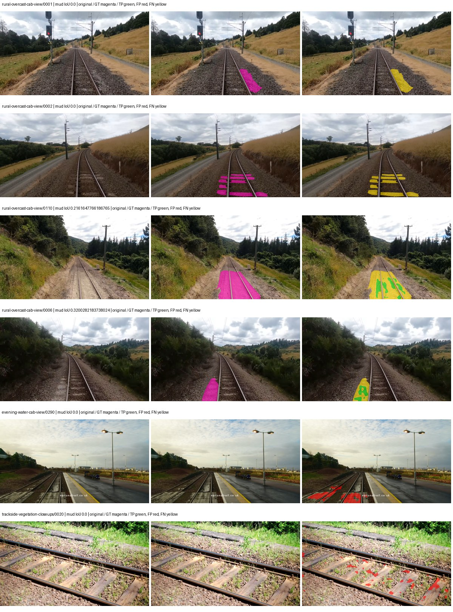
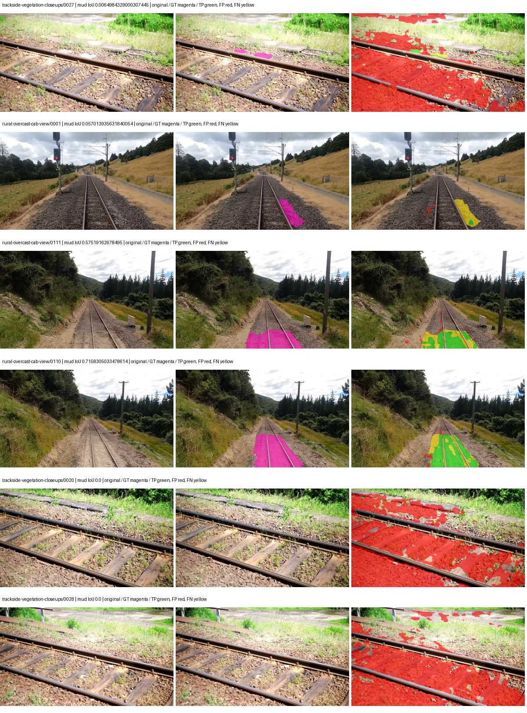
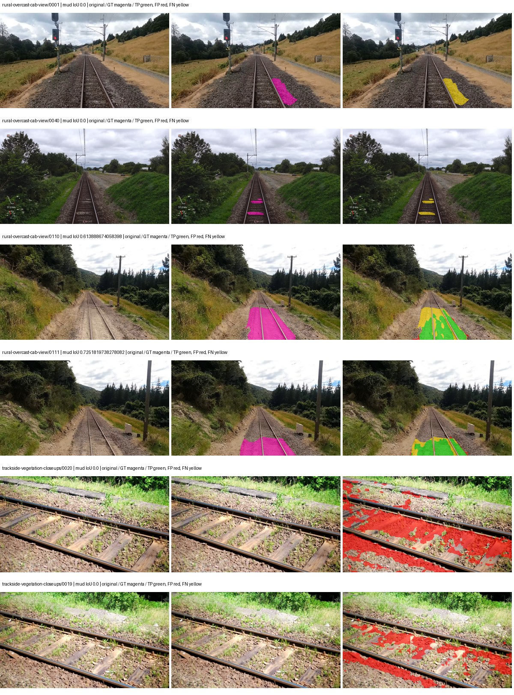
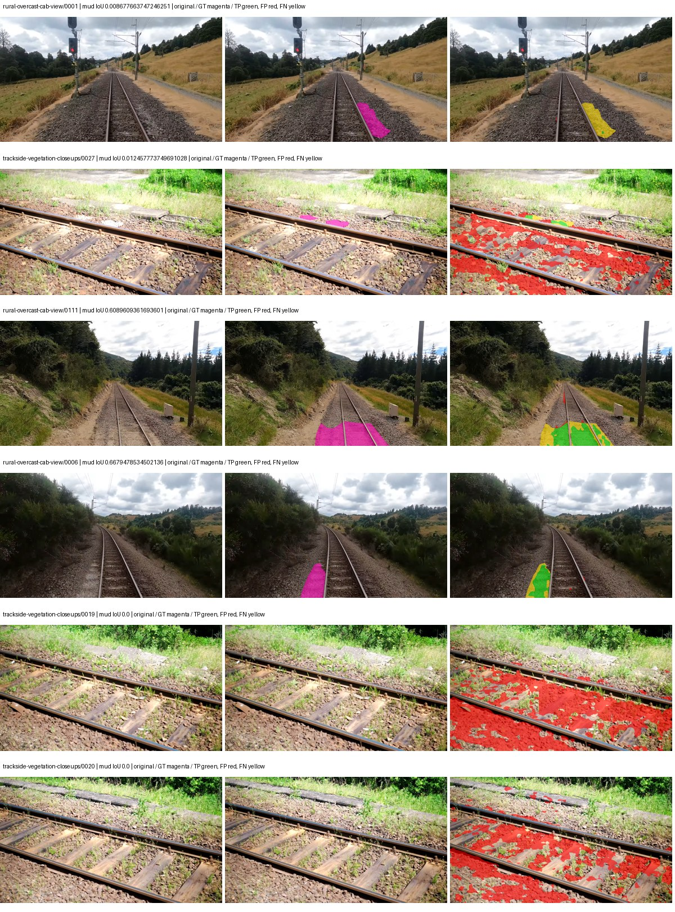

# hf_auto_mobilevitv2_deeplabv3 — rad_9_24_2026-fixed-grouped

[RAD 9/24: Scene-grouped split](../../README.md) · [Full model records](record.json)

Primary result: the **final checkpoint** after the full step budget (no early stopping). The checkpoint with the best **mud-pumping validation IoU, pixels pooled over all validation images**, is kept as secondary evidence. A job is complete only after full statistics and isolated profiling are verified.

Study metrics of the final checkpoint, counting each class only on the validation images that contain it: mud-pumping IoU is the mean per-image IoU over the images with mud-pumping, precision and recall sum pixels over those images, and mIoU averages each class over the images that contain it, then over the classes present.

| Initialization path | Seed | Mud-pumping IoU, train-camera images with mud (%, n=17) | Mud-pumping IoU, all images with mud (%, n=18) | Mud precision, all images with mud (%) | Mud recall, all images with mud (%) | mIoU (each class over images that contain it) (%) |
| --- | --- | --- | --- | --- | --- | --- |
| rtis_only | 0 | 6.10 | 5.85 | 63.75 | 7.44 | 31.46 |
| cityscapes_to_rtis | 0 | 19.03 | 18.03 | 23.77 | 27.78 | 33.08 |
| railsem19_to_rtis | 0 | 29.59 | 28.03 | 51.93 | 36.58 | 37.85 |
| cityscapes_to_railsem19_to_rtis | 0 | 28.27 | 26.78 | 27.48 | 38.02 | 35.32 |

Per-class IoU: IoU (%) of every class, each averaged only over the validation images that contain the class (n = those images); — = no image contains it. mIoU averages the classes with at least one such image.

| Initialization path | Seed | mIoU (each class over images that contain it) | person (n=0) | truck (n=0) | rail-track (n=37) | vegetation-overgrowth (n=13) | car (n=3) | on-rails (n=0) | traffic-sign (n=9) | road (n=11) | sidewalk (n=12) | construction (n=12) | tram-track (n=2) | pole (n=21) | traffic-light (n=3) | mud-pumping (n=18) | fence (n=7) | terrain (n=35) | sky (n=28) | rail-embedded (n=3) | rail-raised (n=37) | trackbed (n=37) | standing-water (n=9) |
| --- | --- | --- | --- | --- | --- | --- | --- | --- | --- | --- | --- | --- | --- | --- | --- | --- | --- | --- | --- | --- | --- | --- | --- |
| rtis_only | 0 | 31.46 | — | — | 55.25 | 36.69 | 18.79 | — | 9.79 | 5.08 | 7.92 | 30.50 | 0.00 | 55.98 | 24.66 | 5.85 | 12.77 | 78.43 | 95.36 | 3.50 | 65.85 | 55.94 | 3.85 |
| cityscapes_to_rtis | 0 | 33.08 | — | — | 50.76 | 12.13 | 29.12 | — | 21.62 | 11.61 | 9.78 | 27.18 | 0.12 | 57.54 | 50.98 | 18.03 | 14.14 | 79.01 | 93.83 | 0.67 | 66.73 | 51.83 | 0.29 |
| railsem19_to_rtis | 0 | 37.85 | — | — | 57.24 | 28.09 | 36.87 | — | 20.57 | 11.26 | 15.11 | 43.46 | 0.01 | 60.13 | 50.77 | 28.03 | 19.24 | 83.94 | 96.18 | 2.14 | 69.10 | 54.79 | 4.41 |
| cityscapes_to_railsem19_to_rtis | 0 | 35.32 | — | — | 53.28 | 17.50 | 34.72 | — | 20.99 | 18.68 | 12.60 | 31.09 | 0.95 | 58.39 | 49.00 | 26.78 | 15.52 | 80.72 | 95.78 | 4.44 | 65.48 | 49.86 | 0.05 |

Everything below is the campaign's own record, with pixels pooled over all validation images: its evaluation is the checkpoint that scored best on that pooled mud IoU (secondary evidence here); the diagnostics also cover the final checkpoint (`final-auto-val`).

| Model | Initialization path | Seed | Status | Steps | Best step | Best-checkpoint mud IoU, pixels pooled (%) | Best-checkpoint mud precision, pixels pooled (%) | Best-checkpoint mud recall, pixels pooled (%) | Final mud IoU (trainer val, pixels pooled, %) | Best-checkpoint mIoU, pixels pooled (%) | Best-checkpoint fixed GT-class mIoU, pixels pooled (%) |
| --- | --- | --- | --- | --- | --- | --- | --- | --- | --- | --- | --- |
| hf_auto_mobilevitv2_deeplabv3 | rtis_only | 0 | completed | 4000 | 2851 | 5.01 | 30.17 | 5.67 | 4.21 | 29.04 | 33.88 |
| hf_auto_mobilevitv2_deeplabv3 | cityscapes_to_rtis | 0 | completed | 4000 | 1296 | 6.38 | 7.02 | 41.17 | 4.12 | 27.52 | 32.11 |
| hf_auto_mobilevitv2_deeplabv3 | railsem19_to_rtis | 0 | completed | 4000 | 2333 | 15.02 | 18.19 | 46.27 | 9.82 | 35.32 | 41.21 |
| hf_auto_mobilevitv2_deeplabv3 | cityscapes_to_railsem19_to_rtis | 0 | completed | 4000 | 2333 | 7.97 | 9.84 | 29.60 | 5.25 | 34.65 | 38.50 |

Training: 217 images. Validation: 37 images. Test: 60 held out. Seeds: [0]. Seed variation measures optimization variability, not independent-recording uncertainty. Historical source checkpoints stay fixed across adaptation seeds.

Training code: `fce0ea0ac50b334d4252812c396e0e593def375d`. Split SHA-256: `12d7b367c72cda61d57686ff2ac28223530d0af49debd9fb7a0fbc68b908bc93`.

## rtis_only — seed 0

Status: **completed**. Started: 2026-10-11T02:57:53.394517+00:00. Finished: 2026-10-11T03:50:26.095398+00:00.

Recipe pretrained initializer: `apple/mobilevitv2-1.0-voc-deeplabv3`.

`rtis_only` uses the recipe initializer, which may include pretrained segmentation components. Transfer paths load the exact historical source checkpoint below and reset the classifier; they do not reset all query/decoder features.

Source checkpoint: `Recipe pretrained initialization`.

Config SHA-256: `1f7503bf344cd72c1c876a779e2e94e00d970c25c705b48d36117d2b6bdbdac1`. Weights used for validation: `raw`.

### Mud-pumping and aggregate quality

| Metric | Selected checkpoint | Final training validation |
| --- | --- | --- |
| Mud IoU | 5.01 | 4.21 |
| Mud precision | 30.17 | 8.85 |
| Mud recall | 5.67 | 7.43 |
| Mud Dice/F1 | 9.54 | 8.08 |
| mIoU | 29.04 | 29.35 |
| Mean accuracy | 42.79 | 43.83 |
| Mean precision | 47.30 | 44.80 |
| Mean Dice | 37.57 | 37.81 |
| Mean specificity | 98.82 | 98.88 |
| Pixel accuracy | 81.12 | 82.13 |
| Frequency-weighted IoU | 71.40 | 72.69 |
| Fixed GT-present class mIoU | 33.88 | 34.24 |
| Boundary F1 | 35.23 | 34.53 |

The selected checkpoint has independent evaluation evidence. Final values are the trainer's final validation record, not a new independent evaluation. mIoU averages classes with nonzero union, so false positives on absent classes can change its denominator. The fixed GT-class mean is supplementary and excludes absent classes; their false positives remain in the confusion matrix.

### Resource usage and timing

| Measurement | Value |
| --- | --- |
| Peak training VRAM, retained training invocation (GiB) | 9.10 |
| Peak evaluation VRAM (GiB) | 6.64 |
| Retained training invocation wall time (seconds) | 3006.22 |
| Retained training invocation GPU-hours (one GPU) | 0.84 |
| Evaluation wall time (seconds) | 12.36 |
| Full evaluation pipeline images/second | 2.99 |
| Best full-state checkpoint (MiB) | 203.83 |
| Final full-state checkpoint (MiB) | 203.82 |
| Verified periodic checkpoints removed (GiB) | 1.59 |

VRAM uses the recorded allocator high-water mark; it is not total device usage including CUDA context. Resumed jobs' retained training invocation times and peaks are **not whole-campaign totals**. Earlier invocation resource records are not reconstructed here. Evaluation throughput includes loader, sliding-window inference and metrics; it is not model-only latency/FPS. Missing measurements are shown as —, never inferred from another dataset's run.

### Standardized inference performance

Dedicated model-only profiling waits for an idle worker-locked L40S: BF16, batch 1, 1024x1024, 20 warmup and 100 CUDA-event-timed public forwards. It excludes loading, preprocessing, tiling and metrics.

| Status | Parameters | Weight MiB | FPS | p50 ms | p95 ms | Peak reserved GiB |
| --- | --- | --- | --- | --- | --- | --- |
| complete | 13318654 | 50.81 | 82.88 | 12.03 | 12.16 | 0.39 |

```json
{
  "schema_version": 1,
  "model_id": "hf_auto_mobilevitv2_deeplabv3",
  "measured_at": "2026-10-11T03:50:22+00:00",
  "status": "complete",
  "benchmark_scope": "rtis_selected_checkpoint_model_only",
  "applies_to": [
    "hf_auto_mobilevitv2_deeplabv3--rtis_only--seed-0"
  ],
  "source": {
    "campaign_git_sha": "fce0ea0ac50b334d4252812c396e0e593def375d",
    "git_dirty": false,
    "config_hash": "802b31b7a16b",
    "resolved_config": "/data/izadia1/projects/segmentary-runs/rad_9_24_2026/fgall-seed0-20261007/configs/hf_auto_mobilevitv2_deeplabv3--rtis_only--seed-0.yaml",
    "config_sha256": "1f7503bf344cd72c1c876a779e2e94e00d970c25c705b48d36117d2b6bdbdac1",
    "checkpoint_sha256": "46f0d43bca8e3198e2145b9af798b9f871d232065b14bca0129f31d2bb161526",
    "checkpoint_global_step": 2851,
    "checkpoint_bytes": 213728887,
    "checkpoint_kind": "resume checkpoint with optimizer and EMA state",
    "weights": "raw",
    "measured_checkpoint_job_id": "hf_auto_mobilevitv2_deeplabv3--rtis_only--seed-0",
    "result_sha256": "a449d30b92ec6b24a098b930a9297e38b59911ad418388640a78a8c0437af381",
    "result_git_sha": "fce0ea0ac50b334d4252812c396e0e593def375d",
    "result_stage": "eval:rad_9_24_2026-fixed-grouped:val",
    "result_seed": 0
  },
  "hardware": {
    "gpu_name": "NVIDIA L40S",
    "gpu_uuid": "GPU-1c9b612f-e0b5-fbbc-150f-8c2ef13453c9",
    "logical_device": "cuda:0",
    "physical_visibility_token": "5",
    "compute_capability": [
      8,
      9
    ],
    "total_memory_bytes": 47677177856
  },
  "model": {
    "parameter_count": 13318654,
    "trainable_parameter_count": 13318654,
    "resident_parameter_bytes": 53274616,
    "parameter_dtype_counts": {
      "float32": 13318654
    }
  },
  "contract": {
    "backend": "pytorch",
    "precision": "bf16_autocast",
    "batch_size": 1,
    "input_shape_nchw": [
      1,
      3,
      1024,
      1024
    ],
    "warmup_iterations": 20,
    "measured_iterations": 100,
    "timing": "per-forward CUDA events with end-event synchronization",
    "includes_preprocessing": false,
    "includes_data_loader": false,
    "includes_sliding_window": false,
    "input_resident_on_gpu": true,
    "model_only": true,
    "entrypoint": "public model(image) dense-logits forward"
  },
  "measurements": {
    "latency": {
      "p50_ms": 12.034560203552246,
      "p95_ms": 12.162867546081543,
      "mean_ms": 12.065463619232178,
      "minimum_ms": 12.016639709472656,
      "maximum_ms": 12.73855972290039,
      "fps": 82.8811914368557,
      "raw_ms": [
        12.057600021362305,
        12.064767837524414,
        12.033023834228516,
        12.030976295471191,
        12.020735740661621,
        12.04428768157959,
        12.017663955688477,
        12.031999588012695,
        12.024831771850586,
        12.042240142822266,
        12.029952049255371,
        12.0381441116333,
        12.02892780303955,
        12.022784233093262,
        12.026880264282227,
        12.020735740661621,
        12.043264389038086,
        12.17843246459961,
        12.016639709472656,
        12.02790355682373,
        12.041215896606445,
        12.154879570007324,
        12.023807525634766,
        12.021759986877441,
        12.137472152709961,
        12.026880264282227,
        12.035072326660156,
        12.024831771850586,
        12.024831771850586,
        12.034048080444336,
        12.154879570007324,
        12.026880264282227,
        12.021759986877441,
        12.039168357849121,
        12.030976295471191,
        12.149760246276855,
        12.025856018066406,
        12.039168357849121,
        12.031999588012695,
        12.050432205200195,
        12.04531192779541,
        12.040191650390625,
        12.055551528930664,
        12.039168357849121,
        12.0381441116333,
        12.043264389038086,
        12.031999588012695,
        12.03711986541748,
        12.034048080444336,
        12.051456451416016,
        12.024831771850586,
        12.4334077835083,
        12.129280090332031,
        12.029952049255371,
        12.02790355682373,
        12.031999588012695,
        12.182527542114258,
        12.034048080444336,
        12.041215896606445,
        12.034048080444336,
        12.033023834228516,
        12.02892780303955,
        12.041152000427246,
        12.73855972290039,
        12.126208305358887,
        12.026880264282227,
        12.025856018066406,
        12.04428768157959,
        12.030976295471191,
        12.154879570007324,
        12.23475170135498,
        12.057600021362305,
        12.119039535522461,
        12.05350399017334,
        12.02790355682373,
        12.066816329956055,
        12.030976295471191,
        12.033023834228516,
        12.055551528930664,
        12.025856018066406,
        12.03609561920166,
        12.024831771850586,
        12.033023834228516,
        12.020735740661621,
        12.06067180633545,
        12.155903816223145,
        12.128255844116211,
        12.022784233093262,
        12.024831771850586,
        12.024831771850586,
        12.126208305358887,
        12.03609561920166,
        12.050432205200195,
        12.04633617401123,
        12.023807525634766,
        12.16204833984375,
        12.123135566711426,
        12.031999588012695,
        12.02892780303955,
        12.146688461303711
      ],
      "percentile_method": "numpy linear interpolation"
    },
    "peak_reserved_bytes": 417333248,
    "memory_kind": "pytorch_cuda_allocator_peak_reserved_excluding_context",
    "process_total_bytes": 945815552,
    "process_total_kind": "nvidia-smi used_memory of this PID on the benchmark GPU after the timed loop, including the CUDA context; null when the driver could not attribute memory to this PID",
    "benchmark_wall_clock_s": 16.03255719691515
  },
  "started_at": "2026-10-11T03:50:06+00:00",
  "finished_at": "2026-10-11T03:50:22+00:00",
  "environment": {
    "hostname": "hdrfs-app-001",
    "python": "3.11.15",
    "platform": "Linux-5.15.0-139-generic-x86_64-with-glibc2.35",
    "torch": "2.11.0+cu128",
    "torch_cuda": "12.8",
    "cudnn": 91900,
    "driver_version": "570.133.20",
    "cuda_available": true,
    "gpu_count": 1,
    "gpu_names": [
      "NVIDIA L40S"
    ],
    "cuda_visible_devices": "5",
    "packages": {
      "segmentary": "0.1.0",
      "torch": "2.11.0+cu128",
      "torchvision": "0.26.0+cu128",
      "transformers": "5.15.0",
      "timm": "1.0.28",
      "segmentation-models-pytorch": "0.5.0",
      "albumentations": "2.0.8",
      "lightning": "2.6.5",
      "numpy": "2.4.4"
    }
  }
}
```

### Per-class validation results

| Class | GT pixels | IoU (%) | Precision (%) | Recall (%) | Dice (%) | Boundary F1 (%) |
| --- | --- | --- | --- | --- | --- | --- |
| car | 29664 | 43.73 | 63.38 | 58.52 | 60.85 | 38.55 |
| construction | 311585 | 6.75 | 6.98 | 66.94 | 12.64 | 17.89 |
| fence | 265137 | 6.76 | 20.85 | 9.10 | 12.67 | 21.63 |
| mud-pumping | 1226250 | 5.01 | 30.17 | 5.67 | 9.54 | 7.07 |
| on-rails | 0 | 0.00 | 0.00 | — | 0.00 | 0.00 |
| person | 0 | 0.00 | 0.00 | — | 0.00 | 0.00 |
| pole | 628038 | 63.78 | 82.92 | 73.43 | 77.89 | 84.30 |
| rail-embedded | 16799 | 1.89 | 28.28 | 1.99 | 3.72 | 16.31 |
| rail-raised | 2969797 | 71.83 | 83.04 | 84.18 | 83.61 | 89.27 |
| rail-track | 6323197 | 37.41 | 59.76 | 50.01 | 54.45 | 49.35 |
| road | 1048831 | 8.63 | 24.21 | 11.83 | 15.89 | 13.20 |
| sidewalk | 1297367 | 27.49 | 95.34 | 27.86 | 43.12 | 9.26 |
| sky | 19121606 | 97.86 | 99.01 | 98.83 | 98.92 | 93.91 |
| standing-water | 95802 | 3.44 | 10.68 | 4.84 | 6.66 | 16.01 |
| terrain | 39239306 | 80.89 | 86.53 | 92.55 | 89.44 | 49.91 |
| trackbed | 10643081 | 54.86 | 66.71 | 75.53 | 70.85 | 49.97 |
| traffic-light | 19510 | 40.51 | 87.81 | 42.92 | 57.66 | 72.00 |
| traffic-sign | 13285 | 26.38 | 73.01 | 29.24 | 41.75 | 54.76 |
| tram-track | 56179 | 0.00 | 0.00 | 0.00 | 0.00 | 0.00 |
| truck | 0 | 0.00 | 0.00 | — | 0.00 | 0.00 |
| vegetation-overgrowth | 5901821 | 32.67 | 74.54 | 36.77 | 49.25 | 56.50 |

### Full-run accounting

| Measurement | Value |
| --- | --- |
| Full GPU-reserved wall seconds, all recorded worker attempts | 3160.39 |
| Full reserved GPU-hours | 0.88 |
| Whole-run timing complete | True |

| Phase | Wall seconds including failed attempts |
| --- | --- |
| training | 3013.05 |
| diagnostics | 93.43 |
| performance | 23.85 |

GPU-reserved time includes model loading, training, validation, collection, profiling, checkpoint I/O and orchestration while the worker owns one GPU. It is not GPU kernel-active time. Phase timings and sampled device memory/power/utilization are retained separately; sampled device memory is not the allocator high-water mark.

### Train/validation and raw/EMA diagnostics

| Checkpoint / weights / split | Images | Mud IoU (%) | Mud precision (%) | Mud recall (%) |
| --- | --- | --- | --- | --- |
| best-auto-train / raw | 217 | 92.12 | 97.28 | 94.55 |
| best-auto-val / raw | 37 | 5.01 | 30.17 | 5.67 |
| best-alternate-val / ema | 37 | 1.97 | 2.42 | 9.56 |
| final-auto-val / raw | 37 | 4.21 | 8.86 | 7.44 |

Train uses the evaluation transform without augmentation. Compare mud train/validation metrics for the same selected weights. Alternate EMA on running-stat BatchNorm is explicitly uncalibrated and is diagnostic only. Score-threshold curves use uncalibrated normalized scores and are pixel-level diagnostics, not event detection rates or a selected deployment operating point.

### Downloadable evidence

- best-auto-train: [per-image.csv](rtis_only--seed-0/best-auto-train/per-image.csv) · [per-image-confusion.json.gz](rtis_only--seed-0/best-auto-train/per-image-confusion.json.gz) · [groups.json](rtis_only--seed-0/best-auto-train/groups.json) · [mud-score-curves.json](rtis_only--seed-0/best-auto-train/mud-score-curves.json)
- best-auto-val: [per-image.csv](rtis_only--seed-0/best-auto-val/per-image.csv) · [per-image-confusion.json.gz](rtis_only--seed-0/best-auto-val/per-image-confusion.json.gz) · [groups.json](rtis_only--seed-0/best-auto-val/groups.json) · [mud-score-curves.json](rtis_only--seed-0/best-auto-val/mud-score-curves.json) · [examples.jpg](rtis_only--seed-0/best-auto-val/examples.jpg)
- best-alternate-val: [per-image.csv](rtis_only--seed-0/best-alternate-val/per-image.csv) · [per-image-confusion.json.gz](rtis_only--seed-0/best-alternate-val/per-image-confusion.json.gz) · [groups.json](rtis_only--seed-0/best-alternate-val/groups.json) · [mud-score-curves.json](rtis_only--seed-0/best-alternate-val/mud-score-curves.json)
- final-auto-val: [per-image.csv](rtis_only--seed-0/final-auto-val/per-image.csv) · [per-image-confusion.json.gz](rtis_only--seed-0/final-auto-val/per-image-confusion.json.gz) · [groups.json](rtis_only--seed-0/final-auto-val/groups.json) · [mud-score-curves.json](rtis_only--seed-0/final-auto-val/mud-score-curves.json)
- resources: [telemetry.csv](rtis_only--seed-0/resources/telemetry.csv)



Examples are two lowest and two highest mud-IoU positive images, plus up to two negative images with the most false-positive mud pixels. They are targeted diagnostic examples, not random samples. Green: true positive; red: false positive; yellow: false negative. Full predictions remain on HDRFS.

### Validation tracking

| Logged step | Overall mIoU (%) | Mud IoU (%) |
| --- | --- | --- |
| 258 | 19.37 | 0.43 |
| 518 | 26.04 | 0.21 |
| 777 | 24.87 | 2.81 |
| 1036 | 24.71 | 2.44 |
| 1295 | 25.10 | 0.68 |
| 1555 | 26.21 | 0.88 |
| 1814 | 29.19 | 2.59 |
| 2073 | 26.67 | 1.40 |
| 2332 | 28.69 | 1.82 |
| 2592 | 29.25 | 4.12 |
| 2851 | 29.04 | 5.01 |
| 3110 | 29.30 | 3.13 |
| 3369 | 29.15 | 4.46 |
| 3629 | 29.49 | 4.53 |
| 3888 | 28.76 | 2.44 |
| 4000 | 29.35 | 4.21 |

All retained scalar curves, including training loss and per-class IoU, are in record.json. Observed best mud on a curve is not necessarily a retained checkpoint: the pilot saved its selection-metric-best and final checkpoints. Step logging and checkpoint global_step may differ by one.

### Stopping and checkpoint provenance

```json
{
  "stopping": {
    "actual_steps": 4000,
    "maximum_steps": 4000,
    "min_delta": 0.0,
    "monitor": "val_iou/mud-pumping",
    "patience": null,
    "reason": "budget_complete"
  },
  "checkpoints": {
    "best": {
      "path": "/data/izadia1/projects/segmentary-runs/rad_9_24_2026/fgall-seed0-20261007/future-runs/hf_auto_mobilevitv2_deeplabv3--rtis_only--seed-0_seed0/rtis/best.ckpt",
      "sha256": "46f0d43bca8e3198e2145b9af798b9f871d232065b14bca0129f31d2bb161526",
      "global_step": 2851,
      "bytes": 213728887
    },
    "final": {
      "path": "/data/izadia1/projects/segmentary-runs/rad_9_24_2026/fgall-seed0-20261007/future-runs/hf_auto_mobilevitv2_deeplabv3--rtis_only--seed-0_seed0/rtis/last.ckpt",
      "sha256": "43a718bbb451453a59a824bc35453bf4ed8aec70a99b912787d85c2d00568ba4",
      "global_step": 4000,
      "bytes": 213717111
    }
  },
  "cleanup_error": null
}
```

### Resolved training, initialization and evaluation settings

The optimizer block is the base configuration. Stage LR scales are applied at runtime, and stage warmup is capped at min(base warmup, floor(stage budget / 10), stage budget - 1): 400 steps for this 4,000-step pilot. Model-internal native input grids may differ from augmentation crops (EoMT uses its 640 grid).

```json
{
  "name": "hf_auto_mobilevitv2_deeplabv3--rtis_only--seed-0",
  "model": {
    "arch": "hf_auto",
    "checkpoint": "apple/mobilevitv2-1.0-voc-deeplabv3",
    "tuning": "full",
    "head": "unified_head",
    "lora_r": 16,
    "lora_alpha": 32,
    "lora_dropout": 0.05,
    "lora_targets": [],
    "drop_path": null,
    "revision": "cd9b6a101aefbccb4c3cc1bce0324cfc1de8a4c9",
    "subfolder": null,
    "local_files_only": false,
    "trust_remote_code": false,
    "backbone_path": null,
    "head_paths": [],
    "classifier_path": null,
    "inactive_parameter_paths": [],
    "smp_arch": null,
    "encoder_name": null,
    "encoder_weights": null,
    "native": null,
    "batch_norm_momentum": null
  },
  "space": "paul-test-rtis",
  "taxonomy_root": "/data/izadia1/projects/segmentary-rad-fgall-fce0ea0a/taxonomy",
  "output_root": "/data/izadia1/projects/segmentary-runs/rad_9_24_2026/fgall-seed0-20261007/future-runs",
  "optim": {
    "backbone_lr": 0.0001,
    "head_lr_mult": 10.0,
    "weight_decay": 0.05,
    "llrd": 1.0,
    "warmup_iters": 1500,
    "warmup_ratio": 1e-06,
    "poly_power": 0.9,
    "min_lr_ratio": 0.0,
    "betas": [
      0.9,
      0.999
    ],
    "grad_clip": 1.0
  },
  "train": {
    "iters": 4000,
    "batch_size": 2,
    "accum": 8,
    "num_workers": 2,
    "precision": "bf16-mixed",
    "ema_decay": 0.9998,
    "val_every": 250,
    "ckpt_every": 500,
    "selection_metric": "val_iou/mud-pumping",
    "early_stopping_patience": null,
    "early_stopping_min_delta": 0.0,
    "seed": 0,
    "devices": 1
  },
  "eval": {
    "sliding_window": true,
    "window": [
      1024,
      1024
    ],
    "stride": [
      768,
      768
    ],
    "batch_size": 1,
    "num_workers": 2,
    "tta_scales": [],
    "tta_flip": false,
    "threshold": 0.5,
    "boundary_tolerance_frac": 0.0075,
    "save_confusion": true
  },
  "loss": {
    "task": "multiclass",
    "activation": "auto",
    "terms": [],
    "aux": "none",
    "aux_weight": 0.0,
    "ce_weight": 1.0,
    "label_smoothing": 0.0,
    "class_weights": null,
    "query": null
  },
  "aug": {
    "crop": [
      1024,
      1024
    ],
    "scale_min": 0.5,
    "scale_max": 2.0,
    "hflip_p": 0.5,
    "color_jitter_p": 0.5,
    "brightness": 0.25,
    "contrast": 0.25,
    "saturation": 0.25,
    "hue": 0.05
  },
  "stages": [
    {
      "name": "rtis",
      "data": [
        {
          "name": "rad_9_24_2026-fixed-grouped",
          "root": "/data/izadia1/datasets/rad_9_24_2026-fixed-grouped",
          "variant": null,
          "split_file": "splits.json",
          "train_split": "train",
          "val_split": "val",
          "limit": null,
          "loader": "folder",
          "mapping": "paul-test-rtis",
          "loader_options": {
            "require_groups": true
          }
        }
      ],
      "iters": null,
      "lr_scale": 1.0,
      "head_group_lr_scale": 1.0,
      "init_from": "pretrained",
      "reset_head": false,
      "freeze": null,
      "sample_weights": null
    }
  ]
}
```

### Hardware and software provenance

```json
{
  "training": {
    "cuda_available": true,
    "cuda_visible_devices": "5",
    "cudnn": 91900,
    "driver_version": "570.133.20",
    "gpu_count": 1,
    "gpu_names": [
      "NVIDIA L40S"
    ],
    "hostname": "hdrfs-app-001",
    "input_normalization": {
      "channel_order": "bgr",
      "mean": [
        0.0,
        0.0,
        0.0
      ],
      "source": "hf_image_processor",
      "std": [
        1.0,
        1.0,
        1.0
      ]
    },
    "model_origins": [
      {
        "hf_commit": "cd9b6a101aefbccb4c3cc1bce0324cfc1de8a4c9",
        "hf_name_or_path": "apple/mobilevitv2-1.0-voc-deeplabv3",
        "module": "model",
        "timm_pretrained": {}
      },
      {
        "hf_commit": "cd9b6a101aefbccb4c3cc1bce0324cfc1de8a4c9",
        "hf_name_or_path": "apple/mobilevitv2-1.0-voc-deeplabv3",
        "module": "model.mobilevitv2",
        "timm_pretrained": {}
      },
      {
        "hf_commit": "cd9b6a101aefbccb4c3cc1bce0324cfc1de8a4c9",
        "hf_name_or_path": "apple/mobilevitv2-1.0-voc-deeplabv3",
        "module": "model.mobilevitv2.encoder",
        "timm_pretrained": {}
      }
    ],
    "model_parameter_count": 13318654,
    "packages": {
      "albumentations": "2.0.8",
      "lightning": "2.6.5",
      "numpy": "2.4.4",
      "segmentary": "0.1.0",
      "segmentation-models-pytorch": "0.5.0",
      "timm": "1.0.28",
      "torch": "2.11.0+cu128",
      "torchvision": "0.26.0+cu128",
      "transformers": "5.15.0"
    },
    "platform": "Linux-5.15.0-139-generic-x86_64-with-glibc2.35",
    "python": "3.11.15",
    "torch": "2.11.0+cu128",
    "torch_cuda": "12.8",
    "trainable_parameter_count": 13318654,
    "training_stop": {
      "actual_steps": 4000,
      "maximum_steps": 4000,
      "min_delta": 0.0,
      "monitor": "val_iou/mud-pumping",
      "patience": null,
      "reason": "budget_complete"
    },
    "validation_weights": "raw"
  },
  "evaluation": {
    "cuda_available": true,
    "cuda_visible_devices": "5",
    "cudnn": 91900,
    "driver_version": "570.133.20",
    "gpu_count": 1,
    "gpu_names": [
      "NVIDIA L40S"
    ],
    "hostname": "hdrfs-app-001",
    "input_normalization": {
      "channel_order": "bgr",
      "mean": [
        0.0,
        0.0,
        0.0
      ],
      "source": "hf_image_processor",
      "std": [
        1.0,
        1.0,
        1.0
      ]
    },
    "packages": {
      "albumentations": "2.0.8",
      "lightning": "2.6.5",
      "numpy": "2.4.4",
      "segmentary": "0.1.0",
      "segmentation-models-pytorch": "0.5.0",
      "timm": "1.0.28",
      "torch": "2.11.0+cu128",
      "torchvision": "0.26.0+cu128",
      "transformers": "5.15.0"
    },
    "platform": "Linux-5.15.0-139-generic-x86_64-with-glibc2.35",
    "python": "3.11.15",
    "torch": "2.11.0+cu128",
    "torch_cuda": "12.8"
  }
}
```

## cityscapes_to_rtis — seed 0

Status: **completed**. Started: 2026-10-11T02:59:24.014986+00:00. Finished: 2026-10-11T03:51:44.047840+00:00.

Recipe pretrained initializer: `apple/mobilevitv2-1.0-voc-deeplabv3`.

`rtis_only` uses the recipe initializer, which may include pretrained segmentation components. Transfer paths load the exact historical source checkpoint below and reset the classifier; they do not reset all query/decoder features.

Source checkpoint: `{'name': 'hf_auto_mobilevitv2_deeplabv3--cityscapes--seed-0', 'model': 'hf_auto_mobilevitv2_deeplabv3', 'protocol': 'cityscapes', 'config': '/data/izadia1/projects/segmentary-runs/all-model-city-rail-seed0-rail20-b9eb3e1/jobs/hf_auto_mobilevitv2_deeplabv3--cityscapes--seed-0/attempt-001/resolved-config.yaml', 'checkpoint': '/data/izadia1/projects/segmentary-runs/all-model-city-rail-seed0-rail20-b9eb3e1/jobs/hf_auto_mobilevitv2_deeplabv3--cityscapes--seed-0/attempt-001/train/hf_auto_mobilevitv2_deeplabv3--cityscapes_seed0/cityscapes/last.ckpt', 'recorded_sha256': '532109af0466d02b0e9e648dede15173d1aa42a4c857b4c68304552862f0535d', 'exists': True}`.

Config SHA-256: `b241947ed1e27a3d2fada7cffffa436f73c90ff2dd8167c96ef31a6485486be5`. Weights used for validation: `raw`.

### Mud-pumping and aggregate quality

| Metric | Selected checkpoint | Final training validation |
| --- | --- | --- |
| Mud IoU | 6.38 | 4.12 |
| Mud precision | 7.02 | 4.61 |
| Mud recall | 41.17 | 27.80 |
| Mud Dice/F1 | 12.00 | 7.91 |
| mIoU | 27.52 | 30.43 |
| Mean accuracy | 41.70 | 44.23 |
| Mean precision | 50.32 | 51.63 |
| Mean Dice | 35.34 | 38.20 |
| Mean specificity | 98.69 | 98.63 |
| Pixel accuracy | 78.53 | 77.12 |
| Frequency-weighted IoU | 69.76 | 69.02 |
| Fixed GT-present class mIoU | 32.11 | 35.50 |
| Boundary F1 | 32.80 | 35.37 |

The selected checkpoint has independent evaluation evidence. Final values are the trainer's final validation record, not a new independent evaluation. mIoU averages classes with nonzero union, so false positives on absent classes can change its denominator. The fixed GT-class mean is supplementary and excludes absent classes; their false positives remain in the confusion matrix.

### Resource usage and timing

| Measurement | Value |
| --- | --- |
| Peak training VRAM, retained training invocation (GiB) | 9.10 |
| Peak evaluation VRAM (GiB) | 6.64 |
| Retained training invocation wall time (seconds) | 2993.37 |
| Retained training invocation GPU-hours (one GPU) | 0.83 |
| Evaluation wall time (seconds) | 12.12 |
| Full evaluation pipeline images/second | 3.05 |
| Best full-state checkpoint (MiB) | 203.83 |
| Final full-state checkpoint (MiB) | 203.82 |
| Verified periodic checkpoints removed (GiB) | 1.59 |

VRAM uses the recorded allocator high-water mark; it is not total device usage including CUDA context. Resumed jobs' retained training invocation times and peaks are **not whole-campaign totals**. Earlier invocation resource records are not reconstructed here. Evaluation throughput includes loader, sliding-window inference and metrics; it is not model-only latency/FPS. Missing measurements are shown as —, never inferred from another dataset's run.

### Standardized inference performance

Dedicated model-only profiling waits for an idle worker-locked L40S: BF16, batch 1, 1024x1024, 20 warmup and 100 CUDA-event-timed public forwards. It excludes loading, preprocessing, tiling and metrics.

| Status | Parameters | Weight MiB | FPS | p50 ms | p95 ms | Peak reserved GiB |
| --- | --- | --- | --- | --- | --- | --- |
| complete | 13318654 | 50.81 | 84.79 | 11.78 | 11.85 | 0.39 |

```json
{
  "schema_version": 1,
  "model_id": "hf_auto_mobilevitv2_deeplabv3",
  "measured_at": "2026-10-11T03:51:40+00:00",
  "status": "complete",
  "benchmark_scope": "rtis_selected_checkpoint_model_only",
  "applies_to": [
    "hf_auto_mobilevitv2_deeplabv3--cityscapes_to_rtis--seed-0"
  ],
  "source": {
    "campaign_git_sha": "fce0ea0ac50b334d4252812c396e0e593def375d",
    "git_dirty": false,
    "config_hash": "c7e8da5d2005",
    "resolved_config": "/data/izadia1/projects/segmentary-runs/rad_9_24_2026/fgall-seed0-20261007/configs/hf_auto_mobilevitv2_deeplabv3--cityscapes_to_rtis--seed-0.yaml",
    "config_sha256": "b241947ed1e27a3d2fada7cffffa436f73c90ff2dd8167c96ef31a6485486be5",
    "checkpoint_sha256": "f6559561bdca84b7027c7fc2b2e857e7e49eb4e4e9b593f5e5c244714b51da48",
    "checkpoint_global_step": 1296,
    "checkpoint_bytes": 213728887,
    "checkpoint_kind": "resume checkpoint with optimizer and EMA state",
    "weights": "raw",
    "measured_checkpoint_job_id": "hf_auto_mobilevitv2_deeplabv3--cityscapes_to_rtis--seed-0",
    "result_sha256": "6af4dc8a80b4dfd4efb65a225d6ac81e11dae2a866e10447b0d7f5a5d4360e10",
    "result_git_sha": "fce0ea0ac50b334d4252812c396e0e593def375d",
    "result_stage": "eval:rad_9_24_2026-fixed-grouped:val",
    "result_seed": 0
  },
  "hardware": {
    "gpu_name": "NVIDIA L40S",
    "gpu_uuid": "GPU-804aea8b-5f62-423e-72c6-49e1ed15c4e4",
    "logical_device": "cuda:0",
    "physical_visibility_token": "6",
    "compute_capability": [
      8,
      9
    ],
    "total_memory_bytes": 47677177856
  },
  "model": {
    "parameter_count": 13318654,
    "trainable_parameter_count": 13318654,
    "resident_parameter_bytes": 53274616,
    "parameter_dtype_counts": {
      "float32": 13318654
    }
  },
  "contract": {
    "backend": "pytorch",
    "precision": "bf16_autocast",
    "batch_size": 1,
    "input_shape_nchw": [
      1,
      3,
      1024,
      1024
    ],
    "warmup_iterations": 20,
    "measured_iterations": 100,
    "timing": "per-forward CUDA events with end-event synchronization",
    "includes_preprocessing": false,
    "includes_data_loader": false,
    "includes_sliding_window": false,
    "input_resident_on_gpu": true,
    "model_only": true,
    "entrypoint": "public model(image) dense-logits forward"
  },
  "measurements": {
    "latency": {
      "p50_ms": 11.781120300292969,
      "p95_ms": 11.852902746200561,
      "mean_ms": 11.794072952270508,
      "minimum_ms": 11.76473617553711,
      "maximum_ms": 12.040191650390625,
      "fps": 84.78835123768566,
      "raw_ms": [
        11.85484790802002,
        11.788288116455078,
        11.777024269104004,
        11.789312362670898,
        11.783167839050293,
        11.791359901428223,
        11.783167839050293,
        11.766783714294434,
        11.814911842346191,
        11.774975776672363,
        11.806719779968262,
        11.779071807861328,
        11.774975776672363,
        11.781120300292969,
        11.76473617553711,
        11.772928237915039,
        11.776000022888184,
        11.804672241210938,
        11.797504425048828,
        11.774975776672363,
        11.772928237915039,
        11.772928237915039,
        11.778047561645508,
        11.779071807861328,
        11.786239624023438,
        11.770879745483398,
        11.778047561645508,
        11.785216331481934,
        11.780096054077148,
        11.832320213317871,
        11.791359901428223,
        11.781120300292969,
        11.785216331481934,
        11.783167839050293,
        11.776000022888184,
        11.773951530456543,
        11.804672241210938,
        11.781120300292969,
        11.779071807861328,
        11.774975776672363,
        11.78006362915039,
        11.791328430175781,
        11.769856452941895,
        11.787263870239258,
        11.781120300292969,
        11.802623748779297,
        11.768832206726074,
        11.773951530456543,
        11.771903991699219,
        11.828224182128906,
        11.769856452941895,
        11.766783714294434,
        11.807744026184082,
        11.792384147644043,
        11.793408393859863,
        11.988991737365723,
        11.781120300292969,
        11.852800369262695,
        11.779071807861328,
        11.774975776672363,
        11.777024269104004,
        11.814911842346191,
        11.771903991699219,
        11.776000022888184,
        11.787263870239258,
        11.813887596130371,
        11.804672241210938,
        11.780096054077148,
        11.801600456237793,
        11.771903991699219,
        11.76576042175293,
        11.819007873535156,
        11.792384147644043,
        11.778047561645508,
        11.784192085266113,
        11.796480178833008,
        11.985919952392578,
        11.777024269104004,
        11.774975776672363,
        11.786239624023438,
        11.774975776672363,
        11.836416244506836,
        11.798527717590332,
        11.766783714294434,
        11.771903991699219,
        11.798527717590332,
        12.040191650390625,
        11.800576210021973,
        11.780096054077148,
        11.778047561645508,
        11.770879745483398,
        11.796480178833008,
        11.786239624023438,
        11.772928237915039,
        11.773951530456543,
        11.787263870239258,
        11.867136001586914,
        11.808768272399902,
        11.783167839050293,
        11.769856452941895
      ],
      "percentile_method": "numpy linear interpolation"
    },
    "peak_reserved_bytes": 417333248,
    "memory_kind": "pytorch_cuda_allocator_peak_reserved_excluding_context",
    "process_total_bytes": 945815552,
    "process_total_kind": "nvidia-smi used_memory of this PID on the benchmark GPU after the timed loop, including the CUDA context; null when the driver could not attribute memory to this PID",
    "benchmark_wall_clock_s": 16.12947303056717
  },
  "started_at": "2026-10-11T03:51:24+00:00",
  "finished_at": "2026-10-11T03:51:40+00:00",
  "environment": {
    "hostname": "hdrfs-app-001",
    "python": "3.11.15",
    "platform": "Linux-5.15.0-139-generic-x86_64-with-glibc2.35",
    "torch": "2.11.0+cu128",
    "torch_cuda": "12.8",
    "cudnn": 91900,
    "driver_version": "570.133.20",
    "cuda_available": true,
    "gpu_count": 1,
    "gpu_names": [
      "NVIDIA L40S"
    ],
    "cuda_visible_devices": "6",
    "packages": {
      "segmentary": "0.1.0",
      "torch": "2.11.0+cu128",
      "torchvision": "0.26.0+cu128",
      "transformers": "5.15.0",
      "timm": "1.0.28",
      "segmentation-models-pytorch": "0.5.0",
      "albumentations": "2.0.8",
      "lightning": "2.6.5",
      "numpy": "2.4.4"
    }
  }
}
```

### Per-class validation results

| Class | GT pixels | IoU (%) | Precision (%) | Recall (%) | Dice (%) | Boundary F1 (%) |
| --- | --- | --- | --- | --- | --- | --- |
| car | 29664 | 47.01 | 78.80 | 53.82 | 63.95 | 57.79 |
| construction | 311585 | 9.12 | 9.57 | 66.33 | 16.72 | 14.95 |
| fence | 265137 | 5.41 | 26.16 | 6.39 | 10.27 | 13.49 |
| mud-pumping | 1226250 | 6.38 | 7.02 | 41.17 | 12.00 | 19.21 |
| on-rails | 0 | 0.00 | 0.00 | — | 0.00 | 0.00 |
| person | 0 | 0.00 | 0.00 | — | 0.00 | 0.00 |
| pole | 628038 | 62.64 | 85.83 | 69.87 | 77.03 | 83.24 |
| rail-embedded | 16799 | 0.41 | 100.00 | 0.41 | 0.82 | 5.83 |
| rail-raised | 2969797 | 68.12 | 73.55 | 90.21 | 81.04 | 85.58 |
| rail-track | 6323197 | 31.06 | 75.45 | 34.55 | 47.39 | 41.39 |
| road | 1048831 | 7.36 | 21.76 | 10.01 | 13.72 | 14.03 |
| sidewalk | 1297367 | 24.78 | 95.82 | 25.05 | 39.71 | 10.79 |
| sky | 19121606 | 97.07 | 99.16 | 97.87 | 98.51 | 91.12 |
| standing-water | 95802 | 0.10 | 0.16 | 0.30 | 0.21 | 0.72 |
| terrain | 39239306 | 83.07 | 85.69 | 96.45 | 90.75 | 51.95 |
| trackbed | 10643081 | 54.97 | 81.37 | 62.89 | 70.95 | 57.47 |
| traffic-light | 19510 | 39.03 | 73.11 | 45.58 | 56.15 | 59.06 |
| traffic-sign | 13285 | 36.24 | 66.26 | 44.44 | 53.20 | 58.42 |
| tram-track | 56179 | 0.07 | 0.45 | 0.09 | 0.15 | 2.39 |
| truck | 0 | 0.00 | 0.00 | — | 0.00 | 0.00 |
| vegetation-overgrowth | 5901821 | 5.06 | 76.65 | 5.14 | 9.63 | 21.43 |

### Full-run accounting

| Measurement | Value |
| --- | --- |
| Full GPU-reserved wall seconds, all recorded worker attempts | 3149.97 |
| Full reserved GPU-hours | 0.87 |
| Whole-run timing complete | True |

| Phase | Wall seconds including failed attempts |
| --- | --- |
| training | 3000.33 |
| diagnostics | 93.76 |
| performance | 23.74 |

GPU-reserved time includes model loading, training, validation, collection, profiling, checkpoint I/O and orchestration while the worker owns one GPU. It is not GPU kernel-active time. Phase timings and sampled device memory/power/utilization are retained separately; sampled device memory is not the allocator high-water mark.

### Train/validation and raw/EMA diagnostics

| Checkpoint / weights / split | Images | Mud IoU (%) | Mud precision (%) | Mud recall (%) |
| --- | --- | --- | --- | --- |
| best-auto-train / raw | 217 | 87.52 | 89.54 | 97.48 |
| best-auto-val / raw | 37 | 6.38 | 7.02 | 41.17 |
| best-alternate-val / ema | 37 | 3.24 | 3.79 | 18.20 |
| final-auto-val / raw | 37 | 4.12 | 4.61 | 27.78 |

Train uses the evaluation transform without augmentation. Compare mud train/validation metrics for the same selected weights. Alternate EMA on running-stat BatchNorm is explicitly uncalibrated and is diagnostic only. Score-threshold curves use uncalibrated normalized scores and are pixel-level diagnostics, not event detection rates or a selected deployment operating point.

### Downloadable evidence

- best-auto-train: [per-image.csv](cityscapes_to_rtis--seed-0/best-auto-train/per-image.csv) · [per-image-confusion.json.gz](cityscapes_to_rtis--seed-0/best-auto-train/per-image-confusion.json.gz) · [groups.json](cityscapes_to_rtis--seed-0/best-auto-train/groups.json) · [mud-score-curves.json](cityscapes_to_rtis--seed-0/best-auto-train/mud-score-curves.json)
- best-auto-val: [per-image.csv](cityscapes_to_rtis--seed-0/best-auto-val/per-image.csv) · [per-image-confusion.json.gz](cityscapes_to_rtis--seed-0/best-auto-val/per-image-confusion.json.gz) · [groups.json](cityscapes_to_rtis--seed-0/best-auto-val/groups.json) · [mud-score-curves.json](cityscapes_to_rtis--seed-0/best-auto-val/mud-score-curves.json) · [examples.jpg](cityscapes_to_rtis--seed-0/best-auto-val/examples.jpg)
- best-alternate-val: [per-image.csv](cityscapes_to_rtis--seed-0/best-alternate-val/per-image.csv) · [per-image-confusion.json.gz](cityscapes_to_rtis--seed-0/best-alternate-val/per-image-confusion.json.gz) · [groups.json](cityscapes_to_rtis--seed-0/best-alternate-val/groups.json) · [mud-score-curves.json](cityscapes_to_rtis--seed-0/best-alternate-val/mud-score-curves.json)
- final-auto-val: [per-image.csv](cityscapes_to_rtis--seed-0/final-auto-val/per-image.csv) · [per-image-confusion.json.gz](cityscapes_to_rtis--seed-0/final-auto-val/per-image-confusion.json.gz) · [groups.json](cityscapes_to_rtis--seed-0/final-auto-val/groups.json) · [mud-score-curves.json](cityscapes_to_rtis--seed-0/final-auto-val/mud-score-curves.json)
- resources: [telemetry.csv](cityscapes_to_rtis--seed-0/resources/telemetry.csv)



Examples are two lowest and two highest mud-IoU positive images, plus up to two negative images with the most false-positive mud pixels. They are targeted diagnostic examples, not random samples. Green: true positive; red: false positive; yellow: false negative. Full predictions remain on HDRFS.

### Validation tracking

| Logged step | Overall mIoU (%) | Mud IoU (%) |
| --- | --- | --- |
| 258 | 22.73 | 4.02 |
| 518 | 21.89 | 4.61 |
| 777 | 24.52 | 5.29 |
| 1036 | 27.03 | 4.31 |
| 1295 | 27.52 | 6.39 |
| 1555 | 29.38 | 2.79 |
| 1814 | 29.77 | 4.00 |
| 2073 | 31.14 | 5.20 |
| 2332 | 29.21 | 5.06 |
| 2592 | 31.50 | 4.03 |
| 2851 | 30.68 | 4.36 |
| 3110 | 30.66 | 5.16 |
| 3369 | 31.65 | 2.16 |
| 3629 | 31.96 | 3.92 |
| 3888 | 31.15 | 2.68 |
| 4000 | 30.43 | 4.12 |

All retained scalar curves, including training loss and per-class IoU, are in record.json. Observed best mud on a curve is not necessarily a retained checkpoint: the pilot saved its selection-metric-best and final checkpoints. Step logging and checkpoint global_step may differ by one.

### Stopping and checkpoint provenance

```json
{
  "stopping": {
    "actual_steps": 4000,
    "maximum_steps": 4000,
    "min_delta": 0.0,
    "monitor": "val_iou/mud-pumping",
    "patience": null,
    "reason": "budget_complete"
  },
  "checkpoints": {
    "best": {
      "path": "/data/izadia1/projects/segmentary-runs/rad_9_24_2026/fgall-seed0-20261007/future-runs/hf_auto_mobilevitv2_deeplabv3--cityscapes_to_rtis--seed-0_seed0/rtis/best.ckpt",
      "sha256": "f6559561bdca84b7027c7fc2b2e857e7e49eb4e4e9b593f5e5c244714b51da48",
      "global_step": 1296,
      "bytes": 213728887
    },
    "final": {
      "path": "/data/izadia1/projects/segmentary-runs/rad_9_24_2026/fgall-seed0-20261007/future-runs/hf_auto_mobilevitv2_deeplabv3--cityscapes_to_rtis--seed-0_seed0/rtis/last.ckpt",
      "sha256": "99714e40f601ef4226f6e917045cb45a57e18d1d9125ff86d7a1dfd6b1428dc3",
      "global_step": 4000,
      "bytes": 213717175
    }
  },
  "cleanup_error": null
}
```

### Resolved training, initialization and evaluation settings

The optimizer block is the base configuration. Stage LR scales are applied at runtime, and stage warmup is capped at min(base warmup, floor(stage budget / 10), stage budget - 1): 400 steps for this 4,000-step pilot. Model-internal native input grids may differ from augmentation crops (EoMT uses its 640 grid).

```json
{
  "name": "hf_auto_mobilevitv2_deeplabv3--cityscapes_to_rtis--seed-0",
  "model": {
    "arch": "hf_auto",
    "checkpoint": "apple/mobilevitv2-1.0-voc-deeplabv3",
    "tuning": "full",
    "head": "unified_head",
    "lora_r": 16,
    "lora_alpha": 32,
    "lora_dropout": 0.05,
    "lora_targets": [],
    "drop_path": null,
    "revision": "cd9b6a101aefbccb4c3cc1bce0324cfc1de8a4c9",
    "subfolder": null,
    "local_files_only": false,
    "trust_remote_code": false,
    "backbone_path": null,
    "head_paths": [],
    "classifier_path": null,
    "inactive_parameter_paths": [],
    "smp_arch": null,
    "encoder_name": null,
    "encoder_weights": null,
    "native": null,
    "batch_norm_momentum": null
  },
  "space": "paul-test-rtis",
  "taxonomy_root": "/data/izadia1/projects/segmentary-rad-fgall-fce0ea0a/taxonomy",
  "output_root": "/data/izadia1/projects/segmentary-runs/rad_9_24_2026/fgall-seed0-20261007/future-runs",
  "optim": {
    "backbone_lr": 0.0001,
    "head_lr_mult": 10.0,
    "weight_decay": 0.05,
    "llrd": 1.0,
    "warmup_iters": 1500,
    "warmup_ratio": 1e-06,
    "poly_power": 0.9,
    "min_lr_ratio": 0.0,
    "betas": [
      0.9,
      0.999
    ],
    "grad_clip": 1.0
  },
  "train": {
    "iters": 4000,
    "batch_size": 2,
    "accum": 8,
    "num_workers": 2,
    "precision": "bf16-mixed",
    "ema_decay": 0.9998,
    "val_every": 250,
    "ckpt_every": 500,
    "selection_metric": "val_iou/mud-pumping",
    "early_stopping_patience": null,
    "early_stopping_min_delta": 0.0,
    "seed": 0,
    "devices": 1
  },
  "eval": {
    "sliding_window": true,
    "window": [
      1024,
      1024
    ],
    "stride": [
      768,
      768
    ],
    "batch_size": 1,
    "num_workers": 2,
    "tta_scales": [],
    "tta_flip": false,
    "threshold": 0.5,
    "boundary_tolerance_frac": 0.0075,
    "save_confusion": true
  },
  "loss": {
    "task": "multiclass",
    "activation": "auto",
    "terms": [],
    "aux": "none",
    "aux_weight": 0.0,
    "ce_weight": 1.0,
    "label_smoothing": 0.0,
    "class_weights": null,
    "query": null
  },
  "aug": {
    "crop": [
      1024,
      1024
    ],
    "scale_min": 0.5,
    "scale_max": 2.0,
    "hflip_p": 0.5,
    "color_jitter_p": 0.5,
    "brightness": 0.25,
    "contrast": 0.25,
    "saturation": 0.25,
    "hue": 0.05
  },
  "stages": [
    {
      "name": "rtis",
      "data": [
        {
          "name": "rad_9_24_2026-fixed-grouped",
          "root": "/data/izadia1/datasets/rad_9_24_2026-fixed-grouped",
          "variant": null,
          "split_file": "splits.json",
          "train_split": "train",
          "val_split": "val",
          "limit": null,
          "loader": "folder",
          "mapping": "paul-test-rtis",
          "loader_options": {
            "require_groups": true
          }
        }
      ],
      "iters": null,
      "lr_scale": 0.1,
      "head_group_lr_scale": 1.0,
      "init_from": "/data/izadia1/projects/segmentary-runs/all-model-city-rail-seed0-rail20-b9eb3e1/jobs/hf_auto_mobilevitv2_deeplabv3--cityscapes--seed-0/attempt-001/train/hf_auto_mobilevitv2_deeplabv3--cityscapes_seed0/cityscapes/last.ckpt",
      "reset_head": true,
      "freeze": null,
      "sample_weights": null
    }
  ]
}
```

### Hardware and software provenance

```json
{
  "training": {
    "cuda_available": true,
    "cuda_visible_devices": "6",
    "cudnn": 91900,
    "driver_version": "570.133.20",
    "gpu_count": 1,
    "gpu_names": [
      "NVIDIA L40S"
    ],
    "hostname": "hdrfs-app-001",
    "input_normalization": {
      "channel_order": "bgr",
      "mean": [
        0.0,
        0.0,
        0.0
      ],
      "source": "hf_image_processor",
      "std": [
        1.0,
        1.0,
        1.0
      ]
    },
    "model_origins": [
      {
        "hf_commit": "cd9b6a101aefbccb4c3cc1bce0324cfc1de8a4c9",
        "hf_name_or_path": "apple/mobilevitv2-1.0-voc-deeplabv3",
        "module": "model",
        "timm_pretrained": {}
      },
      {
        "hf_commit": "cd9b6a101aefbccb4c3cc1bce0324cfc1de8a4c9",
        "hf_name_or_path": "apple/mobilevitv2-1.0-voc-deeplabv3",
        "module": "model.mobilevitv2",
        "timm_pretrained": {}
      },
      {
        "hf_commit": "cd9b6a101aefbccb4c3cc1bce0324cfc1de8a4c9",
        "hf_name_or_path": "apple/mobilevitv2-1.0-voc-deeplabv3",
        "module": "model.mobilevitv2.encoder",
        "timm_pretrained": {}
      }
    ],
    "model_parameter_count": 13318654,
    "packages": {
      "albumentations": "2.0.8",
      "lightning": "2.6.5",
      "numpy": "2.4.4",
      "segmentary": "0.1.0",
      "segmentation-models-pytorch": "0.5.0",
      "timm": "1.0.28",
      "torch": "2.11.0+cu128",
      "torchvision": "0.26.0+cu128",
      "transformers": "5.15.0"
    },
    "platform": "Linux-5.15.0-139-generic-x86_64-with-glibc2.35",
    "python": "3.11.15",
    "torch": "2.11.0+cu128",
    "torch_cuda": "12.8",
    "trainable_parameter_count": 13318654,
    "training_stop": {
      "actual_steps": 4000,
      "maximum_steps": 4000,
      "min_delta": 0.0,
      "monitor": "val_iou/mud-pumping",
      "patience": null,
      "reason": "budget_complete"
    },
    "validation_weights": "raw"
  },
  "evaluation": {
    "cuda_available": true,
    "cuda_visible_devices": "6",
    "cudnn": 91900,
    "driver_version": "570.133.20",
    "gpu_count": 1,
    "gpu_names": [
      "NVIDIA L40S"
    ],
    "hostname": "hdrfs-app-001",
    "input_normalization": {
      "channel_order": "bgr",
      "mean": [
        0.0,
        0.0,
        0.0
      ],
      "source": "hf_image_processor",
      "std": [
        1.0,
        1.0,
        1.0
      ]
    },
    "packages": {
      "albumentations": "2.0.8",
      "lightning": "2.6.5",
      "numpy": "2.4.4",
      "segmentary": "0.1.0",
      "segmentation-models-pytorch": "0.5.0",
      "timm": "1.0.28",
      "torch": "2.11.0+cu128",
      "torchvision": "0.26.0+cu128",
      "transformers": "5.15.0"
    },
    "platform": "Linux-5.15.0-139-generic-x86_64-with-glibc2.35",
    "python": "3.11.15",
    "torch": "2.11.0+cu128",
    "torch_cuda": "12.8"
  }
}
```

## railsem19_to_rtis — seed 0

Status: **completed**. Started: 2026-10-11T03:15:16.798153+00:00. Finished: 2026-10-11T04:08:12.294180+00:00.

Recipe pretrained initializer: `apple/mobilevitv2-1.0-voc-deeplabv3`.

`rtis_only` uses the recipe initializer, which may include pretrained segmentation components. Transfer paths load the exact historical source checkpoint below and reset the classifier; they do not reset all query/decoder features.

Source checkpoint: `{'name': 'hf_auto_mobilevitv2_deeplabv3--railsem19--seed-0', 'model': 'hf_auto_mobilevitv2_deeplabv3', 'protocol': 'railsem19', 'config': '/data/izadia1/projects/segmentary-runs/all-model-city-rail-seed0-rail20-b9eb3e1/jobs/hf_auto_mobilevitv2_deeplabv3--railsem19--seed-0/attempt-001/resolved-config.yaml', 'checkpoint': '/data/izadia1/projects/segmentary-runs/all-model-city-rail-seed0-rail20-b9eb3e1/jobs/hf_auto_mobilevitv2_deeplabv3--railsem19--seed-0/attempt-001/train/hf_auto_mobilevitv2_deeplabv3--railsem19_seed0/railsem19/last.ckpt', 'recorded_sha256': '3447670839539d1c864c79dacd4bf77b868d02f49be1ee2a1fc64bccf13935ed', 'exists': True}`.

Config SHA-256: `6e76f5f950b030dcfbf4b7610f634847f2d93596c2055f09dab06f9875dacedd`. Weights used for validation: `raw`.

### Mud-pumping and aggregate quality

| Metric | Selected checkpoint | Final training validation |
| --- | --- | --- |
| Mud IoU | 15.02 | 9.82 |
| Mud precision | 18.19 | 11.84 |
| Mud recall | 46.27 | 36.59 |
| Mud Dice/F1 | 26.11 | 17.89 |
| mIoU | 35.32 | 35.29 |
| Mean accuracy | 50.70 | 50.89 |
| Mean precision | 54.74 | 53.94 |
| Mean Dice | 44.39 | 44.13 |
| Mean specificity | 98.92 | 98.89 |
| Pixel accuracy | 82.15 | 81.75 |
| Frequency-weighted IoU | 73.67 | 73.26 |
| Fixed GT-present class mIoU | 41.21 | 41.18 |
| Boundary F1 | 40.94 | 39.74 |

The selected checkpoint has independent evaluation evidence. Final values are the trainer's final validation record, not a new independent evaluation. mIoU averages classes with nonzero union, so false positives on absent classes can change its denominator. The fixed GT-class mean is supplementary and excludes absent classes; their false positives remain in the confusion matrix.

### Resource usage and timing

| Measurement | Value |
| --- | --- |
| Peak training VRAM, retained training invocation (GiB) | 9.10 |
| Peak evaluation VRAM (GiB) | 6.64 |
| Retained training invocation wall time (seconds) | 3025.85 |
| Retained training invocation GPU-hours (one GPU) | 0.84 |
| Evaluation wall time (seconds) | 12.38 |
| Full evaluation pipeline images/second | 2.99 |
| Best full-state checkpoint (MiB) | 203.83 |
| Final full-state checkpoint (MiB) | 203.82 |
| Verified periodic checkpoints removed (GiB) | 1.59 |

VRAM uses the recorded allocator high-water mark; it is not total device usage including CUDA context. Resumed jobs' retained training invocation times and peaks are **not whole-campaign totals**. Earlier invocation resource records are not reconstructed here. Evaluation throughput includes loader, sliding-window inference and metrics; it is not model-only latency/FPS. Missing measurements are shown as —, never inferred from another dataset's run.

### Standardized inference performance

Dedicated model-only profiling waits for an idle worker-locked L40S: BF16, batch 1, 1024x1024, 20 warmup and 100 CUDA-event-timed public forwards. It excludes loading, preprocessing, tiling and metrics.

| Status | Parameters | Weight MiB | FPS | p50 ms | p95 ms | Peak reserved GiB |
| --- | --- | --- | --- | --- | --- | --- |
| complete | 13318654 | 50.81 | 82.98 | 12.04 | 12.10 | 0.39 |

```json
{
  "schema_version": 1,
  "model_id": "hf_auto_mobilevitv2_deeplabv3",
  "measured_at": "2026-10-11T04:08:08+00:00",
  "status": "complete",
  "benchmark_scope": "rtis_selected_checkpoint_model_only",
  "applies_to": [
    "hf_auto_mobilevitv2_deeplabv3--railsem19_to_rtis--seed-0"
  ],
  "source": {
    "campaign_git_sha": "fce0ea0ac50b334d4252812c396e0e593def375d",
    "git_dirty": false,
    "config_hash": "9caf19321219",
    "resolved_config": "/data/izadia1/projects/segmentary-runs/rad_9_24_2026/fgall-seed0-20261007/configs/hf_auto_mobilevitv2_deeplabv3--railsem19_to_rtis--seed-0.yaml",
    "config_sha256": "6e76f5f950b030dcfbf4b7610f634847f2d93596c2055f09dab06f9875dacedd",
    "checkpoint_sha256": "6da80e3eea8494aa633c5ec2f1eab09027b6426cc3ce34916c5fcbb764c006a3",
    "checkpoint_global_step": 2333,
    "checkpoint_bytes": 213728887,
    "checkpoint_kind": "resume checkpoint with optimizer and EMA state",
    "weights": "raw",
    "measured_checkpoint_job_id": "hf_auto_mobilevitv2_deeplabv3--railsem19_to_rtis--seed-0",
    "result_sha256": "aa6a3eb7832baa968c5c888be9dda9694a44c2d8be3894495f2bdc145391ebcb",
    "result_git_sha": "fce0ea0ac50b334d4252812c396e0e593def375d",
    "result_stage": "eval:rad_9_24_2026-fixed-grouped:val",
    "result_seed": 0
  },
  "hardware": {
    "gpu_name": "NVIDIA L40S",
    "gpu_uuid": "GPU-a5ad49e5-0536-5229-ba8a-f8a902808f53",
    "logical_device": "cuda:0",
    "physical_visibility_token": "7",
    "compute_capability": [
      8,
      9
    ],
    "total_memory_bytes": 47677177856
  },
  "model": {
    "parameter_count": 13318654,
    "trainable_parameter_count": 13318654,
    "resident_parameter_bytes": 53274616,
    "parameter_dtype_counts": {
      "float32": 13318654
    }
  },
  "contract": {
    "backend": "pytorch",
    "precision": "bf16_autocast",
    "batch_size": 1,
    "input_shape_nchw": [
      1,
      3,
      1024,
      1024
    ],
    "warmup_iterations": 20,
    "measured_iterations": 100,
    "timing": "per-forward CUDA events with end-event synchronization",
    "includes_preprocessing": false,
    "includes_data_loader": false,
    "includes_sliding_window": false,
    "input_resident_on_gpu": true,
    "model_only": true,
    "entrypoint": "public model(image) dense-logits forward"
  },
  "measurements": {
    "latency": {
      "p50_ms": 12.040191650390625,
      "p95_ms": 12.102809953689576,
      "mean_ms": 12.050443210601806,
      "minimum_ms": 12.021759986877441,
      "maximum_ms": 12.437503814697266,
      "fps": 82.98449961742605,
      "raw_ms": [
        12.102656364440918,
        12.039168357849121,
        12.06169605255127,
        12.050432205200195,
        12.041215896606445,
        12.039168357849121,
        12.043264389038086,
        12.055551528930664,
        12.040191650390625,
        12.040191650390625,
        12.035103797912598,
        12.132351875305176,
        12.039168357849121,
        12.105728149414062,
        12.043264389038086,
        12.040191650390625,
        12.024831771850586,
        12.03609561920166,
        12.023807525634766,
        12.02790355682373,
        12.026880264282227,
        12.03609561920166,
        12.034048080444336,
        12.03711986541748,
        12.040191650390625,
        12.04531192779541,
        12.033023834228516,
        12.04531192779541,
        12.040191650390625,
        12.05350399017334,
        12.026880264282227,
        12.039168357849121,
        12.030976295471191,
        12.0381441116333,
        12.031999588012695,
        12.035072326660156,
        12.0381441116333,
        12.033023834228516,
        12.031999588012695,
        12.057600021362305,
        12.03711986541748,
        12.029952049255371,
        12.041248321533203,
        12.039168357849121,
        12.029952049255371,
        12.030976295471191,
        12.021759986877441,
        12.04633617401123,
        12.06067180633545,
        12.057600021362305,
        12.051456451416016,
        12.030976295471191,
        12.075008392333984,
        12.041215896606445,
        12.02892780303955,
        12.035072326660156,
        12.039168357849121,
        12.04633617401123,
        12.058624267578125,
        12.04531192779541,
        12.029952049255371,
        12.03711986541748,
        12.033023834228516,
        12.067839622497559,
        12.039168357849121,
        12.026880264282227,
        12.034079551696777,
        12.034048080444336,
        12.040191650390625,
        12.050432205200195,
        12.04531192779541,
        12.040191650390625,
        12.033023834228516,
        12.03711986541748,
        12.04633617401123,
        12.216320037841797,
        12.031999588012695,
        12.033023834228516,
        12.03609561920166,
        12.033023834228516,
        12.0381441116333,
        12.048383712768555,
        12.04736042022705,
        12.075008392333984,
        12.050432205200195,
        12.04736042022705,
        12.04633617401123,
        12.056575775146484,
        12.205056190490723,
        12.0381441116333,
        12.437503814697266,
        12.05247974395752,
        12.051456451416016,
        12.043264389038086,
        12.040191650390625,
        12.040191650390625,
        12.035072326660156,
        12.04428768157959,
        12.035072326660156,
        12.043264389038086
      ],
      "percentile_method": "numpy linear interpolation"
    },
    "peak_reserved_bytes": 417333248,
    "memory_kind": "pytorch_cuda_allocator_peak_reserved_excluding_context",
    "process_total_bytes": 945815552,
    "process_total_kind": "nvidia-smi used_memory of this PID on the benchmark GPU after the timed loop, including the CUDA context; null when the driver could not attribute memory to this PID",
    "benchmark_wall_clock_s": 16.099076628684998
  },
  "started_at": "2026-10-11T04:07:52+00:00",
  "finished_at": "2026-10-11T04:08:08+00:00",
  "environment": {
    "hostname": "hdrfs-app-001",
    "python": "3.11.15",
    "platform": "Linux-5.15.0-139-generic-x86_64-with-glibc2.35",
    "torch": "2.11.0+cu128",
    "torch_cuda": "12.8",
    "cudnn": 91900,
    "driver_version": "570.133.20",
    "cuda_available": true,
    "gpu_count": 1,
    "gpu_names": [
      "NVIDIA L40S"
    ],
    "cuda_visible_devices": "7",
    "packages": {
      "segmentary": "0.1.0",
      "torch": "2.11.0+cu128",
      "torchvision": "0.26.0+cu128",
      "transformers": "5.15.0",
      "timm": "1.0.28",
      "segmentation-models-pytorch": "0.5.0",
      "albumentations": "2.0.8",
      "lightning": "2.6.5",
      "numpy": "2.4.4"
    }
  }
}
```

### Per-class validation results

| Class | GT pixels | IoU (%) | Precision (%) | Recall (%) | Dice (%) | Boundary F1 (%) |
| --- | --- | --- | --- | --- | --- | --- |
| car | 29664 | 66.14 | 89.20 | 71.90 | 79.62 | 64.88 |
| construction | 311585 | 35.03 | 39.17 | 76.82 | 51.89 | 41.89 |
| fence | 265137 | 15.69 | 36.10 | 21.73 | 27.13 | 33.72 |
| mud-pumping | 1226250 | 15.02 | 18.19 | 46.27 | 26.11 | 22.41 |
| on-rails | 0 | 0.00 | 0.00 | — | 0.00 | 0.00 |
| person | 0 | 0.00 | 0.00 | — | 0.00 | 0.00 |
| pole | 628038 | 66.29 | 84.89 | 75.15 | 79.72 | 86.87 |
| rail-embedded | 16799 | 7.66 | 87.73 | 7.74 | 14.23 | 19.09 |
| rail-raised | 2969797 | 73.56 | 83.87 | 85.68 | 84.77 | 90.50 |
| rail-track | 6323197 | 33.47 | 76.51 | 37.30 | 50.15 | 43.51 |
| road | 1048831 | 10.22 | 39.29 | 12.14 | 18.55 | 16.93 |
| sidewalk | 1297367 | 44.81 | 93.56 | 46.24 | 61.89 | 17.20 |
| sky | 19121606 | 98.27 | 98.92 | 99.34 | 99.13 | 95.81 |
| standing-water | 95802 | 0.42 | 0.43 | 10.83 | 0.83 | 1.86 |
| terrain | 39239306 | 87.13 | 89.09 | 97.54 | 93.12 | 60.61 |
| trackbed | 10643081 | 52.91 | 67.33 | 71.19 | 69.20 | 52.70 |
| traffic-light | 19510 | 78.87 | 86.11 | 90.36 | 88.18 | 89.97 |
| traffic-sign | 13285 | 33.40 | 73.35 | 38.01 | 50.07 | 60.99 |
| tram-track | 56179 | 0.46 | 7.02 | 0.49 | 0.92 | 12.60 |
| truck | 0 | 0.00 | 0.00 | — | 0.00 | 0.00 |
| vegetation-overgrowth | 5901821 | 22.46 | 78.77 | 23.91 | 36.68 | 48.25 |

### Full-run accounting

| Measurement | Value |
| --- | --- |
| Full GPU-reserved wall seconds, all recorded worker attempts | 3183.35 |
| Full reserved GPU-hours | 0.88 |
| Whole-run timing complete | True |

| Phase | Wall seconds including failed attempts |
| --- | --- |
| training | 3033.47 |
| diagnostics | 94.97 |
| performance | 23.91 |

GPU-reserved time includes model loading, training, validation, collection, profiling, checkpoint I/O and orchestration while the worker owns one GPU. It is not GPU kernel-active time. Phase timings and sampled device memory/power/utilization are retained separately; sampled device memory is not the allocator high-water mark.

### Train/validation and raw/EMA diagnostics

| Checkpoint / weights / split | Images | Mud IoU (%) | Mud precision (%) | Mud recall (%) |
| --- | --- | --- | --- | --- |
| best-auto-train / raw | 217 | 92.90 | 95.82 | 96.82 |
| best-auto-val / raw | 37 | 15.02 | 18.19 | 46.27 |
| best-alternate-val / ema | 37 | 14.03 | 19.17 | 34.32 |
| final-auto-val / raw | 37 | 9.82 | 11.83 | 36.58 |

Train uses the evaluation transform without augmentation. Compare mud train/validation metrics for the same selected weights. Alternate EMA on running-stat BatchNorm is explicitly uncalibrated and is diagnostic only. Score-threshold curves use uncalibrated normalized scores and are pixel-level diagnostics, not event detection rates or a selected deployment operating point.

### Downloadable evidence

- best-auto-train: [per-image.csv](railsem19_to_rtis--seed-0/best-auto-train/per-image.csv) · [per-image-confusion.json.gz](railsem19_to_rtis--seed-0/best-auto-train/per-image-confusion.json.gz) · [groups.json](railsem19_to_rtis--seed-0/best-auto-train/groups.json) · [mud-score-curves.json](railsem19_to_rtis--seed-0/best-auto-train/mud-score-curves.json)
- best-auto-val: [per-image.csv](railsem19_to_rtis--seed-0/best-auto-val/per-image.csv) · [per-image-confusion.json.gz](railsem19_to_rtis--seed-0/best-auto-val/per-image-confusion.json.gz) · [groups.json](railsem19_to_rtis--seed-0/best-auto-val/groups.json) · [mud-score-curves.json](railsem19_to_rtis--seed-0/best-auto-val/mud-score-curves.json) · [examples.jpg](railsem19_to_rtis--seed-0/best-auto-val/examples.jpg)
- best-alternate-val: [per-image.csv](railsem19_to_rtis--seed-0/best-alternate-val/per-image.csv) · [per-image-confusion.json.gz](railsem19_to_rtis--seed-0/best-alternate-val/per-image-confusion.json.gz) · [groups.json](railsem19_to_rtis--seed-0/best-alternate-val/groups.json) · [mud-score-curves.json](railsem19_to_rtis--seed-0/best-alternate-val/mud-score-curves.json)
- final-auto-val: [per-image.csv](railsem19_to_rtis--seed-0/final-auto-val/per-image.csv) · [per-image-confusion.json.gz](railsem19_to_rtis--seed-0/final-auto-val/per-image-confusion.json.gz) · [groups.json](railsem19_to_rtis--seed-0/final-auto-val/groups.json) · [mud-score-curves.json](railsem19_to_rtis--seed-0/final-auto-val/mud-score-curves.json)
- resources: [telemetry.csv](railsem19_to_rtis--seed-0/resources/telemetry.csv)



Examples are two lowest and two highest mud-IoU positive images, plus up to two negative images with the most false-positive mud pixels. They are targeted diagnostic examples, not random samples. Green: true positive; red: false positive; yellow: false negative. Full predictions remain on HDRFS.

### Validation tracking

| Logged step | Overall mIoU (%) | Mud IoU (%) |
| --- | --- | --- |
| 258 | 26.14 | 0.07 |
| 518 | 29.52 | 5.02 |
| 777 | 36.91 | 8.09 |
| 1036 | 35.80 | 8.74 |
| 1295 | 35.41 | 13.66 |
| 1555 | 36.54 | 11.57 |
| 1814 | 36.15 | 11.23 |
| 2073 | 36.92 | 11.80 |
| 2332 | 35.32 | 15.03 |
| 2592 | 35.50 | 7.46 |
| 2851 | 35.70 | 10.20 |
| 3110 | 36.00 | 10.63 |
| 3369 | 36.60 | 10.63 |
| 3629 | 36.65 | 8.36 |
| 3888 | 36.24 | 7.74 |
| 4000 | 35.29 | 9.82 |

All retained scalar curves, including training loss and per-class IoU, are in record.json. Observed best mud on a curve is not necessarily a retained checkpoint: the pilot saved its selection-metric-best and final checkpoints. Step logging and checkpoint global_step may differ by one.

### Stopping and checkpoint provenance

```json
{
  "stopping": {
    "actual_steps": 4000,
    "maximum_steps": 4000,
    "min_delta": 0.0,
    "monitor": "val_iou/mud-pumping",
    "patience": null,
    "reason": "budget_complete"
  },
  "checkpoints": {
    "best": {
      "path": "/data/izadia1/projects/segmentary-runs/rad_9_24_2026/fgall-seed0-20261007/future-runs/hf_auto_mobilevitv2_deeplabv3--railsem19_to_rtis--seed-0_seed0/rtis/best.ckpt",
      "sha256": "6da80e3eea8494aa633c5ec2f1eab09027b6426cc3ce34916c5fcbb764c006a3",
      "global_step": 2333,
      "bytes": 213728887
    },
    "final": {
      "path": "/data/izadia1/projects/segmentary-runs/rad_9_24_2026/fgall-seed0-20261007/future-runs/hf_auto_mobilevitv2_deeplabv3--railsem19_to_rtis--seed-0_seed0/rtis/last.ckpt",
      "sha256": "6f91421433e3a030c48cd5898f4331fd537981f7e843ca7e99dc8c3caf194edf",
      "global_step": 4000,
      "bytes": 213717175
    }
  },
  "cleanup_error": null
}
```

### Resolved training, initialization and evaluation settings

The optimizer block is the base configuration. Stage LR scales are applied at runtime, and stage warmup is capped at min(base warmup, floor(stage budget / 10), stage budget - 1): 400 steps for this 4,000-step pilot. Model-internal native input grids may differ from augmentation crops (EoMT uses its 640 grid).

```json
{
  "name": "hf_auto_mobilevitv2_deeplabv3--railsem19_to_rtis--seed-0",
  "model": {
    "arch": "hf_auto",
    "checkpoint": "apple/mobilevitv2-1.0-voc-deeplabv3",
    "tuning": "full",
    "head": "unified_head",
    "lora_r": 16,
    "lora_alpha": 32,
    "lora_dropout": 0.05,
    "lora_targets": [],
    "drop_path": null,
    "revision": "cd9b6a101aefbccb4c3cc1bce0324cfc1de8a4c9",
    "subfolder": null,
    "local_files_only": false,
    "trust_remote_code": false,
    "backbone_path": null,
    "head_paths": [],
    "classifier_path": null,
    "inactive_parameter_paths": [],
    "smp_arch": null,
    "encoder_name": null,
    "encoder_weights": null,
    "native": null,
    "batch_norm_momentum": null
  },
  "space": "paul-test-rtis",
  "taxonomy_root": "/data/izadia1/projects/segmentary-rad-fgall-fce0ea0a/taxonomy",
  "output_root": "/data/izadia1/projects/segmentary-runs/rad_9_24_2026/fgall-seed0-20261007/future-runs",
  "optim": {
    "backbone_lr": 0.0001,
    "head_lr_mult": 10.0,
    "weight_decay": 0.05,
    "llrd": 1.0,
    "warmup_iters": 1500,
    "warmup_ratio": 1e-06,
    "poly_power": 0.9,
    "min_lr_ratio": 0.0,
    "betas": [
      0.9,
      0.999
    ],
    "grad_clip": 1.0
  },
  "train": {
    "iters": 4000,
    "batch_size": 2,
    "accum": 8,
    "num_workers": 2,
    "precision": "bf16-mixed",
    "ema_decay": 0.9998,
    "val_every": 250,
    "ckpt_every": 500,
    "selection_metric": "val_iou/mud-pumping",
    "early_stopping_patience": null,
    "early_stopping_min_delta": 0.0,
    "seed": 0,
    "devices": 1
  },
  "eval": {
    "sliding_window": true,
    "window": [
      1024,
      1024
    ],
    "stride": [
      768,
      768
    ],
    "batch_size": 1,
    "num_workers": 2,
    "tta_scales": [],
    "tta_flip": false,
    "threshold": 0.5,
    "boundary_tolerance_frac": 0.0075,
    "save_confusion": true
  },
  "loss": {
    "task": "multiclass",
    "activation": "auto",
    "terms": [],
    "aux": "none",
    "aux_weight": 0.0,
    "ce_weight": 1.0,
    "label_smoothing": 0.0,
    "class_weights": null,
    "query": null
  },
  "aug": {
    "crop": [
      1024,
      1024
    ],
    "scale_min": 0.5,
    "scale_max": 2.0,
    "hflip_p": 0.5,
    "color_jitter_p": 0.5,
    "brightness": 0.25,
    "contrast": 0.25,
    "saturation": 0.25,
    "hue": 0.05
  },
  "stages": [
    {
      "name": "rtis",
      "data": [
        {
          "name": "rad_9_24_2026-fixed-grouped",
          "root": "/data/izadia1/datasets/rad_9_24_2026-fixed-grouped",
          "variant": null,
          "split_file": "splits.json",
          "train_split": "train",
          "val_split": "val",
          "limit": null,
          "loader": "folder",
          "mapping": "paul-test-rtis",
          "loader_options": {
            "require_groups": true
          }
        }
      ],
      "iters": null,
      "lr_scale": 0.1,
      "head_group_lr_scale": 1.0,
      "init_from": "/data/izadia1/projects/segmentary-runs/all-model-city-rail-seed0-rail20-b9eb3e1/jobs/hf_auto_mobilevitv2_deeplabv3--railsem19--seed-0/attempt-001/train/hf_auto_mobilevitv2_deeplabv3--railsem19_seed0/railsem19/last.ckpt",
      "reset_head": true,
      "freeze": null,
      "sample_weights": null
    }
  ]
}
```

### Hardware and software provenance

```json
{
  "training": {
    "cuda_available": true,
    "cuda_visible_devices": "7",
    "cudnn": 91900,
    "driver_version": "570.133.20",
    "gpu_count": 1,
    "gpu_names": [
      "NVIDIA L40S"
    ],
    "hostname": "hdrfs-app-001",
    "input_normalization": {
      "channel_order": "bgr",
      "mean": [
        0.0,
        0.0,
        0.0
      ],
      "source": "hf_image_processor",
      "std": [
        1.0,
        1.0,
        1.0
      ]
    },
    "model_origins": [
      {
        "hf_commit": "cd9b6a101aefbccb4c3cc1bce0324cfc1de8a4c9",
        "hf_name_or_path": "apple/mobilevitv2-1.0-voc-deeplabv3",
        "module": "model",
        "timm_pretrained": {}
      },
      {
        "hf_commit": "cd9b6a101aefbccb4c3cc1bce0324cfc1de8a4c9",
        "hf_name_or_path": "apple/mobilevitv2-1.0-voc-deeplabv3",
        "module": "model.mobilevitv2",
        "timm_pretrained": {}
      },
      {
        "hf_commit": "cd9b6a101aefbccb4c3cc1bce0324cfc1de8a4c9",
        "hf_name_or_path": "apple/mobilevitv2-1.0-voc-deeplabv3",
        "module": "model.mobilevitv2.encoder",
        "timm_pretrained": {}
      }
    ],
    "model_parameter_count": 13318654,
    "packages": {
      "albumentations": "2.0.8",
      "lightning": "2.6.5",
      "numpy": "2.4.4",
      "segmentary": "0.1.0",
      "segmentation-models-pytorch": "0.5.0",
      "timm": "1.0.28",
      "torch": "2.11.0+cu128",
      "torchvision": "0.26.0+cu128",
      "transformers": "5.15.0"
    },
    "platform": "Linux-5.15.0-139-generic-x86_64-with-glibc2.35",
    "python": "3.11.15",
    "torch": "2.11.0+cu128",
    "torch_cuda": "12.8",
    "trainable_parameter_count": 13318654,
    "training_stop": {
      "actual_steps": 4000,
      "maximum_steps": 4000,
      "min_delta": 0.0,
      "monitor": "val_iou/mud-pumping",
      "patience": null,
      "reason": "budget_complete"
    },
    "validation_weights": "raw"
  },
  "evaluation": {
    "cuda_available": true,
    "cuda_visible_devices": "7",
    "cudnn": 91900,
    "driver_version": "570.133.20",
    "gpu_count": 1,
    "gpu_names": [
      "NVIDIA L40S"
    ],
    "hostname": "hdrfs-app-001",
    "input_normalization": {
      "channel_order": "bgr",
      "mean": [
        0.0,
        0.0,
        0.0
      ],
      "source": "hf_image_processor",
      "std": [
        1.0,
        1.0,
        1.0
      ]
    },
    "packages": {
      "albumentations": "2.0.8",
      "lightning": "2.6.5",
      "numpy": "2.4.4",
      "segmentary": "0.1.0",
      "segmentation-models-pytorch": "0.5.0",
      "timm": "1.0.28",
      "torch": "2.11.0+cu128",
      "torchvision": "0.26.0+cu128",
      "transformers": "5.15.0"
    },
    "platform": "Linux-5.15.0-139-generic-x86_64-with-glibc2.35",
    "python": "3.11.15",
    "torch": "2.11.0+cu128",
    "torch_cuda": "12.8"
  }
}
```

## cityscapes_to_railsem19_to_rtis — seed 0

Status: **completed**. Started: 2026-10-11T03:21:32.166789+00:00. Finished: 2026-10-11T04:14:26.449724+00:00.

Recipe pretrained initializer: `apple/mobilevitv2-1.0-voc-deeplabv3`.

`rtis_only` uses the recipe initializer, which may include pretrained segmentation components. Transfer paths load the exact historical source checkpoint below and reset the classifier; they do not reset all query/decoder features.

Source checkpoint: `{'name': 'hf_auto_mobilevitv2_deeplabv3--cityscapes_to_railsem19--seed-0', 'model': 'hf_auto_mobilevitv2_deeplabv3', 'protocol': 'cityscapes_to_railsem19', 'config': '/data/izadia1/projects/segmentary-runs/all-model-city-rail-seed0-rail20-b9eb3e1/jobs/hf_auto_mobilevitv2_deeplabv3--cityscapes_to_railsem19--seed-0/attempt-001/resolved-config.yaml', 'checkpoint': '/data/izadia1/projects/segmentary-runs/all-model-city-rail-seed0-rail20-b9eb3e1/jobs/hf_auto_mobilevitv2_deeplabv3--cityscapes_to_railsem19--seed-0/attempt-001/train/hf_auto_mobilevitv2_deeplabv3--cityscapes_to_railsem19_seed0/railsem19/last.ckpt', 'recorded_sha256': 'fb8317597d0c6864238817b24fb6fc81daa495641ec537d7c1da8f225b72c809', 'exists': True}`.

Config SHA-256: `027555be9a875ad047eb9b98293889314ff5c557e25904704fc582dd4d6a0b79`. Weights used for validation: `raw`.

### Mud-pumping and aggregate quality

| Metric | Selected checkpoint | Final training validation |
| --- | --- | --- |
| Mud IoU | 7.97 | 5.25 |
| Mud precision | 9.84 | 5.74 |
| Mud recall | 29.60 | 38.03 |
| Mud Dice/F1 | 14.77 | 9.97 |
| mIoU | 34.65 | 35.03 |
| Mean accuracy | 48.42 | 48.01 |
| Mean precision | 56.28 | 54.51 |
| Mean Dice | 43.90 | 43.92 |
| Mean specificity | 98.79 | 98.71 |
| Pixel accuracy | 79.86 | 77.91 |
| Frequency-weighted IoU | 71.75 | 70.54 |
| Fixed GT-present class mIoU | 38.50 | 38.93 |
| Boundary F1 | 41.72 | 40.47 |

The selected checkpoint has independent evaluation evidence. Final values are the trainer's final validation record, not a new independent evaluation. mIoU averages classes with nonzero union, so false positives on absent classes can change its denominator. The fixed GT-class mean is supplementary and excludes absent classes; their false positives remain in the confusion matrix.

### Resource usage and timing

| Measurement | Value |
| --- | --- |
| Peak training VRAM, retained training invocation (GiB) | 9.10 |
| Peak evaluation VRAM (GiB) | 6.64 |
| Retained training invocation wall time (seconds) | 3028.56 |
| Retained training invocation GPU-hours (one GPU) | 0.84 |
| Evaluation wall time (seconds) | 12.04 |
| Full evaluation pipeline images/second | 3.07 |
| Best full-state checkpoint (MiB) | 203.83 |
| Final full-state checkpoint (MiB) | 203.82 |
| Verified periodic checkpoints removed (GiB) | 1.59 |

VRAM uses the recorded allocator high-water mark; it is not total device usage including CUDA context. Resumed jobs' retained training invocation times and peaks are **not whole-campaign totals**. Earlier invocation resource records are not reconstructed here. Evaluation throughput includes loader, sliding-window inference and metrics; it is not model-only latency/FPS. Missing measurements are shown as —, never inferred from another dataset's run.

### Standardized inference performance

Dedicated model-only profiling waits for an idle worker-locked L40S: BF16, batch 1, 1024x1024, 20 warmup and 100 CUDA-event-timed public forwards. It excludes loading, preprocessing, tiling and metrics.

| Status | Parameters | Weight MiB | FPS | p50 ms | p95 ms | Peak reserved GiB |
| --- | --- | --- | --- | --- | --- | --- |
| complete | 13318654 | 50.81 | 83.15 | 12.02 | 12.06 | 0.39 |

```json
{
  "schema_version": 1,
  "model_id": "hf_auto_mobilevitv2_deeplabv3",
  "measured_at": "2026-10-11T04:14:23+00:00",
  "status": "complete",
  "benchmark_scope": "rtis_selected_checkpoint_model_only",
  "applies_to": [
    "hf_auto_mobilevitv2_deeplabv3--cityscapes_to_railsem19_to_rtis--seed-0"
  ],
  "source": {
    "campaign_git_sha": "fce0ea0ac50b334d4252812c396e0e593def375d",
    "git_dirty": false,
    "config_hash": "50abca65fb5c",
    "resolved_config": "/data/izadia1/projects/segmentary-runs/rad_9_24_2026/fgall-seed0-20261007/configs/hf_auto_mobilevitv2_deeplabv3--cityscapes_to_railsem19_to_rtis--seed-0.yaml",
    "config_sha256": "027555be9a875ad047eb9b98293889314ff5c557e25904704fc582dd4d6a0b79",
    "checkpoint_sha256": "affe963a9980626aa29f10e01778e5534a32b4ae39ed3079d48bc2e5fbd23491",
    "checkpoint_global_step": 2333,
    "checkpoint_bytes": 213728951,
    "checkpoint_kind": "resume checkpoint with optimizer and EMA state",
    "weights": "raw",
    "measured_checkpoint_job_id": "hf_auto_mobilevitv2_deeplabv3--cityscapes_to_railsem19_to_rtis--seed-0",
    "result_sha256": "cca92dfc9ee7aa5339171517d98f3b0b5a10371ba3f5981ba07b7a20ab245c7d",
    "result_git_sha": "fce0ea0ac50b334d4252812c396e0e593def375d",
    "result_stage": "eval:rad_9_24_2026-fixed-grouped:val",
    "result_seed": 0
  },
  "hardware": {
    "gpu_name": "NVIDIA L40S",
    "gpu_uuid": "GPU-2f8008a1-9b67-11f6-987b-b393a672322c",
    "logical_device": "cuda:0",
    "physical_visibility_token": "3",
    "compute_capability": [
      8,
      9
    ],
    "total_memory_bytes": 47677177856
  },
  "model": {
    "parameter_count": 13318654,
    "trainable_parameter_count": 13318654,
    "resident_parameter_bytes": 53274616,
    "parameter_dtype_counts": {
      "float32": 13318654
    }
  },
  "contract": {
    "backend": "pytorch",
    "precision": "bf16_autocast",
    "batch_size": 1,
    "input_shape_nchw": [
      1,
      3,
      1024,
      1024
    ],
    "warmup_iterations": 20,
    "measured_iterations": 100,
    "timing": "per-forward CUDA events with end-event synchronization",
    "includes_preprocessing": false,
    "includes_data_loader": false,
    "includes_sliding_window": false,
    "input_resident_on_gpu": true,
    "model_only": true,
    "entrypoint": "public model(image) dense-logits forward"
  },
  "measurements": {
    "latency": {
      "p50_ms": 12.019200325012207,
      "p95_ms": 12.062822675704956,
      "mean_ms": 12.026025247573852,
      "minimum_ms": 12.006400108337402,
      "maximum_ms": 12.219391822814941,
      "fps": 83.15299356300133,
      "raw_ms": [
        12.075008392333984,
        12.018688201904297,
        12.023807525634766,
        12.013567924499512,
        12.025856018066406,
        12.007424354553223,
        12.010496139526367,
        12.010496139526367,
        12.015616416931152,
        12.015616416931152,
        12.008447647094727,
        12.026880264282227,
        12.012543678283691,
        12.021759986877441,
        12.024831771850586,
        12.022784233093262,
        12.147711753845215,
        12.023807525634766,
        12.06272029876709,
        12.048383712768555,
        12.010496139526367,
        12.016639709472656,
        12.008447647094727,
        12.012543678283691,
        12.006400108337402,
        12.012543678283691,
        12.02079963684082,
        12.017663955688477,
        12.013567924499512,
        12.018688201904297,
        12.05247974395752,
        12.016639709472656,
        12.020735740661621,
        12.018688201904297,
        12.010496139526367,
        12.016639709472656,
        12.014592170715332,
        12.020735740661621,
        12.019712448120117,
        12.016639709472656,
        12.009407997131348,
        12.042240142822266,
        12.025856018066406,
        12.023807525634766,
        12.076031684875488,
        12.039072036743164,
        12.024831771850586,
        12.06067180633545,
        12.013567924499512,
        12.010496139526367,
        12.021759986877441,
        12.013567924499512,
        12.016639709472656,
        12.014687538146973,
        12.023807525634766,
        12.009471893310547,
        12.010496139526367,
        12.022784233093262,
        12.016639709472656,
        12.016639709472656,
        12.021632194519043,
        12.015616416931152,
        12.020735740661621,
        12.033984184265137,
        12.010496139526367,
        12.013567924499512,
        12.018688201904297,
        12.016639709472656,
        12.024703979492188,
        12.024831771850586,
        12.012543678283691,
        12.031999588012695,
        12.026880264282227,
        12.012543678283691,
        12.219391822814941,
        12.016639709472656,
        12.043264389038086,
        12.022784233093262,
        12.019712448120117,
        12.021759986877441,
        12.019712448120117,
        12.012479782104492,
        12.022815704345703,
        12.031999588012695,
        12.015616416931152,
        12.018688201904297,
        12.021759986877441,
        12.064767837524414,
        12.010496139526367,
        12.018688201904297,
        12.022784233093262,
        12.020735740661621,
        12.019712448120117,
        12.018688201904297,
        12.022784233093262,
        12.016639709472656,
        12.058624267578125,
        12.061568260192871,
        12.02790355682373,
        12.013567924499512
      ],
      "percentile_method": "numpy linear interpolation"
    },
    "peak_reserved_bytes": 417333248,
    "memory_kind": "pytorch_cuda_allocator_peak_reserved_excluding_context",
    "process_total_bytes": 945815552,
    "process_total_kind": "nvidia-smi used_memory of this PID on the benchmark GPU after the timed loop, including the CUDA context; null when the driver could not attribute memory to this PID",
    "benchmark_wall_clock_s": 15.904412187635899
  },
  "started_at": "2026-10-11T04:14:07+00:00",
  "finished_at": "2026-10-11T04:14:23+00:00",
  "environment": {
    "hostname": "hdrfs-app-001",
    "python": "3.11.15",
    "platform": "Linux-5.15.0-139-generic-x86_64-with-glibc2.35",
    "torch": "2.11.0+cu128",
    "torch_cuda": "12.8",
    "cudnn": 91900,
    "driver_version": "570.133.20",
    "cuda_available": true,
    "gpu_count": 1,
    "gpu_names": [
      "NVIDIA L40S"
    ],
    "cuda_visible_devices": "3",
    "packages": {
      "segmentary": "0.1.0",
      "torch": "2.11.0+cu128",
      "torchvision": "0.26.0+cu128",
      "transformers": "5.15.0",
      "timm": "1.0.28",
      "segmentation-models-pytorch": "0.5.0",
      "albumentations": "2.0.8",
      "lightning": "2.6.5",
      "numpy": "2.4.4"
    }
  }
}
```

### Per-class validation results

| Class | GT pixels | IoU (%) | Precision (%) | Recall (%) | Dice (%) | Boundary F1 (%) |
| --- | --- | --- | --- | --- | --- | --- |
| car | 29664 | 72.54 | 91.07 | 78.10 | 84.09 | 75.78 |
| construction | 311585 | 15.41 | 16.52 | 69.60 | 26.70 | 17.98 |
| fence | 265137 | 9.61 | 23.67 | 13.93 | 17.54 | 21.99 |
| mud-pumping | 1226250 | 7.97 | 9.84 | 29.60 | 14.77 | 14.37 |
| on-rails | 0 | — | — | — | — | — |
| person | 0 | 0.00 | 0.00 | — | 0.00 | 0.00 |
| pole | 628038 | 65.00 | 83.45 | 74.62 | 78.79 | 85.68 |
| rail-embedded | 16799 | 11.98 | 74.96 | 12.48 | 21.39 | 21.24 |
| rail-raised | 2969797 | 69.07 | 77.73 | 86.11 | 81.71 | 87.27 |
| rail-track | 6323197 | 32.64 | 79.65 | 35.61 | 49.21 | 44.22 |
| road | 1048831 | 7.55 | 30.20 | 9.15 | 14.04 | 16.35 |
| sidewalk | 1297367 | 42.59 | 94.30 | 43.72 | 59.74 | 14.42 |
| sky | 19121606 | 97.87 | 98.90 | 98.95 | 98.92 | 93.78 |
| standing-water | 95802 | 0.87 | 0.89 | 33.39 | 1.73 | 3.10 |
| terrain | 39239306 | 84.23 | 87.52 | 95.73 | 91.44 | 51.61 |
| trackbed | 10643081 | 53.97 | 76.28 | 64.85 | 70.10 | 53.59 |
| traffic-light | 19510 | 63.80 | 99.55 | 63.99 | 77.90 | 93.30 |
| traffic-sign | 13285 | 36.75 | 86.71 | 38.95 | 53.75 | 64.72 |
| tram-track | 56179 | 2.03 | 22.14 | 2.18 | 3.97 | 25.04 |
| truck | 0 | 0.00 | 0.00 | — | 0.00 | 0.00 |
| vegetation-overgrowth | 5901821 | 19.16 | 72.13 | 20.69 | 32.16 | 49.90 |

### Full-run accounting

| Measurement | Value |
| --- | --- |
| Full GPU-reserved wall seconds, all recorded worker attempts | 3182.08 |
| Full reserved GPU-hours | 0.88 |
| Whole-run timing complete | True |

| Phase | Wall seconds including failed attempts |
| --- | --- |
| training | 3035.64 |
| diagnostics | 93.22 |
| performance | 23.49 |

GPU-reserved time includes model loading, training, validation, collection, profiling, checkpoint I/O and orchestration while the worker owns one GPU. It is not GPU kernel-active time. Phase timings and sampled device memory/power/utilization are retained separately; sampled device memory is not the allocator high-water mark.

### Train/validation and raw/EMA diagnostics

| Checkpoint / weights / split | Images | Mud IoU (%) | Mud precision (%) | Mud recall (%) |
| --- | --- | --- | --- | --- |
| best-auto-train / raw | 217 | 92.66 | 95.22 | 97.18 |
| best-auto-val / raw | 37 | 7.97 | 9.84 | 29.60 |
| best-alternate-val / ema | 37 | 4.27 | 5.64 | 15.01 |
| final-auto-val / raw | 37 | 5.25 | 5.74 | 38.02 |

Train uses the evaluation transform without augmentation. Compare mud train/validation metrics for the same selected weights. Alternate EMA on running-stat BatchNorm is explicitly uncalibrated and is diagnostic only. Score-threshold curves use uncalibrated normalized scores and are pixel-level diagnostics, not event detection rates or a selected deployment operating point.

### Downloadable evidence

- best-auto-train: [per-image.csv](cityscapes_to_railsem19_to_rtis--seed-0/best-auto-train/per-image.csv) · [per-image-confusion.json.gz](cityscapes_to_railsem19_to_rtis--seed-0/best-auto-train/per-image-confusion.json.gz) · [groups.json](cityscapes_to_railsem19_to_rtis--seed-0/best-auto-train/groups.json) · [mud-score-curves.json](cityscapes_to_railsem19_to_rtis--seed-0/best-auto-train/mud-score-curves.json)
- best-auto-val: [per-image.csv](cityscapes_to_railsem19_to_rtis--seed-0/best-auto-val/per-image.csv) · [per-image-confusion.json.gz](cityscapes_to_railsem19_to_rtis--seed-0/best-auto-val/per-image-confusion.json.gz) · [groups.json](cityscapes_to_railsem19_to_rtis--seed-0/best-auto-val/groups.json) · [mud-score-curves.json](cityscapes_to_railsem19_to_rtis--seed-0/best-auto-val/mud-score-curves.json) · [examples.jpg](cityscapes_to_railsem19_to_rtis--seed-0/best-auto-val/examples.jpg)
- best-alternate-val: [per-image.csv](cityscapes_to_railsem19_to_rtis--seed-0/best-alternate-val/per-image.csv) · [per-image-confusion.json.gz](cityscapes_to_railsem19_to_rtis--seed-0/best-alternate-val/per-image-confusion.json.gz) · [groups.json](cityscapes_to_railsem19_to_rtis--seed-0/best-alternate-val/groups.json) · [mud-score-curves.json](cityscapes_to_railsem19_to_rtis--seed-0/best-alternate-val/mud-score-curves.json)
- final-auto-val: [per-image.csv](cityscapes_to_railsem19_to_rtis--seed-0/final-auto-val/per-image.csv) · [per-image-confusion.json.gz](cityscapes_to_railsem19_to_rtis--seed-0/final-auto-val/per-image-confusion.json.gz) · [groups.json](cityscapes_to_railsem19_to_rtis--seed-0/final-auto-val/groups.json) · [mud-score-curves.json](cityscapes_to_railsem19_to_rtis--seed-0/final-auto-val/mud-score-curves.json)
- resources: [telemetry.csv](cityscapes_to_railsem19_to_rtis--seed-0/resources/telemetry.csv)



Examples are two lowest and two highest mud-IoU positive images, plus up to two negative images with the most false-positive mud pixels. They are targeted diagnostic examples, not random samples. Green: true positive; red: false positive; yellow: false negative. Full predictions remain on HDRFS.

### Validation tracking

| Logged step | Overall mIoU (%) | Mud IoU (%) |
| --- | --- | --- |
| 258 | 26.35 | 1.36 |
| 518 | 29.60 | 5.73 |
| 777 | 32.77 | 5.93 |
| 1036 | 35.93 | 6.84 |
| 1295 | 32.39 | 7.89 |
| 1555 | 36.00 | 4.45 |
| 1814 | 35.36 | 5.36 |
| 2073 | 35.49 | 6.50 |
| 2332 | 34.66 | 7.98 |
| 2592 | 35.89 | 4.09 |
| 2851 | 35.93 | 5.07 |
| 3110 | 34.93 | 4.71 |
| 3369 | 36.41 | 3.17 |
| 3629 | 37.13 | 5.78 |
| 3888 | 35.79 | 4.09 |
| 4000 | 35.03 | 5.25 |

All retained scalar curves, including training loss and per-class IoU, are in record.json. Observed best mud on a curve is not necessarily a retained checkpoint: the pilot saved its selection-metric-best and final checkpoints. Step logging and checkpoint global_step may differ by one.

### Stopping and checkpoint provenance

```json
{
  "stopping": {
    "actual_steps": 4000,
    "maximum_steps": 4000,
    "min_delta": 0.0,
    "monitor": "val_iou/mud-pumping",
    "patience": null,
    "reason": "budget_complete"
  },
  "checkpoints": {
    "best": {
      "path": "/data/izadia1/projects/segmentary-runs/rad_9_24_2026/fgall-seed0-20261007/future-runs/hf_auto_mobilevitv2_deeplabv3--cityscapes_to_railsem19_to_rtis--seed-0_seed0/rtis/best.ckpt",
      "sha256": "affe963a9980626aa29f10e01778e5534a32b4ae39ed3079d48bc2e5fbd23491",
      "global_step": 2333,
      "bytes": 213728951
    },
    "final": {
      "path": "/data/izadia1/projects/segmentary-runs/rad_9_24_2026/fgall-seed0-20261007/future-runs/hf_auto_mobilevitv2_deeplabv3--cityscapes_to_railsem19_to_rtis--seed-0_seed0/rtis/last.ckpt",
      "sha256": "0b550e71c75e4830874570e27d2c819d5f2283cad2ec7a6bad28fded5f030f24",
      "global_step": 4000,
      "bytes": 213717239
    }
  },
  "cleanup_error": null
}
```

### Resolved training, initialization and evaluation settings

The optimizer block is the base configuration. Stage LR scales are applied at runtime, and stage warmup is capped at min(base warmup, floor(stage budget / 10), stage budget - 1): 400 steps for this 4,000-step pilot. Model-internal native input grids may differ from augmentation crops (EoMT uses its 640 grid).

```json
{
  "name": "hf_auto_mobilevitv2_deeplabv3--cityscapes_to_railsem19_to_rtis--seed-0",
  "model": {
    "arch": "hf_auto",
    "checkpoint": "apple/mobilevitv2-1.0-voc-deeplabv3",
    "tuning": "full",
    "head": "unified_head",
    "lora_r": 16,
    "lora_alpha": 32,
    "lora_dropout": 0.05,
    "lora_targets": [],
    "drop_path": null,
    "revision": "cd9b6a101aefbccb4c3cc1bce0324cfc1de8a4c9",
    "subfolder": null,
    "local_files_only": false,
    "trust_remote_code": false,
    "backbone_path": null,
    "head_paths": [],
    "classifier_path": null,
    "inactive_parameter_paths": [],
    "smp_arch": null,
    "encoder_name": null,
    "encoder_weights": null,
    "native": null,
    "batch_norm_momentum": null
  },
  "space": "paul-test-rtis",
  "taxonomy_root": "/data/izadia1/projects/segmentary-rad-fgall-fce0ea0a/taxonomy",
  "output_root": "/data/izadia1/projects/segmentary-runs/rad_9_24_2026/fgall-seed0-20261007/future-runs",
  "optim": {
    "backbone_lr": 0.0001,
    "head_lr_mult": 10.0,
    "weight_decay": 0.05,
    "llrd": 1.0,
    "warmup_iters": 1500,
    "warmup_ratio": 1e-06,
    "poly_power": 0.9,
    "min_lr_ratio": 0.0,
    "betas": [
      0.9,
      0.999
    ],
    "grad_clip": 1.0
  },
  "train": {
    "iters": 4000,
    "batch_size": 2,
    "accum": 8,
    "num_workers": 2,
    "precision": "bf16-mixed",
    "ema_decay": 0.9998,
    "val_every": 250,
    "ckpt_every": 500,
    "selection_metric": "val_iou/mud-pumping",
    "early_stopping_patience": null,
    "early_stopping_min_delta": 0.0,
    "seed": 0,
    "devices": 1
  },
  "eval": {
    "sliding_window": true,
    "window": [
      1024,
      1024
    ],
    "stride": [
      768,
      768
    ],
    "batch_size": 1,
    "num_workers": 2,
    "tta_scales": [],
    "tta_flip": false,
    "threshold": 0.5,
    "boundary_tolerance_frac": 0.0075,
    "save_confusion": true
  },
  "loss": {
    "task": "multiclass",
    "activation": "auto",
    "terms": [],
    "aux": "none",
    "aux_weight": 0.0,
    "ce_weight": 1.0,
    "label_smoothing": 0.0,
    "class_weights": null,
    "query": null
  },
  "aug": {
    "crop": [
      1024,
      1024
    ],
    "scale_min": 0.5,
    "scale_max": 2.0,
    "hflip_p": 0.5,
    "color_jitter_p": 0.5,
    "brightness": 0.25,
    "contrast": 0.25,
    "saturation": 0.25,
    "hue": 0.05
  },
  "stages": [
    {
      "name": "rtis",
      "data": [
        {
          "name": "rad_9_24_2026-fixed-grouped",
          "root": "/data/izadia1/datasets/rad_9_24_2026-fixed-grouped",
          "variant": null,
          "split_file": "splits.json",
          "train_split": "train",
          "val_split": "val",
          "limit": null,
          "loader": "folder",
          "mapping": "paul-test-rtis",
          "loader_options": {
            "require_groups": true
          }
        }
      ],
      "iters": null,
      "lr_scale": 0.1,
      "head_group_lr_scale": 1.0,
      "init_from": "/data/izadia1/projects/segmentary-runs/all-model-city-rail-seed0-rail20-b9eb3e1/jobs/hf_auto_mobilevitv2_deeplabv3--cityscapes_to_railsem19--seed-0/attempt-001/train/hf_auto_mobilevitv2_deeplabv3--cityscapes_to_railsem19_seed0/railsem19/last.ckpt",
      "reset_head": true,
      "freeze": null,
      "sample_weights": null
    }
  ]
}
```

### Hardware and software provenance

```json
{
  "training": {
    "cuda_available": true,
    "cuda_visible_devices": "3",
    "cudnn": 91900,
    "driver_version": "570.133.20",
    "gpu_count": 1,
    "gpu_names": [
      "NVIDIA L40S"
    ],
    "hostname": "hdrfs-app-001",
    "input_normalization": {
      "channel_order": "bgr",
      "mean": [
        0.0,
        0.0,
        0.0
      ],
      "source": "hf_image_processor",
      "std": [
        1.0,
        1.0,
        1.0
      ]
    },
    "model_origins": [
      {
        "hf_commit": "cd9b6a101aefbccb4c3cc1bce0324cfc1de8a4c9",
        "hf_name_or_path": "apple/mobilevitv2-1.0-voc-deeplabv3",
        "module": "model",
        "timm_pretrained": {}
      },
      {
        "hf_commit": "cd9b6a101aefbccb4c3cc1bce0324cfc1de8a4c9",
        "hf_name_or_path": "apple/mobilevitv2-1.0-voc-deeplabv3",
        "module": "model.mobilevitv2",
        "timm_pretrained": {}
      },
      {
        "hf_commit": "cd9b6a101aefbccb4c3cc1bce0324cfc1de8a4c9",
        "hf_name_or_path": "apple/mobilevitv2-1.0-voc-deeplabv3",
        "module": "model.mobilevitv2.encoder",
        "timm_pretrained": {}
      }
    ],
    "model_parameter_count": 13318654,
    "packages": {
      "albumentations": "2.0.8",
      "lightning": "2.6.5",
      "numpy": "2.4.4",
      "segmentary": "0.1.0",
      "segmentation-models-pytorch": "0.5.0",
      "timm": "1.0.28",
      "torch": "2.11.0+cu128",
      "torchvision": "0.26.0+cu128",
      "transformers": "5.15.0"
    },
    "platform": "Linux-5.15.0-139-generic-x86_64-with-glibc2.35",
    "python": "3.11.15",
    "torch": "2.11.0+cu128",
    "torch_cuda": "12.8",
    "trainable_parameter_count": 13318654,
    "training_stop": {
      "actual_steps": 4000,
      "maximum_steps": 4000,
      "min_delta": 0.0,
      "monitor": "val_iou/mud-pumping",
      "patience": null,
      "reason": "budget_complete"
    },
    "validation_weights": "raw"
  },
  "evaluation": {
    "cuda_available": true,
    "cuda_visible_devices": "3",
    "cudnn": 91900,
    "driver_version": "570.133.20",
    "gpu_count": 1,
    "gpu_names": [
      "NVIDIA L40S"
    ],
    "hostname": "hdrfs-app-001",
    "input_normalization": {
      "channel_order": "bgr",
      "mean": [
        0.0,
        0.0,
        0.0
      ],
      "source": "hf_image_processor",
      "std": [
        1.0,
        1.0,
        1.0
      ]
    },
    "packages": {
      "albumentations": "2.0.8",
      "lightning": "2.6.5",
      "numpy": "2.4.4",
      "segmentary": "0.1.0",
      "segmentation-models-pytorch": "0.5.0",
      "timm": "1.0.28",
      "torch": "2.11.0+cu128",
      "torchvision": "0.26.0+cu128",
      "transformers": "5.15.0"
    },
    "platform": "Linux-5.15.0-139-generic-x86_64-with-glibc2.35",
    "python": "3.11.15",
    "torch": "2.11.0+cu128",
    "torch_cuda": "12.8"
  }
}
```
