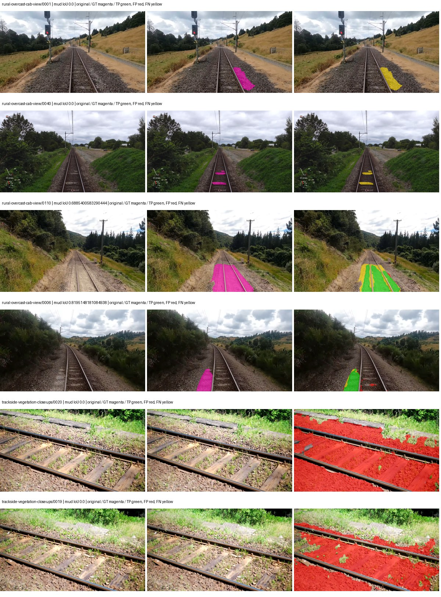
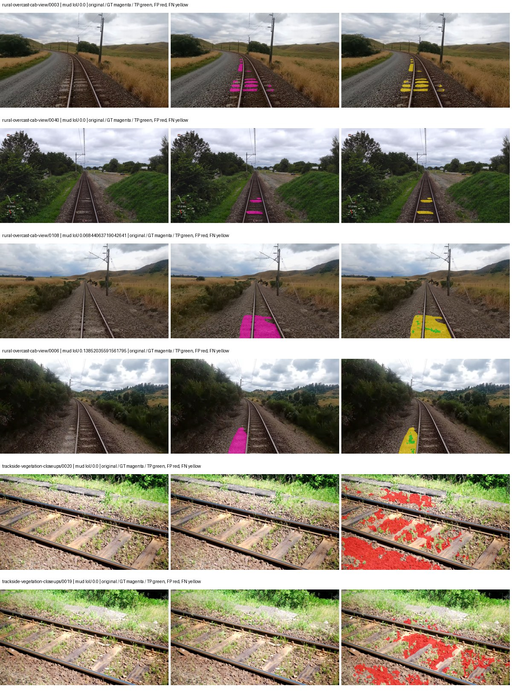
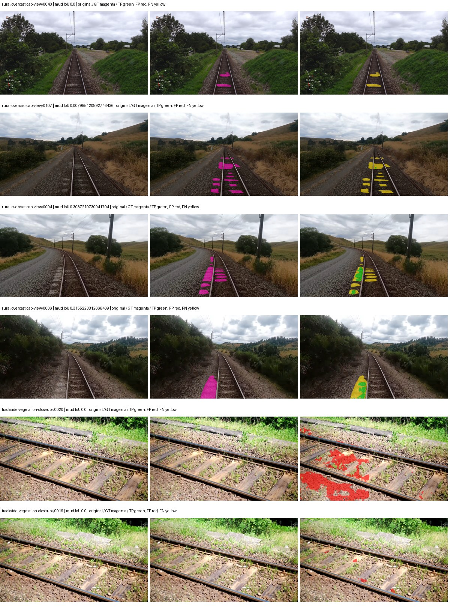
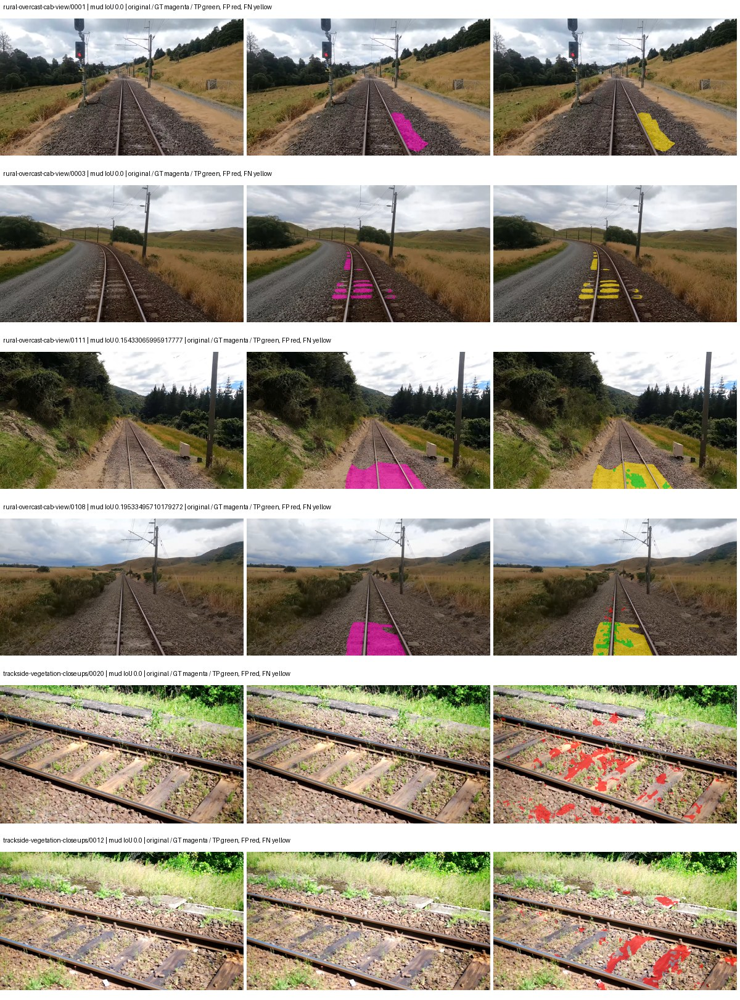

# hf_auto_segformer_b0 — rad_9_24_2026-fixed-grouped

[RAD 9/24: Scene-grouped split](../../README.md) · [Full model records](record.json)

Primary result: the **final checkpoint** after the full step budget (no early stopping). The checkpoint with the best **mud-pumping validation IoU, pixels pooled over all validation images**, is kept as secondary evidence. A job is complete only after full statistics and isolated profiling are verified.

Study metrics of the final checkpoint, counting each class only on the validation images that contain it: mud-pumping IoU is the mean per-image IoU over the images with mud-pumping, precision and recall sum pixels over those images, and mIoU averages each class over the images that contain it, then over the classes present.

| Initialization path | Seed | Mud-pumping IoU, train-camera images with mud (%, n=17) | Mud-pumping IoU, all images with mud (%, n=18) | Mud precision, all images with mud (%) | Mud recall, all images with mud (%) | mIoU (each class over images that contain it) (%) |
| --- | --- | --- | --- | --- | --- | --- |
| rtis_only | 0 | 18.14 | 17.26 | 33.04 | 22.42 | 34.04 |
| cityscapes_to_rtis | 0 | 2.31 | 2.42 | 14.69 | 3.31 | 31.45 |
| railsem19_to_rtis | 0 | 9.08 | 8.79 | 90.62 | 9.01 | 40.46 |
| cityscapes_to_railsem19_to_rtis | 0 | 4.30 | 4.10 | 48.59 | 4.64 | 36.52 |

Per-class IoU: IoU (%) of every class, each averaged only over the validation images that contain the class (n = those images); — = no image contains it. mIoU averages the classes with at least one such image.

| Initialization path | Seed | mIoU (each class over images that contain it) | person (n=0) | truck (n=0) | rail-track (n=37) | vegetation-overgrowth (n=13) | car (n=3) | on-rails (n=0) | traffic-sign (n=9) | road (n=11) | sidewalk (n=12) | construction (n=12) | tram-track (n=2) | pole (n=21) | traffic-light (n=3) | mud-pumping (n=18) | fence (n=7) | terrain (n=35) | sky (n=28) | rail-embedded (n=3) | rail-raised (n=37) | trackbed (n=37) | standing-water (n=9) |
| --- | --- | --- | --- | --- | --- | --- | --- | --- | --- | --- | --- | --- | --- | --- | --- | --- | --- | --- | --- | --- | --- | --- | --- |
| rtis_only | 0 | 34.04 | — | — | 49.79 | 40.68 | 16.46 | — | 11.90 | 24.65 | 12.48 | 29.20 | 9.32 | 60.64 | 5.52 | 17.26 | 12.93 | 84.14 | 96.45 | 6.19 | 72.93 | 57.36 | 4.77 |
| cityscapes_to_rtis | 0 | 31.45 | — | — | 47.74 | 36.36 | 5.00 | — | 9.79 | 8.36 | 6.74 | 29.51 | 11.36 | 63.20 | 30.15 | 2.42 | 8.18 | 82.19 | 96.06 | 8.80 | 70.26 | 49.46 | 0.51 |
| railsem19_to_rtis | 0 | 40.46 | — | — | 57.24 | 39.64 | 14.77 | — | 22.04 | 8.72 | 15.03 | 49.81 | 32.16 | 69.03 | 45.25 | 8.79 | 29.61 | 84.72 | 96.91 | 20.74 | 72.35 | 60.40 | 1.03 |
| cityscapes_to_railsem19_to_rtis | 0 | 36.52 | — | — | 54.00 | 35.59 | 21.05 | — | 17.34 | 19.12 | 4.04 | 42.12 | 14.07 | 67.03 | 45.42 | 4.10 | 17.74 | 81.02 | 97.12 | 9.82 | 71.27 | 55.93 | 0.68 |

Everything below is the campaign's own record, with pixels pooled over all validation images: its evaluation is the checkpoint that scored best on that pooled mud IoU (secondary evidence here); the diagnostics also cover the final checkpoint (`final-auto-val`).

| Model | Initialization path | Seed | Status | Steps | Best step | Best-checkpoint mud IoU, pixels pooled (%) | Best-checkpoint mud precision, pixels pooled (%) | Best-checkpoint mud recall, pixels pooled (%) | Final mud IoU (trainer val, pixels pooled, %) | Best-checkpoint mIoU, pixels pooled (%) | Best-checkpoint fixed GT-class mIoU, pixels pooled (%) |
| --- | --- | --- | --- | --- | --- | --- | --- | --- | --- | --- | --- |
| hf_auto_segformer_b0 | rtis_only | 0 | completed | 4000 | 2333 | 7.00 | 7.79 | 40.86 | 4.18 | 30.17 | 35.20 |
| hf_auto_segformer_b0 | cityscapes_to_rtis | 0 | completed | 4000 | 2074 | 1.62 | 3.03 | 3.35 | 1.37 | 27.82 | 32.46 |
| hf_auto_segformer_b0 | railsem19_to_rtis | 0 | completed | 4000 | 3629 | 9.30 | 33.68 | 11.38 | 7.56 | 40.21 | 44.67 |
| hf_auto_segformer_b0 | cityscapes_to_railsem19_to_rtis | 0 | completed | 4000 | 3629 | 4.53 | 13.59 | 6.36 | 3.78 | 35.02 | 40.85 |

Training: 217 images. Validation: 37 images. Test: 60 held out. Seeds: [0]. Seed variation measures optimization variability, not independent-recording uncertainty. Historical source checkpoints stay fixed across adaptation seeds.

Training code: `fce0ea0ac50b334d4252812c396e0e593def375d`. Split SHA-256: `12d7b367c72cda61d57686ff2ac28223530d0af49debd9fb7a0fbc68b908bc93`.

## rtis_only — seed 0

Status: **completed**. Started: 2026-10-11T03:31:24.537187+00:00. Finished: 2026-10-11T04:12:32.815731+00:00.

Recipe pretrained initializer: `nvidia/segformer-b0-finetuned-ade-512-512`.

`rtis_only` uses the recipe initializer, which may include pretrained segmentation components. Transfer paths load the exact historical source checkpoint below and reset the classifier; they do not reset all query/decoder features.

Source checkpoint: `Recipe pretrained initialization`.

Config SHA-256: `aedbf91d52b751aba8ac876d8f3ee9812839fb19e3b4bfbc2ef8b0a82a359589`. Weights used for validation: `raw`.

### Mud-pumping and aggregate quality

| Metric | Selected checkpoint | Final training validation |
| --- | --- | --- |
| Mud IoU | 7.00 | 4.18 |
| Mud precision | 7.79 | 4.88 |
| Mud recall | 40.86 | 22.41 |
| Mud Dice/F1 | 13.09 | 8.02 |
| mIoU | 30.17 | 31.41 |
| Mean accuracy | 42.37 | 43.65 |
| Mean precision | 61.32 | 58.61 |
| Mean Dice | 38.99 | 40.84 |
| Mean specificity | 98.99 | 99.00 |
| Pixel accuracy | 82.35 | 82.71 |
| Frequency-weighted IoU | 75.19 | 75.59 |
| Fixed GT-present class mIoU | 35.20 | 36.64 |
| Boundary F1 | 37.49 | 40.87 |

The selected checkpoint has independent evaluation evidence. Final values are the trainer's final validation record, not a new independent evaluation. mIoU averages classes with nonzero union, so false positives on absent classes can change its denominator. The fixed GT-class mean is supplementary and excludes absent classes; their false positives remain in the confusion matrix.

### Resource usage and timing

| Measurement | Value |
| --- | --- |
| Peak training VRAM, retained training invocation (GiB) | 7.79 |
| Peak evaluation VRAM (GiB) | 7.03 |
| Retained training invocation wall time (seconds) | 2325.18 |
| Retained training invocation GPU-hours (one GPU) | 0.65 |
| Evaluation wall time (seconds) | 12.95 |
| Full evaluation pipeline images/second | 2.86 |
| Best full-state checkpoint (MiB) | 57.10 |
| Final full-state checkpoint (MiB) | 57.09 |
| Verified periodic checkpoints removed (GiB) | 0.45 |

VRAM uses the recorded allocator high-water mark; it is not total device usage including CUDA context. Resumed jobs' retained training invocation times and peaks are **not whole-campaign totals**. Earlier invocation resource records are not reconstructed here. Evaluation throughput includes loader, sliding-window inference and metrics; it is not model-only latency/FPS. Missing measurements are shown as —, never inferred from another dataset's run.

### Standardized inference performance

Dedicated model-only profiling waits for an idle worker-locked L40S: BF16, batch 1, 1024x1024, 20 warmup and 100 CUDA-event-timed public forwards. It excludes loading, preprocessing, tiling and metrics.

| Status | Parameters | Weight MiB | FPS | p50 ms | p95 ms | Peak reserved GiB |
| --- | --- | --- | --- | --- | --- | --- |
| complete | 3719541 | 14.19 | 133.19 | 7.38 | 8.14 | 0.89 |

```json
{
  "schema_version": 1,
  "model_id": "hf_auto_segformer_b0",
  "measured_at": "2026-10-11T04:12:30+00:00",
  "status": "complete",
  "benchmark_scope": "rtis_selected_checkpoint_model_only",
  "applies_to": [
    "hf_auto_segformer_b0--rtis_only--seed-0"
  ],
  "source": {
    "campaign_git_sha": "fce0ea0ac50b334d4252812c396e0e593def375d",
    "git_dirty": false,
    "config_hash": "b5008e7e385e",
    "resolved_config": "/data/izadia1/projects/segmentary-runs/rad_9_24_2026/fgall-seed0-20261007/configs/hf_auto_segformer_b0--rtis_only--seed-0.yaml",
    "config_sha256": "aedbf91d52b751aba8ac876d8f3ee9812839fb19e3b4bfbc2ef8b0a82a359589",
    "checkpoint_sha256": "f568bb28203740309da877948eaa7775de9a70e3a46a58851d18fc7dc0e2b2ea",
    "checkpoint_global_step": 2333,
    "checkpoint_bytes": 59869710,
    "checkpoint_kind": "resume checkpoint with optimizer and EMA state",
    "weights": "raw",
    "measured_checkpoint_job_id": "hf_auto_segformer_b0--rtis_only--seed-0",
    "result_sha256": "5d73764862928010cd2edcd02f81632647ea984932508851bea05204835c7e77",
    "result_git_sha": "fce0ea0ac50b334d4252812c396e0e593def375d",
    "result_stage": "eval:rad_9_24_2026-fixed-grouped:val",
    "result_seed": 0
  },
  "hardware": {
    "gpu_name": "NVIDIA L40S",
    "gpu_uuid": "GPU-c76642eb-64c1-b0ac-b051-d2efd47b32c4",
    "logical_device": "cuda:0",
    "physical_visibility_token": "9",
    "compute_capability": [
      8,
      9
    ],
    "total_memory_bytes": 47677177856
  },
  "model": {
    "parameter_count": 3719541,
    "trainable_parameter_count": 3719541,
    "resident_parameter_bytes": 14878164,
    "parameter_dtype_counts": {
      "float32": 3719541
    }
  },
  "contract": {
    "backend": "pytorch",
    "precision": "bf16_autocast",
    "batch_size": 1,
    "input_shape_nchw": [
      1,
      3,
      1024,
      1024
    ],
    "warmup_iterations": 20,
    "measured_iterations": 100,
    "timing": "per-forward CUDA events with end-event synchronization",
    "includes_preprocessing": false,
    "includes_data_loader": false,
    "includes_sliding_window": false,
    "input_resident_on_gpu": true,
    "model_only": true,
    "entrypoint": "public model(image) dense-logits forward"
  },
  "measurements": {
    "latency": {
      "p50_ms": 7.376384019851685,
      "p95_ms": 8.144026041030884,
      "mean_ms": 7.508214087486267,
      "minimum_ms": 7.194623947143555,
      "maximum_ms": 9.646080017089844,
      "fps": 133.1874648681998,
      "raw_ms": [
        7.465983867645264,
        7.362559795379639,
        7.256063938140869,
        7.334911823272705,
        7.64415979385376,
        7.4239678382873535,
        7.376895904541016,
        7.5489277839660645,
        7.469056129455566,
        7.345151901245117,
        7.2478718757629395,
        7.245823860168457,
        7.528448104858398,
        8.215616226196289,
        7.64518404006958,
        7.6943359375,
        7.308288097381592,
        7.34822416305542,
        7.283711910247803,
        7.342080116271973,
        7.311359882354736,
        7.29088020324707,
        7.756800174713135,
        7.715839862823486,
        7.523327827453613,
        7.630847930908203,
        8.005632400512695,
        7.383039951324463,
        7.325695991516113,
        7.29804801940918,
        7.683072090148926,
        8.083456039428711,
        7.194623947143555,
        7.500800132751465,
        7.85100793838501,
        7.49567985534668,
        7.2570881843566895,
        7.270400047302246,
        7.329792022705078,
        7.399424076080322,
        7.388160228729248,
        7.3666558265686035,
        8.237055778503418,
        7.263232231140137,
        7.244800090789795,
        7.219200134277344,
        7.264256000518799,
        7.602176189422607,
        8.140800476074219,
        7.63699197769165,
        7.238656044006348,
        7.322624206542969,
        7.310336112976074,
        7.490560054779053,
        7.314432144165039,
        7.250944137573242,
        7.2724480628967285,
        7.482399940490723,
        7.719935894012451,
        7.230463981628418,
        7.315455913543701,
        7.322624206542969,
        8.607744216918945,
        7.975935935974121,
        7.442431926727295,
        7.312384128570557,
        8.20531177520752,
        7.224319934844971,
        7.2284159660339355,
        7.270400047302246,
        7.473152160644531,
        7.453695774078369,
        7.630847930908203,
        7.329792022705078,
        7.291903972625732,
        7.343103885650635,
        7.55404806137085,
        7.876607894897461,
        7.4199042320251465,
        8.112128257751465,
        7.461887836456299,
        7.334911823272705,
        7.370751857757568,
        7.343103885650635,
        7.361536026000977,
        7.382016181945801,
        8.102911949157715,
        7.649280071258545,
        7.618559837341309,
        7.332863807678223,
        7.264256000518799,
        7.3758721351623535,
        7.356383800506592,
        7.4547200202941895,
        7.846911907196045,
        9.646080017089844,
        7.391232013702393,
        7.259136199951172,
        7.230463981628418,
        7.258111953735352
      ],
      "percentile_method": "numpy linear interpolation"
    },
    "peak_reserved_bytes": 960495616,
    "memory_kind": "pytorch_cuda_allocator_peak_reserved_excluding_context",
    "process_total_bytes": 1497366528,
    "process_total_kind": "nvidia-smi used_memory of this PID on the benchmark GPU after the timed loop, including the CUDA context; null when the driver could not attribute memory to this PID",
    "benchmark_wall_clock_s": 4.562128864228725
  },
  "started_at": "2026-10-11T04:12:26+00:00",
  "finished_at": "2026-10-11T04:12:30+00:00",
  "environment": {
    "hostname": "hdrfs-app-001",
    "python": "3.11.15",
    "platform": "Linux-5.15.0-139-generic-x86_64-with-glibc2.35",
    "torch": "2.11.0+cu128",
    "torch_cuda": "12.8",
    "cudnn": 91900,
    "driver_version": "570.133.20",
    "cuda_available": true,
    "gpu_count": 1,
    "gpu_names": [
      "NVIDIA L40S"
    ],
    "cuda_visible_devices": "9",
    "packages": {
      "segmentary": "0.1.0",
      "torch": "2.11.0+cu128",
      "torchvision": "0.26.0+cu128",
      "transformers": "5.15.0",
      "timm": "1.0.28",
      "segmentation-models-pytorch": "0.5.0",
      "albumentations": "2.0.8",
      "lightning": "2.6.5",
      "numpy": "2.4.4"
    }
  }
}
```

### Per-class validation results

| Class | GT pixels | IoU (%) | Precision (%) | Recall (%) | Dice (%) | Boundary F1 (%) |
| --- | --- | --- | --- | --- | --- | --- |
| car | 29664 | 0.12 | 100.00 | 0.12 | 0.25 | 11.90 |
| construction | 311585 | 50.23 | 59.24 | 76.77 | 66.87 | 64.63 |
| fence | 265137 | 7.09 | 41.54 | 7.87 | 13.23 | 21.44 |
| mud-pumping | 1226250 | 7.00 | 7.79 | 40.86 | 13.09 | 15.07 |
| on-rails | 0 | 0.00 | 0.00 | — | 0.00 | 0.00 |
| person | 0 | 0.00 | 0.00 | — | 0.00 | 0.00 |
| pole | 628038 | 62.22 | 84.58 | 70.18 | 76.71 | 86.83 |
| rail-embedded | 16799 | 11.25 | 97.18 | 11.29 | 20.22 | 21.13 |
| rail-raised | 2969797 | 75.70 | 82.65 | 90.00 | 86.17 | 90.78 |
| rail-track | 6323197 | 29.99 | 78.67 | 32.64 | 46.14 | 41.22 |
| road | 1048831 | 23.96 | 56.35 | 29.41 | 38.65 | 31.30 |
| sidewalk | 1297367 | 43.12 | 96.99 | 43.71 | 60.26 | 10.19 |
| sky | 19121606 | 98.10 | 99.13 | 98.95 | 99.04 | 94.50 |
| standing-water | 95802 | 3.11 | 8.50 | 4.67 | 6.03 | 8.33 |
| terrain | 39239306 | 88.78 | 92.30 | 95.88 | 94.06 | 69.13 |
| trackbed | 10643081 | 53.37 | 71.66 | 67.65 | 69.60 | 56.28 |
| traffic-light | 19510 | 16.22 | 84.25 | 16.73 | 27.92 | 43.79 |
| traffic-sign | 13285 | 14.30 | 87.89 | 14.59 | 25.02 | 45.72 |
| tram-track | 56179 | 12.12 | 79.06 | 12.52 | 21.62 | 21.52 |
| truck | 0 | 0.00 | 0.00 | — | 0.00 | 0.00 |
| vegetation-overgrowth | 5901821 | 36.85 | 60.00 | 48.85 | 53.85 | 53.44 |

### Full-run accounting

| Measurement | Value |
| --- | --- |
| Full GPU-reserved wall seconds, all recorded worker attempts | 2476.17 |
| Full reserved GPU-hours | 0.69 |
| Whole-run timing complete | True |

| Phase | Wall seconds including failed attempts |
| --- | --- |
| training | 2332.46 |
| diagnostics | 102.37 |
| performance | 11.87 |

GPU-reserved time includes model loading, training, validation, collection, profiling, checkpoint I/O and orchestration while the worker owns one GPU. It is not GPU kernel-active time. Phase timings and sampled device memory/power/utilization are retained separately; sampled device memory is not the allocator high-water mark.

### Train/validation and raw/EMA diagnostics

| Checkpoint / weights / split | Images | Mud IoU (%) | Mud precision (%) | Mud recall (%) |
| --- | --- | --- | --- | --- |
| best-auto-train / raw | 217 | 94.35 | 97.29 | 96.90 |
| best-auto-val / raw | 37 | 7.00 | 7.79 | 40.86 |
| best-alternate-val / ema | 37 | 3.38 | 3.77 | 24.52 |
| final-auto-val / raw | 37 | 4.18 | 4.88 | 22.42 |

Train uses the evaluation transform without augmentation. Compare mud train/validation metrics for the same selected weights. Alternate EMA on running-stat BatchNorm is explicitly uncalibrated and is diagnostic only. Score-threshold curves use uncalibrated normalized scores and are pixel-level diagnostics, not event detection rates or a selected deployment operating point.

### Downloadable evidence

- best-auto-train: [per-image.csv](rtis_only--seed-0/best-auto-train/per-image.csv) · [per-image-confusion.json.gz](rtis_only--seed-0/best-auto-train/per-image-confusion.json.gz) · [groups.json](rtis_only--seed-0/best-auto-train/groups.json) · [mud-score-curves.json](rtis_only--seed-0/best-auto-train/mud-score-curves.json)
- best-auto-val: [per-image.csv](rtis_only--seed-0/best-auto-val/per-image.csv) · [per-image-confusion.json.gz](rtis_only--seed-0/best-auto-val/per-image-confusion.json.gz) · [groups.json](rtis_only--seed-0/best-auto-val/groups.json) · [mud-score-curves.json](rtis_only--seed-0/best-auto-val/mud-score-curves.json) · [examples.jpg](rtis_only--seed-0/best-auto-val/examples.jpg)
- best-alternate-val: [per-image.csv](rtis_only--seed-0/best-alternate-val/per-image.csv) · [per-image-confusion.json.gz](rtis_only--seed-0/best-alternate-val/per-image-confusion.json.gz) · [groups.json](rtis_only--seed-0/best-alternate-val/groups.json) · [mud-score-curves.json](rtis_only--seed-0/best-alternate-val/mud-score-curves.json)
- final-auto-val: [per-image.csv](rtis_only--seed-0/final-auto-val/per-image.csv) · [per-image-confusion.json.gz](rtis_only--seed-0/final-auto-val/per-image-confusion.json.gz) · [groups.json](rtis_only--seed-0/final-auto-val/groups.json) · [mud-score-curves.json](rtis_only--seed-0/final-auto-val/mud-score-curves.json)
- resources: [telemetry.csv](rtis_only--seed-0/resources/telemetry.csv)



Examples are two lowest and two highest mud-IoU positive images, plus up to two negative images with the most false-positive mud pixels. They are targeted diagnostic examples, not random samples. Green: true positive; red: false positive; yellow: false negative. Full predictions remain on HDRFS.

### Validation tracking

| Logged step | Overall mIoU (%) | Mud IoU (%) |
| --- | --- | --- |
| 258 | 19.85 | 0.11 |
| 518 | 25.49 | 2.27 |
| 777 | 25.59 | 1.20 |
| 1036 | 26.79 | 2.63 |
| 1295 | 26.89 | 5.59 |
| 1555 | 27.92 | 4.78 |
| 1814 | 28.40 | 5.79 |
| 2073 | 28.96 | 4.70 |
| 2332 | 30.17 | 7.01 |
| 2592 | 30.33 | 5.15 |
| 2851 | 29.79 | 3.41 |
| 3110 | 31.74 | 4.21 |
| 3369 | 31.71 | 4.58 |
| 3629 | 31.72 | 4.61 |
| 3888 | 31.93 | 4.04 |
| 4000 | 31.41 | 4.18 |

All retained scalar curves, including training loss and per-class IoU, are in record.json. Observed best mud on a curve is not necessarily a retained checkpoint: the pilot saved its selection-metric-best and final checkpoints. Step logging and checkpoint global_step may differ by one.

### Stopping and checkpoint provenance

```json
{
  "stopping": {
    "actual_steps": 4000,
    "maximum_steps": 4000,
    "min_delta": 0.0,
    "monitor": "val_iou/mud-pumping",
    "patience": null,
    "reason": "budget_complete"
  },
  "checkpoints": {
    "best": {
      "path": "/data/izadia1/projects/segmentary-runs/rad_9_24_2026/fgall-seed0-20261007/future-runs/hf_auto_segformer_b0--rtis_only--seed-0_seed0/rtis/best.ckpt",
      "sha256": "f568bb28203740309da877948eaa7775de9a70e3a46a58851d18fc7dc0e2b2ea",
      "global_step": 2333,
      "bytes": 59869710
    },
    "final": {
      "path": "/data/izadia1/projects/segmentary-runs/rad_9_24_2026/fgall-seed0-20261007/future-runs/hf_auto_segformer_b0--rtis_only--seed-0_seed0/rtis/last.ckpt",
      "sha256": "de0ea40de1ed7458534776375694d572a80b0042202525e9e97afe24f304f86b",
      "global_step": 4000,
      "bytes": 59859854
    }
  },
  "cleanup_error": null
}
```

### Resolved training, initialization and evaluation settings

The optimizer block is the base configuration. Stage LR scales are applied at runtime, and stage warmup is capped at min(base warmup, floor(stage budget / 10), stage budget - 1): 400 steps for this 4,000-step pilot. Model-internal native input grids may differ from augmentation crops (EoMT uses its 640 grid).

```json
{
  "name": "hf_auto_segformer_b0--rtis_only--seed-0",
  "model": {
    "arch": "hf_auto",
    "checkpoint": "nvidia/segformer-b0-finetuned-ade-512-512",
    "tuning": "full",
    "head": "unified_head",
    "lora_r": 16,
    "lora_alpha": 32,
    "lora_dropout": 0.05,
    "lora_targets": [],
    "drop_path": null,
    "revision": "489d5cd81a0b59fab9b7ea758d3548ebe99677da",
    "subfolder": null,
    "local_files_only": false,
    "trust_remote_code": false,
    "backbone_path": null,
    "head_paths": [],
    "classifier_path": null,
    "inactive_parameter_paths": [],
    "smp_arch": null,
    "encoder_name": null,
    "encoder_weights": null,
    "native": null,
    "batch_norm_momentum": null
  },
  "space": "paul-test-rtis",
  "taxonomy_root": "/data/izadia1/projects/segmentary-rad-fgall-fce0ea0a/taxonomy",
  "output_root": "/data/izadia1/projects/segmentary-runs/rad_9_24_2026/fgall-seed0-20261007/future-runs",
  "optim": {
    "backbone_lr": 6e-05,
    "head_lr_mult": 10.0,
    "weight_decay": 0.05,
    "llrd": 1.0,
    "warmup_iters": 1500,
    "warmup_ratio": 1e-06,
    "poly_power": 0.9,
    "min_lr_ratio": 0.0,
    "betas": [
      0.9,
      0.999
    ],
    "grad_clip": 1.0
  },
  "train": {
    "iters": 4000,
    "batch_size": 2,
    "accum": 8,
    "num_workers": 2,
    "precision": "bf16-mixed",
    "ema_decay": 0.9998,
    "val_every": 250,
    "ckpt_every": 500,
    "selection_metric": "val_iou/mud-pumping",
    "early_stopping_patience": null,
    "early_stopping_min_delta": 0.0,
    "seed": 0,
    "devices": 1
  },
  "eval": {
    "sliding_window": true,
    "window": [
      1024,
      1024
    ],
    "stride": [
      768,
      768
    ],
    "batch_size": 1,
    "num_workers": 2,
    "tta_scales": [],
    "tta_flip": false,
    "threshold": 0.5,
    "boundary_tolerance_frac": 0.0075,
    "save_confusion": true
  },
  "loss": {
    "task": "multiclass",
    "activation": "auto",
    "terms": [],
    "aux": "none",
    "aux_weight": 0.0,
    "ce_weight": 1.0,
    "label_smoothing": 0.0,
    "class_weights": null,
    "query": null
  },
  "aug": {
    "crop": [
      1024,
      1024
    ],
    "scale_min": 0.5,
    "scale_max": 2.0,
    "hflip_p": 0.5,
    "color_jitter_p": 0.5,
    "brightness": 0.25,
    "contrast": 0.25,
    "saturation": 0.25,
    "hue": 0.05
  },
  "stages": [
    {
      "name": "rtis",
      "data": [
        {
          "name": "rad_9_24_2026-fixed-grouped",
          "root": "/data/izadia1/datasets/rad_9_24_2026-fixed-grouped",
          "variant": null,
          "split_file": "splits.json",
          "train_split": "train",
          "val_split": "val",
          "limit": null,
          "loader": "folder",
          "mapping": "paul-test-rtis",
          "loader_options": {
            "require_groups": true
          }
        }
      ],
      "iters": null,
      "lr_scale": 1.0,
      "head_group_lr_scale": 1.0,
      "init_from": "pretrained",
      "reset_head": false,
      "freeze": null,
      "sample_weights": null
    }
  ]
}
```

### Hardware and software provenance

```json
{
  "training": {
    "cuda_available": true,
    "cuda_visible_devices": "9",
    "cudnn": 91900,
    "driver_version": "570.133.20",
    "gpu_count": 1,
    "gpu_names": [
      "NVIDIA L40S"
    ],
    "hostname": "hdrfs-app-001",
    "input_normalization": {
      "channel_order": "rgb",
      "mean": [
        0.485,
        0.456,
        0.406
      ],
      "source": "hf_image_processor",
      "std": [
        0.229,
        0.224,
        0.225
      ]
    },
    "model_origins": [
      {
        "hf_commit": "489d5cd81a0b59fab9b7ea758d3548ebe99677da",
        "hf_name_or_path": "nvidia/segformer-b0-finetuned-ade-512-512",
        "module": "model",
        "timm_pretrained": {}
      },
      {
        "hf_commit": "489d5cd81a0b59fab9b7ea758d3548ebe99677da",
        "hf_name_or_path": "nvidia/segformer-b0-finetuned-ade-512-512",
        "module": "model.segformer",
        "timm_pretrained": {}
      },
      {
        "hf_commit": "489d5cd81a0b59fab9b7ea758d3548ebe99677da",
        "hf_name_or_path": "nvidia/segformer-b0-finetuned-ade-512-512",
        "module": "model.segformer.stages.0.blocks.0.attention",
        "timm_pretrained": {}
      },
      {
        "hf_commit": "489d5cd81a0b59fab9b7ea758d3548ebe99677da",
        "hf_name_or_path": "nvidia/segformer-b0-finetuned-ade-512-512",
        "module": "model.segformer.stages.0.blocks.1.attention",
        "timm_pretrained": {}
      },
      {
        "hf_commit": "489d5cd81a0b59fab9b7ea758d3548ebe99677da",
        "hf_name_or_path": "nvidia/segformer-b0-finetuned-ade-512-512",
        "module": "model.segformer.stages.1.blocks.0.attention",
        "timm_pretrained": {}
      },
      {
        "hf_commit": "489d5cd81a0b59fab9b7ea758d3548ebe99677da",
        "hf_name_or_path": "nvidia/segformer-b0-finetuned-ade-512-512",
        "module": "model.segformer.stages.1.blocks.1.attention",
        "timm_pretrained": {}
      },
      {
        "hf_commit": "489d5cd81a0b59fab9b7ea758d3548ebe99677da",
        "hf_name_or_path": "nvidia/segformer-b0-finetuned-ade-512-512",
        "module": "model.segformer.stages.2.blocks.0.attention",
        "timm_pretrained": {}
      },
      {
        "hf_commit": "489d5cd81a0b59fab9b7ea758d3548ebe99677da",
        "hf_name_or_path": "nvidia/segformer-b0-finetuned-ade-512-512",
        "module": "model.segformer.stages.2.blocks.1.attention",
        "timm_pretrained": {}
      },
      {
        "hf_commit": "489d5cd81a0b59fab9b7ea758d3548ebe99677da",
        "hf_name_or_path": "nvidia/segformer-b0-finetuned-ade-512-512",
        "module": "model.segformer.stages.3.blocks.0.attention",
        "timm_pretrained": {}
      },
      {
        "hf_commit": "489d5cd81a0b59fab9b7ea758d3548ebe99677da",
        "hf_name_or_path": "nvidia/segformer-b0-finetuned-ade-512-512",
        "module": "model.segformer.stages.3.blocks.1.attention",
        "timm_pretrained": {}
      },
      {
        "hf_commit": "489d5cd81a0b59fab9b7ea758d3548ebe99677da",
        "hf_name_or_path": "nvidia/segformer-b0-finetuned-ade-512-512",
        "module": "model.decode_head",
        "timm_pretrained": {}
      }
    ],
    "model_parameter_count": 3719541,
    "packages": {
      "albumentations": "2.0.8",
      "lightning": "2.6.5",
      "numpy": "2.4.4",
      "segmentary": "0.1.0",
      "segmentation-models-pytorch": "0.5.0",
      "timm": "1.0.28",
      "torch": "2.11.0+cu128",
      "torchvision": "0.26.0+cu128",
      "transformers": "5.15.0"
    },
    "platform": "Linux-5.15.0-139-generic-x86_64-with-glibc2.35",
    "python": "3.11.15",
    "torch": "2.11.0+cu128",
    "torch_cuda": "12.8",
    "trainable_parameter_count": 3719541,
    "training_stop": {
      "actual_steps": 4000,
      "maximum_steps": 4000,
      "min_delta": 0.0,
      "monitor": "val_iou/mud-pumping",
      "patience": null,
      "reason": "budget_complete"
    },
    "validation_weights": "raw"
  },
  "evaluation": {
    "cuda_available": true,
    "cuda_visible_devices": "9",
    "cudnn": 91900,
    "driver_version": "570.133.20",
    "gpu_count": 1,
    "gpu_names": [
      "NVIDIA L40S"
    ],
    "hostname": "hdrfs-app-001",
    "input_normalization": {
      "channel_order": "rgb",
      "mean": [
        0.485,
        0.456,
        0.406
      ],
      "source": "hf_image_processor",
      "std": [
        0.229,
        0.224,
        0.225
      ]
    },
    "packages": {
      "albumentations": "2.0.8",
      "lightning": "2.6.5",
      "numpy": "2.4.4",
      "segmentary": "0.1.0",
      "segmentation-models-pytorch": "0.5.0",
      "timm": "1.0.28",
      "torch": "2.11.0+cu128",
      "torchvision": "0.26.0+cu128",
      "transformers": "5.15.0"
    },
    "platform": "Linux-5.15.0-139-generic-x86_64-with-glibc2.35",
    "python": "3.11.15",
    "torch": "2.11.0+cu128",
    "torch_cuda": "12.8"
  }
}
```

## cityscapes_to_rtis — seed 0

Status: **completed**. Started: 2026-10-11T03:40:03.685189+00:00. Finished: 2026-10-11T04:21:16.750522+00:00.

Recipe pretrained initializer: `nvidia/segformer-b0-finetuned-ade-512-512`.

`rtis_only` uses the recipe initializer, which may include pretrained segmentation components. Transfer paths load the exact historical source checkpoint below and reset the classifier; they do not reset all query/decoder features.

Source checkpoint: `{'name': 'hf_auto_segformer_b0--cityscapes--seed-0', 'model': 'hf_auto_segformer_b0', 'protocol': 'cityscapes', 'config': '/data/izadia1/projects/segmentary-runs/all-model-city-rail-seed0-rail20-b9eb3e1/jobs/hf_auto_segformer_b0--cityscapes--seed-0/attempt-001/resolved-config.yaml', 'checkpoint': '/data/izadia1/projects/segmentary-runs/all-model-city-rail-seed0-rail20-b9eb3e1/jobs/hf_auto_segformer_b0--cityscapes--seed-0/attempt-001/train/hf_auto_segformer_b0--cityscapes_seed0/cityscapes/last.ckpt', 'recorded_sha256': '68c80fba89b35c10ef9974fcd7163c2bf6b0afaf0ad6c00ff14cbc2b97e30dc9', 'exists': True}`.

Config SHA-256: `ceb11f6db250b2c9028ef8ef552a7db495a77cab36f9a95d68e3495c176b04be`. Weights used for validation: `raw`.

### Mud-pumping and aggregate quality

| Metric | Selected checkpoint | Final training validation |
| --- | --- | --- |
| Mud IoU | 1.62 | 1.37 |
| Mud precision | 3.03 | 2.29 |
| Mud recall | 3.35 | 3.31 |
| Mud Dice/F1 | 3.18 | 2.71 |
| mIoU | 27.82 | 30.30 |
| Mean accuracy | 37.56 | 40.68 |
| Mean precision | 52.42 | 51.74 |
| Mean Dice | 35.57 | 39.16 |
| Mean specificity | 98.91 | 98.87 |
| Pixel accuracy | 81.97 | 81.96 |
| Frequency-weighted IoU | 73.82 | 73.28 |
| Fixed GT-present class mIoU | 32.46 | 35.35 |
| Boundary F1 | 33.52 | 37.98 |

The selected checkpoint has independent evaluation evidence. Final values are the trainer's final validation record, not a new independent evaluation. mIoU averages classes with nonzero union, so false positives on absent classes can change its denominator. The fixed GT-class mean is supplementary and excludes absent classes; their false positives remain in the confusion matrix.

### Resource usage and timing

| Measurement | Value |
| --- | --- |
| Peak training VRAM, retained training invocation (GiB) | 7.79 |
| Peak evaluation VRAM (GiB) | 7.03 |
| Retained training invocation wall time (seconds) | 2332.50 |
| Retained training invocation GPU-hours (one GPU) | 0.65 |
| Evaluation wall time (seconds) | 12.75 |
| Full evaluation pipeline images/second | 2.90 |
| Best full-state checkpoint (MiB) | 57.10 |
| Final full-state checkpoint (MiB) | 57.09 |
| Verified periodic checkpoints removed (GiB) | 0.45 |

VRAM uses the recorded allocator high-water mark; it is not total device usage including CUDA context. Resumed jobs' retained training invocation times and peaks are **not whole-campaign totals**. Earlier invocation resource records are not reconstructed here. Evaluation throughput includes loader, sliding-window inference and metrics; it is not model-only latency/FPS. Missing measurements are shown as —, never inferred from another dataset's run.

### Standardized inference performance

Dedicated model-only profiling waits for an idle worker-locked L40S: BF16, batch 1, 1024x1024, 20 warmup and 100 CUDA-event-timed public forwards. It excludes loading, preprocessing, tiling and metrics.

| Status | Parameters | Weight MiB | FPS | p50 ms | p95 ms | Peak reserved GiB |
| --- | --- | --- | --- | --- | --- | --- |
| complete | 3719541 | 14.19 | 135.52 | 7.30 | 7.85 | 0.89 |

```json
{
  "schema_version": 1,
  "model_id": "hf_auto_segformer_b0",
  "measured_at": "2026-10-11T04:21:14+00:00",
  "status": "complete",
  "benchmark_scope": "rtis_selected_checkpoint_model_only",
  "applies_to": [
    "hf_auto_segformer_b0--cityscapes_to_rtis--seed-0"
  ],
  "source": {
    "campaign_git_sha": "fce0ea0ac50b334d4252812c396e0e593def375d",
    "git_dirty": false,
    "config_hash": "9253f44b382a",
    "resolved_config": "/data/izadia1/projects/segmentary-runs/rad_9_24_2026/fgall-seed0-20261007/configs/hf_auto_segformer_b0--cityscapes_to_rtis--seed-0.yaml",
    "config_sha256": "ceb11f6db250b2c9028ef8ef552a7db495a77cab36f9a95d68e3495c176b04be",
    "checkpoint_sha256": "d6f3c163fb899fc83780dbdfe803c4c48745334866826367de55c3746ddcd490",
    "checkpoint_global_step": 2074,
    "checkpoint_bytes": 59869774,
    "checkpoint_kind": "resume checkpoint with optimizer and EMA state",
    "weights": "raw",
    "measured_checkpoint_job_id": "hf_auto_segformer_b0--cityscapes_to_rtis--seed-0",
    "result_sha256": "8befbde5944f8a96d3926b13bd06a12475db2b6c1eb087ef4c893210815a602b",
    "result_git_sha": "fce0ea0ac50b334d4252812c396e0e593def375d",
    "result_stage": "eval:rad_9_24_2026-fixed-grouped:val",
    "result_seed": 0
  },
  "hardware": {
    "gpu_name": "NVIDIA L40S",
    "gpu_uuid": "GPU-fc5dde96-210d-0afa-ac74-7f88477d622b",
    "logical_device": "cuda:0",
    "physical_visibility_token": "4",
    "compute_capability": [
      8,
      9
    ],
    "total_memory_bytes": 47677177856
  },
  "model": {
    "parameter_count": 3719541,
    "trainable_parameter_count": 3719541,
    "resident_parameter_bytes": 14878164,
    "parameter_dtype_counts": {
      "float32": 3719541
    }
  },
  "contract": {
    "backend": "pytorch",
    "precision": "bf16_autocast",
    "batch_size": 1,
    "input_shape_nchw": [
      1,
      3,
      1024,
      1024
    ],
    "warmup_iterations": 20,
    "measured_iterations": 100,
    "timing": "per-forward CUDA events with end-event synchronization",
    "includes_preprocessing": false,
    "includes_data_loader": false,
    "includes_sliding_window": false,
    "input_resident_on_gpu": true,
    "model_only": true,
    "entrypoint": "public model(image) dense-logits forward"
  },
  "measurements": {
    "latency": {
      "p50_ms": 7.296000003814697,
      "p95_ms": 7.84547688961029,
      "mean_ms": 7.378786244392395,
      "minimum_ms": 7.236480236053467,
      "maximum_ms": 8.428544044494629,
      "fps": 135.52364398141538,
      "raw_ms": [
        7.582816123962402,
        7.522304058074951,
        7.2724480628967285,
        7.291903972625732,
        7.276544094085693,
        7.310336112976074,
        7.279615879058838,
        7.2724480628967285,
        7.314432144165039,
        7.320576190948486,
        7.274496078491211,
        7.301119804382324,
        7.296000003814697,
        7.296000003814697,
        7.278592109680176,
        7.293888092041016,
        7.841792106628418,
        7.341055870056152,
        7.915487766265869,
        7.788544178009033,
        7.532639980316162,
        7.452672004699707,
        7.935999870300293,
        7.547904014587402,
        7.3164801597595215,
        7.293951988220215,
        7.296000003814697,
        7.269375801086426,
        7.433216094970703,
        7.332863807678223,
        7.29801607131958,
        7.642111778259277,
        7.359488010406494,
        7.282656192779541,
        7.315360069274902,
        7.349247932434082,
        7.305215835571289,
        7.326720237731934,
        8.428544044494629,
        7.5109758377075195,
        7.406496047973633,
        7.29088020324707,
        7.508096218109131,
        7.279776096343994,
        7.236480236053467,
        7.246848106384277,
        7.285759925842285,
        7.275519847869873,
        7.343103885650635,
        7.2867841720581055,
        7.282688140869141,
        7.281536102294922,
        7.301119804382324,
        7.275519847869873,
        7.278592109680176,
        7.379936218261719,
        7.267392158508301,
        7.278592109680176,
        7.236608028411865,
        7.271423816680908,
        7.293951988220215,
        7.823328018188477,
        8.00153636932373,
        7.329792022705078,
        7.266304016113281,
        7.254015922546387,
        7.246848106384277,
        7.287807941436768,
        7.265279769897461,
        7.276544094085693,
        8.045536041259766,
        7.269375801086426,
        7.260159969329834,
        7.371776103973389,
        7.274496078491211,
        7.290815830230713,
        7.326623916625977,
        7.301119804382324,
        7.270400047302246,
        7.2724480628967285,
        7.349247932434082,
        7.294976234436035,
        7.287807941436768,
        7.271423816680908,
        7.28166389465332,
        7.273471832275391,
        7.304255962371826,
        7.299071788787842,
        7.310336112976074,
        7.279615879058838,
        7.285696029663086,
        7.364607810974121,
        7.311359882354736,
        7.390207767486572,
        7.285759925842285,
        7.3072638511657715,
        7.320576190948486,
        7.569407939910889,
        7.278592109680176,
        7.772128105163574
      ],
      "percentile_method": "numpy linear interpolation"
    },
    "peak_reserved_bytes": 960495616,
    "memory_kind": "pytorch_cuda_allocator_peak_reserved_excluding_context",
    "process_total_bytes": 1497366528,
    "process_total_kind": "nvidia-smi used_memory of this PID on the benchmark GPU after the timed loop, including the CUDA context; null when the driver could not attribute memory to this PID",
    "benchmark_wall_clock_s": 4.429931744933128
  },
  "started_at": "2026-10-11T04:21:10+00:00",
  "finished_at": "2026-10-11T04:21:14+00:00",
  "environment": {
    "hostname": "hdrfs-app-001",
    "python": "3.11.15",
    "platform": "Linux-5.15.0-139-generic-x86_64-with-glibc2.35",
    "torch": "2.11.0+cu128",
    "torch_cuda": "12.8",
    "cudnn": 91900,
    "driver_version": "570.133.20",
    "cuda_available": true,
    "gpu_count": 1,
    "gpu_names": [
      "NVIDIA L40S"
    ],
    "cuda_visible_devices": "4",
    "packages": {
      "segmentary": "0.1.0",
      "torch": "2.11.0+cu128",
      "torchvision": "0.26.0+cu128",
      "transformers": "5.15.0",
      "timm": "1.0.28",
      "segmentation-models-pytorch": "0.5.0",
      "albumentations": "2.0.8",
      "lightning": "2.6.5",
      "numpy": "2.4.4"
    }
  }
}
```

### Per-class validation results

| Class | GT pixels | IoU (%) | Precision (%) | Recall (%) | Dice (%) | Boundary F1 (%) |
| --- | --- | --- | --- | --- | --- | --- |
| car | 29664 | 0.00 | 0.00 | 0.00 | 0.00 | 0.00 |
| construction | 311585 | 48.97 | 65.91 | 65.58 | 65.74 | 59.05 |
| fence | 265137 | 3.49 | 16.70 | 4.23 | 6.74 | 18.15 |
| mud-pumping | 1226250 | 1.62 | 3.03 | 3.35 | 3.18 | 4.70 |
| on-rails | 0 | 0.00 | 0.00 | — | 0.00 | 0.00 |
| person | 0 | 0.00 | 0.00 | — | 0.00 | 0.00 |
| pole | 628038 | 64.11 | 83.24 | 73.61 | 78.13 | 86.62 |
| rail-embedded | 16799 | 13.11 | 85.82 | 13.40 | 23.18 | 16.18 |
| rail-raised | 2969797 | 69.40 | 81.98 | 81.89 | 81.93 | 87.45 |
| rail-track | 6323197 | 35.01 | 53.91 | 49.96 | 51.86 | 46.88 |
| road | 1048831 | 4.28 | 11.10 | 6.52 | 8.21 | 9.72 |
| sidewalk | 1297367 | 25.66 | 98.78 | 25.74 | 40.84 | 10.34 |
| sky | 19121606 | 97.75 | 99.18 | 98.55 | 98.86 | 93.02 |
| standing-water | 95802 | 0.03 | 0.03 | 0.75 | 0.05 | 0.19 |
| terrain | 39239306 | 86.07 | 89.09 | 96.22 | 92.52 | 53.98 |
| trackbed | 10643081 | 53.62 | 76.08 | 64.49 | 69.81 | 55.62 |
| traffic-light | 19510 | 3.87 | 96.31 | 3.87 | 7.45 | 23.73 |
| traffic-sign | 13285 | 11.38 | 92.21 | 11.49 | 20.43 | 41.82 |
| tram-track | 56179 | 24.83 | 76.74 | 26.85 | 39.79 | 33.04 |
| truck | 0 | 0.00 | 0.00 | — | 0.00 | 0.00 |
| vegetation-overgrowth | 5901821 | 41.13 | 70.77 | 49.56 | 58.29 | 63.54 |

### Full-run accounting

| Measurement | Value |
| --- | --- |
| Full GPU-reserved wall seconds, all recorded worker attempts | 2480.96 |
| Full reserved GPU-hours | 0.69 |
| Whole-run timing complete | True |

| Phase | Wall seconds including failed attempts |
| --- | --- |
| training | 2339.43 |
| diagnostics | 101.18 |
| performance | 11.53 |

GPU-reserved time includes model loading, training, validation, collection, profiling, checkpoint I/O and orchestration while the worker owns one GPU. It is not GPU kernel-active time. Phase timings and sampled device memory/power/utilization are retained separately; sampled device memory is not the allocator high-water mark.

### Train/validation and raw/EMA diagnostics

| Checkpoint / weights / split | Images | Mud IoU (%) | Mud precision (%) | Mud recall (%) |
| --- | --- | --- | --- | --- |
| best-auto-train / raw | 217 | 88.99 | 93.38 | 94.99 |
| best-auto-val / raw | 37 | 1.62 | 3.03 | 3.35 |
| best-alternate-val / ema | 37 | 0.89 | 1.64 | 1.92 |
| final-auto-val / raw | 37 | 1.37 | 2.30 | 3.31 |

Train uses the evaluation transform without augmentation. Compare mud train/validation metrics for the same selected weights. Alternate EMA on running-stat BatchNorm is explicitly uncalibrated and is diagnostic only. Score-threshold curves use uncalibrated normalized scores and are pixel-level diagnostics, not event detection rates or a selected deployment operating point.

### Downloadable evidence

- best-auto-train: [per-image.csv](cityscapes_to_rtis--seed-0/best-auto-train/per-image.csv) · [per-image-confusion.json.gz](cityscapes_to_rtis--seed-0/best-auto-train/per-image-confusion.json.gz) · [groups.json](cityscapes_to_rtis--seed-0/best-auto-train/groups.json) · [mud-score-curves.json](cityscapes_to_rtis--seed-0/best-auto-train/mud-score-curves.json)
- best-auto-val: [per-image.csv](cityscapes_to_rtis--seed-0/best-auto-val/per-image.csv) · [per-image-confusion.json.gz](cityscapes_to_rtis--seed-0/best-auto-val/per-image-confusion.json.gz) · [groups.json](cityscapes_to_rtis--seed-0/best-auto-val/groups.json) · [mud-score-curves.json](cityscapes_to_rtis--seed-0/best-auto-val/mud-score-curves.json) · [examples.jpg](cityscapes_to_rtis--seed-0/best-auto-val/examples.jpg)
- best-alternate-val: [per-image.csv](cityscapes_to_rtis--seed-0/best-alternate-val/per-image.csv) · [per-image-confusion.json.gz](cityscapes_to_rtis--seed-0/best-alternate-val/per-image-confusion.json.gz) · [groups.json](cityscapes_to_rtis--seed-0/best-alternate-val/groups.json) · [mud-score-curves.json](cityscapes_to_rtis--seed-0/best-alternate-val/mud-score-curves.json)
- final-auto-val: [per-image.csv](cityscapes_to_rtis--seed-0/final-auto-val/per-image.csv) · [per-image-confusion.json.gz](cityscapes_to_rtis--seed-0/final-auto-val/per-image-confusion.json.gz) · [groups.json](cityscapes_to_rtis--seed-0/final-auto-val/groups.json) · [mud-score-curves.json](cityscapes_to_rtis--seed-0/final-auto-val/mud-score-curves.json)
- resources: [telemetry.csv](cityscapes_to_rtis--seed-0/resources/telemetry.csv)



Examples are two lowest and two highest mud-IoU positive images, plus up to two negative images with the most false-positive mud pixels. They are targeted diagnostic examples, not random samples. Green: true positive; red: false positive; yellow: false negative. Full predictions remain on HDRFS.

### Validation tracking

| Logged step | Overall mIoU (%) | Mud IoU (%) |
| --- | --- | --- |
| 258 | 18.04 | 0.05 |
| 518 | 24.01 | 0.03 |
| 777 | 24.75 | 0.15 |
| 1036 | 25.64 | 0.06 |
| 1295 | 24.63 | 0.37 |
| 1555 | 25.61 | 0.59 |
| 1814 | 27.45 | 0.93 |
| 2073 | 27.83 | 1.61 |
| 2332 | 27.92 | 0.74 |
| 2592 | 29.41 | 1.39 |
| 2851 | 29.79 | 0.84 |
| 3110 | 29.65 | 1.44 |
| 3369 | 29.88 | 1.21 |
| 3629 | 30.64 | 1.50 |
| 3888 | 30.74 | 1.20 |
| 4000 | 30.30 | 1.37 |

All retained scalar curves, including training loss and per-class IoU, are in record.json. Observed best mud on a curve is not necessarily a retained checkpoint: the pilot saved its selection-metric-best and final checkpoints. Step logging and checkpoint global_step may differ by one.

### Stopping and checkpoint provenance

```json
{
  "stopping": {
    "actual_steps": 4000,
    "maximum_steps": 4000,
    "min_delta": 0.0,
    "monitor": "val_iou/mud-pumping",
    "patience": null,
    "reason": "budget_complete"
  },
  "checkpoints": {
    "best": {
      "path": "/data/izadia1/projects/segmentary-runs/rad_9_24_2026/fgall-seed0-20261007/future-runs/hf_auto_segformer_b0--cityscapes_to_rtis--seed-0_seed0/rtis/best.ckpt",
      "sha256": "d6f3c163fb899fc83780dbdfe803c4c48745334866826367de55c3746ddcd490",
      "global_step": 2074,
      "bytes": 59869774
    },
    "final": {
      "path": "/data/izadia1/projects/segmentary-runs/rad_9_24_2026/fgall-seed0-20261007/future-runs/hf_auto_segformer_b0--cityscapes_to_rtis--seed-0_seed0/rtis/last.ckpt",
      "sha256": "114a253e00a5dad2e0a779e8a2b22d5d6230d397710ba5f151e8364d38f51b7d",
      "global_step": 4000,
      "bytes": 59859854
    }
  },
  "cleanup_error": null
}
```

### Resolved training, initialization and evaluation settings

The optimizer block is the base configuration. Stage LR scales are applied at runtime, and stage warmup is capped at min(base warmup, floor(stage budget / 10), stage budget - 1): 400 steps for this 4,000-step pilot. Model-internal native input grids may differ from augmentation crops (EoMT uses its 640 grid).

```json
{
  "name": "hf_auto_segformer_b0--cityscapes_to_rtis--seed-0",
  "model": {
    "arch": "hf_auto",
    "checkpoint": "nvidia/segformer-b0-finetuned-ade-512-512",
    "tuning": "full",
    "head": "unified_head",
    "lora_r": 16,
    "lora_alpha": 32,
    "lora_dropout": 0.05,
    "lora_targets": [],
    "drop_path": null,
    "revision": "489d5cd81a0b59fab9b7ea758d3548ebe99677da",
    "subfolder": null,
    "local_files_only": false,
    "trust_remote_code": false,
    "backbone_path": null,
    "head_paths": [],
    "classifier_path": null,
    "inactive_parameter_paths": [],
    "smp_arch": null,
    "encoder_name": null,
    "encoder_weights": null,
    "native": null,
    "batch_norm_momentum": null
  },
  "space": "paul-test-rtis",
  "taxonomy_root": "/data/izadia1/projects/segmentary-rad-fgall-fce0ea0a/taxonomy",
  "output_root": "/data/izadia1/projects/segmentary-runs/rad_9_24_2026/fgall-seed0-20261007/future-runs",
  "optim": {
    "backbone_lr": 6e-05,
    "head_lr_mult": 10.0,
    "weight_decay": 0.05,
    "llrd": 1.0,
    "warmup_iters": 1500,
    "warmup_ratio": 1e-06,
    "poly_power": 0.9,
    "min_lr_ratio": 0.0,
    "betas": [
      0.9,
      0.999
    ],
    "grad_clip": 1.0
  },
  "train": {
    "iters": 4000,
    "batch_size": 2,
    "accum": 8,
    "num_workers": 2,
    "precision": "bf16-mixed",
    "ema_decay": 0.9998,
    "val_every": 250,
    "ckpt_every": 500,
    "selection_metric": "val_iou/mud-pumping",
    "early_stopping_patience": null,
    "early_stopping_min_delta": 0.0,
    "seed": 0,
    "devices": 1
  },
  "eval": {
    "sliding_window": true,
    "window": [
      1024,
      1024
    ],
    "stride": [
      768,
      768
    ],
    "batch_size": 1,
    "num_workers": 2,
    "tta_scales": [],
    "tta_flip": false,
    "threshold": 0.5,
    "boundary_tolerance_frac": 0.0075,
    "save_confusion": true
  },
  "loss": {
    "task": "multiclass",
    "activation": "auto",
    "terms": [],
    "aux": "none",
    "aux_weight": 0.0,
    "ce_weight": 1.0,
    "label_smoothing": 0.0,
    "class_weights": null,
    "query": null
  },
  "aug": {
    "crop": [
      1024,
      1024
    ],
    "scale_min": 0.5,
    "scale_max": 2.0,
    "hflip_p": 0.5,
    "color_jitter_p": 0.5,
    "brightness": 0.25,
    "contrast": 0.25,
    "saturation": 0.25,
    "hue": 0.05
  },
  "stages": [
    {
      "name": "rtis",
      "data": [
        {
          "name": "rad_9_24_2026-fixed-grouped",
          "root": "/data/izadia1/datasets/rad_9_24_2026-fixed-grouped",
          "variant": null,
          "split_file": "splits.json",
          "train_split": "train",
          "val_split": "val",
          "limit": null,
          "loader": "folder",
          "mapping": "paul-test-rtis",
          "loader_options": {
            "require_groups": true
          }
        }
      ],
      "iters": null,
      "lr_scale": 0.1,
      "head_group_lr_scale": 1.0,
      "init_from": "/data/izadia1/projects/segmentary-runs/all-model-city-rail-seed0-rail20-b9eb3e1/jobs/hf_auto_segformer_b0--cityscapes--seed-0/attempt-001/train/hf_auto_segformer_b0--cityscapes_seed0/cityscapes/last.ckpt",
      "reset_head": true,
      "freeze": null,
      "sample_weights": null
    }
  ]
}
```

### Hardware and software provenance

```json
{
  "training": {
    "cuda_available": true,
    "cuda_visible_devices": "4",
    "cudnn": 91900,
    "driver_version": "570.133.20",
    "gpu_count": 1,
    "gpu_names": [
      "NVIDIA L40S"
    ],
    "hostname": "hdrfs-app-001",
    "input_normalization": {
      "channel_order": "rgb",
      "mean": [
        0.485,
        0.456,
        0.406
      ],
      "source": "hf_image_processor",
      "std": [
        0.229,
        0.224,
        0.225
      ]
    },
    "model_origins": [
      {
        "hf_commit": "489d5cd81a0b59fab9b7ea758d3548ebe99677da",
        "hf_name_or_path": "nvidia/segformer-b0-finetuned-ade-512-512",
        "module": "model",
        "timm_pretrained": {}
      },
      {
        "hf_commit": "489d5cd81a0b59fab9b7ea758d3548ebe99677da",
        "hf_name_or_path": "nvidia/segformer-b0-finetuned-ade-512-512",
        "module": "model.segformer",
        "timm_pretrained": {}
      },
      {
        "hf_commit": "489d5cd81a0b59fab9b7ea758d3548ebe99677da",
        "hf_name_or_path": "nvidia/segformer-b0-finetuned-ade-512-512",
        "module": "model.segformer.stages.0.blocks.0.attention",
        "timm_pretrained": {}
      },
      {
        "hf_commit": "489d5cd81a0b59fab9b7ea758d3548ebe99677da",
        "hf_name_or_path": "nvidia/segformer-b0-finetuned-ade-512-512",
        "module": "model.segformer.stages.0.blocks.1.attention",
        "timm_pretrained": {}
      },
      {
        "hf_commit": "489d5cd81a0b59fab9b7ea758d3548ebe99677da",
        "hf_name_or_path": "nvidia/segformer-b0-finetuned-ade-512-512",
        "module": "model.segformer.stages.1.blocks.0.attention",
        "timm_pretrained": {}
      },
      {
        "hf_commit": "489d5cd81a0b59fab9b7ea758d3548ebe99677da",
        "hf_name_or_path": "nvidia/segformer-b0-finetuned-ade-512-512",
        "module": "model.segformer.stages.1.blocks.1.attention",
        "timm_pretrained": {}
      },
      {
        "hf_commit": "489d5cd81a0b59fab9b7ea758d3548ebe99677da",
        "hf_name_or_path": "nvidia/segformer-b0-finetuned-ade-512-512",
        "module": "model.segformer.stages.2.blocks.0.attention",
        "timm_pretrained": {}
      },
      {
        "hf_commit": "489d5cd81a0b59fab9b7ea758d3548ebe99677da",
        "hf_name_or_path": "nvidia/segformer-b0-finetuned-ade-512-512",
        "module": "model.segformer.stages.2.blocks.1.attention",
        "timm_pretrained": {}
      },
      {
        "hf_commit": "489d5cd81a0b59fab9b7ea758d3548ebe99677da",
        "hf_name_or_path": "nvidia/segformer-b0-finetuned-ade-512-512",
        "module": "model.segformer.stages.3.blocks.0.attention",
        "timm_pretrained": {}
      },
      {
        "hf_commit": "489d5cd81a0b59fab9b7ea758d3548ebe99677da",
        "hf_name_or_path": "nvidia/segformer-b0-finetuned-ade-512-512",
        "module": "model.segformer.stages.3.blocks.1.attention",
        "timm_pretrained": {}
      },
      {
        "hf_commit": "489d5cd81a0b59fab9b7ea758d3548ebe99677da",
        "hf_name_or_path": "nvidia/segformer-b0-finetuned-ade-512-512",
        "module": "model.decode_head",
        "timm_pretrained": {}
      }
    ],
    "model_parameter_count": 3719541,
    "packages": {
      "albumentations": "2.0.8",
      "lightning": "2.6.5",
      "numpy": "2.4.4",
      "segmentary": "0.1.0",
      "segmentation-models-pytorch": "0.5.0",
      "timm": "1.0.28",
      "torch": "2.11.0+cu128",
      "torchvision": "0.26.0+cu128",
      "transformers": "5.15.0"
    },
    "platform": "Linux-5.15.0-139-generic-x86_64-with-glibc2.35",
    "python": "3.11.15",
    "torch": "2.11.0+cu128",
    "torch_cuda": "12.8",
    "trainable_parameter_count": 3719541,
    "training_stop": {
      "actual_steps": 4000,
      "maximum_steps": 4000,
      "min_delta": 0.0,
      "monitor": "val_iou/mud-pumping",
      "patience": null,
      "reason": "budget_complete"
    },
    "validation_weights": "raw"
  },
  "evaluation": {
    "cuda_available": true,
    "cuda_visible_devices": "4",
    "cudnn": 91900,
    "driver_version": "570.133.20",
    "gpu_count": 1,
    "gpu_names": [
      "NVIDIA L40S"
    ],
    "hostname": "hdrfs-app-001",
    "input_normalization": {
      "channel_order": "rgb",
      "mean": [
        0.485,
        0.456,
        0.406
      ],
      "source": "hf_image_processor",
      "std": [
        0.229,
        0.224,
        0.225
      ]
    },
    "packages": {
      "albumentations": "2.0.8",
      "lightning": "2.6.5",
      "numpy": "2.4.4",
      "segmentary": "0.1.0",
      "segmentation-models-pytorch": "0.5.0",
      "timm": "1.0.28",
      "torch": "2.11.0+cu128",
      "torchvision": "0.26.0+cu128",
      "transformers": "5.15.0"
    },
    "platform": "Linux-5.15.0-139-generic-x86_64-with-glibc2.35",
    "python": "3.11.15",
    "torch": "2.11.0+cu128",
    "torch_cuda": "12.8"
  }
}
```

## railsem19_to_rtis — seed 0

Status: **completed**. Started: 2026-10-11T03:44:33.030249+00:00. Finished: 2026-10-11T04:26:03.830510+00:00.

Recipe pretrained initializer: `nvidia/segformer-b0-finetuned-ade-512-512`.

`rtis_only` uses the recipe initializer, which may include pretrained segmentation components. Transfer paths load the exact historical source checkpoint below and reset the classifier; they do not reset all query/decoder features.

Source checkpoint: `{'name': 'hf_auto_segformer_b0--railsem19--seed-0', 'model': 'hf_auto_segformer_b0', 'protocol': 'railsem19', 'config': '/data/izadia1/projects/segmentary-runs/all-model-city-rail-seed0-rail20-b9eb3e1/jobs/hf_auto_segformer_b0--railsem19--seed-0/attempt-001/resolved-config.yaml', 'checkpoint': '/data/izadia1/projects/segmentary-runs/all-model-city-rail-seed0-rail20-b9eb3e1/jobs/hf_auto_segformer_b0--railsem19--seed-0/attempt-001/train/hf_auto_segformer_b0--railsem19_seed0/railsem19/last.ckpt', 'recorded_sha256': '32dc1a1782498981e96d56a57c665fef9cc51ba9285097ecb9ca1feed9368946', 'exists': True}`.

Config SHA-256: `5f8dd5a7b74ebda4bfa802cbb300ea1625e730c0abbd9d1404dc7de35b06d7e1`. Weights used for validation: `raw`.

### Mud-pumping and aggregate quality

| Metric | Selected checkpoint | Final training validation |
| --- | --- | --- |
| Mud IoU | 9.30 | 7.56 |
| Mud precision | 33.68 | 32.15 |
| Mud recall | 11.38 | 9.00 |
| Mud Dice/F1 | 17.01 | 14.06 |
| mIoU | 40.21 | 39.95 |
| Mean accuracy | 55.00 | 54.08 |
| Mean precision | 56.46 | 57.10 |
| Mean Dice | 51.06 | 50.80 |
| Mean specificity | 99.09 | 99.08 |
| Pixel accuracy | 84.89 | 84.88 |
| Frequency-weighted IoU | 76.33 | 76.26 |
| Fixed GT-present class mIoU | 44.67 | 44.39 |
| Boundary F1 | 47.72 | 47.01 |

The selected checkpoint has independent evaluation evidence. Final values are the trainer's final validation record, not a new independent evaluation. mIoU averages classes with nonzero union, so false positives on absent classes can change its denominator. The fixed GT-class mean is supplementary and excludes absent classes; their false positives remain in the confusion matrix.

### Resource usage and timing

| Measurement | Value |
| --- | --- |
| Peak training VRAM, retained training invocation (GiB) | 7.79 |
| Peak evaluation VRAM (GiB) | 7.03 |
| Retained training invocation wall time (seconds) | 2351.23 |
| Retained training invocation GPU-hours (one GPU) | 0.65 |
| Evaluation wall time (seconds) | 12.62 |
| Full evaluation pipeline images/second | 2.93 |
| Best full-state checkpoint (MiB) | 57.10 |
| Final full-state checkpoint (MiB) | 57.09 |
| Verified periodic checkpoints removed (GiB) | 0.45 |

VRAM uses the recorded allocator high-water mark; it is not total device usage including CUDA context. Resumed jobs' retained training invocation times and peaks are **not whole-campaign totals**. Earlier invocation resource records are not reconstructed here. Evaluation throughput includes loader, sliding-window inference and metrics; it is not model-only latency/FPS. Missing measurements are shown as —, never inferred from another dataset's run.

### Standardized inference performance

Dedicated model-only profiling waits for an idle worker-locked L40S: BF16, batch 1, 1024x1024, 20 warmup and 100 CUDA-event-timed public forwards. It excludes loading, preprocessing, tiling and metrics.

| Status | Parameters | Weight MiB | FPS | p50 ms | p95 ms | Peak reserved GiB |
| --- | --- | --- | --- | --- | --- | --- |
| complete | 3719541 | 14.19 | 130.58 | 7.49 | 8.40 | 0.89 |

```json
{
  "schema_version": 1,
  "model_id": "hf_auto_segformer_b0",
  "measured_at": "2026-10-11T04:26:01+00:00",
  "status": "complete",
  "benchmark_scope": "rtis_selected_checkpoint_model_only",
  "applies_to": [
    "hf_auto_segformer_b0--railsem19_to_rtis--seed-0"
  ],
  "source": {
    "campaign_git_sha": "fce0ea0ac50b334d4252812c396e0e593def375d",
    "git_dirty": false,
    "config_hash": "50704341c55c",
    "resolved_config": "/data/izadia1/projects/segmentary-runs/rad_9_24_2026/fgall-seed0-20261007/configs/hf_auto_segformer_b0--railsem19_to_rtis--seed-0.yaml",
    "config_sha256": "5f8dd5a7b74ebda4bfa802cbb300ea1625e730c0abbd9d1404dc7de35b06d7e1",
    "checkpoint_sha256": "5995c486138457fc5ddfe3707ddad9d0be17afc68b33a1a66049dc6c7468132e",
    "checkpoint_global_step": 3629,
    "checkpoint_bytes": 59869774,
    "checkpoint_kind": "resume checkpoint with optimizer and EMA state",
    "weights": "raw",
    "measured_checkpoint_job_id": "hf_auto_segformer_b0--railsem19_to_rtis--seed-0",
    "result_sha256": "dbbfe75ee1ac7906bfd3e4598d692db0d7de511b64a822f961cbef439356cc1a",
    "result_git_sha": "fce0ea0ac50b334d4252812c396e0e593def375d",
    "result_stage": "eval:rad_9_24_2026-fixed-grouped:val",
    "result_seed": 0
  },
  "hardware": {
    "gpu_name": "NVIDIA L40S",
    "gpu_uuid": "GPU-931d0911-fc78-1638-e3d7-1ba868cbd286",
    "logical_device": "cuda:0",
    "physical_visibility_token": "2",
    "compute_capability": [
      8,
      9
    ],
    "total_memory_bytes": 47677177856
  },
  "model": {
    "parameter_count": 3719541,
    "trainable_parameter_count": 3719541,
    "resident_parameter_bytes": 14878164,
    "parameter_dtype_counts": {
      "float32": 3719541
    }
  },
  "contract": {
    "backend": "pytorch",
    "precision": "bf16_autocast",
    "batch_size": 1,
    "input_shape_nchw": [
      1,
      3,
      1024,
      1024
    ],
    "warmup_iterations": 20,
    "measured_iterations": 100,
    "timing": "per-forward CUDA events with end-event synchronization",
    "includes_preprocessing": false,
    "includes_data_loader": false,
    "includes_sliding_window": false,
    "input_resident_on_gpu": true,
    "model_only": true,
    "entrypoint": "public model(image) dense-logits forward"
  },
  "measurements": {
    "latency": {
      "p50_ms": 7.489487886428833,
      "p95_ms": 8.403968048095702,
      "mean_ms": 7.657862386703491,
      "minimum_ms": 7.2867841720581055,
      "maximum_ms": 11.199487686157227,
      "fps": 130.58474408423965,
      "raw_ms": [
        7.473152160644531,
        7.3256001472473145,
        7.406591892242432,
        7.390336036682129,
        7.4351677894592285,
        7.443456172943115,
        7.625728130340576,
        7.485343933105469,
        8.344575881958008,
        7.643136024475098,
        7.351263999938965,
        7.293951988220215,
        7.3000640869140625,
        7.384064197540283,
        7.291903972625732,
        7.734303951263428,
        7.666687965393066,
        7.624703884124756,
        7.462912082672119,
        7.527423858642578,
        7.60422420501709,
        7.883903980255127,
        7.574528217315674,
        8.462335586547852,
        7.985151767730713,
        8.400896072387695,
        7.742464065551758,
        7.585663795471191,
        7.591936111450195,
        7.777279853820801,
        7.472127914428711,
        7.951263904571533,
        7.364607810974121,
        7.334911823272705,
        7.333888053894043,
        7.369728088378906,
        7.472127914428711,
        7.738368034362793,
        8.47760009765625,
        8.029184341430664,
        7.625728130340576,
        7.682975769042969,
        7.4403839111328125,
        7.9850239753723145,
        7.353343963623047,
        7.352320194244385,
        7.493631839752197,
        7.612576007843018,
        7.335936069488525,
        7.359488010406494,
        7.370751857757568,
        7.902239799499512,
        7.64415979385376,
        7.3369598388671875,
        7.443391799926758,
        7.721983909606934,
        8.065024375915527,
        8.515583992004395,
        7.616384029388428,
        7.300096035003662,
        7.315455913543701,
        7.710720062255859,
        7.997439861297607,
        8.71731185913086,
        8.253408432006836,
        8.137727737426758,
        8.110048294067383,
        7.574528217315674,
        7.559167861938477,
        7.9318718910217285,
        7.476160049438477,
        7.739391803741455,
        7.3021440505981445,
        7.337984085083008,
        7.3758721351623535,
        8.376319885253906,
        8.10086441040039,
        7.420928001403809,
        7.3318400382995605,
        7.293951988220215,
        7.287744045257568,
        7.503871917724609,
        8.131584167480469,
        7.343103885650635,
        11.199487686157227,
        7.326655864715576,
        7.293951988220215,
        7.334911823272705,
        7.323647975921631,
        7.2867841720581055,
        7.403520107269287,
        7.987199783325195,
        7.342080116271973,
        7.309311866760254,
        7.818240165710449,
        7.8008317947387695,
        7.332736015319824,
        7.395455837249756,
        7.390207767486572,
        7.391232013702393
      ],
      "percentile_method": "numpy linear interpolation"
    },
    "peak_reserved_bytes": 960495616,
    "memory_kind": "pytorch_cuda_allocator_peak_reserved_excluding_context",
    "process_total_bytes": 1497366528,
    "process_total_kind": "nvidia-smi used_memory of this PID on the benchmark GPU after the timed loop, including the CUDA context; null when the driver could not attribute memory to this PID",
    "benchmark_wall_clock_s": 4.409343272447586
  },
  "started_at": "2026-10-11T04:25:57+00:00",
  "finished_at": "2026-10-11T04:26:01+00:00",
  "environment": {
    "hostname": "hdrfs-app-001",
    "python": "3.11.15",
    "platform": "Linux-5.15.0-139-generic-x86_64-with-glibc2.35",
    "torch": "2.11.0+cu128",
    "torch_cuda": "12.8",
    "cudnn": 91900,
    "driver_version": "570.133.20",
    "cuda_available": true,
    "gpu_count": 1,
    "gpu_names": [
      "NVIDIA L40S"
    ],
    "cuda_visible_devices": "2",
    "packages": {
      "segmentary": "0.1.0",
      "torch": "2.11.0+cu128",
      "torchvision": "0.26.0+cu128",
      "transformers": "5.15.0",
      "timm": "1.0.28",
      "segmentation-models-pytorch": "0.5.0",
      "albumentations": "2.0.8",
      "lightning": "2.6.5",
      "numpy": "2.4.4"
    }
  }
}
```

### Per-class validation results

| Class | GT pixels | IoU (%) | Precision (%) | Recall (%) | Dice (%) | Boundary F1 (%) |
| --- | --- | --- | --- | --- | --- | --- |
| car | 29664 | 25.86 | 70.01 | 29.08 | 41.09 | 52.78 |
| construction | 311585 | 62.37 | 75.31 | 78.40 | 76.82 | 72.80 |
| fence | 265137 | 21.80 | 37.79 | 34.00 | 35.79 | 31.37 |
| mud-pumping | 1226250 | 9.30 | 33.68 | 11.38 | 17.01 | 26.81 |
| on-rails | 0 | — | — | — | — | — |
| person | 0 | 0.00 | 0.00 | — | 0.00 | 0.00 |
| pole | 628038 | 71.87 | 88.09 | 79.61 | 83.63 | 91.42 |
| rail-embedded | 16799 | 32.85 | 61.01 | 41.57 | 49.45 | 62.71 |
| rail-raised | 2969797 | 71.94 | 89.00 | 78.96 | 83.68 | 90.24 |
| rail-track | 6323197 | 39.37 | 77.93 | 44.31 | 56.50 | 49.15 |
| road | 1048831 | 6.26 | 20.82 | 8.22 | 11.79 | 19.89 |
| sidewalk | 1297367 | 42.01 | 75.34 | 48.71 | 59.16 | 11.75 |
| sky | 19121606 | 98.71 | 99.31 | 99.39 | 99.35 | 97.20 |
| standing-water | 95802 | 0.70 | 0.83 | 4.23 | 1.39 | 2.73 |
| terrain | 39239306 | 88.86 | 91.91 | 96.41 | 94.10 | 65.93 |
| trackbed | 10643081 | 53.64 | 60.00 | 83.50 | 69.83 | 52.77 |
| traffic-light | 19510 | 69.14 | 81.24 | 82.29 | 81.76 | 68.79 |
| traffic-sign | 13285 | 34.82 | 60.41 | 45.12 | 51.66 | 57.61 |
| tram-track | 56179 | 31.76 | 36.11 | 72.50 | 48.21 | 35.55 |
| truck | 0 | 0.00 | 0.00 | — | 0.00 | 0.00 |
| vegetation-overgrowth | 5901821 | 42.88 | 70.38 | 52.32 | 60.02 | 64.97 |

### Full-run accounting

| Measurement | Value |
| --- | --- |
| Full GPU-reserved wall seconds, all recorded worker attempts | 2498.75 |
| Full reserved GPU-hours | 0.69 |
| Whole-run timing complete | True |

| Phase | Wall seconds including failed attempts |
| --- | --- |
| training | 2357.80 |
| diagnostics | 101.11 |
| performance | 11.49 |

GPU-reserved time includes model loading, training, validation, collection, profiling, checkpoint I/O and orchestration while the worker owns one GPU. It is not GPU kernel-active time. Phase timings and sampled device memory/power/utilization are retained separately; sampled device memory is not the allocator high-water mark.

### Train/validation and raw/EMA diagnostics

| Checkpoint / weights / split | Images | Mud IoU (%) | Mud precision (%) | Mud recall (%) |
| --- | --- | --- | --- | --- |
| best-auto-train / raw | 217 | 92.11 | 95.67 | 96.12 |
| best-auto-val / raw | 37 | 9.30 | 33.68 | 11.38 |
| best-alternate-val / ema | 37 | 5.55 | 26.68 | 6.55 |
| final-auto-val / raw | 37 | 7.57 | 32.15 | 9.01 |

Train uses the evaluation transform without augmentation. Compare mud train/validation metrics for the same selected weights. Alternate EMA on running-stat BatchNorm is explicitly uncalibrated and is diagnostic only. Score-threshold curves use uncalibrated normalized scores and are pixel-level diagnostics, not event detection rates or a selected deployment operating point.

### Downloadable evidence

- best-auto-train: [per-image.csv](railsem19_to_rtis--seed-0/best-auto-train/per-image.csv) · [per-image-confusion.json.gz](railsem19_to_rtis--seed-0/best-auto-train/per-image-confusion.json.gz) · [groups.json](railsem19_to_rtis--seed-0/best-auto-train/groups.json) · [mud-score-curves.json](railsem19_to_rtis--seed-0/best-auto-train/mud-score-curves.json)
- best-auto-val: [per-image.csv](railsem19_to_rtis--seed-0/best-auto-val/per-image.csv) · [per-image-confusion.json.gz](railsem19_to_rtis--seed-0/best-auto-val/per-image-confusion.json.gz) · [groups.json](railsem19_to_rtis--seed-0/best-auto-val/groups.json) · [mud-score-curves.json](railsem19_to_rtis--seed-0/best-auto-val/mud-score-curves.json) · [examples.jpg](railsem19_to_rtis--seed-0/best-auto-val/examples.jpg)
- best-alternate-val: [per-image.csv](railsem19_to_rtis--seed-0/best-alternate-val/per-image.csv) · [per-image-confusion.json.gz](railsem19_to_rtis--seed-0/best-alternate-val/per-image-confusion.json.gz) · [groups.json](railsem19_to_rtis--seed-0/best-alternate-val/groups.json) · [mud-score-curves.json](railsem19_to_rtis--seed-0/best-alternate-val/mud-score-curves.json)
- final-auto-val: [per-image.csv](railsem19_to_rtis--seed-0/final-auto-val/per-image.csv) · [per-image-confusion.json.gz](railsem19_to_rtis--seed-0/final-auto-val/per-image-confusion.json.gz) · [groups.json](railsem19_to_rtis--seed-0/final-auto-val/groups.json) · [mud-score-curves.json](railsem19_to_rtis--seed-0/final-auto-val/mud-score-curves.json)
- resources: [telemetry.csv](railsem19_to_rtis--seed-0/resources/telemetry.csv)



Examples are two lowest and two highest mud-IoU positive images, plus up to two negative images with the most false-positive mud pixels. They are targeted diagnostic examples, not random samples. Green: true positive; red: false positive; yellow: false negative. Full predictions remain on HDRFS.

### Validation tracking

| Logged step | Overall mIoU (%) | Mud IoU (%) |
| --- | --- | --- |
| 258 | 26.33 | 0.22 |
| 518 | 30.70 | 0.75 |
| 777 | 29.85 | 1.02 |
| 1036 | 32.22 | 1.06 |
| 1295 | 33.91 | 3.55 |
| 1555 | 35.70 | 4.37 |
| 1814 | 38.20 | 6.80 |
| 2073 | 37.42 | 8.22 |
| 2332 | 38.47 | 5.32 |
| 2592 | 38.35 | 8.02 |
| 2851 | 38.38 | 4.06 |
| 3110 | 38.59 | 7.15 |
| 3369 | 39.39 | 6.16 |
| 3629 | 40.21 | 9.29 |
| 3888 | 40.19 | 7.09 |
| 4000 | 39.95 | 7.56 |

All retained scalar curves, including training loss and per-class IoU, are in record.json. Observed best mud on a curve is not necessarily a retained checkpoint: the pilot saved its selection-metric-best and final checkpoints. Step logging and checkpoint global_step may differ by one.

### Stopping and checkpoint provenance

```json
{
  "stopping": {
    "actual_steps": 4000,
    "maximum_steps": 4000,
    "min_delta": 0.0,
    "monitor": "val_iou/mud-pumping",
    "patience": null,
    "reason": "budget_complete"
  },
  "checkpoints": {
    "best": {
      "path": "/data/izadia1/projects/segmentary-runs/rad_9_24_2026/fgall-seed0-20261007/future-runs/hf_auto_segformer_b0--railsem19_to_rtis--seed-0_seed0/rtis/best.ckpt",
      "sha256": "5995c486138457fc5ddfe3707ddad9d0be17afc68b33a1a66049dc6c7468132e",
      "global_step": 3629,
      "bytes": 59869774
    },
    "final": {
      "path": "/data/izadia1/projects/segmentary-runs/rad_9_24_2026/fgall-seed0-20261007/future-runs/hf_auto_segformer_b0--railsem19_to_rtis--seed-0_seed0/rtis/last.ckpt",
      "sha256": "8f36dafad4c373e406c142487075912857c689afcdb4a4f5d692c1a451aa0fd8",
      "global_step": 4000,
      "bytes": 59859854
    }
  },
  "cleanup_error": null
}
```

### Resolved training, initialization and evaluation settings

The optimizer block is the base configuration. Stage LR scales are applied at runtime, and stage warmup is capped at min(base warmup, floor(stage budget / 10), stage budget - 1): 400 steps for this 4,000-step pilot. Model-internal native input grids may differ from augmentation crops (EoMT uses its 640 grid).

```json
{
  "name": "hf_auto_segformer_b0--railsem19_to_rtis--seed-0",
  "model": {
    "arch": "hf_auto",
    "checkpoint": "nvidia/segformer-b0-finetuned-ade-512-512",
    "tuning": "full",
    "head": "unified_head",
    "lora_r": 16,
    "lora_alpha": 32,
    "lora_dropout": 0.05,
    "lora_targets": [],
    "drop_path": null,
    "revision": "489d5cd81a0b59fab9b7ea758d3548ebe99677da",
    "subfolder": null,
    "local_files_only": false,
    "trust_remote_code": false,
    "backbone_path": null,
    "head_paths": [],
    "classifier_path": null,
    "inactive_parameter_paths": [],
    "smp_arch": null,
    "encoder_name": null,
    "encoder_weights": null,
    "native": null,
    "batch_norm_momentum": null
  },
  "space": "paul-test-rtis",
  "taxonomy_root": "/data/izadia1/projects/segmentary-rad-fgall-fce0ea0a/taxonomy",
  "output_root": "/data/izadia1/projects/segmentary-runs/rad_9_24_2026/fgall-seed0-20261007/future-runs",
  "optim": {
    "backbone_lr": 6e-05,
    "head_lr_mult": 10.0,
    "weight_decay": 0.05,
    "llrd": 1.0,
    "warmup_iters": 1500,
    "warmup_ratio": 1e-06,
    "poly_power": 0.9,
    "min_lr_ratio": 0.0,
    "betas": [
      0.9,
      0.999
    ],
    "grad_clip": 1.0
  },
  "train": {
    "iters": 4000,
    "batch_size": 2,
    "accum": 8,
    "num_workers": 2,
    "precision": "bf16-mixed",
    "ema_decay": 0.9998,
    "val_every": 250,
    "ckpt_every": 500,
    "selection_metric": "val_iou/mud-pumping",
    "early_stopping_patience": null,
    "early_stopping_min_delta": 0.0,
    "seed": 0,
    "devices": 1
  },
  "eval": {
    "sliding_window": true,
    "window": [
      1024,
      1024
    ],
    "stride": [
      768,
      768
    ],
    "batch_size": 1,
    "num_workers": 2,
    "tta_scales": [],
    "tta_flip": false,
    "threshold": 0.5,
    "boundary_tolerance_frac": 0.0075,
    "save_confusion": true
  },
  "loss": {
    "task": "multiclass",
    "activation": "auto",
    "terms": [],
    "aux": "none",
    "aux_weight": 0.0,
    "ce_weight": 1.0,
    "label_smoothing": 0.0,
    "class_weights": null,
    "query": null
  },
  "aug": {
    "crop": [
      1024,
      1024
    ],
    "scale_min": 0.5,
    "scale_max": 2.0,
    "hflip_p": 0.5,
    "color_jitter_p": 0.5,
    "brightness": 0.25,
    "contrast": 0.25,
    "saturation": 0.25,
    "hue": 0.05
  },
  "stages": [
    {
      "name": "rtis",
      "data": [
        {
          "name": "rad_9_24_2026-fixed-grouped",
          "root": "/data/izadia1/datasets/rad_9_24_2026-fixed-grouped",
          "variant": null,
          "split_file": "splits.json",
          "train_split": "train",
          "val_split": "val",
          "limit": null,
          "loader": "folder",
          "mapping": "paul-test-rtis",
          "loader_options": {
            "require_groups": true
          }
        }
      ],
      "iters": null,
      "lr_scale": 0.1,
      "head_group_lr_scale": 1.0,
      "init_from": "/data/izadia1/projects/segmentary-runs/all-model-city-rail-seed0-rail20-b9eb3e1/jobs/hf_auto_segformer_b0--railsem19--seed-0/attempt-001/train/hf_auto_segformer_b0--railsem19_seed0/railsem19/last.ckpt",
      "reset_head": true,
      "freeze": null,
      "sample_weights": null
    }
  ]
}
```

### Hardware and software provenance

```json
{
  "training": {
    "cuda_available": true,
    "cuda_visible_devices": "2",
    "cudnn": 91900,
    "driver_version": "570.133.20",
    "gpu_count": 1,
    "gpu_names": [
      "NVIDIA L40S"
    ],
    "hostname": "hdrfs-app-001",
    "input_normalization": {
      "channel_order": "rgb",
      "mean": [
        0.485,
        0.456,
        0.406
      ],
      "source": "hf_image_processor",
      "std": [
        0.229,
        0.224,
        0.225
      ]
    },
    "model_origins": [
      {
        "hf_commit": "489d5cd81a0b59fab9b7ea758d3548ebe99677da",
        "hf_name_or_path": "nvidia/segformer-b0-finetuned-ade-512-512",
        "module": "model",
        "timm_pretrained": {}
      },
      {
        "hf_commit": "489d5cd81a0b59fab9b7ea758d3548ebe99677da",
        "hf_name_or_path": "nvidia/segformer-b0-finetuned-ade-512-512",
        "module": "model.segformer",
        "timm_pretrained": {}
      },
      {
        "hf_commit": "489d5cd81a0b59fab9b7ea758d3548ebe99677da",
        "hf_name_or_path": "nvidia/segformer-b0-finetuned-ade-512-512",
        "module": "model.segformer.stages.0.blocks.0.attention",
        "timm_pretrained": {}
      },
      {
        "hf_commit": "489d5cd81a0b59fab9b7ea758d3548ebe99677da",
        "hf_name_or_path": "nvidia/segformer-b0-finetuned-ade-512-512",
        "module": "model.segformer.stages.0.blocks.1.attention",
        "timm_pretrained": {}
      },
      {
        "hf_commit": "489d5cd81a0b59fab9b7ea758d3548ebe99677da",
        "hf_name_or_path": "nvidia/segformer-b0-finetuned-ade-512-512",
        "module": "model.segformer.stages.1.blocks.0.attention",
        "timm_pretrained": {}
      },
      {
        "hf_commit": "489d5cd81a0b59fab9b7ea758d3548ebe99677da",
        "hf_name_or_path": "nvidia/segformer-b0-finetuned-ade-512-512",
        "module": "model.segformer.stages.1.blocks.1.attention",
        "timm_pretrained": {}
      },
      {
        "hf_commit": "489d5cd81a0b59fab9b7ea758d3548ebe99677da",
        "hf_name_or_path": "nvidia/segformer-b0-finetuned-ade-512-512",
        "module": "model.segformer.stages.2.blocks.0.attention",
        "timm_pretrained": {}
      },
      {
        "hf_commit": "489d5cd81a0b59fab9b7ea758d3548ebe99677da",
        "hf_name_or_path": "nvidia/segformer-b0-finetuned-ade-512-512",
        "module": "model.segformer.stages.2.blocks.1.attention",
        "timm_pretrained": {}
      },
      {
        "hf_commit": "489d5cd81a0b59fab9b7ea758d3548ebe99677da",
        "hf_name_or_path": "nvidia/segformer-b0-finetuned-ade-512-512",
        "module": "model.segformer.stages.3.blocks.0.attention",
        "timm_pretrained": {}
      },
      {
        "hf_commit": "489d5cd81a0b59fab9b7ea758d3548ebe99677da",
        "hf_name_or_path": "nvidia/segformer-b0-finetuned-ade-512-512",
        "module": "model.segformer.stages.3.blocks.1.attention",
        "timm_pretrained": {}
      },
      {
        "hf_commit": "489d5cd81a0b59fab9b7ea758d3548ebe99677da",
        "hf_name_or_path": "nvidia/segformer-b0-finetuned-ade-512-512",
        "module": "model.decode_head",
        "timm_pretrained": {}
      }
    ],
    "model_parameter_count": 3719541,
    "packages": {
      "albumentations": "2.0.8",
      "lightning": "2.6.5",
      "numpy": "2.4.4",
      "segmentary": "0.1.0",
      "segmentation-models-pytorch": "0.5.0",
      "timm": "1.0.28",
      "torch": "2.11.0+cu128",
      "torchvision": "0.26.0+cu128",
      "transformers": "5.15.0"
    },
    "platform": "Linux-5.15.0-139-generic-x86_64-with-glibc2.35",
    "python": "3.11.15",
    "torch": "2.11.0+cu128",
    "torch_cuda": "12.8",
    "trainable_parameter_count": 3719541,
    "training_stop": {
      "actual_steps": 4000,
      "maximum_steps": 4000,
      "min_delta": 0.0,
      "monitor": "val_iou/mud-pumping",
      "patience": null,
      "reason": "budget_complete"
    },
    "validation_weights": "raw"
  },
  "evaluation": {
    "cuda_available": true,
    "cuda_visible_devices": "2",
    "cudnn": 91900,
    "driver_version": "570.133.20",
    "gpu_count": 1,
    "gpu_names": [
      "NVIDIA L40S"
    ],
    "hostname": "hdrfs-app-001",
    "input_normalization": {
      "channel_order": "rgb",
      "mean": [
        0.485,
        0.456,
        0.406
      ],
      "source": "hf_image_processor",
      "std": [
        0.229,
        0.224,
        0.225
      ]
    },
    "packages": {
      "albumentations": "2.0.8",
      "lightning": "2.6.5",
      "numpy": "2.4.4",
      "segmentary": "0.1.0",
      "segmentation-models-pytorch": "0.5.0",
      "timm": "1.0.28",
      "torch": "2.11.0+cu128",
      "torchvision": "0.26.0+cu128",
      "transformers": "5.15.0"
    },
    "platform": "Linux-5.15.0-139-generic-x86_64-with-glibc2.35",
    "python": "3.11.15",
    "torch": "2.11.0+cu128",
    "torch_cuda": "12.8"
  }
}
```

## cityscapes_to_railsem19_to_rtis — seed 0

Status: **completed**. Started: 2026-10-11T03:50:34.371568+00:00. Finished: 2026-10-11T04:32:16.056703+00:00.

Recipe pretrained initializer: `nvidia/segformer-b0-finetuned-ade-512-512`.

`rtis_only` uses the recipe initializer, which may include pretrained segmentation components. Transfer paths load the exact historical source checkpoint below and reset the classifier; they do not reset all query/decoder features.

Source checkpoint: `{'name': 'hf_auto_segformer_b0--cityscapes_to_railsem19--seed-0', 'model': 'hf_auto_segformer_b0', 'protocol': 'cityscapes_to_railsem19', 'config': '/data/izadia1/projects/segmentary-runs/all-model-city-rail-seed0-rail20-b9eb3e1/jobs/hf_auto_segformer_b0--cityscapes_to_railsem19--seed-0/attempt-001/resolved-config.yaml', 'checkpoint': '/data/izadia1/projects/segmentary-runs/all-model-city-rail-seed0-rail20-b9eb3e1/jobs/hf_auto_segformer_b0--cityscapes_to_railsem19--seed-0/attempt-001/train/hf_auto_segformer_b0--cityscapes_to_railsem19_seed0/railsem19/last.ckpt', 'recorded_sha256': '0b1eb3721dd80aa34dd87a6293a2844e0e51d418f59acc5f39c2f81f5395df7f', 'exists': True}`.

Config SHA-256: `72211444def66836347d9741b40bfb45d04dbd5909a2b1f9f6810cb1a5904dcb`. Weights used for validation: `raw`.

### Mud-pumping and aggregate quality

| Metric | Selected checkpoint | Final training validation |
| --- | --- | --- |
| Mud IoU | 4.53 | 3.78 |
| Mud precision | 13.59 | 16.93 |
| Mud recall | 6.36 | 4.63 |
| Mud Dice/F1 | 8.67 | 7.28 |
| mIoU | 35.02 | 35.18 |
| Mean accuracy | 47.98 | 48.02 |
| Mean precision | 55.03 | 55.60 |
| Mean Dice | 44.62 | 44.72 |
| Mean specificity | 98.89 | 98.85 |
| Pixel accuracy | 83.44 | 83.16 |
| Frequency-weighted IoU | 73.38 | 72.85 |
| Fixed GT-present class mIoU | 40.85 | 41.04 |
| Boundary F1 | 41.91 | 41.78 |

The selected checkpoint has independent evaluation evidence. Final values are the trainer's final validation record, not a new independent evaluation. mIoU averages classes with nonzero union, so false positives on absent classes can change its denominator. The fixed GT-class mean is supplementary and excludes absent classes; their false positives remain in the confusion matrix.

### Resource usage and timing

| Measurement | Value |
| --- | --- |
| Peak training VRAM, retained training invocation (GiB) | 7.79 |
| Peak evaluation VRAM (GiB) | 7.03 |
| Retained training invocation wall time (seconds) | 2360.35 |
| Retained training invocation GPU-hours (one GPU) | 0.66 |
| Evaluation wall time (seconds) | 12.78 |
| Full evaluation pipeline images/second | 2.90 |
| Best full-state checkpoint (MiB) | 57.10 |
| Final full-state checkpoint (MiB) | 57.09 |
| Verified periodic checkpoints removed (GiB) | 0.45 |

VRAM uses the recorded allocator high-water mark; it is not total device usage including CUDA context. Resumed jobs' retained training invocation times and peaks are **not whole-campaign totals**. Earlier invocation resource records are not reconstructed here. Evaluation throughput includes loader, sliding-window inference and metrics; it is not model-only latency/FPS. Missing measurements are shown as —, never inferred from another dataset's run.

### Standardized inference performance

Dedicated model-only profiling waits for an idle worker-locked L40S: BF16, batch 1, 1024x1024, 20 warmup and 100 CUDA-event-timed public forwards. It excludes loading, preprocessing, tiling and metrics.

| Status | Parameters | Weight MiB | FPS | p50 ms | p95 ms | Peak reserved GiB |
| --- | --- | --- | --- | --- | --- | --- |
| complete | 3719541 | 14.19 | 136.44 | 7.26 | 7.65 | 0.89 |

```json
{
  "schema_version": 1,
  "model_id": "hf_auto_segformer_b0",
  "measured_at": "2026-10-11T04:32:13+00:00",
  "status": "complete",
  "benchmark_scope": "rtis_selected_checkpoint_model_only",
  "applies_to": [
    "hf_auto_segformer_b0--cityscapes_to_railsem19_to_rtis--seed-0"
  ],
  "source": {
    "campaign_git_sha": "fce0ea0ac50b334d4252812c396e0e593def375d",
    "git_dirty": false,
    "config_hash": "3aaf5f2901b0",
    "resolved_config": "/data/izadia1/projects/segmentary-runs/rad_9_24_2026/fgall-seed0-20261007/configs/hf_auto_segformer_b0--cityscapes_to_railsem19_to_rtis--seed-0.yaml",
    "config_sha256": "72211444def66836347d9741b40bfb45d04dbd5909a2b1f9f6810cb1a5904dcb",
    "checkpoint_sha256": "63157a3b4d35ba1540cd321a5f9dca64b622661d88e0d3751cdb23c5bce4f4cd",
    "checkpoint_global_step": 3629,
    "checkpoint_bytes": 59869838,
    "checkpoint_kind": "resume checkpoint with optimizer and EMA state",
    "weights": "raw",
    "measured_checkpoint_job_id": "hf_auto_segformer_b0--cityscapes_to_railsem19_to_rtis--seed-0",
    "result_sha256": "6a230387193b0445cc42ecb16bf172b8f54e66c7218eab7ddc85962a1c59cdaf",
    "result_git_sha": "fce0ea0ac50b334d4252812c396e0e593def375d",
    "result_stage": "eval:rad_9_24_2026-fixed-grouped:val",
    "result_seed": 0
  },
  "hardware": {
    "gpu_name": "NVIDIA L40S",
    "gpu_uuid": "GPU-1c9b612f-e0b5-fbbc-150f-8c2ef13453c9",
    "logical_device": "cuda:0",
    "physical_visibility_token": "5",
    "compute_capability": [
      8,
      9
    ],
    "total_memory_bytes": 47677177856
  },
  "model": {
    "parameter_count": 3719541,
    "trainable_parameter_count": 3719541,
    "resident_parameter_bytes": 14878164,
    "parameter_dtype_counts": {
      "float32": 3719541
    }
  },
  "contract": {
    "backend": "pytorch",
    "precision": "bf16_autocast",
    "batch_size": 1,
    "input_shape_nchw": [
      1,
      3,
      1024,
      1024
    ],
    "warmup_iterations": 20,
    "measured_iterations": 100,
    "timing": "per-forward CUDA events with end-event synchronization",
    "includes_preprocessing": false,
    "includes_data_loader": false,
    "includes_sliding_window": false,
    "input_resident_on_gpu": true,
    "model_only": true,
    "entrypoint": "public model(image) dense-logits forward"
  },
  "measurements": {
    "latency": {
      "p50_ms": 7.256079912185669,
      "p95_ms": 7.646720004081725,
      "mean_ms": 7.329238424301147,
      "minimum_ms": 7.177216053009033,
      "maximum_ms": 8.110079765319824,
      "fps": 136.43982390917395,
      "raw_ms": [
        7.43936014175415,
        7.2325119972229,
        7.540736198425293,
        7.227392196655273,
        7.227392196655273,
        7.2478718757629395,
        7.177216053009033,
        7.274464130401611,
        7.214079856872559,
        7.214079856872559,
        7.256063938140869,
        7.217120170593262,
        7.225344181060791,
        7.187456130981445,
        7.19155216217041,
        7.362559795379639,
        7.308288097381592,
        7.221248149871826,
        7.2724480628967285,
        7.28985595703125,
        7.254015922546387,
        7.520256042480469,
        7.208960056304932,
        7.256095886230469,
        7.641088008880615,
        7.365632057189941,
        7.552000045776367,
        7.28985595703125,
        7.24070405960083,
        7.234560012817383,
        7.261184215545654,
        7.284736156463623,
        7.3666558265686035,
        7.48748779296875,
        8.110079765319824,
        7.475200176239014,
        7.889920234680176,
        7.2335357666015625,
        7.9585280418396,
        7.230463981628418,
        7.222271919250488,
        7.209983825683594,
        7.186431884765625,
        7.230463981628418,
        7.227392196655273,
        7.344128131866455,
        7.34003210067749,
        7.23967981338501,
        7.359488010406494,
        7.385087966918945,
        7.231488227844238,
        7.1987199783325195,
        7.206912040710449,
        7.2570881843566895,
        7.222271919250488,
        7.372799873352051,
        7.2130560874938965,
        7.231488227844238,
        7.181312084197998,
        7.214079856872559,
        7.312384128570557,
        7.2570881843566895,
        7.317503929138184,
        7.211008071899414,
        7.318528175354004,
        7.222271919250488,
        7.230463981628418,
        7.408639907836914,
        7.753727912902832,
        7.511040210723877,
        7.401440143585205,
        7.399424076080322,
        7.414783954620361,
        7.3318400382995605,
        7.212031841278076,
        7.601151943206787,
        7.2478718757629395,
        7.493631839752197,
        7.929855823516846,
        7.475200176239014,
        7.2570881843566895,
        7.579648017883301,
        7.2130560874938965,
        7.207935810089111,
        7.355391979217529,
        7.200767993927002,
        7.187456130981445,
        7.187456130981445,
        7.322624206542969,
        7.274496078491211,
        7.63699197769165,
        7.299071788787842,
        7.24889612197876,
        7.206912040710449,
        7.225344181060791,
        7.241727828979492,
        7.2427520751953125,
        7.223296165466309,
        7.206912040710449,
        7.293951988220215
      ],
      "percentile_method": "numpy linear interpolation"
    },
    "peak_reserved_bytes": 960495616,
    "memory_kind": "pytorch_cuda_allocator_peak_reserved_excluding_context",
    "process_total_bytes": 1497366528,
    "process_total_kind": "nvidia-smi used_memory of this PID on the benchmark GPU after the timed loop, including the CUDA context; null when the driver could not attribute memory to this PID",
    "benchmark_wall_clock_s": 4.359212689101696
  },
  "started_at": "2026-10-11T04:32:09+00:00",
  "finished_at": "2026-10-11T04:32:13+00:00",
  "environment": {
    "hostname": "hdrfs-app-001",
    "python": "3.11.15",
    "platform": "Linux-5.15.0-139-generic-x86_64-with-glibc2.35",
    "torch": "2.11.0+cu128",
    "torch_cuda": "12.8",
    "cudnn": 91900,
    "driver_version": "570.133.20",
    "cuda_available": true,
    "gpu_count": 1,
    "gpu_names": [
      "NVIDIA L40S"
    ],
    "cuda_visible_devices": "5",
    "packages": {
      "segmentary": "0.1.0",
      "torch": "2.11.0+cu128",
      "torchvision": "0.26.0+cu128",
      "transformers": "5.15.0",
      "timm": "1.0.28",
      "segmentation-models-pytorch": "0.5.0",
      "albumentations": "2.0.8",
      "lightning": "2.6.5",
      "numpy": "2.4.4"
    }
  }
}
```

### Per-class validation results

| Class | GT pixels | IoU (%) | Precision (%) | Recall (%) | Dice (%) | Boundary F1 (%) |
| --- | --- | --- | --- | --- | --- | --- |
| car | 29664 | 35.09 | 72.80 | 40.39 | 51.95 | 50.76 |
| construction | 311585 | 56.95 | 73.24 | 71.92 | 72.57 | 68.66 |
| fence | 265137 | 6.42 | 12.16 | 11.98 | 12.07 | 13.66 |
| mud-pumping | 1226250 | 4.53 | 13.59 | 6.36 | 8.67 | 9.08 |
| on-rails | 0 | 0.00 | 0.00 | — | 0.00 | 0.00 |
| person | 0 | 0.00 | 0.00 | — | 0.00 | 0.00 |
| pole | 628038 | 69.66 | 86.55 | 78.12 | 82.12 | 91.15 |
| rail-embedded | 16799 | 22.50 | 96.72 | 22.67 | 36.73 | 44.55 |
| rail-raised | 2969797 | 73.36 | 88.42 | 81.15 | 84.63 | 90.65 |
| rail-track | 6323197 | 36.93 | 67.88 | 44.74 | 53.94 | 48.53 |
| road | 1048831 | 13.69 | 24.12 | 24.04 | 24.08 | 24.20 |
| sidewalk | 1297367 | 12.35 | 82.03 | 12.69 | 21.98 | 8.04 |
| sky | 19121606 | 98.60 | 99.20 | 99.39 | 99.29 | 96.76 |
| standing-water | 95802 | 0.65 | 0.78 | 3.92 | 1.30 | 3.71 |
| terrain | 39239306 | 83.52 | 84.79 | 98.24 | 91.02 | 51.19 |
| trackbed | 10643081 | 58.32 | 72.28 | 75.12 | 73.67 | 54.55 |
| traffic-light | 19510 | 70.54 | 82.03 | 83.44 | 82.73 | 80.27 |
| traffic-sign | 13285 | 33.64 | 77.59 | 37.26 | 50.34 | 55.04 |
| tram-track | 56179 | 23.35 | 45.53 | 32.41 | 37.87 | 22.62 |
| truck | 0 | 0.00 | 0.00 | — | 0.00 | 0.00 |
| vegetation-overgrowth | 5901821 | 35.26 | 75.81 | 39.74 | 52.14 | 66.62 |

### Full-run accounting

| Measurement | Value |
| --- | --- |
| Full GPU-reserved wall seconds, all recorded worker attempts | 2509.60 |
| Full reserved GPU-hours | 0.70 |
| Whole-run timing complete | True |

| Phase | Wall seconds including failed attempts |
| --- | --- |
| training | 2367.78 |
| diagnostics | 100.19 |
| performance | 12.00 |

GPU-reserved time includes model loading, training, validation, collection, profiling, checkpoint I/O and orchestration while the worker owns one GPU. It is not GPU kernel-active time. Phase timings and sampled device memory/power/utilization are retained separately; sampled device memory is not the allocator high-water mark.

### Train/validation and raw/EMA diagnostics

| Checkpoint / weights / split | Images | Mud IoU (%) | Mud precision (%) | Mud recall (%) |
| --- | --- | --- | --- | --- |
| best-auto-train / raw | 217 | 91.35 | 94.67 | 96.30 |
| best-auto-val / raw | 37 | 4.53 | 13.59 | 6.36 |
| best-alternate-val / ema | 37 | 2.33 | 6.03 | 3.66 |
| final-auto-val / raw | 37 | 3.78 | 16.94 | 4.64 |

Train uses the evaluation transform without augmentation. Compare mud train/validation metrics for the same selected weights. Alternate EMA on running-stat BatchNorm is explicitly uncalibrated and is diagnostic only. Score-threshold curves use uncalibrated normalized scores and are pixel-level diagnostics, not event detection rates or a selected deployment operating point.

### Downloadable evidence

- best-auto-train: [per-image.csv](cityscapes_to_railsem19_to_rtis--seed-0/best-auto-train/per-image.csv) · [per-image-confusion.json.gz](cityscapes_to_railsem19_to_rtis--seed-0/best-auto-train/per-image-confusion.json.gz) · [groups.json](cityscapes_to_railsem19_to_rtis--seed-0/best-auto-train/groups.json) · [mud-score-curves.json](cityscapes_to_railsem19_to_rtis--seed-0/best-auto-train/mud-score-curves.json)
- best-auto-val: [per-image.csv](cityscapes_to_railsem19_to_rtis--seed-0/best-auto-val/per-image.csv) · [per-image-confusion.json.gz](cityscapes_to_railsem19_to_rtis--seed-0/best-auto-val/per-image-confusion.json.gz) · [groups.json](cityscapes_to_railsem19_to_rtis--seed-0/best-auto-val/groups.json) · [mud-score-curves.json](cityscapes_to_railsem19_to_rtis--seed-0/best-auto-val/mud-score-curves.json) · [examples.jpg](cityscapes_to_railsem19_to_rtis--seed-0/best-auto-val/examples.jpg)
- best-alternate-val: [per-image.csv](cityscapes_to_railsem19_to_rtis--seed-0/best-alternate-val/per-image.csv) · [per-image-confusion.json.gz](cityscapes_to_railsem19_to_rtis--seed-0/best-alternate-val/per-image-confusion.json.gz) · [groups.json](cityscapes_to_railsem19_to_rtis--seed-0/best-alternate-val/groups.json) · [mud-score-curves.json](cityscapes_to_railsem19_to_rtis--seed-0/best-alternate-val/mud-score-curves.json)
- final-auto-val: [per-image.csv](cityscapes_to_railsem19_to_rtis--seed-0/final-auto-val/per-image.csv) · [per-image-confusion.json.gz](cityscapes_to_railsem19_to_rtis--seed-0/final-auto-val/per-image-confusion.json.gz) · [groups.json](cityscapes_to_railsem19_to_rtis--seed-0/final-auto-val/groups.json) · [mud-score-curves.json](cityscapes_to_railsem19_to_rtis--seed-0/final-auto-val/mud-score-curves.json)
- resources: [telemetry.csv](cityscapes_to_railsem19_to_rtis--seed-0/resources/telemetry.csv)



Examples are two lowest and two highest mud-IoU positive images, plus up to two negative images with the most false-positive mud pixels. They are targeted diagnostic examples, not random samples. Green: true positive; red: false positive; yellow: false negative. Full predictions remain on HDRFS.

### Validation tracking

| Logged step | Overall mIoU (%) | Mud IoU (%) |
| --- | --- | --- |
| 258 | 25.81 | 0.33 |
| 518 | 26.33 | 2.26 |
| 777 | 25.91 | 1.33 |
| 1036 | 28.29 | 0.88 |
| 1295 | 29.21 | 1.29 |
| 1555 | 30.08 | 0.70 |
| 1814 | 32.91 | 1.26 |
| 2073 | 32.21 | 2.59 |
| 2332 | 33.25 | 2.64 |
| 2592 | 33.79 | 4.20 |
| 2851 | 33.60 | 1.97 |
| 3110 | 34.67 | 3.69 |
| 3369 | 34.27 | 3.39 |
| 3629 | 35.02 | 4.53 |
| 3888 | 35.32 | 3.21 |
| 4000 | 35.18 | 3.78 |

All retained scalar curves, including training loss and per-class IoU, are in record.json. Observed best mud on a curve is not necessarily a retained checkpoint: the pilot saved its selection-metric-best and final checkpoints. Step logging and checkpoint global_step may differ by one.

### Stopping and checkpoint provenance

```json
{
  "stopping": {
    "actual_steps": 4000,
    "maximum_steps": 4000,
    "min_delta": 0.0,
    "monitor": "val_iou/mud-pumping",
    "patience": null,
    "reason": "budget_complete"
  },
  "checkpoints": {
    "best": {
      "path": "/data/izadia1/projects/segmentary-runs/rad_9_24_2026/fgall-seed0-20261007/future-runs/hf_auto_segformer_b0--cityscapes_to_railsem19_to_rtis--seed-0_seed0/rtis/best.ckpt",
      "sha256": "63157a3b4d35ba1540cd321a5f9dca64b622661d88e0d3751cdb23c5bce4f4cd",
      "global_step": 3629,
      "bytes": 59869838
    },
    "final": {
      "path": "/data/izadia1/projects/segmentary-runs/rad_9_24_2026/fgall-seed0-20261007/future-runs/hf_auto_segformer_b0--cityscapes_to_railsem19_to_rtis--seed-0_seed0/rtis/last.ckpt",
      "sha256": "5311efbecf4e4bd83b06068215a278ed523cab6028e0f5a1c517b4a32bebb2a3",
      "global_step": 4000,
      "bytes": 59859918
    }
  },
  "cleanup_error": null
}
```

### Resolved training, initialization and evaluation settings

The optimizer block is the base configuration. Stage LR scales are applied at runtime, and stage warmup is capped at min(base warmup, floor(stage budget / 10), stage budget - 1): 400 steps for this 4,000-step pilot. Model-internal native input grids may differ from augmentation crops (EoMT uses its 640 grid).

```json
{
  "name": "hf_auto_segformer_b0--cityscapes_to_railsem19_to_rtis--seed-0",
  "model": {
    "arch": "hf_auto",
    "checkpoint": "nvidia/segformer-b0-finetuned-ade-512-512",
    "tuning": "full",
    "head": "unified_head",
    "lora_r": 16,
    "lora_alpha": 32,
    "lora_dropout": 0.05,
    "lora_targets": [],
    "drop_path": null,
    "revision": "489d5cd81a0b59fab9b7ea758d3548ebe99677da",
    "subfolder": null,
    "local_files_only": false,
    "trust_remote_code": false,
    "backbone_path": null,
    "head_paths": [],
    "classifier_path": null,
    "inactive_parameter_paths": [],
    "smp_arch": null,
    "encoder_name": null,
    "encoder_weights": null,
    "native": null,
    "batch_norm_momentum": null
  },
  "space": "paul-test-rtis",
  "taxonomy_root": "/data/izadia1/projects/segmentary-rad-fgall-fce0ea0a/taxonomy",
  "output_root": "/data/izadia1/projects/segmentary-runs/rad_9_24_2026/fgall-seed0-20261007/future-runs",
  "optim": {
    "backbone_lr": 6e-05,
    "head_lr_mult": 10.0,
    "weight_decay": 0.05,
    "llrd": 1.0,
    "warmup_iters": 1500,
    "warmup_ratio": 1e-06,
    "poly_power": 0.9,
    "min_lr_ratio": 0.0,
    "betas": [
      0.9,
      0.999
    ],
    "grad_clip": 1.0
  },
  "train": {
    "iters": 4000,
    "batch_size": 2,
    "accum": 8,
    "num_workers": 2,
    "precision": "bf16-mixed",
    "ema_decay": 0.9998,
    "val_every": 250,
    "ckpt_every": 500,
    "selection_metric": "val_iou/mud-pumping",
    "early_stopping_patience": null,
    "early_stopping_min_delta": 0.0,
    "seed": 0,
    "devices": 1
  },
  "eval": {
    "sliding_window": true,
    "window": [
      1024,
      1024
    ],
    "stride": [
      768,
      768
    ],
    "batch_size": 1,
    "num_workers": 2,
    "tta_scales": [],
    "tta_flip": false,
    "threshold": 0.5,
    "boundary_tolerance_frac": 0.0075,
    "save_confusion": true
  },
  "loss": {
    "task": "multiclass",
    "activation": "auto",
    "terms": [],
    "aux": "none",
    "aux_weight": 0.0,
    "ce_weight": 1.0,
    "label_smoothing": 0.0,
    "class_weights": null,
    "query": null
  },
  "aug": {
    "crop": [
      1024,
      1024
    ],
    "scale_min": 0.5,
    "scale_max": 2.0,
    "hflip_p": 0.5,
    "color_jitter_p": 0.5,
    "brightness": 0.25,
    "contrast": 0.25,
    "saturation": 0.25,
    "hue": 0.05
  },
  "stages": [
    {
      "name": "rtis",
      "data": [
        {
          "name": "rad_9_24_2026-fixed-grouped",
          "root": "/data/izadia1/datasets/rad_9_24_2026-fixed-grouped",
          "variant": null,
          "split_file": "splits.json",
          "train_split": "train",
          "val_split": "val",
          "limit": null,
          "loader": "folder",
          "mapping": "paul-test-rtis",
          "loader_options": {
            "require_groups": true
          }
        }
      ],
      "iters": null,
      "lr_scale": 0.1,
      "head_group_lr_scale": 1.0,
      "init_from": "/data/izadia1/projects/segmentary-runs/all-model-city-rail-seed0-rail20-b9eb3e1/jobs/hf_auto_segformer_b0--cityscapes_to_railsem19--seed-0/attempt-001/train/hf_auto_segformer_b0--cityscapes_to_railsem19_seed0/railsem19/last.ckpt",
      "reset_head": true,
      "freeze": null,
      "sample_weights": null
    }
  ]
}
```

### Hardware and software provenance

```json
{
  "training": {
    "cuda_available": true,
    "cuda_visible_devices": "5",
    "cudnn": 91900,
    "driver_version": "570.133.20",
    "gpu_count": 1,
    "gpu_names": [
      "NVIDIA L40S"
    ],
    "hostname": "hdrfs-app-001",
    "input_normalization": {
      "channel_order": "rgb",
      "mean": [
        0.485,
        0.456,
        0.406
      ],
      "source": "hf_image_processor",
      "std": [
        0.229,
        0.224,
        0.225
      ]
    },
    "model_origins": [
      {
        "hf_commit": "489d5cd81a0b59fab9b7ea758d3548ebe99677da",
        "hf_name_or_path": "nvidia/segformer-b0-finetuned-ade-512-512",
        "module": "model",
        "timm_pretrained": {}
      },
      {
        "hf_commit": "489d5cd81a0b59fab9b7ea758d3548ebe99677da",
        "hf_name_or_path": "nvidia/segformer-b0-finetuned-ade-512-512",
        "module": "model.segformer",
        "timm_pretrained": {}
      },
      {
        "hf_commit": "489d5cd81a0b59fab9b7ea758d3548ebe99677da",
        "hf_name_or_path": "nvidia/segformer-b0-finetuned-ade-512-512",
        "module": "model.segformer.stages.0.blocks.0.attention",
        "timm_pretrained": {}
      },
      {
        "hf_commit": "489d5cd81a0b59fab9b7ea758d3548ebe99677da",
        "hf_name_or_path": "nvidia/segformer-b0-finetuned-ade-512-512",
        "module": "model.segformer.stages.0.blocks.1.attention",
        "timm_pretrained": {}
      },
      {
        "hf_commit": "489d5cd81a0b59fab9b7ea758d3548ebe99677da",
        "hf_name_or_path": "nvidia/segformer-b0-finetuned-ade-512-512",
        "module": "model.segformer.stages.1.blocks.0.attention",
        "timm_pretrained": {}
      },
      {
        "hf_commit": "489d5cd81a0b59fab9b7ea758d3548ebe99677da",
        "hf_name_or_path": "nvidia/segformer-b0-finetuned-ade-512-512",
        "module": "model.segformer.stages.1.blocks.1.attention",
        "timm_pretrained": {}
      },
      {
        "hf_commit": "489d5cd81a0b59fab9b7ea758d3548ebe99677da",
        "hf_name_or_path": "nvidia/segformer-b0-finetuned-ade-512-512",
        "module": "model.segformer.stages.2.blocks.0.attention",
        "timm_pretrained": {}
      },
      {
        "hf_commit": "489d5cd81a0b59fab9b7ea758d3548ebe99677da",
        "hf_name_or_path": "nvidia/segformer-b0-finetuned-ade-512-512",
        "module": "model.segformer.stages.2.blocks.1.attention",
        "timm_pretrained": {}
      },
      {
        "hf_commit": "489d5cd81a0b59fab9b7ea758d3548ebe99677da",
        "hf_name_or_path": "nvidia/segformer-b0-finetuned-ade-512-512",
        "module": "model.segformer.stages.3.blocks.0.attention",
        "timm_pretrained": {}
      },
      {
        "hf_commit": "489d5cd81a0b59fab9b7ea758d3548ebe99677da",
        "hf_name_or_path": "nvidia/segformer-b0-finetuned-ade-512-512",
        "module": "model.segformer.stages.3.blocks.1.attention",
        "timm_pretrained": {}
      },
      {
        "hf_commit": "489d5cd81a0b59fab9b7ea758d3548ebe99677da",
        "hf_name_or_path": "nvidia/segformer-b0-finetuned-ade-512-512",
        "module": "model.decode_head",
        "timm_pretrained": {}
      }
    ],
    "model_parameter_count": 3719541,
    "packages": {
      "albumentations": "2.0.8",
      "lightning": "2.6.5",
      "numpy": "2.4.4",
      "segmentary": "0.1.0",
      "segmentation-models-pytorch": "0.5.0",
      "timm": "1.0.28",
      "torch": "2.11.0+cu128",
      "torchvision": "0.26.0+cu128",
      "transformers": "5.15.0"
    },
    "platform": "Linux-5.15.0-139-generic-x86_64-with-glibc2.35",
    "python": "3.11.15",
    "torch": "2.11.0+cu128",
    "torch_cuda": "12.8",
    "trainable_parameter_count": 3719541,
    "training_stop": {
      "actual_steps": 4000,
      "maximum_steps": 4000,
      "min_delta": 0.0,
      "monitor": "val_iou/mud-pumping",
      "patience": null,
      "reason": "budget_complete"
    },
    "validation_weights": "raw"
  },
  "evaluation": {
    "cuda_available": true,
    "cuda_visible_devices": "5",
    "cudnn": 91900,
    "driver_version": "570.133.20",
    "gpu_count": 1,
    "gpu_names": [
      "NVIDIA L40S"
    ],
    "hostname": "hdrfs-app-001",
    "input_normalization": {
      "channel_order": "rgb",
      "mean": [
        0.485,
        0.456,
        0.406
      ],
      "source": "hf_image_processor",
      "std": [
        0.229,
        0.224,
        0.225
      ]
    },
    "packages": {
      "albumentations": "2.0.8",
      "lightning": "2.6.5",
      "numpy": "2.4.4",
      "segmentary": "0.1.0",
      "segmentation-models-pytorch": "0.5.0",
      "timm": "1.0.28",
      "torch": "2.11.0+cu128",
      "torchvision": "0.26.0+cu128",
      "transformers": "5.15.0"
    },
    "platform": "Linux-5.15.0-139-generic-x86_64-with-glibc2.35",
    "python": "3.11.15",
    "torch": "2.11.0+cu128",
    "torch_cuda": "12.8"
  }
}
```
