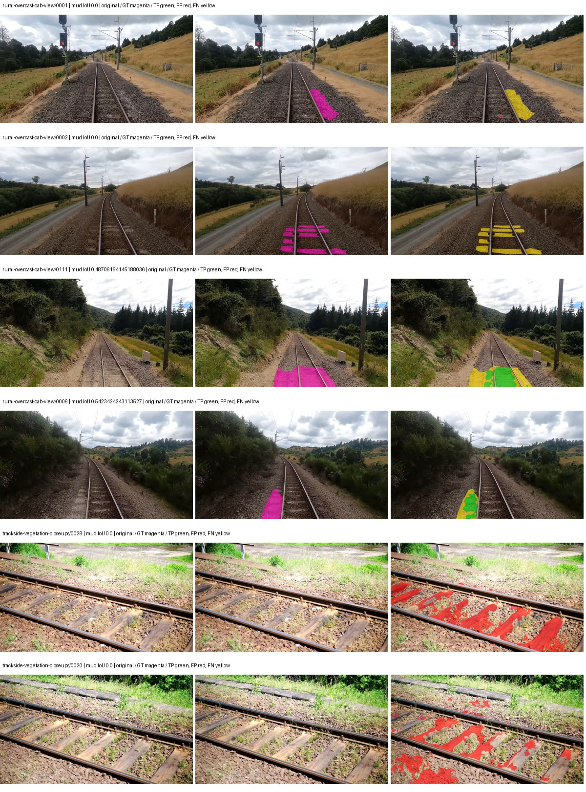
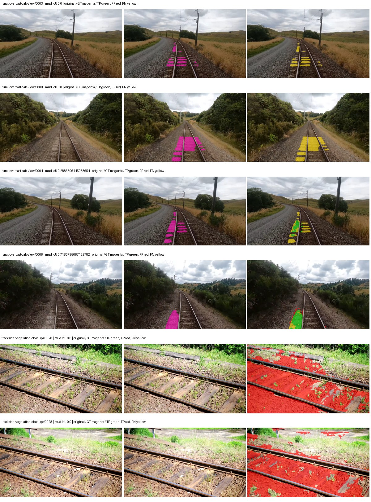
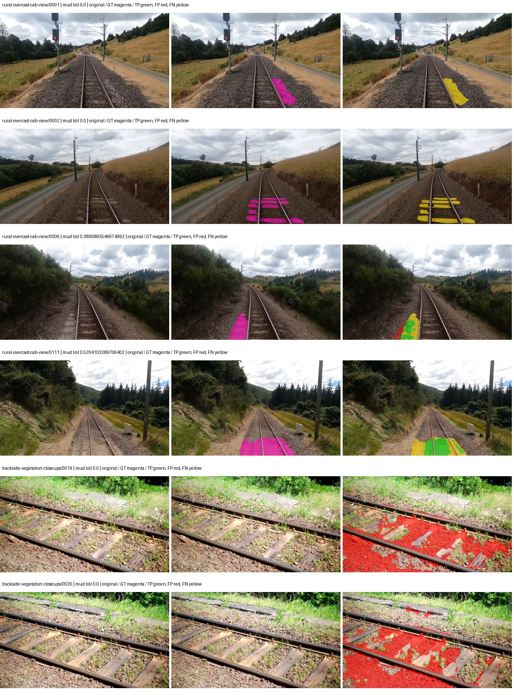
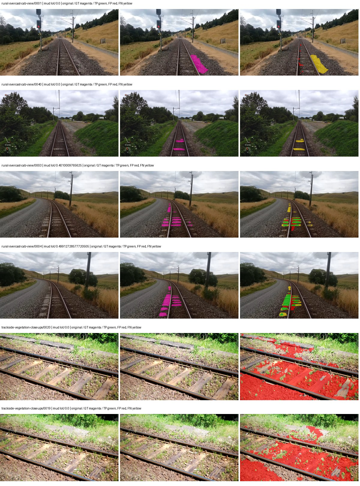

# hf_auto_upernet_swin_tiny — rad_9_24_2026-fixed-grouped

[RAD 9/24: Scene-grouped split](../../README.md) · [Full model records](record.json)

Primary result: the **final checkpoint** after the full step budget (no early stopping). The checkpoint with the best **mud-pumping validation IoU, pixels pooled over all validation images**, is kept as secondary evidence. A job is complete only after full statistics and isolated profiling are verified.

Study metrics of the final checkpoint, counting each class only on the validation images that contain it: mud-pumping IoU is the mean per-image IoU over the images with mud-pumping, precision and recall sum pixels over those images, and mIoU averages each class over the images that contain it, then over the classes present.

| Initialization path | Seed | Mud-pumping IoU, train-camera images with mud (%, n=17) | Mud-pumping IoU, all images with mud (%, n=18) | Mud precision, all images with mud (%) | Mud recall, all images with mud (%) | mIoU (each class over images that contain it) (%) |
| --- | --- | --- | --- | --- | --- | --- |
| rtis_only | 0 | 12.03 | 11.52 | 28.25 | 14.89 | 37.78 |
| cityscapes_to_rtis | 0 | 1.95 | 1.95 | 5.56 | 3.11 | 34.89 |
| railsem19_to_rtis | 0 | 2.10 | 2.12 | 6.26 | 2.74 | 43.28 |
| cityscapes_to_railsem19_to_rtis | 0 | 9.13 | 8.77 | 20.22 | 9.40 | 39.81 |

Per-class IoU: IoU (%) of every class, each averaged only over the validation images that contain the class (n = those images); — = no image contains it. mIoU averages the classes with at least one such image.

| Initialization path | Seed | mIoU (each class over images that contain it) | person (n=0) | truck (n=0) | rail-track (n=37) | vegetation-overgrowth (n=13) | car (n=3) | on-rails (n=0) | traffic-sign (n=9) | road (n=11) | sidewalk (n=12) | construction (n=12) | tram-track (n=2) | pole (n=21) | traffic-light (n=3) | mud-pumping (n=18) | fence (n=7) | terrain (n=35) | sky (n=28) | rail-embedded (n=3) | rail-raised (n=37) | trackbed (n=37) | standing-water (n=9) |
| --- | --- | --- | --- | --- | --- | --- | --- | --- | --- | --- | --- | --- | --- | --- | --- | --- | --- | --- | --- | --- | --- | --- | --- |
| rtis_only | 0 | 37.78 | — | — | 55.35 | 38.07 | 9.62 | — | 30.08 | 4.04 | 9.50 | 46.58 | 0.41 | 66.01 | 50.11 | 11.52 | 15.55 | 82.88 | 96.19 | 5.76 | 75.01 | 66.42 | 16.97 |
| cityscapes_to_rtis | 0 | 34.89 | — | — | 52.80 | 36.69 | 19.46 | — | 28.20 | 4.91 | 6.61 | 40.85 | 0.06 | 66.13 | 50.27 | 1.95 | 7.15 | 82.07 | 90.34 | 6.53 | 72.65 | 58.54 | 2.85 |
| railsem19_to_rtis | 0 | 43.28 | — | — | 58.52 | 43.61 | 39.08 | — | 33.39 | 6.47 | 15.89 | 55.16 | 36.00 | 69.66 | 50.50 | 2.12 | 23.32 | 84.52 | 95.64 | 19.53 | 73.61 | 67.09 | 4.95 |
| cityscapes_to_railsem19_to_rtis | 0 | 39.81 | — | — | 57.70 | 34.66 | 30.23 | — | 37.81 | 6.66 | 13.10 | 51.62 | 1.03 | 68.38 | 51.49 | 8.77 | 24.57 | 85.68 | 95.50 | 6.56 | 70.72 | 64.77 | 7.28 |

Everything below is the campaign's own record, with pixels pooled over all validation images: its evaluation is the checkpoint that scored best on that pooled mud IoU (secondary evidence here); the diagnostics also cover the final checkpoint (`final-auto-val`).

| Model | Initialization path | Seed | Status | Steps | Best step | Best-checkpoint mud IoU, pixels pooled (%) | Best-checkpoint mud precision, pixels pooled (%) | Best-checkpoint mud recall, pixels pooled (%) | Final mud IoU (trainer val, pixels pooled, %) | Best-checkpoint mIoU, pixels pooled (%) | Best-checkpoint fixed GT-class mIoU, pixels pooled (%) |
| --- | --- | --- | --- | --- | --- | --- | --- | --- | --- | --- | --- |
| hf_auto_upernet_swin_tiny | rtis_only | 0 | completed | 4000 | 777 | 9.19 | 14.97 | 19.24 | 5.77 | 32.68 | 38.13 |
| hf_auto_upernet_swin_tiny | cityscapes_to_rtis | 0 | completed | 4000 | 518 | 2.42 | 2.83 | 14.43 | 0.59 | 24.51 | 28.59 |
| hf_auto_upernet_swin_tiny | railsem19_to_rtis | 0 | completed | 4000 | 518 | 4.89 | 6.54 | 16.25 | 0.93 | 43.14 | 45.54 |
| hf_auto_upernet_swin_tiny | cityscapes_to_railsem19_to_rtis | 0 | completed | 4000 | 1296 | 3.67 | 4.68 | 14.49 | 2.57 | 38.50 | 44.91 |

Training: 217 images. Validation: 37 images. Test: 60 held out. Seeds: [0]. Seed variation measures optimization variability, not independent-recording uncertainty. Historical source checkpoints stay fixed across adaptation seeds.

Training code: `fce0ea0ac50b334d4252812c396e0e593def375d`. Split SHA-256: `12d7b367c72cda61d57686ff2ac28223530d0af49debd9fb7a0fbc68b908bc93`.

## rtis_only — seed 0

Status: **completed**. Started: 2026-10-11T03:51:52.177130+00:00. Finished: 2026-10-11T05:24:02.888617+00:00.

Recipe pretrained initializer: `openmmlab/upernet-swin-tiny`.

`rtis_only` uses the recipe initializer, which may include pretrained segmentation components. Transfer paths load the exact historical source checkpoint below and reset the classifier; they do not reset all query/decoder features.

Source checkpoint: `Recipe pretrained initialization`.

Config SHA-256: `c34889ee28f2541c3355c26ff3147404e129d60e3b4cae0f5087e8f91de0ec2a`. Weights used for validation: `raw`.

### Mud-pumping and aggregate quality

| Metric | Selected checkpoint | Final training validation |
| --- | --- | --- |
| Mud IoU | 9.19 | 5.77 |
| Mud precision | 14.97 | 8.62 |
| Mud recall | 19.24 | 14.88 |
| Mud Dice/F1 | 16.84 | 10.92 |
| mIoU | 32.68 | 34.22 |
| Mean accuracy | 48.03 | 48.48 |
| Mean precision | 54.79 | 54.45 |
| Mean Dice | 41.91 | 42.81 |
| Mean specificity | 99.03 | 98.98 |
| Pixel accuracy | 83.81 | 84.76 |
| Frequency-weighted IoU | 75.25 | 75.72 |
| Fixed GT-present class mIoU | 38.13 | 39.92 |
| Boundary F1 | 40.14 | 42.42 |

The selected checkpoint has independent evaluation evidence. Final values are the trainer's final validation record, not a new independent evaluation. mIoU averages classes with nonzero union, so false positives on absent classes can change its denominator. The fixed GT-class mean is supplementary and excludes absent classes; their false positives remain in the confusion matrix.

### Resource usage and timing

| Measurement | Value |
| --- | --- |
| Peak training VRAM, retained training invocation (GiB) | 11.71 |
| Peak evaluation VRAM (GiB) | 7.52 |
| Retained training invocation wall time (seconds) | 5305.24 |
| Retained training invocation GPU-hours (one GPU) | 1.47 |
| Evaluation wall time (seconds) | 19.56 |
| Full evaluation pipeline images/second | 1.89 |
| Best full-state checkpoint (MiB) | 900.33 |
| Final full-state checkpoint (MiB) | 900.31 |
| Verified periodic checkpoints removed (GiB) | 7.03 |

VRAM uses the recorded allocator high-water mark; it is not total device usage including CUDA context. Resumed jobs' retained training invocation times and peaks are **not whole-campaign totals**. Earlier invocation resource records are not reconstructed here. Evaluation throughput includes loader, sliding-window inference and metrics; it is not model-only latency/FPS. Missing measurements are shown as —, never inferred from another dataset's run.

### Standardized inference performance

Dedicated model-only profiling waits for an idle worker-locked L40S: BF16, batch 1, 1024x1024, 20 warmup and 100 CUDA-event-timed public forwards. It excludes loading, preprocessing, tiling and metrics.

| Status | Parameters | Weight MiB | FPS | p50 ms | p95 ms | Peak reserved GiB |
| --- | --- | --- | --- | --- | --- | --- |
| complete | 58953423 | 224.89 | 42.03 | 23.62 | 24.56 | 2.41 |

```json
{
  "schema_version": 1,
  "model_id": "hf_auto_upernet_swin_tiny",
  "measured_at": "2026-10-11T05:23:53+00:00",
  "status": "complete",
  "benchmark_scope": "rtis_selected_checkpoint_model_only",
  "applies_to": [
    "hf_auto_upernet_swin_tiny--rtis_only--seed-0"
  ],
  "source": {
    "campaign_git_sha": "fce0ea0ac50b334d4252812c396e0e593def375d",
    "git_dirty": false,
    "config_hash": "cf4d36f6ab19",
    "resolved_config": "/data/izadia1/projects/segmentary-runs/rad_9_24_2026/fgall-seed0-20261007/configs/hf_auto_upernet_swin_tiny--rtis_only--seed-0.yaml",
    "config_sha256": "c34889ee28f2541c3355c26ff3147404e129d60e3b4cae0f5087e8f91de0ec2a",
    "checkpoint_sha256": "aff4d5a7aed57ce12bbb6563a647a352d5393dc9b0f5924760a9c6503dc0e5f4",
    "checkpoint_global_step": 777,
    "checkpoint_bytes": 944059354,
    "checkpoint_kind": "resume checkpoint with optimizer and EMA state",
    "weights": "raw",
    "measured_checkpoint_job_id": "hf_auto_upernet_swin_tiny--rtis_only--seed-0",
    "result_sha256": "a670a2821eb70bc270b7c7edc4243cccae3d7d94b59341686b21df20c8205487",
    "result_git_sha": "fce0ea0ac50b334d4252812c396e0e593def375d",
    "result_stage": "eval:rad_9_24_2026-fixed-grouped:val",
    "result_seed": 0
  },
  "hardware": {
    "gpu_name": "NVIDIA L40S",
    "gpu_uuid": "GPU-804aea8b-5f62-423e-72c6-49e1ed15c4e4",
    "logical_device": "cuda:0",
    "physical_visibility_token": "6",
    "compute_capability": [
      8,
      9
    ],
    "total_memory_bytes": 47677177856
  },
  "model": {
    "parameter_count": 58953423,
    "trainable_parameter_count": 58951887,
    "resident_parameter_bytes": 235813692,
    "parameter_dtype_counts": {
      "float32": 58953423
    }
  },
  "contract": {
    "backend": "pytorch",
    "precision": "bf16_autocast",
    "batch_size": 1,
    "input_shape_nchw": [
      1,
      3,
      1024,
      1024
    ],
    "warmup_iterations": 20,
    "measured_iterations": 100,
    "timing": "per-forward CUDA events with end-event synchronization",
    "includes_preprocessing": false,
    "includes_data_loader": false,
    "includes_sliding_window": false,
    "input_resident_on_gpu": true,
    "model_only": true,
    "entrypoint": "public model(image) dense-logits forward"
  },
  "measurements": {
    "latency": {
      "p50_ms": 23.623680114746094,
      "p95_ms": 24.555264472961426,
      "mean_ms": 23.79045886993408,
      "minimum_ms": 23.48953628540039,
      "maximum_ms": 24.768512725830078,
      "fps": 42.033657503924,
      "raw_ms": [
        24.10905647277832,
        24.1080322265625,
        24.386560440063477,
        24.768512725830078,
        23.89811134338379,
        23.734272003173828,
        23.717920303344727,
        23.801855087280273,
        24.09574317932129,
        24.13158416748047,
        23.53868865966797,
        23.50079917907715,
        23.603200912475586,
        23.48953628540039,
        23.571456909179688,
        24.626176834106445,
        23.585792541503906,
        23.554048538208008,
        23.5100154876709,
        23.597055435180664,
        23.527423858642578,
        23.68716812133789,
        24.10598373413086,
        24.5534725189209,
        23.754751205444336,
        23.591936111450195,
        23.50489616394043,
        23.88479995727539,
        23.587839126586914,
        23.85100746154785,
        23.54377555847168,
        23.564287185668945,
        23.647232055664062,
        23.50387191772461,
        23.986175537109375,
        23.564287185668945,
        23.561216354370117,
        23.583744049072266,
        24.353792190551758,
        24.589311599731445,
        23.66873550415039,
        23.622655868530273,
        23.66771125793457,
        23.615488052368164,
        23.533567428588867,
        23.557119369506836,
        23.550975799560547,
        23.578624725341797,
        23.5284481048584,
        23.533567428588867,
        23.53049659729004,
        23.560192108154297,
        23.605247497558594,
        23.599103927612305,
        23.566335678100586,
        23.601152420043945,
        23.7260799407959,
        23.879680633544922,
        23.8919677734375,
        23.578624725341797,
        23.632896423339844,
        23.53152084350586,
        23.616512298583984,
        23.67180824279785,
        23.534591674804688,
        23.51308822631836,
        23.71072006225586,
        23.937023162841797,
        23.988224029541016,
        24.52787208557129,
        23.572479248046875,
        23.959552764892578,
        24.657920837402344,
        23.73632049560547,
        23.620607376098633,
        23.571456909179688,
        23.624704360961914,
        23.53971290588379,
        23.574560165405273,
        23.534591674804688,
        24.1397762298584,
        24.077312469482422,
        24.160255432128906,
        24.374271392822266,
        23.608320236206055,
        23.589887619018555,
        24.012800216674805,
        23.558143615722656,
        23.65235137939453,
        23.9083194732666,
        24.239103317260742,
        24.466432571411133,
        23.70560073852539,
        23.612415313720703,
        23.650304794311523,
        23.596031188964844,
        24.078336715698242,
        23.68409538269043,
        23.550975799560547,
        24.653823852539062
      ],
      "percentile_method": "numpy linear interpolation"
    },
    "peak_reserved_bytes": 2583691264,
    "memory_kind": "pytorch_cuda_allocator_peak_reserved_excluding_context",
    "process_total_bytes": 3120562176,
    "process_total_kind": "nvidia-smi used_memory of this PID on the benchmark GPU after the timed loop, including the CUDA context; null when the driver could not attribute memory to this PID",
    "benchmark_wall_clock_s": 8.366858214139938
  },
  "started_at": "2026-10-11T05:23:44+00:00",
  "finished_at": "2026-10-11T05:23:53+00:00",
  "environment": {
    "hostname": "hdrfs-app-001",
    "python": "3.11.15",
    "platform": "Linux-5.15.0-139-generic-x86_64-with-glibc2.35",
    "torch": "2.11.0+cu128",
    "torch_cuda": "12.8",
    "cudnn": 91900,
    "driver_version": "570.133.20",
    "cuda_available": true,
    "gpu_count": 1,
    "gpu_names": [
      "NVIDIA L40S"
    ],
    "cuda_visible_devices": "6",
    "packages": {
      "segmentary": "0.1.0",
      "torch": "2.11.0+cu128",
      "torchvision": "0.26.0+cu128",
      "transformers": "5.15.0",
      "timm": "1.0.28",
      "segmentation-models-pytorch": "0.5.0",
      "albumentations": "2.0.8",
      "lightning": "2.6.5",
      "numpy": "2.4.4"
    }
  }
}
```

### Per-class validation results

| Class | GT pixels | IoU (%) | Precision (%) | Recall (%) | Dice (%) | Boundary F1 (%) |
| --- | --- | --- | --- | --- | --- | --- |
| car | 29664 | 17.34 | 48.98 | 21.16 | 29.56 | 35.95 |
| construction | 311585 | 49.09 | 53.97 | 84.46 | 65.86 | 55.25 |
| fence | 265137 | 26.25 | 57.22 | 32.67 | 41.59 | 42.57 |
| mud-pumping | 1226250 | 9.19 | 14.97 | 19.24 | 16.84 | 11.72 |
| on-rails | 0 | 0.00 | 0.00 | — | 0.00 | 0.00 |
| person | 0 | 0.00 | 0.00 | — | 0.00 | 0.00 |
| pole | 628038 | 71.52 | 85.36 | 81.52 | 83.40 | 91.96 |
| rail-embedded | 16799 | 10.54 | 91.28 | 10.65 | 19.07 | 12.41 |
| rail-raised | 2969797 | 77.99 | 84.59 | 90.90 | 87.64 | 91.81 |
| rail-track | 6323197 | 29.56 | 82.47 | 31.55 | 45.63 | 40.91 |
| road | 1048831 | 1.05 | 4.63 | 1.33 | 2.07 | 6.74 |
| sidewalk | 1297367 | 35.25 | 73.45 | 40.40 | 52.13 | 13.47 |
| sky | 19121606 | 97.30 | 99.63 | 97.66 | 98.63 | 93.29 |
| standing-water | 95802 | 2.38 | 2.47 | 40.29 | 4.65 | 11.76 |
| terrain | 39239306 | 86.32 | 90.71 | 94.69 | 92.66 | 66.53 |
| trackbed | 10643081 | 58.28 | 65.04 | 84.87 | 73.64 | 55.17 |
| traffic-light | 19510 | 34.09 | 78.24 | 37.66 | 50.85 | 68.65 |
| traffic-sign | 13285 | 24.59 | 54.46 | 30.96 | 39.48 | 49.76 |
| tram-track | 56179 | 4.86 | 85.83 | 4.90 | 9.27 | 22.60 |
| truck | 0 | 0.00 | 0.00 | — | 0.00 | 0.00 |
| vegetation-overgrowth | 5901821 | 50.66 | 77.26 | 59.54 | 67.25 | 72.32 |

### Full-run accounting

| Measurement | Value |
| --- | --- |
| Full GPU-reserved wall seconds, all recorded worker attempts | 5538.50 |
| Full reserved GPU-hours | 1.54 |
| Whole-run timing complete | True |

| Phase | Wall seconds including failed attempts |
| --- | --- |
| training | 5312.86 |
| diagnostics | 162.59 |
| performance | 17.29 |

GPU-reserved time includes model loading, training, validation, collection, profiling, checkpoint I/O and orchestration while the worker owns one GPU. It is not GPU kernel-active time. Phase timings and sampled device memory/power/utilization are retained separately; sampled device memory is not the allocator high-water mark.

### Train/validation and raw/EMA diagnostics

| Checkpoint / weights / split | Images | Mud IoU (%) | Mud precision (%) | Mud recall (%) |
| --- | --- | --- | --- | --- |
| best-auto-train / raw | 217 | 93.71 | 95.93 | 97.60 |
| best-auto-val / raw | 37 | 9.19 | 14.97 | 19.24 |
| best-alternate-val / ema | 37 | 8.89 | 9.93 | 46.02 |
| final-auto-val / raw | 37 | 5.77 | 8.62 | 14.89 |

Train uses the evaluation transform without augmentation. Compare mud train/validation metrics for the same selected weights. Alternate EMA on running-stat BatchNorm is explicitly uncalibrated and is diagnostic only. Score-threshold curves use uncalibrated normalized scores and are pixel-level diagnostics, not event detection rates or a selected deployment operating point.

### Downloadable evidence

- best-auto-train: [per-image.csv](rtis_only--seed-0/best-auto-train/per-image.csv) · [per-image-confusion.json.gz](rtis_only--seed-0/best-auto-train/per-image-confusion.json.gz) · [groups.json](rtis_only--seed-0/best-auto-train/groups.json) · [mud-score-curves.json](rtis_only--seed-0/best-auto-train/mud-score-curves.json)
- best-auto-val: [per-image.csv](rtis_only--seed-0/best-auto-val/per-image.csv) · [per-image-confusion.json.gz](rtis_only--seed-0/best-auto-val/per-image-confusion.json.gz) · [groups.json](rtis_only--seed-0/best-auto-val/groups.json) · [mud-score-curves.json](rtis_only--seed-0/best-auto-val/mud-score-curves.json) · [examples.jpg](rtis_only--seed-0/best-auto-val/examples.jpg)
- best-alternate-val: [per-image.csv](rtis_only--seed-0/best-alternate-val/per-image.csv) · [per-image-confusion.json.gz](rtis_only--seed-0/best-alternate-val/per-image-confusion.json.gz) · [groups.json](rtis_only--seed-0/best-alternate-val/groups.json) · [mud-score-curves.json](rtis_only--seed-0/best-alternate-val/mud-score-curves.json)
- final-auto-val: [per-image.csv](rtis_only--seed-0/final-auto-val/per-image.csv) · [per-image-confusion.json.gz](rtis_only--seed-0/final-auto-val/per-image-confusion.json.gz) · [groups.json](rtis_only--seed-0/final-auto-val/groups.json) · [mud-score-curves.json](rtis_only--seed-0/final-auto-val/mud-score-curves.json)
- resources: [telemetry.csv](rtis_only--seed-0/resources/telemetry.csv)



Examples are two lowest and two highest mud-IoU positive images, plus up to two negative images with the most false-positive mud pixels. They are targeted diagnostic examples, not random samples. Green: true positive; red: false positive; yellow: false negative. Full predictions remain on HDRFS.

### Validation tracking

| Logged step | Overall mIoU (%) | Mud IoU (%) |
| --- | --- | --- |
| 258 | 27.94 | 2.63 |
| 518 | 32.31 | 3.73 |
| 777 | 32.69 | 9.19 |
| 1036 | 30.17 | 2.62 |
| 1295 | 29.52 | 0.64 |
| 1555 | 32.62 | 6.07 |
| 1814 | 33.10 | 2.52 |
| 2073 | 32.49 | 7.75 |
| 2332 | 33.82 | 1.89 |
| 2592 | 32.09 | 5.12 |
| 2851 | 33.75 | 2.17 |
| 3110 | 33.75 | 8.32 |
| 3369 | 33.81 | 6.15 |
| 3629 | 34.32 | 8.04 |
| 3888 | 34.51 | 7.08 |
| 4000 | 34.22 | 5.77 |

All retained scalar curves, including training loss and per-class IoU, are in record.json. Observed best mud on a curve is not necessarily a retained checkpoint: the pilot saved its selection-metric-best and final checkpoints. Step logging and checkpoint global_step may differ by one.

### Stopping and checkpoint provenance

```json
{
  "stopping": {
    "actual_steps": 4000,
    "maximum_steps": 4000,
    "min_delta": 0.0,
    "monitor": "val_iou/mud-pumping",
    "patience": null,
    "reason": "budget_complete"
  },
  "checkpoints": {
    "best": {
      "path": "/data/izadia1/projects/segmentary-runs/rad_9_24_2026/fgall-seed0-20261007/future-runs/hf_auto_upernet_swin_tiny--rtis_only--seed-0_seed0/rtis/best.ckpt",
      "sha256": "aff4d5a7aed57ce12bbb6563a647a352d5393dc9b0f5924760a9c6503dc0e5f4",
      "global_step": 777,
      "bytes": 944059354
    },
    "final": {
      "path": "/data/izadia1/projects/segmentary-runs/rad_9_24_2026/fgall-seed0-20261007/future-runs/hf_auto_upernet_swin_tiny--rtis_only--seed-0_seed0/rtis/last.ckpt",
      "sha256": "9c93aa02726d1f01cfbf4a3b91c34d9e4443459565cf234a415769b24d95b958",
      "global_step": 4000,
      "bytes": 944046042
    }
  },
  "cleanup_error": null
}
```

### Resolved training, initialization and evaluation settings

The optimizer block is the base configuration. Stage LR scales are applied at runtime, and stage warmup is capped at min(base warmup, floor(stage budget / 10), stage budget - 1): 400 steps for this 4,000-step pilot. Model-internal native input grids may differ from augmentation crops (EoMT uses its 640 grid).

```json
{
  "name": "hf_auto_upernet_swin_tiny--rtis_only--seed-0",
  "model": {
    "arch": "hf_auto",
    "checkpoint": "openmmlab/upernet-swin-tiny",
    "tuning": "full",
    "head": "unified_head",
    "lora_r": 16,
    "lora_alpha": 32,
    "lora_dropout": 0.05,
    "lora_targets": [],
    "drop_path": null,
    "revision": "dc8e8c94669c6f14d5cc4c21a141daebd2280d59",
    "subfolder": null,
    "local_files_only": false,
    "trust_remote_code": false,
    "backbone_path": "backbone",
    "head_paths": [
      "decode_head"
    ],
    "classifier_path": "decode_head.classifier",
    "inactive_parameter_paths": [
      "backbone.swin.layernorm"
    ],
    "smp_arch": null,
    "encoder_name": null,
    "encoder_weights": null,
    "native": null,
    "batch_norm_momentum": null
  },
  "space": "paul-test-rtis",
  "taxonomy_root": "/data/izadia1/projects/segmentary-rad-fgall-fce0ea0a/taxonomy",
  "output_root": "/data/izadia1/projects/segmentary-runs/rad_9_24_2026/fgall-seed0-20261007/future-runs",
  "optim": {
    "backbone_lr": 6e-05,
    "head_lr_mult": 10.0,
    "weight_decay": 0.05,
    "llrd": 0.9,
    "warmup_iters": 1500,
    "warmup_ratio": 1e-06,
    "poly_power": 0.9,
    "min_lr_ratio": 0.0,
    "betas": [
      0.9,
      0.999
    ],
    "grad_clip": 1.0
  },
  "train": {
    "iters": 4000,
    "batch_size": 2,
    "accum": 8,
    "num_workers": 2,
    "precision": "bf16-mixed",
    "ema_decay": 0.9998,
    "val_every": 250,
    "ckpt_every": 500,
    "selection_metric": "val_iou/mud-pumping",
    "early_stopping_patience": null,
    "early_stopping_min_delta": 0.0,
    "seed": 0,
    "devices": 1
  },
  "eval": {
    "sliding_window": true,
    "window": [
      1024,
      1024
    ],
    "stride": [
      768,
      768
    ],
    "batch_size": 1,
    "num_workers": 2,
    "tta_scales": [],
    "tta_flip": false,
    "threshold": 0.5,
    "boundary_tolerance_frac": 0.0075,
    "save_confusion": true
  },
  "loss": {
    "task": "multiclass",
    "activation": "auto",
    "terms": [],
    "aux": "none",
    "aux_weight": 0.0,
    "ce_weight": 1.0,
    "label_smoothing": 0.0,
    "class_weights": null,
    "query": null
  },
  "aug": {
    "crop": [
      1024,
      1024
    ],
    "scale_min": 0.5,
    "scale_max": 2.0,
    "hflip_p": 0.5,
    "color_jitter_p": 0.5,
    "brightness": 0.25,
    "contrast": 0.25,
    "saturation": 0.25,
    "hue": 0.05
  },
  "stages": [
    {
      "name": "rtis",
      "data": [
        {
          "name": "rad_9_24_2026-fixed-grouped",
          "root": "/data/izadia1/datasets/rad_9_24_2026-fixed-grouped",
          "variant": null,
          "split_file": "splits.json",
          "train_split": "train",
          "val_split": "val",
          "limit": null,
          "loader": "folder",
          "mapping": "paul-test-rtis",
          "loader_options": {
            "require_groups": true
          }
        }
      ],
      "iters": null,
      "lr_scale": 1.0,
      "head_group_lr_scale": 1.0,
      "init_from": "pretrained",
      "reset_head": false,
      "freeze": null,
      "sample_weights": null
    }
  ]
}
```

### Hardware and software provenance

```json
{
  "training": {
    "cuda_available": true,
    "cuda_visible_devices": "6",
    "cudnn": 91900,
    "driver_version": "570.133.20",
    "gpu_count": 1,
    "gpu_names": [
      "NVIDIA L40S"
    ],
    "hostname": "hdrfs-app-001",
    "input_normalization": {
      "channel_order": "rgb",
      "mean": [
        0.485,
        0.456,
        0.406
      ],
      "source": "hf_image_processor",
      "std": [
        0.229,
        0.224,
        0.225
      ]
    },
    "model_origins": [
      {
        "hf_commit": "dc8e8c94669c6f14d5cc4c21a141daebd2280d59",
        "hf_name_or_path": "openmmlab/upernet-swin-tiny",
        "module": "model",
        "timm_pretrained": {}
      },
      {
        "hf_commit": null,
        "hf_name_or_path": "",
        "module": "model.backbone",
        "timm_pretrained": {}
      },
      {
        "hf_commit": null,
        "hf_name_or_path": "",
        "module": "model.backbone.swin",
        "timm_pretrained": {}
      },
      {
        "hf_commit": null,
        "hf_name_or_path": "",
        "module": "model.backbone.swin.embeddings",
        "timm_pretrained": {}
      },
      {
        "hf_commit": null,
        "hf_name_or_path": "",
        "module": "model.backbone.swin.encoder",
        "timm_pretrained": {}
      },
      {
        "hf_commit": null,
        "hf_name_or_path": "",
        "module": "model.backbone.swin.encoder.layers.0",
        "timm_pretrained": {}
      },
      {
        "hf_commit": null,
        "hf_name_or_path": "",
        "module": "model.backbone.swin.encoder.layers.0.blocks.0.attention",
        "timm_pretrained": {}
      },
      {
        "hf_commit": null,
        "hf_name_or_path": "",
        "module": "model.backbone.swin.encoder.layers.0.blocks.1.attention",
        "timm_pretrained": {}
      },
      {
        "hf_commit": null,
        "hf_name_or_path": "",
        "module": "model.backbone.swin.encoder.layers.1",
        "timm_pretrained": {}
      },
      {
        "hf_commit": null,
        "hf_name_or_path": "",
        "module": "model.backbone.swin.encoder.layers.1.blocks.0.attention",
        "timm_pretrained": {}
      },
      {
        "hf_commit": null,
        "hf_name_or_path": "",
        "module": "model.backbone.swin.encoder.layers.1.blocks.1.attention",
        "timm_pretrained": {}
      },
      {
        "hf_commit": null,
        "hf_name_or_path": "",
        "module": "model.backbone.swin.encoder.layers.2",
        "timm_pretrained": {}
      },
      {
        "hf_commit": null,
        "hf_name_or_path": "",
        "module": "model.backbone.swin.encoder.layers.2.blocks.0.attention",
        "timm_pretrained": {}
      },
      {
        "hf_commit": null,
        "hf_name_or_path": "",
        "module": "model.backbone.swin.encoder.layers.2.blocks.1.attention",
        "timm_pretrained": {}
      },
      {
        "hf_commit": null,
        "hf_name_or_path": "",
        "module": "model.backbone.swin.encoder.layers.2.blocks.2.attention",
        "timm_pretrained": {}
      },
      {
        "hf_commit": null,
        "hf_name_or_path": "",
        "module": "model.backbone.swin.encoder.layers.2.blocks.3.attention",
        "timm_pretrained": {}
      },
      {
        "hf_commit": null,
        "hf_name_or_path": "",
        "module": "model.backbone.swin.encoder.layers.2.blocks.4.attention",
        "timm_pretrained": {}
      },
      {
        "hf_commit": null,
        "hf_name_or_path": "",
        "module": "model.backbone.swin.encoder.layers.2.blocks.5.attention",
        "timm_pretrained": {}
      },
      {
        "hf_commit": null,
        "hf_name_or_path": "",
        "module": "model.backbone.swin.encoder.layers.3",
        "timm_pretrained": {}
      },
      {
        "hf_commit": null,
        "hf_name_or_path": "",
        "module": "model.backbone.swin.encoder.layers.3.blocks.0.attention",
        "timm_pretrained": {}
      },
      {
        "hf_commit": null,
        "hf_name_or_path": "",
        "module": "model.backbone.swin.encoder.layers.3.blocks.1.attention",
        "timm_pretrained": {}
      },
      {
        "hf_commit": "dc8e8c94669c6f14d5cc4c21a141daebd2280d59",
        "hf_name_or_path": "openmmlab/upernet-swin-tiny",
        "module": "model.decode_head",
        "timm_pretrained": {}
      }
    ],
    "model_parameter_count": 58953423,
    "packages": {
      "albumentations": "2.0.8",
      "lightning": "2.6.5",
      "numpy": "2.4.4",
      "segmentary": "0.1.0",
      "segmentation-models-pytorch": "0.5.0",
      "timm": "1.0.28",
      "torch": "2.11.0+cu128",
      "torchvision": "0.26.0+cu128",
      "transformers": "5.15.0"
    },
    "platform": "Linux-5.15.0-139-generic-x86_64-with-glibc2.35",
    "python": "3.11.15",
    "torch": "2.11.0+cu128",
    "torch_cuda": "12.8",
    "trainable_parameter_count": 58951887,
    "training_stop": {
      "actual_steps": 4000,
      "maximum_steps": 4000,
      "min_delta": 0.0,
      "monitor": "val_iou/mud-pumping",
      "patience": null,
      "reason": "budget_complete"
    },
    "validation_weights": "raw"
  },
  "evaluation": {
    "cuda_available": true,
    "cuda_visible_devices": "6",
    "cudnn": 91900,
    "driver_version": "570.133.20",
    "gpu_count": 1,
    "gpu_names": [
      "NVIDIA L40S"
    ],
    "hostname": "hdrfs-app-001",
    "input_normalization": {
      "channel_order": "rgb",
      "mean": [
        0.485,
        0.456,
        0.406
      ],
      "source": "hf_image_processor",
      "std": [
        0.229,
        0.224,
        0.225
      ]
    },
    "packages": {
      "albumentations": "2.0.8",
      "lightning": "2.6.5",
      "numpy": "2.4.4",
      "segmentary": "0.1.0",
      "segmentation-models-pytorch": "0.5.0",
      "timm": "1.0.28",
      "torch": "2.11.0+cu128",
      "torchvision": "0.26.0+cu128",
      "transformers": "5.15.0"
    },
    "platform": "Linux-5.15.0-139-generic-x86_64-with-glibc2.35",
    "python": "3.11.15",
    "torch": "2.11.0+cu128",
    "torch_cuda": "12.8"
  }
}
```

## cityscapes_to_rtis — seed 0

Status: **completed**. Started: 2026-10-11T04:08:21.706276+00:00. Finished: 2026-10-11T05:39:07.042574+00:00.

Recipe pretrained initializer: `openmmlab/upernet-swin-tiny`.

`rtis_only` uses the recipe initializer, which may include pretrained segmentation components. Transfer paths load the exact historical source checkpoint below and reset the classifier; they do not reset all query/decoder features.

Source checkpoint: `{'name': 'hf_auto_upernet_swin_tiny--cityscapes--seed-0', 'model': 'hf_auto_upernet_swin_tiny', 'protocol': 'cityscapes', 'config': '/data/izadia1/projects/segmentary-runs/all-model-city-rail-seed0-rail20-b9eb3e1/accepted/hf_auto_upernet_swin_tiny--cityscapes--seed-0/resolved-config.yaml', 'checkpoint': '/data/izadia1/projects/segmentary-runs/all-model-city-rail-seed0-a7c0b67/jobs/hf_auto_upernet_swin_tiny--cityscapes--seed-0/attempt-001/train/hf_auto_upernet_swin_tiny--cityscapes_seed0/cityscapes/last.ckpt', 'recorded_sha256': 'e7102f15e3adae759eeed4520ad72904fa929dc0c2a74fdc8120e2c147d53cc3', 'exists': True}`.

Config SHA-256: `b0cf498d74bb8840a900ed29d4de11f77a8a3f0ff42ad559eff7465a93670aee`. Weights used for validation: `raw`.

### Mud-pumping and aggregate quality

| Metric | Selected checkpoint | Final training validation |
| --- | --- | --- |
| Mud IoU | 2.42 | 0.59 |
| Mud precision | 2.83 | 0.73 |
| Mud recall | 14.43 | 3.10 |
| Mud Dice/F1 | 4.73 | 1.18 |
| mIoU | 24.51 | 33.01 |
| Mean accuracy | 38.10 | 44.34 |
| Mean precision | 50.20 | 52.39 |
| Mean Dice | 31.42 | 41.27 |
| Mean specificity | 98.69 | 98.83 |
| Pixel accuracy | 77.86 | 81.36 |
| Frequency-weighted IoU | 69.96 | 72.85 |
| Fixed GT-present class mIoU | 28.59 | 38.51 |
| Boundary F1 | 32.70 | 39.26 |

The selected checkpoint has independent evaluation evidence. Final values are the trainer's final validation record, not a new independent evaluation. mIoU averages classes with nonzero union, so false positives on absent classes can change its denominator. The fixed GT-class mean is supplementary and excludes absent classes; their false positives remain in the confusion matrix.

### Resource usage and timing

| Measurement | Value |
| --- | --- |
| Peak training VRAM, retained training invocation (GiB) | 11.71 |
| Peak evaluation VRAM (GiB) | 7.52 |
| Retained training invocation wall time (seconds) | 5216.66 |
| Retained training invocation GPU-hours (one GPU) | 1.45 |
| Evaluation wall time (seconds) | 19.47 |
| Full evaluation pipeline images/second | 1.90 |
| Best full-state checkpoint (MiB) | 900.33 |
| Final full-state checkpoint (MiB) | 900.31 |
| Verified periodic checkpoints removed (GiB) | 7.03 |

VRAM uses the recorded allocator high-water mark; it is not total device usage including CUDA context. Resumed jobs' retained training invocation times and peaks are **not whole-campaign totals**. Earlier invocation resource records are not reconstructed here. Evaluation throughput includes loader, sliding-window inference and metrics; it is not model-only latency/FPS. Missing measurements are shown as —, never inferred from another dataset's run.

### Standardized inference performance

Dedicated model-only profiling waits for an idle worker-locked L40S: BF16, batch 1, 1024x1024, 20 warmup and 100 CUDA-event-timed public forwards. It excludes loading, preprocessing, tiling and metrics.

| Status | Parameters | Weight MiB | FPS | p50 ms | p95 ms | Peak reserved GiB |
| --- | --- | --- | --- | --- | --- | --- |
| complete | 58953423 | 224.89 | 42.99 | 23.15 | 23.88 | 2.41 |

```json
{
  "schema_version": 1,
  "model_id": "hf_auto_upernet_swin_tiny",
  "measured_at": "2026-10-11T05:38:56+00:00",
  "status": "complete",
  "benchmark_scope": "rtis_selected_checkpoint_model_only",
  "applies_to": [
    "hf_auto_upernet_swin_tiny--cityscapes_to_rtis--seed-0"
  ],
  "source": {
    "campaign_git_sha": "fce0ea0ac50b334d4252812c396e0e593def375d",
    "git_dirty": false,
    "config_hash": "748b94e164b8",
    "resolved_config": "/data/izadia1/projects/segmentary-runs/rad_9_24_2026/fgall-seed0-20261007/configs/hf_auto_upernet_swin_tiny--cityscapes_to_rtis--seed-0.yaml",
    "config_sha256": "b0cf498d74bb8840a900ed29d4de11f77a8a3f0ff42ad559eff7465a93670aee",
    "checkpoint_sha256": "1c5975a5afe781c548e3a4bf5d06bb8b7d8318ddf504fc4aaf15acbecd5e43cf",
    "checkpoint_global_step": 518,
    "checkpoint_bytes": 944059418,
    "checkpoint_kind": "resume checkpoint with optimizer and EMA state",
    "weights": "raw",
    "measured_checkpoint_job_id": "hf_auto_upernet_swin_tiny--cityscapes_to_rtis--seed-0",
    "result_sha256": "8389d01ddb7ca15cd251d5d710001910eed65b5507355d1ac645b0049338832c",
    "result_git_sha": "fce0ea0ac50b334d4252812c396e0e593def375d",
    "result_stage": "eval:rad_9_24_2026-fixed-grouped:val",
    "result_seed": 0
  },
  "hardware": {
    "gpu_name": "NVIDIA L40S",
    "gpu_uuid": "GPU-a5ad49e5-0536-5229-ba8a-f8a902808f53",
    "logical_device": "cuda:0",
    "physical_visibility_token": "7",
    "compute_capability": [
      8,
      9
    ],
    "total_memory_bytes": 47677177856
  },
  "model": {
    "parameter_count": 58953423,
    "trainable_parameter_count": 58951887,
    "resident_parameter_bytes": 235813692,
    "parameter_dtype_counts": {
      "float32": 58953423
    }
  },
  "contract": {
    "backend": "pytorch",
    "precision": "bf16_autocast",
    "batch_size": 1,
    "input_shape_nchw": [
      1,
      3,
      1024,
      1024
    ],
    "warmup_iterations": 20,
    "measured_iterations": 100,
    "timing": "per-forward CUDA events with end-event synchronization",
    "includes_preprocessing": false,
    "includes_data_loader": false,
    "includes_sliding_window": false,
    "input_resident_on_gpu": true,
    "model_only": true,
    "entrypoint": "public model(image) dense-logits forward"
  },
  "measurements": {
    "latency": {
      "p50_ms": 23.152639389038086,
      "p95_ms": 23.875382518768312,
      "mean_ms": 23.258554553985597,
      "minimum_ms": 22.999040603637695,
      "maximum_ms": 24.859647750854492,
      "fps": 42.994933226778684,
      "raw_ms": [
        23.448575973510742,
        23.161855697631836,
        23.166976928710938,
        23.175167083740234,
        23.137279510498047,
        23.152639389038086,
        23.10963249206543,
        23.011327743530273,
        23.553024291992188,
        23.999488830566406,
        23.143423080444336,
        24.189952850341797,
        23.152639389038086,
        23.646207809448242,
        23.09324836730957,
        23.112703323364258,
        23.1331844329834,
        23.12499237060547,
        23.21615982055664,
        23.204864501953125,
        23.13420867919922,
        23.090240478515625,
        24.53094482421875,
        23.53868865966797,
        23.10860824584961,
        23.598079681396484,
        23.11680030822754,
        23.148544311523438,
        23.08198356628418,
        23.6441593170166,
        23.23865509033203,
        23.25503921508789,
        23.153696060180664,
        23.112703323364258,
        23.08505630493164,
        23.10041618347168,
        23.09427261352539,
        23.139328002929688,
        23.254016876220703,
        23.12499237060547,
        23.150592803955078,
        23.11065673828125,
        23.130111694335938,
        23.157760620117188,
        23.140352249145508,
        23.45270347595215,
        24.859647750854492,
        23.86944007873535,
        23.202816009521484,
        23.07276725769043,
        23.152639389038086,
        23.06662368774414,
        23.201791763305664,
        23.145471572875977,
        23.029760360717773,
        23.139328002929688,
        23.132160186767578,
        23.138303756713867,
        23.52947235107422,
        23.48031997680664,
        23.446495056152344,
        23.152639389038086,
        23.156736373901367,
        23.153663635253906,
        23.131135940551758,
        23.224319458007812,
        23.11680030822754,
        23.195648193359375,
        23.09836769104004,
        23.159807205200195,
        23.666688919067383,
        23.581695556640625,
        23.2857608795166,
        23.167999267578125,
        23.054336547851562,
        23.159807205200195,
        23.1147518157959,
        23.179264068603516,
        23.335935592651367,
        23.156736373901367,
        23.131168365478516,
        23.209983825683594,
        23.98828887939453,
        23.171072006225586,
        23.136255264282227,
        23.223295211791992,
        23.10963249206543,
        23.192575454711914,
        23.121919631958008,
        23.1014404296875,
        23.130111694335938,
        23.1331844329834,
        23.10041618347168,
        23.09017562866211,
        22.999040603637695,
        23.158784866333008,
        23.171072006225586,
        23.1331844329834,
        23.177215576171875,
        23.191551208496094
      ],
      "percentile_method": "numpy linear interpolation"
    },
    "peak_reserved_bytes": 2583691264,
    "memory_kind": "pytorch_cuda_allocator_peak_reserved_excluding_context",
    "process_total_bytes": 3120562176,
    "process_total_kind": "nvidia-smi used_memory of this PID on the benchmark GPU after the timed loop, including the CUDA context; null when the driver could not attribute memory to this PID",
    "benchmark_wall_clock_s": 8.20774421095848
  },
  "started_at": "2026-10-11T05:38:48+00:00",
  "finished_at": "2026-10-11T05:38:56+00:00",
  "environment": {
    "hostname": "hdrfs-app-001",
    "python": "3.11.15",
    "platform": "Linux-5.15.0-139-generic-x86_64-with-glibc2.35",
    "torch": "2.11.0+cu128",
    "torch_cuda": "12.8",
    "cudnn": 91900,
    "driver_version": "570.133.20",
    "cuda_available": true,
    "gpu_count": 1,
    "gpu_names": [
      "NVIDIA L40S"
    ],
    "cuda_visible_devices": "7",
    "packages": {
      "segmentary": "0.1.0",
      "torch": "2.11.0+cu128",
      "torchvision": "0.26.0+cu128",
      "transformers": "5.15.0",
      "timm": "1.0.28",
      "segmentation-models-pytorch": "0.5.0",
      "albumentations": "2.0.8",
      "lightning": "2.6.5",
      "numpy": "2.4.4"
    }
  }
}
```

### Per-class validation results

| Class | GT pixels | IoU (%) | Precision (%) | Recall (%) | Dice (%) | Boundary F1 (%) |
| --- | --- | --- | --- | --- | --- | --- |
| car | 29664 | 0.00 | 0.00 | 0.00 | 0.00 | 0.00 |
| construction | 311585 | 11.15 | 11.44 | 81.48 | 20.06 | 24.99 |
| fence | 265137 | 12.35 | 68.00 | 13.12 | 21.99 | 29.62 |
| mud-pumping | 1226250 | 2.42 | 2.83 | 14.43 | 4.73 | 9.26 |
| on-rails | 0 | 0.00 | 0.00 | — | 0.00 | 0.00 |
| person | 0 | 0.00 | 0.00 | — | 0.00 | 0.00 |
| pole | 628038 | 68.90 | 83.62 | 79.65 | 81.59 | 90.40 |
| rail-embedded | 16799 | 2.40 | 95.73 | 2.40 | 4.69 | 14.39 |
| rail-raised | 2969797 | 73.36 | 81.56 | 87.95 | 84.63 | 89.14 |
| rail-track | 6323197 | 35.53 | 63.38 | 44.70 | 52.43 | 44.99 |
| road | 1048831 | 2.50 | 10.94 | 3.13 | 4.87 | 12.91 |
| sidewalk | 1297367 | 13.38 | 49.91 | 15.46 | 23.60 | 13.67 |
| sky | 19121606 | 90.52 | 99.53 | 90.91 | 95.02 | 87.05 |
| standing-water | 95802 | 1.82 | 1.92 | 27.37 | 3.58 | 10.19 |
| terrain | 39239306 | 81.68 | 87.06 | 92.98 | 89.92 | 58.46 |
| trackbed | 10643081 | 54.55 | 79.86 | 63.25 | 70.60 | 58.04 |
| traffic-light | 19510 | 18.45 | 100.00 | 18.45 | 31.15 | 42.10 |
| traffic-sign | 13285 | 0.07 | 100.00 | 0.07 | 0.14 | 17.13 |
| tram-track | 56179 | 10.30 | 30.45 | 13.47 | 18.68 | 19.29 |
| truck | 0 | 0.00 | 0.00 | — | 0.00 | 0.00 |
| vegetation-overgrowth | 5901821 | 35.24 | 87.88 | 37.04 | 52.11 | 65.12 |

### Full-run accounting

| Measurement | Value |
| --- | --- |
| Full GPU-reserved wall seconds, all recorded worker attempts | 5454.46 |
| Full reserved GPU-hours | 1.52 |
| Whole-run timing complete | True |

| Phase | Wall seconds including failed attempts |
| --- | --- |
| training | 5225.13 |
| diagnostics | 164.29 |
| performance | 17.45 |

GPU-reserved time includes model loading, training, validation, collection, profiling, checkpoint I/O and orchestration while the worker owns one GPU. It is not GPU kernel-active time. Phase timings and sampled device memory/power/utilization are retained separately; sampled device memory is not the allocator high-water mark.

### Train/validation and raw/EMA diagnostics

| Checkpoint / weights / split | Images | Mud IoU (%) | Mud precision (%) | Mud recall (%) |
| --- | --- | --- | --- | --- |
| best-auto-train / raw | 217 | 93.12 | 95.61 | 97.27 |
| best-auto-val / raw | 37 | 2.42 | 2.83 | 14.43 |
| best-alternate-val / ema | 37 | 2.16 | 2.51 | 13.46 |
| final-auto-val / raw | 37 | 0.60 | 0.73 | 3.11 |

Train uses the evaluation transform without augmentation. Compare mud train/validation metrics for the same selected weights. Alternate EMA on running-stat BatchNorm is explicitly uncalibrated and is diagnostic only. Score-threshold curves use uncalibrated normalized scores and are pixel-level diagnostics, not event detection rates or a selected deployment operating point.

### Downloadable evidence

- best-auto-train: [per-image.csv](cityscapes_to_rtis--seed-0/best-auto-train/per-image.csv) · [per-image-confusion.json.gz](cityscapes_to_rtis--seed-0/best-auto-train/per-image-confusion.json.gz) · [groups.json](cityscapes_to_rtis--seed-0/best-auto-train/groups.json) · [mud-score-curves.json](cityscapes_to_rtis--seed-0/best-auto-train/mud-score-curves.json)
- best-auto-val: [per-image.csv](cityscapes_to_rtis--seed-0/best-auto-val/per-image.csv) · [per-image-confusion.json.gz](cityscapes_to_rtis--seed-0/best-auto-val/per-image-confusion.json.gz) · [groups.json](cityscapes_to_rtis--seed-0/best-auto-val/groups.json) · [mud-score-curves.json](cityscapes_to_rtis--seed-0/best-auto-val/mud-score-curves.json) · [examples.jpg](cityscapes_to_rtis--seed-0/best-auto-val/examples.jpg)
- best-alternate-val: [per-image.csv](cityscapes_to_rtis--seed-0/best-alternate-val/per-image.csv) · [per-image-confusion.json.gz](cityscapes_to_rtis--seed-0/best-alternate-val/per-image-confusion.json.gz) · [groups.json](cityscapes_to_rtis--seed-0/best-alternate-val/groups.json) · [mud-score-curves.json](cityscapes_to_rtis--seed-0/best-alternate-val/mud-score-curves.json)
- final-auto-val: [per-image.csv](cityscapes_to_rtis--seed-0/final-auto-val/per-image.csv) · [per-image-confusion.json.gz](cityscapes_to_rtis--seed-0/final-auto-val/per-image-confusion.json.gz) · [groups.json](cityscapes_to_rtis--seed-0/final-auto-val/groups.json) · [mud-score-curves.json](cityscapes_to_rtis--seed-0/final-auto-val/mud-score-curves.json)
- resources: [telemetry.csv](cityscapes_to_rtis--seed-0/resources/telemetry.csv)



Examples are two lowest and two highest mud-IoU positive images, plus up to two negative images with the most false-positive mud pixels. They are targeted diagnostic examples, not random samples. Green: true positive; red: false positive; yellow: false negative. Full predictions remain on HDRFS.

### Validation tracking

| Logged step | Overall mIoU (%) | Mud IoU (%) |
| --- | --- | --- |
| 258 | 25.43 | 0.38 |
| 518 | 24.50 | 2.42 |
| 777 | 28.11 | 1.25 |
| 1036 | 32.82 | 1.95 |
| 1295 | 33.19 | 1.10 |
| 1555 | 31.58 | 1.20 |
| 1814 | 33.57 | 0.33 |
| 2073 | 29.53 | 0.69 |
| 2332 | 31.56 | 0.40 |
| 2592 | 33.37 | 0.61 |
| 2851 | 32.48 | 0.80 |
| 3110 | 33.27 | 0.52 |
| 3369 | 32.97 | 0.44 |
| 3629 | 32.89 | 0.46 |
| 3888 | 34.03 | 0.51 |
| 4000 | 33.01 | 0.59 |

All retained scalar curves, including training loss and per-class IoU, are in record.json. Observed best mud on a curve is not necessarily a retained checkpoint: the pilot saved its selection-metric-best and final checkpoints. Step logging and checkpoint global_step may differ by one.

### Stopping and checkpoint provenance

```json
{
  "stopping": {
    "actual_steps": 4000,
    "maximum_steps": 4000,
    "min_delta": 0.0,
    "monitor": "val_iou/mud-pumping",
    "patience": null,
    "reason": "budget_complete"
  },
  "checkpoints": {
    "best": {
      "path": "/data/izadia1/projects/segmentary-runs/rad_9_24_2026/fgall-seed0-20261007/future-runs/hf_auto_upernet_swin_tiny--cityscapes_to_rtis--seed-0_seed0/rtis/best.ckpt",
      "sha256": "1c5975a5afe781c548e3a4bf5d06bb8b7d8318ddf504fc4aaf15acbecd5e43cf",
      "global_step": 518,
      "bytes": 944059418
    },
    "final": {
      "path": "/data/izadia1/projects/segmentary-runs/rad_9_24_2026/fgall-seed0-20261007/future-runs/hf_auto_upernet_swin_tiny--cityscapes_to_rtis--seed-0_seed0/rtis/last.ckpt",
      "sha256": "4a559888a3eafe419125fd8227b5f5e0d15dd2285858a66ef2defc614385bbde",
      "global_step": 4000,
      "bytes": 944046106
    }
  },
  "cleanup_error": null
}
```

### Resolved training, initialization and evaluation settings

The optimizer block is the base configuration. Stage LR scales are applied at runtime, and stage warmup is capped at min(base warmup, floor(stage budget / 10), stage budget - 1): 400 steps for this 4,000-step pilot. Model-internal native input grids may differ from augmentation crops (EoMT uses its 640 grid).

```json
{
  "name": "hf_auto_upernet_swin_tiny--cityscapes_to_rtis--seed-0",
  "model": {
    "arch": "hf_auto",
    "checkpoint": "openmmlab/upernet-swin-tiny",
    "tuning": "full",
    "head": "unified_head",
    "lora_r": 16,
    "lora_alpha": 32,
    "lora_dropout": 0.05,
    "lora_targets": [],
    "drop_path": null,
    "revision": "dc8e8c94669c6f14d5cc4c21a141daebd2280d59",
    "subfolder": null,
    "local_files_only": false,
    "trust_remote_code": false,
    "backbone_path": "backbone",
    "head_paths": [
      "decode_head"
    ],
    "classifier_path": "decode_head.classifier",
    "inactive_parameter_paths": [
      "backbone.swin.layernorm"
    ],
    "smp_arch": null,
    "encoder_name": null,
    "encoder_weights": null,
    "native": null,
    "batch_norm_momentum": null
  },
  "space": "paul-test-rtis",
  "taxonomy_root": "/data/izadia1/projects/segmentary-rad-fgall-fce0ea0a/taxonomy",
  "output_root": "/data/izadia1/projects/segmentary-runs/rad_9_24_2026/fgall-seed0-20261007/future-runs",
  "optim": {
    "backbone_lr": 6e-05,
    "head_lr_mult": 10.0,
    "weight_decay": 0.05,
    "llrd": 0.9,
    "warmup_iters": 1500,
    "warmup_ratio": 1e-06,
    "poly_power": 0.9,
    "min_lr_ratio": 0.0,
    "betas": [
      0.9,
      0.999
    ],
    "grad_clip": 1.0
  },
  "train": {
    "iters": 4000,
    "batch_size": 2,
    "accum": 8,
    "num_workers": 2,
    "precision": "bf16-mixed",
    "ema_decay": 0.9998,
    "val_every": 250,
    "ckpt_every": 500,
    "selection_metric": "val_iou/mud-pumping",
    "early_stopping_patience": null,
    "early_stopping_min_delta": 0.0,
    "seed": 0,
    "devices": 1
  },
  "eval": {
    "sliding_window": true,
    "window": [
      1024,
      1024
    ],
    "stride": [
      768,
      768
    ],
    "batch_size": 1,
    "num_workers": 2,
    "tta_scales": [],
    "tta_flip": false,
    "threshold": 0.5,
    "boundary_tolerance_frac": 0.0075,
    "save_confusion": true
  },
  "loss": {
    "task": "multiclass",
    "activation": "auto",
    "terms": [],
    "aux": "none",
    "aux_weight": 0.0,
    "ce_weight": 1.0,
    "label_smoothing": 0.0,
    "class_weights": null,
    "query": null
  },
  "aug": {
    "crop": [
      1024,
      1024
    ],
    "scale_min": 0.5,
    "scale_max": 2.0,
    "hflip_p": 0.5,
    "color_jitter_p": 0.5,
    "brightness": 0.25,
    "contrast": 0.25,
    "saturation": 0.25,
    "hue": 0.05
  },
  "stages": [
    {
      "name": "rtis",
      "data": [
        {
          "name": "rad_9_24_2026-fixed-grouped",
          "root": "/data/izadia1/datasets/rad_9_24_2026-fixed-grouped",
          "variant": null,
          "split_file": "splits.json",
          "train_split": "train",
          "val_split": "val",
          "limit": null,
          "loader": "folder",
          "mapping": "paul-test-rtis",
          "loader_options": {
            "require_groups": true
          }
        }
      ],
      "iters": null,
      "lr_scale": 0.1,
      "head_group_lr_scale": 1.0,
      "init_from": "/data/izadia1/projects/segmentary-runs/all-model-city-rail-seed0-a7c0b67/jobs/hf_auto_upernet_swin_tiny--cityscapes--seed-0/attempt-001/train/hf_auto_upernet_swin_tiny--cityscapes_seed0/cityscapes/last.ckpt",
      "reset_head": true,
      "freeze": null,
      "sample_weights": null
    }
  ]
}
```

### Hardware and software provenance

```json
{
  "training": {
    "cuda_available": true,
    "cuda_visible_devices": "7",
    "cudnn": 91900,
    "driver_version": "570.133.20",
    "gpu_count": 1,
    "gpu_names": [
      "NVIDIA L40S"
    ],
    "hostname": "hdrfs-app-001",
    "input_normalization": {
      "channel_order": "rgb",
      "mean": [
        0.485,
        0.456,
        0.406
      ],
      "source": "hf_image_processor",
      "std": [
        0.229,
        0.224,
        0.225
      ]
    },
    "model_origins": [
      {
        "hf_commit": "dc8e8c94669c6f14d5cc4c21a141daebd2280d59",
        "hf_name_or_path": "openmmlab/upernet-swin-tiny",
        "module": "model",
        "timm_pretrained": {}
      },
      {
        "hf_commit": null,
        "hf_name_or_path": "",
        "module": "model.backbone",
        "timm_pretrained": {}
      },
      {
        "hf_commit": null,
        "hf_name_or_path": "",
        "module": "model.backbone.swin",
        "timm_pretrained": {}
      },
      {
        "hf_commit": null,
        "hf_name_or_path": "",
        "module": "model.backbone.swin.embeddings",
        "timm_pretrained": {}
      },
      {
        "hf_commit": null,
        "hf_name_or_path": "",
        "module": "model.backbone.swin.encoder",
        "timm_pretrained": {}
      },
      {
        "hf_commit": null,
        "hf_name_or_path": "",
        "module": "model.backbone.swin.encoder.layers.0",
        "timm_pretrained": {}
      },
      {
        "hf_commit": null,
        "hf_name_or_path": "",
        "module": "model.backbone.swin.encoder.layers.0.blocks.0.attention",
        "timm_pretrained": {}
      },
      {
        "hf_commit": null,
        "hf_name_or_path": "",
        "module": "model.backbone.swin.encoder.layers.0.blocks.1.attention",
        "timm_pretrained": {}
      },
      {
        "hf_commit": null,
        "hf_name_or_path": "",
        "module": "model.backbone.swin.encoder.layers.1",
        "timm_pretrained": {}
      },
      {
        "hf_commit": null,
        "hf_name_or_path": "",
        "module": "model.backbone.swin.encoder.layers.1.blocks.0.attention",
        "timm_pretrained": {}
      },
      {
        "hf_commit": null,
        "hf_name_or_path": "",
        "module": "model.backbone.swin.encoder.layers.1.blocks.1.attention",
        "timm_pretrained": {}
      },
      {
        "hf_commit": null,
        "hf_name_or_path": "",
        "module": "model.backbone.swin.encoder.layers.2",
        "timm_pretrained": {}
      },
      {
        "hf_commit": null,
        "hf_name_or_path": "",
        "module": "model.backbone.swin.encoder.layers.2.blocks.0.attention",
        "timm_pretrained": {}
      },
      {
        "hf_commit": null,
        "hf_name_or_path": "",
        "module": "model.backbone.swin.encoder.layers.2.blocks.1.attention",
        "timm_pretrained": {}
      },
      {
        "hf_commit": null,
        "hf_name_or_path": "",
        "module": "model.backbone.swin.encoder.layers.2.blocks.2.attention",
        "timm_pretrained": {}
      },
      {
        "hf_commit": null,
        "hf_name_or_path": "",
        "module": "model.backbone.swin.encoder.layers.2.blocks.3.attention",
        "timm_pretrained": {}
      },
      {
        "hf_commit": null,
        "hf_name_or_path": "",
        "module": "model.backbone.swin.encoder.layers.2.blocks.4.attention",
        "timm_pretrained": {}
      },
      {
        "hf_commit": null,
        "hf_name_or_path": "",
        "module": "model.backbone.swin.encoder.layers.2.blocks.5.attention",
        "timm_pretrained": {}
      },
      {
        "hf_commit": null,
        "hf_name_or_path": "",
        "module": "model.backbone.swin.encoder.layers.3",
        "timm_pretrained": {}
      },
      {
        "hf_commit": null,
        "hf_name_or_path": "",
        "module": "model.backbone.swin.encoder.layers.3.blocks.0.attention",
        "timm_pretrained": {}
      },
      {
        "hf_commit": null,
        "hf_name_or_path": "",
        "module": "model.backbone.swin.encoder.layers.3.blocks.1.attention",
        "timm_pretrained": {}
      },
      {
        "hf_commit": "dc8e8c94669c6f14d5cc4c21a141daebd2280d59",
        "hf_name_or_path": "openmmlab/upernet-swin-tiny",
        "module": "model.decode_head",
        "timm_pretrained": {}
      }
    ],
    "model_parameter_count": 58953423,
    "packages": {
      "albumentations": "2.0.8",
      "lightning": "2.6.5",
      "numpy": "2.4.4",
      "segmentary": "0.1.0",
      "segmentation-models-pytorch": "0.5.0",
      "timm": "1.0.28",
      "torch": "2.11.0+cu128",
      "torchvision": "0.26.0+cu128",
      "transformers": "5.15.0"
    },
    "platform": "Linux-5.15.0-139-generic-x86_64-with-glibc2.35",
    "python": "3.11.15",
    "torch": "2.11.0+cu128",
    "torch_cuda": "12.8",
    "trainable_parameter_count": 58951887,
    "training_stop": {
      "actual_steps": 4000,
      "maximum_steps": 4000,
      "min_delta": 0.0,
      "monitor": "val_iou/mud-pumping",
      "patience": null,
      "reason": "budget_complete"
    },
    "validation_weights": "raw"
  },
  "evaluation": {
    "cuda_available": true,
    "cuda_visible_devices": "7",
    "cudnn": 91900,
    "driver_version": "570.133.20",
    "gpu_count": 1,
    "gpu_names": [
      "NVIDIA L40S"
    ],
    "hostname": "hdrfs-app-001",
    "input_normalization": {
      "channel_order": "rgb",
      "mean": [
        0.485,
        0.456,
        0.406
      ],
      "source": "hf_image_processor",
      "std": [
        0.229,
        0.224,
        0.225
      ]
    },
    "packages": {
      "albumentations": "2.0.8",
      "lightning": "2.6.5",
      "numpy": "2.4.4",
      "segmentary": "0.1.0",
      "segmentation-models-pytorch": "0.5.0",
      "timm": "1.0.28",
      "torch": "2.11.0+cu128",
      "torchvision": "0.26.0+cu128",
      "transformers": "5.15.0"
    },
    "platform": "Linux-5.15.0-139-generic-x86_64-with-glibc2.35",
    "python": "3.11.15",
    "torch": "2.11.0+cu128",
    "torch_cuda": "12.8"
  }
}
```

## railsem19_to_rtis — seed 0

Status: **completed**. Started: 2026-10-11T04:12:42.172900+00:00. Finished: 2026-10-11T05:43:12.097055+00:00.

Recipe pretrained initializer: `openmmlab/upernet-swin-tiny`.

`rtis_only` uses the recipe initializer, which may include pretrained segmentation components. Transfer paths load the exact historical source checkpoint below and reset the classifier; they do not reset all query/decoder features.

Source checkpoint: `{'name': 'hf_auto_upernet_swin_tiny--railsem19--seed-0', 'model': 'hf_auto_upernet_swin_tiny', 'protocol': 'railsem19', 'config': '/data/izadia1/projects/segmentary-runs/all-model-city-rail-seed0-rail20-b9eb3e1/accepted/hf_auto_upernet_swin_tiny--railsem19--seed-0/resolved-config.yaml', 'checkpoint': '/data/izadia1/projects/segmentary-runs/all-model-city-rail-seed0-a7c0b67/jobs/hf_auto_upernet_swin_tiny--railsem19--seed-0/attempt-001/train/hf_auto_upernet_swin_tiny--railsem19_seed0/railsem19/last.ckpt', 'recorded_sha256': '1a00f7ff228b31ec3367dca876e5bfa14a671d1f320cf84fcb4f8cbae11b7431', 'exists': True}`.

Config SHA-256: `c10ecb5f595002b8d1f701827f4c23da4a828acaf087908c0c62760e8a1e9ee5`. Weights used for validation: `raw`.

### Mud-pumping and aggregate quality

| Metric | Selected checkpoint | Final training validation |
| --- | --- | --- |
| Mud IoU | 4.89 | 0.93 |
| Mud precision | 6.54 | 1.39 |
| Mud recall | 16.25 | 2.73 |
| Mud Dice/F1 | 9.33 | 1.84 |
| mIoU | 43.14 | 43.76 |
| Mean accuracy | 56.73 | 59.18 |
| Mean precision | 62.99 | 58.89 |
| Mean Dice | 53.98 | 53.13 |
| Mean specificity | 98.92 | 99.04 |
| Pixel accuracy | 83.11 | 85.27 |
| Frequency-weighted IoU | 74.60 | 76.80 |
| Fixed GT-present class mIoU | 45.54 | 51.05 |
| Boundary F1 | 54.37 | 50.32 |

The selected checkpoint has independent evaluation evidence. Final values are the trainer's final validation record, not a new independent evaluation. mIoU averages classes with nonzero union, so false positives on absent classes can change its denominator. The fixed GT-class mean is supplementary and excludes absent classes; their false positives remain in the confusion matrix.

### Resource usage and timing

| Measurement | Value |
| --- | --- |
| Peak training VRAM, retained training invocation (GiB) | 11.71 |
| Peak evaluation VRAM (GiB) | 7.52 |
| Retained training invocation wall time (seconds) | 5202.44 |
| Retained training invocation GPU-hours (one GPU) | 1.45 |
| Evaluation wall time (seconds) | 19.65 |
| Full evaluation pipeline images/second | 1.88 |
| Best full-state checkpoint (MiB) | 900.33 |
| Final full-state checkpoint (MiB) | 900.31 |
| Verified periodic checkpoints removed (GiB) | 7.03 |

VRAM uses the recorded allocator high-water mark; it is not total device usage including CUDA context. Resumed jobs' retained training invocation times and peaks are **not whole-campaign totals**. Earlier invocation resource records are not reconstructed here. Evaluation throughput includes loader, sliding-window inference and metrics; it is not model-only latency/FPS. Missing measurements are shown as —, never inferred from another dataset's run.

### Standardized inference performance

Dedicated model-only profiling waits for an idle worker-locked L40S: BF16, batch 1, 1024x1024, 20 warmup and 100 CUDA-event-timed public forwards. It excludes loading, preprocessing, tiling and metrics.

| Status | Parameters | Weight MiB | FPS | p50 ms | p95 ms | Peak reserved GiB |
| --- | --- | --- | --- | --- | --- | --- |
| complete | 58953423 | 224.89 | 42.35 | 23.52 | 24.01 | 2.41 |

```json
{
  "schema_version": 1,
  "model_id": "hf_auto_upernet_swin_tiny",
  "measured_at": "2026-10-11T05:43:02+00:00",
  "status": "complete",
  "benchmark_scope": "rtis_selected_checkpoint_model_only",
  "applies_to": [
    "hf_auto_upernet_swin_tiny--railsem19_to_rtis--seed-0"
  ],
  "source": {
    "campaign_git_sha": "fce0ea0ac50b334d4252812c396e0e593def375d",
    "git_dirty": false,
    "config_hash": "f05760d59677",
    "resolved_config": "/data/izadia1/projects/segmentary-runs/rad_9_24_2026/fgall-seed0-20261007/configs/hf_auto_upernet_swin_tiny--railsem19_to_rtis--seed-0.yaml",
    "config_sha256": "c10ecb5f595002b8d1f701827f4c23da4a828acaf087908c0c62760e8a1e9ee5",
    "checkpoint_sha256": "294f0674ca6a16b373cc20c1ea6c839fe836939071b7a963c50f8de3e87b36aa",
    "checkpoint_global_step": 518,
    "checkpoint_bytes": 944059418,
    "checkpoint_kind": "resume checkpoint with optimizer and EMA state",
    "weights": "raw",
    "measured_checkpoint_job_id": "hf_auto_upernet_swin_tiny--railsem19_to_rtis--seed-0",
    "result_sha256": "1eeec15ed506f4072fcb8c6cc43874f80e1b7c9d8e5b7fcafc7363002dd7514f",
    "result_git_sha": "fce0ea0ac50b334d4252812c396e0e593def375d",
    "result_stage": "eval:rad_9_24_2026-fixed-grouped:val",
    "result_seed": 0
  },
  "hardware": {
    "gpu_name": "NVIDIA L40S",
    "gpu_uuid": "GPU-c76642eb-64c1-b0ac-b051-d2efd47b32c4",
    "logical_device": "cuda:0",
    "physical_visibility_token": "9",
    "compute_capability": [
      8,
      9
    ],
    "total_memory_bytes": 47677177856
  },
  "model": {
    "parameter_count": 58953423,
    "trainable_parameter_count": 58951887,
    "resident_parameter_bytes": 235813692,
    "parameter_dtype_counts": {
      "float32": 58953423
    }
  },
  "contract": {
    "backend": "pytorch",
    "precision": "bf16_autocast",
    "batch_size": 1,
    "input_shape_nchw": [
      1,
      3,
      1024,
      1024
    ],
    "warmup_iterations": 20,
    "measured_iterations": 100,
    "timing": "per-forward CUDA events with end-event synchronization",
    "includes_preprocessing": false,
    "includes_data_loader": false,
    "includes_sliding_window": false,
    "input_resident_on_gpu": true,
    "model_only": true,
    "entrypoint": "public model(image) dense-logits forward"
  },
  "measurements": {
    "latency": {
      "p50_ms": 23.515647888183594,
      "p95_ms": 24.012543773651124,
      "mean_ms": 23.615313949584962,
      "minimum_ms": 23.434240341186523,
      "maximum_ms": 25.633792877197266,
      "fps": 42.3454035857768,
      "raw_ms": [
        23.96361541748047,
        23.51206398010254,
        23.64313507080078,
        23.67795181274414,
        23.434240341186523,
        23.516159057617188,
        23.514144897460938,
        23.527423858642578,
        23.470016479492188,
        23.91551971435547,
        23.673856735229492,
        23.600128173828125,
        23.50694465637207,
        23.49977684020996,
        23.51411247253418,
        23.475200653076172,
        23.517215728759766,
        23.48748779296875,
        23.465984344482422,
        23.49567985534668,
        24.046592712402344,
        23.5100154876709,
        23.759872436523438,
        23.724031448364258,
        23.505952835083008,
        23.51923179626465,
        23.48748779296875,
        23.509952545166016,
        23.493600845336914,
        23.50489616394043,
        23.48031997680664,
        23.4833927154541,
        23.565311431884766,
        23.556095123291016,
        25.633792877197266,
        23.449600219726562,
        23.49875259399414,
        23.49260711669922,
        23.569408416748047,
        23.830528259277344,
        23.5100154876709,
        23.577600479125977,
        23.49363136291504,
        23.50387191772461,
        23.51923179626465,
        23.820287704467773,
        23.840768814086914,
        23.5100154876709,
        23.50079917907715,
        23.48441505432129,
        23.53049659729004,
        23.50079917907715,
        23.492576599121094,
        24.010751724243164,
        23.650304794311523,
        23.47110366821289,
        23.516159057617188,
        23.948287963867188,
        23.435264587402344,
        24.622079849243164,
        24.225791931152344,
        23.5100154876709,
        23.571456909179688,
        23.49977684020996,
        23.53152084350586,
        23.475200653076172,
        23.71174430847168,
        23.456768035888672,
        23.524351119995117,
        23.46086311340332,
        23.49875259399414,
        23.47212791442871,
        23.550975799560547,
        23.53766441345215,
        23.657472610473633,
        23.50592041015625,
        23.556095123291016,
        23.581695556640625,
        23.51513671875,
        23.479328155517578,
        23.595008850097656,
        23.548927307128906,
        23.49567985534668,
        23.580671310424805,
        23.456768035888672,
        23.478271484375,
        23.527423858642578,
        23.584768295288086,
        23.734272003173828,
        23.50694465637207,
        23.85817527770996,
        23.478271484375,
        24.161344528198242,
        23.649280548095703,
        23.527423858642578,
        23.51206398010254,
        23.50079917907715,
        23.503904342651367,
        24.003583908081055,
        23.534591674804688
      ],
      "percentile_method": "numpy linear interpolation"
    },
    "peak_reserved_bytes": 2583691264,
    "memory_kind": "pytorch_cuda_allocator_peak_reserved_excluding_context",
    "process_total_bytes": 3120562176,
    "process_total_kind": "nvidia-smi used_memory of this PID on the benchmark GPU after the timed loop, including the CUDA context; null when the driver could not attribute memory to this PID",
    "benchmark_wall_clock_s": 8.346906252205372
  },
  "started_at": "2026-10-11T05:42:53+00:00",
  "finished_at": "2026-10-11T05:43:02+00:00",
  "environment": {
    "hostname": "hdrfs-app-001",
    "python": "3.11.15",
    "platform": "Linux-5.15.0-139-generic-x86_64-with-glibc2.35",
    "torch": "2.11.0+cu128",
    "torch_cuda": "12.8",
    "cudnn": 91900,
    "driver_version": "570.133.20",
    "cuda_available": true,
    "gpu_count": 1,
    "gpu_names": [
      "NVIDIA L40S"
    ],
    "cuda_visible_devices": "9",
    "packages": {
      "segmentary": "0.1.0",
      "torch": "2.11.0+cu128",
      "torchvision": "0.26.0+cu128",
      "transformers": "5.15.0",
      "timm": "1.0.28",
      "segmentation-models-pytorch": "0.5.0",
      "albumentations": "2.0.8",
      "lightning": "2.6.5",
      "numpy": "2.4.4"
    }
  }
}
```

### Per-class validation results

| Class | GT pixels | IoU (%) | Precision (%) | Recall (%) | Dice (%) | Boundary F1 (%) |
| --- | --- | --- | --- | --- | --- | --- |
| car | 29664 | 14.28 | 63.09 | 15.58 | 24.99 | 51.68 |
| construction | 311585 | 20.41 | 21.04 | 87.25 | 33.91 | 37.86 |
| fence | 265137 | 29.40 | 74.00 | 32.79 | 45.44 | 51.06 |
| mud-pumping | 1226250 | 4.89 | 6.54 | 16.25 | 9.33 | 7.51 |
| on-rails | 0 | — | — | — | — | — |
| person | 0 | — | — | — | — | — |
| pole | 628038 | 74.28 | 90.22 | 80.78 | 85.24 | 92.74 |
| rail-embedded | 16799 | 42.57 | 82.47 | 46.81 | 59.72 | 80.47 |
| rail-raised | 2969797 | 75.18 | 87.07 | 84.63 | 85.83 | 91.79 |
| rail-track | 6323197 | 43.63 | 75.61 | 50.78 | 60.75 | 57.39 |
| road | 1048831 | 4.73 | 13.05 | 6.91 | 9.04 | 13.68 |
| sidewalk | 1297367 | 47.78 | 82.97 | 52.98 | 64.66 | 17.14 |
| sky | 19121606 | 98.86 | 99.33 | 99.53 | 99.43 | 97.45 |
| standing-water | 95802 | 3.94 | 4.22 | 37.67 | 7.59 | 11.85 |
| terrain | 39239306 | 83.82 | 86.45 | 96.50 | 91.20 | 61.59 |
| trackbed | 10643081 | 60.10 | 79.97 | 70.74 | 75.07 | 62.83 |
| traffic-light | 19510 | 78.83 | 96.14 | 81.40 | 88.16 | 96.68 |
| traffic-sign | 13285 | 41.25 | 64.97 | 53.04 | 58.41 | 67.61 |
| tram-track | 56179 | 62.48 | 81.54 | 72.78 | 76.91 | 70.45 |
| truck | 0 | 0.00 | 0.00 | — | 0.00 | 0.00 |
| vegetation-overgrowth | 5901821 | 33.24 | 88.19 | 34.79 | 49.90 | 63.34 |

### Full-run accounting

| Measurement | Value |
| --- | --- |
| Full GPU-reserved wall seconds, all recorded worker attempts | 5438.91 |
| Full reserved GPU-hours | 1.51 |
| Whole-run timing complete | True |

| Phase | Wall seconds including failed attempts |
| --- | --- |
| training | 5210.16 |
| diagnostics | 163.68 |
| performance | 18.28 |

GPU-reserved time includes model loading, training, validation, collection, profiling, checkpoint I/O and orchestration while the worker owns one GPU. It is not GPU kernel-active time. Phase timings and sampled device memory/power/utilization are retained separately; sampled device memory is not the allocator high-water mark.

### Train/validation and raw/EMA diagnostics

| Checkpoint / weights / split | Images | Mud IoU (%) | Mud precision (%) | Mud recall (%) |
| --- | --- | --- | --- | --- |
| best-auto-train / raw | 217 | 92.95 | 95.11 | 97.62 |
| best-auto-val / raw | 37 | 4.89 | 6.54 | 16.25 |
| best-alternate-val / ema | 37 | 3.07 | 4.75 | 8.00 |
| final-auto-val / raw | 37 | 0.93 | 1.39 | 2.74 |

Train uses the evaluation transform without augmentation. Compare mud train/validation metrics for the same selected weights. Alternate EMA on running-stat BatchNorm is explicitly uncalibrated and is diagnostic only. Score-threshold curves use uncalibrated normalized scores and are pixel-level diagnostics, not event detection rates or a selected deployment operating point.

### Downloadable evidence

- best-auto-train: [per-image.csv](railsem19_to_rtis--seed-0/best-auto-train/per-image.csv) · [per-image-confusion.json.gz](railsem19_to_rtis--seed-0/best-auto-train/per-image-confusion.json.gz) · [groups.json](railsem19_to_rtis--seed-0/best-auto-train/groups.json) · [mud-score-curves.json](railsem19_to_rtis--seed-0/best-auto-train/mud-score-curves.json)
- best-auto-val: [per-image.csv](railsem19_to_rtis--seed-0/best-auto-val/per-image.csv) · [per-image-confusion.json.gz](railsem19_to_rtis--seed-0/best-auto-val/per-image-confusion.json.gz) · [groups.json](railsem19_to_rtis--seed-0/best-auto-val/groups.json) · [mud-score-curves.json](railsem19_to_rtis--seed-0/best-auto-val/mud-score-curves.json) · [examples.jpg](railsem19_to_rtis--seed-0/best-auto-val/examples.jpg)
- best-alternate-val: [per-image.csv](railsem19_to_rtis--seed-0/best-alternate-val/per-image.csv) · [per-image-confusion.json.gz](railsem19_to_rtis--seed-0/best-alternate-val/per-image-confusion.json.gz) · [groups.json](railsem19_to_rtis--seed-0/best-alternate-val/groups.json) · [mud-score-curves.json](railsem19_to_rtis--seed-0/best-alternate-val/mud-score-curves.json)
- final-auto-val: [per-image.csv](railsem19_to_rtis--seed-0/final-auto-val/per-image.csv) · [per-image-confusion.json.gz](railsem19_to_rtis--seed-0/final-auto-val/per-image-confusion.json.gz) · [groups.json](railsem19_to_rtis--seed-0/final-auto-val/groups.json) · [mud-score-curves.json](railsem19_to_rtis--seed-0/final-auto-val/mud-score-curves.json)
- resources: [telemetry.csv](railsem19_to_rtis--seed-0/resources/telemetry.csv)



Examples are two lowest and two highest mud-IoU positive images, plus up to two negative images with the most false-positive mud pixels. They are targeted diagnostic examples, not random samples. Green: true positive; red: false positive; yellow: false negative. Full predictions remain on HDRFS.

### Validation tracking

| Logged step | Overall mIoU (%) | Mud IoU (%) |
| --- | --- | --- |
| 258 | 28.62 | 2.94 |
| 518 | 43.15 | 4.89 |
| 777 | 41.64 | 2.40 |
| 1036 | 42.93 | 1.89 |
| 1295 | 44.13 | 3.65 |
| 1555 | 42.95 | 2.25 |
| 1814 | 46.72 | 1.20 |
| 2073 | 43.65 | 1.32 |
| 2332 | 43.74 | 1.52 |
| 2592 | 45.93 | 2.65 |
| 2851 | 43.49 | 1.67 |
| 3110 | 43.79 | 1.61 |
| 3369 | 44.20 | 1.19 |
| 3629 | 43.72 | 1.27 |
| 3888 | 44.63 | 0.83 |
| 4000 | 43.76 | 0.93 |

All retained scalar curves, including training loss and per-class IoU, are in record.json. Observed best mud on a curve is not necessarily a retained checkpoint: the pilot saved its selection-metric-best and final checkpoints. Step logging and checkpoint global_step may differ by one.

### Stopping and checkpoint provenance

```json
{
  "stopping": {
    "actual_steps": 4000,
    "maximum_steps": 4000,
    "min_delta": 0.0,
    "monitor": "val_iou/mud-pumping",
    "patience": null,
    "reason": "budget_complete"
  },
  "checkpoints": {
    "best": {
      "path": "/data/izadia1/projects/segmentary-runs/rad_9_24_2026/fgall-seed0-20261007/future-runs/hf_auto_upernet_swin_tiny--railsem19_to_rtis--seed-0_seed0/rtis/best.ckpt",
      "sha256": "294f0674ca6a16b373cc20c1ea6c839fe836939071b7a963c50f8de3e87b36aa",
      "global_step": 518,
      "bytes": 944059418
    },
    "final": {
      "path": "/data/izadia1/projects/segmentary-runs/rad_9_24_2026/fgall-seed0-20261007/future-runs/hf_auto_upernet_swin_tiny--railsem19_to_rtis--seed-0_seed0/rtis/last.ckpt",
      "sha256": "58b51ada4885452af4ea10f54ce1b8129e3c37d5ab56a58083f081475bdc4f69",
      "global_step": 4000,
      "bytes": 944046106
    }
  },
  "cleanup_error": null
}
```

### Resolved training, initialization and evaluation settings

The optimizer block is the base configuration. Stage LR scales are applied at runtime, and stage warmup is capped at min(base warmup, floor(stage budget / 10), stage budget - 1): 400 steps for this 4,000-step pilot. Model-internal native input grids may differ from augmentation crops (EoMT uses its 640 grid).

```json
{
  "name": "hf_auto_upernet_swin_tiny--railsem19_to_rtis--seed-0",
  "model": {
    "arch": "hf_auto",
    "checkpoint": "openmmlab/upernet-swin-tiny",
    "tuning": "full",
    "head": "unified_head",
    "lora_r": 16,
    "lora_alpha": 32,
    "lora_dropout": 0.05,
    "lora_targets": [],
    "drop_path": null,
    "revision": "dc8e8c94669c6f14d5cc4c21a141daebd2280d59",
    "subfolder": null,
    "local_files_only": false,
    "trust_remote_code": false,
    "backbone_path": "backbone",
    "head_paths": [
      "decode_head"
    ],
    "classifier_path": "decode_head.classifier",
    "inactive_parameter_paths": [
      "backbone.swin.layernorm"
    ],
    "smp_arch": null,
    "encoder_name": null,
    "encoder_weights": null,
    "native": null,
    "batch_norm_momentum": null
  },
  "space": "paul-test-rtis",
  "taxonomy_root": "/data/izadia1/projects/segmentary-rad-fgall-fce0ea0a/taxonomy",
  "output_root": "/data/izadia1/projects/segmentary-runs/rad_9_24_2026/fgall-seed0-20261007/future-runs",
  "optim": {
    "backbone_lr": 6e-05,
    "head_lr_mult": 10.0,
    "weight_decay": 0.05,
    "llrd": 0.9,
    "warmup_iters": 1500,
    "warmup_ratio": 1e-06,
    "poly_power": 0.9,
    "min_lr_ratio": 0.0,
    "betas": [
      0.9,
      0.999
    ],
    "grad_clip": 1.0
  },
  "train": {
    "iters": 4000,
    "batch_size": 2,
    "accum": 8,
    "num_workers": 2,
    "precision": "bf16-mixed",
    "ema_decay": 0.9998,
    "val_every": 250,
    "ckpt_every": 500,
    "selection_metric": "val_iou/mud-pumping",
    "early_stopping_patience": null,
    "early_stopping_min_delta": 0.0,
    "seed": 0,
    "devices": 1
  },
  "eval": {
    "sliding_window": true,
    "window": [
      1024,
      1024
    ],
    "stride": [
      768,
      768
    ],
    "batch_size": 1,
    "num_workers": 2,
    "tta_scales": [],
    "tta_flip": false,
    "threshold": 0.5,
    "boundary_tolerance_frac": 0.0075,
    "save_confusion": true
  },
  "loss": {
    "task": "multiclass",
    "activation": "auto",
    "terms": [],
    "aux": "none",
    "aux_weight": 0.0,
    "ce_weight": 1.0,
    "label_smoothing": 0.0,
    "class_weights": null,
    "query": null
  },
  "aug": {
    "crop": [
      1024,
      1024
    ],
    "scale_min": 0.5,
    "scale_max": 2.0,
    "hflip_p": 0.5,
    "color_jitter_p": 0.5,
    "brightness": 0.25,
    "contrast": 0.25,
    "saturation": 0.25,
    "hue": 0.05
  },
  "stages": [
    {
      "name": "rtis",
      "data": [
        {
          "name": "rad_9_24_2026-fixed-grouped",
          "root": "/data/izadia1/datasets/rad_9_24_2026-fixed-grouped",
          "variant": null,
          "split_file": "splits.json",
          "train_split": "train",
          "val_split": "val",
          "limit": null,
          "loader": "folder",
          "mapping": "paul-test-rtis",
          "loader_options": {
            "require_groups": true
          }
        }
      ],
      "iters": null,
      "lr_scale": 0.1,
      "head_group_lr_scale": 1.0,
      "init_from": "/data/izadia1/projects/segmentary-runs/all-model-city-rail-seed0-a7c0b67/jobs/hf_auto_upernet_swin_tiny--railsem19--seed-0/attempt-001/train/hf_auto_upernet_swin_tiny--railsem19_seed0/railsem19/last.ckpt",
      "reset_head": true,
      "freeze": null,
      "sample_weights": null
    }
  ]
}
```

### Hardware and software provenance

```json
{
  "training": {
    "cuda_available": true,
    "cuda_visible_devices": "9",
    "cudnn": 91900,
    "driver_version": "570.133.20",
    "gpu_count": 1,
    "gpu_names": [
      "NVIDIA L40S"
    ],
    "hostname": "hdrfs-app-001",
    "input_normalization": {
      "channel_order": "rgb",
      "mean": [
        0.485,
        0.456,
        0.406
      ],
      "source": "hf_image_processor",
      "std": [
        0.229,
        0.224,
        0.225
      ]
    },
    "model_origins": [
      {
        "hf_commit": "dc8e8c94669c6f14d5cc4c21a141daebd2280d59",
        "hf_name_or_path": "openmmlab/upernet-swin-tiny",
        "module": "model",
        "timm_pretrained": {}
      },
      {
        "hf_commit": null,
        "hf_name_or_path": "",
        "module": "model.backbone",
        "timm_pretrained": {}
      },
      {
        "hf_commit": null,
        "hf_name_or_path": "",
        "module": "model.backbone.swin",
        "timm_pretrained": {}
      },
      {
        "hf_commit": null,
        "hf_name_or_path": "",
        "module": "model.backbone.swin.embeddings",
        "timm_pretrained": {}
      },
      {
        "hf_commit": null,
        "hf_name_or_path": "",
        "module": "model.backbone.swin.encoder",
        "timm_pretrained": {}
      },
      {
        "hf_commit": null,
        "hf_name_or_path": "",
        "module": "model.backbone.swin.encoder.layers.0",
        "timm_pretrained": {}
      },
      {
        "hf_commit": null,
        "hf_name_or_path": "",
        "module": "model.backbone.swin.encoder.layers.0.blocks.0.attention",
        "timm_pretrained": {}
      },
      {
        "hf_commit": null,
        "hf_name_or_path": "",
        "module": "model.backbone.swin.encoder.layers.0.blocks.1.attention",
        "timm_pretrained": {}
      },
      {
        "hf_commit": null,
        "hf_name_or_path": "",
        "module": "model.backbone.swin.encoder.layers.1",
        "timm_pretrained": {}
      },
      {
        "hf_commit": null,
        "hf_name_or_path": "",
        "module": "model.backbone.swin.encoder.layers.1.blocks.0.attention",
        "timm_pretrained": {}
      },
      {
        "hf_commit": null,
        "hf_name_or_path": "",
        "module": "model.backbone.swin.encoder.layers.1.blocks.1.attention",
        "timm_pretrained": {}
      },
      {
        "hf_commit": null,
        "hf_name_or_path": "",
        "module": "model.backbone.swin.encoder.layers.2",
        "timm_pretrained": {}
      },
      {
        "hf_commit": null,
        "hf_name_or_path": "",
        "module": "model.backbone.swin.encoder.layers.2.blocks.0.attention",
        "timm_pretrained": {}
      },
      {
        "hf_commit": null,
        "hf_name_or_path": "",
        "module": "model.backbone.swin.encoder.layers.2.blocks.1.attention",
        "timm_pretrained": {}
      },
      {
        "hf_commit": null,
        "hf_name_or_path": "",
        "module": "model.backbone.swin.encoder.layers.2.blocks.2.attention",
        "timm_pretrained": {}
      },
      {
        "hf_commit": null,
        "hf_name_or_path": "",
        "module": "model.backbone.swin.encoder.layers.2.blocks.3.attention",
        "timm_pretrained": {}
      },
      {
        "hf_commit": null,
        "hf_name_or_path": "",
        "module": "model.backbone.swin.encoder.layers.2.blocks.4.attention",
        "timm_pretrained": {}
      },
      {
        "hf_commit": null,
        "hf_name_or_path": "",
        "module": "model.backbone.swin.encoder.layers.2.blocks.5.attention",
        "timm_pretrained": {}
      },
      {
        "hf_commit": null,
        "hf_name_or_path": "",
        "module": "model.backbone.swin.encoder.layers.3",
        "timm_pretrained": {}
      },
      {
        "hf_commit": null,
        "hf_name_or_path": "",
        "module": "model.backbone.swin.encoder.layers.3.blocks.0.attention",
        "timm_pretrained": {}
      },
      {
        "hf_commit": null,
        "hf_name_or_path": "",
        "module": "model.backbone.swin.encoder.layers.3.blocks.1.attention",
        "timm_pretrained": {}
      },
      {
        "hf_commit": "dc8e8c94669c6f14d5cc4c21a141daebd2280d59",
        "hf_name_or_path": "openmmlab/upernet-swin-tiny",
        "module": "model.decode_head",
        "timm_pretrained": {}
      }
    ],
    "model_parameter_count": 58953423,
    "packages": {
      "albumentations": "2.0.8",
      "lightning": "2.6.5",
      "numpy": "2.4.4",
      "segmentary": "0.1.0",
      "segmentation-models-pytorch": "0.5.0",
      "timm": "1.0.28",
      "torch": "2.11.0+cu128",
      "torchvision": "0.26.0+cu128",
      "transformers": "5.15.0"
    },
    "platform": "Linux-5.15.0-139-generic-x86_64-with-glibc2.35",
    "python": "3.11.15",
    "torch": "2.11.0+cu128",
    "torch_cuda": "12.8",
    "trainable_parameter_count": 58951887,
    "training_stop": {
      "actual_steps": 4000,
      "maximum_steps": 4000,
      "min_delta": 0.0,
      "monitor": "val_iou/mud-pumping",
      "patience": null,
      "reason": "budget_complete"
    },
    "validation_weights": "raw"
  },
  "evaluation": {
    "cuda_available": true,
    "cuda_visible_devices": "9",
    "cudnn": 91900,
    "driver_version": "570.133.20",
    "gpu_count": 1,
    "gpu_names": [
      "NVIDIA L40S"
    ],
    "hostname": "hdrfs-app-001",
    "input_normalization": {
      "channel_order": "rgb",
      "mean": [
        0.485,
        0.456,
        0.406
      ],
      "source": "hf_image_processor",
      "std": [
        0.229,
        0.224,
        0.225
      ]
    },
    "packages": {
      "albumentations": "2.0.8",
      "lightning": "2.6.5",
      "numpy": "2.4.4",
      "segmentary": "0.1.0",
      "segmentation-models-pytorch": "0.5.0",
      "timm": "1.0.28",
      "torch": "2.11.0+cu128",
      "torchvision": "0.26.0+cu128",
      "transformers": "5.15.0"
    },
    "platform": "Linux-5.15.0-139-generic-x86_64-with-glibc2.35",
    "python": "3.11.15",
    "torch": "2.11.0+cu128",
    "torch_cuda": "12.8"
  }
}
```

## cityscapes_to_railsem19_to_rtis — seed 0

Status: **completed**. Started: 2026-10-11T04:14:35.515795+00:00. Finished: 2026-10-11T05:45:17.084061+00:00.

Recipe pretrained initializer: `openmmlab/upernet-swin-tiny`.

`rtis_only` uses the recipe initializer, which may include pretrained segmentation components. Transfer paths load the exact historical source checkpoint below and reset the classifier; they do not reset all query/decoder features.

Source checkpoint: `{'name': 'hf_auto_upernet_swin_tiny--cityscapes_to_railsem19--seed-0', 'model': 'hf_auto_upernet_swin_tiny', 'protocol': 'cityscapes_to_railsem19', 'config': '/data/izadia1/projects/segmentary-runs/all-model-city-rail-seed0-rail20-b9eb3e1/accepted/hf_auto_upernet_swin_tiny--cityscapes_to_railsem19--seed-0/resolved-config.yaml', 'checkpoint': '/data/izadia1/projects/segmentary-runs/city-rail-transfer-rail20/hf_auto_upernet_swin_tiny/railsem19/last.ckpt', 'recorded_sha256': 'ebdfc5ac3d69bb58c8c396908b2b1d3f1c1e6d195f24b3b634a5ea4844173915', 'exists': True}`.

Config SHA-256: `2a91ee581224723d4df6cb4384d298e44257ee3b79a682ba39846930812bd90d`. Weights used for validation: `raw`.

### Mud-pumping and aggregate quality

| Metric | Selected checkpoint | Final training validation |
| --- | --- | --- |
| Mud IoU | 3.67 | 2.57 |
| Mud precision | 4.68 | 3.41 |
| Mud recall | 14.49 | 9.39 |
| Mud Dice/F1 | 7.08 | 5.01 |
| mIoU | 38.50 | 37.72 |
| Mean accuracy | 53.61 | 52.66 |
| Mean precision | 59.37 | 60.12 |
| Mean Dice | 48.17 | 47.04 |
| Mean specificity | 98.98 | 99.02 |
| Pixel accuracy | 83.81 | 84.40 |
| Frequency-weighted IoU | 75.59 | 76.10 |
| Fixed GT-present class mIoU | 44.91 | 44.01 |
| Boundary F1 | 46.02 | 45.58 |

The selected checkpoint has independent evaluation evidence. Final values are the trainer's final validation record, not a new independent evaluation. mIoU averages classes with nonzero union, so false positives on absent classes can change its denominator. The fixed GT-class mean is supplementary and excludes absent classes; their false positives remain in the confusion matrix.

### Resource usage and timing

| Measurement | Value |
| --- | --- |
| Peak training VRAM, retained training invocation (GiB) | 11.71 |
| Peak evaluation VRAM (GiB) | 7.52 |
| Retained training invocation wall time (seconds) | 5217.79 |
| Retained training invocation GPU-hours (one GPU) | 1.45 |
| Evaluation wall time (seconds) | 19.55 |
| Full evaluation pipeline images/second | 1.89 |
| Best full-state checkpoint (MiB) | 900.33 |
| Final full-state checkpoint (MiB) | 900.31 |
| Verified periodic checkpoints removed (GiB) | 7.03 |

VRAM uses the recorded allocator high-water mark; it is not total device usage including CUDA context. Resumed jobs' retained training invocation times and peaks are **not whole-campaign totals**. Earlier invocation resource records are not reconstructed here. Evaluation throughput includes loader, sliding-window inference and metrics; it is not model-only latency/FPS. Missing measurements are shown as —, never inferred from another dataset's run.

### Standardized inference performance

Dedicated model-only profiling waits for an idle worker-locked L40S: BF16, batch 1, 1024x1024, 20 warmup and 100 CUDA-event-timed public forwards. It excludes loading, preprocessing, tiling and metrics.

| Status | Parameters | Weight MiB | FPS | p50 ms | p95 ms | Peak reserved GiB |
| --- | --- | --- | --- | --- | --- | --- |
| complete | 58953423 | 224.89 | 41.74 | 23.61 | 26.23 | 2.41 |

```json
{
  "schema_version": 1,
  "model_id": "hf_auto_upernet_swin_tiny",
  "measured_at": "2026-10-11T05:45:07+00:00",
  "status": "complete",
  "benchmark_scope": "rtis_selected_checkpoint_model_only",
  "applies_to": [
    "hf_auto_upernet_swin_tiny--cityscapes_to_railsem19_to_rtis--seed-0"
  ],
  "source": {
    "campaign_git_sha": "fce0ea0ac50b334d4252812c396e0e593def375d",
    "git_dirty": false,
    "config_hash": "9b2e7d96ce1b",
    "resolved_config": "/data/izadia1/projects/segmentary-runs/rad_9_24_2026/fgall-seed0-20261007/configs/hf_auto_upernet_swin_tiny--cityscapes_to_railsem19_to_rtis--seed-0.yaml",
    "config_sha256": "2a91ee581224723d4df6cb4384d298e44257ee3b79a682ba39846930812bd90d",
    "checkpoint_sha256": "e2c0022e1a07f98e5e801a62383b718fbe5110f3a6723b7a46f9705f6b5d3b08",
    "checkpoint_global_step": 1296,
    "checkpoint_bytes": 944059482,
    "checkpoint_kind": "resume checkpoint with optimizer and EMA state",
    "weights": "raw",
    "measured_checkpoint_job_id": "hf_auto_upernet_swin_tiny--cityscapes_to_railsem19_to_rtis--seed-0",
    "result_sha256": "61c14bcc9cd5b5ed68a56c46e0d60a4d154531a26c738be2a4052fb49f2fae75",
    "result_git_sha": "fce0ea0ac50b334d4252812c396e0e593def375d",
    "result_stage": "eval:rad_9_24_2026-fixed-grouped:val",
    "result_seed": 0
  },
  "hardware": {
    "gpu_name": "NVIDIA L40S",
    "gpu_uuid": "GPU-2f8008a1-9b67-11f6-987b-b393a672322c",
    "logical_device": "cuda:0",
    "physical_visibility_token": "3",
    "compute_capability": [
      8,
      9
    ],
    "total_memory_bytes": 47677177856
  },
  "model": {
    "parameter_count": 58953423,
    "trainable_parameter_count": 58951887,
    "resident_parameter_bytes": 235813692,
    "parameter_dtype_counts": {
      "float32": 58953423
    }
  },
  "contract": {
    "backend": "pytorch",
    "precision": "bf16_autocast",
    "batch_size": 1,
    "input_shape_nchw": [
      1,
      3,
      1024,
      1024
    ],
    "warmup_iterations": 20,
    "measured_iterations": 100,
    "timing": "per-forward CUDA events with end-event synchronization",
    "includes_preprocessing": false,
    "includes_data_loader": false,
    "includes_sliding_window": false,
    "input_resident_on_gpu": true,
    "model_only": true,
    "entrypoint": "public model(image) dense-logits forward"
  },
  "measurements": {
    "latency": {
      "p50_ms": 23.608832359313965,
      "p95_ms": 26.229094982147217,
      "mean_ms": 23.95920705795288,
      "minimum_ms": 23.262208938598633,
      "maximum_ms": 28.39142417907715,
      "fps": 41.7376083265688,
      "raw_ms": [
        23.801855087280273,
        23.50489616394043,
        23.75472068786621,
        23.602176666259766,
        23.818239212036133,
        24.354816436767578,
        23.861248016357422,
        23.687135696411133,
        23.407615661621094,
        23.463903427124023,
        23.554048538208008,
        23.435264587402344,
        23.525375366210938,
        23.366655349731445,
        23.563264846801758,
        23.53152084350586,
        24.19094467163086,
        23.532543182373047,
        24.895488739013672,
        24.11827278137207,
        23.53868865966797,
        23.35651206970215,
        23.459840774536133,
        23.621599197387695,
        24.136703491210938,
        23.608320236206055,
        24.25446319580078,
        23.465984344482422,
        25.17401695251465,
        23.51411247253418,
        23.28268814086914,
        23.350271224975586,
        23.979007720947266,
        23.262208938598633,
        23.49567985534668,
        23.28268814086914,
        24.222719192504883,
        23.609344482421875,
        24.333311080932617,
        23.68511962890625,
        24.633344650268555,
        23.447551727294922,
        23.48031997680664,
        23.319551467895508,
        23.377920150756836,
        23.945215225219727,
        23.561216354370117,
        24.05683135986328,
        23.508991241455078,
        23.401472091674805,
        23.467008590698242,
        23.425024032592773,
        23.376895904541016,
        23.3175048828125,
        24.070144653320312,
        23.88684844970703,
        24.410112380981445,
        24.52582359313965,
        24.30463981628418,
        23.49465560913086,
        23.5284481048584,
        23.391231536865234,
        23.354368209838867,
        24.396799087524414,
        23.4935359954834,
        25.063295364379883,
        23.689119338989258,
        23.343103408813477,
        23.33184051513672,
        23.375871658325195,
        23.3308162689209,
        24.17465591430664,
        24.395679473876953,
        23.627775192260742,
        23.75267219543457,
        26.272768020629883,
        28.39142417907715,
        24.94054412841797,
        23.65132713317871,
        24.001535415649414,
        24.11212730407715,
        23.832576751708984,
        23.468032836914062,
        24.183807373046875,
        23.347200393676758,
        23.442432403564453,
        23.347200393676758,
        23.403520584106445,
        24.039424896240234,
        23.714815139770508,
        23.40540885925293,
        24.798175811767578,
        27.117504119873047,
        23.997440338134766,
        23.468032836914062,
        23.50694465637207,
        26.227712631225586,
        26.255359649658203,
        28.070911407470703,
        24.060928344726562
      ],
      "percentile_method": "numpy linear interpolation"
    },
    "peak_reserved_bytes": 2583691264,
    "memory_kind": "pytorch_cuda_allocator_peak_reserved_excluding_context",
    "process_total_bytes": 3120562176,
    "process_total_kind": "nvidia-smi used_memory of this PID on the benchmark GPU after the timed loop, including the CUDA context; null when the driver could not attribute memory to this PID",
    "benchmark_wall_clock_s": 8.219084851443768
  },
  "started_at": "2026-10-11T05:44:59+00:00",
  "finished_at": "2026-10-11T05:45:07+00:00",
  "environment": {
    "hostname": "hdrfs-app-001",
    "python": "3.11.15",
    "platform": "Linux-5.15.0-139-generic-x86_64-with-glibc2.35",
    "torch": "2.11.0+cu128",
    "torch_cuda": "12.8",
    "cudnn": 91900,
    "driver_version": "570.133.20",
    "cuda_available": true,
    "gpu_count": 1,
    "gpu_names": [
      "NVIDIA L40S"
    ],
    "cuda_visible_devices": "3",
    "packages": {
      "segmentary": "0.1.0",
      "torch": "2.11.0+cu128",
      "torchvision": "0.26.0+cu128",
      "transformers": "5.15.0",
      "timm": "1.0.28",
      "segmentation-models-pytorch": "0.5.0",
      "albumentations": "2.0.8",
      "lightning": "2.6.5",
      "numpy": "2.4.4"
    }
  }
}
```

### Per-class validation results

| Class | GT pixels | IoU (%) | Precision (%) | Recall (%) | Dice (%) | Boundary F1 (%) |
| --- | --- | --- | --- | --- | --- | --- |
| car | 29664 | 46.00 | 71.78 | 56.16 | 63.02 | 49.34 |
| construction | 311585 | 58.21 | 63.72 | 87.08 | 73.59 | 59.75 |
| fence | 265137 | 23.90 | 60.46 | 28.32 | 38.57 | 44.79 |
| mud-pumping | 1226250 | 3.67 | 4.68 | 14.49 | 7.08 | 10.25 |
| on-rails | 0 | 0.00 | 0.00 | — | 0.00 | 0.00 |
| person | 0 | 0.00 | 0.00 | — | 0.00 | 0.00 |
| pole | 628038 | 72.71 | 88.84 | 80.02 | 84.20 | 92.03 |
| rail-embedded | 16799 | 17.28 | 96.15 | 17.40 | 29.47 | 25.27 |
| rail-raised | 2969797 | 75.72 | 84.06 | 88.42 | 86.18 | 89.59 |
| rail-track | 6323197 | 40.07 | 62.62 | 52.67 | 57.22 | 56.43 |
| road | 1048831 | 5.24 | 15.65 | 7.31 | 9.96 | 13.52 |
| sidewalk | 1297367 | 36.33 | 79.56 | 40.07 | 53.29 | 16.42 |
| sky | 19121606 | 97.32 | 99.31 | 97.98 | 98.64 | 93.92 |
| standing-water | 95802 | 8.17 | 11.07 | 23.79 | 15.11 | 32.58 |
| terrain | 39239306 | 86.64 | 87.94 | 98.32 | 92.84 | 63.90 |
| trackbed | 10643081 | 60.75 | 82.49 | 69.74 | 75.58 | 63.81 |
| traffic-light | 19510 | 80.40 | 82.76 | 96.57 | 89.13 | 89.22 |
| traffic-sign | 13285 | 48.68 | 76.74 | 57.11 | 65.49 | 69.09 |
| tram-track | 56179 | 9.18 | 90.84 | 9.27 | 16.82 | 26.98 |
| truck | 0 | 0.00 | 0.00 | — | 0.00 | 0.00 |
| vegetation-overgrowth | 5901821 | 38.19 | 88.17 | 40.26 | 55.28 | 69.49 |

### Full-run accounting

| Measurement | Value |
| --- | --- |
| Full GPU-reserved wall seconds, all recorded worker attempts | 5450.26 |
| Full reserved GPU-hours | 1.51 |
| Whole-run timing complete | True |

| Phase | Wall seconds including failed attempts |
| --- | --- |
| training | 5225.32 |
| diagnostics | 162.22 |
| performance | 17.19 |

GPU-reserved time includes model loading, training, validation, collection, profiling, checkpoint I/O and orchestration while the worker owns one GPU. It is not GPU kernel-active time. Phase timings and sampled device memory/power/utilization are retained separately; sampled device memory is not the allocator high-water mark.

### Train/validation and raw/EMA diagnostics

| Checkpoint / weights / split | Images | Mud IoU (%) | Mud precision (%) | Mud recall (%) |
| --- | --- | --- | --- | --- |
| best-auto-train / raw | 217 | 95.94 | 97.07 | 98.80 |
| best-auto-val / raw | 37 | 3.67 | 4.68 | 14.49 |
| best-alternate-val / ema | 37 | 1.50 | 2.02 | 5.49 |
| final-auto-val / raw | 37 | 2.57 | 3.41 | 9.40 |

Train uses the evaluation transform without augmentation. Compare mud train/validation metrics for the same selected weights. Alternate EMA on running-stat BatchNorm is explicitly uncalibrated and is diagnostic only. Score-threshold curves use uncalibrated normalized scores and are pixel-level diagnostics, not event detection rates or a selected deployment operating point.

### Downloadable evidence

- best-auto-train: [per-image.csv](cityscapes_to_railsem19_to_rtis--seed-0/best-auto-train/per-image.csv) · [per-image-confusion.json.gz](cityscapes_to_railsem19_to_rtis--seed-0/best-auto-train/per-image-confusion.json.gz) · [groups.json](cityscapes_to_railsem19_to_rtis--seed-0/best-auto-train/groups.json) · [mud-score-curves.json](cityscapes_to_railsem19_to_rtis--seed-0/best-auto-train/mud-score-curves.json)
- best-auto-val: [per-image.csv](cityscapes_to_railsem19_to_rtis--seed-0/best-auto-val/per-image.csv) · [per-image-confusion.json.gz](cityscapes_to_railsem19_to_rtis--seed-0/best-auto-val/per-image-confusion.json.gz) · [groups.json](cityscapes_to_railsem19_to_rtis--seed-0/best-auto-val/groups.json) · [mud-score-curves.json](cityscapes_to_railsem19_to_rtis--seed-0/best-auto-val/mud-score-curves.json) · [examples.jpg](cityscapes_to_railsem19_to_rtis--seed-0/best-auto-val/examples.jpg)
- best-alternate-val: [per-image.csv](cityscapes_to_railsem19_to_rtis--seed-0/best-alternate-val/per-image.csv) · [per-image-confusion.json.gz](cityscapes_to_railsem19_to_rtis--seed-0/best-alternate-val/per-image-confusion.json.gz) · [groups.json](cityscapes_to_railsem19_to_rtis--seed-0/best-alternate-val/groups.json) · [mud-score-curves.json](cityscapes_to_railsem19_to_rtis--seed-0/best-alternate-val/mud-score-curves.json)
- final-auto-val: [per-image.csv](cityscapes_to_railsem19_to_rtis--seed-0/final-auto-val/per-image.csv) · [per-image-confusion.json.gz](cityscapes_to_railsem19_to_rtis--seed-0/final-auto-val/per-image-confusion.json.gz) · [groups.json](cityscapes_to_railsem19_to_rtis--seed-0/final-auto-val/groups.json) · [mud-score-curves.json](cityscapes_to_railsem19_to_rtis--seed-0/final-auto-val/mud-score-curves.json)
- resources: [telemetry.csv](cityscapes_to_railsem19_to_rtis--seed-0/resources/telemetry.csv)



Examples are two lowest and two highest mud-IoU positive images, plus up to two negative images with the most false-positive mud pixels. They are targeted diagnostic examples, not random samples. Green: true positive; red: false positive; yellow: false negative. Full predictions remain on HDRFS.

### Validation tracking

| Logged step | Overall mIoU (%) | Mud IoU (%) |
| --- | --- | --- |
| 258 | 29.16 | 2.94 |
| 518 | 36.87 | 0.91 |
| 777 | 37.67 | 2.77 |
| 1036 | 36.99 | 2.38 |
| 1295 | 38.51 | 3.67 |
| 1555 | 37.75 | 1.37 |
| 1814 | 38.76 | 1.24 |
| 2073 | 37.23 | 1.29 |
| 2332 | 38.02 | 1.50 |
| 2592 | 37.24 | 1.44 |
| 2851 | 37.30 | 3.60 |
| 3110 | 37.38 | 2.02 |
| 3369 | 37.84 | 1.92 |
| 3629 | 37.19 | 1.78 |
| 3888 | 37.93 | 1.98 |
| 4000 | 37.72 | 2.57 |

All retained scalar curves, including training loss and per-class IoU, are in record.json. Observed best mud on a curve is not necessarily a retained checkpoint: the pilot saved its selection-metric-best and final checkpoints. Step logging and checkpoint global_step may differ by one.

### Stopping and checkpoint provenance

```json
{
  "stopping": {
    "actual_steps": 4000,
    "maximum_steps": 4000,
    "min_delta": 0.0,
    "monitor": "val_iou/mud-pumping",
    "patience": null,
    "reason": "budget_complete"
  },
  "checkpoints": {
    "best": {
      "path": "/data/izadia1/projects/segmentary-runs/rad_9_24_2026/fgall-seed0-20261007/future-runs/hf_auto_upernet_swin_tiny--cityscapes_to_railsem19_to_rtis--seed-0_seed0/rtis/best.ckpt",
      "sha256": "e2c0022e1a07f98e5e801a62383b718fbe5110f3a6723b7a46f9705f6b5d3b08",
      "global_step": 1296,
      "bytes": 944059482
    },
    "final": {
      "path": "/data/izadia1/projects/segmentary-runs/rad_9_24_2026/fgall-seed0-20261007/future-runs/hf_auto_upernet_swin_tiny--cityscapes_to_railsem19_to_rtis--seed-0_seed0/rtis/last.ckpt",
      "sha256": "915d296cc6e346cc313a5bec2cfdb0c59feb3e086d7e1c9c81855efa2de67f84",
      "global_step": 4000,
      "bytes": 944046170
    }
  },
  "cleanup_error": null
}
```

### Resolved training, initialization and evaluation settings

The optimizer block is the base configuration. Stage LR scales are applied at runtime, and stage warmup is capped at min(base warmup, floor(stage budget / 10), stage budget - 1): 400 steps for this 4,000-step pilot. Model-internal native input grids may differ from augmentation crops (EoMT uses its 640 grid).

```json
{
  "name": "hf_auto_upernet_swin_tiny--cityscapes_to_railsem19_to_rtis--seed-0",
  "model": {
    "arch": "hf_auto",
    "checkpoint": "openmmlab/upernet-swin-tiny",
    "tuning": "full",
    "head": "unified_head",
    "lora_r": 16,
    "lora_alpha": 32,
    "lora_dropout": 0.05,
    "lora_targets": [],
    "drop_path": null,
    "revision": "dc8e8c94669c6f14d5cc4c21a141daebd2280d59",
    "subfolder": null,
    "local_files_only": false,
    "trust_remote_code": false,
    "backbone_path": "backbone",
    "head_paths": [
      "decode_head"
    ],
    "classifier_path": "decode_head.classifier",
    "inactive_parameter_paths": [
      "backbone.swin.layernorm"
    ],
    "smp_arch": null,
    "encoder_name": null,
    "encoder_weights": null,
    "native": null,
    "batch_norm_momentum": null
  },
  "space": "paul-test-rtis",
  "taxonomy_root": "/data/izadia1/projects/segmentary-rad-fgall-fce0ea0a/taxonomy",
  "output_root": "/data/izadia1/projects/segmentary-runs/rad_9_24_2026/fgall-seed0-20261007/future-runs",
  "optim": {
    "backbone_lr": 6e-05,
    "head_lr_mult": 10.0,
    "weight_decay": 0.05,
    "llrd": 0.9,
    "warmup_iters": 1500,
    "warmup_ratio": 1e-06,
    "poly_power": 0.9,
    "min_lr_ratio": 0.0,
    "betas": [
      0.9,
      0.999
    ],
    "grad_clip": 1.0
  },
  "train": {
    "iters": 4000,
    "batch_size": 2,
    "accum": 8,
    "num_workers": 2,
    "precision": "bf16-mixed",
    "ema_decay": 0.9998,
    "val_every": 250,
    "ckpt_every": 500,
    "selection_metric": "val_iou/mud-pumping",
    "early_stopping_patience": null,
    "early_stopping_min_delta": 0.0,
    "seed": 0,
    "devices": 1
  },
  "eval": {
    "sliding_window": true,
    "window": [
      1024,
      1024
    ],
    "stride": [
      768,
      768
    ],
    "batch_size": 1,
    "num_workers": 2,
    "tta_scales": [],
    "tta_flip": false,
    "threshold": 0.5,
    "boundary_tolerance_frac": 0.0075,
    "save_confusion": true
  },
  "loss": {
    "task": "multiclass",
    "activation": "auto",
    "terms": [],
    "aux": "none",
    "aux_weight": 0.0,
    "ce_weight": 1.0,
    "label_smoothing": 0.0,
    "class_weights": null,
    "query": null
  },
  "aug": {
    "crop": [
      1024,
      1024
    ],
    "scale_min": 0.5,
    "scale_max": 2.0,
    "hflip_p": 0.5,
    "color_jitter_p": 0.5,
    "brightness": 0.25,
    "contrast": 0.25,
    "saturation": 0.25,
    "hue": 0.05
  },
  "stages": [
    {
      "name": "rtis",
      "data": [
        {
          "name": "rad_9_24_2026-fixed-grouped",
          "root": "/data/izadia1/datasets/rad_9_24_2026-fixed-grouped",
          "variant": null,
          "split_file": "splits.json",
          "train_split": "train",
          "val_split": "val",
          "limit": null,
          "loader": "folder",
          "mapping": "paul-test-rtis",
          "loader_options": {
            "require_groups": true
          }
        }
      ],
      "iters": null,
      "lr_scale": 0.1,
      "head_group_lr_scale": 1.0,
      "init_from": "/data/izadia1/projects/segmentary-runs/city-rail-transfer-rail20/hf_auto_upernet_swin_tiny/railsem19/last.ckpt",
      "reset_head": true,
      "freeze": null,
      "sample_weights": null
    }
  ]
}
```

### Hardware and software provenance

```json
{
  "training": {
    "cuda_available": true,
    "cuda_visible_devices": "3",
    "cudnn": 91900,
    "driver_version": "570.133.20",
    "gpu_count": 1,
    "gpu_names": [
      "NVIDIA L40S"
    ],
    "hostname": "hdrfs-app-001",
    "input_normalization": {
      "channel_order": "rgb",
      "mean": [
        0.485,
        0.456,
        0.406
      ],
      "source": "hf_image_processor",
      "std": [
        0.229,
        0.224,
        0.225
      ]
    },
    "model_origins": [
      {
        "hf_commit": "dc8e8c94669c6f14d5cc4c21a141daebd2280d59",
        "hf_name_or_path": "openmmlab/upernet-swin-tiny",
        "module": "model",
        "timm_pretrained": {}
      },
      {
        "hf_commit": null,
        "hf_name_or_path": "",
        "module": "model.backbone",
        "timm_pretrained": {}
      },
      {
        "hf_commit": null,
        "hf_name_or_path": "",
        "module": "model.backbone.swin",
        "timm_pretrained": {}
      },
      {
        "hf_commit": null,
        "hf_name_or_path": "",
        "module": "model.backbone.swin.embeddings",
        "timm_pretrained": {}
      },
      {
        "hf_commit": null,
        "hf_name_or_path": "",
        "module": "model.backbone.swin.encoder",
        "timm_pretrained": {}
      },
      {
        "hf_commit": null,
        "hf_name_or_path": "",
        "module": "model.backbone.swin.encoder.layers.0",
        "timm_pretrained": {}
      },
      {
        "hf_commit": null,
        "hf_name_or_path": "",
        "module": "model.backbone.swin.encoder.layers.0.blocks.0.attention",
        "timm_pretrained": {}
      },
      {
        "hf_commit": null,
        "hf_name_or_path": "",
        "module": "model.backbone.swin.encoder.layers.0.blocks.1.attention",
        "timm_pretrained": {}
      },
      {
        "hf_commit": null,
        "hf_name_or_path": "",
        "module": "model.backbone.swin.encoder.layers.1",
        "timm_pretrained": {}
      },
      {
        "hf_commit": null,
        "hf_name_or_path": "",
        "module": "model.backbone.swin.encoder.layers.1.blocks.0.attention",
        "timm_pretrained": {}
      },
      {
        "hf_commit": null,
        "hf_name_or_path": "",
        "module": "model.backbone.swin.encoder.layers.1.blocks.1.attention",
        "timm_pretrained": {}
      },
      {
        "hf_commit": null,
        "hf_name_or_path": "",
        "module": "model.backbone.swin.encoder.layers.2",
        "timm_pretrained": {}
      },
      {
        "hf_commit": null,
        "hf_name_or_path": "",
        "module": "model.backbone.swin.encoder.layers.2.blocks.0.attention",
        "timm_pretrained": {}
      },
      {
        "hf_commit": null,
        "hf_name_or_path": "",
        "module": "model.backbone.swin.encoder.layers.2.blocks.1.attention",
        "timm_pretrained": {}
      },
      {
        "hf_commit": null,
        "hf_name_or_path": "",
        "module": "model.backbone.swin.encoder.layers.2.blocks.2.attention",
        "timm_pretrained": {}
      },
      {
        "hf_commit": null,
        "hf_name_or_path": "",
        "module": "model.backbone.swin.encoder.layers.2.blocks.3.attention",
        "timm_pretrained": {}
      },
      {
        "hf_commit": null,
        "hf_name_or_path": "",
        "module": "model.backbone.swin.encoder.layers.2.blocks.4.attention",
        "timm_pretrained": {}
      },
      {
        "hf_commit": null,
        "hf_name_or_path": "",
        "module": "model.backbone.swin.encoder.layers.2.blocks.5.attention",
        "timm_pretrained": {}
      },
      {
        "hf_commit": null,
        "hf_name_or_path": "",
        "module": "model.backbone.swin.encoder.layers.3",
        "timm_pretrained": {}
      },
      {
        "hf_commit": null,
        "hf_name_or_path": "",
        "module": "model.backbone.swin.encoder.layers.3.blocks.0.attention",
        "timm_pretrained": {}
      },
      {
        "hf_commit": null,
        "hf_name_or_path": "",
        "module": "model.backbone.swin.encoder.layers.3.blocks.1.attention",
        "timm_pretrained": {}
      },
      {
        "hf_commit": "dc8e8c94669c6f14d5cc4c21a141daebd2280d59",
        "hf_name_or_path": "openmmlab/upernet-swin-tiny",
        "module": "model.decode_head",
        "timm_pretrained": {}
      }
    ],
    "model_parameter_count": 58953423,
    "packages": {
      "albumentations": "2.0.8",
      "lightning": "2.6.5",
      "numpy": "2.4.4",
      "segmentary": "0.1.0",
      "segmentation-models-pytorch": "0.5.0",
      "timm": "1.0.28",
      "torch": "2.11.0+cu128",
      "torchvision": "0.26.0+cu128",
      "transformers": "5.15.0"
    },
    "platform": "Linux-5.15.0-139-generic-x86_64-with-glibc2.35",
    "python": "3.11.15",
    "torch": "2.11.0+cu128",
    "torch_cuda": "12.8",
    "trainable_parameter_count": 58951887,
    "training_stop": {
      "actual_steps": 4000,
      "maximum_steps": 4000,
      "min_delta": 0.0,
      "monitor": "val_iou/mud-pumping",
      "patience": null,
      "reason": "budget_complete"
    },
    "validation_weights": "raw"
  },
  "evaluation": {
    "cuda_available": true,
    "cuda_visible_devices": "3",
    "cudnn": 91900,
    "driver_version": "570.133.20",
    "gpu_count": 1,
    "gpu_names": [
      "NVIDIA L40S"
    ],
    "hostname": "hdrfs-app-001",
    "input_normalization": {
      "channel_order": "rgb",
      "mean": [
        0.485,
        0.456,
        0.406
      ],
      "source": "hf_image_processor",
      "std": [
        0.229,
        0.224,
        0.225
      ]
    },
    "packages": {
      "albumentations": "2.0.8",
      "lightning": "2.6.5",
      "numpy": "2.4.4",
      "segmentary": "0.1.0",
      "segmentation-models-pytorch": "0.5.0",
      "timm": "1.0.28",
      "torch": "2.11.0+cu128",
      "torchvision": "0.26.0+cu128",
      "transformers": "5.15.0"
    },
    "platform": "Linux-5.15.0-139-generic-x86_64-with-glibc2.35",
    "python": "3.11.15",
    "torch": "2.11.0+cu128",
    "torch_cuda": "12.8"
  }
}
```
