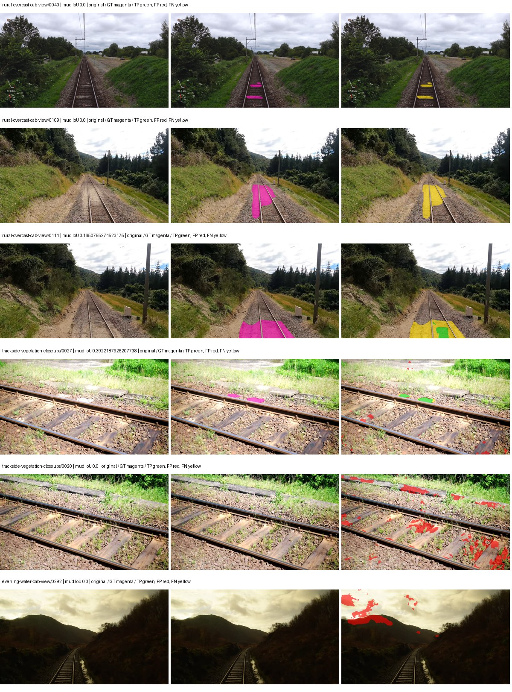
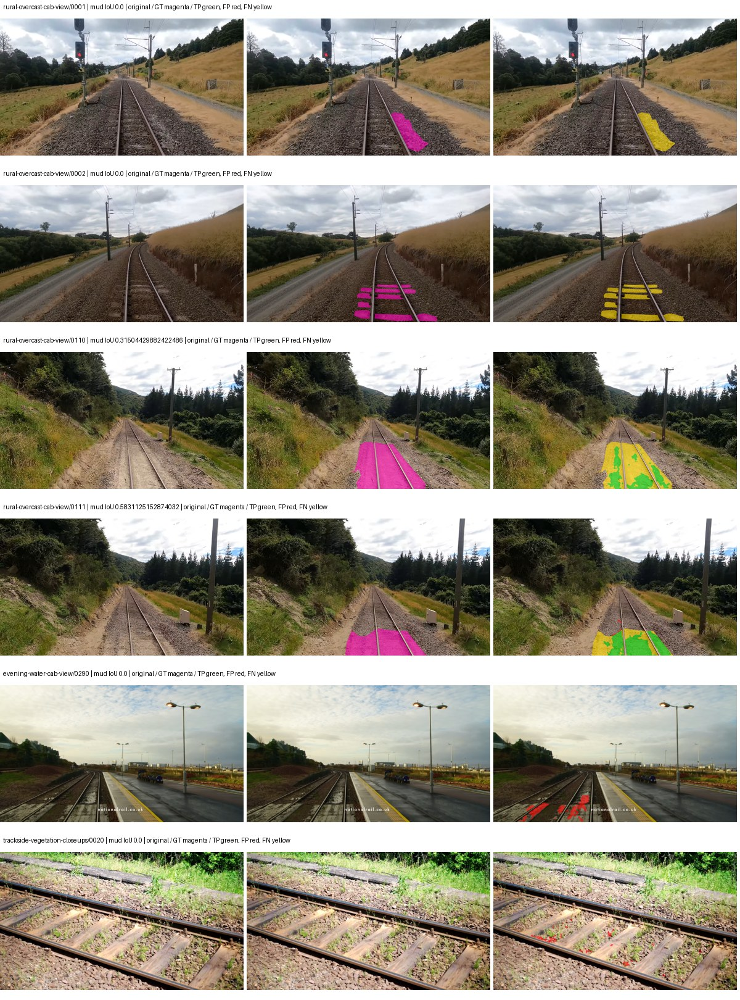
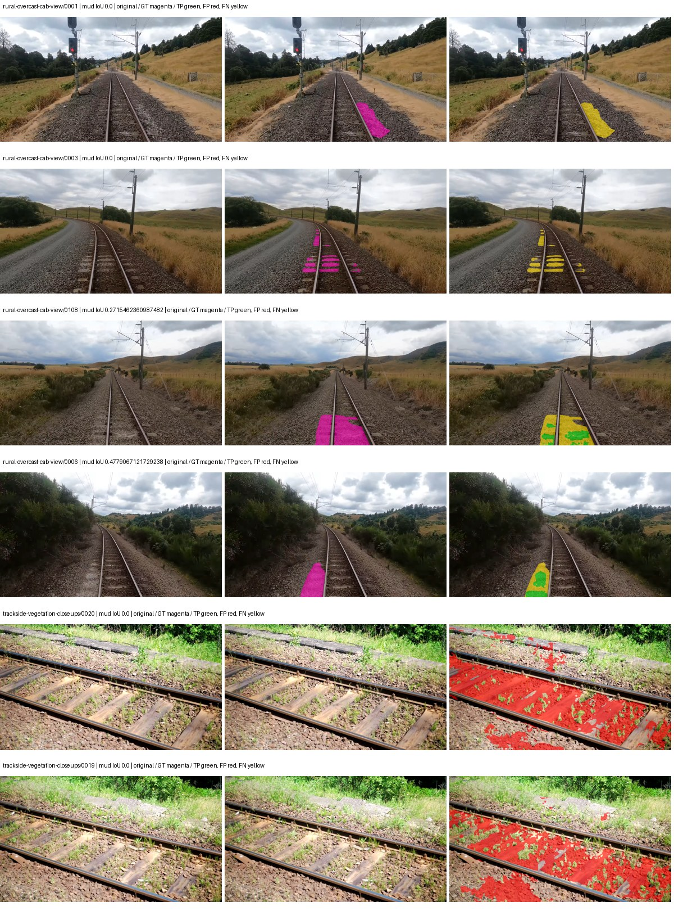
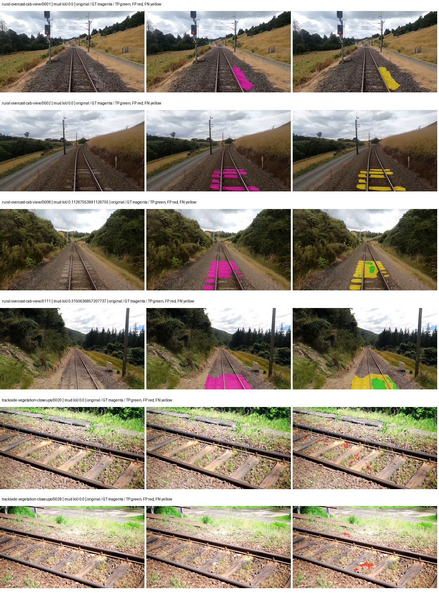

# hrnet_w48_ocr — rad_9_24_2026-fixed-grouped

[RAD 9/24: Scene-grouped split](../../README.md) · [Full model records](record.json)

Primary result: the **final checkpoint** after the full step budget (no early stopping). The checkpoint with the best **mud-pumping validation IoU, pixels pooled over all validation images**, is kept as secondary evidence. A job is complete only after full statistics and isolated profiling are verified.

Study metrics of the final checkpoint, counting each class only on the validation images that contain it: mud-pumping IoU is the mean per-image IoU over the images with mud-pumping, precision and recall sum pixels over those images, and mIoU averages each class over the images that contain it, then over the classes present.

| Initialization path | Seed | Mud-pumping IoU, train-camera images with mud (%, n=17) | Mud-pumping IoU, all images with mud (%, n=18) | Mud precision, all images with mud (%) | Mud recall, all images with mud (%) | mIoU (each class over images that contain it) (%) |
| --- | --- | --- | --- | --- | --- | --- |
| rtis_only | 0 | 1.01 | 1.09 | 5.05 | 2.16 | 38.36 |
| cityscapes_to_rtis | 0 | 3.83 | 5.30 | 95.27 | 5.54 | 35.48 |
| railsem19_to_rtis | 0 | 3.98 | 3.81 | 7.17 | 4.44 | 44.06 |
| cityscapes_to_railsem19_to_rtis | 0 | 4.91 | 4.89 | 42.96 | 6.76 | 40.91 |

Per-class IoU: IoU (%) of every class, each averaged only over the validation images that contain the class (n = those images); — = no image contains it. mIoU averages the classes with at least one such image.

| Initialization path | Seed | mIoU (each class over images that contain it) | person (n=0) | truck (n=0) | rail-track (n=37) | vegetation-overgrowth (n=13) | car (n=3) | on-rails (n=0) | traffic-sign (n=9) | road (n=11) | sidewalk (n=12) | construction (n=12) | tram-track (n=2) | pole (n=21) | traffic-light (n=3) | mud-pumping (n=18) | fence (n=7) | terrain (n=35) | sky (n=28) | rail-embedded (n=3) | rail-raised (n=37) | trackbed (n=37) | standing-water (n=9) |
| --- | --- | --- | --- | --- | --- | --- | --- | --- | --- | --- | --- | --- | --- | --- | --- | --- | --- | --- | --- | --- | --- | --- | --- |
| rtis_only | 0 | 38.36 | — | — | 56.83 | 20.09 | 27.42 | — | 32.62 | 11.43 | 7.21 | 46.01 | 28.90 | 68.40 | 41.17 | 1.09 | 12.17 | 84.06 | 96.18 | 14.29 | 74.53 | 65.99 | 2.15 |
| cityscapes_to_rtis | 0 | 35.48 | — | — | 53.57 | 19.35 | 34.71 | — | 36.24 | 20.18 | 4.65 | 40.99 | 1.42 | 72.33 | 35.55 | 5.30 | 10.90 | 78.10 | 90.93 | 3.71 | 72.07 | 57.94 | 0.68 |
| railsem19_to_rtis | 0 | 44.06 | — | — | 57.35 | 35.78 | 34.05 | — | 52.83 | 11.21 | 16.66 | 44.85 | 34.36 | 73.91 | 40.17 | 3.81 | 28.12 | 84.85 | 96.06 | 32.29 | 74.66 | 69.46 | 2.72 |
| cityscapes_to_railsem19_to_rtis | 0 | 40.91 | — | — | 62.50 | 19.17 | 38.91 | — | 40.80 | 19.27 | 12.26 | 38.88 | 29.13 | 74.84 | 52.11 | 4.89 | 18.08 | 81.97 | 96.72 | 8.84 | 72.65 | 62.72 | 2.65 |

Everything below is the campaign's own record, with pixels pooled over all validation images: its evaluation is the checkpoint that scored best on that pooled mud IoU (secondary evidence here); the diagnostics also cover the final checkpoint (`final-auto-val`).

| Model | Initialization path | Seed | Status | Steps | Best step | Best-checkpoint mud IoU, pixels pooled (%) | Best-checkpoint mud precision, pixels pooled (%) | Best-checkpoint mud recall, pixels pooled (%) | Final mud IoU (trainer val, pixels pooled, %) | Best-checkpoint mIoU, pixels pooled (%) | Best-checkpoint fixed GT-class mIoU, pixels pooled (%) |
| --- | --- | --- | --- | --- | --- | --- | --- | --- | --- | --- | --- |
| hrnet_w48_ocr | rtis_only | 0 | completed | 4000 | 1296 | 4.65 | 12.09 | 7.02 | 0.46 | 33.82 | 39.46 |
| hrnet_w48_ocr | cityscapes_to_rtis | 0 | completed | 4000 | 2074 | 9.46 | 71.43 | 9.83 | 5.22 | 35.66 | 41.60 |
| hrnet_w48_ocr | railsem19_to_rtis | 0 | completed | 4000 | 2592 | 3.04 | 4.22 | 9.84 | 1.06 | 44.19 | 51.56 |
| hrnet_w48_ocr | cityscapes_to_railsem19_to_rtis | 0 | completed | 4000 | 1555 | 5.98 | 66.73 | 6.16 | 5.06 | 44.39 | 49.32 |

Training: 217 images. Validation: 37 images. Test: 60 held out. Seeds: [0]. Seed variation measures optimization variability, not independent-recording uncertainty. Historical source checkpoints stay fixed across adaptation seeds.

Training code: `fce0ea0ac50b334d4252812c396e0e593def375d`. Split SHA-256: `12d7b367c72cda61d57686ff2ac28223530d0af49debd9fb7a0fbc68b908bc93`.

## rtis_only — seed 0

Status: **completed**. Started: 2026-10-11T04:21:24.964981+00:00. Finished: 2026-10-11T06:16:58.163746+00:00.

Recipe pretrained initializer: `timm hrnet_w48 pretrained ImageNet backbone; fresh OCR head`.

`rtis_only` uses the recipe initializer, which may include pretrained segmentation components. Transfer paths load the exact historical source checkpoint below and reset the classifier; they do not reset all query/decoder features.

Source checkpoint: `Recipe pretrained initialization`.

Config SHA-256: `e8f7cbe839d46e56e097eabe48ec3833f95b90fd6065be3725c8a7faa6d0bd87`. Weights used for validation: `raw`.

### Mud-pumping and aggregate quality

| Metric | Selected checkpoint | Final training validation |
| --- | --- | --- |
| Mud IoU | 4.65 | 0.46 |
| Mud precision | 12.09 | 0.57 |
| Mud recall | 7.02 | 2.16 |
| Mud Dice/F1 | 8.88 | 0.91 |
| mIoU | 33.82 | 35.92 |
| Mean accuracy | 52.87 | 49.60 |
| Mean precision | 52.79 | 54.69 |
| Mean Dice | 44.31 | 45.49 |
| Mean specificity | 98.79 | 98.91 |
| Pixel accuracy | 78.66 | 82.62 |
| Frequency-weighted IoU | 70.29 | 74.30 |
| Fixed GT-present class mIoU | 39.46 | 41.91 |
| Boundary F1 | 42.02 | 43.55 |

The selected checkpoint has independent evaluation evidence. Final values are the trainer's final validation record, not a new independent evaluation. mIoU averages classes with nonzero union, so false positives on absent classes can change its denominator. The fixed GT-class mean is supplementary and excludes absent classes; their false positives remain in the confusion matrix.

### Resource usage and timing

| Measurement | Value |
| --- | --- |
| Peak training VRAM, retained training invocation (GiB) | 17.35 |
| Peak evaluation VRAM (GiB) | 7.58 |
| Retained training invocation wall time (seconds) | 6705.33 |
| Retained training invocation GPU-hours (one GPU) | 1.86 |
| Evaluation wall time (seconds) | 18.69 |
| Full evaluation pipeline images/second | 1.98 |
| Best full-state checkpoint (MiB) | 1119.23 |
| Final full-state checkpoint (MiB) | 1119.18 |
| Verified periodic checkpoints removed (GiB) | 8.74 |

VRAM uses the recorded allocator high-water mark; it is not total device usage including CUDA context. Resumed jobs' retained training invocation times and peaks are **not whole-campaign totals**. Earlier invocation resource records are not reconstructed here. Evaluation throughput includes loader, sliding-window inference and metrics; it is not model-only latency/FPS. Missing measurements are shown as —, never inferred from another dataset's run.

### Standardized inference performance

Dedicated model-only profiling waits for an idle worker-locked L40S: BF16, batch 1, 1024x1024, 20 warmup and 100 CUDA-event-timed public forwards. It excludes loading, preprocessing, tiling and metrics.

| Status | Parameters | Weight MiB | FPS | p50 ms | p95 ms | Peak reserved GiB |
| --- | --- | --- | --- | --- | --- | --- |
| complete | 73168490 | 279.12 | 30.28 | 32.60 | 35.03 | 1.26 |

```json
{
  "schema_version": 1,
  "model_id": "hrnet_w48_ocr",
  "measured_at": "2026-10-11T06:16:46+00:00",
  "status": "complete",
  "benchmark_scope": "rtis_selected_checkpoint_model_only",
  "applies_to": [
    "hrnet_w48_ocr--rtis_only--seed-0"
  ],
  "source": {
    "campaign_git_sha": "fce0ea0ac50b334d4252812c396e0e593def375d",
    "git_dirty": false,
    "config_hash": "9bc36fc5be6e",
    "resolved_config": "/data/izadia1/projects/segmentary-runs/rad_9_24_2026/fgall-seed0-20261007/configs/hrnet_w48_ocr--rtis_only--seed-0.yaml",
    "config_sha256": "e8f7cbe839d46e56e097eabe48ec3833f95b90fd6065be3725c8a7faa6d0bd87",
    "checkpoint_sha256": "d8115a2a17341a490cb71503906993ada1a0972b14128655b27c943c879e55a6",
    "checkpoint_global_step": 1296,
    "checkpoint_bytes": 1173602431,
    "checkpoint_kind": "resume checkpoint with optimizer and EMA state",
    "weights": "raw",
    "measured_checkpoint_job_id": "hrnet_w48_ocr--rtis_only--seed-0",
    "result_sha256": "a877acecfb6ec8d7dbd1caeda9bfa78ac85733beb284e80bdfd74368264bb30c",
    "result_git_sha": "fce0ea0ac50b334d4252812c396e0e593def375d",
    "result_stage": "eval:rad_9_24_2026-fixed-grouped:val",
    "result_seed": 0
  },
  "hardware": {
    "gpu_name": "NVIDIA L40S",
    "gpu_uuid": "GPU-fc5dde96-210d-0afa-ac74-7f88477d622b",
    "logical_device": "cuda:0",
    "physical_visibility_token": "4",
    "compute_capability": [
      8,
      9
    ],
    "total_memory_bytes": 47677177856
  },
  "model": {
    "parameter_count": 73168490,
    "trainable_parameter_count": 73168490,
    "resident_parameter_bytes": 292673960,
    "parameter_dtype_counts": {
      "float32": 73168490
    }
  },
  "contract": {
    "backend": "pytorch",
    "precision": "bf16_autocast",
    "batch_size": 1,
    "input_shape_nchw": [
      1,
      3,
      1024,
      1024
    ],
    "warmup_iterations": 20,
    "measured_iterations": 100,
    "timing": "per-forward CUDA events with end-event synchronization",
    "includes_preprocessing": false,
    "includes_data_loader": false,
    "includes_sliding_window": false,
    "input_resident_on_gpu": true,
    "model_only": true,
    "entrypoint": "public model(image) dense-logits forward"
  },
  "measurements": {
    "latency": {
      "p50_ms": 32.60211181640625,
      "p95_ms": 35.029553985595705,
      "mean_ms": 33.03013507843018,
      "minimum_ms": 32.18329620361328,
      "maximum_ms": 36.323326110839844,
      "fps": 30.275383301506224,
      "raw_ms": [
        32.34099197387695,
        32.35737609863281,
        32.91852951049805,
        32.46275329589844,
        32.7086067199707,
        32.21084976196289,
        32.34918212890625,
        34.65110397338867,
        33.95993423461914,
        33.52678298950195,
        32.26726531982422,
        32.24166488647461,
        32.40447998046875,
        32.287742614746094,
        32.553985595703125,
        32.37376022338867,
        32.43929672241211,
        32.247806549072266,
        32.96553421020508,
        33.870849609375,
        34.0582389831543,
        34.1288948059082,
        32.737281799316406,
        32.491519927978516,
        32.40345764160156,
        32.319454193115234,
        32.7740478515625,
        32.44134521484375,
        32.76182556152344,
        32.56934356689453,
        32.347137451171875,
        32.284671783447266,
        36.323326110839844,
        33.63532638549805,
        36.001792907714844,
        32.99430465698242,
        32.18329620361328,
        33.2492790222168,
        32.765953063964844,
        34.25075149536133,
        32.308223724365234,
        32.31430435180664,
        32.34611129760742,
        32.35744094848633,
        35.118080139160156,
        33.077247619628906,
        35.43241500854492,
        33.34553527832031,
        32.30412673950195,
        32.264190673828125,
        33.43257522583008,
        32.914432525634766,
        33.29740905761719,
        32.48524856567383,
        36.311038970947266,
        32.78131103515625,
        33.2891845703125,
        33.65580749511719,
        34.59174346923828,
        32.83865737915039,
        32.26726531982422,
        32.52326583862305,
        33.77561569213867,
        33.62201690673828,
        32.42393493652344,
        32.441471099853516,
        32.314369201660156,
        32.31846237182617,
        33.58822250366211,
        33.34960174560547,
        34.06028747558594,
        32.48128128051758,
        32.32972717285156,
        32.44441604614258,
        32.323585510253906,
        32.60416030883789,
        33.349632263183594,
        32.66048049926758,
        32.361473083496094,
        32.39731216430664,
        32.42496109008789,
        33.089534759521484,
        33.58822250366211,
        35.02489471435547,
        32.90419387817383,
        32.376705169677734,
        33.04751968383789,
        32.363521575927734,
        34.20876693725586,
        32.337921142578125,
        32.46080017089844,
        32.60006332397461,
        32.581600189208984,
        32.505855560302734,
        33.2677116394043,
        33.75513458251953,
        34.69004821777344,
        32.951297760009766,
        32.44224166870117,
        32.43110275268555
      ],
      "percentile_method": "numpy linear interpolation"
    },
    "peak_reserved_bytes": 1350565888,
    "memory_kind": "pytorch_cuda_allocator_peak_reserved_excluding_context",
    "process_total_bytes": 1887436800,
    "process_total_kind": "nvidia-smi used_memory of this PID on the benchmark GPU after the timed loop, including the CUDA context; null when the driver could not attribute memory to this PID",
    "benchmark_wall_clock_s": 16.627378560602665
  },
  "started_at": "2026-10-11T06:16:30+00:00",
  "finished_at": "2026-10-11T06:16:46+00:00",
  "environment": {
    "hostname": "hdrfs-app-001",
    "python": "3.11.15",
    "platform": "Linux-5.15.0-139-generic-x86_64-with-glibc2.35",
    "torch": "2.11.0+cu128",
    "torch_cuda": "12.8",
    "cudnn": 91900,
    "driver_version": "570.133.20",
    "cuda_available": true,
    "gpu_count": 1,
    "gpu_names": [
      "NVIDIA L40S"
    ],
    "cuda_visible_devices": "4",
    "packages": {
      "segmentary": "0.1.0",
      "torch": "2.11.0+cu128",
      "torchvision": "0.26.0+cu128",
      "transformers": "5.15.0",
      "timm": "1.0.28",
      "segmentation-models-pytorch": "0.5.0",
      "albumentations": "2.0.8",
      "lightning": "2.6.5",
      "numpy": "2.4.4"
    }
  }
}
```

### Per-class validation results

| Class | GT pixels | IoU (%) | Precision (%) | Recall (%) | Dice (%) | Boundary F1 (%) |
| --- | --- | --- | --- | --- | --- | --- |
| car | 29664 | 52.57 | 72.70 | 65.50 | 68.91 | 61.29 |
| construction | 311585 | 20.03 | 21.10 | 79.80 | 33.38 | 32.18 |
| fence | 265137 | 17.52 | 49.56 | 21.33 | 29.82 | 38.30 |
| mud-pumping | 1226250 | 4.65 | 12.09 | 7.02 | 8.88 | 7.45 |
| on-rails | 0 | 0.00 | 0.00 | — | 0.00 | 0.00 |
| person | 0 | 0.00 | 0.00 | — | 0.00 | 0.00 |
| pole | 628038 | 68.14 | 86.42 | 76.30 | 81.05 | 90.56 |
| rail-embedded | 16799 | 23.47 | 77.37 | 25.20 | 38.02 | 36.02 |
| rail-raised | 2969797 | 74.71 | 78.60 | 93.78 | 85.52 | 88.80 |
| rail-track | 6323197 | 44.53 | 68.64 | 55.90 | 61.62 | 56.15 |
| road | 1048831 | 14.27 | 34.95 | 19.44 | 24.98 | 18.89 |
| sidewalk | 1297367 | 22.19 | 30.39 | 45.14 | 36.32 | 21.87 |
| sky | 19121606 | 90.65 | 99.29 | 91.24 | 95.09 | 79.37 |
| standing-water | 95802 | 1.03 | 1.04 | 55.14 | 2.04 | 2.01 |
| terrain | 39239306 | 77.77 | 89.90 | 85.21 | 87.49 | 62.56 |
| trackbed | 10643081 | 59.30 | 69.51 | 80.16 | 74.45 | 54.23 |
| traffic-light | 19510 | 42.98 | 87.50 | 45.79 | 60.12 | 58.02 |
| traffic-sign | 13285 | 38.07 | 88.21 | 40.11 | 55.15 | 63.66 |
| tram-track | 56179 | 17.05 | 59.18 | 19.32 | 29.13 | 40.30 |
| truck | 0 | 0.00 | 0.00 | — | 0.00 | 0.00 |
| vegetation-overgrowth | 5901821 | 41.28 | 82.21 | 45.33 | 58.44 | 70.81 |

### Full-run accounting

| Measurement | Value |
| --- | --- |
| Full GPU-reserved wall seconds, all recorded worker attempts | 6941.05 |
| Full reserved GPU-hours | 1.93 |
| Whole-run timing complete | True |

| Phase | Wall seconds including failed attempts |
| --- | --- |
| training | 6712.52 |
| diagnostics | 154.96 |
| performance | 26.41 |

GPU-reserved time includes model loading, training, validation, collection, profiling, checkpoint I/O and orchestration while the worker owns one GPU. It is not GPU kernel-active time. Phase timings and sampled device memory/power/utilization are retained separately; sampled device memory is not the allocator high-water mark.

### Train/validation and raw/EMA diagnostics

| Checkpoint / weights / split | Images | Mud IoU (%) | Mud precision (%) | Mud recall (%) |
| --- | --- | --- | --- | --- |
| best-auto-train / raw | 217 | 93.45 | 96.47 | 96.76 |
| best-auto-val / raw | 37 | 4.65 | 12.09 | 7.02 |
| best-alternate-val / ema | 37 | 0.39 | 0.51 | 1.58 |
| final-auto-val / raw | 37 | 0.46 | 0.57 | 2.16 |

Train uses the evaluation transform without augmentation. Compare mud train/validation metrics for the same selected weights. Alternate EMA on running-stat BatchNorm is explicitly uncalibrated and is diagnostic only. Score-threshold curves use uncalibrated normalized scores and are pixel-level diagnostics, not event detection rates or a selected deployment operating point.

### Downloadable evidence

- best-auto-train: [per-image.csv](rtis_only--seed-0/best-auto-train/per-image.csv) · [per-image-confusion.json.gz](rtis_only--seed-0/best-auto-train/per-image-confusion.json.gz) · [groups.json](rtis_only--seed-0/best-auto-train/groups.json) · [mud-score-curves.json](rtis_only--seed-0/best-auto-train/mud-score-curves.json)
- best-auto-val: [per-image.csv](rtis_only--seed-0/best-auto-val/per-image.csv) · [per-image-confusion.json.gz](rtis_only--seed-0/best-auto-val/per-image-confusion.json.gz) · [groups.json](rtis_only--seed-0/best-auto-val/groups.json) · [mud-score-curves.json](rtis_only--seed-0/best-auto-val/mud-score-curves.json) · [examples.jpg](rtis_only--seed-0/best-auto-val/examples.jpg)
- best-alternate-val: [per-image.csv](rtis_only--seed-0/best-alternate-val/per-image.csv) · [per-image-confusion.json.gz](rtis_only--seed-0/best-alternate-val/per-image-confusion.json.gz) · [groups.json](rtis_only--seed-0/best-alternate-val/groups.json) · [mud-score-curves.json](rtis_only--seed-0/best-alternate-val/mud-score-curves.json)
- final-auto-val: [per-image.csv](rtis_only--seed-0/final-auto-val/per-image.csv) · [per-image-confusion.json.gz](rtis_only--seed-0/final-auto-val/per-image-confusion.json.gz) · [groups.json](rtis_only--seed-0/final-auto-val/groups.json) · [mud-score-curves.json](rtis_only--seed-0/final-auto-val/mud-score-curves.json)
- resources: [telemetry.csv](rtis_only--seed-0/resources/telemetry.csv)



Examples are two lowest and two highest mud-IoU positive images, plus up to two negative images with the most false-positive mud pixels. They are targeted diagnostic examples, not random samples. Green: true positive; red: false positive; yellow: false negative. Full predictions remain on HDRFS.

### Validation tracking

| Logged step | Overall mIoU (%) | Mud IoU (%) |
| --- | --- | --- |
| 258 | 22.71 | 0.44 |
| 518 | 26.18 | 1.95 |
| 777 | 25.86 | 1.06 |
| 1036 | 32.52 | 0.90 |
| 1295 | 33.82 | 4.65 |
| 1555 | 35.78 | 0.90 |
| 1814 | 33.81 | 1.99 |
| 2073 | 33.64 | 0.90 |
| 2332 | 35.55 | 0.75 |
| 2592 | 36.91 | 0.83 |
| 2851 | 37.99 | 1.48 |
| 3110 | 35.73 | 0.49 |
| 3369 | 36.06 | 0.81 |
| 3629 | 37.02 | 0.57 |
| 3888 | 35.22 | 0.33 |
| 4000 | 35.92 | 0.46 |

All retained scalar curves, including training loss and per-class IoU, are in record.json. Observed best mud on a curve is not necessarily a retained checkpoint: the pilot saved its selection-metric-best and final checkpoints. Step logging and checkpoint global_step may differ by one.

### Stopping and checkpoint provenance

```json
{
  "stopping": {
    "actual_steps": 4000,
    "maximum_steps": 4000,
    "min_delta": 0.0,
    "monitor": "val_iou/mud-pumping",
    "patience": null,
    "reason": "budget_complete"
  },
  "checkpoints": {
    "best": {
      "path": "/data/izadia1/projects/segmentary-runs/rad_9_24_2026/fgall-seed0-20261007/future-runs/hrnet_w48_ocr--rtis_only--seed-0_seed0/rtis/best.ckpt",
      "sha256": "d8115a2a17341a490cb71503906993ada1a0972b14128655b27c943c879e55a6",
      "global_step": 1296,
      "bytes": 1173602431
    },
    "final": {
      "path": "/data/izadia1/projects/segmentary-runs/rad_9_24_2026/fgall-seed0-20261007/future-runs/hrnet_w48_ocr--rtis_only--seed-0_seed0/rtis/last.ckpt",
      "sha256": "cd5339b1606f444130a5a1729cf59ab192cb715b36666f10246a82b3c2775271",
      "global_step": 4000,
      "bytes": 1173540991
    }
  },
  "cleanup_error": null
}
```

### Resolved training, initialization and evaluation settings

The optimizer block is the base configuration. Stage LR scales are applied at runtime, and stage warmup is capped at min(base warmup, floor(stage budget / 10), stage budget - 1): 400 steps for this 4,000-step pilot. Model-internal native input grids may differ from augmentation crops (EoMT uses its 640 grid).

```json
{
  "name": "hrnet_w48_ocr--rtis_only--seed-0",
  "model": {
    "arch": "hrnet_w48_ocr",
    "checkpoint": null,
    "tuning": "full",
    "head": "unified_head",
    "lora_r": 16,
    "lora_alpha": 32,
    "lora_dropout": 0.05,
    "lora_targets": [],
    "drop_path": null,
    "revision": null,
    "subfolder": null,
    "local_files_only": false,
    "trust_remote_code": false,
    "backbone_path": null,
    "head_paths": [],
    "classifier_path": null,
    "inactive_parameter_paths": [],
    "smp_arch": null,
    "encoder_name": null,
    "encoder_weights": null,
    "native": null,
    "batch_norm_momentum": null
  },
  "space": "paul-test-rtis",
  "taxonomy_root": "/data/izadia1/projects/segmentary-rad-fgall-fce0ea0a/taxonomy",
  "output_root": "/data/izadia1/projects/segmentary-runs/rad_9_24_2026/fgall-seed0-20261007/future-runs",
  "optim": {
    "backbone_lr": 0.0001,
    "head_lr_mult": 10.0,
    "weight_decay": 0.05,
    "llrd": 1.0,
    "warmup_iters": 1500,
    "warmup_ratio": 1e-06,
    "poly_power": 0.9,
    "min_lr_ratio": 0.0,
    "betas": [
      0.9,
      0.999
    ],
    "grad_clip": 1.0
  },
  "train": {
    "iters": 4000,
    "batch_size": 2,
    "accum": 8,
    "num_workers": 2,
    "precision": "bf16-mixed",
    "ema_decay": 0.9998,
    "val_every": 250,
    "ckpt_every": 500,
    "selection_metric": "val_iou/mud-pumping",
    "early_stopping_patience": null,
    "early_stopping_min_delta": 0.0,
    "seed": 0,
    "devices": 1
  },
  "eval": {
    "sliding_window": true,
    "window": [
      1024,
      1024
    ],
    "stride": [
      768,
      768
    ],
    "batch_size": 1,
    "num_workers": 2,
    "tta_scales": [],
    "tta_flip": false,
    "threshold": 0.5,
    "boundary_tolerance_frac": 0.0075,
    "save_confusion": true
  },
  "loss": {
    "task": "multiclass",
    "activation": "auto",
    "terms": [],
    "aux": "none",
    "aux_weight": 0.0,
    "ce_weight": 1.0,
    "label_smoothing": 0.0,
    "class_weights": null,
    "query": null
  },
  "aug": {
    "crop": [
      1024,
      1024
    ],
    "scale_min": 0.5,
    "scale_max": 2.0,
    "hflip_p": 0.5,
    "color_jitter_p": 0.5,
    "brightness": 0.25,
    "contrast": 0.25,
    "saturation": 0.25,
    "hue": 0.05
  },
  "stages": [
    {
      "name": "rtis",
      "data": [
        {
          "name": "rad_9_24_2026-fixed-grouped",
          "root": "/data/izadia1/datasets/rad_9_24_2026-fixed-grouped",
          "variant": null,
          "split_file": "splits.json",
          "train_split": "train",
          "val_split": "val",
          "limit": null,
          "loader": "folder",
          "mapping": "paul-test-rtis",
          "loader_options": {
            "require_groups": true
          }
        }
      ],
      "iters": null,
      "lr_scale": 1.0,
      "head_group_lr_scale": 1.0,
      "init_from": "pretrained",
      "reset_head": false,
      "freeze": null,
      "sample_weights": null
    }
  ]
}
```

### Hardware and software provenance

```json
{
  "training": {
    "cuda_available": true,
    "cuda_visible_devices": "4",
    "cudnn": 91900,
    "driver_version": "570.133.20",
    "gpu_count": 1,
    "gpu_names": [
      "NVIDIA L40S"
    ],
    "hostname": "hdrfs-app-001",
    "input_normalization": {
      "channel_order": "rgb",
      "mean": [
        0.485,
        0.456,
        0.406
      ],
      "source": "imagenet",
      "std": [
        0.229,
        0.224,
        0.225
      ]
    },
    "model_origins": [
      {
        "hf_commit": null,
        "hf_name_or_path": null,
        "module": "trunk",
        "timm_pretrained": {
          "architecture": "hrnet_w48",
          "hf_hub_id": "timm/hrnet_w48.ms_in1k",
          "tag": "ms_in1k",
          "url": ""
        }
      }
    ],
    "model_parameter_count": 73168490,
    "packages": {
      "albumentations": "2.0.8",
      "lightning": "2.6.5",
      "numpy": "2.4.4",
      "segmentary": "0.1.0",
      "segmentation-models-pytorch": "0.5.0",
      "timm": "1.0.28",
      "torch": "2.11.0+cu128",
      "torchvision": "0.26.0+cu128",
      "transformers": "5.15.0"
    },
    "platform": "Linux-5.15.0-139-generic-x86_64-with-glibc2.35",
    "python": "3.11.15",
    "torch": "2.11.0+cu128",
    "torch_cuda": "12.8",
    "trainable_parameter_count": 73168490,
    "training_stop": {
      "actual_steps": 4000,
      "maximum_steps": 4000,
      "min_delta": 0.0,
      "monitor": "val_iou/mud-pumping",
      "patience": null,
      "reason": "budget_complete"
    },
    "validation_weights": "raw"
  },
  "evaluation": {
    "cuda_available": true,
    "cuda_visible_devices": "4",
    "cudnn": 91900,
    "driver_version": "570.133.20",
    "gpu_count": 1,
    "gpu_names": [
      "NVIDIA L40S"
    ],
    "hostname": "hdrfs-app-001",
    "input_normalization": {
      "channel_order": "rgb",
      "mean": [
        0.485,
        0.456,
        0.406
      ],
      "source": "imagenet",
      "std": [
        0.229,
        0.224,
        0.225
      ]
    },
    "packages": {
      "albumentations": "2.0.8",
      "lightning": "2.6.5",
      "numpy": "2.4.4",
      "segmentary": "0.1.0",
      "segmentation-models-pytorch": "0.5.0",
      "timm": "1.0.28",
      "torch": "2.11.0+cu128",
      "torchvision": "0.26.0+cu128",
      "transformers": "5.15.0"
    },
    "platform": "Linux-5.15.0-139-generic-x86_64-with-glibc2.35",
    "python": "3.11.15",
    "torch": "2.11.0+cu128",
    "torch_cuda": "12.8"
  }
}
```

## cityscapes_to_rtis — seed 0

Status: **completed**. Started: 2026-10-11T04:24:38.716731+00:00. Finished: 2026-10-11T06:20:34.760454+00:00.

Recipe pretrained initializer: `timm hrnet_w48 pretrained ImageNet backbone; fresh OCR head`.

`rtis_only` uses the recipe initializer, which may include pretrained segmentation components. Transfer paths load the exact historical source checkpoint below and reset the classifier; they do not reset all query/decoder features.

Source checkpoint: `{'name': 'hrnet_w48_ocr--cityscapes--seed-0', 'model': 'hrnet_w48_ocr', 'protocol': 'cityscapes', 'config': '/data/izadia1/projects/segmentary-runs/all-model-city-rail-seed0-rail20-b9eb3e1/accepted/hrnet_w48_ocr--cityscapes--seed-0/resolved-config.yaml', 'checkpoint': '/data/izadia1/projects/segmentary-runs/current-main-fill-v2/jobs/hrnet_w48_ocr--cityscapes--seed-0/train/hrnet_w48_ocr--cityscapes_seed0/cityscapes/last.ckpt', 'recorded_sha256': '38fb6ca68c932ae2a8224708568d0825f3d188f076da708d6eca79932cde4e84', 'exists': True}`.

Config SHA-256: `8510b67d9065f47efc2dd0699ed5b3784b95ad4dec005892d8b8a1e23adf5644`. Weights used for validation: `raw`.

### Mud-pumping and aggregate quality

| Metric | Selected checkpoint | Final training validation |
| --- | --- | --- |
| Mud IoU | 9.46 | 5.22 |
| Mud precision | 71.43 | 45.35 |
| Mud recall | 9.83 | 5.56 |
| Mud Dice/F1 | 17.29 | 9.91 |
| mIoU | 35.66 | 33.14 |
| Mean accuracy | 49.26 | 46.38 |
| Mean precision | 57.85 | 54.38 |
| Mean Dice | 44.82 | 42.16 |
| Mean specificity | 98.61 | 98.63 |
| Pixel accuracy | 80.11 | 80.63 |
| Frequency-weighted IoU | 67.69 | 68.22 |
| Fixed GT-present class mIoU | 41.60 | 38.67 |
| Boundary F1 | 40.61 | 40.11 |

The selected checkpoint has independent evaluation evidence. Final values are the trainer's final validation record, not a new independent evaluation. mIoU averages classes with nonzero union, so false positives on absent classes can change its denominator. The fixed GT-class mean is supplementary and excludes absent classes; their false positives remain in the confusion matrix.

### Resource usage and timing

| Measurement | Value |
| --- | --- |
| Peak training VRAM, retained training invocation (GiB) | 17.35 |
| Peak evaluation VRAM (GiB) | 7.58 |
| Retained training invocation wall time (seconds) | 6726.33 |
| Retained training invocation GPU-hours (one GPU) | 1.87 |
| Evaluation wall time (seconds) | 18.38 |
| Full evaluation pipeline images/second | 2.01 |
| Best full-state checkpoint (MiB) | 1119.23 |
| Final full-state checkpoint (MiB) | 1119.18 |
| Verified periodic checkpoints removed (GiB) | 8.74 |

VRAM uses the recorded allocator high-water mark; it is not total device usage including CUDA context. Resumed jobs' retained training invocation times and peaks are **not whole-campaign totals**. Earlier invocation resource records are not reconstructed here. Evaluation throughput includes loader, sliding-window inference and metrics; it is not model-only latency/FPS. Missing measurements are shown as —, never inferred from another dataset's run.

### Standardized inference performance

Dedicated model-only profiling waits for an idle worker-locked L40S: BF16, batch 1, 1024x1024, 20 warmup and 100 CUDA-event-timed public forwards. It excludes loading, preprocessing, tiling and metrics.

| Status | Parameters | Weight MiB | FPS | p50 ms | p95 ms | Peak reserved GiB |
| --- | --- | --- | --- | --- | --- | --- |
| complete | 73168490 | 279.12 | 30.43 | 32.69 | 33.82 | 1.26 |

```json
{
  "schema_version": 1,
  "model_id": "hrnet_w48_ocr",
  "measured_at": "2026-10-11T06:20:23+00:00",
  "status": "complete",
  "benchmark_scope": "rtis_selected_checkpoint_model_only",
  "applies_to": [
    "hrnet_w48_ocr--cityscapes_to_rtis--seed-0"
  ],
  "source": {
    "campaign_git_sha": "fce0ea0ac50b334d4252812c396e0e593def375d",
    "git_dirty": false,
    "config_hash": "271e8d821ee9",
    "resolved_config": "/data/izadia1/projects/segmentary-runs/rad_9_24_2026/fgall-seed0-20261007/configs/hrnet_w48_ocr--cityscapes_to_rtis--seed-0.yaml",
    "config_sha256": "8510b67d9065f47efc2dd0699ed5b3784b95ad4dec005892d8b8a1e23adf5644",
    "checkpoint_sha256": "80bc76e3a96e6c8a5e644223ca42507876455693048d20c72a402542922d9d50",
    "checkpoint_global_step": 2074,
    "checkpoint_bytes": 1173602495,
    "checkpoint_kind": "resume checkpoint with optimizer and EMA state",
    "weights": "raw",
    "measured_checkpoint_job_id": "hrnet_w48_ocr--cityscapes_to_rtis--seed-0",
    "result_sha256": "0bcf75196ea96954798ed278abe08a2fc02b265320312a8f17bfc6c471f2f998",
    "result_git_sha": "fce0ea0ac50b334d4252812c396e0e593def375d",
    "result_stage": "eval:rad_9_24_2026-fixed-grouped:val",
    "result_seed": 0
  },
  "hardware": {
    "gpu_name": "NVIDIA L40S",
    "gpu_uuid": "GPU-e2e96741-aec9-e90b-5c46-d0d58be90a56",
    "logical_device": "cuda:0",
    "physical_visibility_token": "8",
    "compute_capability": [
      8,
      9
    ],
    "total_memory_bytes": 47677177856
  },
  "model": {
    "parameter_count": 73168490,
    "trainable_parameter_count": 73168490,
    "resident_parameter_bytes": 292673960,
    "parameter_dtype_counts": {
      "float32": 73168490
    }
  },
  "contract": {
    "backend": "pytorch",
    "precision": "bf16_autocast",
    "batch_size": 1,
    "input_shape_nchw": [
      1,
      3,
      1024,
      1024
    ],
    "warmup_iterations": 20,
    "measured_iterations": 100,
    "timing": "per-forward CUDA events with end-event synchronization",
    "includes_preprocessing": false,
    "includes_data_loader": false,
    "includes_sliding_window": false,
    "input_resident_on_gpu": true,
    "model_only": true,
    "entrypoint": "public model(image) dense-logits forward"
  },
  "measurements": {
    "latency": {
      "p50_ms": 32.694271087646484,
      "p95_ms": 33.82010746002197,
      "mean_ms": 32.86751079559326,
      "minimum_ms": 32.40959930419922,
      "maximum_ms": 36.299774169921875,
      "fps": 30.42518206563047,
      "raw_ms": [
        33.8974723815918,
        32.517120361328125,
        32.55091094970703,
        33.03014373779297,
        32.54374313354492,
        32.4587516784668,
        32.40959930419922,
        32.70451354980469,
        32.485374450683594,
        32.48844909667969,
        32.50688171386719,
        32.859134674072266,
        33.35782241821289,
        32.652286529541016,
        32.49971389770508,
        32.64409637451172,
        32.97587203979492,
        32.475135803222656,
        32.47206497192383,
        33.065982818603516,
        32.475135803222656,
        33.494014739990234,
        32.5109748840332,
        32.735233306884766,
        33.075199127197266,
        32.429054260253906,
        32.47203063964844,
        35.306495666503906,
        32.6297607421875,
        32.561153411865234,
        32.82636642456055,
        32.692222595214844,
        32.59187316894531,
        32.515071868896484,
        32.729087829589844,
        33.84832000732422,
        32.83763122558594,
        32.97283172607422,
        32.99327850341797,
        33.81452941894531,
        33.81862258911133,
        34.713600158691406,
        36.299774169921875,
        33.20729446411133,
        32.66457748413086,
        32.72499084472656,
        32.8171501159668,
        33.277950286865234,
        32.59590530395508,
        33.24415969848633,
        32.542720794677734,
        32.882686614990234,
        32.66252899169922,
        33.0700798034668,
        32.83763122558594,
        33.02195358276367,
        32.967681884765625,
        32.63488006591797,
        32.77004623413086,
        33.2677116394043,
        32.56524658203125,
        32.570369720458984,
        32.5478401184082,
        32.749568939208984,
        32.73625564575195,
        32.480255126953125,
        32.56422424316406,
        33.66707229614258,
        32.549888610839844,
        32.58982467651367,
        32.63897705078125,
        32.893951416015625,
        32.52735900878906,
        33.270782470703125,
        32.561153411865234,
        32.58572769165039,
        32.73011016845703,
        32.83046340942383,
        33.137630462646484,
        32.73932647705078,
        32.78643035888672,
        32.63385772705078,
        32.99327850341797,
        33.0332145690918,
        32.5140495300293,
        32.53452682495117,
        32.696319580078125,
        32.56422424316406,
        33.04857635498047,
        32.537601470947266,
        32.55807876586914,
        32.44134521484375,
        32.5928955078125,
        32.88579177856445,
        32.893951416015625,
        32.635902404785156,
        32.70655822753906,
        32.56934356689453,
        32.4956169128418,
        32.56620788574219
      ],
      "percentile_method": "numpy linear interpolation"
    },
    "peak_reserved_bytes": 1350565888,
    "memory_kind": "pytorch_cuda_allocator_peak_reserved_excluding_context",
    "process_total_bytes": 1887436800,
    "process_total_kind": "nvidia-smi used_memory of this PID on the benchmark GPU after the timed loop, including the CUDA context; null when the driver could not attribute memory to this PID",
    "benchmark_wall_clock_s": 16.66177774220705
  },
  "started_at": "2026-10-11T06:20:06+00:00",
  "finished_at": "2026-10-11T06:20:23+00:00",
  "environment": {
    "hostname": "hdrfs-app-001",
    "python": "3.11.15",
    "platform": "Linux-5.15.0-139-generic-x86_64-with-glibc2.35",
    "torch": "2.11.0+cu128",
    "torch_cuda": "12.8",
    "cudnn": 91900,
    "driver_version": "570.133.20",
    "cuda_available": true,
    "gpu_count": 1,
    "gpu_names": [
      "NVIDIA L40S"
    ],
    "cuda_visible_devices": "8",
    "packages": {
      "segmentary": "0.1.0",
      "torch": "2.11.0+cu128",
      "torchvision": "0.26.0+cu128",
      "transformers": "5.15.0",
      "timm": "1.0.28",
      "segmentation-models-pytorch": "0.5.0",
      "albumentations": "2.0.8",
      "lightning": "2.6.5",
      "numpy": "2.4.4"
    }
  }
}
```

### Per-class validation results

| Class | GT pixels | IoU (%) | Precision (%) | Recall (%) | Dice (%) | Boundary F1 (%) |
| --- | --- | --- | --- | --- | --- | --- |
| car | 29664 | 57.48 | 73.24 | 72.76 | 73.00 | 51.21 |
| construction | 311585 | 59.46 | 72.91 | 76.32 | 74.57 | 62.13 |
| fence | 265137 | 10.82 | 48.66 | 12.22 | 19.53 | 27.38 |
| mud-pumping | 1226250 | 9.46 | 71.43 | 9.83 | 17.29 | 12.43 |
| on-rails | 0 | 0.00 | 0.00 | — | 0.00 | 0.00 |
| person | 0 | 0.00 | 0.00 | — | 0.00 | 0.00 |
| pole | 628038 | 73.93 | 83.44 | 86.64 | 85.01 | 89.94 |
| rail-embedded | 16799 | 7.48 | 67.44 | 7.76 | 13.91 | 19.99 |
| rail-raised | 2969797 | 72.78 | 80.48 | 88.39 | 84.25 | 87.91 |
| rail-track | 6323197 | 39.72 | 61.35 | 52.98 | 56.86 | 46.02 |
| road | 1048831 | 17.33 | 32.44 | 27.11 | 29.54 | 25.59 |
| sidewalk | 1297367 | 16.88 | 60.98 | 18.92 | 28.88 | 13.14 |
| sky | 19121606 | 89.84 | 99.62 | 90.15 | 94.65 | 78.89 |
| standing-water | 95802 | 0.10 | 0.11 | 0.71 | 0.20 | 2.11 |
| terrain | 39239306 | 78.33 | 79.95 | 97.46 | 87.85 | 45.93 |
| trackbed | 10643081 | 54.59 | 68.81 | 72.54 | 70.63 | 48.97 |
| traffic-light | 19510 | 80.32 | 93.39 | 85.17 | 89.09 | 91.59 |
| traffic-sign | 13285 | 54.79 | 85.51 | 60.39 | 70.79 | 81.98 |
| tram-track | 56179 | 12.86 | 54.85 | 14.39 | 22.79 | 14.17 |
| truck | 0 | 0.00 | 0.00 | — | 0.00 | 0.00 |
| vegetation-overgrowth | 5901821 | 12.62 | 80.21 | 13.03 | 22.41 | 53.32 |

### Full-run accounting

| Measurement | Value |
| --- | --- |
| Full GPU-reserved wall seconds, all recorded worker attempts | 6964.59 |
| Full reserved GPU-hours | 1.93 |
| Whole-run timing complete | True |

| Phase | Wall seconds including failed attempts |
| --- | --- |
| training | 6734.78 |
| diagnostics | 154.98 |
| performance | 26.91 |

GPU-reserved time includes model loading, training, validation, collection, profiling, checkpoint I/O and orchestration while the worker owns one GPU. It is not GPU kernel-active time. Phase timings and sampled device memory/power/utilization are retained separately; sampled device memory is not the allocator high-water mark.

### Train/validation and raw/EMA diagnostics

| Checkpoint / weights / split | Images | Mud IoU (%) | Mud precision (%) | Mud recall (%) |
| --- | --- | --- | --- | --- |
| best-auto-train / raw | 217 | 91.54 | 95.34 | 95.83 |
| best-auto-val / raw | 37 | 9.46 | 71.43 | 9.83 |
| best-alternate-val / ema | 37 | 4.49 | 87.80 | 4.52 |
| final-auto-val / raw | 37 | 5.19 | 45.03 | 5.54 |

Train uses the evaluation transform without augmentation. Compare mud train/validation metrics for the same selected weights. Alternate EMA on running-stat BatchNorm is explicitly uncalibrated and is diagnostic only. Score-threshold curves use uncalibrated normalized scores and are pixel-level diagnostics, not event detection rates or a selected deployment operating point.

### Downloadable evidence

- best-auto-train: [per-image.csv](cityscapes_to_rtis--seed-0/best-auto-train/per-image.csv) · [per-image-confusion.json.gz](cityscapes_to_rtis--seed-0/best-auto-train/per-image-confusion.json.gz) · [groups.json](cityscapes_to_rtis--seed-0/best-auto-train/groups.json) · [mud-score-curves.json](cityscapes_to_rtis--seed-0/best-auto-train/mud-score-curves.json)
- best-auto-val: [per-image.csv](cityscapes_to_rtis--seed-0/best-auto-val/per-image.csv) · [per-image-confusion.json.gz](cityscapes_to_rtis--seed-0/best-auto-val/per-image-confusion.json.gz) · [groups.json](cityscapes_to_rtis--seed-0/best-auto-val/groups.json) · [mud-score-curves.json](cityscapes_to_rtis--seed-0/best-auto-val/mud-score-curves.json) · [examples.jpg](cityscapes_to_rtis--seed-0/best-auto-val/examples.jpg)
- best-alternate-val: [per-image.csv](cityscapes_to_rtis--seed-0/best-alternate-val/per-image.csv) · [per-image-confusion.json.gz](cityscapes_to_rtis--seed-0/best-alternate-val/per-image-confusion.json.gz) · [groups.json](cityscapes_to_rtis--seed-0/best-alternate-val/groups.json) · [mud-score-curves.json](cityscapes_to_rtis--seed-0/best-alternate-val/mud-score-curves.json)
- final-auto-val: [per-image.csv](cityscapes_to_rtis--seed-0/final-auto-val/per-image.csv) · [per-image-confusion.json.gz](cityscapes_to_rtis--seed-0/final-auto-val/per-image-confusion.json.gz) · [groups.json](cityscapes_to_rtis--seed-0/final-auto-val/groups.json) · [mud-score-curves.json](cityscapes_to_rtis--seed-0/final-auto-val/mud-score-curves.json)
- resources: [telemetry.csv](cityscapes_to_rtis--seed-0/resources/telemetry.csv)



Examples are two lowest and two highest mud-IoU positive images, plus up to two negative images with the most false-positive mud pixels. They are targeted diagnostic examples, not random samples. Green: true positive; red: false positive; yellow: false negative. Full predictions remain on HDRFS.

### Validation tracking

| Logged step | Overall mIoU (%) | Mud IoU (%) |
| --- | --- | --- |
| 258 | 22.50 | 0.25 |
| 518 | 21.29 | 7.51 |
| 777 | 24.78 | 2.65 |
| 1036 | 28.65 | 0.13 |
| 1295 | 29.31 | 7.29 |
| 1555 | 33.06 | 9.18 |
| 1814 | 33.06 | 4.10 |
| 2073 | 35.67 | 9.42 |
| 2332 | 33.98 | 4.48 |
| 2592 | 34.11 | 3.69 |
| 2851 | 31.62 | 3.64 |
| 3110 | 31.36 | 6.56 |
| 3369 | 33.97 | 6.92 |
| 3629 | 34.10 | 4.04 |
| 3888 | 34.27 | 3.86 |
| 4000 | 33.14 | 5.22 |

All retained scalar curves, including training loss and per-class IoU, are in record.json. Observed best mud on a curve is not necessarily a retained checkpoint: the pilot saved its selection-metric-best and final checkpoints. Step logging and checkpoint global_step may differ by one.

### Stopping and checkpoint provenance

```json
{
  "stopping": {
    "actual_steps": 4000,
    "maximum_steps": 4000,
    "min_delta": 0.0,
    "monitor": "val_iou/mud-pumping",
    "patience": null,
    "reason": "budget_complete"
  },
  "checkpoints": {
    "best": {
      "path": "/data/izadia1/projects/segmentary-runs/rad_9_24_2026/fgall-seed0-20261007/future-runs/hrnet_w48_ocr--cityscapes_to_rtis--seed-0_seed0/rtis/best.ckpt",
      "sha256": "80bc76e3a96e6c8a5e644223ca42507876455693048d20c72a402542922d9d50",
      "global_step": 2074,
      "bytes": 1173602495
    },
    "final": {
      "path": "/data/izadia1/projects/segmentary-runs/rad_9_24_2026/fgall-seed0-20261007/future-runs/hrnet_w48_ocr--cityscapes_to_rtis--seed-0_seed0/rtis/last.ckpt",
      "sha256": "9891e8d7a000e633277e9cb65a5c1df96f2f420a8d54ec0929b97aebc5824503",
      "global_step": 4000,
      "bytes": 1173541055
    }
  },
  "cleanup_error": null
}
```

### Resolved training, initialization and evaluation settings

The optimizer block is the base configuration. Stage LR scales are applied at runtime, and stage warmup is capped at min(base warmup, floor(stage budget / 10), stage budget - 1): 400 steps for this 4,000-step pilot. Model-internal native input grids may differ from augmentation crops (EoMT uses its 640 grid).

```json
{
  "name": "hrnet_w48_ocr--cityscapes_to_rtis--seed-0",
  "model": {
    "arch": "hrnet_w48_ocr",
    "checkpoint": null,
    "tuning": "full",
    "head": "unified_head",
    "lora_r": 16,
    "lora_alpha": 32,
    "lora_dropout": 0.05,
    "lora_targets": [],
    "drop_path": null,
    "revision": null,
    "subfolder": null,
    "local_files_only": false,
    "trust_remote_code": false,
    "backbone_path": null,
    "head_paths": [],
    "classifier_path": null,
    "inactive_parameter_paths": [],
    "smp_arch": null,
    "encoder_name": null,
    "encoder_weights": null,
    "native": null,
    "batch_norm_momentum": null
  },
  "space": "paul-test-rtis",
  "taxonomy_root": "/data/izadia1/projects/segmentary-rad-fgall-fce0ea0a/taxonomy",
  "output_root": "/data/izadia1/projects/segmentary-runs/rad_9_24_2026/fgall-seed0-20261007/future-runs",
  "optim": {
    "backbone_lr": 0.0001,
    "head_lr_mult": 10.0,
    "weight_decay": 0.05,
    "llrd": 1.0,
    "warmup_iters": 1500,
    "warmup_ratio": 1e-06,
    "poly_power": 0.9,
    "min_lr_ratio": 0.0,
    "betas": [
      0.9,
      0.999
    ],
    "grad_clip": 1.0
  },
  "train": {
    "iters": 4000,
    "batch_size": 2,
    "accum": 8,
    "num_workers": 2,
    "precision": "bf16-mixed",
    "ema_decay": 0.9998,
    "val_every": 250,
    "ckpt_every": 500,
    "selection_metric": "val_iou/mud-pumping",
    "early_stopping_patience": null,
    "early_stopping_min_delta": 0.0,
    "seed": 0,
    "devices": 1
  },
  "eval": {
    "sliding_window": true,
    "window": [
      1024,
      1024
    ],
    "stride": [
      768,
      768
    ],
    "batch_size": 1,
    "num_workers": 2,
    "tta_scales": [],
    "tta_flip": false,
    "threshold": 0.5,
    "boundary_tolerance_frac": 0.0075,
    "save_confusion": true
  },
  "loss": {
    "task": "multiclass",
    "activation": "auto",
    "terms": [],
    "aux": "none",
    "aux_weight": 0.0,
    "ce_weight": 1.0,
    "label_smoothing": 0.0,
    "class_weights": null,
    "query": null
  },
  "aug": {
    "crop": [
      1024,
      1024
    ],
    "scale_min": 0.5,
    "scale_max": 2.0,
    "hflip_p": 0.5,
    "color_jitter_p": 0.5,
    "brightness": 0.25,
    "contrast": 0.25,
    "saturation": 0.25,
    "hue": 0.05
  },
  "stages": [
    {
      "name": "rtis",
      "data": [
        {
          "name": "rad_9_24_2026-fixed-grouped",
          "root": "/data/izadia1/datasets/rad_9_24_2026-fixed-grouped",
          "variant": null,
          "split_file": "splits.json",
          "train_split": "train",
          "val_split": "val",
          "limit": null,
          "loader": "folder",
          "mapping": "paul-test-rtis",
          "loader_options": {
            "require_groups": true
          }
        }
      ],
      "iters": null,
      "lr_scale": 0.1,
      "head_group_lr_scale": 1.0,
      "init_from": "/data/izadia1/projects/segmentary-runs/current-main-fill-v2/jobs/hrnet_w48_ocr--cityscapes--seed-0/train/hrnet_w48_ocr--cityscapes_seed0/cityscapes/last.ckpt",
      "reset_head": true,
      "freeze": null,
      "sample_weights": null
    }
  ]
}
```

### Hardware and software provenance

```json
{
  "training": {
    "cuda_available": true,
    "cuda_visible_devices": "8",
    "cudnn": 91900,
    "driver_version": "570.133.20",
    "gpu_count": 1,
    "gpu_names": [
      "NVIDIA L40S"
    ],
    "hostname": "hdrfs-app-001",
    "input_normalization": {
      "channel_order": "rgb",
      "mean": [
        0.485,
        0.456,
        0.406
      ],
      "source": "imagenet",
      "std": [
        0.229,
        0.224,
        0.225
      ]
    },
    "model_origins": [
      {
        "hf_commit": null,
        "hf_name_or_path": null,
        "module": "trunk",
        "timm_pretrained": {
          "architecture": "hrnet_w48",
          "hf_hub_id": "timm/hrnet_w48.ms_in1k",
          "tag": "ms_in1k",
          "url": ""
        }
      }
    ],
    "model_parameter_count": 73168490,
    "packages": {
      "albumentations": "2.0.8",
      "lightning": "2.6.5",
      "numpy": "2.4.4",
      "segmentary": "0.1.0",
      "segmentation-models-pytorch": "0.5.0",
      "timm": "1.0.28",
      "torch": "2.11.0+cu128",
      "torchvision": "0.26.0+cu128",
      "transformers": "5.15.0"
    },
    "platform": "Linux-5.15.0-139-generic-x86_64-with-glibc2.35",
    "python": "3.11.15",
    "torch": "2.11.0+cu128",
    "torch_cuda": "12.8",
    "trainable_parameter_count": 73168490,
    "training_stop": {
      "actual_steps": 4000,
      "maximum_steps": 4000,
      "min_delta": 0.0,
      "monitor": "val_iou/mud-pumping",
      "patience": null,
      "reason": "budget_complete"
    },
    "validation_weights": "raw"
  },
  "evaluation": {
    "cuda_available": true,
    "cuda_visible_devices": "8",
    "cudnn": 91900,
    "driver_version": "570.133.20",
    "gpu_count": 1,
    "gpu_names": [
      "NVIDIA L40S"
    ],
    "hostname": "hdrfs-app-001",
    "input_normalization": {
      "channel_order": "rgb",
      "mean": [
        0.485,
        0.456,
        0.406
      ],
      "source": "imagenet",
      "std": [
        0.229,
        0.224,
        0.225
      ]
    },
    "packages": {
      "albumentations": "2.0.8",
      "lightning": "2.6.5",
      "numpy": "2.4.4",
      "segmentary": "0.1.0",
      "segmentation-models-pytorch": "0.5.0",
      "timm": "1.0.28",
      "torch": "2.11.0+cu128",
      "torchvision": "0.26.0+cu128",
      "transformers": "5.15.0"
    },
    "platform": "Linux-5.15.0-139-generic-x86_64-with-glibc2.35",
    "python": "3.11.15",
    "torch": "2.11.0+cu128",
    "torch_cuda": "12.8"
  }
}
```

## railsem19_to_rtis — seed 0

Status: **completed**. Started: 2026-10-11T04:26:13.152553+00:00. Finished: 2026-10-11T06:23:03.697978+00:00.

Recipe pretrained initializer: `timm hrnet_w48 pretrained ImageNet backbone; fresh OCR head`.

`rtis_only` uses the recipe initializer, which may include pretrained segmentation components. Transfer paths load the exact historical source checkpoint below and reset the classifier; they do not reset all query/decoder features.

Source checkpoint: `{'name': 'hrnet_w48_ocr--railsem19--seed-0', 'model': 'hrnet_w48_ocr', 'protocol': 'railsem19', 'config': '/data/izadia1/projects/segmentary-runs/all-model-city-rail-seed0-rail20-b9eb3e1/accepted/hrnet_w48_ocr--railsem19--seed-0/resolved-config.yaml', 'checkpoint': '/data/izadia1/projects/segmentary-runs/all-model-city-rail-seed0-a7c0b67/jobs/hrnet_w48_ocr--railsem19--seed-0/attempt-001/train/hrnet_w48_ocr--railsem19_seed0/railsem19/last.ckpt', 'recorded_sha256': '0331c7ee6a029ad5e05837084fbb02cfe48f29dcf82ae3d4edef249af3990510', 'exists': True}`.

Config SHA-256: `7cb912033291fe68e92217f7d7d29f19ab501d4f318b57277de570eead3dd3e2`. Weights used for validation: `raw`.

### Mud-pumping and aggregate quality

| Metric | Selected checkpoint | Final training validation |
| --- | --- | --- |
| Mud IoU | 3.04 | 1.06 |
| Mud precision | 4.22 | 1.37 |
| Mud recall | 9.84 | 4.44 |
| Mud Dice/F1 | 5.91 | 2.10 |
| mIoU | 44.19 | 44.31 |
| Mean accuracy | 59.65 | 56.52 |
| Mean precision | 60.90 | 64.37 |
| Mean Dice | 53.93 | 54.73 |
| Mean specificity | 99.11 | 99.05 |
| Pixel accuracy | 85.49 | 84.38 |
| Frequency-weighted IoU | 77.68 | 76.87 |
| Fixed GT-present class mIoU | 51.56 | 49.24 |
| Boundary F1 | 51.17 | 53.05 |

The selected checkpoint has independent evaluation evidence. Final values are the trainer's final validation record, not a new independent evaluation. mIoU averages classes with nonzero union, so false positives on absent classes can change its denominator. The fixed GT-class mean is supplementary and excludes absent classes; their false positives remain in the confusion matrix.

### Resource usage and timing

| Measurement | Value |
| --- | --- |
| Peak training VRAM, retained training invocation (GiB) | 17.35 |
| Peak evaluation VRAM (GiB) | 7.58 |
| Retained training invocation wall time (seconds) | 6778.40 |
| Retained training invocation GPU-hours (one GPU) | 1.88 |
| Evaluation wall time (seconds) | 18.36 |
| Full evaluation pipeline images/second | 2.02 |
| Best full-state checkpoint (MiB) | 1119.23 |
| Final full-state checkpoint (MiB) | 1119.18 |
| Verified periodic checkpoints removed (GiB) | 8.74 |

VRAM uses the recorded allocator high-water mark; it is not total device usage including CUDA context. Resumed jobs' retained training invocation times and peaks are **not whole-campaign totals**. Earlier invocation resource records are not reconstructed here. Evaluation throughput includes loader, sliding-window inference and metrics; it is not model-only latency/FPS. Missing measurements are shown as —, never inferred from another dataset's run.

### Standardized inference performance

Dedicated model-only profiling waits for an idle worker-locked L40S: BF16, batch 1, 1024x1024, 20 warmup and 100 CUDA-event-timed public forwards. It excludes loading, preprocessing, tiling and metrics.

| Status | Parameters | Weight MiB | FPS | p50 ms | p95 ms | Peak reserved GiB |
| --- | --- | --- | --- | --- | --- | --- |
| complete | 73168490 | 279.12 | 29.73 | 33.38 | 35.10 | 1.26 |

```json
{
  "schema_version": 1,
  "model_id": "hrnet_w48_ocr",
  "measured_at": "2026-10-11T06:22:52+00:00",
  "status": "complete",
  "benchmark_scope": "rtis_selected_checkpoint_model_only",
  "applies_to": [
    "hrnet_w48_ocr--railsem19_to_rtis--seed-0"
  ],
  "source": {
    "campaign_git_sha": "fce0ea0ac50b334d4252812c396e0e593def375d",
    "git_dirty": false,
    "config_hash": "a66df8918592",
    "resolved_config": "/data/izadia1/projects/segmentary-runs/rad_9_24_2026/fgall-seed0-20261007/configs/hrnet_w48_ocr--railsem19_to_rtis--seed-0.yaml",
    "config_sha256": "7cb912033291fe68e92217f7d7d29f19ab501d4f318b57277de570eead3dd3e2",
    "checkpoint_sha256": "5b18c0746b9062c2464ff318a6637635093d3bff6a712cca07a8545f344b0490",
    "checkpoint_global_step": 2592,
    "checkpoint_bytes": 1173602431,
    "checkpoint_kind": "resume checkpoint with optimizer and EMA state",
    "weights": "raw",
    "measured_checkpoint_job_id": "hrnet_w48_ocr--railsem19_to_rtis--seed-0",
    "result_sha256": "da8f72987a400fc074f315b690131e1969233ca62a1cd2cec737b056b41b82cd",
    "result_git_sha": "fce0ea0ac50b334d4252812c396e0e593def375d",
    "result_stage": "eval:rad_9_24_2026-fixed-grouped:val",
    "result_seed": 0
  },
  "hardware": {
    "gpu_name": "NVIDIA L40S",
    "gpu_uuid": "GPU-931d0911-fc78-1638-e3d7-1ba868cbd286",
    "logical_device": "cuda:0",
    "physical_visibility_token": "2",
    "compute_capability": [
      8,
      9
    ],
    "total_memory_bytes": 47677177856
  },
  "model": {
    "parameter_count": 73168490,
    "trainable_parameter_count": 73168490,
    "resident_parameter_bytes": 292673960,
    "parameter_dtype_counts": {
      "float32": 73168490
    }
  },
  "contract": {
    "backend": "pytorch",
    "precision": "bf16_autocast",
    "batch_size": 1,
    "input_shape_nchw": [
      1,
      3,
      1024,
      1024
    ],
    "warmup_iterations": 20,
    "measured_iterations": 100,
    "timing": "per-forward CUDA events with end-event synchronization",
    "includes_preprocessing": false,
    "includes_data_loader": false,
    "includes_sliding_window": false,
    "input_resident_on_gpu": true,
    "model_only": true,
    "entrypoint": "public model(image) dense-logits forward"
  },
  "measurements": {
    "latency": {
      "p50_ms": 33.377729415893555,
      "p95_ms": 35.101134300231934,
      "mean_ms": 33.63425746917724,
      "minimum_ms": 32.58982467651367,
      "maximum_ms": 36.56390380859375,
      "fps": 29.731591396551853,
      "raw_ms": [
        35.18259048461914,
        33.26668930053711,
        32.875518798828125,
        33.11814498901367,
        33.18988800048828,
        32.60825729370117,
        34.19334411621094,
        32.7628173828125,
        34.38796615600586,
        33.92716979980469,
        33.700862884521484,
        34.078590393066406,
        34.55487823486328,
        35.109886169433594,
        34.79449462890625,
        33.75513458251953,
        34.360321044921875,
        34.35724639892578,
        33.84627151489258,
        35.631103515625,
        33.08848190307617,
        34.718719482421875,
        34.41356658935547,
        34.46476745605469,
        36.56390380859375,
        35.10067367553711,
        34.469886779785156,
        33.124351501464844,
        32.733184814453125,
        32.7116813659668,
        32.76492691040039,
        33.05984115600586,
        32.85811233520508,
        34.369537353515625,
        34.21696090698242,
        34.12684631347656,
        34.38489532470703,
        33.17862319946289,
        33.359745025634766,
        32.683006286621094,
        32.932865142822266,
        32.6379508972168,
        32.66559982299805,
        33.01580810546875,
        33.07622528076172,
        33.97119903564453,
        33.865631103515625,
        34.25689697265625,
        33.76844787597656,
        32.842750549316406,
        32.66764831542969,
        33.23699188232422,
        34.51289749145508,
        32.751617431640625,
        32.58982467651367,
        33.13459014892578,
        33.717247009277344,
        34.89484786987305,
        34.14534378051758,
        35.00851058959961,
        33.60358428955078,
        33.42950439453125,
        32.851966857910156,
        32.80998229980469,
        32.79564666748047,
        33.09260940551758,
        32.849918365478516,
        32.7147216796875,
        33.093631744384766,
        34.92454528808594,
        34.82419204711914,
        34.51084899902344,
        34.03263854980469,
        32.85606384277344,
        32.85820770263672,
        32.84377670288086,
        32.76185607910156,
        32.775169372558594,
        33.55545425415039,
        33.60153579711914,
        34.0316162109375,
        34.2374382019043,
        35.78470230102539,
        33.395713806152344,
        34.277374267578125,
        33.170433044433594,
        32.873470306396484,
        32.882686614990234,
        33.16838455200195,
        32.78950500488281,
        33.534976959228516,
        34.13401412963867,
        32.912384033203125,
        32.86832046508789,
        34.62348937988281,
        34.65318298339844,
        32.88371276855469,
        32.930816650390625,
        32.88166427612305,
        32.82022476196289
      ],
      "percentile_method": "numpy linear interpolation"
    },
    "peak_reserved_bytes": 1350565888,
    "memory_kind": "pytorch_cuda_allocator_peak_reserved_excluding_context",
    "process_total_bytes": 1887436800,
    "process_total_kind": "nvidia-smi used_memory of this PID on the benchmark GPU after the timed loop, including the CUDA context; null when the driver could not attribute memory to this PID",
    "benchmark_wall_clock_s": 16.9146593734622
  },
  "started_at": "2026-10-11T06:22:35+00:00",
  "finished_at": "2026-10-11T06:22:52+00:00",
  "environment": {
    "hostname": "hdrfs-app-001",
    "python": "3.11.15",
    "platform": "Linux-5.15.0-139-generic-x86_64-with-glibc2.35",
    "torch": "2.11.0+cu128",
    "torch_cuda": "12.8",
    "cudnn": 91900,
    "driver_version": "570.133.20",
    "cuda_available": true,
    "gpu_count": 1,
    "gpu_names": [
      "NVIDIA L40S"
    ],
    "cuda_visible_devices": "2",
    "packages": {
      "segmentary": "0.1.0",
      "torch": "2.11.0+cu128",
      "torchvision": "0.26.0+cu128",
      "transformers": "5.15.0",
      "timm": "1.0.28",
      "segmentation-models-pytorch": "0.5.0",
      "albumentations": "2.0.8",
      "lightning": "2.6.5",
      "numpy": "2.4.4"
    }
  }
}
```

### Per-class validation results

| Class | GT pixels | IoU (%) | Precision (%) | Recall (%) | Dice (%) | Boundary F1 (%) |
| --- | --- | --- | --- | --- | --- | --- |
| car | 29664 | 69.06 | 78.02 | 85.74 | 81.70 | 64.29 |
| construction | 311585 | 63.60 | 74.82 | 80.93 | 77.75 | 68.52 |
| fence | 265137 | 34.87 | 78.26 | 38.61 | 51.71 | 49.27 |
| mud-pumping | 1226250 | 3.04 | 4.22 | 9.84 | 5.91 | 5.04 |
| on-rails | 0 | 0.00 | 0.00 | — | 0.00 | 0.00 |
| person | 0 | 0.00 | 0.00 | — | 0.00 | 0.00 |
| pole | 628038 | 77.10 | 87.11 | 87.02 | 87.07 | 93.46 |
| rail-embedded | 16799 | 44.02 | 87.39 | 47.00 | 61.13 | 88.20 |
| rail-raised | 2969797 | 75.07 | 80.35 | 91.95 | 85.76 | 88.52 |
| rail-track | 6323197 | 44.10 | 72.96 | 52.71 | 61.20 | 59.87 |
| road | 1048831 | 6.00 | 22.67 | 7.54 | 11.31 | 18.22 |
| sidewalk | 1297367 | 39.61 | 92.09 | 41.01 | 56.75 | 20.07 |
| sky | 19121606 | 98.04 | 99.59 | 98.44 | 99.01 | 93.43 |
| standing-water | 95802 | 0.07 | 0.09 | 0.43 | 0.14 | 1.21 |
| terrain | 39239306 | 88.38 | 90.46 | 97.47 | 93.83 | 65.01 |
| trackbed | 10643081 | 67.90 | 76.76 | 85.47 | 80.88 | 63.15 |
| traffic-light | 19510 | 55.40 | 88.76 | 59.57 | 71.30 | 86.42 |
| traffic-sign | 13285 | 55.94 | 84.22 | 62.48 | 71.74 | 79.11 |
| tram-track | 56179 | 69.45 | 76.28 | 88.58 | 81.97 | 61.30 |
| truck | 0 | 0.00 | 0.00 | — | 0.00 | 0.00 |
| vegetation-overgrowth | 5901821 | 36.43 | 84.82 | 38.97 | 53.41 | 69.40 |

### Full-run accounting

| Measurement | Value |
| --- | --- |
| Full GPU-reserved wall seconds, all recorded worker attempts | 7019.53 |
| Full reserved GPU-hours | 1.95 |
| Whole-run timing complete | True |

| Phase | Wall seconds including failed attempts |
| --- | --- |
| training | 6786.88 |
| diagnostics | 157.08 |
| performance | 27.59 |

GPU-reserved time includes model loading, training, validation, collection, profiling, checkpoint I/O and orchestration while the worker owns one GPU. It is not GPU kernel-active time. Phase timings and sampled device memory/power/utilization are retained separately; sampled device memory is not the allocator high-water mark.

### Train/validation and raw/EMA diagnostics

| Checkpoint / weights / split | Images | Mud IoU (%) | Mud precision (%) | Mud recall (%) |
| --- | --- | --- | --- | --- |
| best-auto-train / raw | 217 | 94.18 | 96.88 | 97.12 |
| best-auto-val / raw | 37 | 3.04 | 4.22 | 9.84 |
| best-alternate-val / ema | 37 | 2.10 | 2.97 | 6.73 |
| final-auto-val / raw | 37 | 1.06 | 1.37 | 4.44 |

Train uses the evaluation transform without augmentation. Compare mud train/validation metrics for the same selected weights. Alternate EMA on running-stat BatchNorm is explicitly uncalibrated and is diagnostic only. Score-threshold curves use uncalibrated normalized scores and are pixel-level diagnostics, not event detection rates or a selected deployment operating point.

### Downloadable evidence

- best-auto-train: [per-image.csv](railsem19_to_rtis--seed-0/best-auto-train/per-image.csv) · [per-image-confusion.json.gz](railsem19_to_rtis--seed-0/best-auto-train/per-image-confusion.json.gz) · [groups.json](railsem19_to_rtis--seed-0/best-auto-train/groups.json) · [mud-score-curves.json](railsem19_to_rtis--seed-0/best-auto-train/mud-score-curves.json)
- best-auto-val: [per-image.csv](railsem19_to_rtis--seed-0/best-auto-val/per-image.csv) · [per-image-confusion.json.gz](railsem19_to_rtis--seed-0/best-auto-val/per-image-confusion.json.gz) · [groups.json](railsem19_to_rtis--seed-0/best-auto-val/groups.json) · [mud-score-curves.json](railsem19_to_rtis--seed-0/best-auto-val/mud-score-curves.json) · [examples.jpg](railsem19_to_rtis--seed-0/best-auto-val/examples.jpg)
- best-alternate-val: [per-image.csv](railsem19_to_rtis--seed-0/best-alternate-val/per-image.csv) · [per-image-confusion.json.gz](railsem19_to_rtis--seed-0/best-alternate-val/per-image-confusion.json.gz) · [groups.json](railsem19_to_rtis--seed-0/best-alternate-val/groups.json) · [mud-score-curves.json](railsem19_to_rtis--seed-0/best-alternate-val/mud-score-curves.json)
- final-auto-val: [per-image.csv](railsem19_to_rtis--seed-0/final-auto-val/per-image.csv) · [per-image-confusion.json.gz](railsem19_to_rtis--seed-0/final-auto-val/per-image-confusion.json.gz) · [groups.json](railsem19_to_rtis--seed-0/final-auto-val/groups.json) · [mud-score-curves.json](railsem19_to_rtis--seed-0/final-auto-val/mud-score-curves.json)
- resources: [telemetry.csv](railsem19_to_rtis--seed-0/resources/telemetry.csv)



Examples are two lowest and two highest mud-IoU positive images, plus up to two negative images with the most false-positive mud pixels. They are targeted diagnostic examples, not random samples. Green: true positive; red: false positive; yellow: false negative. Full predictions remain on HDRFS.

### Validation tracking

| Logged step | Overall mIoU (%) | Mud IoU (%) |
| --- | --- | --- |
| 258 | 29.36 | 0.02 |
| 518 | 35.00 | 0.25 |
| 777 | 43.57 | 0.35 |
| 1036 | 45.40 | 0.52 |
| 1295 | 50.02 | 0.36 |
| 1555 | 45.51 | 0.62 |
| 1814 | 47.87 | 0.31 |
| 2073 | 43.65 | 1.63 |
| 2332 | 47.53 | 0.87 |
| 2592 | 44.19 | 3.05 |
| 2851 | 43.92 | 0.88 |
| 3110 | 44.91 | 1.32 |
| 3369 | 44.23 | 0.94 |
| 3629 | 44.14 | 1.71 |
| 3888 | 44.32 | 1.05 |
| 4000 | 44.31 | 1.06 |

All retained scalar curves, including training loss and per-class IoU, are in record.json. Observed best mud on a curve is not necessarily a retained checkpoint: the pilot saved its selection-metric-best and final checkpoints. Step logging and checkpoint global_step may differ by one.

### Stopping and checkpoint provenance

```json
{
  "stopping": {
    "actual_steps": 4000,
    "maximum_steps": 4000,
    "min_delta": 0.0,
    "monitor": "val_iou/mud-pumping",
    "patience": null,
    "reason": "budget_complete"
  },
  "checkpoints": {
    "best": {
      "path": "/data/izadia1/projects/segmentary-runs/rad_9_24_2026/fgall-seed0-20261007/future-runs/hrnet_w48_ocr--railsem19_to_rtis--seed-0_seed0/rtis/best.ckpt",
      "sha256": "5b18c0746b9062c2464ff318a6637635093d3bff6a712cca07a8545f344b0490",
      "global_step": 2592,
      "bytes": 1173602431
    },
    "final": {
      "path": "/data/izadia1/projects/segmentary-runs/rad_9_24_2026/fgall-seed0-20261007/future-runs/hrnet_w48_ocr--railsem19_to_rtis--seed-0_seed0/rtis/last.ckpt",
      "sha256": "8e5ecb9c83ade7dfe88c14908acdd67fa5fd7764d788faecb2c9972ae5830ab8",
      "global_step": 4000,
      "bytes": 1173541055
    }
  },
  "cleanup_error": null
}
```

### Resolved training, initialization and evaluation settings

The optimizer block is the base configuration. Stage LR scales are applied at runtime, and stage warmup is capped at min(base warmup, floor(stage budget / 10), stage budget - 1): 400 steps for this 4,000-step pilot. Model-internal native input grids may differ from augmentation crops (EoMT uses its 640 grid).

```json
{
  "name": "hrnet_w48_ocr--railsem19_to_rtis--seed-0",
  "model": {
    "arch": "hrnet_w48_ocr",
    "checkpoint": null,
    "tuning": "full",
    "head": "unified_head",
    "lora_r": 16,
    "lora_alpha": 32,
    "lora_dropout": 0.05,
    "lora_targets": [],
    "drop_path": null,
    "revision": null,
    "subfolder": null,
    "local_files_only": false,
    "trust_remote_code": false,
    "backbone_path": null,
    "head_paths": [],
    "classifier_path": null,
    "inactive_parameter_paths": [],
    "smp_arch": null,
    "encoder_name": null,
    "encoder_weights": null,
    "native": null,
    "batch_norm_momentum": null
  },
  "space": "paul-test-rtis",
  "taxonomy_root": "/data/izadia1/projects/segmentary-rad-fgall-fce0ea0a/taxonomy",
  "output_root": "/data/izadia1/projects/segmentary-runs/rad_9_24_2026/fgall-seed0-20261007/future-runs",
  "optim": {
    "backbone_lr": 0.0001,
    "head_lr_mult": 10.0,
    "weight_decay": 0.05,
    "llrd": 1.0,
    "warmup_iters": 1500,
    "warmup_ratio": 1e-06,
    "poly_power": 0.9,
    "min_lr_ratio": 0.0,
    "betas": [
      0.9,
      0.999
    ],
    "grad_clip": 1.0
  },
  "train": {
    "iters": 4000,
    "batch_size": 2,
    "accum": 8,
    "num_workers": 2,
    "precision": "bf16-mixed",
    "ema_decay": 0.9998,
    "val_every": 250,
    "ckpt_every": 500,
    "selection_metric": "val_iou/mud-pumping",
    "early_stopping_patience": null,
    "early_stopping_min_delta": 0.0,
    "seed": 0,
    "devices": 1
  },
  "eval": {
    "sliding_window": true,
    "window": [
      1024,
      1024
    ],
    "stride": [
      768,
      768
    ],
    "batch_size": 1,
    "num_workers": 2,
    "tta_scales": [],
    "tta_flip": false,
    "threshold": 0.5,
    "boundary_tolerance_frac": 0.0075,
    "save_confusion": true
  },
  "loss": {
    "task": "multiclass",
    "activation": "auto",
    "terms": [],
    "aux": "none",
    "aux_weight": 0.0,
    "ce_weight": 1.0,
    "label_smoothing": 0.0,
    "class_weights": null,
    "query": null
  },
  "aug": {
    "crop": [
      1024,
      1024
    ],
    "scale_min": 0.5,
    "scale_max": 2.0,
    "hflip_p": 0.5,
    "color_jitter_p": 0.5,
    "brightness": 0.25,
    "contrast": 0.25,
    "saturation": 0.25,
    "hue": 0.05
  },
  "stages": [
    {
      "name": "rtis",
      "data": [
        {
          "name": "rad_9_24_2026-fixed-grouped",
          "root": "/data/izadia1/datasets/rad_9_24_2026-fixed-grouped",
          "variant": null,
          "split_file": "splits.json",
          "train_split": "train",
          "val_split": "val",
          "limit": null,
          "loader": "folder",
          "mapping": "paul-test-rtis",
          "loader_options": {
            "require_groups": true
          }
        }
      ],
      "iters": null,
      "lr_scale": 0.1,
      "head_group_lr_scale": 1.0,
      "init_from": "/data/izadia1/projects/segmentary-runs/all-model-city-rail-seed0-a7c0b67/jobs/hrnet_w48_ocr--railsem19--seed-0/attempt-001/train/hrnet_w48_ocr--railsem19_seed0/railsem19/last.ckpt",
      "reset_head": true,
      "freeze": null,
      "sample_weights": null
    }
  ]
}
```

### Hardware and software provenance

```json
{
  "training": {
    "cuda_available": true,
    "cuda_visible_devices": "2",
    "cudnn": 91900,
    "driver_version": "570.133.20",
    "gpu_count": 1,
    "gpu_names": [
      "NVIDIA L40S"
    ],
    "hostname": "hdrfs-app-001",
    "input_normalization": {
      "channel_order": "rgb",
      "mean": [
        0.485,
        0.456,
        0.406
      ],
      "source": "imagenet",
      "std": [
        0.229,
        0.224,
        0.225
      ]
    },
    "model_origins": [
      {
        "hf_commit": null,
        "hf_name_or_path": null,
        "module": "trunk",
        "timm_pretrained": {
          "architecture": "hrnet_w48",
          "hf_hub_id": "timm/hrnet_w48.ms_in1k",
          "tag": "ms_in1k",
          "url": ""
        }
      }
    ],
    "model_parameter_count": 73168490,
    "packages": {
      "albumentations": "2.0.8",
      "lightning": "2.6.5",
      "numpy": "2.4.4",
      "segmentary": "0.1.0",
      "segmentation-models-pytorch": "0.5.0",
      "timm": "1.0.28",
      "torch": "2.11.0+cu128",
      "torchvision": "0.26.0+cu128",
      "transformers": "5.15.0"
    },
    "platform": "Linux-5.15.0-139-generic-x86_64-with-glibc2.35",
    "python": "3.11.15",
    "torch": "2.11.0+cu128",
    "torch_cuda": "12.8",
    "trainable_parameter_count": 73168490,
    "training_stop": {
      "actual_steps": 4000,
      "maximum_steps": 4000,
      "min_delta": 0.0,
      "monitor": "val_iou/mud-pumping",
      "patience": null,
      "reason": "budget_complete"
    },
    "validation_weights": "raw"
  },
  "evaluation": {
    "cuda_available": true,
    "cuda_visible_devices": "2",
    "cudnn": 91900,
    "driver_version": "570.133.20",
    "gpu_count": 1,
    "gpu_names": [
      "NVIDIA L40S"
    ],
    "hostname": "hdrfs-app-001",
    "input_normalization": {
      "channel_order": "rgb",
      "mean": [
        0.485,
        0.456,
        0.406
      ],
      "source": "imagenet",
      "std": [
        0.229,
        0.224,
        0.225
      ]
    },
    "packages": {
      "albumentations": "2.0.8",
      "lightning": "2.6.5",
      "numpy": "2.4.4",
      "segmentary": "0.1.0",
      "segmentation-models-pytorch": "0.5.0",
      "timm": "1.0.28",
      "torch": "2.11.0+cu128",
      "torchvision": "0.26.0+cu128",
      "transformers": "5.15.0"
    },
    "platform": "Linux-5.15.0-139-generic-x86_64-with-glibc2.35",
    "python": "3.11.15",
    "torch": "2.11.0+cu128",
    "torch_cuda": "12.8"
  }
}
```

## cityscapes_to_railsem19_to_rtis — seed 0

Status: **completed**. Started: 2026-10-11T04:32:25.293022+00:00. Finished: 2026-10-11T06:28:53.692681+00:00.

Recipe pretrained initializer: `timm hrnet_w48 pretrained ImageNet backbone; fresh OCR head`.

`rtis_only` uses the recipe initializer, which may include pretrained segmentation components. Transfer paths load the exact historical source checkpoint below and reset the classifier; they do not reset all query/decoder features.

Source checkpoint: `{'name': 'hrnet_w48_ocr--cityscapes_to_railsem19--seed-0', 'model': 'hrnet_w48_ocr', 'protocol': 'cityscapes_to_railsem19', 'config': '/data/izadia1/projects/segmentary-runs/all-model-city-rail-seed0-rail20-b9eb3e1/jobs/hrnet_w48_ocr--cityscapes_to_railsem19--seed-0/attempt-001/resolved-config.yaml', 'checkpoint': '/data/izadia1/projects/segmentary-runs/all-model-city-rail-seed0-rail20-b9eb3e1/jobs/hrnet_w48_ocr--cityscapes_to_railsem19--seed-0/attempt-001/train/hrnet_w48_ocr--cityscapes_to_railsem19_seed0/railsem19/last.ckpt', 'recorded_sha256': '35f0c4ae7228f09da7b511df61a84d5a379d8f28830f8f91149fde0a44b6f3d3', 'exists': True}`.

Config SHA-256: `ca06a3341bfa4ee751fea4a55d3949fb3df924830d369bcdeb99445df7543d32`. Weights used for validation: `raw`.

### Mud-pumping and aggregate quality

| Metric | Selected checkpoint | Final training validation |
| --- | --- | --- |
| Mud IoU | 5.98 | 5.06 |
| Mud precision | 66.73 | 16.72 |
| Mud recall | 6.16 | 6.76 |
| Mud Dice/F1 | 11.28 | 9.63 |
| mIoU | 44.39 | 42.10 |
| Mean accuracy | 57.18 | 56.51 |
| Mean precision | 69.27 | 64.64 |
| Mean Dice | 54.25 | 51.74 |
| Mean specificity | 98.91 | 98.85 |
| Pixel accuracy | 84.15 | 83.52 |
| Frequency-weighted IoU | 73.22 | 72.43 |
| Fixed GT-present class mIoU | 49.32 | 49.11 |
| Boundary F1 | 49.42 | 48.40 |

The selected checkpoint has independent evaluation evidence. Final values are the trainer's final validation record, not a new independent evaluation. mIoU averages classes with nonzero union, so false positives on absent classes can change its denominator. The fixed GT-class mean is supplementary and excludes absent classes; their false positives remain in the confusion matrix.

### Resource usage and timing

| Measurement | Value |
| --- | --- |
| Peak training VRAM, retained training invocation (GiB) | 17.35 |
| Peak evaluation VRAM (GiB) | 7.58 |
| Retained training invocation wall time (seconds) | 6757.72 |
| Retained training invocation GPU-hours (one GPU) | 1.88 |
| Evaluation wall time (seconds) | 18.59 |
| Full evaluation pipeline images/second | 1.99 |
| Best full-state checkpoint (MiB) | 1119.23 |
| Final full-state checkpoint (MiB) | 1119.18 |
| Verified periodic checkpoints removed (GiB) | 8.74 |

VRAM uses the recorded allocator high-water mark; it is not total device usage including CUDA context. Resumed jobs' retained training invocation times and peaks are **not whole-campaign totals**. Earlier invocation resource records are not reconstructed here. Evaluation throughput includes loader, sliding-window inference and metrics; it is not model-only latency/FPS. Missing measurements are shown as —, never inferred from another dataset's run.

### Standardized inference performance

Dedicated model-only profiling waits for an idle worker-locked L40S: BF16, batch 1, 1024x1024, 20 warmup and 100 CUDA-event-timed public forwards. It excludes loading, preprocessing, tiling and metrics.

| Status | Parameters | Weight MiB | FPS | p50 ms | p95 ms | Peak reserved GiB |
| --- | --- | --- | --- | --- | --- | --- |
| complete | 73168490 | 279.12 | 30.86 | 32.22 | 33.56 | 1.26 |

```json
{
  "schema_version": 1,
  "model_id": "hrnet_w48_ocr",
  "measured_at": "2026-10-11T06:28:42+00:00",
  "status": "complete",
  "benchmark_scope": "rtis_selected_checkpoint_model_only",
  "applies_to": [
    "hrnet_w48_ocr--cityscapes_to_railsem19_to_rtis--seed-0"
  ],
  "source": {
    "campaign_git_sha": "fce0ea0ac50b334d4252812c396e0e593def375d",
    "git_dirty": false,
    "config_hash": "f43c2137d3b5",
    "resolved_config": "/data/izadia1/projects/segmentary-runs/rad_9_24_2026/fgall-seed0-20261007/configs/hrnet_w48_ocr--cityscapes_to_railsem19_to_rtis--seed-0.yaml",
    "config_sha256": "ca06a3341bfa4ee751fea4a55d3949fb3df924830d369bcdeb99445df7543d32",
    "checkpoint_sha256": "345b6ce41317e3c7c2715c37b326782459d5deb808ba7703634283b94d1f54c0",
    "checkpoint_global_step": 1555,
    "checkpoint_bytes": 1173602559,
    "checkpoint_kind": "resume checkpoint with optimizer and EMA state",
    "weights": "raw",
    "measured_checkpoint_job_id": "hrnet_w48_ocr--cityscapes_to_railsem19_to_rtis--seed-0",
    "result_sha256": "2ebed0b02d6594e10bc20a98c91e8b5b4279c4c4b7e6a208ebd467bb74eb5439",
    "result_git_sha": "fce0ea0ac50b334d4252812c396e0e593def375d",
    "result_stage": "eval:rad_9_24_2026-fixed-grouped:val",
    "result_seed": 0
  },
  "hardware": {
    "gpu_name": "NVIDIA L40S",
    "gpu_uuid": "GPU-1c9b612f-e0b5-fbbc-150f-8c2ef13453c9",
    "logical_device": "cuda:0",
    "physical_visibility_token": "5",
    "compute_capability": [
      8,
      9
    ],
    "total_memory_bytes": 47677177856
  },
  "model": {
    "parameter_count": 73168490,
    "trainable_parameter_count": 73168490,
    "resident_parameter_bytes": 292673960,
    "parameter_dtype_counts": {
      "float32": 73168490
    }
  },
  "contract": {
    "backend": "pytorch",
    "precision": "bf16_autocast",
    "batch_size": 1,
    "input_shape_nchw": [
      1,
      3,
      1024,
      1024
    ],
    "warmup_iterations": 20,
    "measured_iterations": 100,
    "timing": "per-forward CUDA events with end-event synchronization",
    "includes_preprocessing": false,
    "includes_data_loader": false,
    "includes_sliding_window": false,
    "input_resident_on_gpu": true,
    "model_only": true,
    "entrypoint": "public model(image) dense-logits forward"
  },
  "measurements": {
    "latency": {
      "p50_ms": 32.217599868774414,
      "p95_ms": 33.56190643310547,
      "mean_ms": 32.408308277130125,
      "minimum_ms": 31.550464630126953,
      "maximum_ms": 34.460670471191406,
      "fps": 30.856285105930056,
      "raw_ms": [
        31.631359100341797,
        32.22732925415039,
        31.75935935974121,
        31.657983779907227,
        31.870975494384766,
        33.62607955932617,
        31.703039169311523,
        33.03219223022461,
        31.712255477905273,
        32.1607666015625,
        31.679487228393555,
        31.7521915435791,
        32.116737365722656,
        31.748096466064453,
        31.869951248168945,
        31.675392150878906,
        31.933439254760742,
        32.14336013793945,
        33.303550720214844,
        31.76755142211914,
        32.8007698059082,
        32.74342346191406,
        33.01478576660156,
        32.121856689453125,
        32.01638412475586,
        32.317440032958984,
        31.841279983520508,
        32.314369201660156,
        32.126976013183594,
        32.13516616821289,
        32.14438247680664,
        32.696319580078125,
        33.558528900146484,
        32.91852951049805,
        32.16793441772461,
        31.79622459411621,
        31.662080764770508,
        32.048126220703125,
        31.62828826904297,
        31.931392669677734,
        31.550464630126953,
        32.83046340942383,
        32.707584381103516,
        34.0582389831543,
        32.93388748168945,
        33.03526306152344,
        32.25289535522461,
        32.40652847290039,
        32.41471862792969,
        31.7521915435791,
        31.833087921142578,
        32.20787048339844,
        31.683551788330078,
        31.729663848876953,
        32.95948791503906,
        32.513023376464844,
        33.13868713378906,
        33.320960998535156,
        33.14585494995117,
        32.3317756652832,
        31.999967575073242,
        32.107521057128906,
        32.57958221435547,
        31.60063934326172,
        31.633407592773438,
        33.36908721923828,
        34.460670471191406,
        32.967681884765625,
        33.55033493041992,
        34.1104621887207,
        32.70451354980469,
        32.9697265625,
        32.7639045715332,
        31.686656951904297,
        32.82636642456055,
        31.666175842285156,
        32.60211181640625,
        31.849472045898438,
        34.20979309082031,
        32.886783599853516,
        33.18783950805664,
        32.81919860839844,
        33.510398864746094,
        33.179649353027344,
        32.72294235229492,
        31.79110336303711,
        32.339969635009766,
        31.728639602661133,
        31.98873519897461,
        32.494590759277344,
        31.77779197692871,
        32.370689392089844,
        33.362945556640625,
        33.03526306152344,
        32.14643096923828,
        32.073726654052734,
        31.743999481201172,
        32.49971389770508,
        31.75935935974121,
        31.5914249420166
      ],
      "percentile_method": "numpy linear interpolation"
    },
    "peak_reserved_bytes": 1350565888,
    "memory_kind": "pytorch_cuda_allocator_peak_reserved_excluding_context",
    "process_total_bytes": 1887436800,
    "process_total_kind": "nvidia-smi used_memory of this PID on the benchmark GPU after the timed loop, including the CUDA context; null when the driver could not attribute memory to this PID",
    "benchmark_wall_clock_s": 16.571450509130955
  },
  "started_at": "2026-10-11T06:28:25+00:00",
  "finished_at": "2026-10-11T06:28:42+00:00",
  "environment": {
    "hostname": "hdrfs-app-001",
    "python": "3.11.15",
    "platform": "Linux-5.15.0-139-generic-x86_64-with-glibc2.35",
    "torch": "2.11.0+cu128",
    "torch_cuda": "12.8",
    "cudnn": 91900,
    "driver_version": "570.133.20",
    "cuda_available": true,
    "gpu_count": 1,
    "gpu_names": [
      "NVIDIA L40S"
    ],
    "cuda_visible_devices": "5",
    "packages": {
      "segmentary": "0.1.0",
      "torch": "2.11.0+cu128",
      "torchvision": "0.26.0+cu128",
      "transformers": "5.15.0",
      "timm": "1.0.28",
      "segmentation-models-pytorch": "0.5.0",
      "albumentations": "2.0.8",
      "lightning": "2.6.5",
      "numpy": "2.4.4"
    }
  }
}
```

### Per-class validation results

| Class | GT pixels | IoU (%) | Precision (%) | Recall (%) | Dice (%) | Boundary F1 (%) |
| --- | --- | --- | --- | --- | --- | --- |
| car | 29664 | 76.39 | 82.16 | 91.58 | 86.61 | 75.35 |
| construction | 311585 | 54.87 | 61.94 | 82.79 | 70.86 | 59.59 |
| fence | 265137 | 25.31 | 74.56 | 27.71 | 40.40 | 38.23 |
| mud-pumping | 1226250 | 5.98 | 66.73 | 6.16 | 11.28 | 7.43 |
| on-rails | 0 | 0.00 | 0.00 | — | 0.00 | 0.00 |
| person | 0 | 0.00 | 0.00 | — | 0.00 | 0.00 |
| pole | 628038 | 77.40 | 92.95 | 82.23 | 87.26 | 93.97 |
| rail-embedded | 16799 | 27.07 | 90.78 | 27.83 | 42.61 | 36.90 |
| rail-raised | 2969797 | 70.04 | 73.54 | 93.65 | 82.38 | 84.46 |
| rail-track | 6323197 | 48.92 | 55.95 | 79.56 | 65.70 | 56.87 |
| road | 1048831 | 18.33 | 58.60 | 21.06 | 30.99 | 23.44 |
| sidewalk | 1297367 | 39.75 | 93.08 | 40.96 | 56.89 | 15.68 |
| sky | 19121606 | 98.70 | 99.30 | 99.39 | 99.34 | 95.91 |
| standing-water | 95802 | 0.00 | 0.00 | 0.00 | 0.00 | 0.00 |
| terrain | 39239306 | 83.69 | 84.39 | 99.02 | 91.12 | 57.56 |
| trackbed | 10643081 | 60.51 | 84.85 | 67.83 | 75.39 | 61.68 |
| traffic-light | 19510 | 90.17 | 93.60 | 96.10 | 94.83 | 93.40 |
| traffic-sign | 13285 | 55.19 | 93.83 | 57.27 | 71.13 | 75.99 |
| tram-track | 56179 | 48.64 | 98.13 | 49.09 | 65.45 | 73.69 |
| truck | 0 | — | — | — | — | — |
| vegetation-overgrowth | 5901821 | 6.87 | 80.97 | 6.98 | 12.85 | 38.16 |

### Full-run accounting

| Measurement | Value |
| --- | --- |
| Full GPU-reserved wall seconds, all recorded worker attempts | 6997.31 |
| Full reserved GPU-hours | 1.94 |
| Whole-run timing complete | True |

| Phase | Wall seconds including failed attempts |
| --- | --- |
| training | 6766.25 |
| diagnostics | 154.82 |
| performance | 27.41 |

GPU-reserved time includes model loading, training, validation, collection, profiling, checkpoint I/O and orchestration while the worker owns one GPU. It is not GPU kernel-active time. Phase timings and sampled device memory/power/utilization are retained separately; sampled device memory is not the allocator high-water mark.

### Train/validation and raw/EMA diagnostics

| Checkpoint / weights / split | Images | Mud IoU (%) | Mud precision (%) | Mud recall (%) |
| --- | --- | --- | --- | --- |
| best-auto-train / raw | 217 | 91.49 | 96.34 | 94.79 |
| best-auto-val / raw | 37 | 5.98 | 66.73 | 6.16 |
| best-alternate-val / ema | 37 | 2.60 | 72.63 | 2.62 |
| final-auto-val / raw | 37 | 5.05 | 16.67 | 6.76 |

Train uses the evaluation transform without augmentation. Compare mud train/validation metrics for the same selected weights. Alternate EMA on running-stat BatchNorm is explicitly uncalibrated and is diagnostic only. Score-threshold curves use uncalibrated normalized scores and are pixel-level diagnostics, not event detection rates or a selected deployment operating point.

### Downloadable evidence

- best-auto-train: [per-image.csv](cityscapes_to_railsem19_to_rtis--seed-0/best-auto-train/per-image.csv) · [per-image-confusion.json.gz](cityscapes_to_railsem19_to_rtis--seed-0/best-auto-train/per-image-confusion.json.gz) · [groups.json](cityscapes_to_railsem19_to_rtis--seed-0/best-auto-train/groups.json) · [mud-score-curves.json](cityscapes_to_railsem19_to_rtis--seed-0/best-auto-train/mud-score-curves.json)
- best-auto-val: [per-image.csv](cityscapes_to_railsem19_to_rtis--seed-0/best-auto-val/per-image.csv) · [per-image-confusion.json.gz](cityscapes_to_railsem19_to_rtis--seed-0/best-auto-val/per-image-confusion.json.gz) · [groups.json](cityscapes_to_railsem19_to_rtis--seed-0/best-auto-val/groups.json) · [mud-score-curves.json](cityscapes_to_railsem19_to_rtis--seed-0/best-auto-val/mud-score-curves.json) · [examples.jpg](cityscapes_to_railsem19_to_rtis--seed-0/best-auto-val/examples.jpg)
- best-alternate-val: [per-image.csv](cityscapes_to_railsem19_to_rtis--seed-0/best-alternate-val/per-image.csv) · [per-image-confusion.json.gz](cityscapes_to_railsem19_to_rtis--seed-0/best-alternate-val/per-image-confusion.json.gz) · [groups.json](cityscapes_to_railsem19_to_rtis--seed-0/best-alternate-val/groups.json) · [mud-score-curves.json](cityscapes_to_railsem19_to_rtis--seed-0/best-alternate-val/mud-score-curves.json)
- final-auto-val: [per-image.csv](cityscapes_to_railsem19_to_rtis--seed-0/final-auto-val/per-image.csv) · [per-image-confusion.json.gz](cityscapes_to_railsem19_to_rtis--seed-0/final-auto-val/per-image-confusion.json.gz) · [groups.json](cityscapes_to_railsem19_to_rtis--seed-0/final-auto-val/groups.json) · [mud-score-curves.json](cityscapes_to_railsem19_to_rtis--seed-0/final-auto-val/mud-score-curves.json)
- resources: [telemetry.csv](cityscapes_to_railsem19_to_rtis--seed-0/resources/telemetry.csv)



Examples are two lowest and two highest mud-IoU positive images, plus up to two negative images with the most false-positive mud pixels. They are targeted diagnostic examples, not random samples. Green: true positive; red: false positive; yellow: false negative. Full predictions remain on HDRFS.

### Validation tracking

| Logged step | Overall mIoU (%) | Mud IoU (%) |
| --- | --- | --- |
| 258 | 25.56 | 0.00 |
| 518 | 34.00 | 0.16 |
| 777 | 43.28 | 2.28 |
| 1036 | 44.15 | 3.55 |
| 1295 | 44.97 | 5.17 |
| 1555 | 44.40 | 5.98 |
| 1814 | 41.42 | 1.97 |
| 2073 | 43.44 | 5.47 |
| 2332 | 44.29 | 1.39 |
| 2592 | 43.07 | 5.21 |
| 2851 | 39.35 | 3.75 |
| 3110 | 41.91 | 4.39 |
| 3369 | 40.82 | 5.14 |
| 3629 | 44.53 | 4.25 |
| 3888 | 43.70 | 2.74 |
| 4000 | 42.10 | 5.06 |

All retained scalar curves, including training loss and per-class IoU, are in record.json. Observed best mud on a curve is not necessarily a retained checkpoint: the pilot saved its selection-metric-best and final checkpoints. Step logging and checkpoint global_step may differ by one.

### Stopping and checkpoint provenance

```json
{
  "stopping": {
    "actual_steps": 4000,
    "maximum_steps": 4000,
    "min_delta": 0.0,
    "monitor": "val_iou/mud-pumping",
    "patience": null,
    "reason": "budget_complete"
  },
  "checkpoints": {
    "best": {
      "path": "/data/izadia1/projects/segmentary-runs/rad_9_24_2026/fgall-seed0-20261007/future-runs/hrnet_w48_ocr--cityscapes_to_railsem19_to_rtis--seed-0_seed0/rtis/best.ckpt",
      "sha256": "345b6ce41317e3c7c2715c37b326782459d5deb808ba7703634283b94d1f54c0",
      "global_step": 1555,
      "bytes": 1173602559
    },
    "final": {
      "path": "/data/izadia1/projects/segmentary-runs/rad_9_24_2026/fgall-seed0-20261007/future-runs/hrnet_w48_ocr--cityscapes_to_railsem19_to_rtis--seed-0_seed0/rtis/last.ckpt",
      "sha256": "809880ca220976faa060dde4ac1968d18659ce5f1830a934fbbc142de3f59043",
      "global_step": 4000,
      "bytes": 1173541119
    }
  },
  "cleanup_error": null
}
```

### Resolved training, initialization and evaluation settings

The optimizer block is the base configuration. Stage LR scales are applied at runtime, and stage warmup is capped at min(base warmup, floor(stage budget / 10), stage budget - 1): 400 steps for this 4,000-step pilot. Model-internal native input grids may differ from augmentation crops (EoMT uses its 640 grid).

```json
{
  "name": "hrnet_w48_ocr--cityscapes_to_railsem19_to_rtis--seed-0",
  "model": {
    "arch": "hrnet_w48_ocr",
    "checkpoint": null,
    "tuning": "full",
    "head": "unified_head",
    "lora_r": 16,
    "lora_alpha": 32,
    "lora_dropout": 0.05,
    "lora_targets": [],
    "drop_path": null,
    "revision": null,
    "subfolder": null,
    "local_files_only": false,
    "trust_remote_code": false,
    "backbone_path": null,
    "head_paths": [],
    "classifier_path": null,
    "inactive_parameter_paths": [],
    "smp_arch": null,
    "encoder_name": null,
    "encoder_weights": null,
    "native": null,
    "batch_norm_momentum": null
  },
  "space": "paul-test-rtis",
  "taxonomy_root": "/data/izadia1/projects/segmentary-rad-fgall-fce0ea0a/taxonomy",
  "output_root": "/data/izadia1/projects/segmentary-runs/rad_9_24_2026/fgall-seed0-20261007/future-runs",
  "optim": {
    "backbone_lr": 0.0001,
    "head_lr_mult": 10.0,
    "weight_decay": 0.05,
    "llrd": 1.0,
    "warmup_iters": 1500,
    "warmup_ratio": 1e-06,
    "poly_power": 0.9,
    "min_lr_ratio": 0.0,
    "betas": [
      0.9,
      0.999
    ],
    "grad_clip": 1.0
  },
  "train": {
    "iters": 4000,
    "batch_size": 2,
    "accum": 8,
    "num_workers": 2,
    "precision": "bf16-mixed",
    "ema_decay": 0.9998,
    "val_every": 250,
    "ckpt_every": 500,
    "selection_metric": "val_iou/mud-pumping",
    "early_stopping_patience": null,
    "early_stopping_min_delta": 0.0,
    "seed": 0,
    "devices": 1
  },
  "eval": {
    "sliding_window": true,
    "window": [
      1024,
      1024
    ],
    "stride": [
      768,
      768
    ],
    "batch_size": 1,
    "num_workers": 2,
    "tta_scales": [],
    "tta_flip": false,
    "threshold": 0.5,
    "boundary_tolerance_frac": 0.0075,
    "save_confusion": true
  },
  "loss": {
    "task": "multiclass",
    "activation": "auto",
    "terms": [],
    "aux": "none",
    "aux_weight": 0.0,
    "ce_weight": 1.0,
    "label_smoothing": 0.0,
    "class_weights": null,
    "query": null
  },
  "aug": {
    "crop": [
      1024,
      1024
    ],
    "scale_min": 0.5,
    "scale_max": 2.0,
    "hflip_p": 0.5,
    "color_jitter_p": 0.5,
    "brightness": 0.25,
    "contrast": 0.25,
    "saturation": 0.25,
    "hue": 0.05
  },
  "stages": [
    {
      "name": "rtis",
      "data": [
        {
          "name": "rad_9_24_2026-fixed-grouped",
          "root": "/data/izadia1/datasets/rad_9_24_2026-fixed-grouped",
          "variant": null,
          "split_file": "splits.json",
          "train_split": "train",
          "val_split": "val",
          "limit": null,
          "loader": "folder",
          "mapping": "paul-test-rtis",
          "loader_options": {
            "require_groups": true
          }
        }
      ],
      "iters": null,
      "lr_scale": 0.1,
      "head_group_lr_scale": 1.0,
      "init_from": "/data/izadia1/projects/segmentary-runs/all-model-city-rail-seed0-rail20-b9eb3e1/jobs/hrnet_w48_ocr--cityscapes_to_railsem19--seed-0/attempt-001/train/hrnet_w48_ocr--cityscapes_to_railsem19_seed0/railsem19/last.ckpt",
      "reset_head": true,
      "freeze": null,
      "sample_weights": null
    }
  ]
}
```

### Hardware and software provenance

```json
{
  "training": {
    "cuda_available": true,
    "cuda_visible_devices": "5",
    "cudnn": 91900,
    "driver_version": "570.133.20",
    "gpu_count": 1,
    "gpu_names": [
      "NVIDIA L40S"
    ],
    "hostname": "hdrfs-app-001",
    "input_normalization": {
      "channel_order": "rgb",
      "mean": [
        0.485,
        0.456,
        0.406
      ],
      "source": "imagenet",
      "std": [
        0.229,
        0.224,
        0.225
      ]
    },
    "model_origins": [
      {
        "hf_commit": null,
        "hf_name_or_path": null,
        "module": "trunk",
        "timm_pretrained": {
          "architecture": "hrnet_w48",
          "hf_hub_id": "timm/hrnet_w48.ms_in1k",
          "tag": "ms_in1k",
          "url": ""
        }
      }
    ],
    "model_parameter_count": 73168490,
    "packages": {
      "albumentations": "2.0.8",
      "lightning": "2.6.5",
      "numpy": "2.4.4",
      "segmentary": "0.1.0",
      "segmentation-models-pytorch": "0.5.0",
      "timm": "1.0.28",
      "torch": "2.11.0+cu128",
      "torchvision": "0.26.0+cu128",
      "transformers": "5.15.0"
    },
    "platform": "Linux-5.15.0-139-generic-x86_64-with-glibc2.35",
    "python": "3.11.15",
    "torch": "2.11.0+cu128",
    "torch_cuda": "12.8",
    "trainable_parameter_count": 73168490,
    "training_stop": {
      "actual_steps": 4000,
      "maximum_steps": 4000,
      "min_delta": 0.0,
      "monitor": "val_iou/mud-pumping",
      "patience": null,
      "reason": "budget_complete"
    },
    "validation_weights": "raw"
  },
  "evaluation": {
    "cuda_available": true,
    "cuda_visible_devices": "5",
    "cudnn": 91900,
    "driver_version": "570.133.20",
    "gpu_count": 1,
    "gpu_names": [
      "NVIDIA L40S"
    ],
    "hostname": "hdrfs-app-001",
    "input_normalization": {
      "channel_order": "rgb",
      "mean": [
        0.485,
        0.456,
        0.406
      ],
      "source": "imagenet",
      "std": [
        0.229,
        0.224,
        0.225
      ]
    },
    "packages": {
      "albumentations": "2.0.8",
      "lightning": "2.6.5",
      "numpy": "2.4.4",
      "segmentary": "0.1.0",
      "segmentation-models-pytorch": "0.5.0",
      "timm": "1.0.28",
      "torch": "2.11.0+cu128",
      "torchvision": "0.26.0+cu128",
      "transformers": "5.15.0"
    },
    "platform": "Linux-5.15.0-139-generic-x86_64-with-glibc2.35",
    "python": "3.11.15",
    "torch": "2.11.0+cu128",
    "torch_cuda": "12.8"
  }
}
```
