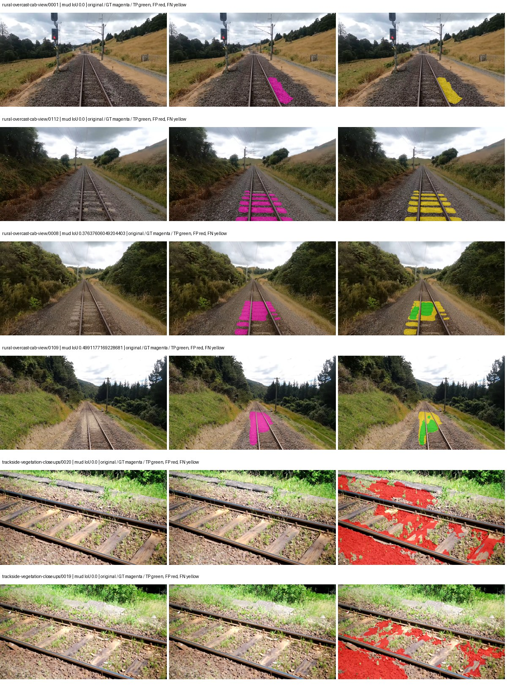
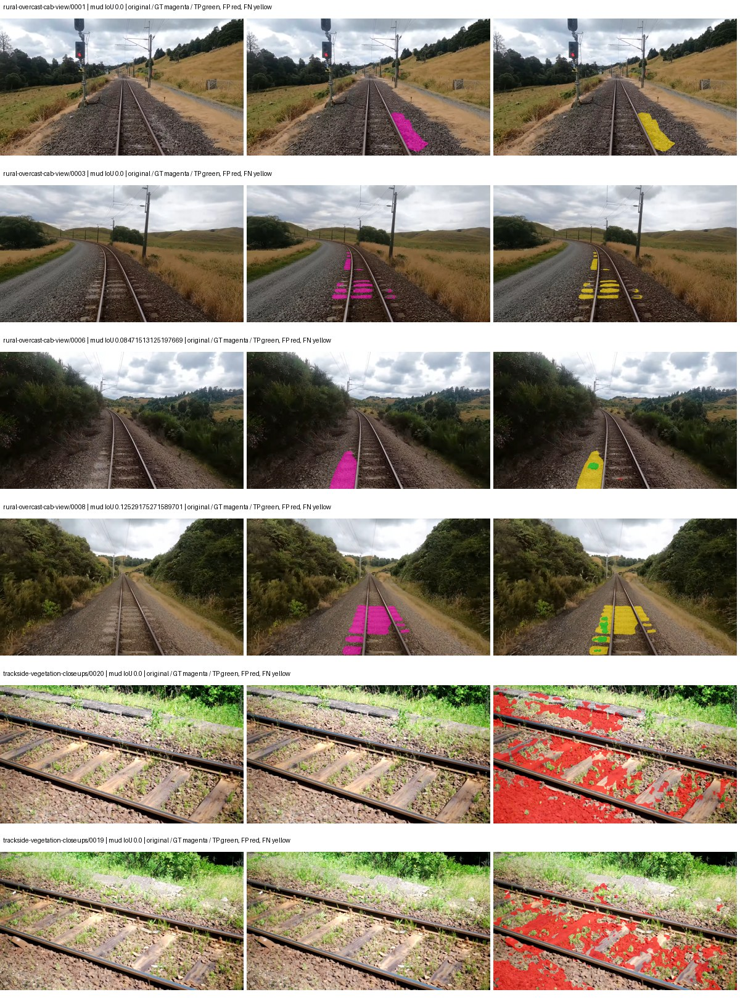
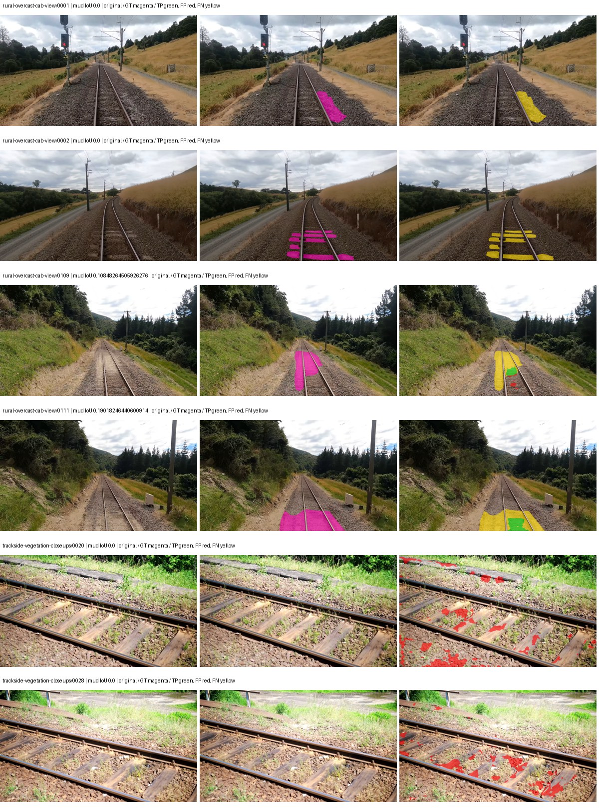
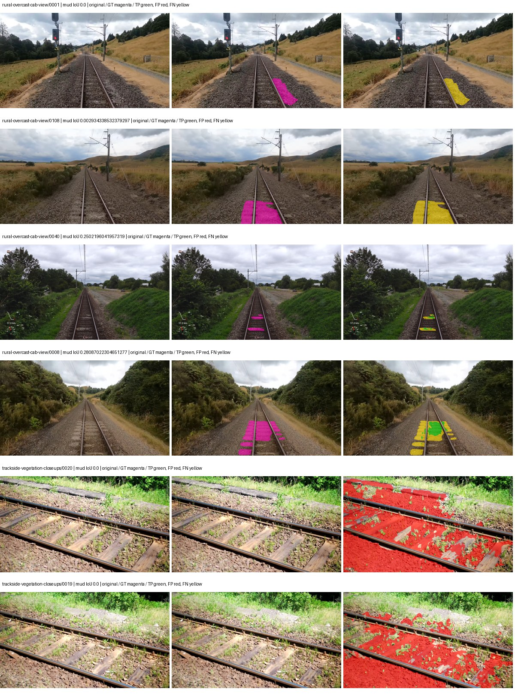

# native_convnext_tiny_channelmapper_dpt — rad_9_24_2026-fixed-grouped

[RAD 9/24: Scene-grouped split](../../README.md) · [Full model records](record.json)

Primary result: the **final checkpoint** after the full step budget (no early stopping). The checkpoint with the best **mud-pumping validation IoU, pixels pooled over all validation images**, is kept as secondary evidence. A job is complete only after full statistics and isolated profiling are verified.

Study metrics of the final checkpoint, counting each class only on the validation images that contain it: mud-pumping IoU is the mean per-image IoU over the images with mud-pumping, precision and recall sum pixels over those images, and mIoU averages each class over the images that contain it, then over the classes present.

| Initialization path | Seed | Mud-pumping IoU, train-camera images with mud (%, n=17) | Mud-pumping IoU, all images with mud (%, n=18) | Mud precision, all images with mud (%) | Mud recall, all images with mud (%) | mIoU (each class over images that contain it) (%) |
| --- | --- | --- | --- | --- | --- | --- |
| rtis_only | 0 | 13.42 | 12.70 | 38.33 | 14.62 | 39.68 |
| cityscapes_to_rtis | 0 | 1.35 | 1.45 | 7.74 | 2.18 | 38.74 |
| railsem19_to_rtis | 0 | 2.98 | 3.05 | 20.00 | 3.74 | 46.75 |
| cityscapes_to_railsem19_to_rtis | 0 | 9.48 | 9.03 | 13.19 | 9.75 | 43.59 |

Per-class IoU: IoU (%) of every class, each averaged only over the validation images that contain the class (n = those images); — = no image contains it. mIoU averages the classes with at least one such image.

| Initialization path | Seed | mIoU (each class over images that contain it) | person (n=0) | truck (n=0) | rail-track (n=37) | vegetation-overgrowth (n=13) | car (n=3) | on-rails (n=0) | traffic-sign (n=9) | road (n=11) | sidewalk (n=12) | construction (n=12) | tram-track (n=2) | pole (n=21) | traffic-light (n=3) | mud-pumping (n=18) | fence (n=7) | terrain (n=35) | sky (n=28) | rail-embedded (n=3) | rail-raised (n=37) | trackbed (n=37) | standing-water (n=9) |
| --- | --- | --- | --- | --- | --- | --- | --- | --- | --- | --- | --- | --- | --- | --- | --- | --- | --- | --- | --- | --- | --- | --- | --- |
| rtis_only | 0 | 39.68 | — | — | 58.85 | 36.87 | 17.76 | — | 28.02 | 19.07 | 6.96 | 52.49 | 17.89 | 68.41 | 32.95 | 12.70 | 23.08 | 83.92 | 93.50 | 19.09 | 74.27 | 63.65 | 4.82 |
| cityscapes_to_rtis | 0 | 38.74 | — | — | 57.22 | 36.19 | 36.70 | — | 37.32 | 4.75 | 6.51 | 36.78 | 14.02 | 68.82 | 44.79 | 1.45 | 31.39 | 84.06 | 90.25 | 6.97 | 72.44 | 60.50 | 7.11 |
| railsem19_to_rtis | 0 | 46.75 | — | — | 63.05 | 36.76 | 31.91 | — | 41.66 | 15.98 | 21.30 | 47.92 | 64.44 | 69.69 | 34.69 | 3.05 | 33.76 | 85.69 | 96.82 | 52.29 | 76.46 | 65.69 | 0.36 |
| cityscapes_to_railsem19_to_rtis | 0 | 43.59 | — | — | 58.78 | 33.21 | 36.56 | — | 47.82 | 17.56 | 16.66 | 50.74 | 26.17 | 72.44 | 47.22 | 9.03 | 28.03 | 85.09 | 95.15 | 19.34 | 73.37 | 62.97 | 4.45 |

Everything below is the campaign's own record, with pixels pooled over all validation images: its evaluation is the checkpoint that scored best on that pooled mud IoU (secondary evidence here); the diagnostics also cover the final checkpoint (`final-auto-val`).

| Model | Initialization path | Seed | Status | Steps | Best step | Best-checkpoint mud IoU, pixels pooled (%) | Best-checkpoint mud precision, pixels pooled (%) | Best-checkpoint mud recall, pixels pooled (%) | Final mud IoU (trainer val, pixels pooled, %) | Best-checkpoint mIoU, pixels pooled (%) | Best-checkpoint fixed GT-class mIoU, pixels pooled (%) |
| --- | --- | --- | --- | --- | --- | --- | --- | --- | --- | --- | --- |
| native_convnext_tiny_channelmapper_dpt | rtis_only | 0 | completed | 4000 | 3888 | 5.14 | 7.33 | 14.67 | 5.14 | 33.78 | 39.41 |
| native_convnext_tiny_channelmapper_dpt | cityscapes_to_rtis | 0 | completed | 4000 | 1814 | 0.85 | 1.25 | 2.60 | 0.78 | 36.13 | 42.16 |
| native_convnext_tiny_channelmapper_dpt | railsem19_to_rtis | 0 | completed | 4000 | 1555 | 3.09 | 11.21 | 4.10 | 2.35 | 44.28 | 49.20 |
| native_convnext_tiny_channelmapper_dpt | cityscapes_to_railsem19_to_rtis | 0 | completed | 4000 | 3888 | 1.80 | 2.16 | 9.77 | 1.81 | 41.24 | 48.11 |

Training: 217 images. Validation: 37 images. Test: 60 held out. Seeds: [0]. Seed variation measures optimization variability, not independent-recording uncertainty. Historical source checkpoints stay fixed across adaptation seeds.

Training code: `fce0ea0ac50b334d4252812c396e0e593def375d`. Split SHA-256: `12d7b367c72cda61d57686ff2ac28223530d0af49debd9fb7a0fbc68b908bc93`.

## rtis_only — seed 0

Status: **completed**. Started: 2026-10-11T05:24:10.958459+00:00. Finished: 2026-10-11T07:17:06.727342+00:00.

Recipe pretrained initializer: `{"arch": "native", "backbone_path": null, "batch_norm_momentum": null, "checkpoint": null, "classifier_path": null, "drop_path": null, "encoder_name": null, "encoder_weights": null, "head": "unified_head", "head_paths": [], "inactive_parameter_paths": [], "local_files_only": false, "lora_alpha": 32, "lora_dropout": 0.05, "lora_r": 16, "lora_targets": [], "native": {"auxiliary_heads": [], "backbone": {"in_channels": 3, "kind": "timm", "name": "convnext_tiny.fb_in22k_ft_in1k", "out_indices": [0, 1, 2, 3], "weights": "pretrained"}, "head": {"activation": "relu", "channels": 256, "dropout": 0.1, "in_indices": [0, 1, 2, 3], "kind": "dpt", "norm": "group"}, "neck": {"activation": "relu", "kernel_size": 1, "kind": "channel_mapper", "norm": "group", "num_outputs": 4, "out_channels": 256}, "task": "multiclass"}, "revision": null, "smp_arch": null, "subfolder": null, "trust_remote_code": false, "tuning": "full"}`.

`rtis_only` uses the recipe initializer, which may include pretrained segmentation components. Transfer paths load the exact historical source checkpoint below and reset the classifier; they do not reset all query/decoder features.

Source checkpoint: `Recipe pretrained initialization`.

Config SHA-256: `8c11752bb260895b6f5207a7d314cc2ee3f20c0af80a44e0bc83406e862f58e1`. Weights used for validation: `ema`.

### Mud-pumping and aggregate quality

| Metric | Selected checkpoint | Final training validation |
| --- | --- | --- |
| Mud IoU | 5.14 | 5.14 |
| Mud precision | 7.33 | 7.34 |
| Mud recall | 14.67 | 14.62 |
| Mud Dice/F1 | 9.78 | 9.77 |
| mIoU | 33.78 | 33.76 |
| Mean accuracy | 53.02 | 52.94 |
| Mean precision | 48.74 | 48.71 |
| Mean Dice | 44.17 | 44.14 |
| Mean specificity | 98.94 | 98.94 |
| Pixel accuracy | 82.88 | 82.86 |
| Frequency-weighted IoU | 74.15 | 74.12 |
| Fixed GT-present class mIoU | 39.41 | 39.39 |
| Boundary F1 | 41.87 | 41.85 |

The selected checkpoint has independent evaluation evidence. Final values are the trainer's final validation record, not a new independent evaluation. mIoU averages classes with nonzero union, so false positives on absent classes can change its denominator. The fixed GT-class mean is supplementary and excludes absent classes; their false positives remain in the confusion matrix.

### Resource usage and timing

| Measurement | Value |
| --- | --- |
| Peak training VRAM, retained training invocation (GiB) | 15.83 |
| Peak evaluation VRAM (GiB) | 8.11 |
| Retained training invocation wall time (seconds) | 6529.41 |
| Retained training invocation GPU-hours (one GPU) | 1.81 |
| Evaluation wall time (seconds) | 22.39 |
| Full evaluation pipeline images/second | 1.65 |
| Best full-state checkpoint (MiB) | 583.74 |
| Final full-state checkpoint (MiB) | 583.73 |
| Verified periodic checkpoints removed (GiB) | 4.56 |

VRAM uses the recorded allocator high-water mark; it is not total device usage including CUDA context. Resumed jobs' retained training invocation times and peaks are **not whole-campaign totals**. Earlier invocation resource records are not reconstructed here. Evaluation throughput includes loader, sliding-window inference and metrics; it is not model-only latency/FPS. Missing measurements are shown as —, never inferred from another dataset's run.

### Standardized inference performance

Dedicated model-only profiling waits for an idle worker-locked L40S: BF16, batch 1, 1024x1024, 20 warmup and 100 CUDA-event-timed public forwards. It excludes loading, preprocessing, tiling and metrics.

| Status | Parameters | Weight MiB | FPS | p50 ms | p95 ms | Peak reserved GiB |
| --- | --- | --- | --- | --- | --- | --- |
| complete | 38230389 | 145.84 | 28.92 | 34.55 | 34.73 | 1.95 |

```json
{
  "schema_version": 1,
  "model_id": "native_convnext_tiny_channelmapper_dpt",
  "measured_at": "2026-10-11T07:16:59+00:00",
  "status": "complete",
  "benchmark_scope": "rtis_selected_checkpoint_model_only",
  "applies_to": [
    "native_convnext_tiny_channelmapper_dpt--rtis_only--seed-0"
  ],
  "source": {
    "campaign_git_sha": "fce0ea0ac50b334d4252812c396e0e593def375d",
    "git_dirty": false,
    "config_hash": "c077da54fb75",
    "resolved_config": "/data/izadia1/projects/segmentary-runs/rad_9_24_2026/fgall-seed0-20261007/configs/native_convnext_tiny_channelmapper_dpt--rtis_only--seed-0.yaml",
    "config_sha256": "8c11752bb260895b6f5207a7d314cc2ee3f20c0af80a44e0bc83406e862f58e1",
    "checkpoint_sha256": "211a3378baf73941989d889a6aab88ff81c5435f02a5d8e52fdea52f0f148a2e",
    "checkpoint_global_step": 3888,
    "checkpoint_bytes": 612094422,
    "checkpoint_kind": "resume checkpoint with optimizer and EMA state",
    "weights": "ema",
    "measured_checkpoint_job_id": "native_convnext_tiny_channelmapper_dpt--rtis_only--seed-0",
    "result_sha256": "e834131cf854aea52e363117a5d39d10a89211579183db5ba82358ef9eb714d9",
    "result_git_sha": "fce0ea0ac50b334d4252812c396e0e593def375d",
    "result_stage": "eval:rad_9_24_2026-fixed-grouped:val",
    "result_seed": 0
  },
  "hardware": {
    "gpu_name": "NVIDIA L40S",
    "gpu_uuid": "GPU-804aea8b-5f62-423e-72c6-49e1ed15c4e4",
    "logical_device": "cuda:0",
    "physical_visibility_token": "6",
    "compute_capability": [
      8,
      9
    ],
    "total_memory_bytes": 47677177856
  },
  "model": {
    "parameter_count": 38230389,
    "trainable_parameter_count": 38230389,
    "resident_parameter_bytes": 152921556,
    "parameter_dtype_counts": {
      "float32": 38230389
    }
  },
  "contract": {
    "backend": "pytorch",
    "precision": "bf16_autocast",
    "batch_size": 1,
    "input_shape_nchw": [
      1,
      3,
      1024,
      1024
    ],
    "warmup_iterations": 20,
    "measured_iterations": 100,
    "timing": "per-forward CUDA events with end-event synchronization",
    "includes_preprocessing": false,
    "includes_data_loader": false,
    "includes_sliding_window": false,
    "input_resident_on_gpu": true,
    "model_only": true,
    "entrypoint": "public model(image) dense-logits forward"
  },
  "measurements": {
    "latency": {
      "p50_ms": 34.5456657409668,
      "p95_ms": 34.7266040802002,
      "mean_ms": 34.57934410095215,
      "minimum_ms": 34.44326400756836,
      "maximum_ms": 35.68435287475586,
      "fps": 28.91899849460895,
      "raw_ms": [
        34.698238372802734,
        34.44326400756836,
        34.537471771240234,
        34.544639587402344,
        34.46579360961914,
        34.49241638183594,
        34.52006530761719,
        34.45759963989258,
        35.68435287475586,
        34.7402229309082,
        34.74943923950195,
        34.65625762939453,
        34.60095977783203,
        34.718719482421875,
        34.63167953491211,
        34.61427307128906,
        34.7064323425293,
        34.61836624145508,
        34.70131301879883,
        34.590721130371094,
        34.64089584350586,
        34.548736572265625,
        34.665470123291016,
        34.57740783691406,
        34.725887298583984,
        34.569217681884766,
        34.555904388427734,
        34.6879997253418,
        34.63167953491211,
        34.46579360961914,
        34.48524856567383,
        34.58867263793945,
        34.61324691772461,
        34.553855895996094,
        34.766849517822266,
        34.587646484375,
        34.521087646484375,
        34.49856185913086,
        34.58662414550781,
        34.530303955078125,
        34.532352447509766,
        34.534400939941406,
        34.519039154052734,
        34.57231903076172,
        34.50368118286133,
        34.55487823486328,
        34.57334518432617,
        34.52211380004883,
        34.511871337890625,
        34.515968322753906,
        34.5088005065918,
        34.5425910949707,
        34.48320007324219,
        34.530303955078125,
        34.63167953491211,
        34.51289749145508,
        34.71974563598633,
        34.513919830322266,
        34.526206970214844,
        34.506752014160156,
        34.55081558227539,
        34.52211380004883,
        34.532352447509766,
        34.563072204589844,
        34.57024002075195,
        34.548736572265625,
        34.497535705566406,
        34.49651336669922,
        34.544639587402344,
        34.49958419799805,
        34.5272331237793,
        34.550785064697266,
        34.5456657409668,
        34.50163269042969,
        34.48828887939453,
        34.52006530761719,
        34.528255462646484,
        34.64601516723633,
        34.691070556640625,
        34.555904388427734,
        34.557952880859375,
        34.57126235961914,
        34.511871337890625,
        34.51494216918945,
        34.534400939941406,
        34.51289749145508,
        34.515968322753906,
        34.535423278808594,
        34.74739074707031,
        34.716670989990234,
        34.590721130371094,
        34.500606536865234,
        34.5456657409668,
        34.5456657409668,
        34.55692672729492,
        34.5241584777832,
        34.528255462646484,
        34.665470123291016,
        34.49241638183594,
        34.59584045410156
      ],
      "percentile_method": "numpy linear interpolation"
    },
    "peak_reserved_bytes": 2090860544,
    "memory_kind": "pytorch_cuda_allocator_peak_reserved_excluding_context",
    "process_total_bytes": 2627731456,
    "process_total_kind": "nvidia-smi used_memory of this PID on the benchmark GPU after the timed loop, including the CUDA context; null when the driver could not attribute memory to this PID",
    "benchmark_wall_clock_s": 10.493938528001308
  },
  "started_at": "2026-10-11T07:16:49+00:00",
  "finished_at": "2026-10-11T07:16:59+00:00",
  "environment": {
    "hostname": "hdrfs-app-001",
    "python": "3.11.15",
    "platform": "Linux-5.15.0-139-generic-x86_64-with-glibc2.35",
    "torch": "2.11.0+cu128",
    "torch_cuda": "12.8",
    "cudnn": 91900,
    "driver_version": "570.133.20",
    "cuda_available": true,
    "gpu_count": 1,
    "gpu_names": [
      "NVIDIA L40S"
    ],
    "cuda_visible_devices": "6",
    "packages": {
      "segmentary": "0.1.0",
      "torch": "2.11.0+cu128",
      "torchvision": "0.26.0+cu128",
      "transformers": "5.15.0",
      "timm": "1.0.28",
      "segmentation-models-pytorch": "0.5.0",
      "albumentations": "2.0.8",
      "lightning": "2.6.5",
      "numpy": "2.4.4"
    }
  }
}
```

### Per-class validation results

| Class | GT pixels | IoU (%) | Precision (%) | Recall (%) | Dice (%) | Boundary F1 (%) |
| --- | --- | --- | --- | --- | --- | --- |
| car | 29664 | 28.49 | 44.19 | 44.50 | 44.34 | 34.05 |
| construction | 311585 | 22.68 | 24.00 | 80.49 | 36.97 | 39.52 |
| fence | 265137 | 24.09 | 67.72 | 27.21 | 38.82 | 49.85 |
| mud-pumping | 1226250 | 5.14 | 7.33 | 14.67 | 9.78 | 6.29 |
| on-rails | 0 | 0.00 | 0.00 | — | 0.00 | 0.00 |
| person | 0 | 0.00 | 0.00 | — | 0.00 | 0.00 |
| pole | 628038 | 72.16 | 86.82 | 81.03 | 83.83 | 91.50 |
| rail-embedded | 16799 | 28.32 | 55.59 | 36.60 | 44.14 | 43.35 |
| rail-raised | 2969797 | 77.07 | 82.97 | 91.55 | 87.05 | 91.45 |
| rail-track | 6323197 | 38.56 | 69.75 | 46.30 | 55.66 | 53.65 |
| road | 1048831 | 14.03 | 26.35 | 23.09 | 24.61 | 17.73 |
| sidewalk | 1297367 | 17.11 | 47.63 | 21.07 | 29.21 | 10.92 |
| sky | 19121606 | 96.11 | 99.38 | 96.69 | 98.02 | 89.80 |
| standing-water | 95802 | 3.95 | 4.31 | 31.91 | 7.60 | 15.00 |
| terrain | 39239306 | 85.50 | 88.25 | 96.49 | 92.18 | 66.23 |
| trackbed | 10643081 | 59.70 | 73.57 | 76.01 | 74.77 | 59.07 |
| traffic-light | 19510 | 47.25 | 87.81 | 50.56 | 64.17 | 61.70 |
| traffic-sign | 13285 | 33.09 | 44.18 | 56.85 | 49.72 | 59.62 |
| tram-track | 56179 | 20.97 | 29.75 | 41.55 | 34.67 | 20.73 |
| truck | 0 | 0.00 | 0.00 | — | 0.00 | 0.00 |
| vegetation-overgrowth | 5901821 | 35.21 | 83.87 | 37.77 | 52.09 | 68.86 |

### Full-run accounting

| Measurement | Value |
| --- | --- |
| Full GPU-reserved wall seconds, all recorded worker attempts | 6783.48 |
| Full reserved GPU-hours | 1.88 |
| Whole-run timing complete | True |

| Phase | Wall seconds including failed attempts |
| --- | --- |
| training | 6536.40 |
| diagnostics | 183.58 |
| performance | 19.12 |

GPU-reserved time includes model loading, training, validation, collection, profiling, checkpoint I/O and orchestration while the worker owns one GPU. It is not GPU kernel-active time. Phase timings and sampled device memory/power/utilization are retained separately; sampled device memory is not the allocator high-water mark.

### Train/validation and raw/EMA diagnostics

| Checkpoint / weights / split | Images | Mud IoU (%) | Mud precision (%) | Mud recall (%) |
| --- | --- | --- | --- | --- |
| best-auto-train / ema | 217 | 98.02 | 98.96 | 99.04 |
| best-auto-val / ema | 37 | 5.14 | 7.33 | 14.67 |
| best-alternate-val / raw | 37 | 5.63 | 8.04 | 15.81 |
| final-auto-val / ema | 37 | 5.13 | 7.33 | 14.62 |

Train uses the evaluation transform without augmentation. Compare mud train/validation metrics for the same selected weights. Alternate EMA on running-stat BatchNorm is explicitly uncalibrated and is diagnostic only. Score-threshold curves use uncalibrated normalized scores and are pixel-level diagnostics, not event detection rates or a selected deployment operating point.

### Downloadable evidence

- best-auto-train: [per-image.csv](rtis_only--seed-0/best-auto-train/per-image.csv) · [per-image-confusion.json.gz](rtis_only--seed-0/best-auto-train/per-image-confusion.json.gz) · [groups.json](rtis_only--seed-0/best-auto-train/groups.json) · [mud-score-curves.json](rtis_only--seed-0/best-auto-train/mud-score-curves.json)
- best-auto-val: [per-image.csv](rtis_only--seed-0/best-auto-val/per-image.csv) · [per-image-confusion.json.gz](rtis_only--seed-0/best-auto-val/per-image-confusion.json.gz) · [groups.json](rtis_only--seed-0/best-auto-val/groups.json) · [mud-score-curves.json](rtis_only--seed-0/best-auto-val/mud-score-curves.json) · [examples.jpg](rtis_only--seed-0/best-auto-val/examples.jpg)
- best-alternate-val: [per-image.csv](rtis_only--seed-0/best-alternate-val/per-image.csv) · [per-image-confusion.json.gz](rtis_only--seed-0/best-alternate-val/per-image-confusion.json.gz) · [groups.json](rtis_only--seed-0/best-alternate-val/groups.json) · [mud-score-curves.json](rtis_only--seed-0/best-alternate-val/mud-score-curves.json)
- final-auto-val: [per-image.csv](rtis_only--seed-0/final-auto-val/per-image.csv) · [per-image-confusion.json.gz](rtis_only--seed-0/final-auto-val/per-image-confusion.json.gz) · [groups.json](rtis_only--seed-0/final-auto-val/groups.json) · [mud-score-curves.json](rtis_only--seed-0/final-auto-val/mud-score-curves.json)
- resources: [telemetry.csv](rtis_only--seed-0/resources/telemetry.csv)



Examples are two lowest and two highest mud-IoU positive images, plus up to two negative images with the most false-positive mud pixels. They are targeted diagnostic examples, not random samples. Green: true positive; red: false positive; yellow: false negative. Full predictions remain on HDRFS.

### Validation tracking

| Logged step | Overall mIoU (%) | Mud IoU (%) |
| --- | --- | --- |
| 258 | 24.27 | 2.14 |
| 518 | 26.99 | 3.17 |
| 777 | 31.67 | 1.73 |
| 1036 | 33.01 | 2.60 |
| 1295 | 33.13 | 3.78 |
| 1555 | 33.46 | 4.42 |
| 1814 | 33.75 | 3.67 |
| 2073 | 33.85 | 4.79 |
| 2332 | 33.79 | 4.89 |
| 2592 | 33.77 | 4.95 |
| 2851 | 33.74 | 5.02 |
| 3110 | 33.73 | 5.05 |
| 3369 | 33.75 | 5.06 |
| 3629 | 33.77 | 5.07 |
| 3888 | 33.79 | 5.14 |
| 4000 | 33.76 | 5.14 |

All retained scalar curves, including training loss and per-class IoU, are in record.json. Observed best mud on a curve is not necessarily a retained checkpoint: the pilot saved its selection-metric-best and final checkpoints. Step logging and checkpoint global_step may differ by one.

### Stopping and checkpoint provenance

```json
{
  "stopping": {
    "actual_steps": 4000,
    "maximum_steps": 4000,
    "min_delta": 0.0,
    "monitor": "val_iou/mud-pumping",
    "patience": null,
    "reason": "budget_complete"
  },
  "checkpoints": {
    "best": {
      "path": "/data/izadia1/projects/segmentary-runs/rad_9_24_2026/fgall-seed0-20261007/future-runs/native_convnext_tiny_channelmapper_dpt--rtis_only--seed-0_seed0/rtis/best.ckpt",
      "sha256": "211a3378baf73941989d889a6aab88ff81c5435f02a5d8e52fdea52f0f148a2e",
      "global_step": 3888,
      "bytes": 612094422
    },
    "final": {
      "path": "/data/izadia1/projects/segmentary-runs/rad_9_24_2026/fgall-seed0-20261007/future-runs/native_convnext_tiny_channelmapper_dpt--rtis_only--seed-0_seed0/rtis/last.ckpt",
      "sha256": "700e7f79efba31717f2b32388b164a80cd34ec029d8df6e8d1fe82c91186ce81",
      "global_step": 4000,
      "bytes": 612082774
    }
  },
  "cleanup_error": null
}
```

### Resolved training, initialization and evaluation settings

The optimizer block is the base configuration. Stage LR scales are applied at runtime, and stage warmup is capped at min(base warmup, floor(stage budget / 10), stage budget - 1): 400 steps for this 4,000-step pilot. Model-internal native input grids may differ from augmentation crops (EoMT uses its 640 grid).

```json
{
  "name": "native_convnext_tiny_channelmapper_dpt--rtis_only--seed-0",
  "model": {
    "arch": "native",
    "checkpoint": null,
    "tuning": "full",
    "head": "unified_head",
    "lora_r": 16,
    "lora_alpha": 32,
    "lora_dropout": 0.05,
    "lora_targets": [],
    "drop_path": null,
    "revision": null,
    "subfolder": null,
    "local_files_only": false,
    "trust_remote_code": false,
    "backbone_path": null,
    "head_paths": [],
    "classifier_path": null,
    "inactive_parameter_paths": [],
    "smp_arch": null,
    "encoder_name": null,
    "encoder_weights": null,
    "native": {
      "task": "multiclass",
      "backbone": {
        "kind": "timm",
        "name": "convnext_tiny.fb_in22k_ft_in1k",
        "weights": "pretrained",
        "out_indices": [
          0,
          1,
          2,
          3
        ],
        "in_channels": 3
      },
      "neck": {
        "kind": "channel_mapper",
        "out_channels": 256,
        "kernel_size": 1,
        "num_outputs": 4,
        "norm": "group",
        "activation": "relu"
      },
      "head": {
        "kind": "dpt",
        "in_indices": [
          0,
          1,
          2,
          3
        ],
        "channels": 256,
        "dropout": 0.1,
        "norm": "group",
        "activation": "relu"
      },
      "auxiliary_heads": []
    },
    "batch_norm_momentum": null
  },
  "space": "paul-test-rtis",
  "taxonomy_root": "/data/izadia1/projects/segmentary-rad-fgall-fce0ea0a/taxonomy",
  "output_root": "/data/izadia1/projects/segmentary-runs/rad_9_24_2026/fgall-seed0-20261007/future-runs",
  "optim": {
    "backbone_lr": 0.0001,
    "head_lr_mult": 10.0,
    "weight_decay": 0.05,
    "llrd": 1.0,
    "warmup_iters": 1500,
    "warmup_ratio": 1e-06,
    "poly_power": 0.9,
    "min_lr_ratio": 0.0,
    "betas": [
      0.9,
      0.999
    ],
    "grad_clip": 1.0
  },
  "train": {
    "iters": 4000,
    "batch_size": 2,
    "accum": 8,
    "num_workers": 2,
    "precision": "bf16-mixed",
    "ema_decay": 0.9998,
    "val_every": 250,
    "ckpt_every": 500,
    "selection_metric": "val_iou/mud-pumping",
    "early_stopping_patience": null,
    "early_stopping_min_delta": 0.0,
    "seed": 0,
    "devices": 1
  },
  "eval": {
    "sliding_window": true,
    "window": [
      1024,
      1024
    ],
    "stride": [
      768,
      768
    ],
    "batch_size": 1,
    "num_workers": 2,
    "tta_scales": [],
    "tta_flip": false,
    "threshold": 0.5,
    "boundary_tolerance_frac": 0.0075,
    "save_confusion": true
  },
  "loss": {
    "task": "multiclass",
    "activation": "auto",
    "terms": [],
    "aux": "none",
    "aux_weight": 0.0,
    "ce_weight": 1.0,
    "label_smoothing": 0.0,
    "class_weights": null,
    "query": null
  },
  "aug": {
    "crop": [
      1024,
      1024
    ],
    "scale_min": 0.5,
    "scale_max": 2.0,
    "hflip_p": 0.5,
    "color_jitter_p": 0.5,
    "brightness": 0.25,
    "contrast": 0.25,
    "saturation": 0.25,
    "hue": 0.05
  },
  "stages": [
    {
      "name": "rtis",
      "data": [
        {
          "name": "rad_9_24_2026-fixed-grouped",
          "root": "/data/izadia1/datasets/rad_9_24_2026-fixed-grouped",
          "variant": null,
          "split_file": "splits.json",
          "train_split": "train",
          "val_split": "val",
          "limit": null,
          "loader": "folder",
          "mapping": "paul-test-rtis",
          "loader_options": {
            "require_groups": true
          }
        }
      ],
      "iters": null,
      "lr_scale": 1.0,
      "head_group_lr_scale": 1.0,
      "init_from": "pretrained",
      "reset_head": false,
      "freeze": null,
      "sample_weights": null
    }
  ]
}
```

### Hardware and software provenance

```json
{
  "training": {
    "cuda_available": true,
    "cuda_visible_devices": "6",
    "cudnn": 91900,
    "driver_version": "570.133.20",
    "gpu_count": 1,
    "gpu_names": [
      "NVIDIA L40S"
    ],
    "hostname": "hdrfs-app-001",
    "input_normalization": {
      "channel_order": "rgb",
      "mean": [
        0.485,
        0.456,
        0.406
      ],
      "source": "timm_pretrained_cfg",
      "std": [
        0.229,
        0.224,
        0.225
      ]
    },
    "model_origins": [
      {
        "hf_commit": null,
        "hf_name_or_path": null,
        "module": "backbone",
        "timm_pretrained": {
          "architecture": "convnext_tiny",
          "hf_hub_id": "timm/convnext_tiny.fb_in22k_ft_in1k",
          "tag": "fb_in22k_ft_in1k",
          "url": "https://dl.fbaipublicfiles.com/convnext/convnext_tiny_22k_1k_224.pth"
        }
      },
      {
        "hf_commit": null,
        "hf_name_or_path": null,
        "module": "backbone.model",
        "timm_pretrained": {
          "architecture": "convnext_tiny",
          "hf_hub_id": "timm/convnext_tiny.fb_in22k_ft_in1k",
          "tag": "fb_in22k_ft_in1k",
          "url": "https://dl.fbaipublicfiles.com/convnext/convnext_tiny_22k_1k_224.pth"
        }
      }
    ],
    "model_parameter_count": 38230389,
    "packages": {
      "albumentations": "2.0.8",
      "lightning": "2.6.5",
      "numpy": "2.4.4",
      "segmentary": "0.1.0",
      "segmentation-models-pytorch": "0.5.0",
      "timm": "1.0.28",
      "torch": "2.11.0+cu128",
      "torchvision": "0.26.0+cu128",
      "transformers": "5.15.0"
    },
    "platform": "Linux-5.15.0-139-generic-x86_64-with-glibc2.35",
    "python": "3.11.15",
    "torch": "2.11.0+cu128",
    "torch_cuda": "12.8",
    "trainable_parameter_count": 38230389,
    "training_stop": {
      "actual_steps": 4000,
      "maximum_steps": 4000,
      "min_delta": 0.0,
      "monitor": "val_iou/mud-pumping",
      "patience": null,
      "reason": "budget_complete"
    },
    "validation_weights": "ema"
  },
  "evaluation": {
    "cuda_available": true,
    "cuda_visible_devices": "6",
    "cudnn": 91900,
    "driver_version": "570.133.20",
    "gpu_count": 1,
    "gpu_names": [
      "NVIDIA L40S"
    ],
    "hostname": "hdrfs-app-001",
    "input_normalization": {
      "channel_order": "rgb",
      "mean": [
        0.485,
        0.456,
        0.406
      ],
      "source": "timm_pretrained_cfg",
      "std": [
        0.229,
        0.224,
        0.225
      ]
    },
    "packages": {
      "albumentations": "2.0.8",
      "lightning": "2.6.5",
      "numpy": "2.4.4",
      "segmentary": "0.1.0",
      "segmentation-models-pytorch": "0.5.0",
      "timm": "1.0.28",
      "torch": "2.11.0+cu128",
      "torchvision": "0.26.0+cu128",
      "transformers": "5.15.0"
    },
    "platform": "Linux-5.15.0-139-generic-x86_64-with-glibc2.35",
    "python": "3.11.15",
    "torch": "2.11.0+cu128",
    "torch_cuda": "12.8"
  }
}
```

## cityscapes_to_rtis — seed 0

Status: **completed**. Started: 2026-10-11T05:39:15.614281+00:00. Finished: 2026-10-11T07:30:19.387847+00:00.

Recipe pretrained initializer: `{"arch": "native", "backbone_path": null, "batch_norm_momentum": null, "checkpoint": null, "classifier_path": null, "drop_path": null, "encoder_name": null, "encoder_weights": null, "head": "unified_head", "head_paths": [], "inactive_parameter_paths": [], "local_files_only": false, "lora_alpha": 32, "lora_dropout": 0.05, "lora_r": 16, "lora_targets": [], "native": {"auxiliary_heads": [], "backbone": {"in_channels": 3, "kind": "timm", "name": "convnext_tiny.fb_in22k_ft_in1k", "out_indices": [0, 1, 2, 3], "weights": "pretrained"}, "head": {"activation": "relu", "channels": 256, "dropout": 0.1, "in_indices": [0, 1, 2, 3], "kind": "dpt", "norm": "group"}, "neck": {"activation": "relu", "kernel_size": 1, "kind": "channel_mapper", "norm": "group", "num_outputs": 4, "out_channels": 256}, "task": "multiclass"}, "revision": null, "smp_arch": null, "subfolder": null, "trust_remote_code": false, "tuning": "full"}`.

`rtis_only` uses the recipe initializer, which may include pretrained segmentation components. Transfer paths load the exact historical source checkpoint below and reset the classifier; they do not reset all query/decoder features.

Source checkpoint: `{'name': 'native_convnext_tiny_channelmapper_dpt--cityscapes--seed-0', 'model': 'native_convnext_tiny_channelmapper_dpt', 'protocol': 'cityscapes', 'config': '/data/izadia1/projects/segmentary-runs/all-model-city-rail-seed0-rail20-b9eb3e1/accepted/native_convnext_tiny_channelmapper_dpt--cityscapes--seed-0/resolved-config.yaml', 'checkpoint': '/data/izadia1/projects/segmentary-runs/current-main-fill-v2/jobs/native_convnext_tiny_channelmapper_dpt--cityscapes--seed-0/train/native_convnext_tiny_channelmapper_dpt--cityscapes_seed0/cityscapes/last.ckpt', 'recorded_sha256': 'f7a8f68311a3e12924b3c25bb86ca30549789182ea5f1d4a3ae8424af523ee6d', 'exists': True}`.

Config SHA-256: `e04b08ba6648e87330da3f0dbcff1b78d27afa8aa80d345f19c559bcf1ffddbd`. Weights used for validation: `ema`.

### Mud-pumping and aggregate quality

| Metric | Selected checkpoint | Final training validation |
| --- | --- | --- |
| Mud IoU | 0.85 | 0.78 |
| Mud precision | 1.25 | 1.20 |
| Mud recall | 2.60 | 2.18 |
| Mud Dice/F1 | 1.69 | 1.55 |
| mIoU | 36.13 | 36.94 |
| Mean accuracy | 53.37 | 54.07 |
| Mean precision | 52.55 | 52.45 |
| Mean Dice | 45.41 | 46.33 |
| Mean specificity | 98.94 | 98.93 |
| Pixel accuracy | 82.99 | 83.08 |
| Frequency-weighted IoU | 74.00 | 73.75 |
| Fixed GT-present class mIoU | 42.16 | 43.10 |
| Boundary F1 | 42.62 | 42.85 |

The selected checkpoint has independent evaluation evidence. Final values are the trainer's final validation record, not a new independent evaluation. mIoU averages classes with nonzero union, so false positives on absent classes can change its denominator. The fixed GT-class mean is supplementary and excludes absent classes; their false positives remain in the confusion matrix.

### Resource usage and timing

| Measurement | Value |
| --- | --- |
| Peak training VRAM, retained training invocation (GiB) | 15.80 |
| Peak evaluation VRAM (GiB) | 8.11 |
| Retained training invocation wall time (seconds) | 6416.83 |
| Retained training invocation GPU-hours (one GPU) | 1.78 |
| Evaluation wall time (seconds) | 23.07 |
| Full evaluation pipeline images/second | 1.60 |
| Best full-state checkpoint (MiB) | 583.74 |
| Final full-state checkpoint (MiB) | 583.73 |
| Verified periodic checkpoints removed (GiB) | 4.56 |

VRAM uses the recorded allocator high-water mark; it is not total device usage including CUDA context. Resumed jobs' retained training invocation times and peaks are **not whole-campaign totals**. Earlier invocation resource records are not reconstructed here. Evaluation throughput includes loader, sliding-window inference and metrics; it is not model-only latency/FPS. Missing measurements are shown as —, never inferred from another dataset's run.

### Standardized inference performance

Dedicated model-only profiling waits for an idle worker-locked L40S: BF16, batch 1, 1024x1024, 20 warmup and 100 CUDA-event-timed public forwards. It excludes loading, preprocessing, tiling and metrics.

| Status | Parameters | Weight MiB | FPS | p50 ms | p95 ms | Peak reserved GiB |
| --- | --- | --- | --- | --- | --- | --- |
| complete | 38230389 | 145.84 | 29.11 | 34.32 | 34.44 | 1.95 |

```json
{
  "schema_version": 1,
  "model_id": "native_convnext_tiny_channelmapper_dpt",
  "measured_at": "2026-10-11T07:30:12+00:00",
  "status": "complete",
  "benchmark_scope": "rtis_selected_checkpoint_model_only",
  "applies_to": [
    "native_convnext_tiny_channelmapper_dpt--cityscapes_to_rtis--seed-0"
  ],
  "source": {
    "campaign_git_sha": "fce0ea0ac50b334d4252812c396e0e593def375d",
    "git_dirty": false,
    "config_hash": "bacfb6c5cfb0",
    "resolved_config": "/data/izadia1/projects/segmentary-runs/rad_9_24_2026/fgall-seed0-20261007/configs/native_convnext_tiny_channelmapper_dpt--cityscapes_to_rtis--seed-0.yaml",
    "config_sha256": "e04b08ba6648e87330da3f0dbcff1b78d27afa8aa80d345f19c559bcf1ffddbd",
    "checkpoint_sha256": "056b8dbff8d612912ec99f1030b9b5d3c12d1a7767d81839258771c90433ebb2",
    "checkpoint_global_step": 1814,
    "checkpoint_bytes": 612094486,
    "checkpoint_kind": "resume checkpoint with optimizer and EMA state",
    "weights": "ema",
    "measured_checkpoint_job_id": "native_convnext_tiny_channelmapper_dpt--cityscapes_to_rtis--seed-0",
    "result_sha256": "88eefa9f5ac67e54bb48dc7e6c8cf11a716d13153f164ab02d94e199c40fae7e",
    "result_git_sha": "fce0ea0ac50b334d4252812c396e0e593def375d",
    "result_stage": "eval:rad_9_24_2026-fixed-grouped:val",
    "result_seed": 0
  },
  "hardware": {
    "gpu_name": "NVIDIA L40S",
    "gpu_uuid": "GPU-a5ad49e5-0536-5229-ba8a-f8a902808f53",
    "logical_device": "cuda:0",
    "physical_visibility_token": "7",
    "compute_capability": [
      8,
      9
    ],
    "total_memory_bytes": 47677177856
  },
  "model": {
    "parameter_count": 38230389,
    "trainable_parameter_count": 38230389,
    "resident_parameter_bytes": 152921556,
    "parameter_dtype_counts": {
      "float32": 38230389
    }
  },
  "contract": {
    "backend": "pytorch",
    "precision": "bf16_autocast",
    "batch_size": 1,
    "input_shape_nchw": [
      1,
      3,
      1024,
      1024
    ],
    "warmup_iterations": 20,
    "measured_iterations": 100,
    "timing": "per-forward CUDA events with end-event synchronization",
    "includes_preprocessing": false,
    "includes_data_loader": false,
    "includes_sliding_window": false,
    "input_resident_on_gpu": true,
    "model_only": true,
    "entrypoint": "public model(image) dense-logits forward"
  },
  "measurements": {
    "latency": {
      "p50_ms": 34.323455810546875,
      "p95_ms": 34.44479846954346,
      "mean_ms": 34.34924961090088,
      "minimum_ms": 34.23436737060547,
      "maximum_ms": 35.631103515625,
      "fps": 29.11271749245567,
      "raw_ms": [
        34.39923095703125,
        34.25689697265625,
        34.28966522216797,
        34.28761672973633,
        34.29171371459961,
        34.24153518676758,
        34.300926208496094,
        34.305023193359375,
        34.2927360534668,
        34.25894546508789,
        34.26508712768555,
        34.26611328125,
        34.40537643432617,
        34.408416748046875,
        34.327552795410156,
        34.24256134033203,
        34.36851119995117,
        34.23436737060547,
        34.25791931152344,
        34.24665451049805,
        34.279422760009766,
        34.270206451416016,
        34.299903869628906,
        34.26713562011719,
        34.263038635253906,
        34.281471252441406,
        34.323455810546875,
        34.26611328125,
        34.26911926269531,
        34.30400085449219,
        34.25689697265625,
        34.260990142822266,
        34.33574295043945,
        34.45452880859375,
        34.323455810546875,
        34.26816177368164,
        34.40947341918945,
        34.38284683227539,
        34.39718246459961,
        34.3296012878418,
        34.35724639892578,
        34.27532958984375,
        34.4268798828125,
        34.2845458984375,
        34.402305603027344,
        34.270206451416016,
        34.3480339050293,
        34.2743034362793,
        34.378753662109375,
        34.28761672973633,
        34.41664123535156,
        34.305023193359375,
        34.42585754394531,
        34.300926208496094,
        34.337791442871094,
        35.631103515625,
        34.507774353027344,
        34.2374382019043,
        34.39411163330078,
        34.26508712768555,
        34.28351974487305,
        34.36646270751953,
        34.488319396972656,
        34.37055969238281,
        34.37567901611328,
        34.40742492675781,
        34.44428634643555,
        34.307071685791016,
        34.25484848022461,
        34.365440368652344,
        34.42380905151367,
        34.323455810546875,
        34.42483139038086,
        34.310142517089844,
        34.4002571105957,
        34.362369537353516,
        34.42278289794922,
        34.353153228759766,
        34.42585754394531,
        34.312191009521484,
        34.3480339050293,
        34.3480339050293,
        34.26918411254883,
        34.43404769897461,
        34.325504302978516,
        34.43609619140625,
        34.286590576171875,
        34.39926528930664,
        34.305023193359375,
        34.42483139038086,
        34.2845458984375,
        34.36441421508789,
        34.295806884765625,
        34.43708801269531,
        34.30195236206055,
        34.515968322753906,
        34.336769104003906,
        34.44326400756836,
        34.28351974487305,
        34.345985412597656
      ],
      "percentile_method": "numpy linear interpolation"
    },
    "peak_reserved_bytes": 2090860544,
    "memory_kind": "pytorch_cuda_allocator_peak_reserved_excluding_context",
    "process_total_bytes": 2627731456,
    "process_total_kind": "nvidia-smi used_memory of this PID on the benchmark GPU after the timed loop, including the CUDA context; null when the driver could not attribute memory to this PID",
    "benchmark_wall_clock_s": 10.423094637691975
  },
  "started_at": "2026-10-11T07:30:02+00:00",
  "finished_at": "2026-10-11T07:30:12+00:00",
  "environment": {
    "hostname": "hdrfs-app-001",
    "python": "3.11.15",
    "platform": "Linux-5.15.0-139-generic-x86_64-with-glibc2.35",
    "torch": "2.11.0+cu128",
    "torch_cuda": "12.8",
    "cudnn": 91900,
    "driver_version": "570.133.20",
    "cuda_available": true,
    "gpu_count": 1,
    "gpu_names": [
      "NVIDIA L40S"
    ],
    "cuda_visible_devices": "7",
    "packages": {
      "segmentary": "0.1.0",
      "torch": "2.11.0+cu128",
      "torchvision": "0.26.0+cu128",
      "transformers": "5.15.0",
      "timm": "1.0.28",
      "segmentation-models-pytorch": "0.5.0",
      "albumentations": "2.0.8",
      "lightning": "2.6.5",
      "numpy": "2.4.4"
    }
  }
}
```

### Per-class validation results

| Class | GT pixels | IoU (%) | Precision (%) | Recall (%) | Dice (%) | Boundary F1 (%) |
| --- | --- | --- | --- | --- | --- | --- |
| car | 29664 | 69.00 | 79.34 | 84.12 | 81.66 | 66.23 |
| construction | 311585 | 25.51 | 27.40 | 78.71 | 40.64 | 37.10 |
| fence | 265137 | 28.71 | 51.25 | 39.49 | 44.61 | 45.03 |
| mud-pumping | 1226250 | 0.85 | 1.25 | 2.60 | 1.69 | 1.84 |
| on-rails | 0 | 0.00 | 0.00 | — | 0.00 | 0.00 |
| person | 0 | 0.00 | 0.00 | — | 0.00 | 0.00 |
| pole | 628038 | 72.26 | 85.96 | 81.93 | 83.90 | 91.46 |
| rail-embedded | 16799 | 7.68 | 88.29 | 7.76 | 14.27 | 23.41 |
| rail-raised | 2969797 | 71.37 | 77.11 | 90.55 | 83.29 | 86.17 |
| rail-track | 6323197 | 43.97 | 63.97 | 58.45 | 61.09 | 57.79 |
| road | 1048831 | 1.57 | 5.73 | 2.11 | 3.09 | 9.59 |
| sidewalk | 1297367 | 16.38 | 66.71 | 17.84 | 28.15 | 17.41 |
| sky | 19121606 | 94.14 | 99.40 | 94.68 | 96.98 | 88.00 |
| standing-water | 95802 | 4.89 | 6.69 | 15.41 | 9.33 | 13.93 |
| terrain | 39239306 | 86.34 | 88.32 | 97.47 | 92.67 | 64.97 |
| trackbed | 10643081 | 60.12 | 74.69 | 75.50 | 75.09 | 59.57 |
| traffic-light | 19510 | 62.47 | 81.82 | 72.54 | 76.90 | 76.98 |
| traffic-sign | 13285 | 57.28 | 70.12 | 75.78 | 72.84 | 70.86 |
| tram-track | 56179 | 23.61 | 49.06 | 31.27 | 38.20 | 16.16 |
| truck | 0 | 0.00 | 0.00 | — | 0.00 | 0.00 |
| vegetation-overgrowth | 5901821 | 32.65 | 86.39 | 34.42 | 49.23 | 68.59 |

### Full-run accounting

| Measurement | Value |
| --- | --- |
| Full GPU-reserved wall seconds, all recorded worker attempts | 6672.00 |
| Full reserved GPU-hours | 1.85 |
| Whole-run timing complete | True |

| Phase | Wall seconds including failed attempts |
| --- | --- |
| training | 6424.12 |
| diagnostics | 183.74 |
| performance | 18.92 |

GPU-reserved time includes model loading, training, validation, collection, profiling, checkpoint I/O and orchestration while the worker owns one GPU. It is not GPU kernel-active time. Phase timings and sampled device memory/power/utilization are retained separately; sampled device memory is not the allocator high-water mark.

### Train/validation and raw/EMA diagnostics

| Checkpoint / weights / split | Images | Mud IoU (%) | Mud precision (%) | Mud recall (%) |
| --- | --- | --- | --- | --- |
| best-auto-train / ema | 217 | 97.10 | 98.37 | 98.69 |
| best-auto-val / ema | 37 | 0.85 | 1.25 | 2.60 |
| best-alternate-val / raw | 37 | 2.51 | 3.24 | 10.07 |
| final-auto-val / ema | 37 | 0.78 | 1.20 | 2.18 |

Train uses the evaluation transform without augmentation. Compare mud train/validation metrics for the same selected weights. Alternate EMA on running-stat BatchNorm is explicitly uncalibrated and is diagnostic only. Score-threshold curves use uncalibrated normalized scores and are pixel-level diagnostics, not event detection rates or a selected deployment operating point.

### Downloadable evidence

- best-auto-train: [per-image.csv](cityscapes_to_rtis--seed-0/best-auto-train/per-image.csv) · [per-image-confusion.json.gz](cityscapes_to_rtis--seed-0/best-auto-train/per-image-confusion.json.gz) · [groups.json](cityscapes_to_rtis--seed-0/best-auto-train/groups.json) · [mud-score-curves.json](cityscapes_to_rtis--seed-0/best-auto-train/mud-score-curves.json)
- best-auto-val: [per-image.csv](cityscapes_to_rtis--seed-0/best-auto-val/per-image.csv) · [per-image-confusion.json.gz](cityscapes_to_rtis--seed-0/best-auto-val/per-image-confusion.json.gz) · [groups.json](cityscapes_to_rtis--seed-0/best-auto-val/groups.json) · [mud-score-curves.json](cityscapes_to_rtis--seed-0/best-auto-val/mud-score-curves.json) · [examples.jpg](cityscapes_to_rtis--seed-0/best-auto-val/examples.jpg)
- best-alternate-val: [per-image.csv](cityscapes_to_rtis--seed-0/best-alternate-val/per-image.csv) · [per-image-confusion.json.gz](cityscapes_to_rtis--seed-0/best-alternate-val/per-image-confusion.json.gz) · [groups.json](cityscapes_to_rtis--seed-0/best-alternate-val/groups.json) · [mud-score-curves.json](cityscapes_to_rtis--seed-0/best-alternate-val/mud-score-curves.json)
- final-auto-val: [per-image.csv](cityscapes_to_rtis--seed-0/final-auto-val/per-image.csv) · [per-image-confusion.json.gz](cityscapes_to_rtis--seed-0/final-auto-val/per-image-confusion.json.gz) · [groups.json](cityscapes_to_rtis--seed-0/final-auto-val/groups.json) · [mud-score-curves.json](cityscapes_to_rtis--seed-0/final-auto-val/mud-score-curves.json)
- resources: [telemetry.csv](cityscapes_to_rtis--seed-0/resources/telemetry.csv)



Examples are two lowest and two highest mud-IoU positive images, plus up to two negative images with the most false-positive mud pixels. They are targeted diagnostic examples, not random samples. Green: true positive; red: false positive; yellow: false negative. Full predictions remain on HDRFS.

### Validation tracking

| Logged step | Overall mIoU (%) | Mud IoU (%) |
| --- | --- | --- |
| 258 | 24.69 | 0.30 |
| 518 | 27.66 | 0.43 |
| 777 | 36.19 | 0.55 |
| 1036 | 35.24 | 0.76 |
| 1295 | 35.42 | 0.69 |
| 1555 | 35.50 | 0.84 |
| 1814 | 36.14 | 0.85 |
| 2073 | 36.49 | 0.80 |
| 2332 | 36.49 | 0.79 |
| 2592 | 36.55 | 0.79 |
| 2851 | 36.68 | 0.79 |
| 3110 | 36.78 | 0.79 |
| 3369 | 36.85 | 0.79 |
| 3629 | 36.92 | 0.79 |
| 3888 | 36.93 | 0.78 |
| 4000 | 36.94 | 0.78 |

All retained scalar curves, including training loss and per-class IoU, are in record.json. Observed best mud on a curve is not necessarily a retained checkpoint: the pilot saved its selection-metric-best and final checkpoints. Step logging and checkpoint global_step may differ by one.

### Stopping and checkpoint provenance

```json
{
  "stopping": {
    "actual_steps": 4000,
    "maximum_steps": 4000,
    "min_delta": 0.0,
    "monitor": "val_iou/mud-pumping",
    "patience": null,
    "reason": "budget_complete"
  },
  "checkpoints": {
    "best": {
      "path": "/data/izadia1/projects/segmentary-runs/rad_9_24_2026/fgall-seed0-20261007/future-runs/native_convnext_tiny_channelmapper_dpt--cityscapes_to_rtis--seed-0_seed0/rtis/best.ckpt",
      "sha256": "056b8dbff8d612912ec99f1030b9b5d3c12d1a7767d81839258771c90433ebb2",
      "global_step": 1814,
      "bytes": 612094486
    },
    "final": {
      "path": "/data/izadia1/projects/segmentary-runs/rad_9_24_2026/fgall-seed0-20261007/future-runs/native_convnext_tiny_channelmapper_dpt--cityscapes_to_rtis--seed-0_seed0/rtis/last.ckpt",
      "sha256": "cddfca76fe78bdbe6124726fcb62e9ab706c34e69c61b63e1e68ab7501ba3918",
      "global_step": 4000,
      "bytes": 612082838
    }
  },
  "cleanup_error": null
}
```

### Resolved training, initialization and evaluation settings

The optimizer block is the base configuration. Stage LR scales are applied at runtime, and stage warmup is capped at min(base warmup, floor(stage budget / 10), stage budget - 1): 400 steps for this 4,000-step pilot. Model-internal native input grids may differ from augmentation crops (EoMT uses its 640 grid).

```json
{
  "name": "native_convnext_tiny_channelmapper_dpt--cityscapes_to_rtis--seed-0",
  "model": {
    "arch": "native",
    "checkpoint": null,
    "tuning": "full",
    "head": "unified_head",
    "lora_r": 16,
    "lora_alpha": 32,
    "lora_dropout": 0.05,
    "lora_targets": [],
    "drop_path": null,
    "revision": null,
    "subfolder": null,
    "local_files_only": false,
    "trust_remote_code": false,
    "backbone_path": null,
    "head_paths": [],
    "classifier_path": null,
    "inactive_parameter_paths": [],
    "smp_arch": null,
    "encoder_name": null,
    "encoder_weights": null,
    "native": {
      "task": "multiclass",
      "backbone": {
        "kind": "timm",
        "name": "convnext_tiny.fb_in22k_ft_in1k",
        "weights": "pretrained",
        "out_indices": [
          0,
          1,
          2,
          3
        ],
        "in_channels": 3
      },
      "neck": {
        "kind": "channel_mapper",
        "out_channels": 256,
        "kernel_size": 1,
        "num_outputs": 4,
        "norm": "group",
        "activation": "relu"
      },
      "head": {
        "kind": "dpt",
        "in_indices": [
          0,
          1,
          2,
          3
        ],
        "channels": 256,
        "dropout": 0.1,
        "norm": "group",
        "activation": "relu"
      },
      "auxiliary_heads": []
    },
    "batch_norm_momentum": null
  },
  "space": "paul-test-rtis",
  "taxonomy_root": "/data/izadia1/projects/segmentary-rad-fgall-fce0ea0a/taxonomy",
  "output_root": "/data/izadia1/projects/segmentary-runs/rad_9_24_2026/fgall-seed0-20261007/future-runs",
  "optim": {
    "backbone_lr": 0.0001,
    "head_lr_mult": 10.0,
    "weight_decay": 0.05,
    "llrd": 1.0,
    "warmup_iters": 1500,
    "warmup_ratio": 1e-06,
    "poly_power": 0.9,
    "min_lr_ratio": 0.0,
    "betas": [
      0.9,
      0.999
    ],
    "grad_clip": 1.0
  },
  "train": {
    "iters": 4000,
    "batch_size": 2,
    "accum": 8,
    "num_workers": 2,
    "precision": "bf16-mixed",
    "ema_decay": 0.9998,
    "val_every": 250,
    "ckpt_every": 500,
    "selection_metric": "val_iou/mud-pumping",
    "early_stopping_patience": null,
    "early_stopping_min_delta": 0.0,
    "seed": 0,
    "devices": 1
  },
  "eval": {
    "sliding_window": true,
    "window": [
      1024,
      1024
    ],
    "stride": [
      768,
      768
    ],
    "batch_size": 1,
    "num_workers": 2,
    "tta_scales": [],
    "tta_flip": false,
    "threshold": 0.5,
    "boundary_tolerance_frac": 0.0075,
    "save_confusion": true
  },
  "loss": {
    "task": "multiclass",
    "activation": "auto",
    "terms": [],
    "aux": "none",
    "aux_weight": 0.0,
    "ce_weight": 1.0,
    "label_smoothing": 0.0,
    "class_weights": null,
    "query": null
  },
  "aug": {
    "crop": [
      1024,
      1024
    ],
    "scale_min": 0.5,
    "scale_max": 2.0,
    "hflip_p": 0.5,
    "color_jitter_p": 0.5,
    "brightness": 0.25,
    "contrast": 0.25,
    "saturation": 0.25,
    "hue": 0.05
  },
  "stages": [
    {
      "name": "rtis",
      "data": [
        {
          "name": "rad_9_24_2026-fixed-grouped",
          "root": "/data/izadia1/datasets/rad_9_24_2026-fixed-grouped",
          "variant": null,
          "split_file": "splits.json",
          "train_split": "train",
          "val_split": "val",
          "limit": null,
          "loader": "folder",
          "mapping": "paul-test-rtis",
          "loader_options": {
            "require_groups": true
          }
        }
      ],
      "iters": null,
      "lr_scale": 0.1,
      "head_group_lr_scale": 1.0,
      "init_from": "/data/izadia1/projects/segmentary-runs/current-main-fill-v2/jobs/native_convnext_tiny_channelmapper_dpt--cityscapes--seed-0/train/native_convnext_tiny_channelmapper_dpt--cityscapes_seed0/cityscapes/last.ckpt",
      "reset_head": true,
      "freeze": null,
      "sample_weights": null
    }
  ]
}
```

### Hardware and software provenance

```json
{
  "training": {
    "cuda_available": true,
    "cuda_visible_devices": "7",
    "cudnn": 91900,
    "driver_version": "570.133.20",
    "gpu_count": 1,
    "gpu_names": [
      "NVIDIA L40S"
    ],
    "hostname": "hdrfs-app-001",
    "input_normalization": {
      "channel_order": "rgb",
      "mean": [
        0.485,
        0.456,
        0.406
      ],
      "source": "timm_pretrained_cfg",
      "std": [
        0.229,
        0.224,
        0.225
      ]
    },
    "model_origins": [
      {
        "hf_commit": null,
        "hf_name_or_path": null,
        "module": "backbone",
        "timm_pretrained": {
          "architecture": "convnext_tiny",
          "hf_hub_id": "timm/convnext_tiny.fb_in22k_ft_in1k",
          "tag": "fb_in22k_ft_in1k",
          "url": "https://dl.fbaipublicfiles.com/convnext/convnext_tiny_22k_1k_224.pth"
        }
      },
      {
        "hf_commit": null,
        "hf_name_or_path": null,
        "module": "backbone.model",
        "timm_pretrained": {
          "architecture": "convnext_tiny",
          "hf_hub_id": "timm/convnext_tiny.fb_in22k_ft_in1k",
          "tag": "fb_in22k_ft_in1k",
          "url": "https://dl.fbaipublicfiles.com/convnext/convnext_tiny_22k_1k_224.pth"
        }
      }
    ],
    "model_parameter_count": 38230389,
    "packages": {
      "albumentations": "2.0.8",
      "lightning": "2.6.5",
      "numpy": "2.4.4",
      "segmentary": "0.1.0",
      "segmentation-models-pytorch": "0.5.0",
      "timm": "1.0.28",
      "torch": "2.11.0+cu128",
      "torchvision": "0.26.0+cu128",
      "transformers": "5.15.0"
    },
    "platform": "Linux-5.15.0-139-generic-x86_64-with-glibc2.35",
    "python": "3.11.15",
    "torch": "2.11.0+cu128",
    "torch_cuda": "12.8",
    "trainable_parameter_count": 38230389,
    "training_stop": {
      "actual_steps": 4000,
      "maximum_steps": 4000,
      "min_delta": 0.0,
      "monitor": "val_iou/mud-pumping",
      "patience": null,
      "reason": "budget_complete"
    },
    "validation_weights": "ema"
  },
  "evaluation": {
    "cuda_available": true,
    "cuda_visible_devices": "7",
    "cudnn": 91900,
    "driver_version": "570.133.20",
    "gpu_count": 1,
    "gpu_names": [
      "NVIDIA L40S"
    ],
    "hostname": "hdrfs-app-001",
    "input_normalization": {
      "channel_order": "rgb",
      "mean": [
        0.485,
        0.456,
        0.406
      ],
      "source": "timm_pretrained_cfg",
      "std": [
        0.229,
        0.224,
        0.225
      ]
    },
    "packages": {
      "albumentations": "2.0.8",
      "lightning": "2.6.5",
      "numpy": "2.4.4",
      "segmentary": "0.1.0",
      "segmentation-models-pytorch": "0.5.0",
      "timm": "1.0.28",
      "torch": "2.11.0+cu128",
      "torchvision": "0.26.0+cu128",
      "transformers": "5.15.0"
    },
    "platform": "Linux-5.15.0-139-generic-x86_64-with-glibc2.35",
    "python": "3.11.15",
    "torch": "2.11.0+cu128",
    "torch_cuda": "12.8"
  }
}
```

## railsem19_to_rtis — seed 0

Status: **completed**. Started: 2026-10-11T05:43:20.971185+00:00. Finished: 2026-10-11T07:33:57.540095+00:00.

Recipe pretrained initializer: `{"arch": "native", "backbone_path": null, "batch_norm_momentum": null, "checkpoint": null, "classifier_path": null, "drop_path": null, "encoder_name": null, "encoder_weights": null, "head": "unified_head", "head_paths": [], "inactive_parameter_paths": [], "local_files_only": false, "lora_alpha": 32, "lora_dropout": 0.05, "lora_r": 16, "lora_targets": [], "native": {"auxiliary_heads": [], "backbone": {"in_channels": 3, "kind": "timm", "name": "convnext_tiny.fb_in22k_ft_in1k", "out_indices": [0, 1, 2, 3], "weights": "pretrained"}, "head": {"activation": "relu", "channels": 256, "dropout": 0.1, "in_indices": [0, 1, 2, 3], "kind": "dpt", "norm": "group"}, "neck": {"activation": "relu", "kernel_size": 1, "kind": "channel_mapper", "norm": "group", "num_outputs": 4, "out_channels": 256}, "task": "multiclass"}, "revision": null, "smp_arch": null, "subfolder": null, "trust_remote_code": false, "tuning": "full"}`.

`rtis_only` uses the recipe initializer, which may include pretrained segmentation components. Transfer paths load the exact historical source checkpoint below and reset the classifier; they do not reset all query/decoder features.

Source checkpoint: `{'name': 'native_convnext_tiny_channelmapper_dpt--railsem19--seed-0', 'model': 'native_convnext_tiny_channelmapper_dpt', 'protocol': 'railsem19', 'config': '/data/izadia1/projects/segmentary-runs/all-model-city-rail-seed0-rail20-b9eb3e1/accepted/native_convnext_tiny_channelmapper_dpt--railsem19--seed-0/resolved-config.yaml', 'checkpoint': '/data/izadia1/projects/segmentary-runs/all-model-city-rail-seed0-a7c0b67/jobs/native_convnext_tiny_channelmapper_dpt--railsem19--seed-0/attempt-001/train/native_convnext_tiny_channelmapper_dpt--railsem19_seed0/railsem19/last.ckpt', 'recorded_sha256': '55a44b2d5007d4d837a0cab332ae783de7d0d5625ec3c8077c4f910bc81c2da3', 'exists': True}`.

Config SHA-256: `ba2cd916d510b8c124735bdc32f1ae3349fa405ebd6582fdd1d5481080496708`. Weights used for validation: `ema`.

### Mud-pumping and aggregate quality

| Metric | Selected checkpoint | Final training validation |
| --- | --- | --- |
| Mud IoU | 3.09 | 2.35 |
| Mud precision | 11.21 | 5.97 |
| Mud recall | 4.10 | 3.74 |
| Mud Dice/F1 | 6.00 | 4.60 |
| mIoU | 44.28 | 41.96 |
| Mean accuracy | 61.67 | 61.44 |
| Mean precision | 58.45 | 55.18 |
| Mean Dice | 55.22 | 52.34 |
| Mean specificity | 99.10 | 99.08 |
| Pixel accuracy | 85.91 | 85.70 |
| Frequency-weighted IoU | 76.94 | 76.74 |
| Fixed GT-present class mIoU | 49.20 | 48.95 |
| Boundary F1 | 50.82 | 47.95 |

The selected checkpoint has independent evaluation evidence. Final values are the trainer's final validation record, not a new independent evaluation. mIoU averages classes with nonzero union, so false positives on absent classes can change its denominator. The fixed GT-class mean is supplementary and excludes absent classes; their false positives remain in the confusion matrix.

### Resource usage and timing

| Measurement | Value |
| --- | --- |
| Peak training VRAM, retained training invocation (GiB) | 15.83 |
| Peak evaluation VRAM (GiB) | 8.11 |
| Retained training invocation wall time (seconds) | 6388.54 |
| Retained training invocation GPU-hours (one GPU) | 1.77 |
| Evaluation wall time (seconds) | 22.37 |
| Full evaluation pipeline images/second | 1.65 |
| Best full-state checkpoint (MiB) | 583.74 |
| Final full-state checkpoint (MiB) | 583.73 |
| Verified periodic checkpoints removed (GiB) | 4.56 |

VRAM uses the recorded allocator high-water mark; it is not total device usage including CUDA context. Resumed jobs' retained training invocation times and peaks are **not whole-campaign totals**. Earlier invocation resource records are not reconstructed here. Evaluation throughput includes loader, sliding-window inference and metrics; it is not model-only latency/FPS. Missing measurements are shown as —, never inferred from another dataset's run.

### Standardized inference performance

Dedicated model-only profiling waits for an idle worker-locked L40S: BF16, batch 1, 1024x1024, 20 warmup and 100 CUDA-event-timed public forwards. It excludes loading, preprocessing, tiling and metrics.

| Status | Parameters | Weight MiB | FPS | p50 ms | p95 ms | Peak reserved GiB |
| --- | --- | --- | --- | --- | --- | --- |
| complete | 38230389 | 145.84 | 29.04 | 34.42 | 34.56 | 1.95 |

```json
{
  "schema_version": 1,
  "model_id": "native_convnext_tiny_channelmapper_dpt",
  "measured_at": "2026-10-11T07:33:50+00:00",
  "status": "complete",
  "benchmark_scope": "rtis_selected_checkpoint_model_only",
  "applies_to": [
    "native_convnext_tiny_channelmapper_dpt--railsem19_to_rtis--seed-0"
  ],
  "source": {
    "campaign_git_sha": "fce0ea0ac50b334d4252812c396e0e593def375d",
    "git_dirty": false,
    "config_hash": "e1a50caa35ad",
    "resolved_config": "/data/izadia1/projects/segmentary-runs/rad_9_24_2026/fgall-seed0-20261007/configs/native_convnext_tiny_channelmapper_dpt--railsem19_to_rtis--seed-0.yaml",
    "config_sha256": "ba2cd916d510b8c124735bdc32f1ae3349fa405ebd6582fdd1d5481080496708",
    "checkpoint_sha256": "815dc2003fcb125d9ce8ad64289a6ce60b36756908edaea714c8bb0aba6bd399",
    "checkpoint_global_step": 1555,
    "checkpoint_bytes": 612094486,
    "checkpoint_kind": "resume checkpoint with optimizer and EMA state",
    "weights": "ema",
    "measured_checkpoint_job_id": "native_convnext_tiny_channelmapper_dpt--railsem19_to_rtis--seed-0",
    "result_sha256": "1d1c991bad14ce0dc3eab398c9af069cc744157615dfcba1d338948898ec9047",
    "result_git_sha": "fce0ea0ac50b334d4252812c396e0e593def375d",
    "result_stage": "eval:rad_9_24_2026-fixed-grouped:val",
    "result_seed": 0
  },
  "hardware": {
    "gpu_name": "NVIDIA L40S",
    "gpu_uuid": "GPU-c76642eb-64c1-b0ac-b051-d2efd47b32c4",
    "logical_device": "cuda:0",
    "physical_visibility_token": "9",
    "compute_capability": [
      8,
      9
    ],
    "total_memory_bytes": 47677177856
  },
  "model": {
    "parameter_count": 38230389,
    "trainable_parameter_count": 38230389,
    "resident_parameter_bytes": 152921556,
    "parameter_dtype_counts": {
      "float32": 38230389
    }
  },
  "contract": {
    "backend": "pytorch",
    "precision": "bf16_autocast",
    "batch_size": 1,
    "input_shape_nchw": [
      1,
      3,
      1024,
      1024
    ],
    "warmup_iterations": 20,
    "measured_iterations": 100,
    "timing": "per-forward CUDA events with end-event synchronization",
    "includes_preprocessing": false,
    "includes_data_loader": false,
    "includes_sliding_window": false,
    "input_resident_on_gpu": true,
    "model_only": true,
    "entrypoint": "public model(image) dense-logits forward"
  },
  "measurements": {
    "latency": {
      "p50_ms": 34.42483329772949,
      "p95_ms": 34.560052490234376,
      "mean_ms": 34.4394327545166,
      "minimum_ms": 34.343936920166016,
      "maximum_ms": 34.70848083496094,
      "fps": 29.03648289238602,
      "raw_ms": [
        34.502655029296875,
        34.5610237121582,
        34.4637451171875,
        34.550785064697266,
        34.550785064697266,
        34.560001373291016,
        34.48012924194336,
        34.491390228271484,
        34.48320007324219,
        34.41356658935547,
        34.53644943237305,
        34.371585845947266,
        34.45759963989258,
        34.46886444091797,
        34.550785064697266,
        34.4002571105957,
        34.349056243896484,
        34.46992111206055,
        34.48320007324219,
        34.572288513183594,
        34.4186897277832,
        34.513919830322266,
        34.38796615600586,
        34.52928161621094,
        34.39718246459961,
        34.587646484375,
        34.37363052368164,
        34.4535026550293,
        34.36646270751953,
        34.39206314086914,
        34.495487213134766,
        34.44019317626953,
        34.46169662475586,
        34.469886779785156,
        34.39411163330078,
        34.5610237121582,
        34.43097686767578,
        34.43609619140625,
        34.41049575805664,
        34.52928161621094,
        34.43199920654297,
        34.544639587402344,
        34.4002571105957,
        34.47398376464844,
        34.4268798828125,
        34.482177734375,
        34.4442253112793,
        34.42995071411133,
        34.460670471191406,
        34.41459274291992,
        34.506752014160156,
        34.39206314086914,
        34.41151809692383,
        34.46681594848633,
        34.70848083496094,
        34.367488861083984,
        34.39411163330078,
        34.42073440551758,
        34.385921478271484,
        34.358272552490234,
        34.38489532470703,
        34.42995071411133,
        34.38079833984375,
        34.374656677246094,
        34.40537643432617,
        34.402305603027344,
        34.402305603027344,
        34.349056243896484,
        34.39923095703125,
        34.38899230957031,
        34.374656677246094,
        34.358272552490234,
        34.36742401123047,
        34.4002571105957,
        34.47091293334961,
        34.46886444091797,
        34.41664123535156,
        34.40332794189453,
        34.395137786865234,
        34.43097686767578,
        34.349056243896484,
        34.3900146484375,
        34.42995071411133,
        34.37356948852539,
        34.39820861816406,
        34.42585754394531,
        34.35417556762695,
        34.343936920166016,
        34.38796615600586,
        34.369537353515625,
        34.38694381713867,
        34.408447265625,
        34.482177734375,
        34.500606536865234,
        34.42176055908203,
        34.42380905151367,
        34.477054595947266,
        34.475006103515625,
        34.46681594848633,
        34.385921478271484
      ],
      "percentile_method": "numpy linear interpolation"
    },
    "peak_reserved_bytes": 2090860544,
    "memory_kind": "pytorch_cuda_allocator_peak_reserved_excluding_context",
    "process_total_bytes": 2627731456,
    "process_total_kind": "nvidia-smi used_memory of this PID on the benchmark GPU after the timed loop, including the CUDA context; null when the driver could not attribute memory to this PID",
    "benchmark_wall_clock_s": 10.50767257064581
  },
  "started_at": "2026-10-11T07:33:40+00:00",
  "finished_at": "2026-10-11T07:33:50+00:00",
  "environment": {
    "hostname": "hdrfs-app-001",
    "python": "3.11.15",
    "platform": "Linux-5.15.0-139-generic-x86_64-with-glibc2.35",
    "torch": "2.11.0+cu128",
    "torch_cuda": "12.8",
    "cudnn": 91900,
    "driver_version": "570.133.20",
    "cuda_available": true,
    "gpu_count": 1,
    "gpu_names": [
      "NVIDIA L40S"
    ],
    "cuda_visible_devices": "9",
    "packages": {
      "segmentary": "0.1.0",
      "torch": "2.11.0+cu128",
      "torchvision": "0.26.0+cu128",
      "transformers": "5.15.0",
      "timm": "1.0.28",
      "segmentation-models-pytorch": "0.5.0",
      "albumentations": "2.0.8",
      "lightning": "2.6.5",
      "numpy": "2.4.4"
    }
  }
}
```

### Per-class validation results

| Class | GT pixels | IoU (%) | Precision (%) | Recall (%) | Dice (%) | Boundary F1 (%) |
| --- | --- | --- | --- | --- | --- | --- |
| car | 29664 | 52.55 | 59.43 | 81.94 | 68.90 | 45.91 |
| construction | 311585 | 50.66 | 57.41 | 81.16 | 67.25 | 48.34 |
| fence | 265137 | 35.42 | 62.55 | 44.96 | 52.32 | 51.23 |
| mud-pumping | 1226250 | 3.09 | 11.21 | 4.10 | 6.00 | 5.06 |
| on-rails | 0 | 0.00 | 0.00 | — | 0.00 | 0.00 |
| person | 0 | — | — | — | — | — |
| pole | 628038 | 75.01 | 87.59 | 83.94 | 85.72 | 93.92 |
| rail-embedded | 16799 | 59.25 | 82.44 | 67.81 | 74.41 | 98.07 |
| rail-raised | 2969797 | 80.10 | 87.82 | 90.10 | 88.95 | 92.72 |
| rail-track | 6323197 | 47.63 | 63.10 | 66.02 | 64.53 | 61.81 |
| road | 1048831 | 12.37 | 39.02 | 15.33 | 22.02 | 22.63 |
| sidewalk | 1297367 | 45.98 | 77.01 | 53.29 | 62.99 | 37.16 |
| sky | 19121606 | 98.65 | 99.36 | 99.27 | 99.32 | 96.94 |
| standing-water | 95802 | 0.07 | 0.09 | 0.26 | 0.14 | 1.80 |
| terrain | 39239306 | 87.97 | 89.25 | 98.40 | 93.60 | 67.24 |
| trackbed | 10643081 | 60.82 | 73.10 | 78.36 | 75.64 | 58.35 |
| traffic-light | 19510 | 44.22 | 75.55 | 51.60 | 61.32 | 68.95 |
| traffic-sign | 13285 | 46.35 | 65.40 | 61.41 | 63.34 | 66.31 |
| tram-track | 56179 | 54.45 | 54.70 | 99.17 | 70.51 | 31.59 |
| truck | 0 | 0.00 | 0.00 | — | 0.00 | 0.00 |
| vegetation-overgrowth | 5901821 | 31.04 | 84.04 | 32.98 | 47.37 | 68.36 |

### Full-run accounting

| Measurement | Value |
| --- | --- |
| Full GPU-reserved wall seconds, all recorded worker attempts | 6645.10 |
| Full reserved GPU-hours | 1.85 |
| Whole-run timing complete | True |

| Phase | Wall seconds including failed attempts |
| --- | --- |
| training | 6396.05 |
| diagnostics | 184.82 |
| performance | 19.10 |

GPU-reserved time includes model loading, training, validation, collection, profiling, checkpoint I/O and orchestration while the worker owns one GPU. It is not GPU kernel-active time. Phase timings and sampled device memory/power/utilization are retained separately; sampled device memory is not the allocator high-water mark.

### Train/validation and raw/EMA diagnostics

| Checkpoint / weights / split | Images | Mud IoU (%) | Mud precision (%) | Mud recall (%) |
| --- | --- | --- | --- | --- |
| best-auto-train / ema | 217 | 97.39 | 98.65 | 98.70 |
| best-auto-val / ema | 37 | 3.09 | 11.21 | 4.10 |
| best-alternate-val / raw | 37 | 4.46 | 18.99 | 5.52 |
| final-auto-val / ema | 37 | 2.35 | 5.96 | 3.74 |

Train uses the evaluation transform without augmentation. Compare mud train/validation metrics for the same selected weights. Alternate EMA on running-stat BatchNorm is explicitly uncalibrated and is diagnostic only. Score-threshold curves use uncalibrated normalized scores and are pixel-level diagnostics, not event detection rates or a selected deployment operating point.

### Downloadable evidence

- best-auto-train: [per-image.csv](railsem19_to_rtis--seed-0/best-auto-train/per-image.csv) · [per-image-confusion.json.gz](railsem19_to_rtis--seed-0/best-auto-train/per-image-confusion.json.gz) · [groups.json](railsem19_to_rtis--seed-0/best-auto-train/groups.json) · [mud-score-curves.json](railsem19_to_rtis--seed-0/best-auto-train/mud-score-curves.json)
- best-auto-val: [per-image.csv](railsem19_to_rtis--seed-0/best-auto-val/per-image.csv) · [per-image-confusion.json.gz](railsem19_to_rtis--seed-0/best-auto-val/per-image-confusion.json.gz) · [groups.json](railsem19_to_rtis--seed-0/best-auto-val/groups.json) · [mud-score-curves.json](railsem19_to_rtis--seed-0/best-auto-val/mud-score-curves.json) · [examples.jpg](railsem19_to_rtis--seed-0/best-auto-val/examples.jpg)
- best-alternate-val: [per-image.csv](railsem19_to_rtis--seed-0/best-alternate-val/per-image.csv) · [per-image-confusion.json.gz](railsem19_to_rtis--seed-0/best-alternate-val/per-image-confusion.json.gz) · [groups.json](railsem19_to_rtis--seed-0/best-alternate-val/groups.json) · [mud-score-curves.json](railsem19_to_rtis--seed-0/best-alternate-val/mud-score-curves.json)
- final-auto-val: [per-image.csv](railsem19_to_rtis--seed-0/final-auto-val/per-image.csv) · [per-image-confusion.json.gz](railsem19_to_rtis--seed-0/final-auto-val/per-image-confusion.json.gz) · [groups.json](railsem19_to_rtis--seed-0/final-auto-val/groups.json) · [mud-score-curves.json](railsem19_to_rtis--seed-0/final-auto-val/mud-score-curves.json)
- resources: [telemetry.csv](railsem19_to_rtis--seed-0/resources/telemetry.csv)



Examples are two lowest and two highest mud-IoU positive images, plus up to two negative images with the most false-positive mud pixels. They are targeted diagnostic examples, not random samples. Green: true positive; red: false positive; yellow: false negative. Full predictions remain on HDRFS.

### Validation tracking

| Logged step | Overall mIoU (%) | Mud IoU (%) |
| --- | --- | --- |
| 258 | 33.37 | 0.39 |
| 518 | 38.07 | 1.23 |
| 777 | 43.80 | 0.61 |
| 1036 | 44.04 | 1.51 |
| 1295 | 44.18 | 2.36 |
| 1555 | 44.28 | 3.10 |
| 1814 | 41.94 | 2.45 |
| 2073 | 42.00 | 2.49 |
| 2332 | 42.02 | 2.52 |
| 2592 | 42.01 | 2.51 |
| 2851 | 42.01 | 2.47 |
| 3110 | 41.98 | 2.46 |
| 3369 | 41.95 | 2.44 |
| 3629 | 41.94 | 2.40 |
| 3888 | 41.95 | 2.37 |
| 4000 | 41.96 | 2.35 |

All retained scalar curves, including training loss and per-class IoU, are in record.json. Observed best mud on a curve is not necessarily a retained checkpoint: the pilot saved its selection-metric-best and final checkpoints. Step logging and checkpoint global_step may differ by one.

### Stopping and checkpoint provenance

```json
{
  "stopping": {
    "actual_steps": 4000,
    "maximum_steps": 4000,
    "min_delta": 0.0,
    "monitor": "val_iou/mud-pumping",
    "patience": null,
    "reason": "budget_complete"
  },
  "checkpoints": {
    "best": {
      "path": "/data/izadia1/projects/segmentary-runs/rad_9_24_2026/fgall-seed0-20261007/future-runs/native_convnext_tiny_channelmapper_dpt--railsem19_to_rtis--seed-0_seed0/rtis/best.ckpt",
      "sha256": "815dc2003fcb125d9ce8ad64289a6ce60b36756908edaea714c8bb0aba6bd399",
      "global_step": 1555,
      "bytes": 612094486
    },
    "final": {
      "path": "/data/izadia1/projects/segmentary-runs/rad_9_24_2026/fgall-seed0-20261007/future-runs/native_convnext_tiny_channelmapper_dpt--railsem19_to_rtis--seed-0_seed0/rtis/last.ckpt",
      "sha256": "cd276c24924bee7a8a79b4f029f19c20d0068aa0e3ccb6ef4c3bd8408361a264",
      "global_step": 4000,
      "bytes": 612082774
    }
  },
  "cleanup_error": null
}
```

### Resolved training, initialization and evaluation settings

The optimizer block is the base configuration. Stage LR scales are applied at runtime, and stage warmup is capped at min(base warmup, floor(stage budget / 10), stage budget - 1): 400 steps for this 4,000-step pilot. Model-internal native input grids may differ from augmentation crops (EoMT uses its 640 grid).

```json
{
  "name": "native_convnext_tiny_channelmapper_dpt--railsem19_to_rtis--seed-0",
  "model": {
    "arch": "native",
    "checkpoint": null,
    "tuning": "full",
    "head": "unified_head",
    "lora_r": 16,
    "lora_alpha": 32,
    "lora_dropout": 0.05,
    "lora_targets": [],
    "drop_path": null,
    "revision": null,
    "subfolder": null,
    "local_files_only": false,
    "trust_remote_code": false,
    "backbone_path": null,
    "head_paths": [],
    "classifier_path": null,
    "inactive_parameter_paths": [],
    "smp_arch": null,
    "encoder_name": null,
    "encoder_weights": null,
    "native": {
      "task": "multiclass",
      "backbone": {
        "kind": "timm",
        "name": "convnext_tiny.fb_in22k_ft_in1k",
        "weights": "pretrained",
        "out_indices": [
          0,
          1,
          2,
          3
        ],
        "in_channels": 3
      },
      "neck": {
        "kind": "channel_mapper",
        "out_channels": 256,
        "kernel_size": 1,
        "num_outputs": 4,
        "norm": "group",
        "activation": "relu"
      },
      "head": {
        "kind": "dpt",
        "in_indices": [
          0,
          1,
          2,
          3
        ],
        "channels": 256,
        "dropout": 0.1,
        "norm": "group",
        "activation": "relu"
      },
      "auxiliary_heads": []
    },
    "batch_norm_momentum": null
  },
  "space": "paul-test-rtis",
  "taxonomy_root": "/data/izadia1/projects/segmentary-rad-fgall-fce0ea0a/taxonomy",
  "output_root": "/data/izadia1/projects/segmentary-runs/rad_9_24_2026/fgall-seed0-20261007/future-runs",
  "optim": {
    "backbone_lr": 0.0001,
    "head_lr_mult": 10.0,
    "weight_decay": 0.05,
    "llrd": 1.0,
    "warmup_iters": 1500,
    "warmup_ratio": 1e-06,
    "poly_power": 0.9,
    "min_lr_ratio": 0.0,
    "betas": [
      0.9,
      0.999
    ],
    "grad_clip": 1.0
  },
  "train": {
    "iters": 4000,
    "batch_size": 2,
    "accum": 8,
    "num_workers": 2,
    "precision": "bf16-mixed",
    "ema_decay": 0.9998,
    "val_every": 250,
    "ckpt_every": 500,
    "selection_metric": "val_iou/mud-pumping",
    "early_stopping_patience": null,
    "early_stopping_min_delta": 0.0,
    "seed": 0,
    "devices": 1
  },
  "eval": {
    "sliding_window": true,
    "window": [
      1024,
      1024
    ],
    "stride": [
      768,
      768
    ],
    "batch_size": 1,
    "num_workers": 2,
    "tta_scales": [],
    "tta_flip": false,
    "threshold": 0.5,
    "boundary_tolerance_frac": 0.0075,
    "save_confusion": true
  },
  "loss": {
    "task": "multiclass",
    "activation": "auto",
    "terms": [],
    "aux": "none",
    "aux_weight": 0.0,
    "ce_weight": 1.0,
    "label_smoothing": 0.0,
    "class_weights": null,
    "query": null
  },
  "aug": {
    "crop": [
      1024,
      1024
    ],
    "scale_min": 0.5,
    "scale_max": 2.0,
    "hflip_p": 0.5,
    "color_jitter_p": 0.5,
    "brightness": 0.25,
    "contrast": 0.25,
    "saturation": 0.25,
    "hue": 0.05
  },
  "stages": [
    {
      "name": "rtis",
      "data": [
        {
          "name": "rad_9_24_2026-fixed-grouped",
          "root": "/data/izadia1/datasets/rad_9_24_2026-fixed-grouped",
          "variant": null,
          "split_file": "splits.json",
          "train_split": "train",
          "val_split": "val",
          "limit": null,
          "loader": "folder",
          "mapping": "paul-test-rtis",
          "loader_options": {
            "require_groups": true
          }
        }
      ],
      "iters": null,
      "lr_scale": 0.1,
      "head_group_lr_scale": 1.0,
      "init_from": "/data/izadia1/projects/segmentary-runs/all-model-city-rail-seed0-a7c0b67/jobs/native_convnext_tiny_channelmapper_dpt--railsem19--seed-0/attempt-001/train/native_convnext_tiny_channelmapper_dpt--railsem19_seed0/railsem19/last.ckpt",
      "reset_head": true,
      "freeze": null,
      "sample_weights": null
    }
  ]
}
```

### Hardware and software provenance

```json
{
  "training": {
    "cuda_available": true,
    "cuda_visible_devices": "9",
    "cudnn": 91900,
    "driver_version": "570.133.20",
    "gpu_count": 1,
    "gpu_names": [
      "NVIDIA L40S"
    ],
    "hostname": "hdrfs-app-001",
    "input_normalization": {
      "channel_order": "rgb",
      "mean": [
        0.485,
        0.456,
        0.406
      ],
      "source": "timm_pretrained_cfg",
      "std": [
        0.229,
        0.224,
        0.225
      ]
    },
    "model_origins": [
      {
        "hf_commit": null,
        "hf_name_or_path": null,
        "module": "backbone",
        "timm_pretrained": {
          "architecture": "convnext_tiny",
          "hf_hub_id": "timm/convnext_tiny.fb_in22k_ft_in1k",
          "tag": "fb_in22k_ft_in1k",
          "url": "https://dl.fbaipublicfiles.com/convnext/convnext_tiny_22k_1k_224.pth"
        }
      },
      {
        "hf_commit": null,
        "hf_name_or_path": null,
        "module": "backbone.model",
        "timm_pretrained": {
          "architecture": "convnext_tiny",
          "hf_hub_id": "timm/convnext_tiny.fb_in22k_ft_in1k",
          "tag": "fb_in22k_ft_in1k",
          "url": "https://dl.fbaipublicfiles.com/convnext/convnext_tiny_22k_1k_224.pth"
        }
      }
    ],
    "model_parameter_count": 38230389,
    "packages": {
      "albumentations": "2.0.8",
      "lightning": "2.6.5",
      "numpy": "2.4.4",
      "segmentary": "0.1.0",
      "segmentation-models-pytorch": "0.5.0",
      "timm": "1.0.28",
      "torch": "2.11.0+cu128",
      "torchvision": "0.26.0+cu128",
      "transformers": "5.15.0"
    },
    "platform": "Linux-5.15.0-139-generic-x86_64-with-glibc2.35",
    "python": "3.11.15",
    "torch": "2.11.0+cu128",
    "torch_cuda": "12.8",
    "trainable_parameter_count": 38230389,
    "training_stop": {
      "actual_steps": 4000,
      "maximum_steps": 4000,
      "min_delta": 0.0,
      "monitor": "val_iou/mud-pumping",
      "patience": null,
      "reason": "budget_complete"
    },
    "validation_weights": "ema"
  },
  "evaluation": {
    "cuda_available": true,
    "cuda_visible_devices": "9",
    "cudnn": 91900,
    "driver_version": "570.133.20",
    "gpu_count": 1,
    "gpu_names": [
      "NVIDIA L40S"
    ],
    "hostname": "hdrfs-app-001",
    "input_normalization": {
      "channel_order": "rgb",
      "mean": [
        0.485,
        0.456,
        0.406
      ],
      "source": "timm_pretrained_cfg",
      "std": [
        0.229,
        0.224,
        0.225
      ]
    },
    "packages": {
      "albumentations": "2.0.8",
      "lightning": "2.6.5",
      "numpy": "2.4.4",
      "segmentary": "0.1.0",
      "segmentation-models-pytorch": "0.5.0",
      "timm": "1.0.28",
      "torch": "2.11.0+cu128",
      "torchvision": "0.26.0+cu128",
      "transformers": "5.15.0"
    },
    "platform": "Linux-5.15.0-139-generic-x86_64-with-glibc2.35",
    "python": "3.11.15",
    "torch": "2.11.0+cu128",
    "torch_cuda": "12.8"
  }
}
```

## cityscapes_to_railsem19_to_rtis — seed 0

Status: **completed**. Started: 2026-10-11T05:45:25.636784+00:00. Finished: 2026-10-11T07:36:52.222445+00:00.

Recipe pretrained initializer: `{"arch": "native", "backbone_path": null, "batch_norm_momentum": null, "checkpoint": null, "classifier_path": null, "drop_path": null, "encoder_name": null, "encoder_weights": null, "head": "unified_head", "head_paths": [], "inactive_parameter_paths": [], "local_files_only": false, "lora_alpha": 32, "lora_dropout": 0.05, "lora_r": 16, "lora_targets": [], "native": {"auxiliary_heads": [], "backbone": {"in_channels": 3, "kind": "timm", "name": "convnext_tiny.fb_in22k_ft_in1k", "out_indices": [0, 1, 2, 3], "weights": "pretrained"}, "head": {"activation": "relu", "channels": 256, "dropout": 0.1, "in_indices": [0, 1, 2, 3], "kind": "dpt", "norm": "group"}, "neck": {"activation": "relu", "kernel_size": 1, "kind": "channel_mapper", "norm": "group", "num_outputs": 4, "out_channels": 256}, "task": "multiclass"}, "revision": null, "smp_arch": null, "subfolder": null, "trust_remote_code": false, "tuning": "full"}`.

`rtis_only` uses the recipe initializer, which may include pretrained segmentation components. Transfer paths load the exact historical source checkpoint below and reset the classifier; they do not reset all query/decoder features.

Source checkpoint: `{'name': 'native_convnext_tiny_channelmapper_dpt--cityscapes_to_railsem19--seed-0', 'model': 'native_convnext_tiny_channelmapper_dpt', 'protocol': 'cityscapes_to_railsem19', 'config': '/data/izadia1/projects/segmentary-runs/all-model-city-rail-seed0-rail20-b9eb3e1/jobs/native_convnext_tiny_channelmapper_dpt--cityscapes_to_railsem19--seed-0/attempt-001/resolved-config.yaml', 'checkpoint': '/data/izadia1/projects/segmentary-runs/all-model-city-rail-seed0-rail20-b9eb3e1/jobs/native_convnext_tiny_channelmapper_dpt--cityscapes_to_railsem19--seed-0/attempt-001/train/native_convnext_tiny_channelmapper_dpt--cityscapes_to_railsem19_seed0/railsem19/last.ckpt', 'recorded_sha256': '47944f30c1e3aeefd5254246af3b98470eac27c5874b311e3241000c2efa2276', 'exists': True}`.

Config SHA-256: `598e2757c99a8097b08fbc3be60b96fa1c9fb956f93e3a63802dc15bfe3d776a`. Weights used for validation: `ema`.

### Mud-pumping and aggregate quality

| Metric | Selected checkpoint | Final training validation |
| --- | --- | --- |
| Mud IoU | 1.80 | 1.81 |
| Mud precision | 2.16 | 2.17 |
| Mud recall | 9.77 | 9.75 |
| Mud Dice/F1 | 3.54 | 3.55 |
| mIoU | 41.24 | 41.26 |
| Mean accuracy | 57.12 | 57.14 |
| Mean precision | 60.26 | 60.27 |
| Mean Dice | 51.61 | 51.63 |
| Mean specificity | 98.95 | 98.95 |
| Pixel accuracy | 83.15 | 83.15 |
| Frequency-weighted IoU | 75.33 | 75.33 |
| Fixed GT-present class mIoU | 48.11 | 48.14 |
| Boundary F1 | 50.42 | 50.48 |

The selected checkpoint has independent evaluation evidence. Final values are the trainer's final validation record, not a new independent evaluation. mIoU averages classes with nonzero union, so false positives on absent classes can change its denominator. The fixed GT-class mean is supplementary and excludes absent classes; their false positives remain in the confusion matrix.

### Resource usage and timing

| Measurement | Value |
| --- | --- |
| Peak training VRAM, retained training invocation (GiB) | 15.80 |
| Peak evaluation VRAM (GiB) | 8.11 |
| Retained training invocation wall time (seconds) | 6435.06 |
| Retained training invocation GPU-hours (one GPU) | 1.79 |
| Evaluation wall time (seconds) | 22.72 |
| Full evaluation pipeline images/second | 1.63 |
| Best full-state checkpoint (MiB) | 583.74 |
| Final full-state checkpoint (MiB) | 583.73 |
| Verified periodic checkpoints removed (GiB) | 4.56 |

VRAM uses the recorded allocator high-water mark; it is not total device usage including CUDA context. Resumed jobs' retained training invocation times and peaks are **not whole-campaign totals**. Earlier invocation resource records are not reconstructed here. Evaluation throughput includes loader, sliding-window inference and metrics; it is not model-only latency/FPS. Missing measurements are shown as —, never inferred from another dataset's run.

### Standardized inference performance

Dedicated model-only profiling waits for an idle worker-locked L40S: BF16, batch 1, 1024x1024, 20 warmup and 100 CUDA-event-timed public forwards. It excludes loading, preprocessing, tiling and metrics.

| Status | Parameters | Weight MiB | FPS | p50 ms | p95 ms | Peak reserved GiB |
| --- | --- | --- | --- | --- | --- | --- |
| complete | 38230389 | 145.84 | 28.95 | 34.52 | 34.69 | 1.95 |

```json
{
  "schema_version": 1,
  "model_id": "native_convnext_tiny_channelmapper_dpt",
  "measured_at": "2026-10-11T07:36:45+00:00",
  "status": "complete",
  "benchmark_scope": "rtis_selected_checkpoint_model_only",
  "applies_to": [
    "native_convnext_tiny_channelmapper_dpt--cityscapes_to_railsem19_to_rtis--seed-0"
  ],
  "source": {
    "campaign_git_sha": "fce0ea0ac50b334d4252812c396e0e593def375d",
    "git_dirty": false,
    "config_hash": "484373068208",
    "resolved_config": "/data/izadia1/projects/segmentary-runs/rad_9_24_2026/fgall-seed0-20261007/configs/native_convnext_tiny_channelmapper_dpt--cityscapes_to_railsem19_to_rtis--seed-0.yaml",
    "config_sha256": "598e2757c99a8097b08fbc3be60b96fa1c9fb956f93e3a63802dc15bfe3d776a",
    "checkpoint_sha256": "39450f8b56bc63832f2540e1126f6d4a8d27a48fd0af98816d20c735d2ed2114",
    "checkpoint_global_step": 3888,
    "checkpoint_bytes": 612094550,
    "checkpoint_kind": "resume checkpoint with optimizer and EMA state",
    "weights": "ema",
    "measured_checkpoint_job_id": "native_convnext_tiny_channelmapper_dpt--cityscapes_to_railsem19_to_rtis--seed-0",
    "result_sha256": "5a6a46c4dda9ac0f488f3b67262ee7dcd16f2c56e72c34c55a734938ec92aabf",
    "result_git_sha": "fce0ea0ac50b334d4252812c396e0e593def375d",
    "result_stage": "eval:rad_9_24_2026-fixed-grouped:val",
    "result_seed": 0
  },
  "hardware": {
    "gpu_name": "NVIDIA L40S",
    "gpu_uuid": "GPU-2f8008a1-9b67-11f6-987b-b393a672322c",
    "logical_device": "cuda:0",
    "physical_visibility_token": "3",
    "compute_capability": [
      8,
      9
    ],
    "total_memory_bytes": 47677177856
  },
  "model": {
    "parameter_count": 38230389,
    "trainable_parameter_count": 38230389,
    "resident_parameter_bytes": 152921556,
    "parameter_dtype_counts": {
      "float32": 38230389
    }
  },
  "contract": {
    "backend": "pytorch",
    "precision": "bf16_autocast",
    "batch_size": 1,
    "input_shape_nchw": [
      1,
      3,
      1024,
      1024
    ],
    "warmup_iterations": 20,
    "measured_iterations": 100,
    "timing": "per-forward CUDA events with end-event synchronization",
    "includes_preprocessing": false,
    "includes_data_loader": false,
    "includes_sliding_window": false,
    "input_resident_on_gpu": true,
    "model_only": true,
    "entrypoint": "public model(image) dense-logits forward"
  },
  "measurements": {
    "latency": {
      "p50_ms": 34.51904106140137,
      "p95_ms": 34.687026023864746,
      "mean_ms": 34.54166385650635,
      "minimum_ms": 34.43609619140625,
      "maximum_ms": 35.0463981628418,
      "fps": 28.95054517796883,
      "raw_ms": [
        34.683902740478516,
        34.469886779785156,
        34.572288513183594,
        34.5610237121582,
        34.609153747558594,
        34.521087646484375,
        34.58867263793945,
        34.613121032714844,
        34.80064010620117,
        34.66239929199219,
        34.57843017578125,
        35.0463981628418,
        34.68288040161133,
        34.53849411010742,
        34.587646484375,
        34.62963104248047,
        34.555904388427734,
        34.507774353027344,
        34.899967193603516,
        34.62451171875,
        34.53734588623047,
        34.62451171875,
        34.506656646728516,
        34.49235153198242,
        34.60198211669922,
        34.746368408203125,
        34.53132629394531,
        34.548736572265625,
        34.50572967529297,
        34.53849411010742,
        34.51494216918945,
        34.53337478637695,
        34.46476745605469,
        34.5456657409668,
        34.477054595947266,
        34.585601806640625,
        34.50163269042969,
        34.46476745605469,
        34.52016067504883,
        34.46886444091797,
        34.43609619140625,
        34.45452880859375,
        34.46265411376953,
        34.4535026550293,
        34.45555114746094,
        34.504703521728516,
        34.52211380004883,
        34.5272331237793,
        34.52928161621094,
        34.51494216918945,
        34.507774353027344,
        34.506752014160156,
        34.511871337890625,
        34.4903678894043,
        34.49856185913086,
        34.52006530761719,
        34.486270904541016,
        34.45657730102539,
        34.51696014404297,
        34.49446487426758,
        34.583553314208984,
        34.50163269042969,
        34.541568756103516,
        34.532352447509766,
        34.47808074951172,
        34.521087646484375,
        34.528255462646484,
        34.523136138916016,
        34.502655029296875,
        34.500606536865234,
        34.54975891113281,
        34.469886779785156,
        34.44633483886719,
        34.5088005065918,
        34.56409454345703,
        34.45964813232422,
        34.491390228271484,
        34.46886444091797,
        34.557952880859375,
        34.54054260253906,
        34.44940948486328,
        34.86207962036133,
        34.45248031616211,
        34.499488830566406,
        34.64396667480469,
        34.63782501220703,
        34.45759963989258,
        34.504703521728516,
        34.477054595947266,
        34.523136138916016,
        34.54252624511719,
        34.49241638183594,
        34.48934555053711,
        34.46476745605469,
        34.592769622802734,
        34.51696014404297,
        34.54767990112305,
        34.47808074951172,
        34.51801681518555,
        34.451454162597656
      ],
      "percentile_method": "numpy linear interpolation"
    },
    "peak_reserved_bytes": 2090860544,
    "memory_kind": "pytorch_cuda_allocator_peak_reserved_excluding_context",
    "process_total_bytes": 2627731456,
    "process_total_kind": "nvidia-smi used_memory of this PID on the benchmark GPU after the timed loop, including the CUDA context; null when the driver could not attribute memory to this PID",
    "benchmark_wall_clock_s": 10.75786878168583
  },
  "started_at": "2026-10-11T07:36:34+00:00",
  "finished_at": "2026-10-11T07:36:45+00:00",
  "environment": {
    "hostname": "hdrfs-app-001",
    "python": "3.11.15",
    "platform": "Linux-5.15.0-139-generic-x86_64-with-glibc2.35",
    "torch": "2.11.0+cu128",
    "torch_cuda": "12.8",
    "cudnn": 91900,
    "driver_version": "570.133.20",
    "cuda_available": true,
    "gpu_count": 1,
    "gpu_names": [
      "NVIDIA L40S"
    ],
    "cuda_visible_devices": "3",
    "packages": {
      "segmentary": "0.1.0",
      "torch": "2.11.0+cu128",
      "torchvision": "0.26.0+cu128",
      "transformers": "5.15.0",
      "timm": "1.0.28",
      "segmentation-models-pytorch": "0.5.0",
      "albumentations": "2.0.8",
      "lightning": "2.6.5",
      "numpy": "2.4.4"
    }
  }
}
```

### Per-class validation results

| Class | GT pixels | IoU (%) | Precision (%) | Recall (%) | Dice (%) | Boundary F1 (%) |
| --- | --- | --- | --- | --- | --- | --- |
| car | 29664 | 62.25 | 65.22 | 93.18 | 76.73 | 46.16 |
| construction | 311585 | 49.00 | 55.11 | 81.55 | 65.77 | 52.56 |
| fence | 265137 | 25.42 | 48.19 | 34.98 | 40.53 | 47.91 |
| mud-pumping | 1226250 | 1.80 | 2.16 | 9.77 | 3.54 | 4.76 |
| on-rails | 0 | 0.00 | 0.00 | — | 0.00 | 0.00 |
| person | 0 | 0.00 | 0.00 | — | 0.00 | 0.00 |
| pole | 628038 | 76.04 | 87.16 | 85.63 | 86.39 | 92.24 |
| rail-embedded | 16799 | 25.54 | 91.13 | 26.19 | 40.68 | 70.92 |
| rail-raised | 2969797 | 75.20 | 83.33 | 88.52 | 85.85 | 89.86 |
| rail-track | 6323197 | 40.25 | 77.88 | 45.44 | 57.39 | 52.20 |
| road | 1048831 | 16.01 | 50.99 | 18.93 | 27.61 | 27.02 |
| sidewalk | 1297367 | 42.14 | 90.81 | 44.02 | 59.30 | 29.21 |
| sky | 19121606 | 97.63 | 99.46 | 98.15 | 98.80 | 91.71 |
| standing-water | 95802 | 5.29 | 11.25 | 9.08 | 10.05 | 23.83 |
| terrain | 39239306 | 86.80 | 87.81 | 98.69 | 92.93 | 63.52 |
| trackbed | 10643081 | 60.55 | 81.70 | 70.05 | 75.43 | 62.46 |
| traffic-light | 19510 | 72.54 | 91.48 | 77.80 | 84.09 | 85.54 |
| traffic-sign | 13285 | 54.46 | 81.22 | 62.30 | 70.51 | 80.29 |
| tram-track | 56179 | 45.53 | 77.39 | 52.51 | 62.57 | 72.17 |
| truck | 0 | 0.00 | 0.00 | — | 0.00 | 0.00 |
| vegetation-overgrowth | 5901821 | 29.50 | 83.07 | 31.39 | 45.56 | 66.55 |

### Full-run accounting

| Measurement | Value |
| --- | --- |
| Full GPU-reserved wall seconds, all recorded worker attempts | 6694.81 |
| Full reserved GPU-hours | 1.86 |
| Whole-run timing complete | True |

| Phase | Wall seconds including failed attempts |
| --- | --- |
| training | 6442.45 |
| diagnostics | 186.96 |
| performance | 19.98 |

GPU-reserved time includes model loading, training, validation, collection, profiling, checkpoint I/O and orchestration while the worker owns one GPU. It is not GPU kernel-active time. Phase timings and sampled device memory/power/utilization are retained separately; sampled device memory is not the allocator high-water mark.

### Train/validation and raw/EMA diagnostics

| Checkpoint / weights / split | Images | Mud IoU (%) | Mud precision (%) | Mud recall (%) |
| --- | --- | --- | --- | --- |
| best-auto-train / ema | 217 | 97.73 | 98.80 | 98.91 |
| best-auto-val / ema | 37 | 1.80 | 2.16 | 9.77 |
| best-alternate-val / raw | 37 | 2.00 | 2.51 | 8.99 |
| final-auto-val / ema | 37 | 1.80 | 2.17 | 9.75 |

Train uses the evaluation transform without augmentation. Compare mud train/validation metrics for the same selected weights. Alternate EMA on running-stat BatchNorm is explicitly uncalibrated and is diagnostic only. Score-threshold curves use uncalibrated normalized scores and are pixel-level diagnostics, not event detection rates or a selected deployment operating point.

### Downloadable evidence

- best-auto-train: [per-image.csv](cityscapes_to_railsem19_to_rtis--seed-0/best-auto-train/per-image.csv) · [per-image-confusion.json.gz](cityscapes_to_railsem19_to_rtis--seed-0/best-auto-train/per-image-confusion.json.gz) · [groups.json](cityscapes_to_railsem19_to_rtis--seed-0/best-auto-train/groups.json) · [mud-score-curves.json](cityscapes_to_railsem19_to_rtis--seed-0/best-auto-train/mud-score-curves.json)
- best-auto-val: [per-image.csv](cityscapes_to_railsem19_to_rtis--seed-0/best-auto-val/per-image.csv) · [per-image-confusion.json.gz](cityscapes_to_railsem19_to_rtis--seed-0/best-auto-val/per-image-confusion.json.gz) · [groups.json](cityscapes_to_railsem19_to_rtis--seed-0/best-auto-val/groups.json) · [mud-score-curves.json](cityscapes_to_railsem19_to_rtis--seed-0/best-auto-val/mud-score-curves.json) · [examples.jpg](cityscapes_to_railsem19_to_rtis--seed-0/best-auto-val/examples.jpg)
- best-alternate-val: [per-image.csv](cityscapes_to_railsem19_to_rtis--seed-0/best-alternate-val/per-image.csv) · [per-image-confusion.json.gz](cityscapes_to_railsem19_to_rtis--seed-0/best-alternate-val/per-image-confusion.json.gz) · [groups.json](cityscapes_to_railsem19_to_rtis--seed-0/best-alternate-val/groups.json) · [mud-score-curves.json](cityscapes_to_railsem19_to_rtis--seed-0/best-alternate-val/mud-score-curves.json)
- final-auto-val: [per-image.csv](cityscapes_to_railsem19_to_rtis--seed-0/final-auto-val/per-image.csv) · [per-image-confusion.json.gz](cityscapes_to_railsem19_to_rtis--seed-0/final-auto-val/per-image-confusion.json.gz) · [groups.json](cityscapes_to_railsem19_to_rtis--seed-0/final-auto-val/groups.json) · [mud-score-curves.json](cityscapes_to_railsem19_to_rtis--seed-0/final-auto-val/mud-score-curves.json)
- resources: [telemetry.csv](cityscapes_to_railsem19_to_rtis--seed-0/resources/telemetry.csv)



Examples are two lowest and two highest mud-IoU positive images, plus up to two negative images with the most false-positive mud pixels. They are targeted diagnostic examples, not random samples. Green: true positive; red: false positive; yellow: false negative. Full predictions remain on HDRFS.

### Validation tracking

| Logged step | Overall mIoU (%) | Mud IoU (%) |
| --- | --- | --- |
| 258 | 32.28 | 0.25 |
| 518 | 43.18 | 0.34 |
| 777 | 40.44 | 1.27 |
| 1036 | 40.67 | 1.44 |
| 1295 | 41.79 | 1.57 |
| 1555 | 41.12 | 1.62 |
| 1814 | 41.02 | 1.61 |
| 2073 | 40.89 | 1.80 |
| 2332 | 40.87 | 1.80 |
| 2592 | 40.96 | 1.79 |
| 2851 | 41.00 | 1.77 |
| 3110 | 41.09 | 1.79 |
| 3369 | 41.17 | 1.79 |
| 3629 | 41.23 | 1.80 |
| 3888 | 41.25 | 1.80 |
| 4000 | 41.26 | 1.81 |

All retained scalar curves, including training loss and per-class IoU, are in record.json. Observed best mud on a curve is not necessarily a retained checkpoint: the pilot saved its selection-metric-best and final checkpoints. Step logging and checkpoint global_step may differ by one.

### Stopping and checkpoint provenance

```json
{
  "stopping": {
    "actual_steps": 4000,
    "maximum_steps": 4000,
    "min_delta": 0.0,
    "monitor": "val_iou/mud-pumping",
    "patience": null,
    "reason": "budget_complete"
  },
  "checkpoints": {
    "best": {
      "path": "/data/izadia1/projects/segmentary-runs/rad_9_24_2026/fgall-seed0-20261007/future-runs/native_convnext_tiny_channelmapper_dpt--cityscapes_to_railsem19_to_rtis--seed-0_seed0/rtis/best.ckpt",
      "sha256": "39450f8b56bc63832f2540e1126f6d4a8d27a48fd0af98816d20c735d2ed2114",
      "global_step": 3888,
      "bytes": 612094550
    },
    "final": {
      "path": "/data/izadia1/projects/segmentary-runs/rad_9_24_2026/fgall-seed0-20261007/future-runs/native_convnext_tiny_channelmapper_dpt--cityscapes_to_railsem19_to_rtis--seed-0_seed0/rtis/last.ckpt",
      "sha256": "bd45fdf65e31c39cd4f86966c259e818875e0e7e62e2321ca89746b58995f407",
      "global_step": 4000,
      "bytes": 612082902
    }
  },
  "cleanup_error": null
}
```

### Resolved training, initialization and evaluation settings

The optimizer block is the base configuration. Stage LR scales are applied at runtime, and stage warmup is capped at min(base warmup, floor(stage budget / 10), stage budget - 1): 400 steps for this 4,000-step pilot. Model-internal native input grids may differ from augmentation crops (EoMT uses its 640 grid).

```json
{
  "name": "native_convnext_tiny_channelmapper_dpt--cityscapes_to_railsem19_to_rtis--seed-0",
  "model": {
    "arch": "native",
    "checkpoint": null,
    "tuning": "full",
    "head": "unified_head",
    "lora_r": 16,
    "lora_alpha": 32,
    "lora_dropout": 0.05,
    "lora_targets": [],
    "drop_path": null,
    "revision": null,
    "subfolder": null,
    "local_files_only": false,
    "trust_remote_code": false,
    "backbone_path": null,
    "head_paths": [],
    "classifier_path": null,
    "inactive_parameter_paths": [],
    "smp_arch": null,
    "encoder_name": null,
    "encoder_weights": null,
    "native": {
      "task": "multiclass",
      "backbone": {
        "kind": "timm",
        "name": "convnext_tiny.fb_in22k_ft_in1k",
        "weights": "pretrained",
        "out_indices": [
          0,
          1,
          2,
          3
        ],
        "in_channels": 3
      },
      "neck": {
        "kind": "channel_mapper",
        "out_channels": 256,
        "kernel_size": 1,
        "num_outputs": 4,
        "norm": "group",
        "activation": "relu"
      },
      "head": {
        "kind": "dpt",
        "in_indices": [
          0,
          1,
          2,
          3
        ],
        "channels": 256,
        "dropout": 0.1,
        "norm": "group",
        "activation": "relu"
      },
      "auxiliary_heads": []
    },
    "batch_norm_momentum": null
  },
  "space": "paul-test-rtis",
  "taxonomy_root": "/data/izadia1/projects/segmentary-rad-fgall-fce0ea0a/taxonomy",
  "output_root": "/data/izadia1/projects/segmentary-runs/rad_9_24_2026/fgall-seed0-20261007/future-runs",
  "optim": {
    "backbone_lr": 0.0001,
    "head_lr_mult": 10.0,
    "weight_decay": 0.05,
    "llrd": 1.0,
    "warmup_iters": 1500,
    "warmup_ratio": 1e-06,
    "poly_power": 0.9,
    "min_lr_ratio": 0.0,
    "betas": [
      0.9,
      0.999
    ],
    "grad_clip": 1.0
  },
  "train": {
    "iters": 4000,
    "batch_size": 2,
    "accum": 8,
    "num_workers": 2,
    "precision": "bf16-mixed",
    "ema_decay": 0.9998,
    "val_every": 250,
    "ckpt_every": 500,
    "selection_metric": "val_iou/mud-pumping",
    "early_stopping_patience": null,
    "early_stopping_min_delta": 0.0,
    "seed": 0,
    "devices": 1
  },
  "eval": {
    "sliding_window": true,
    "window": [
      1024,
      1024
    ],
    "stride": [
      768,
      768
    ],
    "batch_size": 1,
    "num_workers": 2,
    "tta_scales": [],
    "tta_flip": false,
    "threshold": 0.5,
    "boundary_tolerance_frac": 0.0075,
    "save_confusion": true
  },
  "loss": {
    "task": "multiclass",
    "activation": "auto",
    "terms": [],
    "aux": "none",
    "aux_weight": 0.0,
    "ce_weight": 1.0,
    "label_smoothing": 0.0,
    "class_weights": null,
    "query": null
  },
  "aug": {
    "crop": [
      1024,
      1024
    ],
    "scale_min": 0.5,
    "scale_max": 2.0,
    "hflip_p": 0.5,
    "color_jitter_p": 0.5,
    "brightness": 0.25,
    "contrast": 0.25,
    "saturation": 0.25,
    "hue": 0.05
  },
  "stages": [
    {
      "name": "rtis",
      "data": [
        {
          "name": "rad_9_24_2026-fixed-grouped",
          "root": "/data/izadia1/datasets/rad_9_24_2026-fixed-grouped",
          "variant": null,
          "split_file": "splits.json",
          "train_split": "train",
          "val_split": "val",
          "limit": null,
          "loader": "folder",
          "mapping": "paul-test-rtis",
          "loader_options": {
            "require_groups": true
          }
        }
      ],
      "iters": null,
      "lr_scale": 0.1,
      "head_group_lr_scale": 1.0,
      "init_from": "/data/izadia1/projects/segmentary-runs/all-model-city-rail-seed0-rail20-b9eb3e1/jobs/native_convnext_tiny_channelmapper_dpt--cityscapes_to_railsem19--seed-0/attempt-001/train/native_convnext_tiny_channelmapper_dpt--cityscapes_to_railsem19_seed0/railsem19/last.ckpt",
      "reset_head": true,
      "freeze": null,
      "sample_weights": null
    }
  ]
}
```

### Hardware and software provenance

```json
{
  "training": {
    "cuda_available": true,
    "cuda_visible_devices": "3",
    "cudnn": 91900,
    "driver_version": "570.133.20",
    "gpu_count": 1,
    "gpu_names": [
      "NVIDIA L40S"
    ],
    "hostname": "hdrfs-app-001",
    "input_normalization": {
      "channel_order": "rgb",
      "mean": [
        0.485,
        0.456,
        0.406
      ],
      "source": "timm_pretrained_cfg",
      "std": [
        0.229,
        0.224,
        0.225
      ]
    },
    "model_origins": [
      {
        "hf_commit": null,
        "hf_name_or_path": null,
        "module": "backbone",
        "timm_pretrained": {
          "architecture": "convnext_tiny",
          "hf_hub_id": "timm/convnext_tiny.fb_in22k_ft_in1k",
          "tag": "fb_in22k_ft_in1k",
          "url": "https://dl.fbaipublicfiles.com/convnext/convnext_tiny_22k_1k_224.pth"
        }
      },
      {
        "hf_commit": null,
        "hf_name_or_path": null,
        "module": "backbone.model",
        "timm_pretrained": {
          "architecture": "convnext_tiny",
          "hf_hub_id": "timm/convnext_tiny.fb_in22k_ft_in1k",
          "tag": "fb_in22k_ft_in1k",
          "url": "https://dl.fbaipublicfiles.com/convnext/convnext_tiny_22k_1k_224.pth"
        }
      }
    ],
    "model_parameter_count": 38230389,
    "packages": {
      "albumentations": "2.0.8",
      "lightning": "2.6.5",
      "numpy": "2.4.4",
      "segmentary": "0.1.0",
      "segmentation-models-pytorch": "0.5.0",
      "timm": "1.0.28",
      "torch": "2.11.0+cu128",
      "torchvision": "0.26.0+cu128",
      "transformers": "5.15.0"
    },
    "platform": "Linux-5.15.0-139-generic-x86_64-with-glibc2.35",
    "python": "3.11.15",
    "torch": "2.11.0+cu128",
    "torch_cuda": "12.8",
    "trainable_parameter_count": 38230389,
    "training_stop": {
      "actual_steps": 4000,
      "maximum_steps": 4000,
      "min_delta": 0.0,
      "monitor": "val_iou/mud-pumping",
      "patience": null,
      "reason": "budget_complete"
    },
    "validation_weights": "ema"
  },
  "evaluation": {
    "cuda_available": true,
    "cuda_visible_devices": "3",
    "cudnn": 91900,
    "driver_version": "570.133.20",
    "gpu_count": 1,
    "gpu_names": [
      "NVIDIA L40S"
    ],
    "hostname": "hdrfs-app-001",
    "input_normalization": {
      "channel_order": "rgb",
      "mean": [
        0.485,
        0.456,
        0.406
      ],
      "source": "timm_pretrained_cfg",
      "std": [
        0.229,
        0.224,
        0.225
      ]
    },
    "packages": {
      "albumentations": "2.0.8",
      "lightning": "2.6.5",
      "numpy": "2.4.4",
      "segmentary": "0.1.0",
      "segmentation-models-pytorch": "0.5.0",
      "timm": "1.0.28",
      "torch": "2.11.0+cu128",
      "torchvision": "0.26.0+cu128",
      "transformers": "5.15.0"
    },
    "platform": "Linux-5.15.0-139-generic-x86_64-with-glibc2.35",
    "python": "3.11.15",
    "torch": "2.11.0+cu128",
    "torch_cuda": "12.8"
  }
}
```
