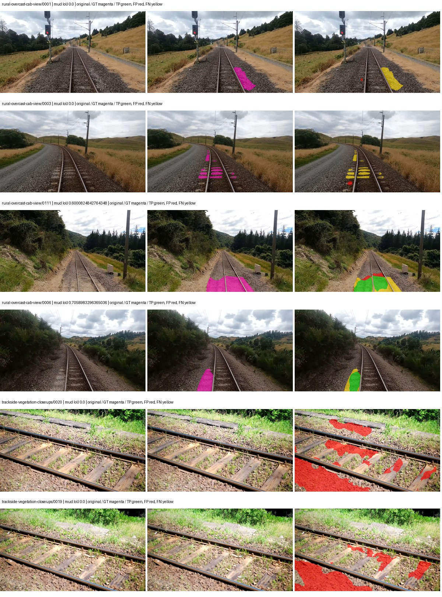
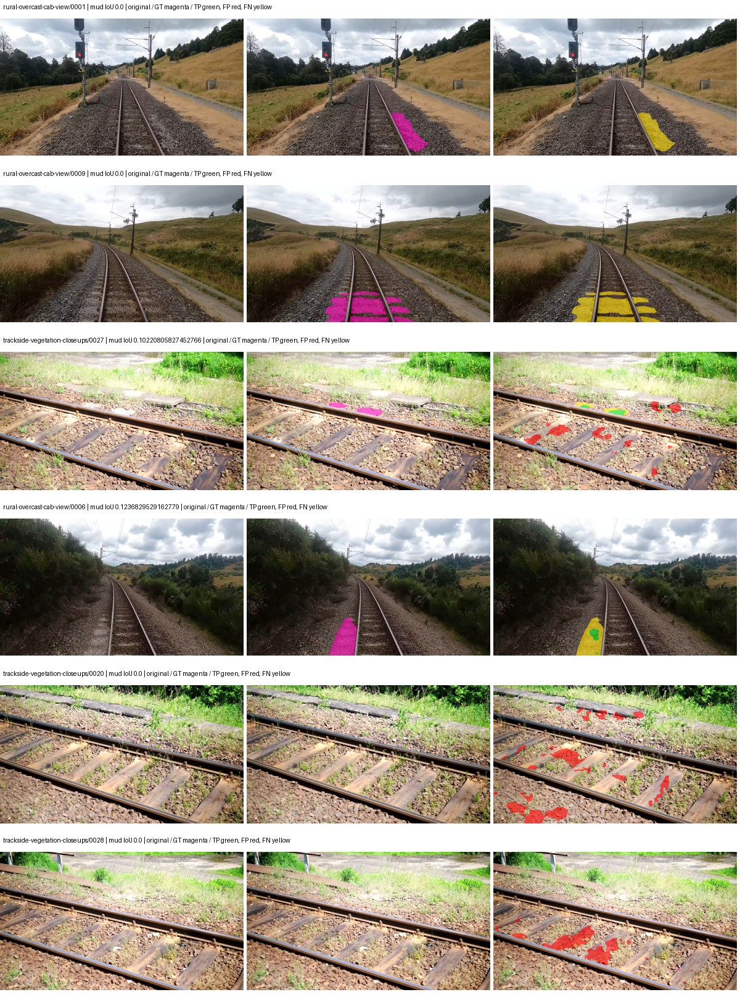
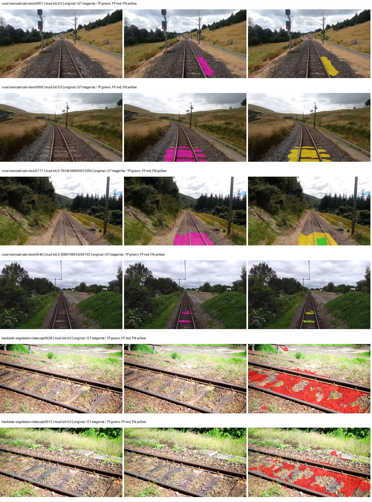
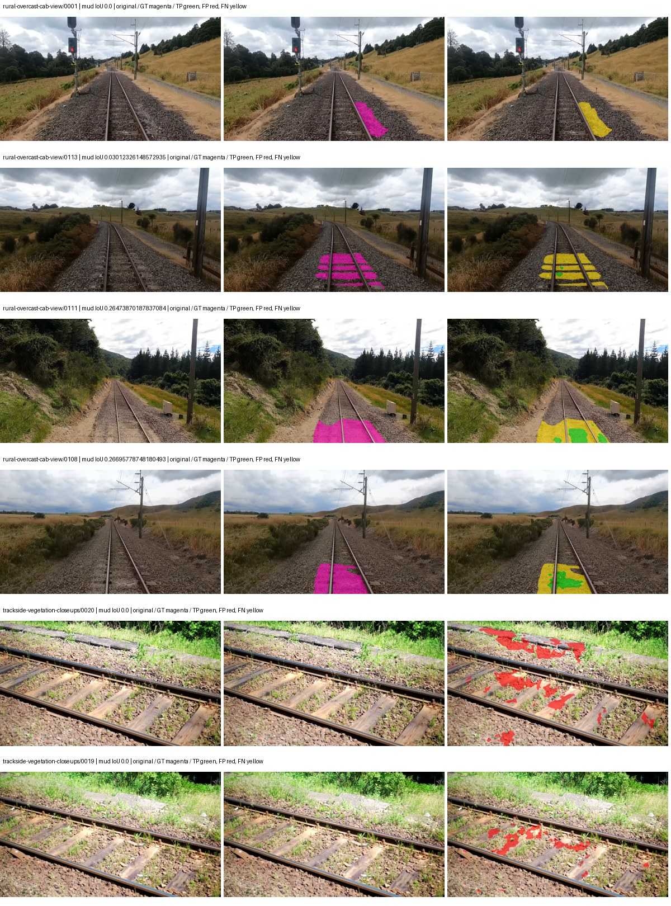

# native_convnext_tiny_uper — rad_9_24_2026-fixed-grouped

[RAD 9/24: Scene-grouped split](../../README.md) · [Full model records](record.json)

Primary result: the **final checkpoint** after the full step budget (no early stopping). The checkpoint with the best **mud-pumping validation IoU, pixels pooled over all validation images**, is kept as secondary evidence. A job is complete only after full statistics and isolated profiling are verified.

Study metrics of the final checkpoint, counting each class only on the validation images that contain it: mud-pumping IoU is the mean per-image IoU over the images with mud-pumping, precision and recall sum pixels over those images, and mIoU averages each class over the images that contain it, then over the classes present.

| Initialization path | Seed | Mud-pumping IoU, train-camera images with mud (%, n=17) | Mud-pumping IoU, all images with mud (%, n=18) | Mud precision, all images with mud (%) | Mud recall, all images with mud (%) | mIoU (each class over images that contain it) (%) |
| --- | --- | --- | --- | --- | --- | --- |
| rtis_only | 0 | 8.64 | 8.76 | 74.74 | 7.88 | 40.76 |
| cityscapes_to_rtis | 0 | 2.00 | 2.40 | 44.04 | 1.99 | 38.95 |
| railsem19_to_rtis | 0 | 2.60 | 2.63 | 9.94 | 3.55 | 43.26 |
| cityscapes_to_railsem19_to_rtis | 0 | 9.49 | 9.52 | 61.92 | 11.24 | 44.14 |

Per-class IoU: IoU (%) of every class, each averaged only over the validation images that contain the class (n = those images); — = no image contains it. mIoU averages the classes with at least one such image.

| Initialization path | Seed | mIoU (each class over images that contain it) | person (n=0) | truck (n=0) | rail-track (n=37) | vegetation-overgrowth (n=13) | car (n=3) | on-rails (n=0) | traffic-sign (n=9) | road (n=11) | sidewalk (n=12) | construction (n=12) | tram-track (n=2) | pole (n=21) | traffic-light (n=3) | mud-pumping (n=18) | fence (n=7) | terrain (n=35) | sky (n=28) | rail-embedded (n=3) | rail-raised (n=37) | trackbed (n=37) | standing-water (n=9) |
| --- | --- | --- | --- | --- | --- | --- | --- | --- | --- | --- | --- | --- | --- | --- | --- | --- | --- | --- | --- | --- | --- | --- | --- |
| rtis_only | 0 | 40.76 | — | — | 59.15 | 38.14 | 22.16 | — | 30.45 | 19.38 | 9.49 | 48.77 | 20.31 | 69.63 | 42.67 | 8.76 | 21.40 | 86.87 | 94.93 | 17.64 | 75.74 | 62.80 | 5.43 |
| cityscapes_to_rtis | 0 | 38.95 | — | — | 55.86 | 40.34 | 38.12 | — | 42.28 | 9.30 | 3.63 | 45.24 | 13.40 | 70.61 | 35.80 | 2.40 | 32.83 | 82.88 | 87.23 | 5.82 | 73.17 | 59.87 | 2.36 |
| railsem19_to_rtis | 0 | 43.26 | — | — | 58.91 | 32.33 | 37.46 | — | 42.26 | 4.54 | 16.65 | 54.27 | 28.04 | 71.72 | 36.61 | 2.63 | 34.04 | 85.85 | 96.94 | 32.34 | 75.45 | 66.61 | 2.08 |
| cityscapes_to_railsem19_to_rtis | 0 | 44.14 | — | — | 59.69 | 39.88 | 42.86 | — | 42.37 | 12.06 | 17.84 | 49.73 | 21.04 | 72.03 | 45.09 | 9.52 | 36.41 | 87.53 | 96.26 | 14.40 | 75.39 | 64.81 | 7.69 |

Everything below is the campaign's own record, with pixels pooled over all validation images: its evaluation is the checkpoint that scored best on that pooled mud IoU (secondary evidence here); the diagnostics also cover the final checkpoint (`final-auto-val`).

| Model | Initialization path | Seed | Status | Steps | Best step | Best-checkpoint mud IoU, pixels pooled (%) | Best-checkpoint mud precision, pixels pooled (%) | Best-checkpoint mud recall, pixels pooled (%) | Final mud IoU (trainer val, pixels pooled, %) | Best-checkpoint mIoU, pixels pooled (%) | Best-checkpoint fixed GT-class mIoU, pixels pooled (%) |
| --- | --- | --- | --- | --- | --- | --- | --- | --- | --- | --- | --- |
| native_convnext_tiny_uper | rtis_only | 0 | completed | 4000 | 259 | 9.31 | 13.56 | 22.90 | 5.60 | 27.47 | 29.00 |
| native_convnext_tiny_uper | cityscapes_to_rtis | 0 | completed | 4000 | 777 | 2.97 | 11.34 | 3.87 | 1.59 | 35.48 | 41.39 |
| native_convnext_tiny_uper | railsem19_to_rtis | 0 | completed | 4000 | 1037 | 2.06 | 3.11 | 5.75 | 1.48 | 42.40 | 49.46 |
| native_convnext_tiny_uper | cityscapes_to_railsem19_to_rtis | 0 | completed | 4000 | 1555 | 9.81 | 27.46 | 13.25 | 8.60 | 41.84 | 48.81 |

Training: 217 images. Validation: 37 images. Test: 60 held out. Seeds: [0]. Seed variation measures optimization variability, not independent-recording uncertainty. Historical source checkpoints stay fixed across adaptation seeds.

Training code: `fce0ea0ac50b334d4252812c396e0e593def375d`. Split SHA-256: `12d7b367c72cda61d57686ff2ac28223530d0af49debd9fb7a0fbc68b908bc93`.

## rtis_only — seed 0

Status: **completed**. Started: 2026-10-11T06:17:06.172422+00:00. Finished: 2026-10-11T07:13:35.872302+00:00.

Recipe pretrained initializer: `{"arch": "native", "backbone_path": null, "batch_norm_momentum": null, "checkpoint": null, "classifier_path": null, "drop_path": null, "encoder_name": null, "encoder_weights": null, "head": "unified_head", "head_paths": [], "inactive_parameter_paths": [], "local_files_only": false, "lora_alpha": 32, "lora_dropout": 0.05, "lora_r": 16, "lora_targets": [], "native": {"auxiliary_heads": [], "backbone": {"in_channels": 3, "kind": "timm", "name": "convnext_tiny.fb_in22k_ft_in1k", "out_indices": [0, 1, 2, 3], "weights": "pretrained"}, "head": {"activation": "relu", "channels": 256, "dropout": 0.1, "in_indices": [0, 1, 2, 3], "kind": "uper", "norm": "group", "pool_bins": [1, 2, 3, 6]}, "neck": {"kind": "identity"}, "task": "multiclass"}, "revision": null, "smp_arch": null, "subfolder": null, "trust_remote_code": false, "tuning": "full"}`.

`rtis_only` uses the recipe initializer, which may include pretrained segmentation components. Transfer paths load the exact historical source checkpoint below and reset the classifier; they do not reset all query/decoder features.

Source checkpoint: `Recipe pretrained initialization`.

Config SHA-256: `5df2f170edf4617d41ef96c7c37e7d53000f88d6fabd178ca9b1cf309fc11924`. Weights used for validation: `ema`.

### Mud-pumping and aggregate quality

| Metric | Selected checkpoint | Final training validation |
| --- | --- | --- |
| Mud IoU | 9.31 | 5.60 |
| Mud precision | 13.56 | 16.25 |
| Mud recall | 22.90 | 7.87 |
| Mud Dice/F1 | 17.04 | 10.61 |
| mIoU | 27.47 | 36.56 |
| Mean accuracy | 38.88 | 54.13 |
| Mean precision | 42.91 | 50.63 |
| Mean Dice | 35.33 | 46.74 |
| Mean specificity | 98.74 | 99.05 |
| Pixel accuracy | 80.60 | 84.80 |
| Frequency-weighted IoU | 70.11 | 75.97 |
| Fixed GT-present class mIoU | 29.00 | 42.65 |
| Boundary F1 | 32.21 | 44.51 |

The selected checkpoint has independent evaluation evidence. Final values are the trainer's final validation record, not a new independent evaluation. mIoU averages classes with nonzero union, so false positives on absent classes can change its denominator. The fixed GT-class mean is supplementary and excludes absent classes; their false positives remain in the confusion matrix.

### Resource usage and timing

| Measurement | Value |
| --- | --- |
| Peak training VRAM, retained training invocation (GiB) | 10.27 |
| Peak evaluation VRAM (GiB) | 7.42 |
| Retained training invocation wall time (seconds) | 3205.85 |
| Retained training invocation GPU-hours (one GPU) | 0.89 |
| Evaluation wall time (seconds) | 16.20 |
| Full evaluation pipeline images/second | 2.28 |
| Best full-state checkpoint (MiB) | 562.63 |
| Final full-state checkpoint (MiB) | 562.62 |
| Verified periodic checkpoints removed (GiB) | 4.40 |

VRAM uses the recorded allocator high-water mark; it is not total device usage including CUDA context. Resumed jobs' retained training invocation times and peaks are **not whole-campaign totals**. Earlier invocation resource records are not reconstructed here. Evaluation throughput includes loader, sliding-window inference and metrics; it is not model-only latency/FPS. Missing measurements are shown as —, never inferred from another dataset's run.

### Standardized inference performance

Dedicated model-only profiling waits for an idle worker-locked L40S: BF16, batch 1, 1024x1024, 20 warmup and 100 CUDA-event-timed public forwards. It excludes loading, preprocessing, tiling and metrics.

| Status | Parameters | Weight MiB | FPS | p50 ms | p95 ms | Peak reserved GiB |
| --- | --- | --- | --- | --- | --- | --- |
| complete | 36849525 | 140.57 | 76.13 | 13.13 | 13.18 | 1.24 |

```json
{
  "schema_version": 1,
  "model_id": "native_convnext_tiny_uper",
  "measured_at": "2026-10-11T07:13:29+00:00",
  "status": "complete",
  "benchmark_scope": "rtis_selected_checkpoint_model_only",
  "applies_to": [
    "native_convnext_tiny_uper--rtis_only--seed-0"
  ],
  "source": {
    "campaign_git_sha": "fce0ea0ac50b334d4252812c396e0e593def375d",
    "git_dirty": false,
    "config_hash": "87a0dc3a2ad0",
    "resolved_config": "/data/izadia1/projects/segmentary-runs/rad_9_24_2026/fgall-seed0-20261007/configs/native_convnext_tiny_uper--rtis_only--seed-0.yaml",
    "config_sha256": "5df2f170edf4617d41ef96c7c37e7d53000f88d6fabd178ca9b1cf309fc11924",
    "checkpoint_sha256": "e9960cf5a31f9e200c1b8fb8938d530ebad26f3030db9cf5c0f777d682d019e8",
    "checkpoint_global_step": 259,
    "checkpoint_bytes": 589960974,
    "checkpoint_kind": "resume checkpoint with optimizer and EMA state",
    "weights": "ema",
    "measured_checkpoint_job_id": "native_convnext_tiny_uper--rtis_only--seed-0",
    "result_sha256": "a3cc522e1578e328b1269edd8e6c6d85fd0a80fc78582256226f16a04af17aa4",
    "result_git_sha": "fce0ea0ac50b334d4252812c396e0e593def375d",
    "result_stage": "eval:rad_9_24_2026-fixed-grouped:val",
    "result_seed": 0
  },
  "hardware": {
    "gpu_name": "NVIDIA L40S",
    "gpu_uuid": "GPU-fc5dde96-210d-0afa-ac74-7f88477d622b",
    "logical_device": "cuda:0",
    "physical_visibility_token": "4",
    "compute_capability": [
      8,
      9
    ],
    "total_memory_bytes": 47677177856
  },
  "model": {
    "parameter_count": 36849525,
    "trainable_parameter_count": 36849525,
    "resident_parameter_bytes": 147398100,
    "parameter_dtype_counts": {
      "float32": 36849525
    }
  },
  "contract": {
    "backend": "pytorch",
    "precision": "bf16_autocast",
    "batch_size": 1,
    "input_shape_nchw": [
      1,
      3,
      1024,
      1024
    ],
    "warmup_iterations": 20,
    "measured_iterations": 100,
    "timing": "per-forward CUDA events with end-event synchronization",
    "includes_preprocessing": false,
    "includes_data_loader": false,
    "includes_sliding_window": false,
    "input_resident_on_gpu": true,
    "model_only": true,
    "entrypoint": "public model(image) dense-logits forward"
  },
  "measurements": {
    "latency": {
      "p50_ms": 13.127679824829102,
      "p95_ms": 13.183243370056152,
      "mean_ms": 13.135089988708495,
      "minimum_ms": 13.089792251586914,
      "maximum_ms": 13.351936340332031,
      "fps": 76.1319489139126,
      "raw_ms": [
        13.298687934875488,
        13.17683219909668,
        13.154208183288574,
        13.13379192352295,
        13.129728317260742,
        13.142016410827637,
        13.232128143310547,
        13.155327796936035,
        13.135871887207031,
        13.110272407531738,
        13.110272407531738,
        13.135871887207031,
        13.129664421081543,
        13.121536254882812,
        13.131744384765625,
        13.117440223693848,
        13.138943672180176,
        13.148159980773926,
        13.176863670349121,
        13.14303970336914,
        13.115391731262207,
        13.126655578613281,
        13.159551620483398,
        13.117440223693848,
        13.097984313964844,
        13.126655578613281,
        13.115391731262207,
        13.156352043151855,
        13.118464469909668,
        13.134847640991211,
        13.110272407531738,
        13.136896133422852,
        13.12662410736084,
        13.13475227355957,
        13.351936340332031,
        13.125632286071777,
        13.1278076171875,
        13.127679824829102,
        13.103103637695312,
        13.133824348449707,
        13.134880065917969,
        13.11740779876709,
        13.146112442016602,
        13.114368438720703,
        13.210623741149902,
        13.111167907714844,
        13.121536254882812,
        13.110272407531738,
        13.109248161315918,
        13.114368438720703,
        13.209600448608398,
        13.122559547424316,
        13.130656242370605,
        13.105152130126953,
        13.136896133422852,
        13.118464469909668,
        13.128704071044922,
        13.114368438720703,
        13.120512008666992,
        13.129728317260742,
        13.129728317260742,
        13.15225601196289,
        13.103103637695312,
        13.15123176574707,
        13.135871887207031,
        13.109248161315918,
        13.155327796936035,
        13.126655578613281,
        13.118464469909668,
        13.127679824829102,
        13.089792251586914,
        13.116415977478027,
        13.134847640991211,
        13.109248161315918,
        13.093888282775879,
        13.121536254882812,
        13.12553596496582,
        13.109248161315918,
        13.125632286071777,
        13.101056098937988,
        13.166560173034668,
        13.117440223693848,
        13.133888244628906,
        13.181856155395508,
        13.142975807189941,
        13.117440223693848,
        13.122559547424316,
        13.116415977478027,
        13.150208473205566,
        13.120512008666992,
        13.118464469909668,
        13.144063949584961,
        13.124608039855957,
        13.129728317260742,
        13.15123176574707,
        13.15225601196289,
        13.136896133422852,
        13.112447738647461,
        13.127679824829102,
        13.128704071044922
      ],
      "percentile_method": "numpy linear interpolation"
    },
    "peak_reserved_bytes": 1335885824,
    "memory_kind": "pytorch_cuda_allocator_peak_reserved_excluding_context",
    "process_total_bytes": 1872756736,
    "process_total_kind": "nvidia-smi used_memory of this PID on the benchmark GPU after the timed loop, including the CUDA context; null when the driver could not attribute memory to this PID",
    "benchmark_wall_clock_s": 9.217871554195881
  },
  "started_at": "2026-10-11T07:13:20+00:00",
  "finished_at": "2026-10-11T07:13:29+00:00",
  "environment": {
    "hostname": "hdrfs-app-001",
    "python": "3.11.15",
    "platform": "Linux-5.15.0-139-generic-x86_64-with-glibc2.35",
    "torch": "2.11.0+cu128",
    "torch_cuda": "12.8",
    "cudnn": 91900,
    "driver_version": "570.133.20",
    "cuda_available": true,
    "gpu_count": 1,
    "gpu_names": [
      "NVIDIA L40S"
    ],
    "cuda_visible_devices": "4",
    "packages": {
      "segmentary": "0.1.0",
      "torch": "2.11.0+cu128",
      "torchvision": "0.26.0+cu128",
      "transformers": "5.15.0",
      "timm": "1.0.28",
      "segmentation-models-pytorch": "0.5.0",
      "albumentations": "2.0.8",
      "lightning": "2.6.5",
      "numpy": "2.4.4"
    }
  }
}
```

### Per-class validation results

| Class | GT pixels | IoU (%) | Precision (%) | Recall (%) | Dice (%) | Boundary F1 (%) |
| --- | --- | --- | --- | --- | --- | --- |
| car | 29664 | 0.00 | 0.00 | 0.00 | 0.00 | 0.00 |
| construction | 311585 | 16.79 | 17.84 | 73.95 | 28.75 | 43.36 |
| fence | 265137 | 22.55 | 47.07 | 30.20 | 36.80 | 34.57 |
| mud-pumping | 1226250 | 9.31 | 13.56 | 22.90 | 17.04 | 12.31 |
| on-rails | 0 | 0.00 | 0.00 | — | 0.00 | 0.00 |
| person | 0 | — | — | — | — | — |
| pole | 628038 | 58.08 | 73.93 | 73.04 | 73.48 | 81.72 |
| rail-embedded | 16799 | 0.00 | 0.00 | 0.00 | 0.00 | 0.00 |
| rail-raised | 2969797 | 74.03 | 80.55 | 90.15 | 85.08 | 88.54 |
| rail-track | 6323197 | 41.34 | 69.30 | 50.61 | 58.50 | 54.85 |
| road | 1048831 | 2.65 | 5.53 | 4.85 | 5.17 | 6.76 |
| sidewalk | 1297367 | 29.36 | 67.82 | 34.10 | 45.39 | 18.05 |
| sky | 19121606 | 94.06 | 99.24 | 94.74 | 96.94 | 84.79 |
| standing-water | 95802 | 3.75 | 4.26 | 24.02 | 7.23 | 15.39 |
| terrain | 39239306 | 81.56 | 84.00 | 96.57 | 89.84 | 55.94 |
| trackbed | 10643081 | 56.38 | 71.93 | 72.29 | 72.11 | 56.77 |
| traffic-light | 19510 | 0.00 | 0.00 | 0.00 | 0.00 | 0.00 |
| traffic-sign | 13285 | 0.00 | 0.00 | 0.00 | 0.00 | 0.00 |
| tram-track | 56179 | 19.70 | 97.40 | 19.81 | 32.92 | 26.05 |
| truck | 0 | — | — | — | — | — |
| vegetation-overgrowth | 5901821 | 12.36 | 82.85 | 12.68 | 22.00 | 32.87 |

### Full-run accounting

| Measurement | Value |
| --- | --- |
| Full GPU-reserved wall seconds, all recorded worker attempts | 3397.37 |
| Full reserved GPU-hours | 0.94 |
| Whole-run timing complete | True |

| Phase | Wall seconds including failed attempts |
| --- | --- |
| training | 3212.93 |
| diagnostics | 128.82 |
| performance | 17.98 |

GPU-reserved time includes model loading, training, validation, collection, profiling, checkpoint I/O and orchestration while the worker owns one GPU. It is not GPU kernel-active time. Phase timings and sampled device memory/power/utilization are retained separately; sampled device memory is not the allocator high-water mark.

### Train/validation and raw/EMA diagnostics

| Checkpoint / weights / split | Images | Mud IoU (%) | Mud precision (%) | Mud recall (%) |
| --- | --- | --- | --- | --- |
| best-auto-train / ema | 217 | 91.28 | 94.63 | 96.26 |
| best-auto-val / ema | 37 | 9.31 | 13.56 | 22.90 |
| best-alternate-val / raw | 37 | 23.54 | 31.13 | 49.10 |
| final-auto-val / ema | 37 | 5.61 | 16.26 | 7.88 |

Train uses the evaluation transform without augmentation. Compare mud train/validation metrics for the same selected weights. Alternate EMA on running-stat BatchNorm is explicitly uncalibrated and is diagnostic only. Score-threshold curves use uncalibrated normalized scores and are pixel-level diagnostics, not event detection rates or a selected deployment operating point.

### Downloadable evidence

- best-auto-train: [per-image.csv](rtis_only--seed-0/best-auto-train/per-image.csv) · [per-image-confusion.json.gz](rtis_only--seed-0/best-auto-train/per-image-confusion.json.gz) · [groups.json](rtis_only--seed-0/best-auto-train/groups.json) · [mud-score-curves.json](rtis_only--seed-0/best-auto-train/mud-score-curves.json)
- best-auto-val: [per-image.csv](rtis_only--seed-0/best-auto-val/per-image.csv) · [per-image-confusion.json.gz](rtis_only--seed-0/best-auto-val/per-image-confusion.json.gz) · [groups.json](rtis_only--seed-0/best-auto-val/groups.json) · [mud-score-curves.json](rtis_only--seed-0/best-auto-val/mud-score-curves.json) · [examples.jpg](rtis_only--seed-0/best-auto-val/examples.jpg)
- best-alternate-val: [per-image.csv](rtis_only--seed-0/best-alternate-val/per-image.csv) · [per-image-confusion.json.gz](rtis_only--seed-0/best-alternate-val/per-image-confusion.json.gz) · [groups.json](rtis_only--seed-0/best-alternate-val/groups.json) · [mud-score-curves.json](rtis_only--seed-0/best-alternate-val/mud-score-curves.json)
- final-auto-val: [per-image.csv](rtis_only--seed-0/final-auto-val/per-image.csv) · [per-image-confusion.json.gz](rtis_only--seed-0/final-auto-val/per-image-confusion.json.gz) · [groups.json](rtis_only--seed-0/final-auto-val/groups.json) · [mud-score-curves.json](rtis_only--seed-0/final-auto-val/mud-score-curves.json)
- resources: [telemetry.csv](rtis_only--seed-0/resources/telemetry.csv)



Examples are two lowest and two highest mud-IoU positive images, plus up to two negative images with the most false-positive mud pixels. They are targeted diagnostic examples, not random samples. Green: true positive; red: false positive; yellow: false negative. Full predictions remain on HDRFS.

### Validation tracking

| Logged step | Overall mIoU (%) | Mud IoU (%) |
| --- | --- | --- |
| 258 | 27.48 | 9.32 |
| 518 | 26.81 | 1.78 |
| 777 | 32.90 | 2.58 |
| 1036 | 36.25 | 4.57 |
| 1295 | 36.46 | 3.08 |
| 1555 | 36.11 | 3.81 |
| 1814 | 35.80 | 3.47 |
| 2073 | 35.94 | 4.74 |
| 2332 | 35.98 | 4.80 |
| 2592 | 36.06 | 4.96 |
| 2851 | 36.14 | 5.14 |
| 3110 | 36.23 | 5.28 |
| 3369 | 36.31 | 5.43 |
| 3629 | 36.41 | 5.55 |
| 3888 | 36.53 | 5.60 |
| 4000 | 36.56 | 5.60 |

All retained scalar curves, including training loss and per-class IoU, are in record.json. Observed best mud on a curve is not necessarily a retained checkpoint: the pilot saved its selection-metric-best and final checkpoints. Step logging and checkpoint global_step may differ by one.

### Stopping and checkpoint provenance

```json
{
  "stopping": {
    "actual_steps": 4000,
    "maximum_steps": 4000,
    "min_delta": 0.0,
    "monitor": "val_iou/mud-pumping",
    "patience": null,
    "reason": "budget_complete"
  },
  "checkpoints": {
    "best": {
      "path": "/data/izadia1/projects/segmentary-runs/rad_9_24_2026/fgall-seed0-20261007/future-runs/native_convnext_tiny_uper--rtis_only--seed-0_seed0/rtis/best.ckpt",
      "sha256": "e9960cf5a31f9e200c1b8fb8938d530ebad26f3030db9cf5c0f777d682d019e8",
      "global_step": 259,
      "bytes": 589960974
    },
    "final": {
      "path": "/data/izadia1/projects/segmentary-runs/rad_9_24_2026/fgall-seed0-20261007/future-runs/native_convnext_tiny_uper--rtis_only--seed-0_seed0/rtis/last.ckpt",
      "sha256": "4d1250b4f14d544973b566f9002f42ef00e0ec3aa26d8009fcd193caeb4838f3",
      "global_step": 4000,
      "bytes": 589950798
    }
  },
  "cleanup_error": null
}
```

### Resolved training, initialization and evaluation settings

The optimizer block is the base configuration. Stage LR scales are applied at runtime, and stage warmup is capped at min(base warmup, floor(stage budget / 10), stage budget - 1): 400 steps for this 4,000-step pilot. Model-internal native input grids may differ from augmentation crops (EoMT uses its 640 grid).

```json
{
  "name": "native_convnext_tiny_uper--rtis_only--seed-0",
  "model": {
    "arch": "native",
    "checkpoint": null,
    "tuning": "full",
    "head": "unified_head",
    "lora_r": 16,
    "lora_alpha": 32,
    "lora_dropout": 0.05,
    "lora_targets": [],
    "drop_path": null,
    "revision": null,
    "subfolder": null,
    "local_files_only": false,
    "trust_remote_code": false,
    "backbone_path": null,
    "head_paths": [],
    "classifier_path": null,
    "inactive_parameter_paths": [],
    "smp_arch": null,
    "encoder_name": null,
    "encoder_weights": null,
    "native": {
      "task": "multiclass",
      "backbone": {
        "kind": "timm",
        "name": "convnext_tiny.fb_in22k_ft_in1k",
        "weights": "pretrained",
        "out_indices": [
          0,
          1,
          2,
          3
        ],
        "in_channels": 3
      },
      "neck": {
        "kind": "identity"
      },
      "head": {
        "kind": "uper",
        "in_indices": [
          0,
          1,
          2,
          3
        ],
        "channels": 256,
        "pool_bins": [
          1,
          2,
          3,
          6
        ],
        "dropout": 0.1,
        "norm": "group",
        "activation": "relu"
      },
      "auxiliary_heads": []
    },
    "batch_norm_momentum": null
  },
  "space": "paul-test-rtis",
  "taxonomy_root": "/data/izadia1/projects/segmentary-rad-fgall-fce0ea0a/taxonomy",
  "output_root": "/data/izadia1/projects/segmentary-runs/rad_9_24_2026/fgall-seed0-20261007/future-runs",
  "optim": {
    "backbone_lr": 0.0001,
    "head_lr_mult": 10.0,
    "weight_decay": 0.05,
    "llrd": 1.0,
    "warmup_iters": 1500,
    "warmup_ratio": 1e-06,
    "poly_power": 0.9,
    "min_lr_ratio": 0.0,
    "betas": [
      0.9,
      0.999
    ],
    "grad_clip": 1.0
  },
  "train": {
    "iters": 4000,
    "batch_size": 2,
    "accum": 8,
    "num_workers": 2,
    "precision": "bf16-mixed",
    "ema_decay": 0.9998,
    "val_every": 250,
    "ckpt_every": 500,
    "selection_metric": "val_iou/mud-pumping",
    "early_stopping_patience": null,
    "early_stopping_min_delta": 0.0,
    "seed": 0,
    "devices": 1
  },
  "eval": {
    "sliding_window": true,
    "window": [
      1024,
      1024
    ],
    "stride": [
      768,
      768
    ],
    "batch_size": 1,
    "num_workers": 2,
    "tta_scales": [],
    "tta_flip": false,
    "threshold": 0.5,
    "boundary_tolerance_frac": 0.0075,
    "save_confusion": true
  },
  "loss": {
    "task": "multiclass",
    "activation": "auto",
    "terms": [],
    "aux": "none",
    "aux_weight": 0.0,
    "ce_weight": 1.0,
    "label_smoothing": 0.0,
    "class_weights": null,
    "query": null
  },
  "aug": {
    "crop": [
      1024,
      1024
    ],
    "scale_min": 0.5,
    "scale_max": 2.0,
    "hflip_p": 0.5,
    "color_jitter_p": 0.5,
    "brightness": 0.25,
    "contrast": 0.25,
    "saturation": 0.25,
    "hue": 0.05
  },
  "stages": [
    {
      "name": "rtis",
      "data": [
        {
          "name": "rad_9_24_2026-fixed-grouped",
          "root": "/data/izadia1/datasets/rad_9_24_2026-fixed-grouped",
          "variant": null,
          "split_file": "splits.json",
          "train_split": "train",
          "val_split": "val",
          "limit": null,
          "loader": "folder",
          "mapping": "paul-test-rtis",
          "loader_options": {
            "require_groups": true
          }
        }
      ],
      "iters": null,
      "lr_scale": 1.0,
      "head_group_lr_scale": 1.0,
      "init_from": "pretrained",
      "reset_head": false,
      "freeze": null,
      "sample_weights": null
    }
  ]
}
```

### Hardware and software provenance

```json
{
  "training": {
    "cuda_available": true,
    "cuda_visible_devices": "4",
    "cudnn": 91900,
    "driver_version": "570.133.20",
    "gpu_count": 1,
    "gpu_names": [
      "NVIDIA L40S"
    ],
    "hostname": "hdrfs-app-001",
    "input_normalization": {
      "channel_order": "rgb",
      "mean": [
        0.485,
        0.456,
        0.406
      ],
      "source": "timm_pretrained_cfg",
      "std": [
        0.229,
        0.224,
        0.225
      ]
    },
    "model_origins": [
      {
        "hf_commit": null,
        "hf_name_or_path": null,
        "module": "backbone",
        "timm_pretrained": {
          "architecture": "convnext_tiny",
          "hf_hub_id": "timm/convnext_tiny.fb_in22k_ft_in1k",
          "tag": "fb_in22k_ft_in1k",
          "url": "https://dl.fbaipublicfiles.com/convnext/convnext_tiny_22k_1k_224.pth"
        }
      },
      {
        "hf_commit": null,
        "hf_name_or_path": null,
        "module": "backbone.model",
        "timm_pretrained": {
          "architecture": "convnext_tiny",
          "hf_hub_id": "timm/convnext_tiny.fb_in22k_ft_in1k",
          "tag": "fb_in22k_ft_in1k",
          "url": "https://dl.fbaipublicfiles.com/convnext/convnext_tiny_22k_1k_224.pth"
        }
      }
    ],
    "model_parameter_count": 36849525,
    "packages": {
      "albumentations": "2.0.8",
      "lightning": "2.6.5",
      "numpy": "2.4.4",
      "segmentary": "0.1.0",
      "segmentation-models-pytorch": "0.5.0",
      "timm": "1.0.28",
      "torch": "2.11.0+cu128",
      "torchvision": "0.26.0+cu128",
      "transformers": "5.15.0"
    },
    "platform": "Linux-5.15.0-139-generic-x86_64-with-glibc2.35",
    "python": "3.11.15",
    "torch": "2.11.0+cu128",
    "torch_cuda": "12.8",
    "trainable_parameter_count": 36849525,
    "training_stop": {
      "actual_steps": 4000,
      "maximum_steps": 4000,
      "min_delta": 0.0,
      "monitor": "val_iou/mud-pumping",
      "patience": null,
      "reason": "budget_complete"
    },
    "validation_weights": "ema"
  },
  "evaluation": {
    "cuda_available": true,
    "cuda_visible_devices": "4",
    "cudnn": 91900,
    "driver_version": "570.133.20",
    "gpu_count": 1,
    "gpu_names": [
      "NVIDIA L40S"
    ],
    "hostname": "hdrfs-app-001",
    "input_normalization": {
      "channel_order": "rgb",
      "mean": [
        0.485,
        0.456,
        0.406
      ],
      "source": "timm_pretrained_cfg",
      "std": [
        0.229,
        0.224,
        0.225
      ]
    },
    "packages": {
      "albumentations": "2.0.8",
      "lightning": "2.6.5",
      "numpy": "2.4.4",
      "segmentary": "0.1.0",
      "segmentation-models-pytorch": "0.5.0",
      "timm": "1.0.28",
      "torch": "2.11.0+cu128",
      "torchvision": "0.26.0+cu128",
      "transformers": "5.15.0"
    },
    "platform": "Linux-5.15.0-139-generic-x86_64-with-glibc2.35",
    "python": "3.11.15",
    "torch": "2.11.0+cu128",
    "torch_cuda": "12.8"
  }
}
```

## cityscapes_to_rtis — seed 0

Status: **completed**. Started: 2026-10-11T06:20:43.236491+00:00. Finished: 2026-10-11T07:17:33.609580+00:00.

Recipe pretrained initializer: `{"arch": "native", "backbone_path": null, "batch_norm_momentum": null, "checkpoint": null, "classifier_path": null, "drop_path": null, "encoder_name": null, "encoder_weights": null, "head": "unified_head", "head_paths": [], "inactive_parameter_paths": [], "local_files_only": false, "lora_alpha": 32, "lora_dropout": 0.05, "lora_r": 16, "lora_targets": [], "native": {"auxiliary_heads": [], "backbone": {"in_channels": 3, "kind": "timm", "name": "convnext_tiny.fb_in22k_ft_in1k", "out_indices": [0, 1, 2, 3], "weights": "pretrained"}, "head": {"activation": "relu", "channels": 256, "dropout": 0.1, "in_indices": [0, 1, 2, 3], "kind": "uper", "norm": "group", "pool_bins": [1, 2, 3, 6]}, "neck": {"kind": "identity"}, "task": "multiclass"}, "revision": null, "smp_arch": null, "subfolder": null, "trust_remote_code": false, "tuning": "full"}`.

`rtis_only` uses the recipe initializer, which may include pretrained segmentation components. Transfer paths load the exact historical source checkpoint below and reset the classifier; they do not reset all query/decoder features.

Source checkpoint: `{'name': 'native_convnext_tiny_uper--cityscapes--seed-0', 'model': 'native_convnext_tiny_uper', 'protocol': 'cityscapes', 'config': '/data/izadia1/projects/segmentary-runs/all-model-city-rail-seed0-rail20-b9eb3e1/accepted/native_convnext_tiny_uper--cityscapes--seed-0/resolved-config.yaml', 'checkpoint': '/data/izadia1/projects/segmentary-runs/all-model-city-rail-seed0-a7c0b67/jobs/native_convnext_tiny_uper--cityscapes--seed-0/attempt-001/train/native_convnext_tiny_uper--cityscapes_seed0/cityscapes/last.ckpt', 'recorded_sha256': '5b371ccbb1c2f1ad354d205d07f867135039dd82de6fffac6c27c76b1cbc88ea', 'exists': True}`.

Config SHA-256: `5653dde6b6a512e3c3b1cfbed1e2ac7296fd6b78493f8593ae3e15b523606ba7`. Weights used for validation: `ema`.

### Mud-pumping and aggregate quality

| Metric | Selected checkpoint | Final training validation |
| --- | --- | --- |
| Mud IoU | 2.97 | 1.59 |
| Mud precision | 11.34 | 7.31 |
| Mud recall | 3.87 | 1.99 |
| Mud Dice/F1 | 5.77 | 3.13 |
| mIoU | 35.48 | 35.80 |
| Mean accuracy | 51.76 | 51.34 |
| Mean precision | 48.83 | 48.51 |
| Mean Dice | 45.11 | 45.17 |
| Mean specificity | 98.99 | 98.90 |
| Pixel accuracy | 83.96 | 83.07 |
| Frequency-weighted IoU | 74.39 | 72.70 |
| Fixed GT-present class mIoU | 41.39 | 41.77 |
| Boundary F1 | 41.56 | 42.06 |

The selected checkpoint has independent evaluation evidence. Final values are the trainer's final validation record, not a new independent evaluation. mIoU averages classes with nonzero union, so false positives on absent classes can change its denominator. The fixed GT-class mean is supplementary and excludes absent classes; their false positives remain in the confusion matrix.

### Resource usage and timing

| Measurement | Value |
| --- | --- |
| Peak training VRAM, retained training invocation (GiB) | 10.20 |
| Peak evaluation VRAM (GiB) | 7.42 |
| Retained training invocation wall time (seconds) | 3226.91 |
| Retained training invocation GPU-hours (one GPU) | 0.90 |
| Evaluation wall time (seconds) | 15.74 |
| Full evaluation pipeline images/second | 2.35 |
| Best full-state checkpoint (MiB) | 562.63 |
| Final full-state checkpoint (MiB) | 562.62 |
| Verified periodic checkpoints removed (GiB) | 4.40 |

VRAM uses the recorded allocator high-water mark; it is not total device usage including CUDA context. Resumed jobs' retained training invocation times and peaks are **not whole-campaign totals**. Earlier invocation resource records are not reconstructed here. Evaluation throughput includes loader, sliding-window inference and metrics; it is not model-only latency/FPS. Missing measurements are shown as —, never inferred from another dataset's run.

### Standardized inference performance

Dedicated model-only profiling waits for an idle worker-locked L40S: BF16, batch 1, 1024x1024, 20 warmup and 100 CUDA-event-timed public forwards. It excludes loading, preprocessing, tiling and metrics.

| Status | Parameters | Weight MiB | FPS | p50 ms | p95 ms | Peak reserved GiB |
| --- | --- | --- | --- | --- | --- | --- |
| complete | 36849525 | 140.57 | 76.08 | 13.14 | 13.22 | 1.24 |

```json
{
  "schema_version": 1,
  "model_id": "native_convnext_tiny_uper",
  "measured_at": "2026-10-11T07:17:27+00:00",
  "status": "complete",
  "benchmark_scope": "rtis_selected_checkpoint_model_only",
  "applies_to": [
    "native_convnext_tiny_uper--cityscapes_to_rtis--seed-0"
  ],
  "source": {
    "campaign_git_sha": "fce0ea0ac50b334d4252812c396e0e593def375d",
    "git_dirty": false,
    "config_hash": "a27b0c40ffa8",
    "resolved_config": "/data/izadia1/projects/segmentary-runs/rad_9_24_2026/fgall-seed0-20261007/configs/native_convnext_tiny_uper--cityscapes_to_rtis--seed-0.yaml",
    "config_sha256": "5653dde6b6a512e3c3b1cfbed1e2ac7296fd6b78493f8593ae3e15b523606ba7",
    "checkpoint_sha256": "046c49287ee25c71dc1ca5ffa73e048514fa4ab71049557b87c93a4c61659d69",
    "checkpoint_global_step": 777,
    "checkpoint_bytes": 589961358,
    "checkpoint_kind": "resume checkpoint with optimizer and EMA state",
    "weights": "ema",
    "measured_checkpoint_job_id": "native_convnext_tiny_uper--cityscapes_to_rtis--seed-0",
    "result_sha256": "a4e3f06e9d349fab725e0e193dd132ce98b1e5b178d6d5a0d3987e99a09fcbf2",
    "result_git_sha": "fce0ea0ac50b334d4252812c396e0e593def375d",
    "result_stage": "eval:rad_9_24_2026-fixed-grouped:val",
    "result_seed": 0
  },
  "hardware": {
    "gpu_name": "NVIDIA L40S",
    "gpu_uuid": "GPU-e2e96741-aec9-e90b-5c46-d0d58be90a56",
    "logical_device": "cuda:0",
    "physical_visibility_token": "8",
    "compute_capability": [
      8,
      9
    ],
    "total_memory_bytes": 47677177856
  },
  "model": {
    "parameter_count": 36849525,
    "trainable_parameter_count": 36849525,
    "resident_parameter_bytes": 147398100,
    "parameter_dtype_counts": {
      "float32": 36849525
    }
  },
  "contract": {
    "backend": "pytorch",
    "precision": "bf16_autocast",
    "batch_size": 1,
    "input_shape_nchw": [
      1,
      3,
      1024,
      1024
    ],
    "warmup_iterations": 20,
    "measured_iterations": 100,
    "timing": "per-forward CUDA events with end-event synchronization",
    "includes_preprocessing": false,
    "includes_data_loader": false,
    "includes_sliding_window": false,
    "input_resident_on_gpu": true,
    "model_only": true,
    "entrypoint": "public model(image) dense-logits forward"
  },
  "measurements": {
    "latency": {
      "p50_ms": 13.143040180206299,
      "p95_ms": 13.221120023727417,
      "mean_ms": 13.14396222114563,
      "minimum_ms": 13.022208213806152,
      "maximum_ms": 14.135295867919922,
      "fps": 76.08055951281027,
      "raw_ms": [
        13.245439529418945,
        13.100031852722168,
        13.144063949584961,
        13.140992164611816,
        13.16966438293457,
        13.142016410827637,
        13.125632286071777,
        13.064191818237305,
        13.26899242401123,
        13.187071800231934,
        13.156352043151855,
        13.153280258178711,
        13.042719841003418,
        13.075455665588379,
        13.090815544128418,
        13.0764799118042,
        13.142016410827637,
        13.074432373046875,
        13.142016410827637,
        13.131775856018066,
        13.0447359085083,
        13.065216064453125,
        13.15839958190918,
        13.088768005371094,
        13.293567657470703,
        13.022208213806152,
        13.091839790344238,
        13.101056098937988,
        13.084671974182129,
        13.154303550720215,
        13.100031852722168,
        13.163519859313965,
        13.099040031433105,
        13.157376289367676,
        13.121536254882812,
        13.189120292663574,
        13.290495872497559,
        13.06828784942627,
        13.170687675476074,
        13.092864036560059,
        13.178879737854004,
        14.135295867919922,
        13.165568351745605,
        13.149184226989746,
        13.157376289367676,
        13.156352043151855,
        13.188096046447754,
        13.08672046661377,
        13.05907154083252,
        13.156352043151855,
        13.085760116577148,
        13.07539176940918,
        13.165568351745605,
        13.140992164611816,
        13.163519859313965,
        13.15123176574707,
        13.071359634399414,
        13.057024002075195,
        13.149184226989746,
        13.174783706665039,
        13.208576202392578,
        13.170687675476074,
        13.16659164428711,
        13.091839790344238,
        13.06726360321045,
        13.137920379638672,
        13.219840049743652,
        13.193216323852539,
        13.191167831420898,
        13.153280258178711,
        13.073408126831055,
        13.093888282775879,
        13.07852840423584,
        13.163519859313965,
        13.180928230285645,
        13.072383880615234,
        13.204480171203613,
        13.170687675476074,
        13.105152130126953,
        13.06726360321045,
        13.149184226989746,
        13.159423828125,
        13.116415977478027,
        13.173760414123535,
        13.094911575317383,
        13.103103637695312,
        13.156352043151855,
        13.073408126831055,
        13.127679824829102,
        13.173760414123535,
        13.071359634399414,
        13.094911575317383,
        13.155327796936035,
        13.171711921691895,
        13.182975769042969,
        13.159423828125,
        13.159423828125,
        13.163519859313965,
        13.136896133422852,
        13.063167572021484
      ],
      "percentile_method": "numpy linear interpolation"
    },
    "peak_reserved_bytes": 1335885824,
    "memory_kind": "pytorch_cuda_allocator_peak_reserved_excluding_context",
    "process_total_bytes": 1872756736,
    "process_total_kind": "nvidia-smi used_memory of this PID on the benchmark GPU after the timed loop, including the CUDA context; null when the driver could not attribute memory to this PID",
    "benchmark_wall_clock_s": 9.168279983103275
  },
  "started_at": "2026-10-11T07:17:17+00:00",
  "finished_at": "2026-10-11T07:17:27+00:00",
  "environment": {
    "hostname": "hdrfs-app-001",
    "python": "3.11.15",
    "platform": "Linux-5.15.0-139-generic-x86_64-with-glibc2.35",
    "torch": "2.11.0+cu128",
    "torch_cuda": "12.8",
    "cudnn": 91900,
    "driver_version": "570.133.20",
    "cuda_available": true,
    "gpu_count": 1,
    "gpu_names": [
      "NVIDIA L40S"
    ],
    "cuda_visible_devices": "8",
    "packages": {
      "segmentary": "0.1.0",
      "torch": "2.11.0+cu128",
      "torchvision": "0.26.0+cu128",
      "transformers": "5.15.0",
      "timm": "1.0.28",
      "segmentation-models-pytorch": "0.5.0",
      "albumentations": "2.0.8",
      "lightning": "2.6.5",
      "numpy": "2.4.4"
    }
  }
}
```

### Per-class validation results

| Class | GT pixels | IoU (%) | Precision (%) | Recall (%) | Dice (%) | Boundary F1 (%) |
| --- | --- | --- | --- | --- | --- | --- |
| car | 29664 | 61.36 | 82.74 | 70.36 | 76.05 | 57.30 |
| construction | 311585 | 46.01 | 51.28 | 81.76 | 63.03 | 50.35 |
| fence | 265137 | 33.10 | 55.73 | 44.90 | 49.73 | 46.82 |
| mud-pumping | 1226250 | 2.97 | 11.34 | 3.87 | 5.77 | 9.06 |
| on-rails | 0 | 0.00 | 0.00 | — | 0.00 | 0.00 |
| person | 0 | 0.00 | 0.00 | — | 0.00 | 0.00 |
| pole | 628038 | 73.74 | 84.21 | 85.57 | 84.89 | 91.69 |
| rail-embedded | 16799 | 10.62 | 22.19 | 16.92 | 19.20 | 20.85 |
| rail-raised | 2969797 | 72.72 | 81.73 | 86.84 | 84.21 | 88.08 |
| rail-track | 6323197 | 42.79 | 61.67 | 58.28 | 59.93 | 57.65 |
| road | 1048831 | 1.40 | 4.84 | 1.93 | 2.76 | 9.17 |
| sidewalk | 1297367 | 11.21 | 44.28 | 13.04 | 20.15 | 15.65 |
| sky | 19121606 | 95.55 | 99.50 | 96.01 | 97.72 | 84.86 |
| standing-water | 95802 | 2.78 | 3.58 | 10.99 | 5.40 | 13.06 |
| terrain | 39239306 | 86.87 | 88.84 | 97.52 | 92.98 | 66.78 |
| trackbed | 10643081 | 55.56 | 65.52 | 78.52 | 71.43 | 54.82 |
| traffic-light | 19510 | 40.41 | 78.55 | 45.42 | 57.56 | 60.17 |
| traffic-sign | 13285 | 46.32 | 65.92 | 60.91 | 63.32 | 63.39 |
| tram-track | 56179 | 22.87 | 36.84 | 37.61 | 37.22 | 14.25 |
| truck | 0 | 0.00 | 0.00 | — | 0.00 | 0.00 |
| vegetation-overgrowth | 5901821 | 38.76 | 86.63 | 41.23 | 55.87 | 68.88 |

### Full-run accounting

| Measurement | Value |
| --- | --- |
| Full GPU-reserved wall seconds, all recorded worker attempts | 3418.56 |
| Full reserved GPU-hours | 0.95 |
| Whole-run timing complete | True |

| Phase | Wall seconds including failed attempts |
| --- | --- |
| training | 3234.44 |
| diagnostics | 128.62 |
| performance | 17.69 |

GPU-reserved time includes model loading, training, validation, collection, profiling, checkpoint I/O and orchestration while the worker owns one GPU. It is not GPU kernel-active time. Phase timings and sampled device memory/power/utilization are retained separately; sampled device memory is not the allocator high-water mark.

### Train/validation and raw/EMA diagnostics

| Checkpoint / weights / split | Images | Mud IoU (%) | Mud precision (%) | Mud recall (%) |
| --- | --- | --- | --- | --- |
| best-auto-train / ema | 217 | 95.37 | 97.41 | 97.85 |
| best-auto-val / ema | 37 | 2.97 | 11.34 | 3.87 |
| best-alternate-val / raw | 37 | 1.03 | 7.18 | 1.19 |
| final-auto-val / ema | 37 | 1.59 | 7.30 | 1.99 |

Train uses the evaluation transform without augmentation. Compare mud train/validation metrics for the same selected weights. Alternate EMA on running-stat BatchNorm is explicitly uncalibrated and is diagnostic only. Score-threshold curves use uncalibrated normalized scores and are pixel-level diagnostics, not event detection rates or a selected deployment operating point.

### Downloadable evidence

- best-auto-train: [per-image.csv](cityscapes_to_rtis--seed-0/best-auto-train/per-image.csv) · [per-image-confusion.json.gz](cityscapes_to_rtis--seed-0/best-auto-train/per-image-confusion.json.gz) · [groups.json](cityscapes_to_rtis--seed-0/best-auto-train/groups.json) · [mud-score-curves.json](cityscapes_to_rtis--seed-0/best-auto-train/mud-score-curves.json)
- best-auto-val: [per-image.csv](cityscapes_to_rtis--seed-0/best-auto-val/per-image.csv) · [per-image-confusion.json.gz](cityscapes_to_rtis--seed-0/best-auto-val/per-image-confusion.json.gz) · [groups.json](cityscapes_to_rtis--seed-0/best-auto-val/groups.json) · [mud-score-curves.json](cityscapes_to_rtis--seed-0/best-auto-val/mud-score-curves.json) · [examples.jpg](cityscapes_to_rtis--seed-0/best-auto-val/examples.jpg)
- best-alternate-val: [per-image.csv](cityscapes_to_rtis--seed-0/best-alternate-val/per-image.csv) · [per-image-confusion.json.gz](cityscapes_to_rtis--seed-0/best-alternate-val/per-image-confusion.json.gz) · [groups.json](cityscapes_to_rtis--seed-0/best-alternate-val/groups.json) · [mud-score-curves.json](cityscapes_to_rtis--seed-0/best-alternate-val/mud-score-curves.json)
- final-auto-val: [per-image.csv](cityscapes_to_rtis--seed-0/final-auto-val/per-image.csv) · [per-image-confusion.json.gz](cityscapes_to_rtis--seed-0/final-auto-val/per-image-confusion.json.gz) · [groups.json](cityscapes_to_rtis--seed-0/final-auto-val/groups.json) · [mud-score-curves.json](cityscapes_to_rtis--seed-0/final-auto-val/mud-score-curves.json)
- resources: [telemetry.csv](cityscapes_to_rtis--seed-0/resources/telemetry.csv)



Examples are two lowest and two highest mud-IoU positive images, plus up to two negative images with the most false-positive mud pixels. They are targeted diagnostic examples, not random samples. Green: true positive; red: false positive; yellow: false negative. Full predictions remain on HDRFS.

### Validation tracking

| Logged step | Overall mIoU (%) | Mud IoU (%) |
| --- | --- | --- |
| 258 | 24.18 | 1.31 |
| 518 | 30.67 | 2.64 |
| 777 | 35.48 | 2.98 |
| 1036 | 35.45 | 1.29 |
| 1295 | 36.17 | 1.86 |
| 1555 | 35.69 | 2.25 |
| 1814 | 35.96 | 2.08 |
| 2073 | 35.78 | 1.85 |
| 2332 | 35.79 | 1.84 |
| 2592 | 35.82 | 1.82 |
| 2851 | 35.84 | 1.80 |
| 3110 | 35.84 | 1.72 |
| 3369 | 35.84 | 1.66 |
| 3629 | 35.84 | 1.64 |
| 3888 | 35.78 | 1.61 |
| 4000 | 35.80 | 1.59 |

All retained scalar curves, including training loss and per-class IoU, are in record.json. Observed best mud on a curve is not necessarily a retained checkpoint: the pilot saved its selection-metric-best and final checkpoints. Step logging and checkpoint global_step may differ by one.

### Stopping and checkpoint provenance

```json
{
  "stopping": {
    "actual_steps": 4000,
    "maximum_steps": 4000,
    "min_delta": 0.0,
    "monitor": "val_iou/mud-pumping",
    "patience": null,
    "reason": "budget_complete"
  },
  "checkpoints": {
    "best": {
      "path": "/data/izadia1/projects/segmentary-runs/rad_9_24_2026/fgall-seed0-20261007/future-runs/native_convnext_tiny_uper--cityscapes_to_rtis--seed-0_seed0/rtis/best.ckpt",
      "sha256": "046c49287ee25c71dc1ca5ffa73e048514fa4ab71049557b87c93a4c61659d69",
      "global_step": 777,
      "bytes": 589961358
    },
    "final": {
      "path": "/data/izadia1/projects/segmentary-runs/rad_9_24_2026/fgall-seed0-20261007/future-runs/native_convnext_tiny_uper--cityscapes_to_rtis--seed-0_seed0/rtis/last.ckpt",
      "sha256": "884164955c3c2ffeb6b17a8399cd769fe4f677179309cdaa310edefb813468f0",
      "global_step": 4000,
      "bytes": 589950862
    }
  },
  "cleanup_error": null
}
```

### Resolved training, initialization and evaluation settings

The optimizer block is the base configuration. Stage LR scales are applied at runtime, and stage warmup is capped at min(base warmup, floor(stage budget / 10), stage budget - 1): 400 steps for this 4,000-step pilot. Model-internal native input grids may differ from augmentation crops (EoMT uses its 640 grid).

```json
{
  "name": "native_convnext_tiny_uper--cityscapes_to_rtis--seed-0",
  "model": {
    "arch": "native",
    "checkpoint": null,
    "tuning": "full",
    "head": "unified_head",
    "lora_r": 16,
    "lora_alpha": 32,
    "lora_dropout": 0.05,
    "lora_targets": [],
    "drop_path": null,
    "revision": null,
    "subfolder": null,
    "local_files_only": false,
    "trust_remote_code": false,
    "backbone_path": null,
    "head_paths": [],
    "classifier_path": null,
    "inactive_parameter_paths": [],
    "smp_arch": null,
    "encoder_name": null,
    "encoder_weights": null,
    "native": {
      "task": "multiclass",
      "backbone": {
        "kind": "timm",
        "name": "convnext_tiny.fb_in22k_ft_in1k",
        "weights": "pretrained",
        "out_indices": [
          0,
          1,
          2,
          3
        ],
        "in_channels": 3
      },
      "neck": {
        "kind": "identity"
      },
      "head": {
        "kind": "uper",
        "in_indices": [
          0,
          1,
          2,
          3
        ],
        "channels": 256,
        "pool_bins": [
          1,
          2,
          3,
          6
        ],
        "dropout": 0.1,
        "norm": "group",
        "activation": "relu"
      },
      "auxiliary_heads": []
    },
    "batch_norm_momentum": null
  },
  "space": "paul-test-rtis",
  "taxonomy_root": "/data/izadia1/projects/segmentary-rad-fgall-fce0ea0a/taxonomy",
  "output_root": "/data/izadia1/projects/segmentary-runs/rad_9_24_2026/fgall-seed0-20261007/future-runs",
  "optim": {
    "backbone_lr": 0.0001,
    "head_lr_mult": 10.0,
    "weight_decay": 0.05,
    "llrd": 1.0,
    "warmup_iters": 1500,
    "warmup_ratio": 1e-06,
    "poly_power": 0.9,
    "min_lr_ratio": 0.0,
    "betas": [
      0.9,
      0.999
    ],
    "grad_clip": 1.0
  },
  "train": {
    "iters": 4000,
    "batch_size": 2,
    "accum": 8,
    "num_workers": 2,
    "precision": "bf16-mixed",
    "ema_decay": 0.9998,
    "val_every": 250,
    "ckpt_every": 500,
    "selection_metric": "val_iou/mud-pumping",
    "early_stopping_patience": null,
    "early_stopping_min_delta": 0.0,
    "seed": 0,
    "devices": 1
  },
  "eval": {
    "sliding_window": true,
    "window": [
      1024,
      1024
    ],
    "stride": [
      768,
      768
    ],
    "batch_size": 1,
    "num_workers": 2,
    "tta_scales": [],
    "tta_flip": false,
    "threshold": 0.5,
    "boundary_tolerance_frac": 0.0075,
    "save_confusion": true
  },
  "loss": {
    "task": "multiclass",
    "activation": "auto",
    "terms": [],
    "aux": "none",
    "aux_weight": 0.0,
    "ce_weight": 1.0,
    "label_smoothing": 0.0,
    "class_weights": null,
    "query": null
  },
  "aug": {
    "crop": [
      1024,
      1024
    ],
    "scale_min": 0.5,
    "scale_max": 2.0,
    "hflip_p": 0.5,
    "color_jitter_p": 0.5,
    "brightness": 0.25,
    "contrast": 0.25,
    "saturation": 0.25,
    "hue": 0.05
  },
  "stages": [
    {
      "name": "rtis",
      "data": [
        {
          "name": "rad_9_24_2026-fixed-grouped",
          "root": "/data/izadia1/datasets/rad_9_24_2026-fixed-grouped",
          "variant": null,
          "split_file": "splits.json",
          "train_split": "train",
          "val_split": "val",
          "limit": null,
          "loader": "folder",
          "mapping": "paul-test-rtis",
          "loader_options": {
            "require_groups": true
          }
        }
      ],
      "iters": null,
      "lr_scale": 0.1,
      "head_group_lr_scale": 1.0,
      "init_from": "/data/izadia1/projects/segmentary-runs/all-model-city-rail-seed0-a7c0b67/jobs/native_convnext_tiny_uper--cityscapes--seed-0/attempt-001/train/native_convnext_tiny_uper--cityscapes_seed0/cityscapes/last.ckpt",
      "reset_head": true,
      "freeze": null,
      "sample_weights": null
    }
  ]
}
```

### Hardware and software provenance

```json
{
  "training": {
    "cuda_available": true,
    "cuda_visible_devices": "8",
    "cudnn": 91900,
    "driver_version": "570.133.20",
    "gpu_count": 1,
    "gpu_names": [
      "NVIDIA L40S"
    ],
    "hostname": "hdrfs-app-001",
    "input_normalization": {
      "channel_order": "rgb",
      "mean": [
        0.485,
        0.456,
        0.406
      ],
      "source": "timm_pretrained_cfg",
      "std": [
        0.229,
        0.224,
        0.225
      ]
    },
    "model_origins": [
      {
        "hf_commit": null,
        "hf_name_or_path": null,
        "module": "backbone",
        "timm_pretrained": {
          "architecture": "convnext_tiny",
          "hf_hub_id": "timm/convnext_tiny.fb_in22k_ft_in1k",
          "tag": "fb_in22k_ft_in1k",
          "url": "https://dl.fbaipublicfiles.com/convnext/convnext_tiny_22k_1k_224.pth"
        }
      },
      {
        "hf_commit": null,
        "hf_name_or_path": null,
        "module": "backbone.model",
        "timm_pretrained": {
          "architecture": "convnext_tiny",
          "hf_hub_id": "timm/convnext_tiny.fb_in22k_ft_in1k",
          "tag": "fb_in22k_ft_in1k",
          "url": "https://dl.fbaipublicfiles.com/convnext/convnext_tiny_22k_1k_224.pth"
        }
      }
    ],
    "model_parameter_count": 36849525,
    "packages": {
      "albumentations": "2.0.8",
      "lightning": "2.6.5",
      "numpy": "2.4.4",
      "segmentary": "0.1.0",
      "segmentation-models-pytorch": "0.5.0",
      "timm": "1.0.28",
      "torch": "2.11.0+cu128",
      "torchvision": "0.26.0+cu128",
      "transformers": "5.15.0"
    },
    "platform": "Linux-5.15.0-139-generic-x86_64-with-glibc2.35",
    "python": "3.11.15",
    "torch": "2.11.0+cu128",
    "torch_cuda": "12.8",
    "trainable_parameter_count": 36849525,
    "training_stop": {
      "actual_steps": 4000,
      "maximum_steps": 4000,
      "min_delta": 0.0,
      "monitor": "val_iou/mud-pumping",
      "patience": null,
      "reason": "budget_complete"
    },
    "validation_weights": "ema"
  },
  "evaluation": {
    "cuda_available": true,
    "cuda_visible_devices": "8",
    "cudnn": 91900,
    "driver_version": "570.133.20",
    "gpu_count": 1,
    "gpu_names": [
      "NVIDIA L40S"
    ],
    "hostname": "hdrfs-app-001",
    "input_normalization": {
      "channel_order": "rgb",
      "mean": [
        0.485,
        0.456,
        0.406
      ],
      "source": "timm_pretrained_cfg",
      "std": [
        0.229,
        0.224,
        0.225
      ]
    },
    "packages": {
      "albumentations": "2.0.8",
      "lightning": "2.6.5",
      "numpy": "2.4.4",
      "segmentary": "0.1.0",
      "segmentation-models-pytorch": "0.5.0",
      "timm": "1.0.28",
      "torch": "2.11.0+cu128",
      "torchvision": "0.26.0+cu128",
      "transformers": "5.15.0"
    },
    "platform": "Linux-5.15.0-139-generic-x86_64-with-glibc2.35",
    "python": "3.11.15",
    "torch": "2.11.0+cu128",
    "torch_cuda": "12.8"
  }
}
```

## railsem19_to_rtis — seed 0

Status: **completed**. Started: 2026-10-11T06:23:12.354092+00:00. Finished: 2026-10-11T07:20:30.212717+00:00.

Recipe pretrained initializer: `{"arch": "native", "backbone_path": null, "batch_norm_momentum": null, "checkpoint": null, "classifier_path": null, "drop_path": null, "encoder_name": null, "encoder_weights": null, "head": "unified_head", "head_paths": [], "inactive_parameter_paths": [], "local_files_only": false, "lora_alpha": 32, "lora_dropout": 0.05, "lora_r": 16, "lora_targets": [], "native": {"auxiliary_heads": [], "backbone": {"in_channels": 3, "kind": "timm", "name": "convnext_tiny.fb_in22k_ft_in1k", "out_indices": [0, 1, 2, 3], "weights": "pretrained"}, "head": {"activation": "relu", "channels": 256, "dropout": 0.1, "in_indices": [0, 1, 2, 3], "kind": "uper", "norm": "group", "pool_bins": [1, 2, 3, 6]}, "neck": {"kind": "identity"}, "task": "multiclass"}, "revision": null, "smp_arch": null, "subfolder": null, "trust_remote_code": false, "tuning": "full"}`.

`rtis_only` uses the recipe initializer, which may include pretrained segmentation components. Transfer paths load the exact historical source checkpoint below and reset the classifier; they do not reset all query/decoder features.

Source checkpoint: `{'name': 'native_convnext_tiny_uper--railsem19--seed-0', 'model': 'native_convnext_tiny_uper', 'protocol': 'railsem19', 'config': '/data/izadia1/projects/segmentary-runs/all-model-city-rail-seed0-rail20-b9eb3e1/jobs/native_convnext_tiny_uper--railsem19--seed-0/attempt-001/resolved-config.yaml', 'checkpoint': '/data/izadia1/projects/segmentary-runs/all-model-city-rail-seed0-rail20-b9eb3e1/jobs/native_convnext_tiny_uper--railsem19--seed-0/attempt-001/train/native_convnext_tiny_uper--railsem19_seed0/railsem19/last.ckpt', 'recorded_sha256': 'c9d8b86e7010fbe8b3f53c0683701f659ed08d6326c16e1de022bfdb51de7a79', 'exists': True}`.

Config SHA-256: `4bddefa67251b49fb04ec972b7323ed325450c4b73271af4eec82e6c05c091d7`. Weights used for validation: `ema`.

### Mud-pumping and aggregate quality

| Metric | Selected checkpoint | Final training validation |
| --- | --- | --- |
| Mud IoU | 2.06 | 1.48 |
| Mud precision | 3.11 | 2.48 |
| Mud recall | 5.75 | 3.55 |
| Mud Dice/F1 | 4.04 | 2.92 |
| mIoU | 42.40 | 41.03 |
| Mean accuracy | 58.14 | 56.18 |
| Mean precision | 57.49 | 57.47 |
| Mean Dice | 52.10 | 50.93 |
| Mean specificity | 99.03 | 99.03 |
| Pixel accuracy | 84.45 | 84.70 |
| Frequency-weighted IoU | 75.84 | 75.87 |
| Fixed GT-present class mIoU | 49.46 | 47.87 |
| Boundary F1 | 51.30 | 49.86 |

The selected checkpoint has independent evaluation evidence. Final values are the trainer's final validation record, not a new independent evaluation. mIoU averages classes with nonzero union, so false positives on absent classes can change its denominator. The fixed GT-class mean is supplementary and excludes absent classes; their false positives remain in the confusion matrix.

### Resource usage and timing

| Measurement | Value |
| --- | --- |
| Peak training VRAM, retained training invocation (GiB) | 10.20 |
| Peak evaluation VRAM (GiB) | 7.42 |
| Retained training invocation wall time (seconds) | 3253.81 |
| Retained training invocation GPU-hours (one GPU) | 0.90 |
| Evaluation wall time (seconds) | 15.73 |
| Full evaluation pipeline images/second | 2.35 |
| Best full-state checkpoint (MiB) | 562.63 |
| Final full-state checkpoint (MiB) | 562.62 |
| Verified periodic checkpoints removed (GiB) | 4.40 |

VRAM uses the recorded allocator high-water mark; it is not total device usage including CUDA context. Resumed jobs' retained training invocation times and peaks are **not whole-campaign totals**. Earlier invocation resource records are not reconstructed here. Evaluation throughput includes loader, sliding-window inference and metrics; it is not model-only latency/FPS. Missing measurements are shown as —, never inferred from another dataset's run.

### Standardized inference performance

Dedicated model-only profiling waits for an idle worker-locked L40S: BF16, batch 1, 1024x1024, 20 warmup and 100 CUDA-event-timed public forwards. It excludes loading, preprocessing, tiling and metrics.

| Status | Parameters | Weight MiB | FPS | p50 ms | p95 ms | Peak reserved GiB |
| --- | --- | --- | --- | --- | --- | --- |
| complete | 36849525 | 140.57 | 76.52 | 13.06 | 13.16 | 1.24 |

```json
{
  "schema_version": 1,
  "model_id": "native_convnext_tiny_uper",
  "measured_at": "2026-10-11T07:20:23+00:00",
  "status": "complete",
  "benchmark_scope": "rtis_selected_checkpoint_model_only",
  "applies_to": [
    "native_convnext_tiny_uper--railsem19_to_rtis--seed-0"
  ],
  "source": {
    "campaign_git_sha": "fce0ea0ac50b334d4252812c396e0e593def375d",
    "git_dirty": false,
    "config_hash": "429a27293e63",
    "resolved_config": "/data/izadia1/projects/segmentary-runs/rad_9_24_2026/fgall-seed0-20261007/configs/native_convnext_tiny_uper--railsem19_to_rtis--seed-0.yaml",
    "config_sha256": "4bddefa67251b49fb04ec972b7323ed325450c4b73271af4eec82e6c05c091d7",
    "checkpoint_sha256": "807743869d863a421608c6b06ed97c8d34ec6f2f516f47e01ee6290308a368bc",
    "checkpoint_global_step": 1037,
    "checkpoint_bytes": 589961358,
    "checkpoint_kind": "resume checkpoint with optimizer and EMA state",
    "weights": "ema",
    "measured_checkpoint_job_id": "native_convnext_tiny_uper--railsem19_to_rtis--seed-0",
    "result_sha256": "f9d1f7302fce9e436a289bcc825dff6b27b814455b1a5bb7ca56ebb89ea5e446",
    "result_git_sha": "fce0ea0ac50b334d4252812c396e0e593def375d",
    "result_stage": "eval:rad_9_24_2026-fixed-grouped:val",
    "result_seed": 0
  },
  "hardware": {
    "gpu_name": "NVIDIA L40S",
    "gpu_uuid": "GPU-931d0911-fc78-1638-e3d7-1ba868cbd286",
    "logical_device": "cuda:0",
    "physical_visibility_token": "2",
    "compute_capability": [
      8,
      9
    ],
    "total_memory_bytes": 47677177856
  },
  "model": {
    "parameter_count": 36849525,
    "trainable_parameter_count": 36849525,
    "resident_parameter_bytes": 147398100,
    "parameter_dtype_counts": {
      "float32": 36849525
    }
  },
  "contract": {
    "backend": "pytorch",
    "precision": "bf16_autocast",
    "batch_size": 1,
    "input_shape_nchw": [
      1,
      3,
      1024,
      1024
    ],
    "warmup_iterations": 20,
    "measured_iterations": 100,
    "timing": "per-forward CUDA events with end-event synchronization",
    "includes_preprocessing": false,
    "includes_data_loader": false,
    "includes_sliding_window": false,
    "input_resident_on_gpu": true,
    "model_only": true,
    "entrypoint": "public model(image) dense-logits forward"
  },
  "measurements": {
    "latency": {
      "p50_ms": 13.05958366394043,
      "p95_ms": 13.163571071624755,
      "mean_ms": 13.069162292480469,
      "minimum_ms": 13.022175788879395,
      "maximum_ms": 13.219840049743652,
      "fps": 76.51599831883368,
      "raw_ms": [
        13.164544105529785,
        13.034496307373047,
        13.05395221710205,
        13.05395221710205,
        13.032447814941406,
        13.022175788879395,
        13.06112003326416,
        13.034496307373047,
        13.070303916931152,
        13.05907154083252,
        13.040639877319336,
        13.119487762451172,
        13.063167572021484,
        13.049856185913086,
        13.032447814941406,
        13.028351783752441,
        13.115391731262207,
        13.05395221710205,
        13.064191818237305,
        13.049856185913086,
        13.025279998779297,
        13.029376029968262,
        13.038592338562012,
        13.139967918395996,
        13.050880432128906,
        13.05395221710205,
        13.088768005371094,
        13.10211181640625,
        13.181952476501465,
        13.041664123535156,
        13.039615631103516,
        13.07852840423584,
        13.063167572021484,
        13.06828784942627,
        13.17683219909668,
        13.097984313964844,
        13.057024002075195,
        13.132800102233887,
        13.03548812866211,
        13.058048248291016,
        13.042688369750977,
        13.06214427947998,
        13.034496307373047,
        13.082624435424805,
        13.126720428466797,
        13.032447814941406,
        13.042688369750977,
        13.041664123535156,
        13.047712326049805,
        13.134719848632812,
        13.112319946289062,
        13.07750415802002,
        13.041536331176758,
        13.219840049743652,
        13.071359634399414,
        13.081536293029785,
        13.135871887207031,
        13.06828784942627,
        13.17580795288086,
        13.075455665588379,
        13.063167572021484,
        13.038592338562012,
        13.034496307373047,
        13.06931209564209,
        13.045760154724121,
        13.06214427947998,
        13.027199745178223,
        13.041664123535156,
        13.030400276184082,
        13.032416343688965,
        13.0764799118042,
        13.071488380432129,
        13.050880432128906,
        13.163519859313965,
        13.071264266967773,
        13.048831939697266,
        13.041664123535156,
        13.050880432128906,
        13.15225601196289,
        13.06112003326416,
        13.065183639526367,
        13.0764799118042,
        13.029376029968262,
        13.095935821533203,
        13.039615631103516,
        13.066176414489746,
        13.06726360321045,
        13.116415977478027,
        13.071359634399414,
        13.042688369750977,
        13.045760154724121,
        13.05292797088623,
        13.06214427947998,
        13.042688369750977,
        13.073408126831055,
        13.050880432128906,
        13.06009578704834,
        13.0447359085083,
        13.071359634399414,
        13.036543846130371
      ],
      "percentile_method": "numpy linear interpolation"
    },
    "peak_reserved_bytes": 1335885824,
    "memory_kind": "pytorch_cuda_allocator_peak_reserved_excluding_context",
    "process_total_bytes": 1872756736,
    "process_total_kind": "nvidia-smi used_memory of this PID on the benchmark GPU after the timed loop, including the CUDA context; null when the driver could not attribute memory to this PID",
    "benchmark_wall_clock_s": 9.397396512329578
  },
  "started_at": "2026-10-11T07:20:14+00:00",
  "finished_at": "2026-10-11T07:20:23+00:00",
  "environment": {
    "hostname": "hdrfs-app-001",
    "python": "3.11.15",
    "platform": "Linux-5.15.0-139-generic-x86_64-with-glibc2.35",
    "torch": "2.11.0+cu128",
    "torch_cuda": "12.8",
    "cudnn": 91900,
    "driver_version": "570.133.20",
    "cuda_available": true,
    "gpu_count": 1,
    "gpu_names": [
      "NVIDIA L40S"
    ],
    "cuda_visible_devices": "2",
    "packages": {
      "segmentary": "0.1.0",
      "torch": "2.11.0+cu128",
      "torchvision": "0.26.0+cu128",
      "transformers": "5.15.0",
      "timm": "1.0.28",
      "segmentation-models-pytorch": "0.5.0",
      "albumentations": "2.0.8",
      "lightning": "2.6.5",
      "numpy": "2.4.4"
    }
  }
}
```

### Per-class validation results

| Class | GT pixels | IoU (%) | Precision (%) | Recall (%) | Dice (%) | Boundary F1 (%) |
| --- | --- | --- | --- | --- | --- | --- |
| car | 29664 | 74.12 | 81.64 | 88.94 | 85.14 | 76.20 |
| construction | 311585 | 57.77 | 66.44 | 81.59 | 73.24 | 60.60 |
| fence | 265137 | 35.79 | 68.11 | 42.99 | 52.71 | 51.10 |
| mud-pumping | 1226250 | 2.06 | 3.11 | 5.75 | 4.04 | 5.66 |
| on-rails | 0 | 0.00 | 0.00 | — | 0.00 | 0.00 |
| person | 0 | 0.00 | 0.00 | — | 0.00 | 0.00 |
| pole | 628038 | 76.62 | 88.71 | 84.89 | 86.76 | 93.03 |
| rail-embedded | 16799 | 51.35 | 81.02 | 58.37 | 67.85 | 89.28 |
| rail-raised | 2969797 | 78.42 | 87.61 | 88.20 | 87.91 | 93.07 |
| rail-track | 6323197 | 36.90 | 62.04 | 47.67 | 53.91 | 53.61 |
| road | 1048831 | 3.21 | 10.97 | 4.35 | 6.23 | 20.71 |
| sidewalk | 1297367 | 40.09 | 76.09 | 45.87 | 57.23 | 24.20 |
| sky | 19121606 | 98.94 | 99.41 | 99.52 | 99.47 | 98.06 |
| standing-water | 95802 | 1.31 | 3.05 | 2.25 | 2.59 | 7.09 |
| terrain | 39239306 | 88.19 | 89.42 | 98.46 | 93.73 | 71.57 |
| trackbed | 10643081 | 60.99 | 70.60 | 81.75 | 75.77 | 59.67 |
| traffic-light | 19510 | 64.94 | 94.64 | 67.42 | 78.74 | 87.86 |
| traffic-sign | 13285 | 50.19 | 80.19 | 57.29 | 66.83 | 71.44 |
| tram-track | 56179 | 42.95 | 56.82 | 63.76 | 60.09 | 48.73 |
| truck | 0 | 0.00 | 0.00 | — | 0.00 | 0.00 |
| vegetation-overgrowth | 5901821 | 26.45 | 87.34 | 27.50 | 41.83 | 65.34 |

### Full-run accounting

| Measurement | Value |
| --- | --- |
| Full GPU-reserved wall seconds, all recorded worker attempts | 3446.18 |
| Full reserved GPU-hours | 0.96 |
| Whole-run timing complete | True |

| Phase | Wall seconds including failed attempts |
| --- | --- |
| training | 3261.53 |
| diagnostics | 129.19 |
| performance | 17.84 |

GPU-reserved time includes model loading, training, validation, collection, profiling, checkpoint I/O and orchestration while the worker owns one GPU. It is not GPU kernel-active time. Phase timings and sampled device memory/power/utilization are retained separately; sampled device memory is not the allocator high-water mark.

### Train/validation and raw/EMA diagnostics

| Checkpoint / weights / split | Images | Mud IoU (%) | Mud precision (%) | Mud recall (%) |
| --- | --- | --- | --- | --- |
| best-auto-train / ema | 217 | 96.77 | 98.11 | 98.60 |
| best-auto-val / ema | 37 | 2.06 | 3.11 | 5.75 |
| best-alternate-val / raw | 37 | 1.82 | 3.04 | 4.35 |
| final-auto-val / ema | 37 | 1.48 | 2.48 | 3.55 |

Train uses the evaluation transform without augmentation. Compare mud train/validation metrics for the same selected weights. Alternate EMA on running-stat BatchNorm is explicitly uncalibrated and is diagnostic only. Score-threshold curves use uncalibrated normalized scores and are pixel-level diagnostics, not event detection rates or a selected deployment operating point.

### Downloadable evidence

- best-auto-train: [per-image.csv](railsem19_to_rtis--seed-0/best-auto-train/per-image.csv) · [per-image-confusion.json.gz](railsem19_to_rtis--seed-0/best-auto-train/per-image-confusion.json.gz) · [groups.json](railsem19_to_rtis--seed-0/best-auto-train/groups.json) · [mud-score-curves.json](railsem19_to_rtis--seed-0/best-auto-train/mud-score-curves.json)
- best-auto-val: [per-image.csv](railsem19_to_rtis--seed-0/best-auto-val/per-image.csv) · [per-image-confusion.json.gz](railsem19_to_rtis--seed-0/best-auto-val/per-image-confusion.json.gz) · [groups.json](railsem19_to_rtis--seed-0/best-auto-val/groups.json) · [mud-score-curves.json](railsem19_to_rtis--seed-0/best-auto-val/mud-score-curves.json) · [examples.jpg](railsem19_to_rtis--seed-0/best-auto-val/examples.jpg)
- best-alternate-val: [per-image.csv](railsem19_to_rtis--seed-0/best-alternate-val/per-image.csv) · [per-image-confusion.json.gz](railsem19_to_rtis--seed-0/best-alternate-val/per-image-confusion.json.gz) · [groups.json](railsem19_to_rtis--seed-0/best-alternate-val/groups.json) · [mud-score-curves.json](railsem19_to_rtis--seed-0/best-alternate-val/mud-score-curves.json)
- final-auto-val: [per-image.csv](railsem19_to_rtis--seed-0/final-auto-val/per-image.csv) · [per-image-confusion.json.gz](railsem19_to_rtis--seed-0/final-auto-val/per-image-confusion.json.gz) · [groups.json](railsem19_to_rtis--seed-0/final-auto-val/groups.json) · [mud-score-curves.json](railsem19_to_rtis--seed-0/final-auto-val/mud-score-curves.json)
- resources: [telemetry.csv](railsem19_to_rtis--seed-0/resources/telemetry.csv)



Examples are two lowest and two highest mud-IoU positive images, plus up to two negative images with the most false-positive mud pixels. They are targeted diagnostic examples, not random samples. Green: true positive; red: false positive; yellow: false negative. Full predictions remain on HDRFS.

### Validation tracking

| Logged step | Overall mIoU (%) | Mud IoU (%) |
| --- | --- | --- |
| 258 | 29.23 | 0.27 |
| 518 | 42.10 | 1.67 |
| 777 | 43.07 | 1.73 |
| 1036 | 42.39 | 2.06 |
| 1295 | 41.63 | 1.49 |
| 1555 | 41.51 | 1.59 |
| 1814 | 41.11 | 1.63 |
| 2073 | 41.06 | 1.66 |
| 2332 | 41.05 | 1.64 |
| 2592 | 41.03 | 1.60 |
| 2851 | 41.06 | 1.57 |
| 3110 | 41.01 | 1.55 |
| 3369 | 41.03 | 1.54 |
| 3629 | 41.05 | 1.51 |
| 3888 | 41.04 | 1.49 |
| 4000 | 41.03 | 1.48 |

All retained scalar curves, including training loss and per-class IoU, are in record.json. Observed best mud on a curve is not necessarily a retained checkpoint: the pilot saved its selection-metric-best and final checkpoints. Step logging and checkpoint global_step may differ by one.

### Stopping and checkpoint provenance

```json
{
  "stopping": {
    "actual_steps": 4000,
    "maximum_steps": 4000,
    "min_delta": 0.0,
    "monitor": "val_iou/mud-pumping",
    "patience": null,
    "reason": "budget_complete"
  },
  "checkpoints": {
    "best": {
      "path": "/data/izadia1/projects/segmentary-runs/rad_9_24_2026/fgall-seed0-20261007/future-runs/native_convnext_tiny_uper--railsem19_to_rtis--seed-0_seed0/rtis/best.ckpt",
      "sha256": "807743869d863a421608c6b06ed97c8d34ec6f2f516f47e01ee6290308a368bc",
      "global_step": 1037,
      "bytes": 589961358
    },
    "final": {
      "path": "/data/izadia1/projects/segmentary-runs/rad_9_24_2026/fgall-seed0-20261007/future-runs/native_convnext_tiny_uper--railsem19_to_rtis--seed-0_seed0/rtis/last.ckpt",
      "sha256": "8ea1288bfe8973feacd374274f627cafe6c52f9345e499788e01938178d0880a",
      "global_step": 4000,
      "bytes": 589950862
    }
  },
  "cleanup_error": null
}
```

### Resolved training, initialization and evaluation settings

The optimizer block is the base configuration. Stage LR scales are applied at runtime, and stage warmup is capped at min(base warmup, floor(stage budget / 10), stage budget - 1): 400 steps for this 4,000-step pilot. Model-internal native input grids may differ from augmentation crops (EoMT uses its 640 grid).

```json
{
  "name": "native_convnext_tiny_uper--railsem19_to_rtis--seed-0",
  "model": {
    "arch": "native",
    "checkpoint": null,
    "tuning": "full",
    "head": "unified_head",
    "lora_r": 16,
    "lora_alpha": 32,
    "lora_dropout": 0.05,
    "lora_targets": [],
    "drop_path": null,
    "revision": null,
    "subfolder": null,
    "local_files_only": false,
    "trust_remote_code": false,
    "backbone_path": null,
    "head_paths": [],
    "classifier_path": null,
    "inactive_parameter_paths": [],
    "smp_arch": null,
    "encoder_name": null,
    "encoder_weights": null,
    "native": {
      "task": "multiclass",
      "backbone": {
        "kind": "timm",
        "name": "convnext_tiny.fb_in22k_ft_in1k",
        "weights": "pretrained",
        "out_indices": [
          0,
          1,
          2,
          3
        ],
        "in_channels": 3
      },
      "neck": {
        "kind": "identity"
      },
      "head": {
        "kind": "uper",
        "in_indices": [
          0,
          1,
          2,
          3
        ],
        "channels": 256,
        "pool_bins": [
          1,
          2,
          3,
          6
        ],
        "dropout": 0.1,
        "norm": "group",
        "activation": "relu"
      },
      "auxiliary_heads": []
    },
    "batch_norm_momentum": null
  },
  "space": "paul-test-rtis",
  "taxonomy_root": "/data/izadia1/projects/segmentary-rad-fgall-fce0ea0a/taxonomy",
  "output_root": "/data/izadia1/projects/segmentary-runs/rad_9_24_2026/fgall-seed0-20261007/future-runs",
  "optim": {
    "backbone_lr": 0.0001,
    "head_lr_mult": 10.0,
    "weight_decay": 0.05,
    "llrd": 1.0,
    "warmup_iters": 1500,
    "warmup_ratio": 1e-06,
    "poly_power": 0.9,
    "min_lr_ratio": 0.0,
    "betas": [
      0.9,
      0.999
    ],
    "grad_clip": 1.0
  },
  "train": {
    "iters": 4000,
    "batch_size": 2,
    "accum": 8,
    "num_workers": 2,
    "precision": "bf16-mixed",
    "ema_decay": 0.9998,
    "val_every": 250,
    "ckpt_every": 500,
    "selection_metric": "val_iou/mud-pumping",
    "early_stopping_patience": null,
    "early_stopping_min_delta": 0.0,
    "seed": 0,
    "devices": 1
  },
  "eval": {
    "sliding_window": true,
    "window": [
      1024,
      1024
    ],
    "stride": [
      768,
      768
    ],
    "batch_size": 1,
    "num_workers": 2,
    "tta_scales": [],
    "tta_flip": false,
    "threshold": 0.5,
    "boundary_tolerance_frac": 0.0075,
    "save_confusion": true
  },
  "loss": {
    "task": "multiclass",
    "activation": "auto",
    "terms": [],
    "aux": "none",
    "aux_weight": 0.0,
    "ce_weight": 1.0,
    "label_smoothing": 0.0,
    "class_weights": null,
    "query": null
  },
  "aug": {
    "crop": [
      1024,
      1024
    ],
    "scale_min": 0.5,
    "scale_max": 2.0,
    "hflip_p": 0.5,
    "color_jitter_p": 0.5,
    "brightness": 0.25,
    "contrast": 0.25,
    "saturation": 0.25,
    "hue": 0.05
  },
  "stages": [
    {
      "name": "rtis",
      "data": [
        {
          "name": "rad_9_24_2026-fixed-grouped",
          "root": "/data/izadia1/datasets/rad_9_24_2026-fixed-grouped",
          "variant": null,
          "split_file": "splits.json",
          "train_split": "train",
          "val_split": "val",
          "limit": null,
          "loader": "folder",
          "mapping": "paul-test-rtis",
          "loader_options": {
            "require_groups": true
          }
        }
      ],
      "iters": null,
      "lr_scale": 0.1,
      "head_group_lr_scale": 1.0,
      "init_from": "/data/izadia1/projects/segmentary-runs/all-model-city-rail-seed0-rail20-b9eb3e1/jobs/native_convnext_tiny_uper--railsem19--seed-0/attempt-001/train/native_convnext_tiny_uper--railsem19_seed0/railsem19/last.ckpt",
      "reset_head": true,
      "freeze": null,
      "sample_weights": null
    }
  ]
}
```

### Hardware and software provenance

```json
{
  "training": {
    "cuda_available": true,
    "cuda_visible_devices": "2",
    "cudnn": 91900,
    "driver_version": "570.133.20",
    "gpu_count": 1,
    "gpu_names": [
      "NVIDIA L40S"
    ],
    "hostname": "hdrfs-app-001",
    "input_normalization": {
      "channel_order": "rgb",
      "mean": [
        0.485,
        0.456,
        0.406
      ],
      "source": "timm_pretrained_cfg",
      "std": [
        0.229,
        0.224,
        0.225
      ]
    },
    "model_origins": [
      {
        "hf_commit": null,
        "hf_name_or_path": null,
        "module": "backbone",
        "timm_pretrained": {
          "architecture": "convnext_tiny",
          "hf_hub_id": "timm/convnext_tiny.fb_in22k_ft_in1k",
          "tag": "fb_in22k_ft_in1k",
          "url": "https://dl.fbaipublicfiles.com/convnext/convnext_tiny_22k_1k_224.pth"
        }
      },
      {
        "hf_commit": null,
        "hf_name_or_path": null,
        "module": "backbone.model",
        "timm_pretrained": {
          "architecture": "convnext_tiny",
          "hf_hub_id": "timm/convnext_tiny.fb_in22k_ft_in1k",
          "tag": "fb_in22k_ft_in1k",
          "url": "https://dl.fbaipublicfiles.com/convnext/convnext_tiny_22k_1k_224.pth"
        }
      }
    ],
    "model_parameter_count": 36849525,
    "packages": {
      "albumentations": "2.0.8",
      "lightning": "2.6.5",
      "numpy": "2.4.4",
      "segmentary": "0.1.0",
      "segmentation-models-pytorch": "0.5.0",
      "timm": "1.0.28",
      "torch": "2.11.0+cu128",
      "torchvision": "0.26.0+cu128",
      "transformers": "5.15.0"
    },
    "platform": "Linux-5.15.0-139-generic-x86_64-with-glibc2.35",
    "python": "3.11.15",
    "torch": "2.11.0+cu128",
    "torch_cuda": "12.8",
    "trainable_parameter_count": 36849525,
    "training_stop": {
      "actual_steps": 4000,
      "maximum_steps": 4000,
      "min_delta": 0.0,
      "monitor": "val_iou/mud-pumping",
      "patience": null,
      "reason": "budget_complete"
    },
    "validation_weights": "ema"
  },
  "evaluation": {
    "cuda_available": true,
    "cuda_visible_devices": "2",
    "cudnn": 91900,
    "driver_version": "570.133.20",
    "gpu_count": 1,
    "gpu_names": [
      "NVIDIA L40S"
    ],
    "hostname": "hdrfs-app-001",
    "input_normalization": {
      "channel_order": "rgb",
      "mean": [
        0.485,
        0.456,
        0.406
      ],
      "source": "timm_pretrained_cfg",
      "std": [
        0.229,
        0.224,
        0.225
      ]
    },
    "packages": {
      "albumentations": "2.0.8",
      "lightning": "2.6.5",
      "numpy": "2.4.4",
      "segmentary": "0.1.0",
      "segmentation-models-pytorch": "0.5.0",
      "timm": "1.0.28",
      "torch": "2.11.0+cu128",
      "torchvision": "0.26.0+cu128",
      "transformers": "5.15.0"
    },
    "platform": "Linux-5.15.0-139-generic-x86_64-with-glibc2.35",
    "python": "3.11.15",
    "torch": "2.11.0+cu128",
    "torch_cuda": "12.8"
  }
}
```

## cityscapes_to_railsem19_to_rtis — seed 0

Status: **completed**. Started: 2026-10-11T06:29:02.566839+00:00. Finished: 2026-10-11T07:26:10.505330+00:00.

Recipe pretrained initializer: `{"arch": "native", "backbone_path": null, "batch_norm_momentum": null, "checkpoint": null, "classifier_path": null, "drop_path": null, "encoder_name": null, "encoder_weights": null, "head": "unified_head", "head_paths": [], "inactive_parameter_paths": [], "local_files_only": false, "lora_alpha": 32, "lora_dropout": 0.05, "lora_r": 16, "lora_targets": [], "native": {"auxiliary_heads": [], "backbone": {"in_channels": 3, "kind": "timm", "name": "convnext_tiny.fb_in22k_ft_in1k", "out_indices": [0, 1, 2, 3], "weights": "pretrained"}, "head": {"activation": "relu", "channels": 256, "dropout": 0.1, "in_indices": [0, 1, 2, 3], "kind": "uper", "norm": "group", "pool_bins": [1, 2, 3, 6]}, "neck": {"kind": "identity"}, "task": "multiclass"}, "revision": null, "smp_arch": null, "subfolder": null, "trust_remote_code": false, "tuning": "full"}`.

`rtis_only` uses the recipe initializer, which may include pretrained segmentation components. Transfer paths load the exact historical source checkpoint below and reset the classifier; they do not reset all query/decoder features.

Source checkpoint: `{'name': 'native_convnext_tiny_uper--cityscapes_to_railsem19--seed-0', 'model': 'native_convnext_tiny_uper', 'protocol': 'cityscapes_to_railsem19', 'config': '/data/izadia1/projects/segmentary-runs/all-model-city-rail-seed0-rail20-b9eb3e1/accepted/native_convnext_tiny_uper--cityscapes_to_railsem19--seed-0/resolved-config.yaml', 'checkpoint': '/data/izadia1/projects/segmentary-runs/city-rail-transfer-rail20/native_convnext_tiny_uper/railsem19/last.ckpt', 'recorded_sha256': '4c64ebd37d92449a029c1a9161c4a35cdd0453c05d49baea6d23458e21ff4c30', 'exists': True}`.

Config SHA-256: `e8cb49120b4bbb5dbe79a993d3e63214b96e942f1c3d164f2534636d05f5d1b9`. Weights used for validation: `ema`.

### Mud-pumping and aggregate quality

| Metric | Selected checkpoint | Final training validation |
| --- | --- | --- |
| Mud IoU | 9.81 | 8.60 |
| Mud precision | 27.46 | 26.88 |
| Mud recall | 13.25 | 11.23 |
| Mud Dice/F1 | 17.87 | 15.84 |
| mIoU | 41.84 | 42.19 |
| Mean accuracy | 58.48 | 58.68 |
| Mean precision | 58.32 | 59.18 |
| Mean Dice | 51.99 | 52.32 |
| Mean specificity | 99.12 | 99.11 |
| Pixel accuracy | 85.93 | 85.73 |
| Frequency-weighted IoU | 77.16 | 76.86 |
| Fixed GT-present class mIoU | 48.81 | 49.23 |
| Boundary F1 | 50.44 | 51.22 |

The selected checkpoint has independent evaluation evidence. Final values are the trainer's final validation record, not a new independent evaluation. mIoU averages classes with nonzero union, so false positives on absent classes can change its denominator. The fixed GT-class mean is supplementary and excludes absent classes; their false positives remain in the confusion matrix.

### Resource usage and timing

| Measurement | Value |
| --- | --- |
| Peak training VRAM, retained training invocation (GiB) | 10.20 |
| Peak evaluation VRAM (GiB) | 7.42 |
| Retained training invocation wall time (seconds) | 3244.54 |
| Retained training invocation GPU-hours (one GPU) | 0.90 |
| Evaluation wall time (seconds) | 16.06 |
| Full evaluation pipeline images/second | 2.30 |
| Best full-state checkpoint (MiB) | 562.63 |
| Final full-state checkpoint (MiB) | 562.62 |
| Verified periodic checkpoints removed (GiB) | 4.40 |

VRAM uses the recorded allocator high-water mark; it is not total device usage including CUDA context. Resumed jobs' retained training invocation times and peaks are **not whole-campaign totals**. Earlier invocation resource records are not reconstructed here. Evaluation throughput includes loader, sliding-window inference and metrics; it is not model-only latency/FPS. Missing measurements are shown as —, never inferred from another dataset's run.

### Standardized inference performance

Dedicated model-only profiling waits for an idle worker-locked L40S: BF16, batch 1, 1024x1024, 20 warmup and 100 CUDA-event-timed public forwards. It excludes loading, preprocessing, tiling and metrics.

| Status | Parameters | Weight MiB | FPS | p50 ms | p95 ms | Peak reserved GiB |
| --- | --- | --- | --- | --- | --- | --- |
| complete | 36849525 | 140.57 | 74.32 | 13.21 | 15.13 | 1.24 |

```json
{
  "schema_version": 1,
  "model_id": "native_convnext_tiny_uper",
  "measured_at": "2026-10-11T07:26:03+00:00",
  "status": "complete",
  "benchmark_scope": "rtis_selected_checkpoint_model_only",
  "applies_to": [
    "native_convnext_tiny_uper--cityscapes_to_railsem19_to_rtis--seed-0"
  ],
  "source": {
    "campaign_git_sha": "fce0ea0ac50b334d4252812c396e0e593def375d",
    "git_dirty": false,
    "config_hash": "ed01402307d3",
    "resolved_config": "/data/izadia1/projects/segmentary-runs/rad_9_24_2026/fgall-seed0-20261007/configs/native_convnext_tiny_uper--cityscapes_to_railsem19_to_rtis--seed-0.yaml",
    "config_sha256": "e8cb49120b4bbb5dbe79a993d3e63214b96e942f1c3d164f2534636d05f5d1b9",
    "checkpoint_sha256": "2e351a7d9fe459a14811cd0192be762cfab8adb2a1ce9e4bf171a32b601a2047",
    "checkpoint_global_step": 1555,
    "checkpoint_bytes": 589961422,
    "checkpoint_kind": "resume checkpoint with optimizer and EMA state",
    "weights": "ema",
    "measured_checkpoint_job_id": "native_convnext_tiny_uper--cityscapes_to_railsem19_to_rtis--seed-0",
    "result_sha256": "46aec215355c3d561bcd4b8609d30f324dd7f375982d8568cbe714a88c763815",
    "result_git_sha": "fce0ea0ac50b334d4252812c396e0e593def375d",
    "result_stage": "eval:rad_9_24_2026-fixed-grouped:val",
    "result_seed": 0
  },
  "hardware": {
    "gpu_name": "NVIDIA L40S",
    "gpu_uuid": "GPU-1c9b612f-e0b5-fbbc-150f-8c2ef13453c9",
    "logical_device": "cuda:0",
    "physical_visibility_token": "5",
    "compute_capability": [
      8,
      9
    ],
    "total_memory_bytes": 47677177856
  },
  "model": {
    "parameter_count": 36849525,
    "trainable_parameter_count": 36849525,
    "resident_parameter_bytes": 147398100,
    "parameter_dtype_counts": {
      "float32": 36849525
    }
  },
  "contract": {
    "backend": "pytorch",
    "precision": "bf16_autocast",
    "batch_size": 1,
    "input_shape_nchw": [
      1,
      3,
      1024,
      1024
    ],
    "warmup_iterations": 20,
    "measured_iterations": 100,
    "timing": "per-forward CUDA events with end-event synchronization",
    "includes_preprocessing": false,
    "includes_data_loader": false,
    "includes_sliding_window": false,
    "input_resident_on_gpu": true,
    "model_only": true,
    "entrypoint": "public model(image) dense-logits forward"
  },
  "measurements": {
    "latency": {
      "p50_ms": 13.211647987365723,
      "p95_ms": 15.125149250030518,
      "mean_ms": 13.45595422744751,
      "minimum_ms": 13.165568351745605,
      "maximum_ms": 15.424511909484863,
      "fps": 74.31654292938927,
      "raw_ms": [
        13.262847900390625,
        15.315967559814453,
        13.241344451904297,
        13.201408386230469,
        13.209600448608398,
        13.190143585205078,
        13.207551956176758,
        15.121408462524414,
        13.211647987365723,
        13.221887588500977,
        14.475263595581055,
        13.216768264770508,
        13.219840049743652,
        13.172736167907715,
        13.197312355041504,
        14.253055572509766,
        13.190143585205078,
        13.755359649658203,
        13.182975769042969,
        13.232128143310547,
        15.409152030944824,
        13.67142391204834,
        13.190143585205078,
        13.195263862609863,
        13.187071800231934,
        14.67084789276123,
        13.235199928283691,
        13.184000015258789,
        13.18502426147461,
        15.196224212646484,
        13.205504417419434,
        13.205535888671875,
        13.165568351745605,
        13.184000015258789,
        13.18502426147461,
        15.382528305053711,
        13.214719772338867,
        13.205504417419434,
        13.225983619689941,
        15.101951599121094,
        13.232128143310547,
        13.204480171203613,
        13.192192077636719,
        13.201408386230469,
        13.184000015258789,
        13.192192077636719,
        13.211647987365723,
        13.243391990661621,
        13.220864295959473,
        13.206527709960938,
        13.924384117126465,
        14.448639869689941,
        13.221887588500977,
        13.187071800231934,
        13.847552299499512,
        13.25055980682373,
        13.236224174499512,
        13.186079978942871,
        15.424511909484863,
        13.433856010437012,
        13.1778564453125,
        13.230079650878906,
        15.07430362701416,
        13.499391555786133,
        13.190143585205078,
        13.199359893798828,
        13.220864295959473,
        13.26899242401123,
        13.190143585205078,
        13.36729621887207,
        13.218815803527832,
        13.240320205688477,
        13.193216323852539,
        13.186047554016113,
        13.191167831420898,
        13.205504417419434,
        13.202431678771973,
        13.560832023620605,
        13.202431678771973,
        13.178879737854004,
        13.189087867736816,
        13.224960327148438,
        13.236224174499512,
        13.212672233581543,
        13.245439529418945,
        13.205504417419434,
        13.213695526123047,
        13.179903984069824,
        13.290495872497559,
        13.204480171203613,
        13.205504417419434,
        13.191167831420898,
        13.244416236877441,
        13.241312026977539,
        13.188096046447754,
        13.195263862609863,
        13.195263862609863,
        13.173760414123535,
        13.240287780761719,
        13.190143585205078
      ],
      "percentile_method": "numpy linear interpolation"
    },
    "peak_reserved_bytes": 1335885824,
    "memory_kind": "pytorch_cuda_allocator_peak_reserved_excluding_context",
    "process_total_bytes": 1872756736,
    "process_total_kind": "nvidia-smi used_memory of this PID on the benchmark GPU after the timed loop, including the CUDA context; null when the driver could not attribute memory to this PID",
    "benchmark_wall_clock_s": 9.048062324523926
  },
  "started_at": "2026-10-11T07:25:54+00:00",
  "finished_at": "2026-10-11T07:26:03+00:00",
  "environment": {
    "hostname": "hdrfs-app-001",
    "python": "3.11.15",
    "platform": "Linux-5.15.0-139-generic-x86_64-with-glibc2.35",
    "torch": "2.11.0+cu128",
    "torch_cuda": "12.8",
    "cudnn": 91900,
    "driver_version": "570.133.20",
    "cuda_available": true,
    "gpu_count": 1,
    "gpu_names": [
      "NVIDIA L40S"
    ],
    "cuda_visible_devices": "5",
    "packages": {
      "segmentary": "0.1.0",
      "torch": "2.11.0+cu128",
      "torchvision": "0.26.0+cu128",
      "transformers": "5.15.0",
      "timm": "1.0.28",
      "segmentation-models-pytorch": "0.5.0",
      "albumentations": "2.0.8",
      "lightning": "2.6.5",
      "numpy": "2.4.4"
    }
  }
}
```

### Per-class validation results

| Class | GT pixels | IoU (%) | Precision (%) | Recall (%) | Dice (%) | Boundary F1 (%) |
| --- | --- | --- | --- | --- | --- | --- |
| car | 29664 | 79.44 | 83.67 | 94.01 | 88.54 | 68.44 |
| construction | 311585 | 46.66 | 52.77 | 80.13 | 63.63 | 50.73 |
| fence | 265137 | 33.62 | 59.74 | 43.46 | 50.32 | 51.05 |
| mud-pumping | 1226250 | 9.81 | 27.46 | 13.25 | 17.87 | 16.05 |
| on-rails | 0 | 0.00 | 0.00 | — | 0.00 | 0.00 |
| person | 0 | 0.00 | 0.00 | — | 0.00 | 0.00 |
| pole | 628038 | 75.05 | 86.11 | 85.39 | 85.75 | 92.00 |
| rail-embedded | 16799 | 22.25 | 86.78 | 23.03 | 36.39 | 66.35 |
| rail-raised | 2969797 | 76.49 | 85.02 | 88.41 | 86.68 | 90.64 |
| rail-track | 6323197 | 40.92 | 65.04 | 52.46 | 58.07 | 56.56 |
| road | 1048831 | 4.62 | 21.95 | 5.53 | 8.83 | 21.08 |
| sidewalk | 1297367 | 47.66 | 85.19 | 51.97 | 64.56 | 22.22 |
| sky | 19121606 | 98.17 | 99.40 | 98.76 | 99.08 | 95.40 |
| standing-water | 95802 | 6.72 | 12.70 | 12.49 | 12.59 | 26.34 |
| terrain | 39239306 | 89.51 | 90.91 | 98.31 | 94.46 | 75.00 |
| trackbed | 10643081 | 57.70 | 65.54 | 82.83 | 73.18 | 57.39 |
| traffic-light | 19510 | 74.71 | 93.94 | 78.49 | 85.52 | 88.68 |
| traffic-sign | 13285 | 41.91 | 57.52 | 60.70 | 59.07 | 67.55 |
| tram-track | 56179 | 33.24 | 65.88 | 40.15 | 49.89 | 42.90 |
| truck | 0 | 0.00 | 0.00 | — | 0.00 | 0.00 |
| vegetation-overgrowth | 5901821 | 40.17 | 85.04 | 43.22 | 57.31 | 70.91 |

### Full-run accounting

| Measurement | Value |
| --- | --- |
| Full GPU-reserved wall seconds, all recorded worker attempts | 3436.46 |
| Full reserved GPU-hours | 0.95 |
| Whole-run timing complete | True |

| Phase | Wall seconds including failed attempts |
| --- | --- |
| training | 3251.96 |
| diagnostics | 128.93 |
| performance | 17.23 |

GPU-reserved time includes model loading, training, validation, collection, profiling, checkpoint I/O and orchestration while the worker owns one GPU. It is not GPU kernel-active time. Phase timings and sampled device memory/power/utilization are retained separately; sampled device memory is not the allocator high-water mark.

### Train/validation and raw/EMA diagnostics

| Checkpoint / weights / split | Images | Mud IoU (%) | Mud precision (%) | Mud recall (%) |
| --- | --- | --- | --- | --- |
| best-auto-train / ema | 217 | 97.22 | 98.60 | 98.58 |
| best-auto-val / ema | 37 | 9.81 | 27.46 | 13.25 |
| best-alternate-val / raw | 37 | 9.52 | 28.30 | 12.55 |
| final-auto-val / ema | 37 | 8.61 | 26.88 | 11.24 |

Train uses the evaluation transform without augmentation. Compare mud train/validation metrics for the same selected weights. Alternate EMA on running-stat BatchNorm is explicitly uncalibrated and is diagnostic only. Score-threshold curves use uncalibrated normalized scores and are pixel-level diagnostics, not event detection rates or a selected deployment operating point.

### Downloadable evidence

- best-auto-train: [per-image.csv](cityscapes_to_railsem19_to_rtis--seed-0/best-auto-train/per-image.csv) · [per-image-confusion.json.gz](cityscapes_to_railsem19_to_rtis--seed-0/best-auto-train/per-image-confusion.json.gz) · [groups.json](cityscapes_to_railsem19_to_rtis--seed-0/best-auto-train/groups.json) · [mud-score-curves.json](cityscapes_to_railsem19_to_rtis--seed-0/best-auto-train/mud-score-curves.json)
- best-auto-val: [per-image.csv](cityscapes_to_railsem19_to_rtis--seed-0/best-auto-val/per-image.csv) · [per-image-confusion.json.gz](cityscapes_to_railsem19_to_rtis--seed-0/best-auto-val/per-image-confusion.json.gz) · [groups.json](cityscapes_to_railsem19_to_rtis--seed-0/best-auto-val/groups.json) · [mud-score-curves.json](cityscapes_to_railsem19_to_rtis--seed-0/best-auto-val/mud-score-curves.json) · [examples.jpg](cityscapes_to_railsem19_to_rtis--seed-0/best-auto-val/examples.jpg)
- best-alternate-val: [per-image.csv](cityscapes_to_railsem19_to_rtis--seed-0/best-alternate-val/per-image.csv) · [per-image-confusion.json.gz](cityscapes_to_railsem19_to_rtis--seed-0/best-alternate-val/per-image-confusion.json.gz) · [groups.json](cityscapes_to_railsem19_to_rtis--seed-0/best-alternate-val/groups.json) · [mud-score-curves.json](cityscapes_to_railsem19_to_rtis--seed-0/best-alternate-val/mud-score-curves.json)
- final-auto-val: [per-image.csv](cityscapes_to_railsem19_to_rtis--seed-0/final-auto-val/per-image.csv) · [per-image-confusion.json.gz](cityscapes_to_railsem19_to_rtis--seed-0/final-auto-val/per-image-confusion.json.gz) · [groups.json](cityscapes_to_railsem19_to_rtis--seed-0/final-auto-val/groups.json) · [mud-score-curves.json](cityscapes_to_railsem19_to_rtis--seed-0/final-auto-val/mud-score-curves.json)
- resources: [telemetry.csv](cityscapes_to_railsem19_to_rtis--seed-0/resources/telemetry.csv)



Examples are two lowest and two highest mud-IoU positive images, plus up to two negative images with the most false-positive mud pixels. They are targeted diagnostic examples, not random samples. Green: true positive; red: false positive; yellow: false negative. Full predictions remain on HDRFS.

### Validation tracking

| Logged step | Overall mIoU (%) | Mud IoU (%) |
| --- | --- | --- |
| 258 | 31.49 | 1.50 |
| 518 | 41.83 | 7.17 |
| 777 | 41.96 | 8.24 |
| 1036 | 41.94 | 9.10 |
| 1295 | 41.37 | 7.56 |
| 1555 | 41.85 | 9.81 |
| 1814 | 41.87 | 9.26 |
| 2073 | 42.14 | 8.74 |
| 2332 | 42.16 | 8.69 |
| 2592 | 42.17 | 8.79 |
| 2851 | 42.19 | 8.78 |
| 3110 | 42.18 | 8.72 |
| 3369 | 42.20 | 8.67 |
| 3629 | 42.22 | 8.65 |
| 3888 | 42.21 | 8.62 |
| 4000 | 42.19 | 8.60 |

All retained scalar curves, including training loss and per-class IoU, are in record.json. Observed best mud on a curve is not necessarily a retained checkpoint: the pilot saved its selection-metric-best and final checkpoints. Step logging and checkpoint global_step may differ by one.

### Stopping and checkpoint provenance

```json
{
  "stopping": {
    "actual_steps": 4000,
    "maximum_steps": 4000,
    "min_delta": 0.0,
    "monitor": "val_iou/mud-pumping",
    "patience": null,
    "reason": "budget_complete"
  },
  "checkpoints": {
    "best": {
      "path": "/data/izadia1/projects/segmentary-runs/rad_9_24_2026/fgall-seed0-20261007/future-runs/native_convnext_tiny_uper--cityscapes_to_railsem19_to_rtis--seed-0_seed0/rtis/best.ckpt",
      "sha256": "2e351a7d9fe459a14811cd0192be762cfab8adb2a1ce9e4bf171a32b601a2047",
      "global_step": 1555,
      "bytes": 589961422
    },
    "final": {
      "path": "/data/izadia1/projects/segmentary-runs/rad_9_24_2026/fgall-seed0-20261007/future-runs/native_convnext_tiny_uper--cityscapes_to_railsem19_to_rtis--seed-0_seed0/rtis/last.ckpt",
      "sha256": "4096c2c1fdac2800f8e5701e728b6be18e12a962651fa77315287b6b33d97174",
      "global_step": 4000,
      "bytes": 589950926
    }
  },
  "cleanup_error": null
}
```

### Resolved training, initialization and evaluation settings

The optimizer block is the base configuration. Stage LR scales are applied at runtime, and stage warmup is capped at min(base warmup, floor(stage budget / 10), stage budget - 1): 400 steps for this 4,000-step pilot. Model-internal native input grids may differ from augmentation crops (EoMT uses its 640 grid).

```json
{
  "name": "native_convnext_tiny_uper--cityscapes_to_railsem19_to_rtis--seed-0",
  "model": {
    "arch": "native",
    "checkpoint": null,
    "tuning": "full",
    "head": "unified_head",
    "lora_r": 16,
    "lora_alpha": 32,
    "lora_dropout": 0.05,
    "lora_targets": [],
    "drop_path": null,
    "revision": null,
    "subfolder": null,
    "local_files_only": false,
    "trust_remote_code": false,
    "backbone_path": null,
    "head_paths": [],
    "classifier_path": null,
    "inactive_parameter_paths": [],
    "smp_arch": null,
    "encoder_name": null,
    "encoder_weights": null,
    "native": {
      "task": "multiclass",
      "backbone": {
        "kind": "timm",
        "name": "convnext_tiny.fb_in22k_ft_in1k",
        "weights": "pretrained",
        "out_indices": [
          0,
          1,
          2,
          3
        ],
        "in_channels": 3
      },
      "neck": {
        "kind": "identity"
      },
      "head": {
        "kind": "uper",
        "in_indices": [
          0,
          1,
          2,
          3
        ],
        "channels": 256,
        "pool_bins": [
          1,
          2,
          3,
          6
        ],
        "dropout": 0.1,
        "norm": "group",
        "activation": "relu"
      },
      "auxiliary_heads": []
    },
    "batch_norm_momentum": null
  },
  "space": "paul-test-rtis",
  "taxonomy_root": "/data/izadia1/projects/segmentary-rad-fgall-fce0ea0a/taxonomy",
  "output_root": "/data/izadia1/projects/segmentary-runs/rad_9_24_2026/fgall-seed0-20261007/future-runs",
  "optim": {
    "backbone_lr": 0.0001,
    "head_lr_mult": 10.0,
    "weight_decay": 0.05,
    "llrd": 1.0,
    "warmup_iters": 1500,
    "warmup_ratio": 1e-06,
    "poly_power": 0.9,
    "min_lr_ratio": 0.0,
    "betas": [
      0.9,
      0.999
    ],
    "grad_clip": 1.0
  },
  "train": {
    "iters": 4000,
    "batch_size": 2,
    "accum": 8,
    "num_workers": 2,
    "precision": "bf16-mixed",
    "ema_decay": 0.9998,
    "val_every": 250,
    "ckpt_every": 500,
    "selection_metric": "val_iou/mud-pumping",
    "early_stopping_patience": null,
    "early_stopping_min_delta": 0.0,
    "seed": 0,
    "devices": 1
  },
  "eval": {
    "sliding_window": true,
    "window": [
      1024,
      1024
    ],
    "stride": [
      768,
      768
    ],
    "batch_size": 1,
    "num_workers": 2,
    "tta_scales": [],
    "tta_flip": false,
    "threshold": 0.5,
    "boundary_tolerance_frac": 0.0075,
    "save_confusion": true
  },
  "loss": {
    "task": "multiclass",
    "activation": "auto",
    "terms": [],
    "aux": "none",
    "aux_weight": 0.0,
    "ce_weight": 1.0,
    "label_smoothing": 0.0,
    "class_weights": null,
    "query": null
  },
  "aug": {
    "crop": [
      1024,
      1024
    ],
    "scale_min": 0.5,
    "scale_max": 2.0,
    "hflip_p": 0.5,
    "color_jitter_p": 0.5,
    "brightness": 0.25,
    "contrast": 0.25,
    "saturation": 0.25,
    "hue": 0.05
  },
  "stages": [
    {
      "name": "rtis",
      "data": [
        {
          "name": "rad_9_24_2026-fixed-grouped",
          "root": "/data/izadia1/datasets/rad_9_24_2026-fixed-grouped",
          "variant": null,
          "split_file": "splits.json",
          "train_split": "train",
          "val_split": "val",
          "limit": null,
          "loader": "folder",
          "mapping": "paul-test-rtis",
          "loader_options": {
            "require_groups": true
          }
        }
      ],
      "iters": null,
      "lr_scale": 0.1,
      "head_group_lr_scale": 1.0,
      "init_from": "/data/izadia1/projects/segmentary-runs/city-rail-transfer-rail20/native_convnext_tiny_uper/railsem19/last.ckpt",
      "reset_head": true,
      "freeze": null,
      "sample_weights": null
    }
  ]
}
```

### Hardware and software provenance

```json
{
  "training": {
    "cuda_available": true,
    "cuda_visible_devices": "5",
    "cudnn": 91900,
    "driver_version": "570.133.20",
    "gpu_count": 1,
    "gpu_names": [
      "NVIDIA L40S"
    ],
    "hostname": "hdrfs-app-001",
    "input_normalization": {
      "channel_order": "rgb",
      "mean": [
        0.485,
        0.456,
        0.406
      ],
      "source": "timm_pretrained_cfg",
      "std": [
        0.229,
        0.224,
        0.225
      ]
    },
    "model_origins": [
      {
        "hf_commit": null,
        "hf_name_or_path": null,
        "module": "backbone",
        "timm_pretrained": {
          "architecture": "convnext_tiny",
          "hf_hub_id": "timm/convnext_tiny.fb_in22k_ft_in1k",
          "tag": "fb_in22k_ft_in1k",
          "url": "https://dl.fbaipublicfiles.com/convnext/convnext_tiny_22k_1k_224.pth"
        }
      },
      {
        "hf_commit": null,
        "hf_name_or_path": null,
        "module": "backbone.model",
        "timm_pretrained": {
          "architecture": "convnext_tiny",
          "hf_hub_id": "timm/convnext_tiny.fb_in22k_ft_in1k",
          "tag": "fb_in22k_ft_in1k",
          "url": "https://dl.fbaipublicfiles.com/convnext/convnext_tiny_22k_1k_224.pth"
        }
      }
    ],
    "model_parameter_count": 36849525,
    "packages": {
      "albumentations": "2.0.8",
      "lightning": "2.6.5",
      "numpy": "2.4.4",
      "segmentary": "0.1.0",
      "segmentation-models-pytorch": "0.5.0",
      "timm": "1.0.28",
      "torch": "2.11.0+cu128",
      "torchvision": "0.26.0+cu128",
      "transformers": "5.15.0"
    },
    "platform": "Linux-5.15.0-139-generic-x86_64-with-glibc2.35",
    "python": "3.11.15",
    "torch": "2.11.0+cu128",
    "torch_cuda": "12.8",
    "trainable_parameter_count": 36849525,
    "training_stop": {
      "actual_steps": 4000,
      "maximum_steps": 4000,
      "min_delta": 0.0,
      "monitor": "val_iou/mud-pumping",
      "patience": null,
      "reason": "budget_complete"
    },
    "validation_weights": "ema"
  },
  "evaluation": {
    "cuda_available": true,
    "cuda_visible_devices": "5",
    "cudnn": 91900,
    "driver_version": "570.133.20",
    "gpu_count": 1,
    "gpu_names": [
      "NVIDIA L40S"
    ],
    "hostname": "hdrfs-app-001",
    "input_normalization": {
      "channel_order": "rgb",
      "mean": [
        0.485,
        0.456,
        0.406
      ],
      "source": "timm_pretrained_cfg",
      "std": [
        0.229,
        0.224,
        0.225
      ]
    },
    "packages": {
      "albumentations": "2.0.8",
      "lightning": "2.6.5",
      "numpy": "2.4.4",
      "segmentary": "0.1.0",
      "segmentation-models-pytorch": "0.5.0",
      "timm": "1.0.28",
      "torch": "2.11.0+cu128",
      "torchvision": "0.26.0+cu128",
      "transformers": "5.15.0"
    },
    "platform": "Linux-5.15.0-139-generic-x86_64-with-glibc2.35",
    "python": "3.11.15",
    "torch": "2.11.0+cu128",
    "torch_cuda": "12.8"
  }
}
```
