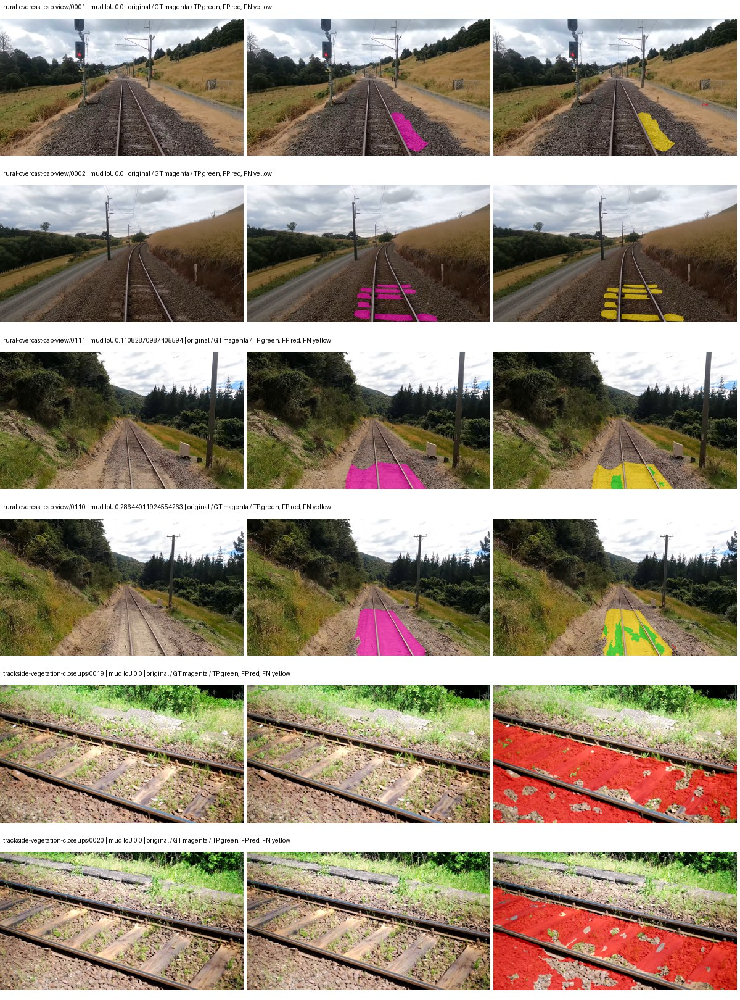
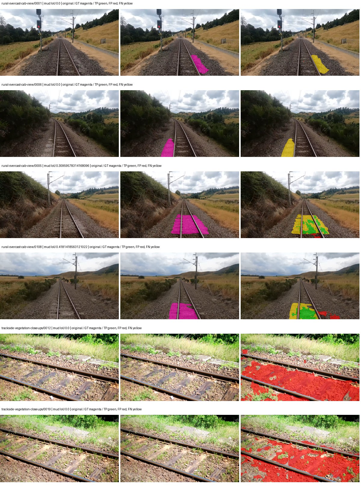
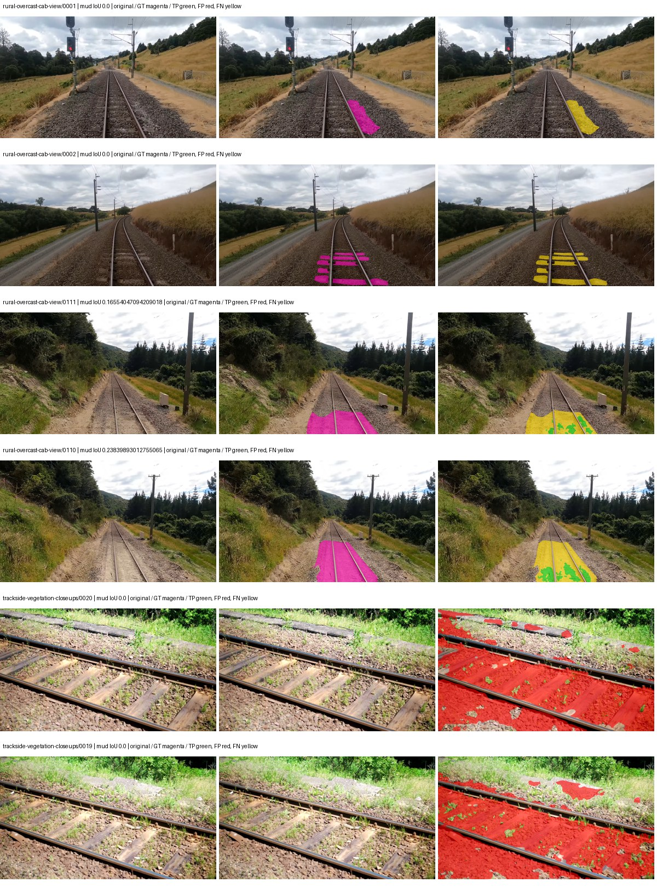
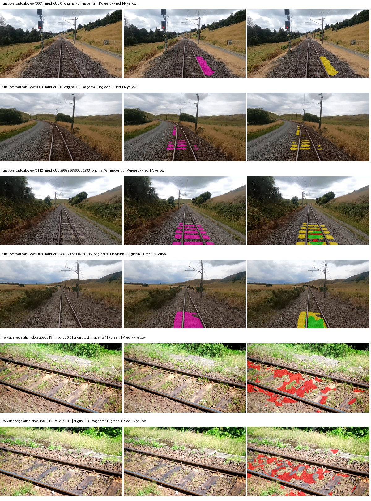

# native_efficientnet_b0_deeplabv3plus — rad_9_24_2026-fixed-grouped

[RAD 9/24: Scene-grouped split](../../README.md) · [Full model records](record.json)

Primary result: the **final checkpoint** after the full step budget (no early stopping). The checkpoint with the best **mud-pumping validation IoU, pixels pooled over all validation images**, is kept as secondary evidence. A job is complete only after full statistics and isolated profiling are verified.

Study metrics of the final checkpoint, counting each class only on the validation images that contain it: mud-pumping IoU is the mean per-image IoU over the images with mud-pumping, precision and recall sum pixels over those images, and mIoU averages each class over the images that contain it, then over the classes present.

| Initialization path | Seed | Mud-pumping IoU, train-camera images with mud (%, n=17) | Mud-pumping IoU, all images with mud (%, n=18) | Mud precision, all images with mud (%) | Mud recall, all images with mud (%) | mIoU (each class over images that contain it) (%) |
| --- | --- | --- | --- | --- | --- | --- |
| rtis_only | 0 | 0.14 | 0.14 | 2.64 | 0.17 | 31.01 |
| cityscapes_to_rtis | 0 | 1.51 | 1.47 | 7.11 | 3.48 | 32.80 |
| railsem19_to_rtis | 0 | 1.20 | 1.16 | 3.06 | 2.24 | 36.73 |
| cityscapes_to_railsem19_to_rtis | 0 | 4.03 | 3.84 | 9.09 | 5.77 | 35.68 |

Per-class IoU: IoU (%) of every class, each averaged only over the validation images that contain the class (n = those images); — = no image contains it. mIoU averages the classes with at least one such image.

| Initialization path | Seed | mIoU (each class over images that contain it) | person (n=0) | truck (n=0) | rail-track (n=37) | vegetation-overgrowth (n=13) | car (n=3) | on-rails (n=0) | traffic-sign (n=9) | road (n=11) | sidewalk (n=12) | construction (n=12) | tram-track (n=2) | pole (n=21) | traffic-light (n=3) | mud-pumping (n=18) | fence (n=7) | terrain (n=35) | sky (n=28) | rail-embedded (n=3) | rail-raised (n=37) | trackbed (n=37) | standing-water (n=9) |
| --- | --- | --- | --- | --- | --- | --- | --- | --- | --- | --- | --- | --- | --- | --- | --- | --- | --- | --- | --- | --- | --- | --- | --- |
| rtis_only | 0 | 31.01 | — | — | 54.62 | 27.37 | 0.07 | — | 13.62 | 2.14 | 15.13 | 41.72 | 0.00 | 59.87 | 17.12 | 0.14 | 18.30 | 83.28 | 95.21 | 2.43 | 70.20 | 56.99 | 0.00 |
| cityscapes_to_rtis | 0 | 32.80 | — | — | 53.44 | 23.67 | 23.34 | — | 22.34 | 3.35 | 6.90 | 39.28 | 0.64 | 63.52 | 34.65 | 1.47 | 12.72 | 82.13 | 93.81 | 1.97 | 68.33 | 58.64 | 0.15 |
| railsem19_to_rtis | 0 | 36.73 | — | — | 56.57 | 18.82 | 24.33 | — | 21.98 | 10.36 | 13.79 | 45.90 | 27.41 | 67.98 | 36.76 | 1.16 | 11.41 | 84.23 | 96.26 | 10.07 | 72.72 | 61.45 | 0.00 |
| cityscapes_to_railsem19_to_rtis | 0 | 35.68 | — | — | 55.47 | 19.08 | 30.03 | — | 23.13 | 9.45 | 10.35 | 41.81 | 2.65 | 67.15 | 41.31 | 3.84 | 17.31 | 84.32 | 95.56 | 6.76 | 71.13 | 61.24 | 1.60 |

Everything below is the campaign's own record, with pixels pooled over all validation images: its evaluation is the checkpoint that scored best on that pooled mud IoU (secondary evidence here); the diagnostics also cover the final checkpoint (`final-auto-val`).

| Model | Initialization path | Seed | Status | Steps | Best step | Best-checkpoint mud IoU, pixels pooled (%) | Best-checkpoint mud precision, pixels pooled (%) | Best-checkpoint mud recall, pixels pooled (%) | Final mud IoU (trainer val, pixels pooled, %) | Best-checkpoint mIoU, pixels pooled (%) | Best-checkpoint fixed GT-class mIoU, pixels pooled (%) |
| --- | --- | --- | --- | --- | --- | --- | --- | --- | --- | --- | --- |
| native_efficientnet_b0_deeplabv3plus | rtis_only | 0 | completed | 4000 | 1555 | 0.89 | 1.09 | 4.67 | 0.07 | 27.68 | 32.29 |
| native_efficientnet_b0_deeplabv3plus | cityscapes_to_rtis | 0 | completed | 4000 | 1555 | 4.93 | 6.04 | 21.14 | 0.96 | 24.98 | 29.14 |
| native_efficientnet_b0_deeplabv3plus | railsem19_to_rtis | 0 | completed | 4000 | 1555 | 1.22 | 1.41 | 8.37 | 0.33 | 39.29 | 43.66 |
| native_efficientnet_b0_deeplabv3plus | cityscapes_to_railsem19_to_rtis | 0 | completed | 4000 | 777 | 6.31 | 12.74 | 11.12 | 1.07 | 29.65 | 34.59 |

Training: 217 images. Validation: 37 images. Test: 60 held out. Seeds: [0]. Seed variation measures optimization variability, not independent-recording uncertainty. Historical source checkpoints stay fixed across adaptation seeds.

Training code: `fce0ea0ac50b334d4252812c396e0e593def375d`. Split SHA-256: `12d7b367c72cda61d57686ff2ac28223530d0af49debd9fb7a0fbc68b908bc93`.

## rtis_only — seed 0

Status: **completed**. Started: 2026-10-11T07:13:44.060329+00:00. Finished: 2026-10-11T07:56:06.908317+00:00.

Recipe pretrained initializer: `{"arch": "native", "backbone_path": null, "batch_norm_momentum": null, "checkpoint": null, "classifier_path": null, "drop_path": null, "encoder_name": null, "encoder_weights": null, "head": "unified_head", "head_paths": [], "inactive_parameter_paths": [], "local_files_only": false, "lora_alpha": 32, "lora_dropout": 0.05, "lora_r": 16, "lora_targets": [], "native": {"auxiliary_heads": [], "backbone": {"in_channels": 3, "kind": "timm", "name": "efficientnet_b0.ra_in1k", "out_indices": [1, 2, 3, 4], "weights": "pretrained"}, "head": {"activation": "relu", "channels": 160, "dilation_rates": [6, 12, 18], "dropout": 0.1, "high_index": 3, "kind": "deeplabv3plus", "low_channels": 32, "low_index": 0, "norm": "group"}, "neck": {"kind": "identity"}, "task": "multiclass"}, "revision": null, "smp_arch": null, "subfolder": null, "trust_remote_code": false, "tuning": "full"}`.

`rtis_only` uses the recipe initializer, which may include pretrained segmentation components. Transfer paths load the exact historical source checkpoint below and reset the classifier; they do not reset all query/decoder features.

Source checkpoint: `Recipe pretrained initialization`.

Config SHA-256: `1385cbe829b20ca873c5475b75b6575693016119421a7f2871956c231efec4a6`. Weights used for validation: `raw`.

### Mud-pumping and aggregate quality

| Metric | Selected checkpoint | Final training validation |
| --- | --- | --- |
| Mud IoU | 0.89 | 0.07 |
| Mud precision | 1.09 | 0.11 |
| Mud recall | 4.67 | 0.17 |
| Mud Dice/F1 | 1.76 | 0.13 |
| mIoU | 27.68 | 29.47 |
| Mean accuracy | 40.24 | 41.05 |
| Mean precision | 45.89 | 48.00 |
| Mean Dice | 34.83 | 37.41 |
| Mean specificity | 98.88 | 98.90 |
| Pixel accuracy | 80.62 | 82.60 |
| Frequency-weighted IoU | 72.58 | 72.91 |
| Fixed GT-present class mIoU | 32.29 | 34.38 |
| Boundary F1 | 30.70 | 34.25 |

The selected checkpoint has independent evaluation evidence. Final values are the trainer's final validation record, not a new independent evaluation. mIoU averages classes with nonzero union, so false positives on absent classes can change its denominator. The fixed GT-class mean is supplementary and excludes absent classes; their false positives remain in the confusion matrix.

### Resource usage and timing

| Measurement | Value |
| --- | --- |
| Peak training VRAM, retained training invocation (GiB) | 8.31 |
| Peak evaluation VRAM (GiB) | 6.78 |
| Retained training invocation wall time (seconds) | 2410.16 |
| Retained training invocation GPU-hours (one GPU) | 0.67 |
| Evaluation wall time (seconds) | 11.63 |
| Full evaluation pipeline images/second | 3.18 |
| Best full-state checkpoint (MiB) | 88.07 |
| Final full-state checkpoint (MiB) | 88.06 |
| Verified periodic checkpoints removed (GiB) | 0.69 |

VRAM uses the recorded allocator high-water mark; it is not total device usage including CUDA context. Resumed jobs' retained training invocation times and peaks are **not whole-campaign totals**. Earlier invocation resource records are not reconstructed here. Evaluation throughput includes loader, sliding-window inference and metrics; it is not model-only latency/FPS. Missing measurements are shown as —, never inferred from another dataset's run.

### Standardized inference performance

Dedicated model-only profiling waits for an idle worker-locked L40S: BF16, batch 1, 1024x1024, 20 warmup and 100 CUDA-event-timed public forwards. It excludes loading, preprocessing, tiling and metrics.

| Status | Parameters | Weight MiB | FPS | p50 ms | p95 ms | Peak reserved GiB |
| --- | --- | --- | --- | --- | --- | --- |
| complete | 5721681 | 21.83 | 140.26 | 7.05 | 8.09 | 0.43 |

```json
{
  "schema_version": 1,
  "model_id": "native_efficientnet_b0_deeplabv3plus",
  "measured_at": "2026-10-11T07:56:04+00:00",
  "status": "complete",
  "benchmark_scope": "rtis_selected_checkpoint_model_only",
  "applies_to": [
    "native_efficientnet_b0_deeplabv3plus--rtis_only--seed-0"
  ],
  "source": {
    "campaign_git_sha": "fce0ea0ac50b334d4252812c396e0e593def375d",
    "git_dirty": false,
    "config_hash": "adc498d52b3d",
    "resolved_config": "/data/izadia1/projects/segmentary-runs/rad_9_24_2026/fgall-seed0-20261007/configs/native_efficientnet_b0_deeplabv3plus--rtis_only--seed-0.yaml",
    "config_sha256": "1385cbe829b20ca873c5475b75b6575693016119421a7f2871956c231efec4a6",
    "checkpoint_sha256": "aa6149e57edb31611695b157b91dc179d485092be155e84eac777e7d028ae4d9",
    "checkpoint_global_step": 1555,
    "checkpoint_bytes": 92350937,
    "checkpoint_kind": "resume checkpoint with optimizer and EMA state",
    "weights": "raw",
    "measured_checkpoint_job_id": "native_efficientnet_b0_deeplabv3plus--rtis_only--seed-0",
    "result_sha256": "20a4585fc0dfa3248e1d50c9851e078fb590aa131a9bdc220b2c13af7a7e4c87",
    "result_git_sha": "fce0ea0ac50b334d4252812c396e0e593def375d",
    "result_stage": "eval:rad_9_24_2026-fixed-grouped:val",
    "result_seed": 0
  },
  "hardware": {
    "gpu_name": "NVIDIA L40S",
    "gpu_uuid": "GPU-fc5dde96-210d-0afa-ac74-7f88477d622b",
    "logical_device": "cuda:0",
    "physical_visibility_token": "4",
    "compute_capability": [
      8,
      9
    ],
    "total_memory_bytes": 47677177856
  },
  "model": {
    "parameter_count": 5721681,
    "trainable_parameter_count": 5721681,
    "resident_parameter_bytes": 22886724,
    "parameter_dtype_counts": {
      "float32": 5721681
    }
  },
  "contract": {
    "backend": "pytorch",
    "precision": "bf16_autocast",
    "batch_size": 1,
    "input_shape_nchw": [
      1,
      3,
      1024,
      1024
    ],
    "warmup_iterations": 20,
    "measured_iterations": 100,
    "timing": "per-forward CUDA events with end-event synchronization",
    "includes_preprocessing": false,
    "includes_data_loader": false,
    "includes_sliding_window": false,
    "input_resident_on_gpu": true,
    "model_only": true,
    "entrypoint": "public model(image) dense-logits forward"
  },
  "measurements": {
    "latency": {
      "p50_ms": 7.0497119426727295,
      "p95_ms": 8.092256307601929,
      "mean_ms": 7.129868788719177,
      "minimum_ms": 6.5136637687683105,
      "maximum_ms": 8.38758373260498,
      "fps": 140.25503548988058,
      "raw_ms": [
        6.704127788543701,
        7.748608112335205,
        7.192480087280273,
        7.103487968444824,
        6.853631973266602,
        7.076863765716553,
        6.625216007232666,
        7.762944221496582,
        7.1096320152282715,
        6.726655960083008,
        6.58022403717041,
        6.5136637687683105,
        6.602752208709717,
        6.523903846740723,
        6.67955207824707,
        6.526976108551025,
        6.626272201538086,
        6.8290557861328125,
        7.15772819519043,
        7.567359924316406,
        8.162176132202148,
        7.056384086608887,
        6.859776020050049,
        7.055327892303467,
        6.748159885406494,
        6.615039825439453,
        6.568960189819336,
        6.565887928009033,
        6.524928092956543,
        6.608895778656006,
        8.037471771240234,
        7.643136024475098,
        7.255040168762207,
        7.093247890472412,
        7.038879871368408,
        6.980576038360596,
        6.919167995452881,
        6.956031799316406,
        6.805503845214844,
        6.989823818206787,
        7.147520065307617,
        8.063936233520508,
        8.38758373260498,
        7.473152160644531,
        6.707200050354004,
        6.636544227600098,
        6.543295860290527,
        6.742015838623047,
        7.187456130981445,
        8.249343872070312,
        7.364607810974121,
        6.928383827209473,
        6.884352207183838,
        7.6472320556640625,
        6.825056076049805,
        7.546879768371582,
        6.7399678230285645,
        6.727680206298828,
        6.625279903411865,
        7.029759883880615,
        8.386495590209961,
        6.853631973266602,
        7.458816051483154,
        8.049663543701172,
        7.204864025115967,
        7.0215678215026855,
        7.0748162269592285,
        6.9324798583984375,
        7.699456214904785,
        7.076863765716553,
        8.184831619262695,
        7.266304016113281,
        7.206912040710449,
        7.354368209838867,
        8.073216438293457,
        6.9273600578308105,
        6.8976640701293945,
        7.059455871582031,
        7.710720062255859,
        6.82700777053833,
        7.2448320388793945,
        6.934432029724121,
        7.044095993041992,
        7.0799360275268555,
        6.74508810043335,
        7.110655784606934,
        7.07366418838501,
        6.842368125915527,
        7.076863765716553,
        7.3164801597595215,
        7.542784214019775,
        6.782879829406738,
        6.804480075836182,
        8.088576316833496,
        6.884352207183838,
        6.834208011627197,
        7.319551944732666,
        7.365632057189941,
        8.079360008239746,
        7.097343921661377
      ],
      "percentile_method": "numpy linear interpolation"
    },
    "peak_reserved_bytes": 457179136,
    "memory_kind": "pytorch_cuda_allocator_peak_reserved_excluding_context",
    "process_total_bytes": 985661440,
    "process_total_kind": "nvidia-smi used_memory of this PID on the benchmark GPU after the timed loop, including the CUDA context; null when the driver could not attribute memory to this PID",
    "benchmark_wall_clock_s": 16.862946808338165
  },
  "started_at": "2026-10-11T07:55:47+00:00",
  "finished_at": "2026-10-11T07:56:04+00:00",
  "environment": {
    "hostname": "hdrfs-app-001",
    "python": "3.11.15",
    "platform": "Linux-5.15.0-139-generic-x86_64-with-glibc2.35",
    "torch": "2.11.0+cu128",
    "torch_cuda": "12.8",
    "cudnn": 91900,
    "driver_version": "570.133.20",
    "cuda_available": true,
    "gpu_count": 1,
    "gpu_names": [
      "NVIDIA L40S"
    ],
    "cuda_visible_devices": "4",
    "packages": {
      "segmentary": "0.1.0",
      "torch": "2.11.0+cu128",
      "torchvision": "0.26.0+cu128",
      "transformers": "5.15.0",
      "timm": "1.0.28",
      "segmentation-models-pytorch": "0.5.0",
      "albumentations": "2.0.8",
      "lightning": "2.6.5",
      "numpy": "2.4.4"
    }
  }
}
```

### Per-class validation results

| Class | GT pixels | IoU (%) | Precision (%) | Recall (%) | Dice (%) | Boundary F1 (%) |
| --- | --- | --- | --- | --- | --- | --- |
| car | 29664 | 1.84 | 38.30 | 1.90 | 3.62 | 19.83 |
| construction | 311585 | 39.61 | 43.58 | 81.29 | 56.74 | 53.25 |
| fence | 265137 | 24.76 | 60.54 | 29.52 | 39.69 | 45.12 |
| mud-pumping | 1226250 | 0.89 | 1.09 | 4.67 | 1.76 | 2.89 |
| on-rails | 0 | 0.00 | 0.00 | — | 0.00 | 0.00 |
| person | 0 | 0.00 | 0.00 | — | 0.00 | 0.00 |
| pole | 628038 | 60.39 | 79.82 | 71.28 | 75.31 | 88.59 |
| rail-embedded | 16799 | 0.00 | 0.00 | 0.00 | 0.00 | 0.00 |
| rail-raised | 2969797 | 70.35 | 77.49 | 88.42 | 82.59 | 88.94 |
| rail-track | 6323197 | 34.54 | 73.95 | 39.33 | 51.35 | 41.24 |
| road | 1048831 | 0.27 | 14.18 | 0.28 | 0.55 | 4.44 |
| sidewalk | 1297367 | 49.56 | 95.48 | 50.75 | 66.27 | 17.75 |
| sky | 19121606 | 96.52 | 99.51 | 96.98 | 98.23 | 86.82 |
| standing-water | 95802 | 0.30 | 0.65 | 0.56 | 0.60 | 2.56 |
| terrain | 39239306 | 86.81 | 91.42 | 94.51 | 92.94 | 61.99 |
| trackbed | 10643081 | 53.70 | 62.22 | 79.67 | 69.88 | 50.26 |
| traffic-light | 19510 | 43.46 | 57.65 | 63.84 | 60.59 | 39.82 |
| traffic-sign | 13285 | 1.15 | 14.67 | 1.23 | 2.26 | 7.61 |
| tram-track | 56179 | 0.00 | 100.00 | 0.00 | 0.01 | 0.00 |
| truck | 0 | 0.00 | 0.00 | — | 0.00 | 0.00 |
| vegetation-overgrowth | 5901821 | 17.02 | 53.23 | 20.02 | 29.09 | 33.62 |

### Full-run accounting

| Measurement | Value |
| --- | --- |
| Full GPU-reserved wall seconds, all recorded worker attempts | 2550.67 |
| Full reserved GPU-hours | 0.71 |
| Whole-run timing complete | True |

| Phase | Wall seconds including failed attempts |
| --- | --- |
| training | 2417.11 |
| diagnostics | 80.73 |
| performance | 24.65 |

GPU-reserved time includes model loading, training, validation, collection, profiling, checkpoint I/O and orchestration while the worker owns one GPU. It is not GPU kernel-active time. Phase timings and sampled device memory/power/utilization are retained separately; sampled device memory is not the allocator high-water mark.

### Train/validation and raw/EMA diagnostics

| Checkpoint / weights / split | Images | Mud IoU (%) | Mud precision (%) | Mud recall (%) |
| --- | --- | --- | --- | --- |
| best-auto-train / raw | 217 | 93.96 | 96.96 | 96.81 |
| best-auto-val / raw | 37 | 0.89 | 1.09 | 4.67 |
| best-alternate-val / ema | 37 | 0.09 | 0.11 | 0.58 |
| final-auto-val / raw | 37 | 0.07 | 0.11 | 0.17 |

Train uses the evaluation transform without augmentation. Compare mud train/validation metrics for the same selected weights. Alternate EMA on running-stat BatchNorm is explicitly uncalibrated and is diagnostic only. Score-threshold curves use uncalibrated normalized scores and are pixel-level diagnostics, not event detection rates or a selected deployment operating point.

### Downloadable evidence

- best-auto-train: [per-image.csv](rtis_only--seed-0/best-auto-train/per-image.csv) · [per-image-confusion.json.gz](rtis_only--seed-0/best-auto-train/per-image-confusion.json.gz) · [groups.json](rtis_only--seed-0/best-auto-train/groups.json) · [mud-score-curves.json](rtis_only--seed-0/best-auto-train/mud-score-curves.json)
- best-auto-val: [per-image.csv](rtis_only--seed-0/best-auto-val/per-image.csv) · [per-image-confusion.json.gz](rtis_only--seed-0/best-auto-val/per-image-confusion.json.gz) · [groups.json](rtis_only--seed-0/best-auto-val/groups.json) · [mud-score-curves.json](rtis_only--seed-0/best-auto-val/mud-score-curves.json) · [examples.jpg](rtis_only--seed-0/best-auto-val/examples.jpg)
- best-alternate-val: [per-image.csv](rtis_only--seed-0/best-alternate-val/per-image.csv) · [per-image-confusion.json.gz](rtis_only--seed-0/best-alternate-val/per-image-confusion.json.gz) · [groups.json](rtis_only--seed-0/best-alternate-val/groups.json) · [mud-score-curves.json](rtis_only--seed-0/best-alternate-val/mud-score-curves.json)
- final-auto-val: [per-image.csv](rtis_only--seed-0/final-auto-val/per-image.csv) · [per-image-confusion.json.gz](rtis_only--seed-0/final-auto-val/per-image-confusion.json.gz) · [groups.json](rtis_only--seed-0/final-auto-val/groups.json) · [mud-score-curves.json](rtis_only--seed-0/final-auto-val/mud-score-curves.json)
- resources: [telemetry.csv](rtis_only--seed-0/resources/telemetry.csv)



Examples are two lowest and two highest mud-IoU positive images, plus up to two negative images with the most false-positive mud pixels. They are targeted diagnostic examples, not random samples. Green: true positive; red: false positive; yellow: false negative. Full predictions remain on HDRFS.

### Validation tracking

| Logged step | Overall mIoU (%) | Mud IoU (%) |
| --- | --- | --- |
| 258 | 19.85 | 0.05 |
| 518 | 18.86 | 0.02 |
| 777 | 22.50 | 0.05 |
| 1036 | 23.27 | 0.07 |
| 1295 | 25.28 | 0.08 |
| 1555 | 27.69 | 0.89 |
| 1814 | 24.87 | 0.07 |
| 2073 | 26.52 | 0.14 |
| 2332 | 28.56 | 0.17 |
| 2592 | 25.51 | 0.05 |
| 2851 | 27.11 | 0.57 |
| 3110 | 28.23 | 0.02 |
| 3369 | 28.67 | 0.18 |
| 3629 | 28.43 | 0.05 |
| 3888 | 28.38 | 0.07 |
| 4000 | 29.47 | 0.07 |

All retained scalar curves, including training loss and per-class IoU, are in record.json. Observed best mud on a curve is not necessarily a retained checkpoint: the pilot saved its selection-metric-best and final checkpoints. Step logging and checkpoint global_step may differ by one.

### Stopping and checkpoint provenance

```json
{
  "stopping": {
    "actual_steps": 4000,
    "maximum_steps": 4000,
    "min_delta": 0.0,
    "monitor": "val_iou/mud-pumping",
    "patience": null,
    "reason": "budget_complete"
  },
  "checkpoints": {
    "best": {
      "path": "/data/izadia1/projects/segmentary-runs/rad_9_24_2026/fgall-seed0-20261007/future-runs/native_efficientnet_b0_deeplabv3plus--rtis_only--seed-0_seed0/rtis/best.ckpt",
      "sha256": "aa6149e57edb31611695b157b91dc179d485092be155e84eac777e7d028ae4d9",
      "global_step": 1555,
      "bytes": 92350937
    },
    "final": {
      "path": "/data/izadia1/projects/segmentary-runs/rad_9_24_2026/fgall-seed0-20261007/future-runs/native_efficientnet_b0_deeplabv3plus--rtis_only--seed-0_seed0/rtis/last.ckpt",
      "sha256": "e6ff8110d94565046d4272e42bf579940e0d46fcc9f784f1b35a8fd4e856674d",
      "global_step": 4000,
      "bytes": 92337177
    }
  },
  "cleanup_error": null
}
```

### Resolved training, initialization and evaluation settings

The optimizer block is the base configuration. Stage LR scales are applied at runtime, and stage warmup is capped at min(base warmup, floor(stage budget / 10), stage budget - 1): 400 steps for this 4,000-step pilot. Model-internal native input grids may differ from augmentation crops (EoMT uses its 640 grid).

```json
{
  "name": "native_efficientnet_b0_deeplabv3plus--rtis_only--seed-0",
  "model": {
    "arch": "native",
    "checkpoint": null,
    "tuning": "full",
    "head": "unified_head",
    "lora_r": 16,
    "lora_alpha": 32,
    "lora_dropout": 0.05,
    "lora_targets": [],
    "drop_path": null,
    "revision": null,
    "subfolder": null,
    "local_files_only": false,
    "trust_remote_code": false,
    "backbone_path": null,
    "head_paths": [],
    "classifier_path": null,
    "inactive_parameter_paths": [],
    "smp_arch": null,
    "encoder_name": null,
    "encoder_weights": null,
    "native": {
      "task": "multiclass",
      "backbone": {
        "kind": "timm",
        "name": "efficientnet_b0.ra_in1k",
        "weights": "pretrained",
        "out_indices": [
          1,
          2,
          3,
          4
        ],
        "in_channels": 3
      },
      "neck": {
        "kind": "identity"
      },
      "head": {
        "kind": "deeplabv3plus",
        "low_index": 0,
        "high_index": 3,
        "channels": 160,
        "low_channels": 32,
        "dilation_rates": [
          6,
          12,
          18
        ],
        "dropout": 0.1,
        "norm": "group",
        "activation": "relu"
      },
      "auxiliary_heads": []
    },
    "batch_norm_momentum": null
  },
  "space": "paul-test-rtis",
  "taxonomy_root": "/data/izadia1/projects/segmentary-rad-fgall-fce0ea0a/taxonomy",
  "output_root": "/data/izadia1/projects/segmentary-runs/rad_9_24_2026/fgall-seed0-20261007/future-runs",
  "optim": {
    "backbone_lr": 0.0001,
    "head_lr_mult": 10.0,
    "weight_decay": 0.05,
    "llrd": 1.0,
    "warmup_iters": 1500,
    "warmup_ratio": 1e-06,
    "poly_power": 0.9,
    "min_lr_ratio": 0.0,
    "betas": [
      0.9,
      0.999
    ],
    "grad_clip": 1.0
  },
  "train": {
    "iters": 4000,
    "batch_size": 2,
    "accum": 8,
    "num_workers": 2,
    "precision": "bf16-mixed",
    "ema_decay": 0.9998,
    "val_every": 250,
    "ckpt_every": 500,
    "selection_metric": "val_iou/mud-pumping",
    "early_stopping_patience": null,
    "early_stopping_min_delta": 0.0,
    "seed": 0,
    "devices": 1
  },
  "eval": {
    "sliding_window": true,
    "window": [
      1024,
      1024
    ],
    "stride": [
      768,
      768
    ],
    "batch_size": 1,
    "num_workers": 2,
    "tta_scales": [],
    "tta_flip": false,
    "threshold": 0.5,
    "boundary_tolerance_frac": 0.0075,
    "save_confusion": true
  },
  "loss": {
    "task": "multiclass",
    "activation": "auto",
    "terms": [],
    "aux": "none",
    "aux_weight": 0.0,
    "ce_weight": 1.0,
    "label_smoothing": 0.0,
    "class_weights": null,
    "query": null
  },
  "aug": {
    "crop": [
      1024,
      1024
    ],
    "scale_min": 0.5,
    "scale_max": 2.0,
    "hflip_p": 0.5,
    "color_jitter_p": 0.5,
    "brightness": 0.25,
    "contrast": 0.25,
    "saturation": 0.25,
    "hue": 0.05
  },
  "stages": [
    {
      "name": "rtis",
      "data": [
        {
          "name": "rad_9_24_2026-fixed-grouped",
          "root": "/data/izadia1/datasets/rad_9_24_2026-fixed-grouped",
          "variant": null,
          "split_file": "splits.json",
          "train_split": "train",
          "val_split": "val",
          "limit": null,
          "loader": "folder",
          "mapping": "paul-test-rtis",
          "loader_options": {
            "require_groups": true
          }
        }
      ],
      "iters": null,
      "lr_scale": 1.0,
      "head_group_lr_scale": 1.0,
      "init_from": "pretrained",
      "reset_head": false,
      "freeze": null,
      "sample_weights": null
    }
  ]
}
```

### Hardware and software provenance

```json
{
  "training": {
    "cuda_available": true,
    "cuda_visible_devices": "4",
    "cudnn": 91900,
    "driver_version": "570.133.20",
    "gpu_count": 1,
    "gpu_names": [
      "NVIDIA L40S"
    ],
    "hostname": "hdrfs-app-001",
    "input_normalization": {
      "channel_order": "rgb",
      "mean": [
        0.485,
        0.456,
        0.406
      ],
      "source": "timm_pretrained_cfg",
      "std": [
        0.229,
        0.224,
        0.225
      ]
    },
    "model_origins": [
      {
        "hf_commit": null,
        "hf_name_or_path": null,
        "module": "backbone",
        "timm_pretrained": {
          "architecture": "efficientnet_b0",
          "hf_hub_id": "timm/efficientnet_b0.ra_in1k",
          "tag": "ra_in1k",
          "url": "https://github.com/rwightman/pytorch-image-models/releases/download/v0.1-weights/efficientnet_b0_ra-3dd342df.pth"
        }
      },
      {
        "hf_commit": null,
        "hf_name_or_path": null,
        "module": "backbone.model",
        "timm_pretrained": {
          "architecture": "efficientnet_b0",
          "hf_hub_id": "timm/efficientnet_b0.ra_in1k",
          "tag": "ra_in1k",
          "url": "https://github.com/rwightman/pytorch-image-models/releases/download/v0.1-weights/efficientnet_b0_ra-3dd342df.pth"
        }
      }
    ],
    "model_parameter_count": 5721681,
    "packages": {
      "albumentations": "2.0.8",
      "lightning": "2.6.5",
      "numpy": "2.4.4",
      "segmentary": "0.1.0",
      "segmentation-models-pytorch": "0.5.0",
      "timm": "1.0.28",
      "torch": "2.11.0+cu128",
      "torchvision": "0.26.0+cu128",
      "transformers": "5.15.0"
    },
    "platform": "Linux-5.15.0-139-generic-x86_64-with-glibc2.35",
    "python": "3.11.15",
    "torch": "2.11.0+cu128",
    "torch_cuda": "12.8",
    "trainable_parameter_count": 5721681,
    "training_stop": {
      "actual_steps": 4000,
      "maximum_steps": 4000,
      "min_delta": 0.0,
      "monitor": "val_iou/mud-pumping",
      "patience": null,
      "reason": "budget_complete"
    },
    "validation_weights": "raw"
  },
  "evaluation": {
    "cuda_available": true,
    "cuda_visible_devices": "4",
    "cudnn": 91900,
    "driver_version": "570.133.20",
    "gpu_count": 1,
    "gpu_names": [
      "NVIDIA L40S"
    ],
    "hostname": "hdrfs-app-001",
    "input_normalization": {
      "channel_order": "rgb",
      "mean": [
        0.485,
        0.456,
        0.406
      ],
      "source": "timm_pretrained_cfg",
      "std": [
        0.229,
        0.224,
        0.225
      ]
    },
    "packages": {
      "albumentations": "2.0.8",
      "lightning": "2.6.5",
      "numpy": "2.4.4",
      "segmentary": "0.1.0",
      "segmentation-models-pytorch": "0.5.0",
      "timm": "1.0.28",
      "torch": "2.11.0+cu128",
      "torchvision": "0.26.0+cu128",
      "transformers": "5.15.0"
    },
    "platform": "Linux-5.15.0-139-generic-x86_64-with-glibc2.35",
    "python": "3.11.15",
    "torch": "2.11.0+cu128",
    "torch_cuda": "12.8"
  }
}
```

## cityscapes_to_rtis — seed 0

Status: **completed**. Started: 2026-10-11T07:17:14.823389+00:00. Finished: 2026-10-11T07:58:54.802034+00:00.

Recipe pretrained initializer: `{"arch": "native", "backbone_path": null, "batch_norm_momentum": null, "checkpoint": null, "classifier_path": null, "drop_path": null, "encoder_name": null, "encoder_weights": null, "head": "unified_head", "head_paths": [], "inactive_parameter_paths": [], "local_files_only": false, "lora_alpha": 32, "lora_dropout": 0.05, "lora_r": 16, "lora_targets": [], "native": {"auxiliary_heads": [], "backbone": {"in_channels": 3, "kind": "timm", "name": "efficientnet_b0.ra_in1k", "out_indices": [1, 2, 3, 4], "weights": "pretrained"}, "head": {"activation": "relu", "channels": 160, "dilation_rates": [6, 12, 18], "dropout": 0.1, "high_index": 3, "kind": "deeplabv3plus", "low_channels": 32, "low_index": 0, "norm": "group"}, "neck": {"kind": "identity"}, "task": "multiclass"}, "revision": null, "smp_arch": null, "subfolder": null, "trust_remote_code": false, "tuning": "full"}`.

`rtis_only` uses the recipe initializer, which may include pretrained segmentation components. Transfer paths load the exact historical source checkpoint below and reset the classifier; they do not reset all query/decoder features.

Source checkpoint: `{'name': 'native_efficientnet_b0_deeplabv3plus--cityscapes--seed-0', 'model': 'native_efficientnet_b0_deeplabv3plus', 'protocol': 'cityscapes', 'config': '/data/izadia1/projects/segmentary-runs/all-model-city-rail-seed0-rail20-b9eb3e1/jobs/native_efficientnet_b0_deeplabv3plus--cityscapes--seed-0/attempt-001/resolved-config.yaml', 'checkpoint': '/data/izadia1/projects/segmentary-runs/all-model-city-rail-seed0-rail20-b9eb3e1/jobs/native_efficientnet_b0_deeplabv3plus--cityscapes--seed-0/attempt-001/train/native_efficientnet_b0_deeplabv3plus--cityscapes_seed0/cityscapes/last.ckpt', 'recorded_sha256': 'f287c443ed0dff9b4ba6966e8cfd4e0e4e74e6694b2a74a49948df30ba979f8f', 'exists': True}`.

Config SHA-256: `b06657e6a2d49f671be1dcec02eb4f3bf69ee27a6ccec0827c8c623535c5bb86`. Weights used for validation: `raw`.

### Mud-pumping and aggregate quality

| Metric | Selected checkpoint | Final training validation |
| --- | --- | --- |
| Mud IoU | 4.93 | 0.96 |
| Mud precision | 6.04 | 1.32 |
| Mud recall | 21.14 | 3.47 |
| Mud Dice/F1 | 9.40 | 1.91 |
| mIoU | 24.98 | 28.02 |
| Mean accuracy | 35.75 | 40.18 |
| Mean precision | 47.26 | 45.50 |
| Mean Dice | 32.40 | 36.13 |
| Mean specificity | 98.74 | 98.84 |
| Pixel accuracy | 80.23 | 81.35 |
| Frequency-weighted IoU | 70.21 | 71.97 |
| Fixed GT-present class mIoU | 29.14 | 32.70 |
| Boundary F1 | 31.32 | 32.71 |

The selected checkpoint has independent evaluation evidence. Final values are the trainer's final validation record, not a new independent evaluation. mIoU averages classes with nonzero union, so false positives on absent classes can change its denominator. The fixed GT-class mean is supplementary and excludes absent classes; their false positives remain in the confusion matrix.

### Resource usage and timing

| Measurement | Value |
| --- | --- |
| Peak training VRAM, retained training invocation (GiB) | 8.31 |
| Peak evaluation VRAM (GiB) | 6.78 |
| Retained training invocation wall time (seconds) | 2369.81 |
| Retained training invocation GPU-hours (one GPU) | 0.66 |
| Evaluation wall time (seconds) | 11.08 |
| Full evaluation pipeline images/second | 3.34 |
| Best full-state checkpoint (MiB) | 88.07 |
| Final full-state checkpoint (MiB) | 88.06 |
| Verified periodic checkpoints removed (GiB) | 0.69 |

VRAM uses the recorded allocator high-water mark; it is not total device usage including CUDA context. Resumed jobs' retained training invocation times and peaks are **not whole-campaign totals**. Earlier invocation resource records are not reconstructed here. Evaluation throughput includes loader, sliding-window inference and metrics; it is not model-only latency/FPS. Missing measurements are shown as —, never inferred from another dataset's run.

### Standardized inference performance

Dedicated model-only profiling waits for an idle worker-locked L40S: BF16, batch 1, 1024x1024, 20 warmup and 100 CUDA-event-timed public forwards. It excludes loading, preprocessing, tiling and metrics.

| Status | Parameters | Weight MiB | FPS | p50 ms | p95 ms | Peak reserved GiB |
| --- | --- | --- | --- | --- | --- | --- |
| complete | 5721681 | 21.83 | 148.70 | 6.60 | 7.18 | 0.43 |

```json
{
  "schema_version": 1,
  "model_id": "native_efficientnet_b0_deeplabv3plus",
  "measured_at": "2026-10-11T07:58:52+00:00",
  "status": "complete",
  "benchmark_scope": "rtis_selected_checkpoint_model_only",
  "applies_to": [
    "native_efficientnet_b0_deeplabv3plus--cityscapes_to_rtis--seed-0"
  ],
  "source": {
    "campaign_git_sha": "fce0ea0ac50b334d4252812c396e0e593def375d",
    "git_dirty": false,
    "config_hash": "e87384467cfe",
    "resolved_config": "/data/izadia1/projects/segmentary-runs/rad_9_24_2026/fgall-seed0-20261007/configs/native_efficientnet_b0_deeplabv3plus--cityscapes_to_rtis--seed-0.yaml",
    "config_sha256": "b06657e6a2d49f671be1dcec02eb4f3bf69ee27a6ccec0827c8c623535c5bb86",
    "checkpoint_sha256": "bbbbcd591f8b72f8c1e11db70dfee7bbe720aed63085df69b24a887915834d0a",
    "checkpoint_global_step": 1555,
    "checkpoint_bytes": 92350937,
    "checkpoint_kind": "resume checkpoint with optimizer and EMA state",
    "weights": "raw",
    "measured_checkpoint_job_id": "native_efficientnet_b0_deeplabv3plus--cityscapes_to_rtis--seed-0",
    "result_sha256": "458782c36b57ecea17be692c0c2e8301de8b48574ebe42926101d79f6254c7d4",
    "result_git_sha": "fce0ea0ac50b334d4252812c396e0e593def375d",
    "result_stage": "eval:rad_9_24_2026-fixed-grouped:val",
    "result_seed": 0
  },
  "hardware": {
    "gpu_name": "NVIDIA L40S",
    "gpu_uuid": "GPU-804aea8b-5f62-423e-72c6-49e1ed15c4e4",
    "logical_device": "cuda:0",
    "physical_visibility_token": "6",
    "compute_capability": [
      8,
      9
    ],
    "total_memory_bytes": 47677177856
  },
  "model": {
    "parameter_count": 5721681,
    "trainable_parameter_count": 5721681,
    "resident_parameter_bytes": 22886724,
    "parameter_dtype_counts": {
      "float32": 5721681
    }
  },
  "contract": {
    "backend": "pytorch",
    "precision": "bf16_autocast",
    "batch_size": 1,
    "input_shape_nchw": [
      1,
      3,
      1024,
      1024
    ],
    "warmup_iterations": 20,
    "measured_iterations": 100,
    "timing": "per-forward CUDA events with end-event synchronization",
    "includes_preprocessing": false,
    "includes_data_loader": false,
    "includes_sliding_window": false,
    "input_resident_on_gpu": true,
    "model_only": true,
    "entrypoint": "public model(image) dense-logits forward"
  },
  "measurements": {
    "latency": {
      "p50_ms": 6.603775978088379,
      "p95_ms": 7.17936646938324,
      "mean_ms": 6.725098881721497,
      "minimum_ms": 6.4983038902282715,
      "maximum_ms": 7.631872177124023,
      "fps": 148.69669838133578,
      "raw_ms": [
        6.611968040466309,
        6.545407772064209,
        6.67033576965332,
        6.667263984680176,
        6.909952163696289,
        7.014400005340576,
        6.591487884521484,
        7.467008113861084,
        7.631872177124023,
        6.666240215301514,
        7.085055828094482,
        7.120895862579346,
        7.181312084197998,
        6.7399678230285645,
        7.0359039306640625,
        6.610943794250488,
        6.589439868927002,
        6.546432018280029,
        6.53926420211792,
        6.554624080657959,
        6.811647891998291,
        6.536191940307617,
        6.526976108551025,
        7.19052791595459,
        6.693888187408447,
        6.917119979858398,
        6.839295864105225,
        6.605823993682861,
        6.592512130737305,
        6.5966081619262695,
        7.086080074310303,
        6.702079772949219,
        7.171072006225586,
        7.179264068603516,
        7.4331841468811035,
        6.687744140625,
        7.054336071014404,
        6.8730878829956055,
        6.58841609954834,
        6.574079990386963,
        6.548480033874512,
        6.883327960968018,
        6.595583915710449,
        6.855679988861084,
        6.681600093841553,
        6.628352165222168,
        6.550528049468994,
        6.565887928009033,
        6.846464157104492,
        6.554624080657959,
        6.568927764892578,
        6.532095909118652,
        6.903808116912842,
        6.546432018280029,
        6.53926420211792,
        6.532095909118652,
        6.544384002685547,
        6.5300798416137695,
        6.910975933074951,
        6.88640022277832,
        6.648831844329834,
        6.508543968200684,
        6.561791896820068,
        6.879231929779053,
        6.524928092956543,
        6.560768127441406,
        6.6017279624938965,
        6.551551818847656,
        6.8823041915893555,
        6.761472225189209,
        6.669312000274658,
        6.583295822143555,
        6.925312042236328,
        6.634496212005615,
        7.0062079429626465,
        6.582272052764893,
        6.5576958656311035,
        6.526976108551025,
        6.549503803253174,
        6.5228800773620605,
        6.825984001159668,
        6.7399678230285645,
        6.578144073486328,
        6.53926420211792,
        6.585343837738037,
        6.5423359870910645,
        6.567935943603516,
        6.544384002685547,
        6.4983038902282715,
        6.9765119552612305,
        6.536191940307617,
        7.066624164581299,
        6.559743881225586,
        6.6017279624938965,
        6.6211838722229,
        6.884352207183838,
        6.5279998779296875,
        6.529024124145508,
        6.552576065063477,
        6.548480033874512
      ],
      "percentile_method": "numpy linear interpolation"
    },
    "peak_reserved_bytes": 457179136,
    "memory_kind": "pytorch_cuda_allocator_peak_reserved_excluding_context",
    "process_total_bytes": 985661440,
    "process_total_kind": "nvidia-smi used_memory of this PID on the benchmark GPU after the timed loop, including the CUDA context; null when the driver could not attribute memory to this PID",
    "benchmark_wall_clock_s": 16.395608633756638
  },
  "started_at": "2026-10-11T07:58:35+00:00",
  "finished_at": "2026-10-11T07:58:52+00:00",
  "environment": {
    "hostname": "hdrfs-app-001",
    "python": "3.11.15",
    "platform": "Linux-5.15.0-139-generic-x86_64-with-glibc2.35",
    "torch": "2.11.0+cu128",
    "torch_cuda": "12.8",
    "cudnn": 91900,
    "driver_version": "570.133.20",
    "cuda_available": true,
    "gpu_count": 1,
    "gpu_names": [
      "NVIDIA L40S"
    ],
    "cuda_visible_devices": "6",
    "packages": {
      "segmentary": "0.1.0",
      "torch": "2.11.0+cu128",
      "torchvision": "0.26.0+cu128",
      "transformers": "5.15.0",
      "timm": "1.0.28",
      "segmentation-models-pytorch": "0.5.0",
      "albumentations": "2.0.8",
      "lightning": "2.6.5",
      "numpy": "2.4.4"
    }
  }
}
```

### Per-class validation results

| Class | GT pixels | IoU (%) | Precision (%) | Recall (%) | Dice (%) | Boundary F1 (%) |
| --- | --- | --- | --- | --- | --- | --- |
| car | 29664 | 9.83 | 79.68 | 10.08 | 17.90 | 27.37 |
| construction | 311585 | 25.23 | 32.18 | 53.88 | 40.29 | 34.23 |
| fence | 265137 | 4.56 | 15.56 | 6.07 | 8.73 | 16.41 |
| mud-pumping | 1226250 | 4.93 | 6.04 | 21.14 | 9.40 | 11.71 |
| on-rails | 0 | 0.00 | 0.00 | — | 0.00 | 0.00 |
| person | 0 | 0.00 | 0.00 | — | 0.00 | 0.00 |
| pole | 628038 | 63.55 | 85.80 | 71.03 | 77.72 | 88.07 |
| rail-embedded | 16799 | 7.05 | 30.39 | 8.41 | 13.17 | 7.25 |
| rail-raised | 2969797 | 61.68 | 68.66 | 85.84 | 76.30 | 83.69 |
| rail-track | 6323197 | 34.75 | 73.02 | 39.87 | 51.58 | 47.41 |
| road | 1048831 | 1.85 | 10.07 | 2.22 | 3.63 | 5.30 |
| sidewalk | 1297367 | 14.29 | 84.79 | 14.66 | 25.00 | 8.56 |
| sky | 19121606 | 97.36 | 99.32 | 98.01 | 98.66 | 91.17 |
| standing-water | 95802 | 0.16 | 0.28 | 0.38 | 0.32 | 1.24 |
| terrain | 39239306 | 82.95 | 84.93 | 97.27 | 90.68 | 50.69 |
| trackbed | 10643081 | 53.92 | 69.92 | 70.21 | 70.07 | 52.68 |
| traffic-light | 19510 | 39.83 | 97.06 | 40.32 | 56.97 | 44.25 |
| traffic-sign | 13285 | 6.39 | 84.30 | 6.47 | 12.01 | 40.54 |
| tram-track | 56179 | 0.38 | 0.94 | 0.64 | 0.76 | 4.90 |
| truck | 0 | 0.00 | 0.00 | — | 0.00 | 0.00 |
| vegetation-overgrowth | 5901821 | 15.76 | 69.50 | 16.94 | 27.24 | 42.35 |

### Full-run accounting

| Measurement | Value |
| --- | --- |
| Full GPU-reserved wall seconds, all recorded worker attempts | 2507.72 |
| Full reserved GPU-hours | 0.70 |
| Whole-run timing complete | True |

| Phase | Wall seconds including failed attempts |
| --- | --- |
| training | 2376.79 |
| diagnostics | 80.01 |
| performance | 23.88 |

GPU-reserved time includes model loading, training, validation, collection, profiling, checkpoint I/O and orchestration while the worker owns one GPU. It is not GPU kernel-active time. Phase timings and sampled device memory/power/utilization are retained separately; sampled device memory is not the allocator high-water mark.

### Train/validation and raw/EMA diagnostics

| Checkpoint / weights / split | Images | Mud IoU (%) | Mud precision (%) | Mud recall (%) |
| --- | --- | --- | --- | --- |
| best-auto-train / raw | 217 | 92.00 | 94.98 | 96.70 |
| best-auto-val / raw | 37 | 4.93 | 6.04 | 21.14 |
| best-alternate-val / ema | 37 | 1.81 | 2.90 | 4.58 |
| final-auto-val / raw | 37 | 0.97 | 1.32 | 3.48 |

Train uses the evaluation transform without augmentation. Compare mud train/validation metrics for the same selected weights. Alternate EMA on running-stat BatchNorm is explicitly uncalibrated and is diagnostic only. Score-threshold curves use uncalibrated normalized scores and are pixel-level diagnostics, not event detection rates or a selected deployment operating point.

### Downloadable evidence

- best-auto-train: [per-image.csv](cityscapes_to_rtis--seed-0/best-auto-train/per-image.csv) · [per-image-confusion.json.gz](cityscapes_to_rtis--seed-0/best-auto-train/per-image-confusion.json.gz) · [groups.json](cityscapes_to_rtis--seed-0/best-auto-train/groups.json) · [mud-score-curves.json](cityscapes_to_rtis--seed-0/best-auto-train/mud-score-curves.json)
- best-auto-val: [per-image.csv](cityscapes_to_rtis--seed-0/best-auto-val/per-image.csv) · [per-image-confusion.json.gz](cityscapes_to_rtis--seed-0/best-auto-val/per-image-confusion.json.gz) · [groups.json](cityscapes_to_rtis--seed-0/best-auto-val/groups.json) · [mud-score-curves.json](cityscapes_to_rtis--seed-0/best-auto-val/mud-score-curves.json) · [examples.jpg](cityscapes_to_rtis--seed-0/best-auto-val/examples.jpg)
- best-alternate-val: [per-image.csv](cityscapes_to_rtis--seed-0/best-alternate-val/per-image.csv) · [per-image-confusion.json.gz](cityscapes_to_rtis--seed-0/best-alternate-val/per-image-confusion.json.gz) · [groups.json](cityscapes_to_rtis--seed-0/best-alternate-val/groups.json) · [mud-score-curves.json](cityscapes_to_rtis--seed-0/best-alternate-val/mud-score-curves.json)
- final-auto-val: [per-image.csv](cityscapes_to_rtis--seed-0/final-auto-val/per-image.csv) · [per-image-confusion.json.gz](cityscapes_to_rtis--seed-0/final-auto-val/per-image-confusion.json.gz) · [groups.json](cityscapes_to_rtis--seed-0/final-auto-val/groups.json) · [mud-score-curves.json](cityscapes_to_rtis--seed-0/final-auto-val/mud-score-curves.json)
- resources: [telemetry.csv](cityscapes_to_rtis--seed-0/resources/telemetry.csv)



Examples are two lowest and two highest mud-IoU positive images, plus up to two negative images with the most false-positive mud pixels. They are targeted diagnostic examples, not random samples. Green: true positive; red: false positive; yellow: false negative. Full predictions remain on HDRFS.

### Validation tracking

| Logged step | Overall mIoU (%) | Mud IoU (%) |
| --- | --- | --- |
| 258 | 18.10 | 0.43 |
| 518 | 19.99 | 2.36 |
| 777 | 20.82 | 0.56 |
| 1036 | 21.68 | 0.52 |
| 1295 | 24.00 | 1.60 |
| 1555 | 24.95 | 4.94 |
| 1814 | 25.76 | 1.04 |
| 2073 | 23.04 | 3.31 |
| 2332 | 27.34 | 0.55 |
| 2592 | 27.57 | 0.68 |
| 2851 | 27.57 | 0.40 |
| 3110 | 26.53 | 0.66 |
| 3369 | 25.90 | 0.22 |
| 3629 | 26.90 | 1.07 |
| 3888 | 26.93 | 0.68 |
| 4000 | 28.02 | 0.96 |

All retained scalar curves, including training loss and per-class IoU, are in record.json. Observed best mud on a curve is not necessarily a retained checkpoint: the pilot saved its selection-metric-best and final checkpoints. Step logging and checkpoint global_step may differ by one.

### Stopping and checkpoint provenance

```json
{
  "stopping": {
    "actual_steps": 4000,
    "maximum_steps": 4000,
    "min_delta": 0.0,
    "monitor": "val_iou/mud-pumping",
    "patience": null,
    "reason": "budget_complete"
  },
  "checkpoints": {
    "best": {
      "path": "/data/izadia1/projects/segmentary-runs/rad_9_24_2026/fgall-seed0-20261007/future-runs/native_efficientnet_b0_deeplabv3plus--cityscapes_to_rtis--seed-0_seed0/rtis/best.ckpt",
      "sha256": "bbbbcd591f8b72f8c1e11db70dfee7bbe720aed63085df69b24a887915834d0a",
      "global_step": 1555,
      "bytes": 92350937
    },
    "final": {
      "path": "/data/izadia1/projects/segmentary-runs/rad_9_24_2026/fgall-seed0-20261007/future-runs/native_efficientnet_b0_deeplabv3plus--cityscapes_to_rtis--seed-0_seed0/rtis/last.ckpt",
      "sha256": "86d1f99a6a2443bee7edc9aeafd59e3b4a851b2953713f456d608e392ca9fc8e",
      "global_step": 4000,
      "bytes": 92337177
    }
  },
  "cleanup_error": null
}
```

### Resolved training, initialization and evaluation settings

The optimizer block is the base configuration. Stage LR scales are applied at runtime, and stage warmup is capped at min(base warmup, floor(stage budget / 10), stage budget - 1): 400 steps for this 4,000-step pilot. Model-internal native input grids may differ from augmentation crops (EoMT uses its 640 grid).

```json
{
  "name": "native_efficientnet_b0_deeplabv3plus--cityscapes_to_rtis--seed-0",
  "model": {
    "arch": "native",
    "checkpoint": null,
    "tuning": "full",
    "head": "unified_head",
    "lora_r": 16,
    "lora_alpha": 32,
    "lora_dropout": 0.05,
    "lora_targets": [],
    "drop_path": null,
    "revision": null,
    "subfolder": null,
    "local_files_only": false,
    "trust_remote_code": false,
    "backbone_path": null,
    "head_paths": [],
    "classifier_path": null,
    "inactive_parameter_paths": [],
    "smp_arch": null,
    "encoder_name": null,
    "encoder_weights": null,
    "native": {
      "task": "multiclass",
      "backbone": {
        "kind": "timm",
        "name": "efficientnet_b0.ra_in1k",
        "weights": "pretrained",
        "out_indices": [
          1,
          2,
          3,
          4
        ],
        "in_channels": 3
      },
      "neck": {
        "kind": "identity"
      },
      "head": {
        "kind": "deeplabv3plus",
        "low_index": 0,
        "high_index": 3,
        "channels": 160,
        "low_channels": 32,
        "dilation_rates": [
          6,
          12,
          18
        ],
        "dropout": 0.1,
        "norm": "group",
        "activation": "relu"
      },
      "auxiliary_heads": []
    },
    "batch_norm_momentum": null
  },
  "space": "paul-test-rtis",
  "taxonomy_root": "/data/izadia1/projects/segmentary-rad-fgall-fce0ea0a/taxonomy",
  "output_root": "/data/izadia1/projects/segmentary-runs/rad_9_24_2026/fgall-seed0-20261007/future-runs",
  "optim": {
    "backbone_lr": 0.0001,
    "head_lr_mult": 10.0,
    "weight_decay": 0.05,
    "llrd": 1.0,
    "warmup_iters": 1500,
    "warmup_ratio": 1e-06,
    "poly_power": 0.9,
    "min_lr_ratio": 0.0,
    "betas": [
      0.9,
      0.999
    ],
    "grad_clip": 1.0
  },
  "train": {
    "iters": 4000,
    "batch_size": 2,
    "accum": 8,
    "num_workers": 2,
    "precision": "bf16-mixed",
    "ema_decay": 0.9998,
    "val_every": 250,
    "ckpt_every": 500,
    "selection_metric": "val_iou/mud-pumping",
    "early_stopping_patience": null,
    "early_stopping_min_delta": 0.0,
    "seed": 0,
    "devices": 1
  },
  "eval": {
    "sliding_window": true,
    "window": [
      1024,
      1024
    ],
    "stride": [
      768,
      768
    ],
    "batch_size": 1,
    "num_workers": 2,
    "tta_scales": [],
    "tta_flip": false,
    "threshold": 0.5,
    "boundary_tolerance_frac": 0.0075,
    "save_confusion": true
  },
  "loss": {
    "task": "multiclass",
    "activation": "auto",
    "terms": [],
    "aux": "none",
    "aux_weight": 0.0,
    "ce_weight": 1.0,
    "label_smoothing": 0.0,
    "class_weights": null,
    "query": null
  },
  "aug": {
    "crop": [
      1024,
      1024
    ],
    "scale_min": 0.5,
    "scale_max": 2.0,
    "hflip_p": 0.5,
    "color_jitter_p": 0.5,
    "brightness": 0.25,
    "contrast": 0.25,
    "saturation": 0.25,
    "hue": 0.05
  },
  "stages": [
    {
      "name": "rtis",
      "data": [
        {
          "name": "rad_9_24_2026-fixed-grouped",
          "root": "/data/izadia1/datasets/rad_9_24_2026-fixed-grouped",
          "variant": null,
          "split_file": "splits.json",
          "train_split": "train",
          "val_split": "val",
          "limit": null,
          "loader": "folder",
          "mapping": "paul-test-rtis",
          "loader_options": {
            "require_groups": true
          }
        }
      ],
      "iters": null,
      "lr_scale": 0.1,
      "head_group_lr_scale": 1.0,
      "init_from": "/data/izadia1/projects/segmentary-runs/all-model-city-rail-seed0-rail20-b9eb3e1/jobs/native_efficientnet_b0_deeplabv3plus--cityscapes--seed-0/attempt-001/train/native_efficientnet_b0_deeplabv3plus--cityscapes_seed0/cityscapes/last.ckpt",
      "reset_head": true,
      "freeze": null,
      "sample_weights": null
    }
  ]
}
```

### Hardware and software provenance

```json
{
  "training": {
    "cuda_available": true,
    "cuda_visible_devices": "6",
    "cudnn": 91900,
    "driver_version": "570.133.20",
    "gpu_count": 1,
    "gpu_names": [
      "NVIDIA L40S"
    ],
    "hostname": "hdrfs-app-001",
    "input_normalization": {
      "channel_order": "rgb",
      "mean": [
        0.485,
        0.456,
        0.406
      ],
      "source": "timm_pretrained_cfg",
      "std": [
        0.229,
        0.224,
        0.225
      ]
    },
    "model_origins": [
      {
        "hf_commit": null,
        "hf_name_or_path": null,
        "module": "backbone",
        "timm_pretrained": {
          "architecture": "efficientnet_b0",
          "hf_hub_id": "timm/efficientnet_b0.ra_in1k",
          "tag": "ra_in1k",
          "url": "https://github.com/rwightman/pytorch-image-models/releases/download/v0.1-weights/efficientnet_b0_ra-3dd342df.pth"
        }
      },
      {
        "hf_commit": null,
        "hf_name_or_path": null,
        "module": "backbone.model",
        "timm_pretrained": {
          "architecture": "efficientnet_b0",
          "hf_hub_id": "timm/efficientnet_b0.ra_in1k",
          "tag": "ra_in1k",
          "url": "https://github.com/rwightman/pytorch-image-models/releases/download/v0.1-weights/efficientnet_b0_ra-3dd342df.pth"
        }
      }
    ],
    "model_parameter_count": 5721681,
    "packages": {
      "albumentations": "2.0.8",
      "lightning": "2.6.5",
      "numpy": "2.4.4",
      "segmentary": "0.1.0",
      "segmentation-models-pytorch": "0.5.0",
      "timm": "1.0.28",
      "torch": "2.11.0+cu128",
      "torchvision": "0.26.0+cu128",
      "transformers": "5.15.0"
    },
    "platform": "Linux-5.15.0-139-generic-x86_64-with-glibc2.35",
    "python": "3.11.15",
    "torch": "2.11.0+cu128",
    "torch_cuda": "12.8",
    "trainable_parameter_count": 5721681,
    "training_stop": {
      "actual_steps": 4000,
      "maximum_steps": 4000,
      "min_delta": 0.0,
      "monitor": "val_iou/mud-pumping",
      "patience": null,
      "reason": "budget_complete"
    },
    "validation_weights": "raw"
  },
  "evaluation": {
    "cuda_available": true,
    "cuda_visible_devices": "6",
    "cudnn": 91900,
    "driver_version": "570.133.20",
    "gpu_count": 1,
    "gpu_names": [
      "NVIDIA L40S"
    ],
    "hostname": "hdrfs-app-001",
    "input_normalization": {
      "channel_order": "rgb",
      "mean": [
        0.485,
        0.456,
        0.406
      ],
      "source": "timm_pretrained_cfg",
      "std": [
        0.229,
        0.224,
        0.225
      ]
    },
    "packages": {
      "albumentations": "2.0.8",
      "lightning": "2.6.5",
      "numpy": "2.4.4",
      "segmentary": "0.1.0",
      "segmentation-models-pytorch": "0.5.0",
      "timm": "1.0.28",
      "torch": "2.11.0+cu128",
      "torchvision": "0.26.0+cu128",
      "transformers": "5.15.0"
    },
    "platform": "Linux-5.15.0-139-generic-x86_64-with-glibc2.35",
    "python": "3.11.15",
    "torch": "2.11.0+cu128",
    "torch_cuda": "12.8"
  }
}
```

## railsem19_to_rtis — seed 0

Status: **completed**. Started: 2026-10-11T07:17:41.846083+00:00. Finished: 2026-10-11T07:59:36.771920+00:00.

Recipe pretrained initializer: `{"arch": "native", "backbone_path": null, "batch_norm_momentum": null, "checkpoint": null, "classifier_path": null, "drop_path": null, "encoder_name": null, "encoder_weights": null, "head": "unified_head", "head_paths": [], "inactive_parameter_paths": [], "local_files_only": false, "lora_alpha": 32, "lora_dropout": 0.05, "lora_r": 16, "lora_targets": [], "native": {"auxiliary_heads": [], "backbone": {"in_channels": 3, "kind": "timm", "name": "efficientnet_b0.ra_in1k", "out_indices": [1, 2, 3, 4], "weights": "pretrained"}, "head": {"activation": "relu", "channels": 160, "dilation_rates": [6, 12, 18], "dropout": 0.1, "high_index": 3, "kind": "deeplabv3plus", "low_channels": 32, "low_index": 0, "norm": "group"}, "neck": {"kind": "identity"}, "task": "multiclass"}, "revision": null, "smp_arch": null, "subfolder": null, "trust_remote_code": false, "tuning": "full"}`.

`rtis_only` uses the recipe initializer, which may include pretrained segmentation components. Transfer paths load the exact historical source checkpoint below and reset the classifier; they do not reset all query/decoder features.

Source checkpoint: `{'name': 'native_efficientnet_b0_deeplabv3plus--railsem19--seed-0', 'model': 'native_efficientnet_b0_deeplabv3plus', 'protocol': 'railsem19', 'config': '/data/izadia1/projects/segmentary-runs/all-model-city-rail-seed0-rail20-b9eb3e1/jobs/native_efficientnet_b0_deeplabv3plus--railsem19--seed-0/attempt-001/resolved-config.yaml', 'checkpoint': '/data/izadia1/projects/segmentary-runs/all-model-city-rail-seed0-rail20-b9eb3e1/jobs/native_efficientnet_b0_deeplabv3plus--railsem19--seed-0/attempt-001/train/native_efficientnet_b0_deeplabv3plus--railsem19_seed0/railsem19/last.ckpt', 'recorded_sha256': 'f9bd05eae50f95fcfa125c631ddaa796c1b5806c5e2eb0bbe7aec493beaffc87', 'exists': True}`.

Config SHA-256: `a15d7729bd16c29f36a6559edb4b727379eeeb0859a87e7054d0dd321786807f`. Weights used for validation: `raw`.

### Mud-pumping and aggregate quality

| Metric | Selected checkpoint | Final training validation |
| --- | --- | --- |
| Mud IoU | 1.22 | 0.33 |
| Mud precision | 1.41 | 0.39 |
| Mud recall | 8.37 | 2.22 |
| Mud Dice/F1 | 2.42 | 0.67 |
| mIoU | 39.29 | 37.24 |
| Mean accuracy | 49.23 | 49.64 |
| Mean precision | 63.85 | 58.31 |
| Mean Dice | 49.57 | 46.59 |
| Mean specificity | 98.85 | 98.87 |
| Pixel accuracy | 81.14 | 81.39 |
| Frequency-weighted IoU | 73.39 | 73.73 |
| Fixed GT-present class mIoU | 43.66 | 43.45 |
| Boundary F1 | 47.28 | 43.99 |

The selected checkpoint has independent evaluation evidence. Final values are the trainer's final validation record, not a new independent evaluation. mIoU averages classes with nonzero union, so false positives on absent classes can change its denominator. The fixed GT-class mean is supplementary and excludes absent classes; their false positives remain in the confusion matrix.

### Resource usage and timing

| Measurement | Value |
| --- | --- |
| Peak training VRAM, retained training invocation (GiB) | 8.31 |
| Peak evaluation VRAM (GiB) | 6.78 |
| Retained training invocation wall time (seconds) | 2385.98 |
| Retained training invocation GPU-hours (one GPU) | 0.66 |
| Evaluation wall time (seconds) | 11.15 |
| Full evaluation pipeline images/second | 3.32 |
| Best full-state checkpoint (MiB) | 88.07 |
| Final full-state checkpoint (MiB) | 88.06 |
| Verified periodic checkpoints removed (GiB) | 0.69 |

VRAM uses the recorded allocator high-water mark; it is not total device usage including CUDA context. Resumed jobs' retained training invocation times and peaks are **not whole-campaign totals**. Earlier invocation resource records are not reconstructed here. Evaluation throughput includes loader, sliding-window inference and metrics; it is not model-only latency/FPS. Missing measurements are shown as —, never inferred from another dataset's run.

### Standardized inference performance

Dedicated model-only profiling waits for an idle worker-locked L40S: BF16, batch 1, 1024x1024, 20 warmup and 100 CUDA-event-timed public forwards. It excludes loading, preprocessing, tiling and metrics.

| Status | Parameters | Weight MiB | FPS | p50 ms | p95 ms | Peak reserved GiB |
| --- | --- | --- | --- | --- | --- | --- |
| complete | 5721681 | 21.83 | 142.93 | 6.67 | 9.52 | 0.43 |

```json
{
  "schema_version": 1,
  "model_id": "native_efficientnet_b0_deeplabv3plus",
  "measured_at": "2026-10-11T07:59:34+00:00",
  "status": "complete",
  "benchmark_scope": "rtis_selected_checkpoint_model_only",
  "applies_to": [
    "native_efficientnet_b0_deeplabv3plus--railsem19_to_rtis--seed-0"
  ],
  "source": {
    "campaign_git_sha": "fce0ea0ac50b334d4252812c396e0e593def375d",
    "git_dirty": false,
    "config_hash": "e79b8b80e8cb",
    "resolved_config": "/data/izadia1/projects/segmentary-runs/rad_9_24_2026/fgall-seed0-20261007/configs/native_efficientnet_b0_deeplabv3plus--railsem19_to_rtis--seed-0.yaml",
    "config_sha256": "a15d7729bd16c29f36a6559edb4b727379eeeb0859a87e7054d0dd321786807f",
    "checkpoint_sha256": "192d97e704525e1f2bcdb6ae775756539ab4545ae6c9ad3ea7448a1385d06fda",
    "checkpoint_global_step": 1555,
    "checkpoint_bytes": 92350937,
    "checkpoint_kind": "resume checkpoint with optimizer and EMA state",
    "weights": "raw",
    "measured_checkpoint_job_id": "native_efficientnet_b0_deeplabv3plus--railsem19_to_rtis--seed-0",
    "result_sha256": "da023d22bb9f954baa66686bcf0841f1acb05f85d845ff06dc7e168c9ec2736a",
    "result_git_sha": "fce0ea0ac50b334d4252812c396e0e593def375d",
    "result_stage": "eval:rad_9_24_2026-fixed-grouped:val",
    "result_seed": 0
  },
  "hardware": {
    "gpu_name": "NVIDIA L40S",
    "gpu_uuid": "GPU-e2e96741-aec9-e90b-5c46-d0d58be90a56",
    "logical_device": "cuda:0",
    "physical_visibility_token": "8",
    "compute_capability": [
      8,
      9
    ],
    "total_memory_bytes": 47677177856
  },
  "model": {
    "parameter_count": 5721681,
    "trainable_parameter_count": 5721681,
    "resident_parameter_bytes": 22886724,
    "parameter_dtype_counts": {
      "float32": 5721681
    }
  },
  "contract": {
    "backend": "pytorch",
    "precision": "bf16_autocast",
    "batch_size": 1,
    "input_shape_nchw": [
      1,
      3,
      1024,
      1024
    ],
    "warmup_iterations": 20,
    "measured_iterations": 100,
    "timing": "per-forward CUDA events with end-event synchronization",
    "includes_preprocessing": false,
    "includes_data_loader": false,
    "includes_sliding_window": false,
    "input_resident_on_gpu": true,
    "model_only": true,
    "entrypoint": "public model(image) dense-logits forward"
  },
  "measurements": {
    "latency": {
      "p50_ms": 6.669312000274658,
      "p95_ms": 9.518591785430909,
      "mean_ms": 6.996582412719727,
      "minimum_ms": 6.415359973907471,
      "maximum_ms": 10.35366439819336,
      "fps": 142.92692360516023,
      "raw_ms": [
        6.506495952606201,
        6.459360122680664,
        6.563839912414551,
        6.666240215301514,
        7.8100481033325195,
        7.197696208953857,
        7.343103885650635,
        7.080959796905518,
        6.4778242111206055,
        6.476799964904785,
        6.72054386138916,
        6.4983038902282715,
        6.841343879699707,
        7.433216094970703,
        7.414783954620361,
        6.518784046173096,
        6.48089599609375,
        6.5300798416137695,
        6.490111827850342,
        6.5873918533325195,
        6.696959972381592,
        7.987199783325195,
        6.550528049468994,
        6.919167995452881,
        6.883327960968018,
        6.491136074066162,
        6.459392070770264,
        7.036928176879883,
        6.564864158630371,
        6.682623863220215,
        7.027711868286133,
        7.4496002197265625,
        7.088128089904785,
        7.237631797790527,
        7.464960098266602,
        6.567935943603516,
        6.504447937011719,
        6.508543968200684,
        6.5147199630737305,
        6.5873918533325195,
        6.501376152038574,
        6.832128047943115,
        6.573056221008301,
        6.616032123565674,
        7.2867841720581055,
        9.573375701904297,
        10.35366439819336,
        9.546751976013184,
        10.244095802307129,
        9.5283203125,
        9.275391578674316,
        6.492159843444824,
        7.553023815155029,
        6.415359973907471,
        7.363584041595459,
        6.822912216186523,
        6.5382399559021,
        9.51807975769043,
        6.715392112731934,
        7.056384086608887,
        6.446047782897949,
        6.4778242111206055,
        6.478847980499268,
        6.552576065063477,
        6.4983038902282715,
        6.672383785247803,
        6.731776237487793,
        6.876160144805908,
        7.053311824798584,
        7.23967981338501,
        7.499743938446045,
        6.473728179931641,
        6.447103977203369,
        6.4481282234191895,
        6.814720153808594,
        6.53107213973999,
        6.497280120849609,
        6.501376152038574,
        6.677504062652588,
        6.508543968200684,
        7.7803521156311035,
        6.616064071655273,
        6.4686079025268555,
        6.446080207824707,
        6.691840171813965,
        6.72870397567749,
        6.536191940307617,
        6.614016056060791,
        7.124000072479248,
        6.98470401763916,
        6.628352165222168,
        7.754752159118652,
        6.963200092315674,
        6.5966081619262695,
        6.450175762176514,
        6.47270393371582,
        6.4686079025268555,
        6.509568214416504,
        7.028736114501953,
        7.241727828979492
      ],
      "percentile_method": "numpy linear interpolation"
    },
    "peak_reserved_bytes": 457179136,
    "memory_kind": "pytorch_cuda_allocator_peak_reserved_excluding_context",
    "process_total_bytes": 985661440,
    "process_total_kind": "nvidia-smi used_memory of this PID on the benchmark GPU after the timed loop, including the CUDA context; null when the driver could not attribute memory to this PID",
    "benchmark_wall_clock_s": 16.339643731713295
  },
  "started_at": "2026-10-11T07:59:18+00:00",
  "finished_at": "2026-10-11T07:59:34+00:00",
  "environment": {
    "hostname": "hdrfs-app-001",
    "python": "3.11.15",
    "platform": "Linux-5.15.0-139-generic-x86_64-with-glibc2.35",
    "torch": "2.11.0+cu128",
    "torch_cuda": "12.8",
    "cudnn": 91900,
    "driver_version": "570.133.20",
    "cuda_available": true,
    "gpu_count": 1,
    "gpu_names": [
      "NVIDIA L40S"
    ],
    "cuda_visible_devices": "8",
    "packages": {
      "segmentary": "0.1.0",
      "torch": "2.11.0+cu128",
      "torchvision": "0.26.0+cu128",
      "transformers": "5.15.0",
      "timm": "1.0.28",
      "segmentation-models-pytorch": "0.5.0",
      "albumentations": "2.0.8",
      "lightning": "2.6.5",
      "numpy": "2.4.4"
    }
  }
}
```

### Per-class validation results

| Class | GT pixels | IoU (%) | Precision (%) | Recall (%) | Dice (%) | Boundary F1 (%) |
| --- | --- | --- | --- | --- | --- | --- |
| car | 29664 | 60.66 | 79.76 | 71.70 | 75.51 | 68.29 |
| construction | 311585 | 64.83 | 83.54 | 74.33 | 78.67 | 75.35 |
| fence | 265137 | 17.63 | 74.16 | 18.78 | 29.97 | 38.63 |
| mud-pumping | 1226250 | 1.22 | 1.41 | 8.37 | 2.42 | 4.48 |
| on-rails | 0 | — | — | — | — | — |
| person | 0 | 0.00 | 0.00 | — | 0.00 | 0.00 |
| pole | 628038 | 70.19 | 89.46 | 76.52 | 82.48 | 90.72 |
| rail-embedded | 16799 | 22.69 | 91.73 | 23.16 | 36.98 | 44.35 |
| rail-raised | 2969797 | 73.01 | 88.00 | 81.08 | 84.40 | 92.48 |
| rail-track | 6323197 | 36.93 | 76.34 | 41.71 | 53.95 | 47.92 |
| road | 1048831 | 7.09 | 32.52 | 8.31 | 13.24 | 14.63 |
| sidewalk | 1297367 | 38.81 | 71.73 | 45.82 | 55.92 | 14.24 |
| sky | 19121606 | 98.52 | 99.07 | 99.44 | 99.25 | 95.32 |
| standing-water | 95802 | 0.00 | 0.00 | 0.00 | 0.00 | 0.00 |
| terrain | 39239306 | 86.66 | 87.74 | 98.60 | 92.85 | 65.24 |
| trackbed | 10643081 | 55.27 | 76.37 | 66.67 | 71.19 | 57.79 |
| traffic-light | 19510 | 46.17 | 80.21 | 52.10 | 63.17 | 66.06 |
| traffic-sign | 13285 | 43.02 | 67.21 | 54.44 | 60.16 | 64.69 |
| tram-track | 56179 | 47.99 | 94.13 | 49.47 | 64.86 | 57.57 |
| truck | 0 | 0.00 | 0.00 | — | 0.00 | 0.00 |
| vegetation-overgrowth | 5901821 | 15.17 | 83.65 | 15.64 | 26.35 | 47.75 |

### Full-run accounting

| Measurement | Value |
| --- | --- |
| Full GPU-reserved wall seconds, all recorded worker attempts | 2522.70 |
| Full reserved GPU-hours | 0.70 |
| Whole-run timing complete | True |

| Phase | Wall seconds including failed attempts |
| --- | --- |
| training | 2392.40 |
| diagnostics | 79.38 |
| performance | 23.52 |

GPU-reserved time includes model loading, training, validation, collection, profiling, checkpoint I/O and orchestration while the worker owns one GPU. It is not GPU kernel-active time. Phase timings and sampled device memory/power/utilization are retained separately; sampled device memory is not the allocator high-water mark.

### Train/validation and raw/EMA diagnostics

| Checkpoint / weights / split | Images | Mud IoU (%) | Mud precision (%) | Mud recall (%) |
| --- | --- | --- | --- | --- |
| best-auto-train / raw | 217 | 92.65 | 94.82 | 97.59 |
| best-auto-val / raw | 37 | 1.22 | 1.41 | 8.37 |
| best-alternate-val / ema | 37 | 0.30 | 0.36 | 1.80 |
| final-auto-val / raw | 37 | 0.34 | 0.40 | 2.24 |

Train uses the evaluation transform without augmentation. Compare mud train/validation metrics for the same selected weights. Alternate EMA on running-stat BatchNorm is explicitly uncalibrated and is diagnostic only. Score-threshold curves use uncalibrated normalized scores and are pixel-level diagnostics, not event detection rates or a selected deployment operating point.

### Downloadable evidence

- best-auto-train: [per-image.csv](railsem19_to_rtis--seed-0/best-auto-train/per-image.csv) · [per-image-confusion.json.gz](railsem19_to_rtis--seed-0/best-auto-train/per-image-confusion.json.gz) · [groups.json](railsem19_to_rtis--seed-0/best-auto-train/groups.json) · [mud-score-curves.json](railsem19_to_rtis--seed-0/best-auto-train/mud-score-curves.json)
- best-auto-val: [per-image.csv](railsem19_to_rtis--seed-0/best-auto-val/per-image.csv) · [per-image-confusion.json.gz](railsem19_to_rtis--seed-0/best-auto-val/per-image-confusion.json.gz) · [groups.json](railsem19_to_rtis--seed-0/best-auto-val/groups.json) · [mud-score-curves.json](railsem19_to_rtis--seed-0/best-auto-val/mud-score-curves.json) · [examples.jpg](railsem19_to_rtis--seed-0/best-auto-val/examples.jpg)
- best-alternate-val: [per-image.csv](railsem19_to_rtis--seed-0/best-alternate-val/per-image.csv) · [per-image-confusion.json.gz](railsem19_to_rtis--seed-0/best-alternate-val/per-image-confusion.json.gz) · [groups.json](railsem19_to_rtis--seed-0/best-alternate-val/groups.json) · [mud-score-curves.json](railsem19_to_rtis--seed-0/best-alternate-val/mud-score-curves.json)
- final-auto-val: [per-image.csv](railsem19_to_rtis--seed-0/final-auto-val/per-image.csv) · [per-image-confusion.json.gz](railsem19_to_rtis--seed-0/final-auto-val/per-image-confusion.json.gz) · [groups.json](railsem19_to_rtis--seed-0/final-auto-val/groups.json) · [mud-score-curves.json](railsem19_to_rtis--seed-0/final-auto-val/mud-score-curves.json)
- resources: [telemetry.csv](railsem19_to_rtis--seed-0/resources/telemetry.csv)



Examples are two lowest and two highest mud-IoU positive images, plus up to two negative images with the most false-positive mud pixels. They are targeted diagnostic examples, not random samples. Green: true positive; red: false positive; yellow: false negative. Full predictions remain on HDRFS.

### Validation tracking

| Logged step | Overall mIoU (%) | Mud IoU (%) |
| --- | --- | --- |
| 258 | 27.06 | 0.15 |
| 518 | 32.24 | 0.29 |
| 777 | 37.64 | 0.47 |
| 1036 | 37.63 | 0.42 |
| 1295 | 37.87 | 0.33 |
| 1555 | 39.29 | 1.23 |
| 1814 | 37.41 | 0.17 |
| 2073 | 36.84 | 0.44 |
| 2332 | 39.39 | 0.07 |
| 2592 | 37.93 | 0.36 |
| 2851 | 39.29 | 0.16 |
| 3110 | 37.18 | 0.36 |
| 3369 | 35.12 | 0.23 |
| 3629 | 34.76 | 0.26 |
| 3888 | 36.54 | 0.21 |
| 4000 | 37.24 | 0.33 |

All retained scalar curves, including training loss and per-class IoU, are in record.json. Observed best mud on a curve is not necessarily a retained checkpoint: the pilot saved its selection-metric-best and final checkpoints. Step logging and checkpoint global_step may differ by one.

### Stopping and checkpoint provenance

```json
{
  "stopping": {
    "actual_steps": 4000,
    "maximum_steps": 4000,
    "min_delta": 0.0,
    "monitor": "val_iou/mud-pumping",
    "patience": null,
    "reason": "budget_complete"
  },
  "checkpoints": {
    "best": {
      "path": "/data/izadia1/projects/segmentary-runs/rad_9_24_2026/fgall-seed0-20261007/future-runs/native_efficientnet_b0_deeplabv3plus--railsem19_to_rtis--seed-0_seed0/rtis/best.ckpt",
      "sha256": "192d97e704525e1f2bcdb6ae775756539ab4545ae6c9ad3ea7448a1385d06fda",
      "global_step": 1555,
      "bytes": 92350937
    },
    "final": {
      "path": "/data/izadia1/projects/segmentary-runs/rad_9_24_2026/fgall-seed0-20261007/future-runs/native_efficientnet_b0_deeplabv3plus--railsem19_to_rtis--seed-0_seed0/rtis/last.ckpt",
      "sha256": "5326b118ef824fc0cdc805a0bb73a26653792702b11783664ffb6892593e61cf",
      "global_step": 4000,
      "bytes": 92337177
    }
  },
  "cleanup_error": null
}
```

### Resolved training, initialization and evaluation settings

The optimizer block is the base configuration. Stage LR scales are applied at runtime, and stage warmup is capped at min(base warmup, floor(stage budget / 10), stage budget - 1): 400 steps for this 4,000-step pilot. Model-internal native input grids may differ from augmentation crops (EoMT uses its 640 grid).

```json
{
  "name": "native_efficientnet_b0_deeplabv3plus--railsem19_to_rtis--seed-0",
  "model": {
    "arch": "native",
    "checkpoint": null,
    "tuning": "full",
    "head": "unified_head",
    "lora_r": 16,
    "lora_alpha": 32,
    "lora_dropout": 0.05,
    "lora_targets": [],
    "drop_path": null,
    "revision": null,
    "subfolder": null,
    "local_files_only": false,
    "trust_remote_code": false,
    "backbone_path": null,
    "head_paths": [],
    "classifier_path": null,
    "inactive_parameter_paths": [],
    "smp_arch": null,
    "encoder_name": null,
    "encoder_weights": null,
    "native": {
      "task": "multiclass",
      "backbone": {
        "kind": "timm",
        "name": "efficientnet_b0.ra_in1k",
        "weights": "pretrained",
        "out_indices": [
          1,
          2,
          3,
          4
        ],
        "in_channels": 3
      },
      "neck": {
        "kind": "identity"
      },
      "head": {
        "kind": "deeplabv3plus",
        "low_index": 0,
        "high_index": 3,
        "channels": 160,
        "low_channels": 32,
        "dilation_rates": [
          6,
          12,
          18
        ],
        "dropout": 0.1,
        "norm": "group",
        "activation": "relu"
      },
      "auxiliary_heads": []
    },
    "batch_norm_momentum": null
  },
  "space": "paul-test-rtis",
  "taxonomy_root": "/data/izadia1/projects/segmentary-rad-fgall-fce0ea0a/taxonomy",
  "output_root": "/data/izadia1/projects/segmentary-runs/rad_9_24_2026/fgall-seed0-20261007/future-runs",
  "optim": {
    "backbone_lr": 0.0001,
    "head_lr_mult": 10.0,
    "weight_decay": 0.05,
    "llrd": 1.0,
    "warmup_iters": 1500,
    "warmup_ratio": 1e-06,
    "poly_power": 0.9,
    "min_lr_ratio": 0.0,
    "betas": [
      0.9,
      0.999
    ],
    "grad_clip": 1.0
  },
  "train": {
    "iters": 4000,
    "batch_size": 2,
    "accum": 8,
    "num_workers": 2,
    "precision": "bf16-mixed",
    "ema_decay": 0.9998,
    "val_every": 250,
    "ckpt_every": 500,
    "selection_metric": "val_iou/mud-pumping",
    "early_stopping_patience": null,
    "early_stopping_min_delta": 0.0,
    "seed": 0,
    "devices": 1
  },
  "eval": {
    "sliding_window": true,
    "window": [
      1024,
      1024
    ],
    "stride": [
      768,
      768
    ],
    "batch_size": 1,
    "num_workers": 2,
    "tta_scales": [],
    "tta_flip": false,
    "threshold": 0.5,
    "boundary_tolerance_frac": 0.0075,
    "save_confusion": true
  },
  "loss": {
    "task": "multiclass",
    "activation": "auto",
    "terms": [],
    "aux": "none",
    "aux_weight": 0.0,
    "ce_weight": 1.0,
    "label_smoothing": 0.0,
    "class_weights": null,
    "query": null
  },
  "aug": {
    "crop": [
      1024,
      1024
    ],
    "scale_min": 0.5,
    "scale_max": 2.0,
    "hflip_p": 0.5,
    "color_jitter_p": 0.5,
    "brightness": 0.25,
    "contrast": 0.25,
    "saturation": 0.25,
    "hue": 0.05
  },
  "stages": [
    {
      "name": "rtis",
      "data": [
        {
          "name": "rad_9_24_2026-fixed-grouped",
          "root": "/data/izadia1/datasets/rad_9_24_2026-fixed-grouped",
          "variant": null,
          "split_file": "splits.json",
          "train_split": "train",
          "val_split": "val",
          "limit": null,
          "loader": "folder",
          "mapping": "paul-test-rtis",
          "loader_options": {
            "require_groups": true
          }
        }
      ],
      "iters": null,
      "lr_scale": 0.1,
      "head_group_lr_scale": 1.0,
      "init_from": "/data/izadia1/projects/segmentary-runs/all-model-city-rail-seed0-rail20-b9eb3e1/jobs/native_efficientnet_b0_deeplabv3plus--railsem19--seed-0/attempt-001/train/native_efficientnet_b0_deeplabv3plus--railsem19_seed0/railsem19/last.ckpt",
      "reset_head": true,
      "freeze": null,
      "sample_weights": null
    }
  ]
}
```

### Hardware and software provenance

```json
{
  "training": {
    "cuda_available": true,
    "cuda_visible_devices": "8",
    "cudnn": 91900,
    "driver_version": "570.133.20",
    "gpu_count": 1,
    "gpu_names": [
      "NVIDIA L40S"
    ],
    "hostname": "hdrfs-app-001",
    "input_normalization": {
      "channel_order": "rgb",
      "mean": [
        0.485,
        0.456,
        0.406
      ],
      "source": "timm_pretrained_cfg",
      "std": [
        0.229,
        0.224,
        0.225
      ]
    },
    "model_origins": [
      {
        "hf_commit": null,
        "hf_name_or_path": null,
        "module": "backbone",
        "timm_pretrained": {
          "architecture": "efficientnet_b0",
          "hf_hub_id": "timm/efficientnet_b0.ra_in1k",
          "tag": "ra_in1k",
          "url": "https://github.com/rwightman/pytorch-image-models/releases/download/v0.1-weights/efficientnet_b0_ra-3dd342df.pth"
        }
      },
      {
        "hf_commit": null,
        "hf_name_or_path": null,
        "module": "backbone.model",
        "timm_pretrained": {
          "architecture": "efficientnet_b0",
          "hf_hub_id": "timm/efficientnet_b0.ra_in1k",
          "tag": "ra_in1k",
          "url": "https://github.com/rwightman/pytorch-image-models/releases/download/v0.1-weights/efficientnet_b0_ra-3dd342df.pth"
        }
      }
    ],
    "model_parameter_count": 5721681,
    "packages": {
      "albumentations": "2.0.8",
      "lightning": "2.6.5",
      "numpy": "2.4.4",
      "segmentary": "0.1.0",
      "segmentation-models-pytorch": "0.5.0",
      "timm": "1.0.28",
      "torch": "2.11.0+cu128",
      "torchvision": "0.26.0+cu128",
      "transformers": "5.15.0"
    },
    "platform": "Linux-5.15.0-139-generic-x86_64-with-glibc2.35",
    "python": "3.11.15",
    "torch": "2.11.0+cu128",
    "torch_cuda": "12.8",
    "trainable_parameter_count": 5721681,
    "training_stop": {
      "actual_steps": 4000,
      "maximum_steps": 4000,
      "min_delta": 0.0,
      "monitor": "val_iou/mud-pumping",
      "patience": null,
      "reason": "budget_complete"
    },
    "validation_weights": "raw"
  },
  "evaluation": {
    "cuda_available": true,
    "cuda_visible_devices": "8",
    "cudnn": 91900,
    "driver_version": "570.133.20",
    "gpu_count": 1,
    "gpu_names": [
      "NVIDIA L40S"
    ],
    "hostname": "hdrfs-app-001",
    "input_normalization": {
      "channel_order": "rgb",
      "mean": [
        0.485,
        0.456,
        0.406
      ],
      "source": "timm_pretrained_cfg",
      "std": [
        0.229,
        0.224,
        0.225
      ]
    },
    "packages": {
      "albumentations": "2.0.8",
      "lightning": "2.6.5",
      "numpy": "2.4.4",
      "segmentary": "0.1.0",
      "segmentation-models-pytorch": "0.5.0",
      "timm": "1.0.28",
      "torch": "2.11.0+cu128",
      "torchvision": "0.26.0+cu128",
      "transformers": "5.15.0"
    },
    "platform": "Linux-5.15.0-139-generic-x86_64-with-glibc2.35",
    "python": "3.11.15",
    "torch": "2.11.0+cu128",
    "torch_cuda": "12.8"
  }
}
```

## cityscapes_to_railsem19_to_rtis — seed 0

Status: **completed**. Started: 2026-10-11T07:20:38.500401+00:00. Finished: 2026-10-11T08:02:36.281742+00:00.

Recipe pretrained initializer: `{"arch": "native", "backbone_path": null, "batch_norm_momentum": null, "checkpoint": null, "classifier_path": null, "drop_path": null, "encoder_name": null, "encoder_weights": null, "head": "unified_head", "head_paths": [], "inactive_parameter_paths": [], "local_files_only": false, "lora_alpha": 32, "lora_dropout": 0.05, "lora_r": 16, "lora_targets": [], "native": {"auxiliary_heads": [], "backbone": {"in_channels": 3, "kind": "timm", "name": "efficientnet_b0.ra_in1k", "out_indices": [1, 2, 3, 4], "weights": "pretrained"}, "head": {"activation": "relu", "channels": 160, "dilation_rates": [6, 12, 18], "dropout": 0.1, "high_index": 3, "kind": "deeplabv3plus", "low_channels": 32, "low_index": 0, "norm": "group"}, "neck": {"kind": "identity"}, "task": "multiclass"}, "revision": null, "smp_arch": null, "subfolder": null, "trust_remote_code": false, "tuning": "full"}`.

`rtis_only` uses the recipe initializer, which may include pretrained segmentation components. Transfer paths load the exact historical source checkpoint below and reset the classifier; they do not reset all query/decoder features.

Source checkpoint: `{'name': 'native_efficientnet_b0_deeplabv3plus--cityscapes_to_railsem19--seed-0', 'model': 'native_efficientnet_b0_deeplabv3plus', 'protocol': 'cityscapes_to_railsem19', 'config': '/data/izadia1/projects/segmentary-runs/all-model-city-rail-seed0-rail20-b9eb3e1/jobs/native_efficientnet_b0_deeplabv3plus--cityscapes_to_railsem19--seed-0/attempt-001/resolved-config.yaml', 'checkpoint': '/data/izadia1/projects/segmentary-runs/all-model-city-rail-seed0-rail20-b9eb3e1/jobs/native_efficientnet_b0_deeplabv3plus--cityscapes_to_railsem19--seed-0/attempt-001/train/native_efficientnet_b0_deeplabv3plus--cityscapes_to_railsem19_seed0/railsem19/last.ckpt', 'recorded_sha256': 'def1cb26954a96bb0bdacdee18807e1ff201dcc97cdfc01a03521c401e0c1392', 'exists': True}`.

Config SHA-256: `b3b249c010506f7dc90e467378267cc350e5d9b0ed3b40d6e66b080050418542`. Weights used for validation: `raw`.

### Mud-pumping and aggregate quality

| Metric | Selected checkpoint | Final training validation |
| --- | --- | --- |
| Mud IoU | 6.31 | 1.07 |
| Mud precision | 12.74 | 1.30 |
| Mud recall | 11.12 | 5.79 |
| Mud Dice/F1 | 11.87 | 2.12 |
| mIoU | 29.65 | 33.82 |
| Mean accuracy | 43.49 | 47.18 |
| Mean precision | 52.53 | 52.66 |
| Mean Dice | 38.69 | 42.62 |
| Mean specificity | 98.85 | 98.88 |
| Pixel accuracy | 82.36 | 81.40 |
| Frequency-weighted IoU | 71.93 | 73.16 |
| Fixed GT-present class mIoU | 34.59 | 39.46 |
| Boundary F1 | 38.41 | 40.62 |

The selected checkpoint has independent evaluation evidence. Final values are the trainer's final validation record, not a new independent evaluation. mIoU averages classes with nonzero union, so false positives on absent classes can change its denominator. The fixed GT-class mean is supplementary and excludes absent classes; their false positives remain in the confusion matrix.

### Resource usage and timing

| Measurement | Value |
| --- | --- |
| Peak training VRAM, retained training invocation (GiB) | 8.31 |
| Peak evaluation VRAM (GiB) | 6.78 |
| Retained training invocation wall time (seconds) | 2386.38 |
| Retained training invocation GPU-hours (one GPU) | 0.66 |
| Evaluation wall time (seconds) | 11.33 |
| Full evaluation pipeline images/second | 3.27 |
| Best full-state checkpoint (MiB) | 88.07 |
| Final full-state checkpoint (MiB) | 88.06 |
| Verified periodic checkpoints removed (GiB) | 0.69 |

VRAM uses the recorded allocator high-water mark; it is not total device usage including CUDA context. Resumed jobs' retained training invocation times and peaks are **not whole-campaign totals**. Earlier invocation resource records are not reconstructed here. Evaluation throughput includes loader, sliding-window inference and metrics; it is not model-only latency/FPS. Missing measurements are shown as —, never inferred from another dataset's run.

### Standardized inference performance

Dedicated model-only profiling waits for an idle worker-locked L40S: BF16, batch 1, 1024x1024, 20 warmup and 100 CUDA-event-timed public forwards. It excludes loading, preprocessing, tiling and metrics.

| Status | Parameters | Weight MiB | FPS | p50 ms | p95 ms | Peak reserved GiB |
| --- | --- | --- | --- | --- | --- | --- |
| complete | 5721681 | 21.83 | 142.82 | 6.75 | 8.56 | 0.43 |

```json
{
  "schema_version": 1,
  "model_id": "native_efficientnet_b0_deeplabv3plus",
  "measured_at": "2026-10-11T08:02:34+00:00",
  "status": "complete",
  "benchmark_scope": "rtis_selected_checkpoint_model_only",
  "applies_to": [
    "native_efficientnet_b0_deeplabv3plus--cityscapes_to_railsem19_to_rtis--seed-0"
  ],
  "source": {
    "campaign_git_sha": "fce0ea0ac50b334d4252812c396e0e593def375d",
    "git_dirty": false,
    "config_hash": "27af044a00c0",
    "resolved_config": "/data/izadia1/projects/segmentary-runs/rad_9_24_2026/fgall-seed0-20261007/configs/native_efficientnet_b0_deeplabv3plus--cityscapes_to_railsem19_to_rtis--seed-0.yaml",
    "config_sha256": "b3b249c010506f7dc90e467378267cc350e5d9b0ed3b40d6e66b080050418542",
    "checkpoint_sha256": "d744bcd63004fbeabd6836ed582e21754a3f38ddb418ac5f72e27fce9a4a3e17",
    "checkpoint_global_step": 777,
    "checkpoint_bytes": 92351001,
    "checkpoint_kind": "resume checkpoint with optimizer and EMA state",
    "weights": "raw",
    "measured_checkpoint_job_id": "native_efficientnet_b0_deeplabv3plus--cityscapes_to_railsem19_to_rtis--seed-0",
    "result_sha256": "344f90cb6ed93b8ef2caad91d303bd0d67a5a684a9af4a39d070ac394863be11",
    "result_git_sha": "fce0ea0ac50b334d4252812c396e0e593def375d",
    "result_stage": "eval:rad_9_24_2026-fixed-grouped:val",
    "result_seed": 0
  },
  "hardware": {
    "gpu_name": "NVIDIA L40S",
    "gpu_uuid": "GPU-931d0911-fc78-1638-e3d7-1ba868cbd286",
    "logical_device": "cuda:0",
    "physical_visibility_token": "2",
    "compute_capability": [
      8,
      9
    ],
    "total_memory_bytes": 47677177856
  },
  "model": {
    "parameter_count": 5721681,
    "trainable_parameter_count": 5721681,
    "resident_parameter_bytes": 22886724,
    "parameter_dtype_counts": {
      "float32": 5721681
    }
  },
  "contract": {
    "backend": "pytorch",
    "precision": "bf16_autocast",
    "batch_size": 1,
    "input_shape_nchw": [
      1,
      3,
      1024,
      1024
    ],
    "warmup_iterations": 20,
    "measured_iterations": 100,
    "timing": "per-forward CUDA events with end-event synchronization",
    "includes_preprocessing": false,
    "includes_data_loader": false,
    "includes_sliding_window": false,
    "input_resident_on_gpu": true,
    "model_only": true,
    "entrypoint": "public model(image) dense-logits forward"
  },
  "measurements": {
    "latency": {
      "p50_ms": 6.747200012207031,
      "p95_ms": 8.56299500465393,
      "mean_ms": 7.001825265884399,
      "minimum_ms": 6.5075201988220215,
      "maximum_ms": 10.063872337341309,
      "fps": 142.81990224354595,
      "raw_ms": [
        6.789120197296143,
        6.851583957672119,
        6.756351947784424,
        6.689792156219482,
        6.7051520347595215,
        7.016448020935059,
        7.128064155578613,
        6.648831844329834,
        6.94374418258667,
        6.8976640701293945,
        6.5423359870910645,
        7.122943878173828,
        7.007232189178467,
        6.548480033874512,
        6.5372161865234375,
        6.550528049468994,
        6.547455787658691,
        6.610015869140625,
        6.657983779907227,
        6.967296123504639,
        6.559743881225586,
        6.559743881225586,
        6.8853759765625,
        8.554495811462402,
        10.063872337341309,
        9.624480247497559,
        9.375743865966797,
        6.7184319496154785,
        6.52185583114624,
        6.5946879386901855,
        6.547455787658691,
        6.626239776611328,
        6.688767910003662,
        7.4260478019714355,
        8.724479675292969,
        6.593599796295166,
        6.60368013381958,
        6.568960189819336,
        6.535168170928955,
        6.520736217498779,
        6.801407814025879,
        7.3809919357299805,
        7.296000003814697,
        6.582272052764893,
        6.555583953857422,
        7.070720195770264,
        6.905856132507324,
        6.98367977142334,
        7.468959808349609,
        6.791168212890625,
        6.58841609954834,
        6.548480033874512,
        6.583295822143555,
        7.29088020324707,
        6.554624080657959,
        7.478208065032959,
        9.565119743347168,
        7.235583782196045,
        7.279615879058838,
        6.839295864105225,
        6.672383785247803,
        6.6151041984558105,
        6.5669121742248535,
        6.563839912414551,
        7.2325758934021,
        7.301119804382324,
        6.531199932098389,
        6.5075201988220215,
        6.508416175842285,
        6.576128005981445,
        6.6263041496276855,
        7.946239948272705,
        6.8853759765625,
        6.672383785247803,
        6.5228800773620605,
        7.129087924957275,
        7.293951988220215,
        6.576159954071045,
        7.152639865875244,
        7.027775764465332,
        7.562240123748779,
        7.252992153167725,
        7.028736114501953,
        7.421951770782471,
        6.620160102844238,
        6.568960189819336,
        6.5608320236206055,
        6.558720111846924,
        6.913023948669434,
        6.571072101593018,
        6.549503803253174,
        6.967296123504639,
        6.74505615234375,
        7.99129581451416,
        6.749311923980713,
        6.576128005981445,
        6.763519763946533,
        8.276991844177246,
        7.23967981338501,
        6.74508810043335
      ],
      "percentile_method": "numpy linear interpolation"
    },
    "peak_reserved_bytes": 457179136,
    "memory_kind": "pytorch_cuda_allocator_peak_reserved_excluding_context",
    "process_total_bytes": 985661440,
    "process_total_kind": "nvidia-smi used_memory of this PID on the benchmark GPU after the timed loop, including the CUDA context; null when the driver could not attribute memory to this PID",
    "benchmark_wall_clock_s": 16.471277929842472
  },
  "started_at": "2026-10-11T08:02:17+00:00",
  "finished_at": "2026-10-11T08:02:34+00:00",
  "environment": {
    "hostname": "hdrfs-app-001",
    "python": "3.11.15",
    "platform": "Linux-5.15.0-139-generic-x86_64-with-glibc2.35",
    "torch": "2.11.0+cu128",
    "torch_cuda": "12.8",
    "cudnn": 91900,
    "driver_version": "570.133.20",
    "cuda_available": true,
    "gpu_count": 1,
    "gpu_names": [
      "NVIDIA L40S"
    ],
    "cuda_visible_devices": "2",
    "packages": {
      "segmentary": "0.1.0",
      "torch": "2.11.0+cu128",
      "torchvision": "0.26.0+cu128",
      "transformers": "5.15.0",
      "timm": "1.0.28",
      "segmentation-models-pytorch": "0.5.0",
      "albumentations": "2.0.8",
      "lightning": "2.6.5",
      "numpy": "2.4.4"
    }
  }
}
```

### Per-class validation results

| Class | GT pixels | IoU (%) | Precision (%) | Recall (%) | Dice (%) | Boundary F1 (%) |
| --- | --- | --- | --- | --- | --- | --- |
| car | 29664 | 39.16 | 76.31 | 44.58 | 56.28 | 43.14 |
| construction | 311585 | 30.51 | 33.41 | 77.85 | 46.75 | 44.02 |
| fence | 265137 | 6.51 | 11.97 | 12.48 | 12.22 | 17.41 |
| mud-pumping | 1226250 | 6.31 | 12.74 | 11.12 | 11.87 | 7.13 |
| on-rails | 0 | 0.00 | 0.00 | — | 0.00 | 0.00 |
| person | 0 | 0.00 | 0.00 | — | 0.00 | 0.00 |
| pole | 628038 | 67.39 | 79.84 | 81.20 | 80.52 | 89.00 |
| rail-embedded | 16799 | 4.45 | 89.52 | 4.48 | 8.53 | 25.76 |
| rail-raised | 2969797 | 64.46 | 69.42 | 90.02 | 78.39 | 83.67 |
| rail-track | 6323197 | 44.13 | 75.39 | 51.56 | 61.24 | 60.32 |
| road | 1048831 | 8.72 | 16.93 | 15.25 | 16.04 | 20.02 |
| sidewalk | 1297367 | 17.25 | 97.00 | 17.34 | 29.43 | 9.91 |
| sky | 19121606 | 98.35 | 99.53 | 98.81 | 99.17 | 95.07 |
| standing-water | 95802 | 0.00 | 0.00 | 0.00 | 0.00 | 0.00 |
| terrain | 39239306 | 83.23 | 85.36 | 97.09 | 90.85 | 54.22 |
| trackbed | 10643081 | 56.17 | 68.24 | 76.05 | 71.94 | 53.64 |
| traffic-light | 19510 | 41.07 | 86.39 | 43.91 | 58.23 | 51.28 |
| traffic-sign | 13285 | 27.51 | 65.95 | 32.07 | 43.15 | 57.90 |
| tram-track | 56179 | 9.47 | 54.37 | 10.29 | 17.30 | 44.31 |
| truck | 0 | 0.00 | 0.00 | — | 0.00 | 0.00 |
| vegetation-overgrowth | 5901821 | 17.99 | 80.74 | 18.80 | 30.49 | 49.80 |

### Full-run accounting

| Measurement | Value |
| --- | --- |
| Full GPU-reserved wall seconds, all recorded worker attempts | 2525.69 |
| Full reserved GPU-hours | 0.70 |
| Whole-run timing complete | True |

| Phase | Wall seconds including failed attempts |
| --- | --- |
| training | 2393.02 |
| diagnostics | 81.19 |
| performance | 23.65 |

GPU-reserved time includes model loading, training, validation, collection, profiling, checkpoint I/O and orchestration while the worker owns one GPU. It is not GPU kernel-active time. Phase timings and sampled device memory/power/utilization are retained separately; sampled device memory is not the allocator high-water mark.

### Train/validation and raw/EMA diagnostics

| Checkpoint / weights / split | Images | Mud IoU (%) | Mud precision (%) | Mud recall (%) |
| --- | --- | --- | --- | --- |
| best-auto-train / raw | 217 | 89.69 | 94.95 | 94.18 |
| best-auto-val / raw | 37 | 6.31 | 12.74 | 11.12 |
| best-alternate-val / ema | 37 | 2.43 | 3.11 | 9.90 |
| final-auto-val / raw | 37 | 1.07 | 1.29 | 5.77 |

Train uses the evaluation transform without augmentation. Compare mud train/validation metrics for the same selected weights. Alternate EMA on running-stat BatchNorm is explicitly uncalibrated and is diagnostic only. Score-threshold curves use uncalibrated normalized scores and are pixel-level diagnostics, not event detection rates or a selected deployment operating point.

### Downloadable evidence

- best-auto-train: [per-image.csv](cityscapes_to_railsem19_to_rtis--seed-0/best-auto-train/per-image.csv) · [per-image-confusion.json.gz](cityscapes_to_railsem19_to_rtis--seed-0/best-auto-train/per-image-confusion.json.gz) · [groups.json](cityscapes_to_railsem19_to_rtis--seed-0/best-auto-train/groups.json) · [mud-score-curves.json](cityscapes_to_railsem19_to_rtis--seed-0/best-auto-train/mud-score-curves.json)
- best-auto-val: [per-image.csv](cityscapes_to_railsem19_to_rtis--seed-0/best-auto-val/per-image.csv) · [per-image-confusion.json.gz](cityscapes_to_railsem19_to_rtis--seed-0/best-auto-val/per-image-confusion.json.gz) · [groups.json](cityscapes_to_railsem19_to_rtis--seed-0/best-auto-val/groups.json) · [mud-score-curves.json](cityscapes_to_railsem19_to_rtis--seed-0/best-auto-val/mud-score-curves.json) · [examples.jpg](cityscapes_to_railsem19_to_rtis--seed-0/best-auto-val/examples.jpg)
- best-alternate-val: [per-image.csv](cityscapes_to_railsem19_to_rtis--seed-0/best-alternate-val/per-image.csv) · [per-image-confusion.json.gz](cityscapes_to_railsem19_to_rtis--seed-0/best-alternate-val/per-image-confusion.json.gz) · [groups.json](cityscapes_to_railsem19_to_rtis--seed-0/best-alternate-val/groups.json) · [mud-score-curves.json](cityscapes_to_railsem19_to_rtis--seed-0/best-alternate-val/mud-score-curves.json)
- final-auto-val: [per-image.csv](cityscapes_to_railsem19_to_rtis--seed-0/final-auto-val/per-image.csv) · [per-image-confusion.json.gz](cityscapes_to_railsem19_to_rtis--seed-0/final-auto-val/per-image-confusion.json.gz) · [groups.json](cityscapes_to_railsem19_to_rtis--seed-0/final-auto-val/groups.json) · [mud-score-curves.json](cityscapes_to_railsem19_to_rtis--seed-0/final-auto-val/mud-score-curves.json)
- resources: [telemetry.csv](cityscapes_to_railsem19_to_rtis--seed-0/resources/telemetry.csv)



Examples are two lowest and two highest mud-IoU positive images, plus up to two negative images with the most false-positive mud pixels. They are targeted diagnostic examples, not random samples. Green: true positive; red: false positive; yellow: false negative. Full predictions remain on HDRFS.

### Validation tracking

| Logged step | Overall mIoU (%) | Mud IoU (%) |
| --- | --- | --- |
| 258 | 24.82 | 0.95 |
| 518 | 28.16 | 1.31 |
| 777 | 29.65 | 6.31 |
| 1036 | 31.97 | 1.35 |
| 1295 | 32.85 | 1.00 |
| 1555 | 34.94 | 2.08 |
| 1814 | 34.72 | 0.68 |
| 2073 | 32.00 | 1.04 |
| 2332 | 34.41 | 0.58 |
| 2592 | 34.95 | 0.32 |
| 2851 | 32.74 | 0.73 |
| 3110 | 34.03 | 0.51 |
| 3369 | 33.81 | 0.32 |
| 3629 | 33.05 | 1.04 |
| 3888 | 33.89 | 0.41 |
| 4000 | 33.82 | 1.07 |

All retained scalar curves, including training loss and per-class IoU, are in record.json. Observed best mud on a curve is not necessarily a retained checkpoint: the pilot saved its selection-metric-best and final checkpoints. Step logging and checkpoint global_step may differ by one.

### Stopping and checkpoint provenance

```json
{
  "stopping": {
    "actual_steps": 4000,
    "maximum_steps": 4000,
    "min_delta": 0.0,
    "monitor": "val_iou/mud-pumping",
    "patience": null,
    "reason": "budget_complete"
  },
  "checkpoints": {
    "best": {
      "path": "/data/izadia1/projects/segmentary-runs/rad_9_24_2026/fgall-seed0-20261007/future-runs/native_efficientnet_b0_deeplabv3plus--cityscapes_to_railsem19_to_rtis--seed-0_seed0/rtis/best.ckpt",
      "sha256": "d744bcd63004fbeabd6836ed582e21754a3f38ddb418ac5f72e27fce9a4a3e17",
      "global_step": 777,
      "bytes": 92351001
    },
    "final": {
      "path": "/data/izadia1/projects/segmentary-runs/rad_9_24_2026/fgall-seed0-20261007/future-runs/native_efficientnet_b0_deeplabv3plus--cityscapes_to_railsem19_to_rtis--seed-0_seed0/rtis/last.ckpt",
      "sha256": "562f82f964e10a735cb9a5cc6d3013dff97ecf51899d2cf3f546aff22208b357",
      "global_step": 4000,
      "bytes": 92337241
    }
  },
  "cleanup_error": null
}
```

### Resolved training, initialization and evaluation settings

The optimizer block is the base configuration. Stage LR scales are applied at runtime, and stage warmup is capped at min(base warmup, floor(stage budget / 10), stage budget - 1): 400 steps for this 4,000-step pilot. Model-internal native input grids may differ from augmentation crops (EoMT uses its 640 grid).

```json
{
  "name": "native_efficientnet_b0_deeplabv3plus--cityscapes_to_railsem19_to_rtis--seed-0",
  "model": {
    "arch": "native",
    "checkpoint": null,
    "tuning": "full",
    "head": "unified_head",
    "lora_r": 16,
    "lora_alpha": 32,
    "lora_dropout": 0.05,
    "lora_targets": [],
    "drop_path": null,
    "revision": null,
    "subfolder": null,
    "local_files_only": false,
    "trust_remote_code": false,
    "backbone_path": null,
    "head_paths": [],
    "classifier_path": null,
    "inactive_parameter_paths": [],
    "smp_arch": null,
    "encoder_name": null,
    "encoder_weights": null,
    "native": {
      "task": "multiclass",
      "backbone": {
        "kind": "timm",
        "name": "efficientnet_b0.ra_in1k",
        "weights": "pretrained",
        "out_indices": [
          1,
          2,
          3,
          4
        ],
        "in_channels": 3
      },
      "neck": {
        "kind": "identity"
      },
      "head": {
        "kind": "deeplabv3plus",
        "low_index": 0,
        "high_index": 3,
        "channels": 160,
        "low_channels": 32,
        "dilation_rates": [
          6,
          12,
          18
        ],
        "dropout": 0.1,
        "norm": "group",
        "activation": "relu"
      },
      "auxiliary_heads": []
    },
    "batch_norm_momentum": null
  },
  "space": "paul-test-rtis",
  "taxonomy_root": "/data/izadia1/projects/segmentary-rad-fgall-fce0ea0a/taxonomy",
  "output_root": "/data/izadia1/projects/segmentary-runs/rad_9_24_2026/fgall-seed0-20261007/future-runs",
  "optim": {
    "backbone_lr": 0.0001,
    "head_lr_mult": 10.0,
    "weight_decay": 0.05,
    "llrd": 1.0,
    "warmup_iters": 1500,
    "warmup_ratio": 1e-06,
    "poly_power": 0.9,
    "min_lr_ratio": 0.0,
    "betas": [
      0.9,
      0.999
    ],
    "grad_clip": 1.0
  },
  "train": {
    "iters": 4000,
    "batch_size": 2,
    "accum": 8,
    "num_workers": 2,
    "precision": "bf16-mixed",
    "ema_decay": 0.9998,
    "val_every": 250,
    "ckpt_every": 500,
    "selection_metric": "val_iou/mud-pumping",
    "early_stopping_patience": null,
    "early_stopping_min_delta": 0.0,
    "seed": 0,
    "devices": 1
  },
  "eval": {
    "sliding_window": true,
    "window": [
      1024,
      1024
    ],
    "stride": [
      768,
      768
    ],
    "batch_size": 1,
    "num_workers": 2,
    "tta_scales": [],
    "tta_flip": false,
    "threshold": 0.5,
    "boundary_tolerance_frac": 0.0075,
    "save_confusion": true
  },
  "loss": {
    "task": "multiclass",
    "activation": "auto",
    "terms": [],
    "aux": "none",
    "aux_weight": 0.0,
    "ce_weight": 1.0,
    "label_smoothing": 0.0,
    "class_weights": null,
    "query": null
  },
  "aug": {
    "crop": [
      1024,
      1024
    ],
    "scale_min": 0.5,
    "scale_max": 2.0,
    "hflip_p": 0.5,
    "color_jitter_p": 0.5,
    "brightness": 0.25,
    "contrast": 0.25,
    "saturation": 0.25,
    "hue": 0.05
  },
  "stages": [
    {
      "name": "rtis",
      "data": [
        {
          "name": "rad_9_24_2026-fixed-grouped",
          "root": "/data/izadia1/datasets/rad_9_24_2026-fixed-grouped",
          "variant": null,
          "split_file": "splits.json",
          "train_split": "train",
          "val_split": "val",
          "limit": null,
          "loader": "folder",
          "mapping": "paul-test-rtis",
          "loader_options": {
            "require_groups": true
          }
        }
      ],
      "iters": null,
      "lr_scale": 0.1,
      "head_group_lr_scale": 1.0,
      "init_from": "/data/izadia1/projects/segmentary-runs/all-model-city-rail-seed0-rail20-b9eb3e1/jobs/native_efficientnet_b0_deeplabv3plus--cityscapes_to_railsem19--seed-0/attempt-001/train/native_efficientnet_b0_deeplabv3plus--cityscapes_to_railsem19_seed0/railsem19/last.ckpt",
      "reset_head": true,
      "freeze": null,
      "sample_weights": null
    }
  ]
}
```

### Hardware and software provenance

```json
{
  "training": {
    "cuda_available": true,
    "cuda_visible_devices": "2",
    "cudnn": 91900,
    "driver_version": "570.133.20",
    "gpu_count": 1,
    "gpu_names": [
      "NVIDIA L40S"
    ],
    "hostname": "hdrfs-app-001",
    "input_normalization": {
      "channel_order": "rgb",
      "mean": [
        0.485,
        0.456,
        0.406
      ],
      "source": "timm_pretrained_cfg",
      "std": [
        0.229,
        0.224,
        0.225
      ]
    },
    "model_origins": [
      {
        "hf_commit": null,
        "hf_name_or_path": null,
        "module": "backbone",
        "timm_pretrained": {
          "architecture": "efficientnet_b0",
          "hf_hub_id": "timm/efficientnet_b0.ra_in1k",
          "tag": "ra_in1k",
          "url": "https://github.com/rwightman/pytorch-image-models/releases/download/v0.1-weights/efficientnet_b0_ra-3dd342df.pth"
        }
      },
      {
        "hf_commit": null,
        "hf_name_or_path": null,
        "module": "backbone.model",
        "timm_pretrained": {
          "architecture": "efficientnet_b0",
          "hf_hub_id": "timm/efficientnet_b0.ra_in1k",
          "tag": "ra_in1k",
          "url": "https://github.com/rwightman/pytorch-image-models/releases/download/v0.1-weights/efficientnet_b0_ra-3dd342df.pth"
        }
      }
    ],
    "model_parameter_count": 5721681,
    "packages": {
      "albumentations": "2.0.8",
      "lightning": "2.6.5",
      "numpy": "2.4.4",
      "segmentary": "0.1.0",
      "segmentation-models-pytorch": "0.5.0",
      "timm": "1.0.28",
      "torch": "2.11.0+cu128",
      "torchvision": "0.26.0+cu128",
      "transformers": "5.15.0"
    },
    "platform": "Linux-5.15.0-139-generic-x86_64-with-glibc2.35",
    "python": "3.11.15",
    "torch": "2.11.0+cu128",
    "torch_cuda": "12.8",
    "trainable_parameter_count": 5721681,
    "training_stop": {
      "actual_steps": 4000,
      "maximum_steps": 4000,
      "min_delta": 0.0,
      "monitor": "val_iou/mud-pumping",
      "patience": null,
      "reason": "budget_complete"
    },
    "validation_weights": "raw"
  },
  "evaluation": {
    "cuda_available": true,
    "cuda_visible_devices": "2",
    "cudnn": 91900,
    "driver_version": "570.133.20",
    "gpu_count": 1,
    "gpu_names": [
      "NVIDIA L40S"
    ],
    "hostname": "hdrfs-app-001",
    "input_normalization": {
      "channel_order": "rgb",
      "mean": [
        0.485,
        0.456,
        0.406
      ],
      "source": "timm_pretrained_cfg",
      "std": [
        0.229,
        0.224,
        0.225
      ]
    },
    "packages": {
      "albumentations": "2.0.8",
      "lightning": "2.6.5",
      "numpy": "2.4.4",
      "segmentary": "0.1.0",
      "segmentation-models-pytorch": "0.5.0",
      "timm": "1.0.28",
      "torch": "2.11.0+cu128",
      "torchvision": "0.26.0+cu128",
      "transformers": "5.15.0"
    },
    "platform": "Linux-5.15.0-139-generic-x86_64-with-glibc2.35",
    "python": "3.11.15",
    "torch": "2.11.0+cu128",
    "torch_cuda": "12.8"
  }
}
```
