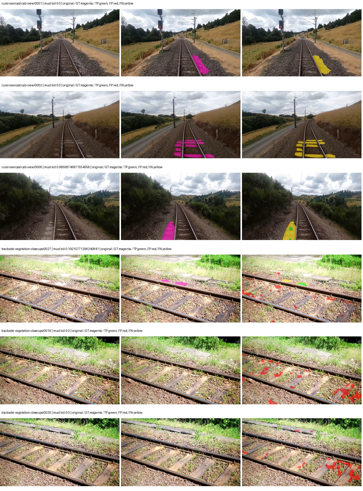
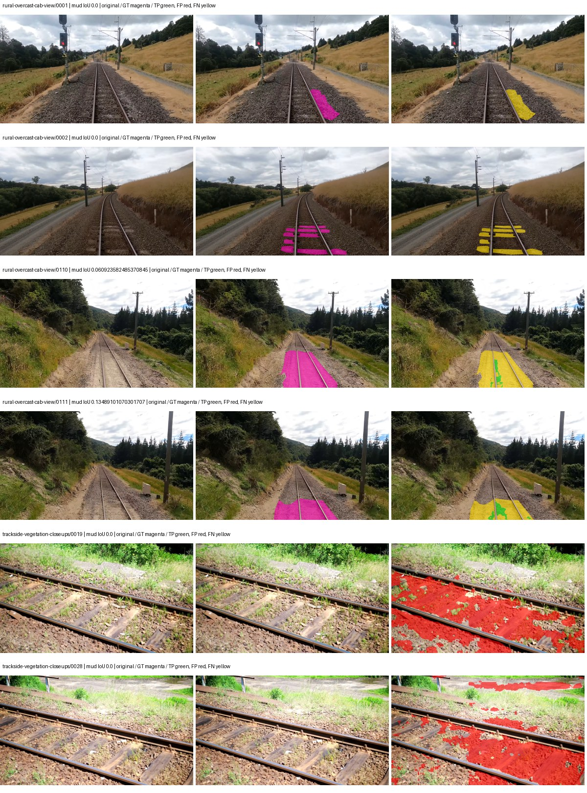
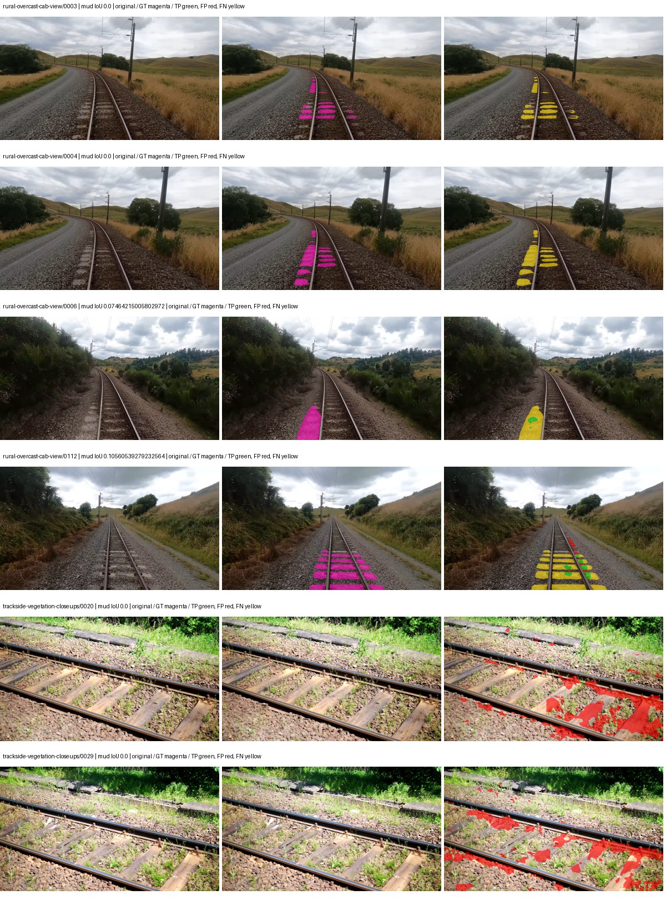
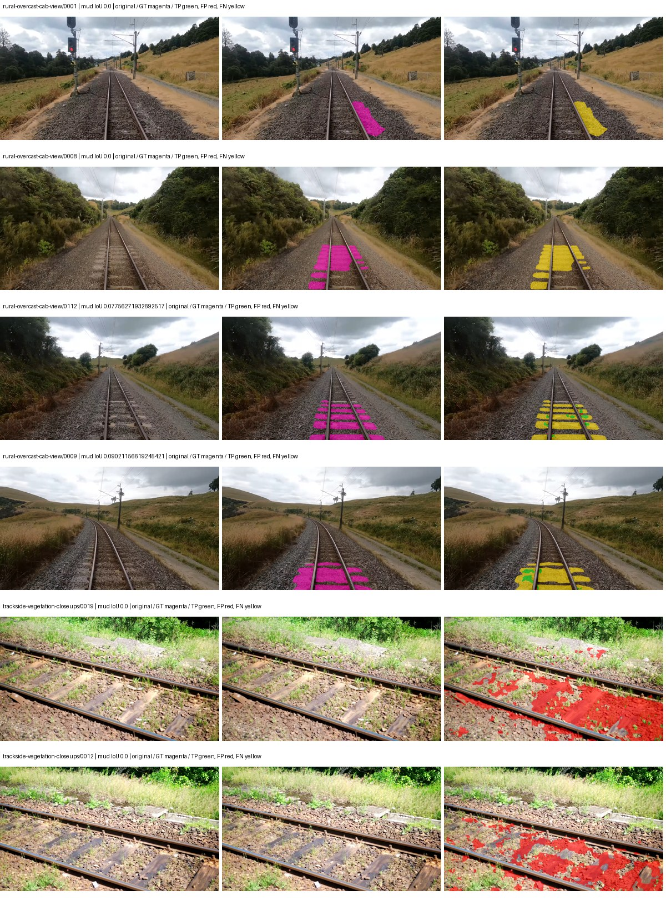

# native_mobilenetv3_large_deeplabv3plus — rad_9_24_2026-fixed-grouped

[RAD 9/24: Scene-grouped split](../../README.md) · [Full model records](record.json)

Primary result: the **final checkpoint** after the full step budget (no early stopping). The checkpoint with the best **mud-pumping validation IoU, pixels pooled over all validation images**, is kept as secondary evidence. A job is complete only after full statistics and isolated profiling are verified.

Study metrics of the final checkpoint, counting each class only on the validation images that contain it: mud-pumping IoU is the mean per-image IoU over the images with mud-pumping, precision and recall sum pixels over those images, and mIoU averages each class over the images that contain it, then over the classes present.

| Initialization path | Seed | Mud-pumping IoU, train-camera images with mud (%, n=17) | Mud-pumping IoU, all images with mud (%, n=18) | Mud precision, all images with mud (%) | Mud recall, all images with mud (%) | mIoU (each class over images that contain it) (%) |
| --- | --- | --- | --- | --- | --- | --- |
| rtis_only | 0 | 1.44 | 1.54 | 11.31 | 1.41 | 31.26 |
| cityscapes_to_rtis | 0 | 1.58 | 1.55 | 3.68 | 2.82 | 33.28 |
| railsem19_to_rtis | 0 | 1.81 | 1.80 | 12.33 | 2.37 | 39.60 |
| cityscapes_to_railsem19_to_rtis | 0 | 0.33 | 0.31 | 0.55 | 0.28 | 35.58 |

Per-class IoU: IoU (%) of every class, each averaged only over the validation images that contain the class (n = those images); — = no image contains it. mIoU averages the classes with at least one such image.

| Initialization path | Seed | mIoU (each class over images that contain it) | person (n=0) | truck (n=0) | rail-track (n=37) | vegetation-overgrowth (n=13) | car (n=3) | on-rails (n=0) | traffic-sign (n=9) | road (n=11) | sidewalk (n=12) | construction (n=12) | tram-track (n=2) | pole (n=21) | traffic-light (n=3) | mud-pumping (n=18) | fence (n=7) | terrain (n=35) | sky (n=28) | rail-embedded (n=3) | rail-raised (n=37) | trackbed (n=37) | standing-water (n=9) |
| --- | --- | --- | --- | --- | --- | --- | --- | --- | --- | --- | --- | --- | --- | --- | --- | --- | --- | --- | --- | --- | --- | --- | --- |
| rtis_only | 0 | 31.26 | — | — | 57.45 | 29.57 | 1.55 | — | 4.07 | 9.61 | 15.50 | 38.63 | 0.39 | 63.35 | 21.96 | 1.54 | 9.85 | 85.46 | 95.59 | 0.00 | 67.99 | 60.10 | 0.00 |
| cityscapes_to_rtis | 0 | 33.28 | — | — | 51.73 | 23.60 | 23.96 | — | 11.73 | 7.96 | 5.71 | 35.23 | 3.20 | 65.41 | 44.08 | 1.55 | 14.15 | 82.03 | 95.33 | 5.62 | 69.82 | 57.95 | 0.00 |
| railsem19_to_rtis | 0 | 39.60 | — | — | 61.28 | 25.58 | 15.64 | — | 21.48 | 8.55 | 14.22 | 44.57 | 38.94 | 70.10 | 46.72 | 1.80 | 18.84 | 85.42 | 96.48 | 28.23 | 70.41 | 64.50 | 0.00 |
| cityscapes_to_railsem19_to_rtis | 0 | 35.58 | — | — | 56.55 | 29.83 | 18.85 | — | 29.46 | 7.58 | 11.09 | 38.71 | 2.86 | 67.90 | 45.85 | 0.31 | 17.33 | 83.82 | 95.67 | 4.48 | 69.99 | 60.03 | 0.17 |

Everything below is the campaign's own record, with pixels pooled over all validation images: its evaluation is the checkpoint that scored best on that pooled mud IoU (secondary evidence here); the diagnostics also cover the final checkpoint (`final-auto-val`).

| Model | Initialization path | Seed | Status | Steps | Best step | Best-checkpoint mud IoU, pixels pooled (%) | Best-checkpoint mud precision, pixels pooled (%) | Best-checkpoint mud recall, pixels pooled (%) | Final mud IoU (trainer val, pixels pooled, %) | Best-checkpoint mIoU, pixels pooled (%) | Best-checkpoint fixed GT-class mIoU, pixels pooled (%) |
| --- | --- | --- | --- | --- | --- | --- | --- | --- | --- | --- | --- |
| native_mobilenetv3_large_deeplabv3plus | rtis_only | 0 | completed | 4000 | 3370 | 1.11 | 4.38 | 1.47 | 0.74 | 29.77 | 34.73 |
| native_mobilenetv3_large_deeplabv3plus | cityscapes_to_rtis | 0 | completed | 4000 | 2851 | 0.77 | 0.99 | 3.34 | 0.53 | 31.30 | 36.51 |
| native_mobilenetv3_large_deeplabv3plus | railsem19_to_rtis | 0 | completed | 4000 | 1814 | 1.40 | 2.69 | 2.84 | 0.86 | 38.01 | 44.34 |
| native_mobilenetv3_large_deeplabv3plus | cityscapes_to_railsem19_to_rtis | 0 | completed | 4000 | 1814 | 0.78 | 1.15 | 2.41 | 0.08 | 35.79 | 41.76 |

Training: 217 images. Validation: 37 images. Test: 60 held out. Seeds: [0]. Seed variation measures optimization variability, not independent-recording uncertainty. Historical source checkpoints stay fixed across adaptation seeds.

Training code: `fce0ea0ac50b334d4252812c396e0e593def375d`. Split SHA-256: `12d7b367c72cda61d57686ff2ac28223530d0af49debd9fb7a0fbc68b908bc93`.

## rtis_only — seed 0

Status: **completed**. Started: 2026-10-11T07:26:18.714578+00:00. Finished: 2026-10-11T08:08:35.254531+00:00.

Recipe pretrained initializer: `{"arch": "native", "backbone_path": null, "batch_norm_momentum": null, "checkpoint": null, "classifier_path": null, "drop_path": null, "encoder_name": null, "encoder_weights": null, "head": "unified_head", "head_paths": [], "inactive_parameter_paths": [], "local_files_only": false, "lora_alpha": 32, "lora_dropout": 0.05, "lora_r": 16, "lora_targets": [], "native": {"auxiliary_heads": [], "backbone": {"in_channels": 3, "kind": "timm", "name": "mobilenetv3_large_100.ra_in1k", "out_indices": [1, 2, 3, 4], "weights": "pretrained"}, "head": {"activation": "relu", "channels": 160, "dilation_rates": [6, 12, 18], "dropout": 0.1, "high_index": 3, "kind": "deeplabv3plus", "low_channels": 32, "low_index": 0, "norm": "group"}, "neck": {"kind": "identity"}, "task": "multiclass"}, "revision": null, "smp_arch": null, "subfolder": null, "trust_remote_code": false, "tuning": "full"}`.

`rtis_only` uses the recipe initializer, which may include pretrained segmentation components. Transfer paths load the exact historical source checkpoint below and reset the classifier; they do not reset all query/decoder features.

Source checkpoint: `Recipe pretrained initialization`.

Config SHA-256: `98f0149795bd210d520dfc7df663a975bf78ca228d80df43341e685d57812334`. Weights used for validation: `raw`.

### Mud-pumping and aggregate quality

| Metric | Selected checkpoint | Final training validation |
| --- | --- | --- |
| Mud IoU | 1.11 | 0.74 |
| Mud precision | 4.38 | 1.54 |
| Mud recall | 1.47 | 1.41 |
| Mud Dice/F1 | 2.20 | 1.47 |
| mIoU | 29.77 | 29.07 |
| Mean accuracy | 42.83 | 41.43 |
| Mean precision | 52.15 | 44.46 |
| Mean Dice | 38.34 | 36.79 |
| Mean specificity | 99.01 | 99.03 |
| Pixel accuracy | 84.33 | 84.44 |
| Frequency-weighted IoU | 74.60 | 75.26 |
| Fixed GT-present class mIoU | 34.73 | 33.92 |
| Boundary F1 | 35.20 | 34.04 |

The selected checkpoint has independent evaluation evidence. Final values are the trainer's final validation record, not a new independent evaluation. mIoU averages classes with nonzero union, so false positives on absent classes can change its denominator. The fixed GT-class mean is supplementary and excludes absent classes; their false positives remain in the confusion matrix.

### Resource usage and timing

| Measurement | Value |
| --- | --- |
| Peak training VRAM, retained training invocation (GiB) | 7.46 |
| Peak evaluation VRAM (GiB) | 6.82 |
| Retained training invocation wall time (seconds) | 2406.65 |
| Retained training invocation GPU-hours (one GPU) | 0.67 |
| Evaluation wall time (seconds) | 11.16 |
| Full evaluation pipeline images/second | 3.31 |
| Best full-state checkpoint (MiB) | 123.69 |
| Final full-state checkpoint (MiB) | 123.68 |
| Verified periodic checkpoints removed (GiB) | 0.97 |

VRAM uses the recorded allocator high-water mark; it is not total device usage including CUDA context. Resumed jobs' retained training invocation times and peaks are **not whole-campaign totals**. Earlier invocation resource records are not reconstructed here. Evaluation throughput includes loader, sliding-window inference and metrics; it is not model-only latency/FPS. Missing measurements are shown as —, never inferred from another dataset's run.

### Standardized inference performance

Dedicated model-only profiling waits for an idle worker-locked L40S: BF16, batch 1, 1024x1024, 20 warmup and 100 CUDA-event-timed public forwards. It excludes loading, preprocessing, tiling and metrics.

| Status | Parameters | Weight MiB | FPS | p50 ms | p95 ms | Peak reserved GiB |
| --- | --- | --- | --- | --- | --- | --- |
| complete | 8067845 | 30.78 | 170.58 | 5.71 | 6.50 | 0.44 |

```json
{
  "schema_version": 1,
  "model_id": "native_mobilenetv3_large_deeplabv3plus",
  "measured_at": "2026-10-11T08:08:32+00:00",
  "status": "complete",
  "benchmark_scope": "rtis_selected_checkpoint_model_only",
  "applies_to": [
    "native_mobilenetv3_large_deeplabv3plus--rtis_only--seed-0"
  ],
  "source": {
    "campaign_git_sha": "fce0ea0ac50b334d4252812c396e0e593def375d",
    "git_dirty": false,
    "config_hash": "df1f39015a60",
    "resolved_config": "/data/izadia1/projects/segmentary-runs/rad_9_24_2026/fgall-seed0-20261007/configs/native_mobilenetv3_large_deeplabv3plus--rtis_only--seed-0.yaml",
    "config_sha256": "98f0149795bd210d520dfc7df663a975bf78ca228d80df43341e685d57812334",
    "checkpoint_sha256": "43ccf58703c747401389c904d14b1cf518e7a6a286e1627c8cae29246dde2e9d",
    "checkpoint_global_step": 3370,
    "checkpoint_bytes": 129695971,
    "checkpoint_kind": "resume checkpoint with optimizer and EMA state",
    "weights": "raw",
    "measured_checkpoint_job_id": "native_mobilenetv3_large_deeplabv3plus--rtis_only--seed-0",
    "result_sha256": "b35bf07ff02c985fd3b0c9435d1a302f7f4008201ee4bffefce8990fd65cd801",
    "result_git_sha": "fce0ea0ac50b334d4252812c396e0e593def375d",
    "result_stage": "eval:rad_9_24_2026-fixed-grouped:val",
    "result_seed": 0
  },
  "hardware": {
    "gpu_name": "NVIDIA L40S",
    "gpu_uuid": "GPU-1c9b612f-e0b5-fbbc-150f-8c2ef13453c9",
    "logical_device": "cuda:0",
    "physical_visibility_token": "5",
    "compute_capability": [
      8,
      9
    ],
    "total_memory_bytes": 47677177856
  },
  "model": {
    "parameter_count": 8067845,
    "trainable_parameter_count": 8067845,
    "resident_parameter_bytes": 32271380,
    "parameter_dtype_counts": {
      "float32": 8067845
    }
  },
  "contract": {
    "backend": "pytorch",
    "precision": "bf16_autocast",
    "batch_size": 1,
    "input_shape_nchw": [
      1,
      3,
      1024,
      1024
    ],
    "warmup_iterations": 20,
    "measured_iterations": 100,
    "timing": "per-forward CUDA events with end-event synchronization",
    "includes_preprocessing": false,
    "includes_data_loader": false,
    "includes_sliding_window": false,
    "input_resident_on_gpu": true,
    "model_only": true,
    "entrypoint": "public model(image) dense-logits forward"
  },
  "measurements": {
    "latency": {
      "p50_ms": 5.712896108627319,
      "p95_ms": 6.504243350028991,
      "mean_ms": 5.862482223510742,
      "minimum_ms": 5.534719944000244,
      "maximum_ms": 7.867392063140869,
      "fps": 170.57621019124403,
      "raw_ms": [
        6.338560104370117,
        6.470655918121338,
        5.830656051635742,
        5.5859198570251465,
        5.599232196807861,
        5.5511040687561035,
        5.6453118324279785,
        5.67091178894043,
        6.169600009918213,
        7.867392063140869,
        6.960127830505371,
        6.486015796661377,
        6.22489595413208,
        6.503424167633057,
        6.246399879455566,
        5.807104110717773,
        5.72211217880249,
        5.72211217880249,
        5.769216060638428,
        6.159359931945801,
        6.343679904937744,
        5.82144021987915,
        5.846015930175781,
        6.172671794891357,
        5.906432151794434,
        5.574656009674072,
        5.752831935882568,
        5.752831935882568,
        5.667840003967285,
        5.801983833312988,
        5.742591857910156,
        6.140927791595459,
        5.924863815307617,
        6.045695781707764,
        5.9699201583862305,
        6.2566399574279785,
        6.2269439697265625,
        6.074368000030518,
        5.77023983001709,
        5.783552169799805,
        5.545983791351318,
        5.587967872619629,
        5.549088001251221,
        5.703680038452148,
        6.876160144805908,
        6.3897600173950195,
        6.311935901641846,
        5.833727836608887,
        6.08460807800293,
        5.774335861206055,
        5.544960021972656,
        5.563392162322998,
        6.446080207824707,
        5.875711917877197,
        6.028287887573242,
        6.27507209777832,
        5.795839786529541,
        5.854207992553711,
        5.604351997375488,
        5.600255966186523,
        5.545983791351318,
        5.56441593170166,
        5.541888236999512,
        5.574656009674072,
        5.541888236999512,
        5.608448028564453,
        5.62278413772583,
        6.5669121742248535,
        5.676032066345215,
        5.604351997375488,
        5.548031806945801,
        5.552127838134766,
        5.534719944000244,
        5.573631763458252,
        5.570559978485107,
        5.543935775756836,
        6.519807815551758,
        6.33139181137085,
        5.628928184509277,
        5.612544059753418,
        5.587967872619629,
        5.699584007263184,
        5.600255966186523,
        5.557248115539551,
        5.563392162322998,
        5.611519813537598,
        5.903359889984131,
        5.591040134429932,
        5.603328227996826,
        5.555200099945068,
        5.544960021972656,
        6.269951820373535,
        5.6248321533203125,
        5.567488193511963,
        5.582848072052002,
        5.602303981781006,
        5.582848072052002,
        5.568511962890625,
        5.641215801239014,
        5.575679779052734
      ],
      "percentile_method": "numpy linear interpolation"
    },
    "peak_reserved_bytes": 471859200,
    "memory_kind": "pytorch_cuda_allocator_peak_reserved_excluding_context",
    "process_total_bytes": 1000341504,
    "process_total_kind": "nvidia-smi used_memory of this PID on the benchmark GPU after the timed loop, including the CUDA context; null when the driver could not attribute memory to this PID",
    "benchmark_wall_clock_s": 16.22789939492941
  },
  "started_at": "2026-10-11T08:08:16+00:00",
  "finished_at": "2026-10-11T08:08:32+00:00",
  "environment": {
    "hostname": "hdrfs-app-001",
    "python": "3.11.15",
    "platform": "Linux-5.15.0-139-generic-x86_64-with-glibc2.35",
    "torch": "2.11.0+cu128",
    "torch_cuda": "12.8",
    "cudnn": 91900,
    "driver_version": "570.133.20",
    "cuda_available": true,
    "gpu_count": 1,
    "gpu_names": [
      "NVIDIA L40S"
    ],
    "cuda_visible_devices": "5",
    "packages": {
      "segmentary": "0.1.0",
      "torch": "2.11.0+cu128",
      "torchvision": "0.26.0+cu128",
      "transformers": "5.15.0",
      "timm": "1.0.28",
      "segmentation-models-pytorch": "0.5.0",
      "albumentations": "2.0.8",
      "lightning": "2.6.5",
      "numpy": "2.4.4"
    }
  }
}
```

### Per-class validation results

| Class | GT pixels | IoU (%) | Precision (%) | Recall (%) | Dice (%) | Boundary F1 (%) |
| --- | --- | --- | --- | --- | --- | --- |
| car | 29664 | 3.57 | 24.40 | 4.01 | 6.90 | 20.83 |
| construction | 311585 | 42.89 | 49.77 | 75.64 | 60.04 | 48.69 |
| fence | 265137 | 14.44 | 41.18 | 18.20 | 25.24 | 40.35 |
| mud-pumping | 1226250 | 1.11 | 4.38 | 1.47 | 2.20 | 2.10 |
| on-rails | 0 | 0.00 | 0.00 | — | 0.00 | 0.00 |
| person | 0 | 0.00 | 0.00 | — | 0.00 | 0.00 |
| pole | 628038 | 65.92 | 76.66 | 82.48 | 79.46 | 88.29 |
| rail-embedded | 16799 | 8.34 | 84.95 | 8.46 | 15.40 | 8.49 |
| rail-raised | 2969797 | 66.81 | 70.18 | 93.30 | 80.10 | 84.73 |
| rail-track | 6323197 | 42.70 | 74.07 | 50.21 | 59.85 | 56.21 |
| road | 1048831 | 7.18 | 56.28 | 7.61 | 13.40 | 15.24 |
| sidewalk | 1297367 | 40.26 | 73.47 | 47.10 | 57.41 | 12.87 |
| sky | 19121606 | 97.43 | 99.42 | 97.99 | 98.70 | 91.67 |
| standing-water | 95802 | 0.08 | 0.12 | 0.23 | 0.16 | 0.95 |
| terrain | 39239306 | 87.94 | 89.26 | 98.35 | 93.58 | 66.52 |
| trackbed | 10643081 | 54.20 | 62.43 | 80.44 | 70.30 | 50.99 |
| traffic-light | 19510 | 40.43 | 75.18 | 46.66 | 57.58 | 43.71 |
| traffic-sign | 13285 | 16.24 | 41.36 | 21.11 | 27.95 | 31.51 |
| tram-track | 56179 | 6.01 | 90.18 | 6.04 | 11.33 | 11.90 |
| truck | 0 | 0.00 | 0.00 | — | 0.00 | 0.00 |
| vegetation-overgrowth | 5901821 | 29.51 | 81.96 | 31.56 | 45.57 | 64.17 |

### Full-run accounting

| Measurement | Value |
| --- | --- |
| Full GPU-reserved wall seconds, all recorded worker attempts | 2544.40 |
| Full reserved GPU-hours | 0.71 |
| Whole-run timing complete | True |

| Phase | Wall seconds including failed attempts |
| --- | --- |
| training | 2413.55 |
| diagnostics | 78.85 |
| performance | 23.66 |

GPU-reserved time includes model loading, training, validation, collection, profiling, checkpoint I/O and orchestration while the worker owns one GPU. It is not GPU kernel-active time. Phase timings and sampled device memory/power/utilization are retained separately; sampled device memory is not the allocator high-water mark.

### Train/validation and raw/EMA diagnostics

| Checkpoint / weights / split | Images | Mud IoU (%) | Mud precision (%) | Mud recall (%) |
| --- | --- | --- | --- | --- |
| best-auto-train / raw | 217 | 94.94 | 98.02 | 96.80 |
| best-auto-val / raw | 37 | 1.11 | 4.38 | 1.47 |
| best-alternate-val / ema | 37 | 0.53 | 1.68 | 0.77 |
| final-auto-val / raw | 37 | 0.74 | 1.53 | 1.41 |

Train uses the evaluation transform without augmentation. Compare mud train/validation metrics for the same selected weights. Alternate EMA on running-stat BatchNorm is explicitly uncalibrated and is diagnostic only. Score-threshold curves use uncalibrated normalized scores and are pixel-level diagnostics, not event detection rates or a selected deployment operating point.

### Downloadable evidence

- best-auto-train: [per-image.csv](rtis_only--seed-0/best-auto-train/per-image.csv) · [per-image-confusion.json.gz](rtis_only--seed-0/best-auto-train/per-image-confusion.json.gz) · [groups.json](rtis_only--seed-0/best-auto-train/groups.json) · [mud-score-curves.json](rtis_only--seed-0/best-auto-train/mud-score-curves.json)
- best-auto-val: [per-image.csv](rtis_only--seed-0/best-auto-val/per-image.csv) · [per-image-confusion.json.gz](rtis_only--seed-0/best-auto-val/per-image-confusion.json.gz) · [groups.json](rtis_only--seed-0/best-auto-val/groups.json) · [mud-score-curves.json](rtis_only--seed-0/best-auto-val/mud-score-curves.json) · [examples.jpg](rtis_only--seed-0/best-auto-val/examples.jpg)
- best-alternate-val: [per-image.csv](rtis_only--seed-0/best-alternate-val/per-image.csv) · [per-image-confusion.json.gz](rtis_only--seed-0/best-alternate-val/per-image-confusion.json.gz) · [groups.json](rtis_only--seed-0/best-alternate-val/groups.json) · [mud-score-curves.json](rtis_only--seed-0/best-alternate-val/mud-score-curves.json)
- final-auto-val: [per-image.csv](rtis_only--seed-0/final-auto-val/per-image.csv) · [per-image-confusion.json.gz](rtis_only--seed-0/final-auto-val/per-image-confusion.json.gz) · [groups.json](rtis_only--seed-0/final-auto-val/groups.json) · [mud-score-curves.json](rtis_only--seed-0/final-auto-val/mud-score-curves.json)
- resources: [telemetry.csv](rtis_only--seed-0/resources/telemetry.csv)



Examples are two lowest and two highest mud-IoU positive images, plus up to two negative images with the most false-positive mud pixels. They are targeted diagnostic examples, not random samples. Green: true positive; red: false positive; yellow: false negative. Full predictions remain on HDRFS.

### Validation tracking

| Logged step | Overall mIoU (%) | Mud IoU (%) |
| --- | --- | --- |
| 258 | 21.05 | 0.25 |
| 518 | 21.33 | 0.31 |
| 777 | 24.67 | 0.41 |
| 1036 | 26.57 | 0.46 |
| 1295 | 25.95 | 0.84 |
| 1555 | 24.85 | 0.71 |
| 1814 | 26.14 | 1.00 |
| 2073 | 26.47 | 0.36 |
| 2332 | 27.49 | 0.45 |
| 2592 | 28.28 | 0.45 |
| 2851 | 26.86 | 0.42 |
| 3110 | 27.89 | 0.73 |
| 3369 | 29.76 | 1.11 |
| 3629 | 29.54 | 0.94 |
| 3888 | 30.22 | 0.84 |
| 4000 | 29.07 | 0.74 |

All retained scalar curves, including training loss and per-class IoU, are in record.json. Observed best mud on a curve is not necessarily a retained checkpoint: the pilot saved its selection-metric-best and final checkpoints. Step logging and checkpoint global_step may differ by one.

### Stopping and checkpoint provenance

```json
{
  "stopping": {
    "actual_steps": 4000,
    "maximum_steps": 4000,
    "min_delta": 0.0,
    "monitor": "val_iou/mud-pumping",
    "patience": null,
    "reason": "budget_complete"
  },
  "checkpoints": {
    "best": {
      "path": "/data/izadia1/projects/segmentary-runs/rad_9_24_2026/fgall-seed0-20261007/future-runs/native_mobilenetv3_large_deeplabv3plus--rtis_only--seed-0_seed0/rtis/best.ckpt",
      "sha256": "43ccf58703c747401389c904d14b1cf518e7a6a286e1627c8cae29246dde2e9d",
      "global_step": 3370,
      "bytes": 129695971
    },
    "final": {
      "path": "/data/izadia1/projects/segmentary-runs/rad_9_24_2026/fgall-seed0-20261007/future-runs/native_mobilenetv3_large_deeplabv3plus--rtis_only--seed-0_seed0/rtis/last.ckpt",
      "sha256": "732ca91e54bb407c3cf46138ead2506db5b236a8c71604690e48a87fd79dee7e",
      "global_step": 4000,
      "bytes": 129684131
    }
  },
  "cleanup_error": null
}
```

### Resolved training, initialization and evaluation settings

The optimizer block is the base configuration. Stage LR scales are applied at runtime, and stage warmup is capped at min(base warmup, floor(stage budget / 10), stage budget - 1): 400 steps for this 4,000-step pilot. Model-internal native input grids may differ from augmentation crops (EoMT uses its 640 grid).

```json
{
  "name": "native_mobilenetv3_large_deeplabv3plus--rtis_only--seed-0",
  "model": {
    "arch": "native",
    "checkpoint": null,
    "tuning": "full",
    "head": "unified_head",
    "lora_r": 16,
    "lora_alpha": 32,
    "lora_dropout": 0.05,
    "lora_targets": [],
    "drop_path": null,
    "revision": null,
    "subfolder": null,
    "local_files_only": false,
    "trust_remote_code": false,
    "backbone_path": null,
    "head_paths": [],
    "classifier_path": null,
    "inactive_parameter_paths": [],
    "smp_arch": null,
    "encoder_name": null,
    "encoder_weights": null,
    "native": {
      "task": "multiclass",
      "backbone": {
        "kind": "timm",
        "name": "mobilenetv3_large_100.ra_in1k",
        "weights": "pretrained",
        "out_indices": [
          1,
          2,
          3,
          4
        ],
        "in_channels": 3
      },
      "neck": {
        "kind": "identity"
      },
      "head": {
        "kind": "deeplabv3plus",
        "low_index": 0,
        "high_index": 3,
        "channels": 160,
        "low_channels": 32,
        "dilation_rates": [
          6,
          12,
          18
        ],
        "dropout": 0.1,
        "norm": "group",
        "activation": "relu"
      },
      "auxiliary_heads": []
    },
    "batch_norm_momentum": null
  },
  "space": "paul-test-rtis",
  "taxonomy_root": "/data/izadia1/projects/segmentary-rad-fgall-fce0ea0a/taxonomy",
  "output_root": "/data/izadia1/projects/segmentary-runs/rad_9_24_2026/fgall-seed0-20261007/future-runs",
  "optim": {
    "backbone_lr": 0.0001,
    "head_lr_mult": 10.0,
    "weight_decay": 0.05,
    "llrd": 1.0,
    "warmup_iters": 1500,
    "warmup_ratio": 1e-06,
    "poly_power": 0.9,
    "min_lr_ratio": 0.0,
    "betas": [
      0.9,
      0.999
    ],
    "grad_clip": 1.0
  },
  "train": {
    "iters": 4000,
    "batch_size": 2,
    "accum": 8,
    "num_workers": 2,
    "precision": "bf16-mixed",
    "ema_decay": 0.9998,
    "val_every": 250,
    "ckpt_every": 500,
    "selection_metric": "val_iou/mud-pumping",
    "early_stopping_patience": null,
    "early_stopping_min_delta": 0.0,
    "seed": 0,
    "devices": 1
  },
  "eval": {
    "sliding_window": true,
    "window": [
      1024,
      1024
    ],
    "stride": [
      768,
      768
    ],
    "batch_size": 1,
    "num_workers": 2,
    "tta_scales": [],
    "tta_flip": false,
    "threshold": 0.5,
    "boundary_tolerance_frac": 0.0075,
    "save_confusion": true
  },
  "loss": {
    "task": "multiclass",
    "activation": "auto",
    "terms": [],
    "aux": "none",
    "aux_weight": 0.0,
    "ce_weight": 1.0,
    "label_smoothing": 0.0,
    "class_weights": null,
    "query": null
  },
  "aug": {
    "crop": [
      1024,
      1024
    ],
    "scale_min": 0.5,
    "scale_max": 2.0,
    "hflip_p": 0.5,
    "color_jitter_p": 0.5,
    "brightness": 0.25,
    "contrast": 0.25,
    "saturation": 0.25,
    "hue": 0.05
  },
  "stages": [
    {
      "name": "rtis",
      "data": [
        {
          "name": "rad_9_24_2026-fixed-grouped",
          "root": "/data/izadia1/datasets/rad_9_24_2026-fixed-grouped",
          "variant": null,
          "split_file": "splits.json",
          "train_split": "train",
          "val_split": "val",
          "limit": null,
          "loader": "folder",
          "mapping": "paul-test-rtis",
          "loader_options": {
            "require_groups": true
          }
        }
      ],
      "iters": null,
      "lr_scale": 1.0,
      "head_group_lr_scale": 1.0,
      "init_from": "pretrained",
      "reset_head": false,
      "freeze": null,
      "sample_weights": null
    }
  ]
}
```

### Hardware and software provenance

```json
{
  "training": {
    "cuda_available": true,
    "cuda_visible_devices": "5",
    "cudnn": 91900,
    "driver_version": "570.133.20",
    "gpu_count": 1,
    "gpu_names": [
      "NVIDIA L40S"
    ],
    "hostname": "hdrfs-app-001",
    "input_normalization": {
      "channel_order": "rgb",
      "mean": [
        0.485,
        0.456,
        0.406
      ],
      "source": "timm_pretrained_cfg",
      "std": [
        0.229,
        0.224,
        0.225
      ]
    },
    "model_origins": [
      {
        "hf_commit": null,
        "hf_name_or_path": null,
        "module": "backbone",
        "timm_pretrained": {
          "architecture": "mobilenetv3_large_100",
          "hf_hub_id": "timm/mobilenetv3_large_100.ra_in1k",
          "tag": "ra_in1k",
          "url": "https://github.com/rwightman/pytorch-image-models/releases/download/v0.1-weights/mobilenetv3_large_100_ra-f55367f5.pth"
        }
      },
      {
        "hf_commit": null,
        "hf_name_or_path": null,
        "module": "backbone.model",
        "timm_pretrained": {
          "architecture": "mobilenetv3_large_100",
          "hf_hub_id": "timm/mobilenetv3_large_100.ra_in1k",
          "tag": "ra_in1k",
          "url": "https://github.com/rwightman/pytorch-image-models/releases/download/v0.1-weights/mobilenetv3_large_100_ra-f55367f5.pth"
        }
      }
    ],
    "model_parameter_count": 8067845,
    "packages": {
      "albumentations": "2.0.8",
      "lightning": "2.6.5",
      "numpy": "2.4.4",
      "segmentary": "0.1.0",
      "segmentation-models-pytorch": "0.5.0",
      "timm": "1.0.28",
      "torch": "2.11.0+cu128",
      "torchvision": "0.26.0+cu128",
      "transformers": "5.15.0"
    },
    "platform": "Linux-5.15.0-139-generic-x86_64-with-glibc2.35",
    "python": "3.11.15",
    "torch": "2.11.0+cu128",
    "torch_cuda": "12.8",
    "trainable_parameter_count": 8067845,
    "training_stop": {
      "actual_steps": 4000,
      "maximum_steps": 4000,
      "min_delta": 0.0,
      "monitor": "val_iou/mud-pumping",
      "patience": null,
      "reason": "budget_complete"
    },
    "validation_weights": "raw"
  },
  "evaluation": {
    "cuda_available": true,
    "cuda_visible_devices": "5",
    "cudnn": 91900,
    "driver_version": "570.133.20",
    "gpu_count": 1,
    "gpu_names": [
      "NVIDIA L40S"
    ],
    "hostname": "hdrfs-app-001",
    "input_normalization": {
      "channel_order": "rgb",
      "mean": [
        0.485,
        0.456,
        0.406
      ],
      "source": "timm_pretrained_cfg",
      "std": [
        0.229,
        0.224,
        0.225
      ]
    },
    "packages": {
      "albumentations": "2.0.8",
      "lightning": "2.6.5",
      "numpy": "2.4.4",
      "segmentary": "0.1.0",
      "segmentation-models-pytorch": "0.5.0",
      "timm": "1.0.28",
      "torch": "2.11.0+cu128",
      "torchvision": "0.26.0+cu128",
      "transformers": "5.15.0"
    },
    "platform": "Linux-5.15.0-139-generic-x86_64-with-glibc2.35",
    "python": "3.11.15",
    "torch": "2.11.0+cu128",
    "torch_cuda": "12.8"
  }
}
```

## cityscapes_to_rtis — seed 0

Status: **completed**. Started: 2026-10-11T07:30:27.664678+00:00. Finished: 2026-10-11T08:12:34.178438+00:00.

Recipe pretrained initializer: `{"arch": "native", "backbone_path": null, "batch_norm_momentum": null, "checkpoint": null, "classifier_path": null, "drop_path": null, "encoder_name": null, "encoder_weights": null, "head": "unified_head", "head_paths": [], "inactive_parameter_paths": [], "local_files_only": false, "lora_alpha": 32, "lora_dropout": 0.05, "lora_r": 16, "lora_targets": [], "native": {"auxiliary_heads": [], "backbone": {"in_channels": 3, "kind": "timm", "name": "mobilenetv3_large_100.ra_in1k", "out_indices": [1, 2, 3, 4], "weights": "pretrained"}, "head": {"activation": "relu", "channels": 160, "dilation_rates": [6, 12, 18], "dropout": 0.1, "high_index": 3, "kind": "deeplabv3plus", "low_channels": 32, "low_index": 0, "norm": "group"}, "neck": {"kind": "identity"}, "task": "multiclass"}, "revision": null, "smp_arch": null, "subfolder": null, "trust_remote_code": false, "tuning": "full"}`.

`rtis_only` uses the recipe initializer, which may include pretrained segmentation components. Transfer paths load the exact historical source checkpoint below and reset the classifier; they do not reset all query/decoder features.

Source checkpoint: `{'name': 'native_mobilenetv3_large_deeplabv3plus--cityscapes--seed-0', 'model': 'native_mobilenetv3_large_deeplabv3plus', 'protocol': 'cityscapes', 'config': '/data/izadia1/projects/segmentary-runs/all-model-city-rail-seed0-rail20-b9eb3e1/jobs/native_mobilenetv3_large_deeplabv3plus--cityscapes--seed-0/attempt-001/resolved-config.yaml', 'checkpoint': '/data/izadia1/projects/segmentary-runs/all-model-city-rail-seed0-rail20-b9eb3e1/jobs/native_mobilenetv3_large_deeplabv3plus--cityscapes--seed-0/attempt-001/train/native_mobilenetv3_large_deeplabv3plus--cityscapes_seed0/cityscapes/last.ckpt', 'recorded_sha256': '3f4ba18645bef15308a37d53615f8c1e284e4869f790f489059857c04872a11f', 'exists': True}`.

Config SHA-256: `0103acf4d3e9bf4d1fe852f9b7fd04e79f0dc6192bc7ddabe2c67450495c722e`. Weights used for validation: `raw`.

### Mud-pumping and aggregate quality

| Metric | Selected checkpoint | Final training validation |
| --- | --- | --- |
| Mud IoU | 0.77 | 0.53 |
| Mud precision | 0.99 | 0.65 |
| Mud recall | 3.34 | 2.83 |
| Mud Dice/F1 | 1.53 | 1.06 |
| mIoU | 31.30 | 31.13 |
| Mean accuracy | 42.48 | 42.94 |
| Mean precision | 51.79 | 49.83 |
| Mean Dice | 39.66 | 39.82 |
| Mean specificity | 98.91 | 98.88 |
| Pixel accuracy | 81.26 | 81.06 |
| Frequency-weighted IoU | 73.03 | 73.13 |
| Fixed GT-present class mIoU | 36.51 | 36.32 |
| Boundary F1 | 37.24 | 37.43 |

The selected checkpoint has independent evaluation evidence. Final values are the trainer's final validation record, not a new independent evaluation. mIoU averages classes with nonzero union, so false positives on absent classes can change its denominator. The fixed GT-class mean is supplementary and excludes absent classes; their false positives remain in the confusion matrix.

### Resource usage and timing

| Measurement | Value |
| --- | --- |
| Peak training VRAM, retained training invocation (GiB) | 7.46 |
| Peak evaluation VRAM (GiB) | 6.82 |
| Retained training invocation wall time (seconds) | 2398.43 |
| Retained training invocation GPU-hours (one GPU) | 0.67 |
| Evaluation wall time (seconds) | 11.25 |
| Full evaluation pipeline images/second | 3.29 |
| Best full-state checkpoint (MiB) | 123.69 |
| Final full-state checkpoint (MiB) | 123.68 |
| Verified periodic checkpoints removed (GiB) | 0.97 |

VRAM uses the recorded allocator high-water mark; it is not total device usage including CUDA context. Resumed jobs' retained training invocation times and peaks are **not whole-campaign totals**. Earlier invocation resource records are not reconstructed here. Evaluation throughput includes loader, sliding-window inference and metrics; it is not model-only latency/FPS. Missing measurements are shown as —, never inferred from another dataset's run.

### Standardized inference performance

Dedicated model-only profiling waits for an idle worker-locked L40S: BF16, batch 1, 1024x1024, 20 warmup and 100 CUDA-event-timed public forwards. It excludes loading, preprocessing, tiling and metrics.

| Status | Parameters | Weight MiB | FPS | p50 ms | p95 ms | Peak reserved GiB |
| --- | --- | --- | --- | --- | --- | --- |
| complete | 8067845 | 30.78 | 160.52 | 6.01 | 8.18 | 0.44 |

```json
{
  "schema_version": 1,
  "model_id": "native_mobilenetv3_large_deeplabv3plus",
  "measured_at": "2026-10-11T08:12:31+00:00",
  "status": "complete",
  "benchmark_scope": "rtis_selected_checkpoint_model_only",
  "applies_to": [
    "native_mobilenetv3_large_deeplabv3plus--cityscapes_to_rtis--seed-0"
  ],
  "source": {
    "campaign_git_sha": "fce0ea0ac50b334d4252812c396e0e593def375d",
    "git_dirty": false,
    "config_hash": "cf612d63deca",
    "resolved_config": "/data/izadia1/projects/segmentary-runs/rad_9_24_2026/fgall-seed0-20261007/configs/native_mobilenetv3_large_deeplabv3plus--cityscapes_to_rtis--seed-0.yaml",
    "config_sha256": "0103acf4d3e9bf4d1fe852f9b7fd04e79f0dc6192bc7ddabe2c67450495c722e",
    "checkpoint_sha256": "b1925e8dcf54c7fc56bc520024dc8fb078705db86a663aaf3b3ba805258b9c96",
    "checkpoint_global_step": 2851,
    "checkpoint_bytes": 129696035,
    "checkpoint_kind": "resume checkpoint with optimizer and EMA state",
    "weights": "raw",
    "measured_checkpoint_job_id": "native_mobilenetv3_large_deeplabv3plus--cityscapes_to_rtis--seed-0",
    "result_sha256": "4418376e545e90dba7a170ba147fbcb533efd355c134a4a7c7293c84c915cdc3",
    "result_git_sha": "fce0ea0ac50b334d4252812c396e0e593def375d",
    "result_stage": "eval:rad_9_24_2026-fixed-grouped:val",
    "result_seed": 0
  },
  "hardware": {
    "gpu_name": "NVIDIA L40S",
    "gpu_uuid": "GPU-a5ad49e5-0536-5229-ba8a-f8a902808f53",
    "logical_device": "cuda:0",
    "physical_visibility_token": "7",
    "compute_capability": [
      8,
      9
    ],
    "total_memory_bytes": 47677177856
  },
  "model": {
    "parameter_count": 8067845,
    "trainable_parameter_count": 8067845,
    "resident_parameter_bytes": 32271380,
    "parameter_dtype_counts": {
      "float32": 8067845
    }
  },
  "contract": {
    "backend": "pytorch",
    "precision": "bf16_autocast",
    "batch_size": 1,
    "input_shape_nchw": [
      1,
      3,
      1024,
      1024
    ],
    "warmup_iterations": 20,
    "measured_iterations": 100,
    "timing": "per-forward CUDA events with end-event synchronization",
    "includes_preprocessing": false,
    "includes_data_loader": false,
    "includes_sliding_window": false,
    "input_resident_on_gpu": true,
    "model_only": true,
    "entrypoint": "public model(image) dense-logits forward"
  },
  "measurements": {
    "latency": {
      "p50_ms": 6.014463901519775,
      "p95_ms": 8.183398008346558,
      "mean_ms": 6.22988224029541,
      "minimum_ms": 5.458943843841553,
      "maximum_ms": 9.109503746032715,
      "fps": 160.51667775225584,
      "raw_ms": [
        7.846911907196045,
        8.18073558807373,
        8.233983993530273,
        8.378368377685547,
        7.7414398193359375,
        8.475647926330566,
        9.109503746032715,
        6.17574405670166,
        6.4389119148254395,
        8.72652816772461,
        6.706175804138184,
        5.542912006378174,
        5.458943843841553,
        5.513216018676758,
        5.509119987487793,
        5.541888236999512,
        6.730751991271973,
        6.714367866516113,
        5.783552169799805,
        5.702655792236328,
        5.617663860321045,
        6.062079906463623,
        6.267903804779053,
        5.5695037841796875,
        5.847040176391602,
        6.252543926239014,
        6.868991851806641,
        6.876160144805908,
        6.4481282234191895,
        5.996511936187744,
        6.154240131378174,
        6.138879776000977,
        6.2740478515625,
        5.555200099945068,
        5.538815975189209,
        5.661695957183838,
        5.650432109832764,
        6.271999835968018,
        6.213632106781006,
        6.1378560066223145,
        6.674431800842285,
        5.789696216583252,
        6.239264011383057,
        6.188032150268555,
        5.9720001220703125,
        6.010879993438721,
        6.371327877044678,
        7.223296165466309,
        7.379968166351318,
        6.13478422164917,
        6.7788801193237305,
        5.9402241706848145,
        5.862400054931641,
        5.508096218109131,
        6.149119853973389,
        5.519360065460205,
        5.517312049865723,
        5.7333760261535645,
        5.754879951477051,
        7.364607810974121,
        6.5423359870910645,
        6.156288146972656,
        5.948416233062744,
        5.9258880615234375,
        5.5357441902160645,
        5.706751823425293,
        5.709824085235596,
        7.146431922912598,
        6.754303932189941,
        6.393856048583984,
        6.01804780960083,
        5.552127838134766,
        5.5316481590271,
        5.51423978805542,
        6.279168128967285,
        6.395904064178467,
        5.578752040863037,
        5.524479866027832,
        5.739520072937012,
        5.633024215698242,
        6.696959972381592,
        6.775807857513428,
        5.988351821899414,
        5.511168003082275,
        6.198272228240967,
        5.490687847137451,
        5.518335819244385,
        5.8521599769592285,
        5.995520114898682,
        7.268352031707764,
        6.657023906707764,
        6.0200958251953125,
        5.587967872619629,
        5.509119987487793,
        5.533696174621582,
        5.510144233703613,
        5.509119987487793,
        5.534719944000244,
        5.557248115539551,
        6.660096168518066
      ],
      "percentile_method": "numpy linear interpolation"
    },
    "peak_reserved_bytes": 471859200,
    "memory_kind": "pytorch_cuda_allocator_peak_reserved_excluding_context",
    "process_total_bytes": 1000341504,
    "process_total_kind": "nvidia-smi used_memory of this PID on the benchmark GPU after the timed loop, including the CUDA context; null when the driver could not attribute memory to this PID",
    "benchmark_wall_clock_s": 15.740459680557251
  },
  "started_at": "2026-10-11T08:12:15+00:00",
  "finished_at": "2026-10-11T08:12:31+00:00",
  "environment": {
    "hostname": "hdrfs-app-001",
    "python": "3.11.15",
    "platform": "Linux-5.15.0-139-generic-x86_64-with-glibc2.35",
    "torch": "2.11.0+cu128",
    "torch_cuda": "12.8",
    "cudnn": 91900,
    "driver_version": "570.133.20",
    "cuda_available": true,
    "gpu_count": 1,
    "gpu_names": [
      "NVIDIA L40S"
    ],
    "cuda_visible_devices": "7",
    "packages": {
      "segmentary": "0.1.0",
      "torch": "2.11.0+cu128",
      "torchvision": "0.26.0+cu128",
      "transformers": "5.15.0",
      "timm": "1.0.28",
      "segmentation-models-pytorch": "0.5.0",
      "albumentations": "2.0.8",
      "lightning": "2.6.5",
      "numpy": "2.4.4"
    }
  }
}
```

### Per-class validation results

| Class | GT pixels | IoU (%) | Precision (%) | Recall (%) | Dice (%) | Boundary F1 (%) |
| --- | --- | --- | --- | --- | --- | --- |
| car | 29664 | 44.33 | 78.02 | 50.66 | 61.43 | 46.23 |
| construction | 311585 | 46.43 | 69.41 | 58.38 | 63.42 | 60.03 |
| fence | 265137 | 11.28 | 61.43 | 12.14 | 20.27 | 30.28 |
| mud-pumping | 1226250 | 0.77 | 0.99 | 3.34 | 1.53 | 2.51 |
| on-rails | 0 | 0.00 | 0.00 | — | 0.00 | 0.00 |
| person | 0 | 0.00 | 0.00 | — | 0.00 | 0.00 |
| pole | 628038 | 68.80 | 83.69 | 79.45 | 81.52 | 90.79 |
| rail-embedded | 16799 | 6.61 | 55.02 | 6.98 | 12.39 | 24.10 |
| rail-raised | 2969797 | 72.48 | 80.19 | 88.30 | 84.05 | 89.39 |
| rail-track | 6323197 | 35.66 | 72.72 | 41.17 | 52.57 | 49.45 |
| road | 1048831 | 4.94 | 13.56 | 7.22 | 9.42 | 13.35 |
| sidewalk | 1297367 | 14.86 | 81.57 | 15.38 | 25.88 | 6.75 |
| sky | 19121606 | 98.31 | 99.03 | 99.26 | 99.15 | 94.85 |
| standing-water | 95802 | 0.00 | 0.00 | 0.00 | 0.00 | 0.00 |
| terrain | 39239306 | 86.66 | 91.39 | 94.37 | 92.85 | 59.98 |
| trackbed | 10643081 | 53.30 | 61.35 | 80.24 | 69.53 | 46.05 |
| traffic-light | 19510 | 64.92 | 86.08 | 72.53 | 78.73 | 73.67 |
| traffic-sign | 13285 | 19.46 | 67.67 | 21.46 | 32.59 | 36.90 |
| tram-track | 56179 | 5.10 | 27.04 | 5.92 | 9.71 | 9.91 |
| truck | 0 | 0.00 | 0.00 | — | 0.00 | 0.00 |
| vegetation-overgrowth | 5901821 | 23.30 | 58.44 | 27.93 | 37.80 | 47.70 |

### Full-run accounting

| Measurement | Value |
| --- | --- |
| Full GPU-reserved wall seconds, all recorded worker attempts | 2534.40 |
| Full reserved GPU-hours | 0.70 |
| Whole-run timing complete | True |

| Phase | Wall seconds including failed attempts |
| --- | --- |
| training | 2405.33 |
| diagnostics | 78.00 |
| performance | 22.96 |

GPU-reserved time includes model loading, training, validation, collection, profiling, checkpoint I/O and orchestration while the worker owns one GPU. It is not GPU kernel-active time. Phase timings and sampled device memory/power/utilization are retained separately; sampled device memory is not the allocator high-water mark.

### Train/validation and raw/EMA diagnostics

| Checkpoint / weights / split | Images | Mud IoU (%) | Mud precision (%) | Mud recall (%) |
| --- | --- | --- | --- | --- |
| best-auto-train / raw | 217 | 89.97 | 96.97 | 92.57 |
| best-auto-val / raw | 37 | 0.77 | 0.99 | 3.34 |
| best-alternate-val / ema | 37 | 0.31 | 0.37 | 1.74 |
| final-auto-val / raw | 37 | 0.53 | 0.65 | 2.82 |

Train uses the evaluation transform without augmentation. Compare mud train/validation metrics for the same selected weights. Alternate EMA on running-stat BatchNorm is explicitly uncalibrated and is diagnostic only. Score-threshold curves use uncalibrated normalized scores and are pixel-level diagnostics, not event detection rates or a selected deployment operating point.

### Downloadable evidence

- best-auto-train: [per-image.csv](cityscapes_to_rtis--seed-0/best-auto-train/per-image.csv) · [per-image-confusion.json.gz](cityscapes_to_rtis--seed-0/best-auto-train/per-image-confusion.json.gz) · [groups.json](cityscapes_to_rtis--seed-0/best-auto-train/groups.json) · [mud-score-curves.json](cityscapes_to_rtis--seed-0/best-auto-train/mud-score-curves.json)
- best-auto-val: [per-image.csv](cityscapes_to_rtis--seed-0/best-auto-val/per-image.csv) · [per-image-confusion.json.gz](cityscapes_to_rtis--seed-0/best-auto-val/per-image-confusion.json.gz) · [groups.json](cityscapes_to_rtis--seed-0/best-auto-val/groups.json) · [mud-score-curves.json](cityscapes_to_rtis--seed-0/best-auto-val/mud-score-curves.json) · [examples.jpg](cityscapes_to_rtis--seed-0/best-auto-val/examples.jpg)
- best-alternate-val: [per-image.csv](cityscapes_to_rtis--seed-0/best-alternate-val/per-image.csv) · [per-image-confusion.json.gz](cityscapes_to_rtis--seed-0/best-alternate-val/per-image-confusion.json.gz) · [groups.json](cityscapes_to_rtis--seed-0/best-alternate-val/groups.json) · [mud-score-curves.json](cityscapes_to_rtis--seed-0/best-alternate-val/mud-score-curves.json)
- final-auto-val: [per-image.csv](cityscapes_to_rtis--seed-0/final-auto-val/per-image.csv) · [per-image-confusion.json.gz](cityscapes_to_rtis--seed-0/final-auto-val/per-image-confusion.json.gz) · [groups.json](cityscapes_to_rtis--seed-0/final-auto-val/groups.json) · [mud-score-curves.json](cityscapes_to_rtis--seed-0/final-auto-val/mud-score-curves.json)
- resources: [telemetry.csv](cityscapes_to_rtis--seed-0/resources/telemetry.csv)



Examples are two lowest and two highest mud-IoU positive images, plus up to two negative images with the most false-positive mud pixels. They are targeted diagnostic examples, not random samples. Green: true positive; red: false positive; yellow: false negative. Full predictions remain on HDRFS.

### Validation tracking

| Logged step | Overall mIoU (%) | Mud IoU (%) |
| --- | --- | --- |
| 258 | 20.60 | 0.05 |
| 518 | 21.89 | 0.10 |
| 777 | 23.15 | 0.13 |
| 1036 | 25.89 | 0.05 |
| 1295 | 27.62 | 0.13 |
| 1555 | 29.60 | 0.18 |
| 1814 | 30.67 | 0.40 |
| 2073 | 28.48 | 0.12 |
| 2332 | 30.07 | 0.37 |
| 2592 | 31.54 | 0.58 |
| 2851 | 31.32 | 0.77 |
| 3110 | 30.56 | 0.18 |
| 3369 | 32.20 | 0.58 |
| 3629 | 30.85 | 0.27 |
| 3888 | 31.31 | 0.52 |
| 4000 | 31.13 | 0.53 |

All retained scalar curves, including training loss and per-class IoU, are in record.json. Observed best mud on a curve is not necessarily a retained checkpoint: the pilot saved its selection-metric-best and final checkpoints. Step logging and checkpoint global_step may differ by one.

### Stopping and checkpoint provenance

```json
{
  "stopping": {
    "actual_steps": 4000,
    "maximum_steps": 4000,
    "min_delta": 0.0,
    "monitor": "val_iou/mud-pumping",
    "patience": null,
    "reason": "budget_complete"
  },
  "checkpoints": {
    "best": {
      "path": "/data/izadia1/projects/segmentary-runs/rad_9_24_2026/fgall-seed0-20261007/future-runs/native_mobilenetv3_large_deeplabv3plus--cityscapes_to_rtis--seed-0_seed0/rtis/best.ckpt",
      "sha256": "b1925e8dcf54c7fc56bc520024dc8fb078705db86a663aaf3b3ba805258b9c96",
      "global_step": 2851,
      "bytes": 129696035
    },
    "final": {
      "path": "/data/izadia1/projects/segmentary-runs/rad_9_24_2026/fgall-seed0-20261007/future-runs/native_mobilenetv3_large_deeplabv3plus--cityscapes_to_rtis--seed-0_seed0/rtis/last.ckpt",
      "sha256": "240b12c108d0447d3a7e17dfafaf0a18d64793f0e19d155b23e0e3c371e5fff8",
      "global_step": 4000,
      "bytes": 129684195
    }
  },
  "cleanup_error": null
}
```

### Resolved training, initialization and evaluation settings

The optimizer block is the base configuration. Stage LR scales are applied at runtime, and stage warmup is capped at min(base warmup, floor(stage budget / 10), stage budget - 1): 400 steps for this 4,000-step pilot. Model-internal native input grids may differ from augmentation crops (EoMT uses its 640 grid).

```json
{
  "name": "native_mobilenetv3_large_deeplabv3plus--cityscapes_to_rtis--seed-0",
  "model": {
    "arch": "native",
    "checkpoint": null,
    "tuning": "full",
    "head": "unified_head",
    "lora_r": 16,
    "lora_alpha": 32,
    "lora_dropout": 0.05,
    "lora_targets": [],
    "drop_path": null,
    "revision": null,
    "subfolder": null,
    "local_files_only": false,
    "trust_remote_code": false,
    "backbone_path": null,
    "head_paths": [],
    "classifier_path": null,
    "inactive_parameter_paths": [],
    "smp_arch": null,
    "encoder_name": null,
    "encoder_weights": null,
    "native": {
      "task": "multiclass",
      "backbone": {
        "kind": "timm",
        "name": "mobilenetv3_large_100.ra_in1k",
        "weights": "pretrained",
        "out_indices": [
          1,
          2,
          3,
          4
        ],
        "in_channels": 3
      },
      "neck": {
        "kind": "identity"
      },
      "head": {
        "kind": "deeplabv3plus",
        "low_index": 0,
        "high_index": 3,
        "channels": 160,
        "low_channels": 32,
        "dilation_rates": [
          6,
          12,
          18
        ],
        "dropout": 0.1,
        "norm": "group",
        "activation": "relu"
      },
      "auxiliary_heads": []
    },
    "batch_norm_momentum": null
  },
  "space": "paul-test-rtis",
  "taxonomy_root": "/data/izadia1/projects/segmentary-rad-fgall-fce0ea0a/taxonomy",
  "output_root": "/data/izadia1/projects/segmentary-runs/rad_9_24_2026/fgall-seed0-20261007/future-runs",
  "optim": {
    "backbone_lr": 0.0001,
    "head_lr_mult": 10.0,
    "weight_decay": 0.05,
    "llrd": 1.0,
    "warmup_iters": 1500,
    "warmup_ratio": 1e-06,
    "poly_power": 0.9,
    "min_lr_ratio": 0.0,
    "betas": [
      0.9,
      0.999
    ],
    "grad_clip": 1.0
  },
  "train": {
    "iters": 4000,
    "batch_size": 2,
    "accum": 8,
    "num_workers": 2,
    "precision": "bf16-mixed",
    "ema_decay": 0.9998,
    "val_every": 250,
    "ckpt_every": 500,
    "selection_metric": "val_iou/mud-pumping",
    "early_stopping_patience": null,
    "early_stopping_min_delta": 0.0,
    "seed": 0,
    "devices": 1
  },
  "eval": {
    "sliding_window": true,
    "window": [
      1024,
      1024
    ],
    "stride": [
      768,
      768
    ],
    "batch_size": 1,
    "num_workers": 2,
    "tta_scales": [],
    "tta_flip": false,
    "threshold": 0.5,
    "boundary_tolerance_frac": 0.0075,
    "save_confusion": true
  },
  "loss": {
    "task": "multiclass",
    "activation": "auto",
    "terms": [],
    "aux": "none",
    "aux_weight": 0.0,
    "ce_weight": 1.0,
    "label_smoothing": 0.0,
    "class_weights": null,
    "query": null
  },
  "aug": {
    "crop": [
      1024,
      1024
    ],
    "scale_min": 0.5,
    "scale_max": 2.0,
    "hflip_p": 0.5,
    "color_jitter_p": 0.5,
    "brightness": 0.25,
    "contrast": 0.25,
    "saturation": 0.25,
    "hue": 0.05
  },
  "stages": [
    {
      "name": "rtis",
      "data": [
        {
          "name": "rad_9_24_2026-fixed-grouped",
          "root": "/data/izadia1/datasets/rad_9_24_2026-fixed-grouped",
          "variant": null,
          "split_file": "splits.json",
          "train_split": "train",
          "val_split": "val",
          "limit": null,
          "loader": "folder",
          "mapping": "paul-test-rtis",
          "loader_options": {
            "require_groups": true
          }
        }
      ],
      "iters": null,
      "lr_scale": 0.1,
      "head_group_lr_scale": 1.0,
      "init_from": "/data/izadia1/projects/segmentary-runs/all-model-city-rail-seed0-rail20-b9eb3e1/jobs/native_mobilenetv3_large_deeplabv3plus--cityscapes--seed-0/attempt-001/train/native_mobilenetv3_large_deeplabv3plus--cityscapes_seed0/cityscapes/last.ckpt",
      "reset_head": true,
      "freeze": null,
      "sample_weights": null
    }
  ]
}
```

### Hardware and software provenance

```json
{
  "training": {
    "cuda_available": true,
    "cuda_visible_devices": "7",
    "cudnn": 91900,
    "driver_version": "570.133.20",
    "gpu_count": 1,
    "gpu_names": [
      "NVIDIA L40S"
    ],
    "hostname": "hdrfs-app-001",
    "input_normalization": {
      "channel_order": "rgb",
      "mean": [
        0.485,
        0.456,
        0.406
      ],
      "source": "timm_pretrained_cfg",
      "std": [
        0.229,
        0.224,
        0.225
      ]
    },
    "model_origins": [
      {
        "hf_commit": null,
        "hf_name_or_path": null,
        "module": "backbone",
        "timm_pretrained": {
          "architecture": "mobilenetv3_large_100",
          "hf_hub_id": "timm/mobilenetv3_large_100.ra_in1k",
          "tag": "ra_in1k",
          "url": "https://github.com/rwightman/pytorch-image-models/releases/download/v0.1-weights/mobilenetv3_large_100_ra-f55367f5.pth"
        }
      },
      {
        "hf_commit": null,
        "hf_name_or_path": null,
        "module": "backbone.model",
        "timm_pretrained": {
          "architecture": "mobilenetv3_large_100",
          "hf_hub_id": "timm/mobilenetv3_large_100.ra_in1k",
          "tag": "ra_in1k",
          "url": "https://github.com/rwightman/pytorch-image-models/releases/download/v0.1-weights/mobilenetv3_large_100_ra-f55367f5.pth"
        }
      }
    ],
    "model_parameter_count": 8067845,
    "packages": {
      "albumentations": "2.0.8",
      "lightning": "2.6.5",
      "numpy": "2.4.4",
      "segmentary": "0.1.0",
      "segmentation-models-pytorch": "0.5.0",
      "timm": "1.0.28",
      "torch": "2.11.0+cu128",
      "torchvision": "0.26.0+cu128",
      "transformers": "5.15.0"
    },
    "platform": "Linux-5.15.0-139-generic-x86_64-with-glibc2.35",
    "python": "3.11.15",
    "torch": "2.11.0+cu128",
    "torch_cuda": "12.8",
    "trainable_parameter_count": 8067845,
    "training_stop": {
      "actual_steps": 4000,
      "maximum_steps": 4000,
      "min_delta": 0.0,
      "monitor": "val_iou/mud-pumping",
      "patience": null,
      "reason": "budget_complete"
    },
    "validation_weights": "raw"
  },
  "evaluation": {
    "cuda_available": true,
    "cuda_visible_devices": "7",
    "cudnn": 91900,
    "driver_version": "570.133.20",
    "gpu_count": 1,
    "gpu_names": [
      "NVIDIA L40S"
    ],
    "hostname": "hdrfs-app-001",
    "input_normalization": {
      "channel_order": "rgb",
      "mean": [
        0.485,
        0.456,
        0.406
      ],
      "source": "timm_pretrained_cfg",
      "std": [
        0.229,
        0.224,
        0.225
      ]
    },
    "packages": {
      "albumentations": "2.0.8",
      "lightning": "2.6.5",
      "numpy": "2.4.4",
      "segmentary": "0.1.0",
      "segmentation-models-pytorch": "0.5.0",
      "timm": "1.0.28",
      "torch": "2.11.0+cu128",
      "torchvision": "0.26.0+cu128",
      "transformers": "5.15.0"
    },
    "platform": "Linux-5.15.0-139-generic-x86_64-with-glibc2.35",
    "python": "3.11.15",
    "torch": "2.11.0+cu128",
    "torch_cuda": "12.8"
  }
}
```

## railsem19_to_rtis — seed 0

Status: **completed**. Started: 2026-10-11T07:34:05.839366+00:00. Finished: 2026-10-11T08:15:31.043823+00:00.

Recipe pretrained initializer: `{"arch": "native", "backbone_path": null, "batch_norm_momentum": null, "checkpoint": null, "classifier_path": null, "drop_path": null, "encoder_name": null, "encoder_weights": null, "head": "unified_head", "head_paths": [], "inactive_parameter_paths": [], "local_files_only": false, "lora_alpha": 32, "lora_dropout": 0.05, "lora_r": 16, "lora_targets": [], "native": {"auxiliary_heads": [], "backbone": {"in_channels": 3, "kind": "timm", "name": "mobilenetv3_large_100.ra_in1k", "out_indices": [1, 2, 3, 4], "weights": "pretrained"}, "head": {"activation": "relu", "channels": 160, "dilation_rates": [6, 12, 18], "dropout": 0.1, "high_index": 3, "kind": "deeplabv3plus", "low_channels": 32, "low_index": 0, "norm": "group"}, "neck": {"kind": "identity"}, "task": "multiclass"}, "revision": null, "smp_arch": null, "subfolder": null, "trust_remote_code": false, "tuning": "full"}`.

`rtis_only` uses the recipe initializer, which may include pretrained segmentation components. Transfer paths load the exact historical source checkpoint below and reset the classifier; they do not reset all query/decoder features.

Source checkpoint: `{'name': 'native_mobilenetv3_large_deeplabv3plus--railsem19--seed-0', 'model': 'native_mobilenetv3_large_deeplabv3plus', 'protocol': 'railsem19', 'config': '/data/izadia1/projects/segmentary-runs/all-model-city-rail-seed0-rail20-b9eb3e1/jobs/native_mobilenetv3_large_deeplabv3plus--railsem19--seed-0/attempt-001/resolved-config.yaml', 'checkpoint': '/data/izadia1/projects/segmentary-runs/all-model-city-rail-seed0-rail20-b9eb3e1/jobs/native_mobilenetv3_large_deeplabv3plus--railsem19--seed-0/attempt-001/train/native_mobilenetv3_large_deeplabv3plus--railsem19_seed0/railsem19/last.ckpt', 'recorded_sha256': '62dbec28bb0b351894ccd9cc55f7a227ae749df3518702e51876d4ff54490854', 'exists': True}`.

Config SHA-256: `c562333d8f9d546debccd79db1bb8070adcf2c2ec2dfd8e072609965d96dd6ff`. Weights used for validation: `raw`.

### Mud-pumping and aggregate quality

| Metric | Selected checkpoint | Final training validation |
| --- | --- | --- |
| Mud IoU | 1.40 | 0.86 |
| Mud precision | 2.69 | 1.33 |
| Mud recall | 2.84 | 2.35 |
| Mud Dice/F1 | 2.76 | 1.70 |
| mIoU | 38.01 | 39.01 |
| Mean accuracy | 56.41 | 55.31 |
| Mean precision | 50.81 | 52.94 |
| Mean Dice | 47.86 | 48.56 |
| Mean specificity | 98.99 | 99.02 |
| Pixel accuracy | 83.73 | 84.21 |
| Frequency-weighted IoU | 75.19 | 75.80 |
| Fixed GT-present class mIoU | 44.34 | 45.51 |
| Boundary F1 | 44.10 | 45.63 |

The selected checkpoint has independent evaluation evidence. Final values are the trainer's final validation record, not a new independent evaluation. mIoU averages classes with nonzero union, so false positives on absent classes can change its denominator. The fixed GT-class mean is supplementary and excludes absent classes; their false positives remain in the confusion matrix.

### Resource usage and timing

| Measurement | Value |
| --- | --- |
| Peak training VRAM, retained training invocation (GiB) | 7.46 |
| Peak evaluation VRAM (GiB) | 6.82 |
| Retained training invocation wall time (seconds) | 2357.71 |
| Retained training invocation GPU-hours (one GPU) | 0.65 |
| Evaluation wall time (seconds) | 10.37 |
| Full evaluation pipeline images/second | 3.57 |
| Best full-state checkpoint (MiB) | 123.69 |
| Final full-state checkpoint (MiB) | 123.68 |
| Verified periodic checkpoints removed (GiB) | 0.97 |

VRAM uses the recorded allocator high-water mark; it is not total device usage including CUDA context. Resumed jobs' retained training invocation times and peaks are **not whole-campaign totals**. Earlier invocation resource records are not reconstructed here. Evaluation throughput includes loader, sliding-window inference and metrics; it is not model-only latency/FPS. Missing measurements are shown as —, never inferred from another dataset's run.

### Standardized inference performance

Dedicated model-only profiling waits for an idle worker-locked L40S: BF16, batch 1, 1024x1024, 20 warmup and 100 CUDA-event-timed public forwards. It excludes loading, preprocessing, tiling and metrics.

| Status | Parameters | Weight MiB | FPS | p50 ms | p95 ms | Peak reserved GiB |
| --- | --- | --- | --- | --- | --- | --- |
| complete | 8067845 | 30.78 | 152.77 | 5.99 | 8.42 | 0.44 |

```json
{
  "schema_version": 1,
  "model_id": "native_mobilenetv3_large_deeplabv3plus",
  "measured_at": "2026-10-11T08:15:28+00:00",
  "status": "complete",
  "benchmark_scope": "rtis_selected_checkpoint_model_only",
  "applies_to": [
    "native_mobilenetv3_large_deeplabv3plus--railsem19_to_rtis--seed-0"
  ],
  "source": {
    "campaign_git_sha": "fce0ea0ac50b334d4252812c396e0e593def375d",
    "git_dirty": false,
    "config_hash": "df28f123ec32",
    "resolved_config": "/data/izadia1/projects/segmentary-runs/rad_9_24_2026/fgall-seed0-20261007/configs/native_mobilenetv3_large_deeplabv3plus--railsem19_to_rtis--seed-0.yaml",
    "config_sha256": "c562333d8f9d546debccd79db1bb8070adcf2c2ec2dfd8e072609965d96dd6ff",
    "checkpoint_sha256": "960c04660ef7dd24fa12c5110771ba799bac21b95c6e3cc193989c049a374d0d",
    "checkpoint_global_step": 1814,
    "checkpoint_bytes": 129696035,
    "checkpoint_kind": "resume checkpoint with optimizer and EMA state",
    "weights": "raw",
    "measured_checkpoint_job_id": "native_mobilenetv3_large_deeplabv3plus--railsem19_to_rtis--seed-0",
    "result_sha256": "a0700aa28e4908d42c20b96cdda31361b1846b605f0c374dbfdc5cb719f7290a",
    "result_git_sha": "fce0ea0ac50b334d4252812c396e0e593def375d",
    "result_stage": "eval:rad_9_24_2026-fixed-grouped:val",
    "result_seed": 0
  },
  "hardware": {
    "gpu_name": "NVIDIA L40S",
    "gpu_uuid": "GPU-c76642eb-64c1-b0ac-b051-d2efd47b32c4",
    "logical_device": "cuda:0",
    "physical_visibility_token": "9",
    "compute_capability": [
      8,
      9
    ],
    "total_memory_bytes": 47677177856
  },
  "model": {
    "parameter_count": 8067845,
    "trainable_parameter_count": 8067845,
    "resident_parameter_bytes": 32271380,
    "parameter_dtype_counts": {
      "float32": 8067845
    }
  },
  "contract": {
    "backend": "pytorch",
    "precision": "bf16_autocast",
    "batch_size": 1,
    "input_shape_nchw": [
      1,
      3,
      1024,
      1024
    ],
    "warmup_iterations": 20,
    "measured_iterations": 100,
    "timing": "per-forward CUDA events with end-event synchronization",
    "includes_preprocessing": false,
    "includes_data_loader": false,
    "includes_sliding_window": false,
    "input_resident_on_gpu": true,
    "model_only": true,
    "entrypoint": "public model(image) dense-logits forward"
  },
  "measurements": {
    "latency": {
      "p50_ms": 5.988863945007324,
      "p95_ms": 8.42316813468933,
      "mean_ms": 6.545929627418518,
      "minimum_ms": 5.469183921813965,
      "maximum_ms": 11.075584411621094,
      "fps": 152.76668967099246,
      "raw_ms": [
        5.620736122131348,
        5.735424041748047,
        6.0200958251953125,
        5.525504112243652,
        5.481472015380859,
        5.552127838134766,
        5.484543800354004,
        5.5654401779174805,
        5.540863990783691,
        5.902336120605469,
        7.032832145690918,
        7.212031841278076,
        7.701504230499268,
        6.322175979614258,
        6.561791896820068,
        6.590464115142822,
        6.092800140380859,
        5.665791988372803,
        5.982207775115967,
        5.910528182983398,
        5.611519813537598,
        5.913536071777344,
        7.168000221252441,
        8.691712379455566,
        10.180607795715332,
        6.8085761070251465,
        6.181888103485107,
        5.986303806304932,
        6.9468159675598145,
        6.890495777130127,
        5.724160194396973,
        5.7579522132873535,
        5.957632064819336,
        5.871615886688232,
        6.127615928649902,
        6.247424125671387,
        5.686272144317627,
        5.479423999786377,
        5.8572797775268555,
        6.576096057891846,
        7.4106879234313965,
        7.588863849639893,
        7.598080158233643,
        7.683072090148926,
        8.077312469482422,
        7.634943962097168,
        8.409088134765625,
        8.690688133239746,
        6.571008205413818,
        5.647359848022461,
        5.807072162628174,
        5.568511962890625,
        5.520383834838867,
        5.527520179748535,
        5.539840221405029,
        5.628928184509277,
        5.991424083709717,
        6.93449592590332,
        8.382464408874512,
        8.312895774841309,
        8.086527824401855,
        8.00051212310791,
        8.051712036132812,
        6.447103977203369,
        6.188032150268555,
        5.67193603515625,
        5.567488193511963,
        5.972991943359375,
        6.199295997619629,
        5.805056095123291,
        5.638144016265869,
        5.991424083709717,
        5.5121917724609375,
        5.469183921813965,
        5.91871976852417,
        5.965824127197266,
        7.067647933959961,
        5.91871976852417,
        5.533696174621582,
        5.865471839904785,
        5.540895938873291,
        5.529600143432617,
        5.527552127838135,
        5.5654401779174805,
        5.529600143432617,
        5.558239936828613,
        5.567552089691162,
        6.5136637687683105,
        5.956607818603516,
        8.003583908081055,
        7.919616222381592,
        8.183808326721191,
        8.08243179321289,
        8.276991844177246,
        6.595583915710449,
        10.51852798461914,
        7.107583999633789,
        11.075584411621094,
        7.220223903656006,
        5.7579522132873535
      ],
      "percentile_method": "numpy linear interpolation"
    },
    "peak_reserved_bytes": 471859200,
    "memory_kind": "pytorch_cuda_allocator_peak_reserved_excluding_context",
    "process_total_bytes": 1000341504,
    "process_total_kind": "nvidia-smi used_memory of this PID on the benchmark GPU after the timed loop, including the CUDA context; null when the driver could not attribute memory to this PID",
    "benchmark_wall_clock_s": 15.47400676459074
  },
  "started_at": "2026-10-11T08:15:12+00:00",
  "finished_at": "2026-10-11T08:15:28+00:00",
  "environment": {
    "hostname": "hdrfs-app-001",
    "python": "3.11.15",
    "platform": "Linux-5.15.0-139-generic-x86_64-with-glibc2.35",
    "torch": "2.11.0+cu128",
    "torch_cuda": "12.8",
    "cudnn": 91900,
    "driver_version": "570.133.20",
    "cuda_available": true,
    "gpu_count": 1,
    "gpu_names": [
      "NVIDIA L40S"
    ],
    "cuda_visible_devices": "9",
    "packages": {
      "segmentary": "0.1.0",
      "torch": "2.11.0+cu128",
      "torchvision": "0.26.0+cu128",
      "transformers": "5.15.0",
      "timm": "1.0.28",
      "segmentation-models-pytorch": "0.5.0",
      "albumentations": "2.0.8",
      "lightning": "2.6.5",
      "numpy": "2.4.4"
    }
  }
}
```

### Per-class validation results

| Class | GT pixels | IoU (%) | Precision (%) | Recall (%) | Dice (%) | Boundary F1 (%) |
| --- | --- | --- | --- | --- | --- | --- |
| car | 29664 | 41.74 | 63.91 | 54.61 | 58.90 | 41.86 |
| construction | 311585 | 42.79 | 50.72 | 73.24 | 59.94 | 46.77 |
| fence | 265137 | 13.77 | 18.16 | 36.29 | 24.21 | 20.96 |
| mud-pumping | 1226250 | 1.40 | 2.69 | 2.84 | 2.76 | 4.34 |
| on-rails | 0 | 0.00 | 0.00 | — | 0.00 | 0.00 |
| person | 0 | 0.00 | 0.00 | — | 0.00 | 0.00 |
| pole | 628038 | 71.53 | 81.37 | 85.53 | 83.40 | 90.61 |
| rail-embedded | 16799 | 50.78 | 72.43 | 62.94 | 67.36 | 92.04 |
| rail-raised | 2969797 | 69.29 | 79.97 | 83.84 | 81.86 | 88.75 |
| rail-track | 6323197 | 44.91 | 71.54 | 54.68 | 61.98 | 59.24 |
| road | 1048831 | 5.78 | 15.30 | 8.49 | 10.92 | 16.04 |
| sidewalk | 1297367 | 36.29 | 92.54 | 37.38 | 53.25 | 18.43 |
| sky | 19121606 | 98.74 | 99.43 | 99.31 | 99.37 | 96.94 |
| standing-water | 95802 | 0.00 | 0.00 | 0.00 | 0.00 | 0.00 |
| terrain | 39239306 | 87.52 | 89.12 | 98.00 | 93.35 | 66.09 |
| trackbed | 10643081 | 59.14 | 71.62 | 77.24 | 74.32 | 56.15 |
| traffic-light | 19510 | 73.71 | 79.90 | 90.49 | 84.86 | 82.03 |
| traffic-sign | 13285 | 30.08 | 45.46 | 47.06 | 46.25 | 48.85 |
| tram-track | 56179 | 46.58 | 53.82 | 77.59 | 63.55 | 39.59 |
| truck | 0 | 0.00 | 0.00 | — | 0.00 | 0.00 |
| vegetation-overgrowth | 5901821 | 24.12 | 79.02 | 25.77 | 38.87 | 57.53 |

### Full-run accounting

| Measurement | Value |
| --- | --- |
| Full GPU-reserved wall seconds, all recorded worker attempts | 2493.14 |
| Full reserved GPU-hours | 0.69 |
| Whole-run timing complete | True |

| Phase | Wall seconds including failed attempts |
| --- | --- |
| training | 2364.68 |
| diagnostics | 77.98 |
| performance | 23.04 |

GPU-reserved time includes model loading, training, validation, collection, profiling, checkpoint I/O and orchestration while the worker owns one GPU. It is not GPU kernel-active time. Phase timings and sampled device memory/power/utilization are retained separately; sampled device memory is not the allocator high-water mark.

### Train/validation and raw/EMA diagnostics

| Checkpoint / weights / split | Images | Mud IoU (%) | Mud precision (%) | Mud recall (%) |
| --- | --- | --- | --- | --- |
| best-auto-train / raw | 217 | 93.26 | 97.90 | 95.15 |
| best-auto-val / raw | 37 | 1.40 | 2.69 | 2.84 |
| best-alternate-val / ema | 37 | 0.94 | 1.46 | 2.59 |
| final-auto-val / raw | 37 | 0.87 | 1.35 | 2.37 |

Train uses the evaluation transform without augmentation. Compare mud train/validation metrics for the same selected weights. Alternate EMA on running-stat BatchNorm is explicitly uncalibrated and is diagnostic only. Score-threshold curves use uncalibrated normalized scores and are pixel-level diagnostics, not event detection rates or a selected deployment operating point.

### Downloadable evidence

- best-auto-train: [per-image.csv](railsem19_to_rtis--seed-0/best-auto-train/per-image.csv) · [per-image-confusion.json.gz](railsem19_to_rtis--seed-0/best-auto-train/per-image-confusion.json.gz) · [groups.json](railsem19_to_rtis--seed-0/best-auto-train/groups.json) · [mud-score-curves.json](railsem19_to_rtis--seed-0/best-auto-train/mud-score-curves.json)
- best-auto-val: [per-image.csv](railsem19_to_rtis--seed-0/best-auto-val/per-image.csv) · [per-image-confusion.json.gz](railsem19_to_rtis--seed-0/best-auto-val/per-image-confusion.json.gz) · [groups.json](railsem19_to_rtis--seed-0/best-auto-val/groups.json) · [mud-score-curves.json](railsem19_to_rtis--seed-0/best-auto-val/mud-score-curves.json) · [examples.jpg](railsem19_to_rtis--seed-0/best-auto-val/examples.jpg)
- best-alternate-val: [per-image.csv](railsem19_to_rtis--seed-0/best-alternate-val/per-image.csv) · [per-image-confusion.json.gz](railsem19_to_rtis--seed-0/best-alternate-val/per-image-confusion.json.gz) · [groups.json](railsem19_to_rtis--seed-0/best-alternate-val/groups.json) · [mud-score-curves.json](railsem19_to_rtis--seed-0/best-alternate-val/mud-score-curves.json)
- final-auto-val: [per-image.csv](railsem19_to_rtis--seed-0/final-auto-val/per-image.csv) · [per-image-confusion.json.gz](railsem19_to_rtis--seed-0/final-auto-val/per-image-confusion.json.gz) · [groups.json](railsem19_to_rtis--seed-0/final-auto-val/groups.json) · [mud-score-curves.json](railsem19_to_rtis--seed-0/final-auto-val/mud-score-curves.json)
- resources: [telemetry.csv](railsem19_to_rtis--seed-0/resources/telemetry.csv)



Examples are two lowest and two highest mud-IoU positive images, plus up to two negative images with the most false-positive mud pixels. They are targeted diagnostic examples, not random samples. Green: true positive; red: false positive; yellow: false negative. Full predictions remain on HDRFS.

### Validation tracking

| Logged step | Overall mIoU (%) | Mud IoU (%) |
| --- | --- | --- |
| 258 | 26.22 | 0.01 |
| 518 | 30.03 | 0.20 |
| 777 | 34.51 | 1.26 |
| 1036 | 34.97 | 0.23 |
| 1295 | 37.94 | 0.83 |
| 1555 | 36.91 | 1.20 |
| 1814 | 38.03 | 1.40 |
| 2073 | 36.58 | 0.55 |
| 2332 | 38.44 | 0.75 |
| 2592 | 40.83 | 0.61 |
| 2851 | 37.92 | 0.83 |
| 3110 | 37.92 | 0.31 |
| 3369 | 37.74 | 1.25 |
| 3629 | 38.54 | 0.48 |
| 3888 | 38.76 | 0.46 |
| 4000 | 39.01 | 0.86 |

All retained scalar curves, including training loss and per-class IoU, are in record.json. Observed best mud on a curve is not necessarily a retained checkpoint: the pilot saved its selection-metric-best and final checkpoints. Step logging and checkpoint global_step may differ by one.

### Stopping and checkpoint provenance

```json
{
  "stopping": {
    "actual_steps": 4000,
    "maximum_steps": 4000,
    "min_delta": 0.0,
    "monitor": "val_iou/mud-pumping",
    "patience": null,
    "reason": "budget_complete"
  },
  "checkpoints": {
    "best": {
      "path": "/data/izadia1/projects/segmentary-runs/rad_9_24_2026/fgall-seed0-20261007/future-runs/native_mobilenetv3_large_deeplabv3plus--railsem19_to_rtis--seed-0_seed0/rtis/best.ckpt",
      "sha256": "960c04660ef7dd24fa12c5110771ba799bac21b95c6e3cc193989c049a374d0d",
      "global_step": 1814,
      "bytes": 129696035
    },
    "final": {
      "path": "/data/izadia1/projects/segmentary-runs/rad_9_24_2026/fgall-seed0-20261007/future-runs/native_mobilenetv3_large_deeplabv3plus--railsem19_to_rtis--seed-0_seed0/rtis/last.ckpt",
      "sha256": "23d5af0945942965a31b99bf037987b2606bf40e96365169ff53834e9f97fe85",
      "global_step": 4000,
      "bytes": 129684195
    }
  },
  "cleanup_error": null
}
```

### Resolved training, initialization and evaluation settings

The optimizer block is the base configuration. Stage LR scales are applied at runtime, and stage warmup is capped at min(base warmup, floor(stage budget / 10), stage budget - 1): 400 steps for this 4,000-step pilot. Model-internal native input grids may differ from augmentation crops (EoMT uses its 640 grid).

```json
{
  "name": "native_mobilenetv3_large_deeplabv3plus--railsem19_to_rtis--seed-0",
  "model": {
    "arch": "native",
    "checkpoint": null,
    "tuning": "full",
    "head": "unified_head",
    "lora_r": 16,
    "lora_alpha": 32,
    "lora_dropout": 0.05,
    "lora_targets": [],
    "drop_path": null,
    "revision": null,
    "subfolder": null,
    "local_files_only": false,
    "trust_remote_code": false,
    "backbone_path": null,
    "head_paths": [],
    "classifier_path": null,
    "inactive_parameter_paths": [],
    "smp_arch": null,
    "encoder_name": null,
    "encoder_weights": null,
    "native": {
      "task": "multiclass",
      "backbone": {
        "kind": "timm",
        "name": "mobilenetv3_large_100.ra_in1k",
        "weights": "pretrained",
        "out_indices": [
          1,
          2,
          3,
          4
        ],
        "in_channels": 3
      },
      "neck": {
        "kind": "identity"
      },
      "head": {
        "kind": "deeplabv3plus",
        "low_index": 0,
        "high_index": 3,
        "channels": 160,
        "low_channels": 32,
        "dilation_rates": [
          6,
          12,
          18
        ],
        "dropout": 0.1,
        "norm": "group",
        "activation": "relu"
      },
      "auxiliary_heads": []
    },
    "batch_norm_momentum": null
  },
  "space": "paul-test-rtis",
  "taxonomy_root": "/data/izadia1/projects/segmentary-rad-fgall-fce0ea0a/taxonomy",
  "output_root": "/data/izadia1/projects/segmentary-runs/rad_9_24_2026/fgall-seed0-20261007/future-runs",
  "optim": {
    "backbone_lr": 0.0001,
    "head_lr_mult": 10.0,
    "weight_decay": 0.05,
    "llrd": 1.0,
    "warmup_iters": 1500,
    "warmup_ratio": 1e-06,
    "poly_power": 0.9,
    "min_lr_ratio": 0.0,
    "betas": [
      0.9,
      0.999
    ],
    "grad_clip": 1.0
  },
  "train": {
    "iters": 4000,
    "batch_size": 2,
    "accum": 8,
    "num_workers": 2,
    "precision": "bf16-mixed",
    "ema_decay": 0.9998,
    "val_every": 250,
    "ckpt_every": 500,
    "selection_metric": "val_iou/mud-pumping",
    "early_stopping_patience": null,
    "early_stopping_min_delta": 0.0,
    "seed": 0,
    "devices": 1
  },
  "eval": {
    "sliding_window": true,
    "window": [
      1024,
      1024
    ],
    "stride": [
      768,
      768
    ],
    "batch_size": 1,
    "num_workers": 2,
    "tta_scales": [],
    "tta_flip": false,
    "threshold": 0.5,
    "boundary_tolerance_frac": 0.0075,
    "save_confusion": true
  },
  "loss": {
    "task": "multiclass",
    "activation": "auto",
    "terms": [],
    "aux": "none",
    "aux_weight": 0.0,
    "ce_weight": 1.0,
    "label_smoothing": 0.0,
    "class_weights": null,
    "query": null
  },
  "aug": {
    "crop": [
      1024,
      1024
    ],
    "scale_min": 0.5,
    "scale_max": 2.0,
    "hflip_p": 0.5,
    "color_jitter_p": 0.5,
    "brightness": 0.25,
    "contrast": 0.25,
    "saturation": 0.25,
    "hue": 0.05
  },
  "stages": [
    {
      "name": "rtis",
      "data": [
        {
          "name": "rad_9_24_2026-fixed-grouped",
          "root": "/data/izadia1/datasets/rad_9_24_2026-fixed-grouped",
          "variant": null,
          "split_file": "splits.json",
          "train_split": "train",
          "val_split": "val",
          "limit": null,
          "loader": "folder",
          "mapping": "paul-test-rtis",
          "loader_options": {
            "require_groups": true
          }
        }
      ],
      "iters": null,
      "lr_scale": 0.1,
      "head_group_lr_scale": 1.0,
      "init_from": "/data/izadia1/projects/segmentary-runs/all-model-city-rail-seed0-rail20-b9eb3e1/jobs/native_mobilenetv3_large_deeplabv3plus--railsem19--seed-0/attempt-001/train/native_mobilenetv3_large_deeplabv3plus--railsem19_seed0/railsem19/last.ckpt",
      "reset_head": true,
      "freeze": null,
      "sample_weights": null
    }
  ]
}
```

### Hardware and software provenance

```json
{
  "training": {
    "cuda_available": true,
    "cuda_visible_devices": "9",
    "cudnn": 91900,
    "driver_version": "570.133.20",
    "gpu_count": 1,
    "gpu_names": [
      "NVIDIA L40S"
    ],
    "hostname": "hdrfs-app-001",
    "input_normalization": {
      "channel_order": "rgb",
      "mean": [
        0.485,
        0.456,
        0.406
      ],
      "source": "timm_pretrained_cfg",
      "std": [
        0.229,
        0.224,
        0.225
      ]
    },
    "model_origins": [
      {
        "hf_commit": null,
        "hf_name_or_path": null,
        "module": "backbone",
        "timm_pretrained": {
          "architecture": "mobilenetv3_large_100",
          "hf_hub_id": "timm/mobilenetv3_large_100.ra_in1k",
          "tag": "ra_in1k",
          "url": "https://github.com/rwightman/pytorch-image-models/releases/download/v0.1-weights/mobilenetv3_large_100_ra-f55367f5.pth"
        }
      },
      {
        "hf_commit": null,
        "hf_name_or_path": null,
        "module": "backbone.model",
        "timm_pretrained": {
          "architecture": "mobilenetv3_large_100",
          "hf_hub_id": "timm/mobilenetv3_large_100.ra_in1k",
          "tag": "ra_in1k",
          "url": "https://github.com/rwightman/pytorch-image-models/releases/download/v0.1-weights/mobilenetv3_large_100_ra-f55367f5.pth"
        }
      }
    ],
    "model_parameter_count": 8067845,
    "packages": {
      "albumentations": "2.0.8",
      "lightning": "2.6.5",
      "numpy": "2.4.4",
      "segmentary": "0.1.0",
      "segmentation-models-pytorch": "0.5.0",
      "timm": "1.0.28",
      "torch": "2.11.0+cu128",
      "torchvision": "0.26.0+cu128",
      "transformers": "5.15.0"
    },
    "platform": "Linux-5.15.0-139-generic-x86_64-with-glibc2.35",
    "python": "3.11.15",
    "torch": "2.11.0+cu128",
    "torch_cuda": "12.8",
    "trainable_parameter_count": 8067845,
    "training_stop": {
      "actual_steps": 4000,
      "maximum_steps": 4000,
      "min_delta": 0.0,
      "monitor": "val_iou/mud-pumping",
      "patience": null,
      "reason": "budget_complete"
    },
    "validation_weights": "raw"
  },
  "evaluation": {
    "cuda_available": true,
    "cuda_visible_devices": "9",
    "cudnn": 91900,
    "driver_version": "570.133.20",
    "gpu_count": 1,
    "gpu_names": [
      "NVIDIA L40S"
    ],
    "hostname": "hdrfs-app-001",
    "input_normalization": {
      "channel_order": "rgb",
      "mean": [
        0.485,
        0.456,
        0.406
      ],
      "source": "timm_pretrained_cfg",
      "std": [
        0.229,
        0.224,
        0.225
      ]
    },
    "packages": {
      "albumentations": "2.0.8",
      "lightning": "2.6.5",
      "numpy": "2.4.4",
      "segmentary": "0.1.0",
      "segmentation-models-pytorch": "0.5.0",
      "timm": "1.0.28",
      "torch": "2.11.0+cu128",
      "torchvision": "0.26.0+cu128",
      "transformers": "5.15.0"
    },
    "platform": "Linux-5.15.0-139-generic-x86_64-with-glibc2.35",
    "python": "3.11.15",
    "torch": "2.11.0+cu128",
    "torch_cuda": "12.8"
  }
}
```

## cityscapes_to_railsem19_to_rtis — seed 0

Status: **completed**. Started: 2026-10-11T07:37:00.537643+00:00. Finished: 2026-10-11T08:18:44.250297+00:00.

Recipe pretrained initializer: `{"arch": "native", "backbone_path": null, "batch_norm_momentum": null, "checkpoint": null, "classifier_path": null, "drop_path": null, "encoder_name": null, "encoder_weights": null, "head": "unified_head", "head_paths": [], "inactive_parameter_paths": [], "local_files_only": false, "lora_alpha": 32, "lora_dropout": 0.05, "lora_r": 16, "lora_targets": [], "native": {"auxiliary_heads": [], "backbone": {"in_channels": 3, "kind": "timm", "name": "mobilenetv3_large_100.ra_in1k", "out_indices": [1, 2, 3, 4], "weights": "pretrained"}, "head": {"activation": "relu", "channels": 160, "dilation_rates": [6, 12, 18], "dropout": 0.1, "high_index": 3, "kind": "deeplabv3plus", "low_channels": 32, "low_index": 0, "norm": "group"}, "neck": {"kind": "identity"}, "task": "multiclass"}, "revision": null, "smp_arch": null, "subfolder": null, "trust_remote_code": false, "tuning": "full"}`.

`rtis_only` uses the recipe initializer, which may include pretrained segmentation components. Transfer paths load the exact historical source checkpoint below and reset the classifier; they do not reset all query/decoder features.

Source checkpoint: `{'name': 'native_mobilenetv3_large_deeplabv3plus--cityscapes_to_railsem19--seed-0', 'model': 'native_mobilenetv3_large_deeplabv3plus', 'protocol': 'cityscapes_to_railsem19', 'config': '/data/izadia1/projects/segmentary-runs/all-model-city-rail-seed0-rail20-b9eb3e1/jobs/native_mobilenetv3_large_deeplabv3plus--cityscapes_to_railsem19--seed-0/attempt-001/resolved-config.yaml', 'checkpoint': '/data/izadia1/projects/segmentary-runs/all-model-city-rail-seed0-rail20-b9eb3e1/jobs/native_mobilenetv3_large_deeplabv3plus--cityscapes_to_railsem19--seed-0/attempt-001/train/native_mobilenetv3_large_deeplabv3plus--cityscapes_to_railsem19_seed0/railsem19/last.ckpt', 'recorded_sha256': '84a6f062b8a824a862de9df2710794905aa04d9824b9011d86a814421ca5258a', 'exists': True}`.

Config SHA-256: `8f265751e9e223e34ee59f4c5ad00e5dc5179d23024d9bf05f1925a912585c03`. Weights used for validation: `raw`.

### Mud-pumping and aggregate quality

| Metric | Selected checkpoint | Final training validation |
| --- | --- | --- |
| Mud IoU | 0.78 | 0.08 |
| Mud precision | 1.15 | 0.12 |
| Mud recall | 2.41 | 0.28 |
| Mud Dice/F1 | 1.56 | 0.17 |
| mIoU | 35.79 | 34.60 |
| Mean accuracy | 49.45 | 46.83 |
| Mean precision | 52.25 | 53.27 |
| Mean Dice | 45.19 | 43.38 |
| Mean specificity | 98.98 | 98.96 |
| Pixel accuracy | 83.46 | 83.18 |
| Frequency-weighted IoU | 74.69 | 74.42 |
| Fixed GT-present class mIoU | 41.76 | 40.36 |
| Boundary F1 | 43.08 | 40.81 |

The selected checkpoint has independent evaluation evidence. Final values are the trainer's final validation record, not a new independent evaluation. mIoU averages classes with nonzero union, so false positives on absent classes can change its denominator. The fixed GT-class mean is supplementary and excludes absent classes; their false positives remain in the confusion matrix.

### Resource usage and timing

| Measurement | Value |
| --- | --- |
| Peak training VRAM, retained training invocation (GiB) | 7.46 |
| Peak evaluation VRAM (GiB) | 6.82 |
| Retained training invocation wall time (seconds) | 2374.31 |
| Retained training invocation GPU-hours (one GPU) | 0.66 |
| Evaluation wall time (seconds) | 10.95 |
| Full evaluation pipeline images/second | 3.38 |
| Best full-state checkpoint (MiB) | 123.69 |
| Final full-state checkpoint (MiB) | 123.68 |
| Verified periodic checkpoints removed (GiB) | 0.97 |

VRAM uses the recorded allocator high-water mark; it is not total device usage including CUDA context. Resumed jobs' retained training invocation times and peaks are **not whole-campaign totals**. Earlier invocation resource records are not reconstructed here. Evaluation throughput includes loader, sliding-window inference and metrics; it is not model-only latency/FPS. Missing measurements are shown as —, never inferred from another dataset's run.

### Standardized inference performance

Dedicated model-only profiling waits for an idle worker-locked L40S: BF16, batch 1, 1024x1024, 20 warmup and 100 CUDA-event-timed public forwards. It excludes loading, preprocessing, tiling and metrics.

| Status | Parameters | Weight MiB | FPS | p50 ms | p95 ms | Peak reserved GiB |
| --- | --- | --- | --- | --- | --- | --- |
| complete | 8067845 | 30.78 | 165.04 | 5.90 | 6.95 | 0.44 |

```json
{
  "schema_version": 1,
  "model_id": "native_mobilenetv3_large_deeplabv3plus",
  "measured_at": "2026-10-11T08:18:41+00:00",
  "status": "complete",
  "benchmark_scope": "rtis_selected_checkpoint_model_only",
  "applies_to": [
    "native_mobilenetv3_large_deeplabv3plus--cityscapes_to_railsem19_to_rtis--seed-0"
  ],
  "source": {
    "campaign_git_sha": "fce0ea0ac50b334d4252812c396e0e593def375d",
    "git_dirty": false,
    "config_hash": "766034e189be",
    "resolved_config": "/data/izadia1/projects/segmentary-runs/rad_9_24_2026/fgall-seed0-20261007/configs/native_mobilenetv3_large_deeplabv3plus--cityscapes_to_railsem19_to_rtis--seed-0.yaml",
    "config_sha256": "8f265751e9e223e34ee59f4c5ad00e5dc5179d23024d9bf05f1925a912585c03",
    "checkpoint_sha256": "7039a30d186ae76a09f44e203d0ee7841fea10c2fa4b90c6b128e8788cc3b04d",
    "checkpoint_global_step": 1814,
    "checkpoint_bytes": 129696099,
    "checkpoint_kind": "resume checkpoint with optimizer and EMA state",
    "weights": "raw",
    "measured_checkpoint_job_id": "native_mobilenetv3_large_deeplabv3plus--cityscapes_to_railsem19_to_rtis--seed-0",
    "result_sha256": "0578216f54b7a93725ca3a99fd7ec132c0d18f30ff97c62b2131dc829989bdda",
    "result_git_sha": "fce0ea0ac50b334d4252812c396e0e593def375d",
    "result_stage": "eval:rad_9_24_2026-fixed-grouped:val",
    "result_seed": 0
  },
  "hardware": {
    "gpu_name": "NVIDIA L40S",
    "gpu_uuid": "GPU-2f8008a1-9b67-11f6-987b-b393a672322c",
    "logical_device": "cuda:0",
    "physical_visibility_token": "3",
    "compute_capability": [
      8,
      9
    ],
    "total_memory_bytes": 47677177856
  },
  "model": {
    "parameter_count": 8067845,
    "trainable_parameter_count": 8067845,
    "resident_parameter_bytes": 32271380,
    "parameter_dtype_counts": {
      "float32": 8067845
    }
  },
  "contract": {
    "backend": "pytorch",
    "precision": "bf16_autocast",
    "batch_size": 1,
    "input_shape_nchw": [
      1,
      3,
      1024,
      1024
    ],
    "warmup_iterations": 20,
    "measured_iterations": 100,
    "timing": "per-forward CUDA events with end-event synchronization",
    "includes_preprocessing": false,
    "includes_data_loader": false,
    "includes_sliding_window": false,
    "input_resident_on_gpu": true,
    "model_only": true,
    "entrypoint": "public model(image) dense-logits forward"
  },
  "measurements": {
    "latency": {
      "p50_ms": 5.9043519496917725,
      "p95_ms": 6.949478387832642,
      "mean_ms": 6.059062728881836,
      "minimum_ms": 5.581823825836182,
      "maximum_ms": 8.127488136291504,
      "fps": 165.04202790858778,
      "raw_ms": [
        5.727136135101318,
        5.617663860321045,
        5.631999969482422,
        5.587967872619629,
        5.700607776641846,
        5.727231979370117,
        5.7139201164245605,
        6.033408164978027,
        6.727680206298828,
        5.76204776763916,
        5.650432109832764,
        5.633920192718506,
        5.617663860321045,
        5.6985602378845215,
        5.63097620010376,
        5.598207950592041,
        5.590943813323975,
        5.823488235473633,
        5.917695999145508,
        6.94271993637085,
        6.4634881019592285,
        6.127615928649902,
        5.844992160797119,
        5.700607776641846,
        5.633024215698242,
        5.6893439292907715,
        5.7169599533081055,
        5.617599964141846,
        5.6299519538879395,
        6.011903762817383,
        6.2412800788879395,
        6.961152076721191,
        5.783552169799805,
        5.71289587020874,
        5.5859198570251465,
        5.618688106536865,
        5.581823825836182,
        5.761023998260498,
        5.8224639892578125,
        6.9170241355896,
        6.460415840148926,
        6.2259202003479,
        5.843967914581299,
        5.723135948181152,
        5.641215801239014,
        5.661695957183838,
        5.903359889984131,
        5.857183933258057,
        5.77023983001709,
        5.718016147613525,
        6.83622407913208,
        6.179840087890625,
        5.791744232177734,
        6.151167869567871,
        6.800384044647217,
        5.803008079528809,
        5.653503894805908,
        5.607423782348633,
        5.6227521896362305,
        6.328320026397705,
        6.666240215301514,
        8.127488136291504,
        6.112256050109863,
        8.054752349853516,
        6.948863983154297,
        6.063104152679443,
        6.033408164978027,
        5.974048137664795,
        5.950463771820068,
        5.843967914581299,
        5.903359889984131,
        5.963776111602783,
        5.847040176391602,
        5.865471839904785,
        6.414336204528809,
        6.17471981048584,
        5.980160236358643,
        6.677504062652588,
        6.814720153808594,
        5.905344009399414,
        5.932032108306885,
        5.8081278800964355,
        5.996543884277344,
        6.550559997558594,
        6.140927791595459,
        6.488063812255859,
        7.105535984039307,
        6.416384220123291,
        6.114304065704346,
        6.001664161682129,
        5.935103893280029,
        5.9269118309021,
        5.864448070526123,
        5.835775852203369,
        5.910528182983398,
        6.108160018920898,
        6.28223991394043,
        6.142975807189941,
        7.49567985534668,
        6.194176197052002
      ],
      "percentile_method": "numpy linear interpolation"
    },
    "peak_reserved_bytes": 471859200,
    "memory_kind": "pytorch_cuda_allocator_peak_reserved_excluding_context",
    "process_total_bytes": 1000341504,
    "process_total_kind": "nvidia-smi used_memory of this PID on the benchmark GPU after the timed loop, including the CUDA context; null when the driver could not attribute memory to this PID",
    "benchmark_wall_clock_s": 16.16213395446539
  },
  "started_at": "2026-10-11T08:18:25+00:00",
  "finished_at": "2026-10-11T08:18:41+00:00",
  "environment": {
    "hostname": "hdrfs-app-001",
    "python": "3.11.15",
    "platform": "Linux-5.15.0-139-generic-x86_64-with-glibc2.35",
    "torch": "2.11.0+cu128",
    "torch_cuda": "12.8",
    "cudnn": 91900,
    "driver_version": "570.133.20",
    "cuda_available": true,
    "gpu_count": 1,
    "gpu_names": [
      "NVIDIA L40S"
    ],
    "cuda_visible_devices": "3",
    "packages": {
      "segmentary": "0.1.0",
      "torch": "2.11.0+cu128",
      "torchvision": "0.26.0+cu128",
      "transformers": "5.15.0",
      "timm": "1.0.28",
      "segmentation-models-pytorch": "0.5.0",
      "albumentations": "2.0.8",
      "lightning": "2.6.5",
      "numpy": "2.4.4"
    }
  }
}
```

### Per-class validation results

| Class | GT pixels | IoU (%) | Precision (%) | Recall (%) | Dice (%) | Boundary F1 (%) |
| --- | --- | --- | --- | --- | --- | --- |
| car | 29664 | 33.80 | 68.74 | 39.93 | 50.52 | 43.63 |
| construction | 311585 | 53.59 | 65.52 | 74.64 | 69.78 | 66.59 |
| fence | 265137 | 24.56 | 44.26 | 35.55 | 39.43 | 37.95 |
| mud-pumping | 1226250 | 0.78 | 1.15 | 2.41 | 1.56 | 3.70 |
| on-rails | 0 | 0.00 | 0.00 | — | 0.00 | 0.00 |
| person | 0 | 0.00 | 0.00 | — | 0.00 | 0.00 |
| pole | 628038 | 70.21 | 82.35 | 82.64 | 82.50 | 91.65 |
| rail-embedded | 16799 | 21.04 | 62.53 | 24.07 | 34.76 | 41.84 |
| rail-raised | 2969797 | 67.75 | 76.49 | 85.56 | 80.78 | 86.60 |
| rail-track | 6323197 | 38.42 | 69.10 | 46.39 | 55.51 | 54.07 |
| road | 1048831 | 2.40 | 11.67 | 2.94 | 4.69 | 13.73 |
| sidewalk | 1297367 | 38.28 | 96.78 | 38.77 | 55.37 | 13.38 |
| sky | 19121606 | 98.54 | 99.27 | 99.26 | 99.27 | 96.32 |
| standing-water | 95802 | 0.07 | 0.37 | 0.08 | 0.14 | 2.08 |
| terrain | 39239306 | 87.76 | 89.56 | 97.76 | 93.48 | 65.29 |
| trackbed | 10643081 | 54.48 | 65.27 | 76.72 | 70.53 | 50.11 |
| traffic-light | 19510 | 76.99 | 89.35 | 84.77 | 87.00 | 84.88 |
| traffic-sign | 13285 | 42.62 | 68.97 | 52.74 | 59.77 | 61.69 |
| tram-track | 56179 | 8.63 | 24.50 | 11.76 | 15.89 | 25.92 |
| truck | 0 | 0.00 | 0.00 | — | 0.00 | 0.00 |
| vegetation-overgrowth | 5901821 | 31.68 | 81.36 | 34.16 | 48.11 | 65.29 |

### Full-run accounting

| Measurement | Value |
| --- | --- |
| Full GPU-reserved wall seconds, all recorded worker attempts | 2511.74 |
| Full reserved GPU-hours | 0.70 |
| Whole-run timing complete | True |

| Phase | Wall seconds including failed attempts |
| --- | --- |
| training | 2381.68 |
| diagnostics | 77.94 |
| performance | 23.49 |

GPU-reserved time includes model loading, training, validation, collection, profiling, checkpoint I/O and orchestration while the worker owns one GPU. It is not GPU kernel-active time. Phase timings and sampled device memory/power/utilization are retained separately; sampled device memory is not the allocator high-water mark.

### Train/validation and raw/EMA diagnostics

| Checkpoint / weights / split | Images | Mud IoU (%) | Mud precision (%) | Mud recall (%) |
| --- | --- | --- | --- | --- |
| best-auto-train / raw | 217 | 92.16 | 96.92 | 94.94 |
| best-auto-val / raw | 37 | 0.78 | 1.15 | 2.41 |
| best-alternate-val / ema | 37 | 0.23 | 0.33 | 0.72 |
| final-auto-val / raw | 37 | 0.08 | 0.12 | 0.28 |

Train uses the evaluation transform without augmentation. Compare mud train/validation metrics for the same selected weights. Alternate EMA on running-stat BatchNorm is explicitly uncalibrated and is diagnostic only. Score-threshold curves use uncalibrated normalized scores and are pixel-level diagnostics, not event detection rates or a selected deployment operating point.

### Downloadable evidence

- best-auto-train: [per-image.csv](cityscapes_to_railsem19_to_rtis--seed-0/best-auto-train/per-image.csv) · [per-image-confusion.json.gz](cityscapes_to_railsem19_to_rtis--seed-0/best-auto-train/per-image-confusion.json.gz) · [groups.json](cityscapes_to_railsem19_to_rtis--seed-0/best-auto-train/groups.json) · [mud-score-curves.json](cityscapes_to_railsem19_to_rtis--seed-0/best-auto-train/mud-score-curves.json)
- best-auto-val: [per-image.csv](cityscapes_to_railsem19_to_rtis--seed-0/best-auto-val/per-image.csv) · [per-image-confusion.json.gz](cityscapes_to_railsem19_to_rtis--seed-0/best-auto-val/per-image-confusion.json.gz) · [groups.json](cityscapes_to_railsem19_to_rtis--seed-0/best-auto-val/groups.json) · [mud-score-curves.json](cityscapes_to_railsem19_to_rtis--seed-0/best-auto-val/mud-score-curves.json) · [examples.jpg](cityscapes_to_railsem19_to_rtis--seed-0/best-auto-val/examples.jpg)
- best-alternate-val: [per-image.csv](cityscapes_to_railsem19_to_rtis--seed-0/best-alternate-val/per-image.csv) · [per-image-confusion.json.gz](cityscapes_to_railsem19_to_rtis--seed-0/best-alternate-val/per-image-confusion.json.gz) · [groups.json](cityscapes_to_railsem19_to_rtis--seed-0/best-alternate-val/groups.json) · [mud-score-curves.json](cityscapes_to_railsem19_to_rtis--seed-0/best-alternate-val/mud-score-curves.json)
- final-auto-val: [per-image.csv](cityscapes_to_railsem19_to_rtis--seed-0/final-auto-val/per-image.csv) · [per-image-confusion.json.gz](cityscapes_to_railsem19_to_rtis--seed-0/final-auto-val/per-image-confusion.json.gz) · [groups.json](cityscapes_to_railsem19_to_rtis--seed-0/final-auto-val/groups.json) · [mud-score-curves.json](cityscapes_to_railsem19_to_rtis--seed-0/final-auto-val/mud-score-curves.json)
- resources: [telemetry.csv](cityscapes_to_railsem19_to_rtis--seed-0/resources/telemetry.csv)



Examples are two lowest and two highest mud-IoU positive images, plus up to two negative images with the most false-positive mud pixels. They are targeted diagnostic examples, not random samples. Green: true positive; red: false positive; yellow: false negative. Full predictions remain on HDRFS.

### Validation tracking

| Logged step | Overall mIoU (%) | Mud IoU (%) |
| --- | --- | --- |
| 258 | 26.01 | 0.04 |
| 518 | 31.13 | 0.61 |
| 777 | 30.23 | 0.61 |
| 1036 | 33.18 | 0.06 |
| 1295 | 35.77 | 0.12 |
| 1555 | 35.11 | 0.41 |
| 1814 | 35.78 | 0.79 |
| 2073 | 34.23 | 0.12 |
| 2332 | 34.44 | 0.12 |
| 2592 | 34.50 | 0.24 |
| 2851 | 34.19 | 0.19 |
| 3110 | 34.23 | 0.06 |
| 3369 | 34.52 | 0.11 |
| 3629 | 33.88 | 0.08 |
| 3888 | 33.86 | 0.08 |
| 4000 | 34.60 | 0.08 |

All retained scalar curves, including training loss and per-class IoU, are in record.json. Observed best mud on a curve is not necessarily a retained checkpoint: the pilot saved its selection-metric-best and final checkpoints. Step logging and checkpoint global_step may differ by one.

### Stopping and checkpoint provenance

```json
{
  "stopping": {
    "actual_steps": 4000,
    "maximum_steps": 4000,
    "min_delta": 0.0,
    "monitor": "val_iou/mud-pumping",
    "patience": null,
    "reason": "budget_complete"
  },
  "checkpoints": {
    "best": {
      "path": "/data/izadia1/projects/segmentary-runs/rad_9_24_2026/fgall-seed0-20261007/future-runs/native_mobilenetv3_large_deeplabv3plus--cityscapes_to_railsem19_to_rtis--seed-0_seed0/rtis/best.ckpt",
      "sha256": "7039a30d186ae76a09f44e203d0ee7841fea10c2fa4b90c6b128e8788cc3b04d",
      "global_step": 1814,
      "bytes": 129696099
    },
    "final": {
      "path": "/data/izadia1/projects/segmentary-runs/rad_9_24_2026/fgall-seed0-20261007/future-runs/native_mobilenetv3_large_deeplabv3plus--cityscapes_to_railsem19_to_rtis--seed-0_seed0/rtis/last.ckpt",
      "sha256": "9a7166e94b5edc684a70f9b46c1b15857814ee73be1c516d0d45009e27e29164",
      "global_step": 4000,
      "bytes": 129684259
    }
  },
  "cleanup_error": null
}
```

### Resolved training, initialization and evaluation settings

The optimizer block is the base configuration. Stage LR scales are applied at runtime, and stage warmup is capped at min(base warmup, floor(stage budget / 10), stage budget - 1): 400 steps for this 4,000-step pilot. Model-internal native input grids may differ from augmentation crops (EoMT uses its 640 grid).

```json
{
  "name": "native_mobilenetv3_large_deeplabv3plus--cityscapes_to_railsem19_to_rtis--seed-0",
  "model": {
    "arch": "native",
    "checkpoint": null,
    "tuning": "full",
    "head": "unified_head",
    "lora_r": 16,
    "lora_alpha": 32,
    "lora_dropout": 0.05,
    "lora_targets": [],
    "drop_path": null,
    "revision": null,
    "subfolder": null,
    "local_files_only": false,
    "trust_remote_code": false,
    "backbone_path": null,
    "head_paths": [],
    "classifier_path": null,
    "inactive_parameter_paths": [],
    "smp_arch": null,
    "encoder_name": null,
    "encoder_weights": null,
    "native": {
      "task": "multiclass",
      "backbone": {
        "kind": "timm",
        "name": "mobilenetv3_large_100.ra_in1k",
        "weights": "pretrained",
        "out_indices": [
          1,
          2,
          3,
          4
        ],
        "in_channels": 3
      },
      "neck": {
        "kind": "identity"
      },
      "head": {
        "kind": "deeplabv3plus",
        "low_index": 0,
        "high_index": 3,
        "channels": 160,
        "low_channels": 32,
        "dilation_rates": [
          6,
          12,
          18
        ],
        "dropout": 0.1,
        "norm": "group",
        "activation": "relu"
      },
      "auxiliary_heads": []
    },
    "batch_norm_momentum": null
  },
  "space": "paul-test-rtis",
  "taxonomy_root": "/data/izadia1/projects/segmentary-rad-fgall-fce0ea0a/taxonomy",
  "output_root": "/data/izadia1/projects/segmentary-runs/rad_9_24_2026/fgall-seed0-20261007/future-runs",
  "optim": {
    "backbone_lr": 0.0001,
    "head_lr_mult": 10.0,
    "weight_decay": 0.05,
    "llrd": 1.0,
    "warmup_iters": 1500,
    "warmup_ratio": 1e-06,
    "poly_power": 0.9,
    "min_lr_ratio": 0.0,
    "betas": [
      0.9,
      0.999
    ],
    "grad_clip": 1.0
  },
  "train": {
    "iters": 4000,
    "batch_size": 2,
    "accum": 8,
    "num_workers": 2,
    "precision": "bf16-mixed",
    "ema_decay": 0.9998,
    "val_every": 250,
    "ckpt_every": 500,
    "selection_metric": "val_iou/mud-pumping",
    "early_stopping_patience": null,
    "early_stopping_min_delta": 0.0,
    "seed": 0,
    "devices": 1
  },
  "eval": {
    "sliding_window": true,
    "window": [
      1024,
      1024
    ],
    "stride": [
      768,
      768
    ],
    "batch_size": 1,
    "num_workers": 2,
    "tta_scales": [],
    "tta_flip": false,
    "threshold": 0.5,
    "boundary_tolerance_frac": 0.0075,
    "save_confusion": true
  },
  "loss": {
    "task": "multiclass",
    "activation": "auto",
    "terms": [],
    "aux": "none",
    "aux_weight": 0.0,
    "ce_weight": 1.0,
    "label_smoothing": 0.0,
    "class_weights": null,
    "query": null
  },
  "aug": {
    "crop": [
      1024,
      1024
    ],
    "scale_min": 0.5,
    "scale_max": 2.0,
    "hflip_p": 0.5,
    "color_jitter_p": 0.5,
    "brightness": 0.25,
    "contrast": 0.25,
    "saturation": 0.25,
    "hue": 0.05
  },
  "stages": [
    {
      "name": "rtis",
      "data": [
        {
          "name": "rad_9_24_2026-fixed-grouped",
          "root": "/data/izadia1/datasets/rad_9_24_2026-fixed-grouped",
          "variant": null,
          "split_file": "splits.json",
          "train_split": "train",
          "val_split": "val",
          "limit": null,
          "loader": "folder",
          "mapping": "paul-test-rtis",
          "loader_options": {
            "require_groups": true
          }
        }
      ],
      "iters": null,
      "lr_scale": 0.1,
      "head_group_lr_scale": 1.0,
      "init_from": "/data/izadia1/projects/segmentary-runs/all-model-city-rail-seed0-rail20-b9eb3e1/jobs/native_mobilenetv3_large_deeplabv3plus--cityscapes_to_railsem19--seed-0/attempt-001/train/native_mobilenetv3_large_deeplabv3plus--cityscapes_to_railsem19_seed0/railsem19/last.ckpt",
      "reset_head": true,
      "freeze": null,
      "sample_weights": null
    }
  ]
}
```

### Hardware and software provenance

```json
{
  "training": {
    "cuda_available": true,
    "cuda_visible_devices": "3",
    "cudnn": 91900,
    "driver_version": "570.133.20",
    "gpu_count": 1,
    "gpu_names": [
      "NVIDIA L40S"
    ],
    "hostname": "hdrfs-app-001",
    "input_normalization": {
      "channel_order": "rgb",
      "mean": [
        0.485,
        0.456,
        0.406
      ],
      "source": "timm_pretrained_cfg",
      "std": [
        0.229,
        0.224,
        0.225
      ]
    },
    "model_origins": [
      {
        "hf_commit": null,
        "hf_name_or_path": null,
        "module": "backbone",
        "timm_pretrained": {
          "architecture": "mobilenetv3_large_100",
          "hf_hub_id": "timm/mobilenetv3_large_100.ra_in1k",
          "tag": "ra_in1k",
          "url": "https://github.com/rwightman/pytorch-image-models/releases/download/v0.1-weights/mobilenetv3_large_100_ra-f55367f5.pth"
        }
      },
      {
        "hf_commit": null,
        "hf_name_or_path": null,
        "module": "backbone.model",
        "timm_pretrained": {
          "architecture": "mobilenetv3_large_100",
          "hf_hub_id": "timm/mobilenetv3_large_100.ra_in1k",
          "tag": "ra_in1k",
          "url": "https://github.com/rwightman/pytorch-image-models/releases/download/v0.1-weights/mobilenetv3_large_100_ra-f55367f5.pth"
        }
      }
    ],
    "model_parameter_count": 8067845,
    "packages": {
      "albumentations": "2.0.8",
      "lightning": "2.6.5",
      "numpy": "2.4.4",
      "segmentary": "0.1.0",
      "segmentation-models-pytorch": "0.5.0",
      "timm": "1.0.28",
      "torch": "2.11.0+cu128",
      "torchvision": "0.26.0+cu128",
      "transformers": "5.15.0"
    },
    "platform": "Linux-5.15.0-139-generic-x86_64-with-glibc2.35",
    "python": "3.11.15",
    "torch": "2.11.0+cu128",
    "torch_cuda": "12.8",
    "trainable_parameter_count": 8067845,
    "training_stop": {
      "actual_steps": 4000,
      "maximum_steps": 4000,
      "min_delta": 0.0,
      "monitor": "val_iou/mud-pumping",
      "patience": null,
      "reason": "budget_complete"
    },
    "validation_weights": "raw"
  },
  "evaluation": {
    "cuda_available": true,
    "cuda_visible_devices": "3",
    "cudnn": 91900,
    "driver_version": "570.133.20",
    "gpu_count": 1,
    "gpu_names": [
      "NVIDIA L40S"
    ],
    "hostname": "hdrfs-app-001",
    "input_normalization": {
      "channel_order": "rgb",
      "mean": [
        0.485,
        0.456,
        0.406
      ],
      "source": "timm_pretrained_cfg",
      "std": [
        0.229,
        0.224,
        0.225
      ]
    },
    "packages": {
      "albumentations": "2.0.8",
      "lightning": "2.6.5",
      "numpy": "2.4.4",
      "segmentary": "0.1.0",
      "segmentation-models-pytorch": "0.5.0",
      "timm": "1.0.28",
      "torch": "2.11.0+cu128",
      "torchvision": "0.26.0+cu128",
      "transformers": "5.15.0"
    },
    "platform": "Linux-5.15.0-139-generic-x86_64-with-glibc2.35",
    "python": "3.11.15",
    "torch": "2.11.0+cu128",
    "torch_cuda": "12.8"
  }
}
```
