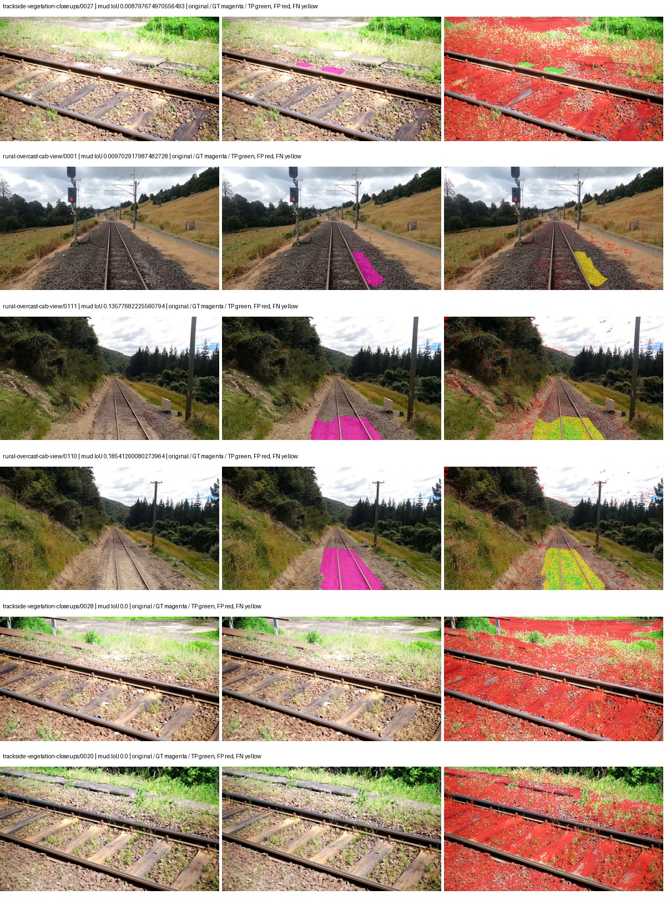
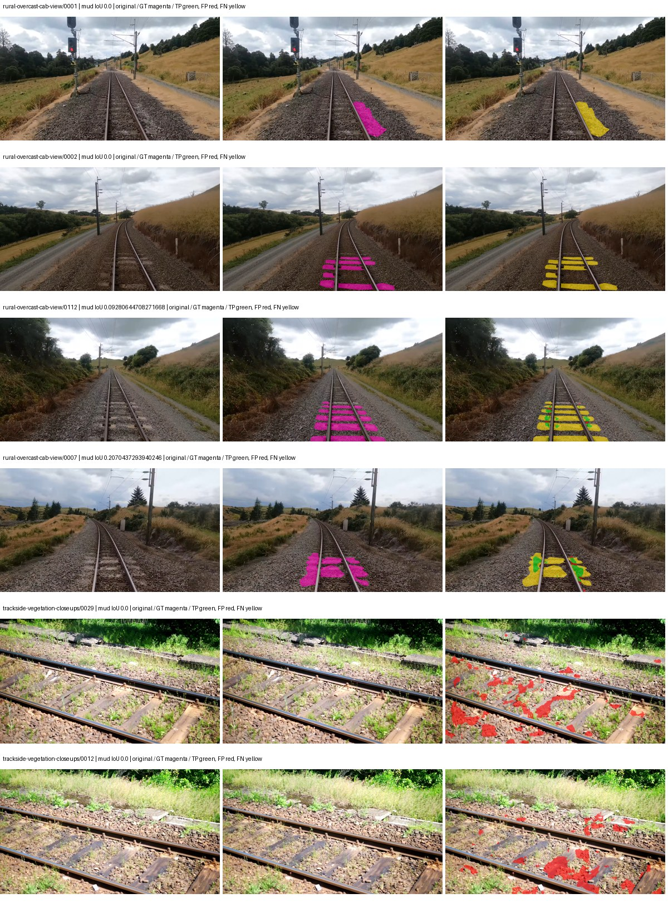
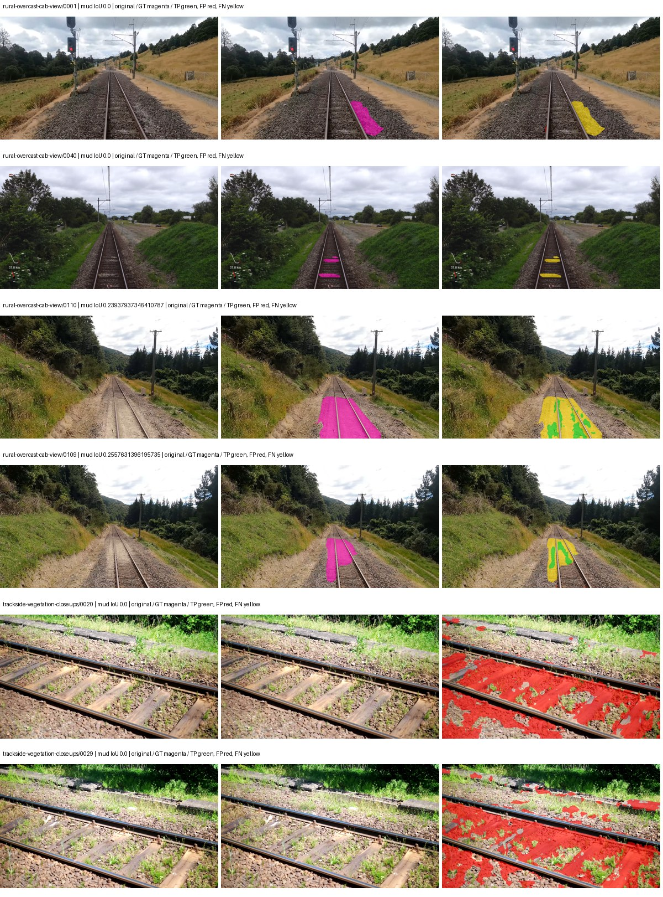
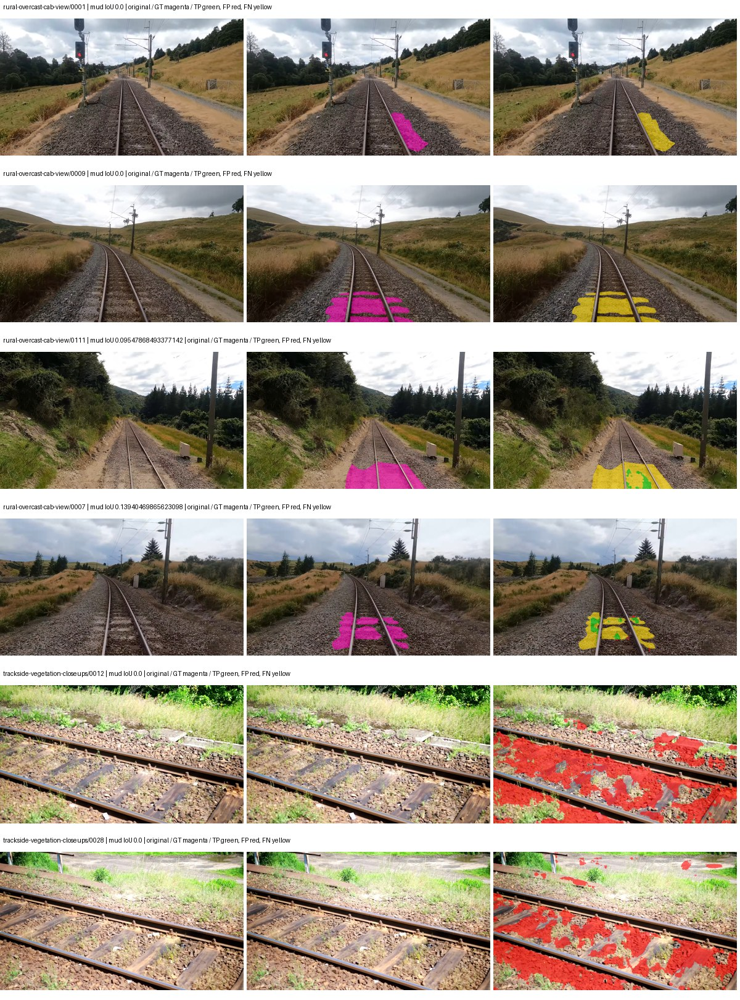

# native_mobilenetv3_large_lraspp — rad_9_24_2026-fixed-grouped

[RAD 9/24: Scene-grouped split](../../README.md) · [Full model records](record.json)

Primary result: the **final checkpoint** after the full step budget (no early stopping). The checkpoint with the best **mud-pumping validation IoU, pixels pooled over all validation images**, is kept as secondary evidence. A job is complete only after full statistics and isolated profiling are verified.

Study metrics of the final checkpoint, counting each class only on the validation images that contain it: mud-pumping IoU is the mean per-image IoU over the images with mud-pumping, precision and recall sum pixels over those images, and mIoU averages each class over the images that contain it, then over the classes present.

| Initialization path | Seed | Mud-pumping IoU, train-camera images with mud (%, n=17) | Mud-pumping IoU, all images with mud (%, n=18) | Mud precision, all images with mud (%) | Mud recall, all images with mud (%) | mIoU (each class over images that contain it) (%) |
| --- | --- | --- | --- | --- | --- | --- |
| rtis_only | 0 | 0.46 | 0.60 | 4.92 | 1.69 | 29.41 |
| cityscapes_to_rtis | 0 | 2.36 | 2.34 | 8.24 | 2.92 | 29.52 |
| railsem19_to_rtis | 0 | 9.48 | 9.02 | 26.50 | 12.91 | 34.44 |
| cityscapes_to_railsem19_to_rtis | 0 | 1.18 | 1.16 | 2.90 | 1.90 | 32.10 |

Per-class IoU: IoU (%) of every class, each averaged only over the validation images that contain the class (n = those images); — = no image contains it. mIoU averages the classes with at least one such image.

| Initialization path | Seed | mIoU (each class over images that contain it) | person (n=0) | truck (n=0) | rail-track (n=37) | vegetation-overgrowth (n=13) | car (n=3) | on-rails (n=0) | traffic-sign (n=9) | road (n=11) | sidewalk (n=12) | construction (n=12) | tram-track (n=2) | pole (n=21) | traffic-light (n=3) | mud-pumping (n=18) | fence (n=7) | terrain (n=35) | sky (n=28) | rail-embedded (n=3) | rail-raised (n=37) | trackbed (n=37) | standing-water (n=9) |
| --- | --- | --- | --- | --- | --- | --- | --- | --- | --- | --- | --- | --- | --- | --- | --- | --- | --- | --- | --- | --- | --- | --- | --- |
| rtis_only | 0 | 29.41 | — | — | 51.38 | 31.77 | 3.14 | — | 10.79 | 8.30 | 12.01 | 27.13 | 0.23 | 56.69 | 14.71 | 0.60 | 10.51 | 84.36 | 94.42 | 0.00 | 65.31 | 56.16 | 1.94 |
| cityscapes_to_rtis | 0 | 29.52 | — | — | 46.25 | 13.87 | 5.81 | — | 13.24 | 4.92 | 8.06 | 34.81 | 0.71 | 55.40 | 25.49 | 2.34 | 15.07 | 83.54 | 94.59 | 0.00 | 63.13 | 55.22 | 8.95 |
| railsem19_to_rtis | 0 | 34.44 | — | — | 56.62 | 20.10 | 13.37 | — | 26.68 | 9.18 | 15.70 | 34.14 | 12.28 | 62.67 | 27.83 | 9.02 | 19.38 | 87.21 | 96.41 | 2.03 | 64.94 | 62.36 | 0.00 |
| cityscapes_to_railsem19_to_rtis | 0 | 32.10 | — | — | 50.33 | 25.98 | 19.91 | — | 17.39 | 7.66 | 14.66 | 32.92 | 2.15 | 60.31 | 32.44 | 1.16 | 7.17 | 85.38 | 95.60 | 0.25 | 64.87 | 58.86 | 0.81 |

Everything below is the campaign's own record, with pixels pooled over all validation images: its evaluation is the checkpoint that scored best on that pooled mud IoU (secondary evidence here); the diagnostics also cover the final checkpoint (`final-auto-val`).

| Model | Initialization path | Seed | Status | Steps | Best step | Best-checkpoint mud IoU, pixels pooled (%) | Best-checkpoint mud precision, pixels pooled (%) | Best-checkpoint mud recall, pixels pooled (%) | Final mud IoU (trainer val, pixels pooled, %) | Best-checkpoint mIoU, pixels pooled (%) | Best-checkpoint fixed GT-class mIoU, pixels pooled (%) |
| --- | --- | --- | --- | --- | --- | --- | --- | --- | --- | --- | --- |
| native_mobilenetv3_large_lraspp | rtis_only | 0 | completed | 4000 | 259 | 1.96 | 2.16 | 17.74 | 0.58 | 16.15 | 18.84 |
| native_mobilenetv3_large_lraspp | cityscapes_to_rtis | 0 | completed | 4000 | 2074 | 2.04 | 5.56 | 3.11 | 1.01 | 25.95 | 30.27 |
| native_mobilenetv3_large_lraspp | railsem19_to_rtis | 0 | completed | 4000 | 1555 | 2.87 | 3.74 | 11.00 | 2.87 | 35.39 | 41.29 |
| native_mobilenetv3_large_lraspp | cityscapes_to_railsem19_to_rtis | 0 | completed | 4000 | 1037 | 0.93 | 1.27 | 3.44 | 0.40 | 29.84 | 34.82 |

Training: 217 images. Validation: 37 images. Test: 60 held out. Seeds: [0]. Seed variation measures optimization variability, not independent-recording uncertainty. Historical source checkpoints stay fixed across adaptation seeds.

Training code: `fce0ea0ac50b334d4252812c396e0e593def375d`. Split SHA-256: `12d7b367c72cda61d57686ff2ac28223530d0af49debd9fb7a0fbc68b908bc93`.

## rtis_only — seed 0

Status: **completed**. Started: 2026-10-11T07:56:15.209617+00:00. Finished: 2026-10-11T08:38:04.150069+00:00.

Recipe pretrained initializer: `{"arch": "native", "backbone_path": null, "batch_norm_momentum": null, "checkpoint": null, "classifier_path": null, "drop_path": null, "encoder_name": null, "encoder_weights": null, "head": "unified_head", "head_paths": [], "inactive_parameter_paths": [], "local_files_only": false, "lora_alpha": 32, "lora_dropout": 0.05, "lora_r": 16, "lora_targets": [], "native": {"auxiliary_heads": [], "backbone": {"in_channels": 3, "kind": "timm", "name": "mobilenetv3_large_100.ra_in1k", "out_indices": [1, 2, 3, 4], "weights": "pretrained"}, "head": {"activation": "relu", "channels": 128, "dropout": 0.1, "high_index": 3, "kind": "lraspp", "low_index": 0, "norm": "group"}, "neck": {"kind": "identity"}, "task": "multiclass"}, "revision": null, "smp_arch": null, "subfolder": null, "trust_remote_code": false, "tuning": "full"}`.

`rtis_only` uses the recipe initializer, which may include pretrained segmentation components. Transfer paths load the exact historical source checkpoint below and reset the classifier; they do not reset all query/decoder features.

Source checkpoint: `Recipe pretrained initialization`.

Config SHA-256: `11122161098b2be460e75266419467c3e3dba908b9d4fda3e2089ec55870df15`. Weights used for validation: `raw`.

### Mud-pumping and aggregate quality

| Metric | Selected checkpoint | Final training validation |
| --- | --- | --- |
| Mud IoU | 1.96 | 0.58 |
| Mud precision | 2.16 | 0.87 |
| Mud recall | 17.74 | 1.70 |
| Mud Dice/F1 | 3.84 | 1.15 |
| mIoU | 16.15 | 26.67 |
| Mean accuracy | 26.40 | 38.42 |
| Mean precision | 24.35 | 43.84 |
| Mean Dice | 20.74 | 34.40 |
| Mean specificity | 98.32 | 98.95 |
| Pixel accuracy | 70.50 | 82.23 |
| Frequency-weighted IoU | 62.46 | 73.91 |
| Fixed GT-present class mIoU | 18.84 | 31.11 |
| Boundary F1 | 17.95 | 31.12 |

The selected checkpoint has independent evaluation evidence. Final values are the trainer's final validation record, not a new independent evaluation. mIoU averages classes with nonzero union, so false positives on absent classes can change its denominator. The fixed GT-class mean is supplementary and excludes absent classes; their false positives remain in the confusion matrix.

### Resource usage and timing

| Measurement | Value |
| --- | --- |
| Peak training VRAM, retained training invocation (GiB) | 6.72 |
| Peak evaluation VRAM (GiB) | 6.51 |
| Retained training invocation wall time (seconds) | 2380.82 |
| Retained training invocation GPU-hours (one GPU) | 0.66 |
| Evaluation wall time (seconds) | 9.83 |
| Full evaluation pipeline images/second | 3.76 |
| Best full-state checkpoint (MiB) | 49.71 |
| Final full-state checkpoint (MiB) | 49.70 |
| Verified periodic checkpoints removed (GiB) | 0.39 |

VRAM uses the recorded allocator high-water mark; it is not total device usage including CUDA context. Resumed jobs' retained training invocation times and peaks are **not whole-campaign totals**. Earlier invocation resource records are not reconstructed here. Evaluation throughput includes loader, sliding-window inference and metrics; it is not model-only latency/FPS. Missing measurements are shown as —, never inferred from another dataset's run.

### Standardized inference performance

Dedicated model-only profiling waits for an idle worker-locked L40S: BF16, batch 1, 1024x1024, 20 warmup and 100 CUDA-event-timed public forwards. It excludes loading, preprocessing, tiling and metrics.

| Status | Parameters | Weight MiB | FPS | p50 ms | p95 ms | Peak reserved GiB |
| --- | --- | --- | --- | --- | --- | --- |
| complete | 3221330 | 12.29 | 220.66 | 4.24 | 5.92 | 0.30 |

```json
{
  "schema_version": 1,
  "model_id": "native_mobilenetv3_large_lraspp",
  "measured_at": "2026-10-11T08:38:02+00:00",
  "status": "complete",
  "benchmark_scope": "rtis_selected_checkpoint_model_only",
  "applies_to": [
    "native_mobilenetv3_large_lraspp--rtis_only--seed-0"
  ],
  "source": {
    "campaign_git_sha": "fce0ea0ac50b334d4252812c396e0e593def375d",
    "git_dirty": false,
    "config_hash": "c0b6d542c671",
    "resolved_config": "/data/izadia1/projects/segmentary-runs/rad_9_24_2026/fgall-seed0-20261007/configs/native_mobilenetv3_large_lraspp--rtis_only--seed-0.yaml",
    "config_sha256": "11122161098b2be460e75266419467c3e3dba908b9d4fda3e2089ec55870df15",
    "checkpoint_sha256": "d15cb4811060da594fd45fe7cb53c9a3890cd6b6085eb9a513e00bf4c56e6d34",
    "checkpoint_global_step": 259,
    "checkpoint_bytes": 52120962,
    "checkpoint_kind": "resume checkpoint with optimizer and EMA state",
    "weights": "raw",
    "measured_checkpoint_job_id": "native_mobilenetv3_large_lraspp--rtis_only--seed-0",
    "result_sha256": "efa367554acd4d10158f6d715323bc19311a122d6fe7b5494475f37582016780",
    "result_git_sha": "fce0ea0ac50b334d4252812c396e0e593def375d",
    "result_stage": "eval:rad_9_24_2026-fixed-grouped:val",
    "result_seed": 0
  },
  "hardware": {
    "gpu_name": "NVIDIA L40S",
    "gpu_uuid": "GPU-fc5dde96-210d-0afa-ac74-7f88477d622b",
    "logical_device": "cuda:0",
    "physical_visibility_token": "4",
    "compute_capability": [
      8,
      9
    ],
    "total_memory_bytes": 47677177856
  },
  "model": {
    "parameter_count": 3221330,
    "trainable_parameter_count": 3221330,
    "resident_parameter_bytes": 12885320,
    "parameter_dtype_counts": {
      "float32": 3221330
    }
  },
  "contract": {
    "backend": "pytorch",
    "precision": "bf16_autocast",
    "batch_size": 1,
    "input_shape_nchw": [
      1,
      3,
      1024,
      1024
    ],
    "warmup_iterations": 20,
    "measured_iterations": 100,
    "timing": "per-forward CUDA events with end-event synchronization",
    "includes_preprocessing": false,
    "includes_data_loader": false,
    "includes_sliding_window": false,
    "input_resident_on_gpu": true,
    "model_only": true,
    "entrypoint": "public model(image) dense-logits forward"
  },
  "measurements": {
    "latency": {
      "p50_ms": 4.240960121154785,
      "p95_ms": 5.924608039855957,
      "mean_ms": 4.531911706924438,
      "minimum_ms": 4.079616069793701,
      "maximum_ms": 7.3667521476745605,
      "fps": 220.65743215430948,
      "raw_ms": [
        4.593664169311523,
        4.299808025360107,
        4.240384101867676,
        4.245503902435303,
        4.543488025665283,
        4.637695789337158,
        4.931583881378174,
        4.843584060668945,
        4.471807956695557,
        4.288512229919434,
        4.178016185760498,
        4.985856056213379,
        6.723584175109863,
        5.921792030334473,
        4.429759979248047,
        4.247615814208984,
        4.1113600730896,
        4.226047992706299,
        4.488192081451416,
        4.1902079582214355,
        4.164608001708984,
        4.129792213439941,
        4.117504119873047,
        4.169727802276611,
        4.1062397956848145,
        4.120575904846191,
        4.137983798980713,
        4.107264041900635,
        4.108287811279297,
        4.61516809463501,
        4.506624221801758,
        5.909567832946777,
        5.97811222076416,
        5.921760082244873,
        5.87775993347168,
        5.850111961364746,
        5.8787841796875,
        5.921792030334473,
        6.139904022216797,
        6.337535858154297,
        7.3667521476745605,
        4.232192039489746,
        4.129792213439941,
        4.178944110870361,
        4.617216110229492,
        4.586592197418213,
        4.438015937805176,
        4.341760158538818,
        4.659200191497803,
        4.272128105163574,
        4.151296138763428,
        4.126719951629639,
        4.1113600730896,
        4.1748480796813965,
        4.280320167541504,
        4.315135955810547,
        4.221951961517334,
        4.24345588684082,
        4.2415361404418945,
        4.537343978881836,
        4.9132161140441895,
        4.560895919799805,
        4.250624179840088,
        4.188223838806152,
        4.568064212799072,
        4.195328235626221,
        4.155392169952393,
        4.113408088684082,
        4.159488201141357,
        4.1451520919799805,
        4.106112003326416,
        4.110335826873779,
        4.112383842468262,
        4.137983798980713,
        4.110335826873779,
        4.099071979522705,
        4.155360221862793,
        4.143104076385498,
        4.085760116577148,
        4.079616069793701,
        4.414432048797607,
        4.2045440673828125,
        4.192255973815918,
        4.126719951629639,
        4.186111927032471,
        4.250624179840088,
        4.299776077270508,
        4.586495876312256,
        4.168704032897949,
        4.156415939331055,
        4.125696182250977,
        4.114431858062744,
        4.185088157653809,
        4.177919864654541,
        4.234272003173828,
        4.146175861358643,
        5.01043176651001,
        4.934656143188477,
        4.688896179199219,
        4.6735358238220215
      ],
      "percentile_method": "numpy linear interpolation"
    },
    "peak_reserved_bytes": 318767104,
    "memory_kind": "pytorch_cuda_allocator_peak_reserved_excluding_context",
    "process_total_bytes": 847249408,
    "process_total_kind": "nvidia-smi used_memory of this PID on the benchmark GPU after the timed loop, including the CUDA context; null when the driver could not attribute memory to this PID",
    "benchmark_wall_clock_s": 13.408569395542145
  },
  "started_at": "2026-10-11T08:37:48+00:00",
  "finished_at": "2026-10-11T08:38:02+00:00",
  "environment": {
    "hostname": "hdrfs-app-001",
    "python": "3.11.15",
    "platform": "Linux-5.15.0-139-generic-x86_64-with-glibc2.35",
    "torch": "2.11.0+cu128",
    "torch_cuda": "12.8",
    "cudnn": 91900,
    "driver_version": "570.133.20",
    "cuda_available": true,
    "gpu_count": 1,
    "gpu_names": [
      "NVIDIA L40S"
    ],
    "cuda_visible_devices": "4",
    "packages": {
      "segmentary": "0.1.0",
      "torch": "2.11.0+cu128",
      "torchvision": "0.26.0+cu128",
      "transformers": "5.15.0",
      "timm": "1.0.28",
      "segmentation-models-pytorch": "0.5.0",
      "albumentations": "2.0.8",
      "lightning": "2.6.5",
      "numpy": "2.4.4"
    }
  }
}
```

### Per-class validation results

| Class | GT pixels | IoU (%) | Precision (%) | Recall (%) | Dice (%) | Boundary F1 (%) |
| --- | --- | --- | --- | --- | --- | --- |
| car | 29664 | 0.00 | 0.00 | 0.00 | 0.00 | 0.00 |
| construction | 311585 | 6.64 | 6.98 | 57.94 | 12.45 | 10.04 |
| fence | 265137 | 1.97 | 2.40 | 9.94 | 3.87 | 3.02 |
| mud-pumping | 1226250 | 1.96 | 2.16 | 17.74 | 3.84 | 6.37 |
| on-rails | 0 | 0.00 | 0.00 | — | 0.00 | 0.00 |
| person | 0 | 0.00 | 0.00 | — | 0.00 | 0.00 |
| pole | 628038 | 27.91 | 51.93 | 37.63 | 43.64 | 62.84 |
| rail-embedded | 16799 | 0.06 | 0.11 | 0.14 | 0.12 | 0.89 |
| rail-raised | 2969797 | 55.90 | 67.60 | 76.36 | 71.71 | 80.58 |
| rail-track | 6323197 | 18.16 | 49.22 | 22.35 | 30.74 | 47.04 |
| road | 1048831 | 0.54 | 7.76 | 0.57 | 1.06 | 7.55 |
| sidewalk | 1297367 | 11.61 | 57.78 | 12.68 | 20.80 | 13.01 |
| sky | 19121606 | 91.74 | 96.81 | 94.60 | 95.69 | 53.48 |
| standing-water | 95802 | 0.25 | 0.34 | 0.91 | 0.49 | 1.38 |
| terrain | 39239306 | 77.18 | 86.50 | 87.75 | 87.12 | 29.38 |
| trackbed | 10643081 | 43.40 | 68.64 | 54.14 | 60.53 | 45.46 |
| traffic-light | 19510 | 0.01 | 0.02 | 0.06 | 0.03 | 0.00 |
| traffic-sign | 13285 | 0.01 | 0.02 | 0.03 | 0.02 | 0.13 |
| tram-track | 56179 | 0.31 | 0.49 | 0.82 | 0.61 | 0.59 |
| truck | 0 | 0.00 | 0.00 | — | 0.00 | 0.00 |
| vegetation-overgrowth | 5901821 | 1.40 | 12.53 | 1.56 | 2.77 | 15.25 |

### Full-run accounting

| Measurement | Value |
| --- | --- |
| Full GPU-reserved wall seconds, all recorded worker attempts | 2516.90 |
| Full reserved GPU-hours | 0.70 |
| Whole-run timing complete | True |

| Phase | Wall seconds including failed attempts |
| --- | --- |
| training | 2388.07 |
| diagnostics | 82.35 |
| performance | 20.65 |

GPU-reserved time includes model loading, training, validation, collection, profiling, checkpoint I/O and orchestration while the worker owns one GPU. It is not GPU kernel-active time. Phase timings and sampled device memory/power/utilization are retained separately; sampled device memory is not the allocator high-water mark.

### Train/validation and raw/EMA diagnostics

| Checkpoint / weights / split | Images | Mud IoU (%) | Mud precision (%) | Mud recall (%) |
| --- | --- | --- | --- | --- |
| best-auto-train / raw | 217 | 62.50 | 68.23 | 88.16 |
| best-auto-val / raw | 37 | 1.96 | 2.16 | 17.74 |
| best-alternate-val / ema | 37 | 2.45 | 2.69 | 21.76 |
| final-auto-val / raw | 37 | 0.58 | 0.87 | 1.69 |

Train uses the evaluation transform without augmentation. Compare mud train/validation metrics for the same selected weights. Alternate EMA on running-stat BatchNorm is explicitly uncalibrated and is diagnostic only. Score-threshold curves use uncalibrated normalized scores and are pixel-level diagnostics, not event detection rates or a selected deployment operating point.

### Downloadable evidence

- best-auto-train: [per-image.csv](rtis_only--seed-0/best-auto-train/per-image.csv) · [per-image-confusion.json.gz](rtis_only--seed-0/best-auto-train/per-image-confusion.json.gz) · [groups.json](rtis_only--seed-0/best-auto-train/groups.json) · [mud-score-curves.json](rtis_only--seed-0/best-auto-train/mud-score-curves.json)
- best-auto-val: [per-image.csv](rtis_only--seed-0/best-auto-val/per-image.csv) · [per-image-confusion.json.gz](rtis_only--seed-0/best-auto-val/per-image-confusion.json.gz) · [groups.json](rtis_only--seed-0/best-auto-val/groups.json) · [mud-score-curves.json](rtis_only--seed-0/best-auto-val/mud-score-curves.json) · [examples.jpg](rtis_only--seed-0/best-auto-val/examples.jpg)
- best-alternate-val: [per-image.csv](rtis_only--seed-0/best-alternate-val/per-image.csv) · [per-image-confusion.json.gz](rtis_only--seed-0/best-alternate-val/per-image-confusion.json.gz) · [groups.json](rtis_only--seed-0/best-alternate-val/groups.json) · [mud-score-curves.json](rtis_only--seed-0/best-alternate-val/mud-score-curves.json)
- final-auto-val: [per-image.csv](rtis_only--seed-0/final-auto-val/per-image.csv) · [per-image-confusion.json.gz](rtis_only--seed-0/final-auto-val/per-image-confusion.json.gz) · [groups.json](rtis_only--seed-0/final-auto-val/groups.json) · [mud-score-curves.json](rtis_only--seed-0/final-auto-val/mud-score-curves.json)
- resources: [telemetry.csv](rtis_only--seed-0/resources/telemetry.csv)



Examples are two lowest and two highest mud-IoU positive images, plus up to two negative images with the most false-positive mud pixels. They are targeted diagnostic examples, not random samples. Green: true positive; red: false positive; yellow: false negative. Full predictions remain on HDRFS.

### Validation tracking

| Logged step | Overall mIoU (%) | Mud IoU (%) |
| --- | --- | --- |
| 258 | 16.15 | 1.96 |
| 518 | 21.02 | 0.36 |
| 777 | 21.38 | 0.49 |
| 1036 | 21.82 | 0.50 |
| 1295 | 23.72 | 0.42 |
| 1555 | 22.81 | 0.67 |
| 1814 | 25.66 | 0.28 |
| 2073 | 24.48 | 0.51 |
| 2332 | 26.27 | 0.66 |
| 2592 | 25.20 | 0.68 |
| 2851 | 25.78 | 0.50 |
| 3110 | 27.04 | 0.77 |
| 3369 | 26.41 | 0.89 |
| 3629 | 25.73 | 0.69 |
| 3888 | 27.01 | 0.76 |
| 4000 | 26.67 | 0.58 |

All retained scalar curves, including training loss and per-class IoU, are in record.json. Observed best mud on a curve is not necessarily a retained checkpoint: the pilot saved its selection-metric-best and final checkpoints. Step logging and checkpoint global_step may differ by one.

### Stopping and checkpoint provenance

```json
{
  "stopping": {
    "actual_steps": 4000,
    "maximum_steps": 4000,
    "min_delta": 0.0,
    "monitor": "val_iou/mud-pumping",
    "patience": null,
    "reason": "budget_complete"
  },
  "checkpoints": {
    "best": {
      "path": "/data/izadia1/projects/segmentary-runs/rad_9_24_2026/fgall-seed0-20261007/future-runs/native_mobilenetv3_large_lraspp--rtis_only--seed-0_seed0/rtis/best.ckpt",
      "sha256": "d15cb4811060da594fd45fe7cb53c9a3890cd6b6085eb9a513e00bf4c56e6d34",
      "global_step": 259,
      "bytes": 52120962
    },
    "final": {
      "path": "/data/izadia1/projects/segmentary-runs/rad_9_24_2026/fgall-seed0-20261007/future-runs/native_mobilenetv3_large_lraspp--rtis_only--seed-0_seed0/rtis/last.ckpt",
      "sha256": "051ccfbbf2dbadb0b506448af9d16d83b0cfc540df515e3ffe83e5d87ef6fa10",
      "global_step": 4000,
      "bytes": 52110402
    }
  },
  "cleanup_error": null
}
```

### Resolved training, initialization and evaluation settings

The optimizer block is the base configuration. Stage LR scales are applied at runtime, and stage warmup is capped at min(base warmup, floor(stage budget / 10), stage budget - 1): 400 steps for this 4,000-step pilot. Model-internal native input grids may differ from augmentation crops (EoMT uses its 640 grid).

```json
{
  "name": "native_mobilenetv3_large_lraspp--rtis_only--seed-0",
  "model": {
    "arch": "native",
    "checkpoint": null,
    "tuning": "full",
    "head": "unified_head",
    "lora_r": 16,
    "lora_alpha": 32,
    "lora_dropout": 0.05,
    "lora_targets": [],
    "drop_path": null,
    "revision": null,
    "subfolder": null,
    "local_files_only": false,
    "trust_remote_code": false,
    "backbone_path": null,
    "head_paths": [],
    "classifier_path": null,
    "inactive_parameter_paths": [],
    "smp_arch": null,
    "encoder_name": null,
    "encoder_weights": null,
    "native": {
      "task": "multiclass",
      "backbone": {
        "kind": "timm",
        "name": "mobilenetv3_large_100.ra_in1k",
        "weights": "pretrained",
        "out_indices": [
          1,
          2,
          3,
          4
        ],
        "in_channels": 3
      },
      "neck": {
        "kind": "identity"
      },
      "head": {
        "kind": "lraspp",
        "low_index": 0,
        "high_index": 3,
        "channels": 128,
        "dropout": 0.1,
        "norm": "group",
        "activation": "relu"
      },
      "auxiliary_heads": []
    },
    "batch_norm_momentum": null
  },
  "space": "paul-test-rtis",
  "taxonomy_root": "/data/izadia1/projects/segmentary-rad-fgall-fce0ea0a/taxonomy",
  "output_root": "/data/izadia1/projects/segmentary-runs/rad_9_24_2026/fgall-seed0-20261007/future-runs",
  "optim": {
    "backbone_lr": 0.0001,
    "head_lr_mult": 10.0,
    "weight_decay": 0.05,
    "llrd": 1.0,
    "warmup_iters": 1500,
    "warmup_ratio": 1e-06,
    "poly_power": 0.9,
    "min_lr_ratio": 0.0,
    "betas": [
      0.9,
      0.999
    ],
    "grad_clip": 1.0
  },
  "train": {
    "iters": 4000,
    "batch_size": 2,
    "accum": 8,
    "num_workers": 2,
    "precision": "bf16-mixed",
    "ema_decay": 0.9998,
    "val_every": 250,
    "ckpt_every": 500,
    "selection_metric": "val_iou/mud-pumping",
    "early_stopping_patience": null,
    "early_stopping_min_delta": 0.0,
    "seed": 0,
    "devices": 1
  },
  "eval": {
    "sliding_window": true,
    "window": [
      1024,
      1024
    ],
    "stride": [
      768,
      768
    ],
    "batch_size": 1,
    "num_workers": 2,
    "tta_scales": [],
    "tta_flip": false,
    "threshold": 0.5,
    "boundary_tolerance_frac": 0.0075,
    "save_confusion": true
  },
  "loss": {
    "task": "multiclass",
    "activation": "auto",
    "terms": [],
    "aux": "none",
    "aux_weight": 0.0,
    "ce_weight": 1.0,
    "label_smoothing": 0.0,
    "class_weights": null,
    "query": null
  },
  "aug": {
    "crop": [
      1024,
      1024
    ],
    "scale_min": 0.5,
    "scale_max": 2.0,
    "hflip_p": 0.5,
    "color_jitter_p": 0.5,
    "brightness": 0.25,
    "contrast": 0.25,
    "saturation": 0.25,
    "hue": 0.05
  },
  "stages": [
    {
      "name": "rtis",
      "data": [
        {
          "name": "rad_9_24_2026-fixed-grouped",
          "root": "/data/izadia1/datasets/rad_9_24_2026-fixed-grouped",
          "variant": null,
          "split_file": "splits.json",
          "train_split": "train",
          "val_split": "val",
          "limit": null,
          "loader": "folder",
          "mapping": "paul-test-rtis",
          "loader_options": {
            "require_groups": true
          }
        }
      ],
      "iters": null,
      "lr_scale": 1.0,
      "head_group_lr_scale": 1.0,
      "init_from": "pretrained",
      "reset_head": false,
      "freeze": null,
      "sample_weights": null
    }
  ]
}
```

### Hardware and software provenance

```json
{
  "training": {
    "cuda_available": true,
    "cuda_visible_devices": "4",
    "cudnn": 91900,
    "driver_version": "570.133.20",
    "gpu_count": 1,
    "gpu_names": [
      "NVIDIA L40S"
    ],
    "hostname": "hdrfs-app-001",
    "input_normalization": {
      "channel_order": "rgb",
      "mean": [
        0.485,
        0.456,
        0.406
      ],
      "source": "timm_pretrained_cfg",
      "std": [
        0.229,
        0.224,
        0.225
      ]
    },
    "model_origins": [
      {
        "hf_commit": null,
        "hf_name_or_path": null,
        "module": "backbone",
        "timm_pretrained": {
          "architecture": "mobilenetv3_large_100",
          "hf_hub_id": "timm/mobilenetv3_large_100.ra_in1k",
          "tag": "ra_in1k",
          "url": "https://github.com/rwightman/pytorch-image-models/releases/download/v0.1-weights/mobilenetv3_large_100_ra-f55367f5.pth"
        }
      },
      {
        "hf_commit": null,
        "hf_name_or_path": null,
        "module": "backbone.model",
        "timm_pretrained": {
          "architecture": "mobilenetv3_large_100",
          "hf_hub_id": "timm/mobilenetv3_large_100.ra_in1k",
          "tag": "ra_in1k",
          "url": "https://github.com/rwightman/pytorch-image-models/releases/download/v0.1-weights/mobilenetv3_large_100_ra-f55367f5.pth"
        }
      }
    ],
    "model_parameter_count": 3221330,
    "packages": {
      "albumentations": "2.0.8",
      "lightning": "2.6.5",
      "numpy": "2.4.4",
      "segmentary": "0.1.0",
      "segmentation-models-pytorch": "0.5.0",
      "timm": "1.0.28",
      "torch": "2.11.0+cu128",
      "torchvision": "0.26.0+cu128",
      "transformers": "5.15.0"
    },
    "platform": "Linux-5.15.0-139-generic-x86_64-with-glibc2.35",
    "python": "3.11.15",
    "torch": "2.11.0+cu128",
    "torch_cuda": "12.8",
    "trainable_parameter_count": 3221330,
    "training_stop": {
      "actual_steps": 4000,
      "maximum_steps": 4000,
      "min_delta": 0.0,
      "monitor": "val_iou/mud-pumping",
      "patience": null,
      "reason": "budget_complete"
    },
    "validation_weights": "raw"
  },
  "evaluation": {
    "cuda_available": true,
    "cuda_visible_devices": "4",
    "cudnn": 91900,
    "driver_version": "570.133.20",
    "gpu_count": 1,
    "gpu_names": [
      "NVIDIA L40S"
    ],
    "hostname": "hdrfs-app-001",
    "input_normalization": {
      "channel_order": "rgb",
      "mean": [
        0.485,
        0.456,
        0.406
      ],
      "source": "timm_pretrained_cfg",
      "std": [
        0.229,
        0.224,
        0.225
      ]
    },
    "packages": {
      "albumentations": "2.0.8",
      "lightning": "2.6.5",
      "numpy": "2.4.4",
      "segmentary": "0.1.0",
      "segmentation-models-pytorch": "0.5.0",
      "timm": "1.0.28",
      "torch": "2.11.0+cu128",
      "torchvision": "0.26.0+cu128",
      "transformers": "5.15.0"
    },
    "platform": "Linux-5.15.0-139-generic-x86_64-with-glibc2.35",
    "python": "3.11.15",
    "torch": "2.11.0+cu128",
    "torch_cuda": "12.8"
  }
}
```

## cityscapes_to_rtis — seed 0

Status: **completed**. Started: 2026-10-11T07:59:02.962405+00:00. Finished: 2026-10-11T08:40:37.695185+00:00.

Recipe pretrained initializer: `{"arch": "native", "backbone_path": null, "batch_norm_momentum": null, "checkpoint": null, "classifier_path": null, "drop_path": null, "encoder_name": null, "encoder_weights": null, "head": "unified_head", "head_paths": [], "inactive_parameter_paths": [], "local_files_only": false, "lora_alpha": 32, "lora_dropout": 0.05, "lora_r": 16, "lora_targets": [], "native": {"auxiliary_heads": [], "backbone": {"in_channels": 3, "kind": "timm", "name": "mobilenetv3_large_100.ra_in1k", "out_indices": [1, 2, 3, 4], "weights": "pretrained"}, "head": {"activation": "relu", "channels": 128, "dropout": 0.1, "high_index": 3, "kind": "lraspp", "low_index": 0, "norm": "group"}, "neck": {"kind": "identity"}, "task": "multiclass"}, "revision": null, "smp_arch": null, "subfolder": null, "trust_remote_code": false, "tuning": "full"}`.

`rtis_only` uses the recipe initializer, which may include pretrained segmentation components. Transfer paths load the exact historical source checkpoint below and reset the classifier; they do not reset all query/decoder features.

Source checkpoint: `{'name': 'native_mobilenetv3_large_lraspp--cityscapes--seed-0', 'model': 'native_mobilenetv3_large_lraspp', 'protocol': 'cityscapes', 'config': '/data/izadia1/projects/segmentary-runs/all-model-city-rail-seed0-rail20-b9eb3e1/jobs/native_mobilenetv3_large_lraspp--cityscapes--seed-0/attempt-001/resolved-config.yaml', 'checkpoint': '/data/izadia1/projects/segmentary-runs/all-model-city-rail-seed0-rail20-b9eb3e1/jobs/native_mobilenetv3_large_lraspp--cityscapes--seed-0/attempt-001/train/native_mobilenetv3_large_lraspp--cityscapes_seed0/cityscapes/last.ckpt', 'recorded_sha256': 'a944c542712e2c055dd03a1f5a27e2b4cc3ed8fa6a407d464a93891a790e7eae', 'exists': True}`.

Config SHA-256: `9bd0182c6723e84268b13de64b9fda0da086f95e1ead1777e58fe084494aca37`. Weights used for validation: `raw`.

### Mud-pumping and aggregate quality

| Metric | Selected checkpoint | Final training validation |
| --- | --- | --- |
| Mud IoU | 2.04 | 1.01 |
| Mud precision | 5.56 | 1.52 |
| Mud recall | 3.11 | 2.90 |
| Mud Dice/F1 | 3.99 | 2.00 |
| mIoU | 25.95 | 26.83 |
| Mean accuracy | 38.27 | 38.35 |
| Mean precision | 39.05 | 42.08 |
| Mean Dice | 33.37 | 34.62 |
| Mean specificity | 98.82 | 98.83 |
| Pixel accuracy | 80.93 | 81.07 |
| Frequency-weighted IoU | 70.80 | 71.21 |
| Fixed GT-present class mIoU | 30.27 | 31.31 |
| Boundary F1 | 32.35 | 33.72 |

The selected checkpoint has independent evaluation evidence. Final values are the trainer's final validation record, not a new independent evaluation. mIoU averages classes with nonzero union, so false positives on absent classes can change its denominator. The fixed GT-class mean is supplementary and excludes absent classes; their false positives remain in the confusion matrix.

### Resource usage and timing

| Measurement | Value |
| --- | --- |
| Peak training VRAM, retained training invocation (GiB) | 6.72 |
| Peak evaluation VRAM (GiB) | 6.51 |
| Retained training invocation wall time (seconds) | 2379.77 |
| Retained training invocation GPU-hours (one GPU) | 0.66 |
| Evaluation wall time (seconds) | 9.71 |
| Full evaluation pipeline images/second | 3.81 |
| Best full-state checkpoint (MiB) | 49.71 |
| Final full-state checkpoint (MiB) | 49.70 |
| Verified periodic checkpoints removed (GiB) | 0.39 |

VRAM uses the recorded allocator high-water mark; it is not total device usage including CUDA context. Resumed jobs' retained training invocation times and peaks are **not whole-campaign totals**. Earlier invocation resource records are not reconstructed here. Evaluation throughput includes loader, sliding-window inference and metrics; it is not model-only latency/FPS. Missing measurements are shown as —, never inferred from another dataset's run.

### Standardized inference performance

Dedicated model-only profiling waits for an idle worker-locked L40S: BF16, batch 1, 1024x1024, 20 warmup and 100 CUDA-event-timed public forwards. It excludes loading, preprocessing, tiling and metrics.

| Status | Parameters | Weight MiB | FPS | p50 ms | p95 ms | Peak reserved GiB |
| --- | --- | --- | --- | --- | --- | --- |
| complete | 3221330 | 12.29 | 221.73 | 4.33 | 5.15 | 0.30 |

```json
{
  "schema_version": 1,
  "model_id": "native_mobilenetv3_large_lraspp",
  "measured_at": "2026-10-11T08:40:35+00:00",
  "status": "complete",
  "benchmark_scope": "rtis_selected_checkpoint_model_only",
  "applies_to": [
    "native_mobilenetv3_large_lraspp--cityscapes_to_rtis--seed-0"
  ],
  "source": {
    "campaign_git_sha": "fce0ea0ac50b334d4252812c396e0e593def375d",
    "git_dirty": false,
    "config_hash": "99e0e47d985c",
    "resolved_config": "/data/izadia1/projects/segmentary-runs/rad_9_24_2026/fgall-seed0-20261007/configs/native_mobilenetv3_large_lraspp--cityscapes_to_rtis--seed-0.yaml",
    "config_sha256": "9bd0182c6723e84268b13de64b9fda0da086f95e1ead1777e58fe084494aca37",
    "checkpoint_sha256": "2c334d6b370e9eafaef2b49f6ca8695a070d0093f5048c63fb0196ed8b32ac68",
    "checkpoint_global_step": 2074,
    "checkpoint_bytes": 52121346,
    "checkpoint_kind": "resume checkpoint with optimizer and EMA state",
    "weights": "raw",
    "measured_checkpoint_job_id": "native_mobilenetv3_large_lraspp--cityscapes_to_rtis--seed-0",
    "result_sha256": "a9cbf3a5110bba61ce0205f5d9b9e49e31e1ef7d31918ee5165c018ed18750d0",
    "result_git_sha": "fce0ea0ac50b334d4252812c396e0e593def375d",
    "result_stage": "eval:rad_9_24_2026-fixed-grouped:val",
    "result_seed": 0
  },
  "hardware": {
    "gpu_name": "NVIDIA L40S",
    "gpu_uuid": "GPU-804aea8b-5f62-423e-72c6-49e1ed15c4e4",
    "logical_device": "cuda:0",
    "physical_visibility_token": "6",
    "compute_capability": [
      8,
      9
    ],
    "total_memory_bytes": 47677177856
  },
  "model": {
    "parameter_count": 3221330,
    "trainable_parameter_count": 3221330,
    "resident_parameter_bytes": 12885320,
    "parameter_dtype_counts": {
      "float32": 3221330
    }
  },
  "contract": {
    "backend": "pytorch",
    "precision": "bf16_autocast",
    "batch_size": 1,
    "input_shape_nchw": [
      1,
      3,
      1024,
      1024
    ],
    "warmup_iterations": 20,
    "measured_iterations": 100,
    "timing": "per-forward CUDA events with end-event synchronization",
    "includes_preprocessing": false,
    "includes_data_loader": false,
    "includes_sliding_window": false,
    "input_resident_on_gpu": true,
    "model_only": true,
    "entrypoint": "public model(image) dense-logits forward"
  },
  "measurements": {
    "latency": {
      "p50_ms": 4.327424049377441,
      "p95_ms": 5.149828624725342,
      "mean_ms": 4.510023365020752,
      "minimum_ms": 4.1308159828186035,
      "maximum_ms": 7.890944004058838,
      "fps": 221.72834131102084,
      "raw_ms": [
        4.216832160949707,
        4.192255973815918,
        4.688896179199219,
        4.865024089813232,
        4.221951961517334,
        4.406271934509277,
        4.662271976470947,
        4.231167793273926,
        4.275199890136719,
        4.382719993591309,
        4.7032318115234375,
        5.090303897857666,
        4.631552219390869,
        4.215807914733887,
        4.637695789337158,
        4.323328018188477,
        4.587520122528076,
        4.677631855010986,
        4.552703857421875,
        4.581376075744629,
        4.803584098815918,
        5.147679805755615,
        4.678656101226807,
        4.965343952178955,
        4.385791778564453,
        4.575232028961182,
        4.403200149536133,
        4.422656059265137,
        4.465663909912109,
        4.214784145355225,
        4.185088157653809,
        4.192255973815918,
        4.521984100341797,
        4.214784145355225,
        4.205567836761475,
        4.262911796569824,
        4.290559768676758,
        4.273151874542236,
        4.872191905975342,
        5.1906561851501465,
        5.241856098175049,
        4.435967922210693,
        4.570112228393555,
        4.498432159423828,
        4.407296180725098,
        4.197343826293945,
        4.211711883544922,
        4.222976207733154,
        4.244480133056641,
        4.241407871246338,
        4.185088157653809,
        4.683775901794434,
        4.356095790863037,
        4.772863864898682,
        4.626431941986084,
        4.225024223327637,
        4.183040142059326,
        4.240384101867676,
        4.791296005249023,
        4.5793280601501465,
        4.8506879806518555,
        4.5404157638549805,
        4.672512054443359,
        4.950016021728516,
        4.289535999298096,
        4.233215808868408,
        4.525055885314941,
        4.244480133056641,
        4.240384101867676,
        4.280320167541504,
        4.651008129119873,
        5.766143798828125,
        7.668735980987549,
        4.187136173248291,
        4.865024089813232,
        4.254720211029053,
        4.1308159828186035,
        4.131840229034424,
        4.149248123168945,
        4.496384143829346,
        4.170752048492432,
        4.136960029602051,
        4.167679786682129,
        4.140031814575195,
        4.15231990814209,
        4.1451520919799805,
        4.151296138763428,
        4.151296138763428,
        4.207615852355957,
        4.247551918029785,
        4.331520080566406,
        4.304895877838135,
        4.314112186431885,
        7.890944004058838,
        4.25984001159668,
        4.7472639083862305,
        4.530176162719727,
        4.177919864654541,
        4.176896095275879,
        4.140031814575195
      ],
      "percentile_method": "numpy linear interpolation"
    },
    "peak_reserved_bytes": 318767104,
    "memory_kind": "pytorch_cuda_allocator_peak_reserved_excluding_context",
    "process_total_bytes": 847249408,
    "process_total_kind": "nvidia-smi used_memory of this PID on the benchmark GPU after the timed loop, including the CUDA context; null when the driver could not attribute memory to this PID",
    "benchmark_wall_clock_s": 13.398006789386272
  },
  "started_at": "2026-10-11T08:40:22+00:00",
  "finished_at": "2026-10-11T08:40:35+00:00",
  "environment": {
    "hostname": "hdrfs-app-001",
    "python": "3.11.15",
    "platform": "Linux-5.15.0-139-generic-x86_64-with-glibc2.35",
    "torch": "2.11.0+cu128",
    "torch_cuda": "12.8",
    "cudnn": 91900,
    "driver_version": "570.133.20",
    "cuda_available": true,
    "gpu_count": 1,
    "gpu_names": [
      "NVIDIA L40S"
    ],
    "cuda_visible_devices": "6",
    "packages": {
      "segmentary": "0.1.0",
      "torch": "2.11.0+cu128",
      "torchvision": "0.26.0+cu128",
      "transformers": "5.15.0",
      "timm": "1.0.28",
      "segmentation-models-pytorch": "0.5.0",
      "albumentations": "2.0.8",
      "lightning": "2.6.5",
      "numpy": "2.4.4"
    }
  }
}
```

### Per-class validation results

| Class | GT pixels | IoU (%) | Precision (%) | Recall (%) | Dice (%) | Boundary F1 (%) |
| --- | --- | --- | --- | --- | --- | --- |
| car | 29664 | 2.76 | 17.83 | 3.16 | 5.37 | 24.57 |
| construction | 311585 | 38.92 | 53.36 | 58.97 | 56.03 | 46.59 |
| fence | 265137 | 7.40 | 12.33 | 15.61 | 13.78 | 13.02 |
| mud-pumping | 1226250 | 2.04 | 5.56 | 3.11 | 3.99 | 6.18 |
| on-rails | 0 | 0.00 | 0.00 | — | 0.00 | 0.00 |
| person | 0 | 0.00 | 0.00 | — | 0.00 | 0.00 |
| pole | 628038 | 59.81 | 77.81 | 72.10 | 74.85 | 86.57 |
| rail-embedded | 16799 | 0.00 | 0.00 | 0.00 | 0.00 | 0.00 |
| rail-raised | 2969797 | 63.66 | 72.43 | 84.02 | 77.80 | 80.89 |
| rail-track | 6323197 | 32.49 | 60.52 | 41.23 | 49.05 | 49.72 |
| road | 1048831 | 5.03 | 12.07 | 7.93 | 9.57 | 12.09 |
| sidewalk | 1297367 | 11.45 | 53.19 | 12.73 | 20.55 | 7.74 |
| sky | 19121606 | 97.05 | 99.17 | 97.85 | 98.51 | 87.08 |
| standing-water | 95802 | 0.63 | 0.72 | 5.24 | 1.26 | 2.52 |
| terrain | 39239306 | 86.00 | 88.27 | 97.10 | 92.47 | 51.34 |
| trackbed | 10643081 | 51.56 | 58.68 | 80.96 | 68.04 | 47.34 |
| traffic-light | 19510 | 42.67 | 69.51 | 52.50 | 59.82 | 69.51 |
| traffic-sign | 13285 | 31.37 | 52.73 | 43.65 | 47.76 | 54.21 |
| tram-track | 56179 | 0.86 | 2.74 | 1.25 | 1.71 | 0.00 |
| truck | 0 | 0.00 | 0.00 | — | 0.00 | 0.00 |
| vegetation-overgrowth | 5901821 | 11.23 | 83.11 | 11.50 | 20.20 | 39.88 |

### Full-run accounting

| Measurement | Value |
| --- | --- |
| Full GPU-reserved wall seconds, all recorded worker attempts | 2502.58 |
| Full reserved GPU-hours | 0.70 |
| Whole-run timing complete | True |

| Phase | Wall seconds including failed attempts |
| --- | --- |
| training | 2386.28 |
| diagnostics | 70.74 |
| performance | 20.44 |

GPU-reserved time includes model loading, training, validation, collection, profiling, checkpoint I/O and orchestration while the worker owns one GPU. It is not GPU kernel-active time. Phase timings and sampled device memory/power/utilization are retained separately; sampled device memory is not the allocator high-water mark.

### Train/validation and raw/EMA diagnostics

| Checkpoint / weights / split | Images | Mud IoU (%) | Mud precision (%) | Mud recall (%) |
| --- | --- | --- | --- | --- |
| best-auto-train / raw | 217 | 84.06 | 95.00 | 87.95 |
| best-auto-val / raw | 37 | 2.04 | 5.56 | 3.11 |
| best-alternate-val / ema | 37 | 1.06 | 3.69 | 1.46 |
| final-auto-val / raw | 37 | 1.02 | 1.54 | 2.92 |

Train uses the evaluation transform without augmentation. Compare mud train/validation metrics for the same selected weights. Alternate EMA on running-stat BatchNorm is explicitly uncalibrated and is diagnostic only. Score-threshold curves use uncalibrated normalized scores and are pixel-level diagnostics, not event detection rates or a selected deployment operating point.

### Downloadable evidence

- best-auto-train: [per-image.csv](cityscapes_to_rtis--seed-0/best-auto-train/per-image.csv) · [per-image-confusion.json.gz](cityscapes_to_rtis--seed-0/best-auto-train/per-image-confusion.json.gz) · [groups.json](cityscapes_to_rtis--seed-0/best-auto-train/groups.json) · [mud-score-curves.json](cityscapes_to_rtis--seed-0/best-auto-train/mud-score-curves.json)
- best-auto-val: [per-image.csv](cityscapes_to_rtis--seed-0/best-auto-val/per-image.csv) · [per-image-confusion.json.gz](cityscapes_to_rtis--seed-0/best-auto-val/per-image-confusion.json.gz) · [groups.json](cityscapes_to_rtis--seed-0/best-auto-val/groups.json) · [mud-score-curves.json](cityscapes_to_rtis--seed-0/best-auto-val/mud-score-curves.json) · [examples.jpg](cityscapes_to_rtis--seed-0/best-auto-val/examples.jpg)
- best-alternate-val: [per-image.csv](cityscapes_to_rtis--seed-0/best-alternate-val/per-image.csv) · [per-image-confusion.json.gz](cityscapes_to_rtis--seed-0/best-alternate-val/per-image-confusion.json.gz) · [groups.json](cityscapes_to_rtis--seed-0/best-alternate-val/groups.json) · [mud-score-curves.json](cityscapes_to_rtis--seed-0/best-alternate-val/mud-score-curves.json)
- final-auto-val: [per-image.csv](cityscapes_to_rtis--seed-0/final-auto-val/per-image.csv) · [per-image-confusion.json.gz](cityscapes_to_rtis--seed-0/final-auto-val/per-image-confusion.json.gz) · [groups.json](cityscapes_to_rtis--seed-0/final-auto-val/groups.json) · [mud-score-curves.json](cityscapes_to_rtis--seed-0/final-auto-val/mud-score-curves.json)
- resources: [telemetry.csv](cityscapes_to_rtis--seed-0/resources/telemetry.csv)



Examples are two lowest and two highest mud-IoU positive images, plus up to two negative images with the most false-positive mud pixels. They are targeted diagnostic examples, not random samples. Green: true positive; red: false positive; yellow: false negative. Full predictions remain on HDRFS.

### Validation tracking

| Logged step | Overall mIoU (%) | Mud IoU (%) |
| --- | --- | --- |
| 258 | 18.16 | 0.62 |
| 518 | 20.88 | 0.52 |
| 777 | 23.19 | 0.83 |
| 1036 | 24.65 | 0.90 |
| 1295 | 24.78 | 1.26 |
| 1555 | 24.16 | 0.63 |
| 1814 | 24.92 | 0.39 |
| 2073 | 25.98 | 2.04 |
| 2332 | 26.21 | 0.75 |
| 2592 | 26.66 | 0.99 |
| 2851 | 26.70 | 1.67 |
| 3110 | 25.73 | 0.69 |
| 3369 | 26.35 | 1.40 |
| 3629 | 27.41 | 0.79 |
| 3888 | 26.89 | 1.06 |
| 4000 | 26.83 | 1.01 |

All retained scalar curves, including training loss and per-class IoU, are in record.json. Observed best mud on a curve is not necessarily a retained checkpoint: the pilot saved its selection-metric-best and final checkpoints. Step logging and checkpoint global_step may differ by one.

### Stopping and checkpoint provenance

```json
{
  "stopping": {
    "actual_steps": 4000,
    "maximum_steps": 4000,
    "min_delta": 0.0,
    "monitor": "val_iou/mud-pumping",
    "patience": null,
    "reason": "budget_complete"
  },
  "checkpoints": {
    "best": {
      "path": "/data/izadia1/projects/segmentary-runs/rad_9_24_2026/fgall-seed0-20261007/future-runs/native_mobilenetv3_large_lraspp--cityscapes_to_rtis--seed-0_seed0/rtis/best.ckpt",
      "sha256": "2c334d6b370e9eafaef2b49f6ca8695a070d0093f5048c63fb0196ed8b32ac68",
      "global_step": 2074,
      "bytes": 52121346
    },
    "final": {
      "path": "/data/izadia1/projects/segmentary-runs/rad_9_24_2026/fgall-seed0-20261007/future-runs/native_mobilenetv3_large_lraspp--cityscapes_to_rtis--seed-0_seed0/rtis/last.ckpt",
      "sha256": "d6324a6a9ae833006edb11d8740877ed1c1b032ea0c55d0cf273c6ad593c4231",
      "global_step": 4000,
      "bytes": 52110402
    }
  },
  "cleanup_error": null
}
```

### Resolved training, initialization and evaluation settings

The optimizer block is the base configuration. Stage LR scales are applied at runtime, and stage warmup is capped at min(base warmup, floor(stage budget / 10), stage budget - 1): 400 steps for this 4,000-step pilot. Model-internal native input grids may differ from augmentation crops (EoMT uses its 640 grid).

```json
{
  "name": "native_mobilenetv3_large_lraspp--cityscapes_to_rtis--seed-0",
  "model": {
    "arch": "native",
    "checkpoint": null,
    "tuning": "full",
    "head": "unified_head",
    "lora_r": 16,
    "lora_alpha": 32,
    "lora_dropout": 0.05,
    "lora_targets": [],
    "drop_path": null,
    "revision": null,
    "subfolder": null,
    "local_files_only": false,
    "trust_remote_code": false,
    "backbone_path": null,
    "head_paths": [],
    "classifier_path": null,
    "inactive_parameter_paths": [],
    "smp_arch": null,
    "encoder_name": null,
    "encoder_weights": null,
    "native": {
      "task": "multiclass",
      "backbone": {
        "kind": "timm",
        "name": "mobilenetv3_large_100.ra_in1k",
        "weights": "pretrained",
        "out_indices": [
          1,
          2,
          3,
          4
        ],
        "in_channels": 3
      },
      "neck": {
        "kind": "identity"
      },
      "head": {
        "kind": "lraspp",
        "low_index": 0,
        "high_index": 3,
        "channels": 128,
        "dropout": 0.1,
        "norm": "group",
        "activation": "relu"
      },
      "auxiliary_heads": []
    },
    "batch_norm_momentum": null
  },
  "space": "paul-test-rtis",
  "taxonomy_root": "/data/izadia1/projects/segmentary-rad-fgall-fce0ea0a/taxonomy",
  "output_root": "/data/izadia1/projects/segmentary-runs/rad_9_24_2026/fgall-seed0-20261007/future-runs",
  "optim": {
    "backbone_lr": 0.0001,
    "head_lr_mult": 10.0,
    "weight_decay": 0.05,
    "llrd": 1.0,
    "warmup_iters": 1500,
    "warmup_ratio": 1e-06,
    "poly_power": 0.9,
    "min_lr_ratio": 0.0,
    "betas": [
      0.9,
      0.999
    ],
    "grad_clip": 1.0
  },
  "train": {
    "iters": 4000,
    "batch_size": 2,
    "accum": 8,
    "num_workers": 2,
    "precision": "bf16-mixed",
    "ema_decay": 0.9998,
    "val_every": 250,
    "ckpt_every": 500,
    "selection_metric": "val_iou/mud-pumping",
    "early_stopping_patience": null,
    "early_stopping_min_delta": 0.0,
    "seed": 0,
    "devices": 1
  },
  "eval": {
    "sliding_window": true,
    "window": [
      1024,
      1024
    ],
    "stride": [
      768,
      768
    ],
    "batch_size": 1,
    "num_workers": 2,
    "tta_scales": [],
    "tta_flip": false,
    "threshold": 0.5,
    "boundary_tolerance_frac": 0.0075,
    "save_confusion": true
  },
  "loss": {
    "task": "multiclass",
    "activation": "auto",
    "terms": [],
    "aux": "none",
    "aux_weight": 0.0,
    "ce_weight": 1.0,
    "label_smoothing": 0.0,
    "class_weights": null,
    "query": null
  },
  "aug": {
    "crop": [
      1024,
      1024
    ],
    "scale_min": 0.5,
    "scale_max": 2.0,
    "hflip_p": 0.5,
    "color_jitter_p": 0.5,
    "brightness": 0.25,
    "contrast": 0.25,
    "saturation": 0.25,
    "hue": 0.05
  },
  "stages": [
    {
      "name": "rtis",
      "data": [
        {
          "name": "rad_9_24_2026-fixed-grouped",
          "root": "/data/izadia1/datasets/rad_9_24_2026-fixed-grouped",
          "variant": null,
          "split_file": "splits.json",
          "train_split": "train",
          "val_split": "val",
          "limit": null,
          "loader": "folder",
          "mapping": "paul-test-rtis",
          "loader_options": {
            "require_groups": true
          }
        }
      ],
      "iters": null,
      "lr_scale": 0.1,
      "head_group_lr_scale": 1.0,
      "init_from": "/data/izadia1/projects/segmentary-runs/all-model-city-rail-seed0-rail20-b9eb3e1/jobs/native_mobilenetv3_large_lraspp--cityscapes--seed-0/attempt-001/train/native_mobilenetv3_large_lraspp--cityscapes_seed0/cityscapes/last.ckpt",
      "reset_head": true,
      "freeze": null,
      "sample_weights": null
    }
  ]
}
```

### Hardware and software provenance

```json
{
  "training": {
    "cuda_available": true,
    "cuda_visible_devices": "6",
    "cudnn": 91900,
    "driver_version": "570.133.20",
    "gpu_count": 1,
    "gpu_names": [
      "NVIDIA L40S"
    ],
    "hostname": "hdrfs-app-001",
    "input_normalization": {
      "channel_order": "rgb",
      "mean": [
        0.485,
        0.456,
        0.406
      ],
      "source": "timm_pretrained_cfg",
      "std": [
        0.229,
        0.224,
        0.225
      ]
    },
    "model_origins": [
      {
        "hf_commit": null,
        "hf_name_or_path": null,
        "module": "backbone",
        "timm_pretrained": {
          "architecture": "mobilenetv3_large_100",
          "hf_hub_id": "timm/mobilenetv3_large_100.ra_in1k",
          "tag": "ra_in1k",
          "url": "https://github.com/rwightman/pytorch-image-models/releases/download/v0.1-weights/mobilenetv3_large_100_ra-f55367f5.pth"
        }
      },
      {
        "hf_commit": null,
        "hf_name_or_path": null,
        "module": "backbone.model",
        "timm_pretrained": {
          "architecture": "mobilenetv3_large_100",
          "hf_hub_id": "timm/mobilenetv3_large_100.ra_in1k",
          "tag": "ra_in1k",
          "url": "https://github.com/rwightman/pytorch-image-models/releases/download/v0.1-weights/mobilenetv3_large_100_ra-f55367f5.pth"
        }
      }
    ],
    "model_parameter_count": 3221330,
    "packages": {
      "albumentations": "2.0.8",
      "lightning": "2.6.5",
      "numpy": "2.4.4",
      "segmentary": "0.1.0",
      "segmentation-models-pytorch": "0.5.0",
      "timm": "1.0.28",
      "torch": "2.11.0+cu128",
      "torchvision": "0.26.0+cu128",
      "transformers": "5.15.0"
    },
    "platform": "Linux-5.15.0-139-generic-x86_64-with-glibc2.35",
    "python": "3.11.15",
    "torch": "2.11.0+cu128",
    "torch_cuda": "12.8",
    "trainable_parameter_count": 3221330,
    "training_stop": {
      "actual_steps": 4000,
      "maximum_steps": 4000,
      "min_delta": 0.0,
      "monitor": "val_iou/mud-pumping",
      "patience": null,
      "reason": "budget_complete"
    },
    "validation_weights": "raw"
  },
  "evaluation": {
    "cuda_available": true,
    "cuda_visible_devices": "6",
    "cudnn": 91900,
    "driver_version": "570.133.20",
    "gpu_count": 1,
    "gpu_names": [
      "NVIDIA L40S"
    ],
    "hostname": "hdrfs-app-001",
    "input_normalization": {
      "channel_order": "rgb",
      "mean": [
        0.485,
        0.456,
        0.406
      ],
      "source": "timm_pretrained_cfg",
      "std": [
        0.229,
        0.224,
        0.225
      ]
    },
    "packages": {
      "albumentations": "2.0.8",
      "lightning": "2.6.5",
      "numpy": "2.4.4",
      "segmentary": "0.1.0",
      "segmentation-models-pytorch": "0.5.0",
      "timm": "1.0.28",
      "torch": "2.11.0+cu128",
      "torchvision": "0.26.0+cu128",
      "transformers": "5.15.0"
    },
    "platform": "Linux-5.15.0-139-generic-x86_64-with-glibc2.35",
    "python": "3.11.15",
    "torch": "2.11.0+cu128",
    "torch_cuda": "12.8"
  }
}
```

## railsem19_to_rtis — seed 0

Status: **completed**. Started: 2026-10-11T07:59:44.950186+00:00. Finished: 2026-10-11T08:40:24.237152+00:00.

Recipe pretrained initializer: `{"arch": "native", "backbone_path": null, "batch_norm_momentum": null, "checkpoint": null, "classifier_path": null, "drop_path": null, "encoder_name": null, "encoder_weights": null, "head": "unified_head", "head_paths": [], "inactive_parameter_paths": [], "local_files_only": false, "lora_alpha": 32, "lora_dropout": 0.05, "lora_r": 16, "lora_targets": [], "native": {"auxiliary_heads": [], "backbone": {"in_channels": 3, "kind": "timm", "name": "mobilenetv3_large_100.ra_in1k", "out_indices": [1, 2, 3, 4], "weights": "pretrained"}, "head": {"activation": "relu", "channels": 128, "dropout": 0.1, "high_index": 3, "kind": "lraspp", "low_index": 0, "norm": "group"}, "neck": {"kind": "identity"}, "task": "multiclass"}, "revision": null, "smp_arch": null, "subfolder": null, "trust_remote_code": false, "tuning": "full"}`.

`rtis_only` uses the recipe initializer, which may include pretrained segmentation components. Transfer paths load the exact historical source checkpoint below and reset the classifier; they do not reset all query/decoder features.

Source checkpoint: `{'name': 'native_mobilenetv3_large_lraspp--railsem19--seed-0', 'model': 'native_mobilenetv3_large_lraspp', 'protocol': 'railsem19', 'config': '/data/izadia1/projects/segmentary-runs/all-model-city-rail-seed0-rail20-b9eb3e1/jobs/native_mobilenetv3_large_lraspp--railsem19--seed-0/attempt-001/resolved-config.yaml', 'checkpoint': '/data/izadia1/projects/segmentary-runs/all-model-city-rail-seed0-rail20-b9eb3e1/jobs/native_mobilenetv3_large_lraspp--railsem19--seed-0/attempt-001/train/native_mobilenetv3_large_lraspp--railsem19_seed0/railsem19/last.ckpt', 'recorded_sha256': 'be9b84bff577ee280a91b6f8bd828630210517609183f6721503ff08ca459ff1', 'exists': True}`.

Config SHA-256: `a4aa356866e212ae4a28677cf51d0c5254dcfce7b27ed2d0ec470e1dc9a9b60e`. Weights used for validation: `raw`.

### Mud-pumping and aggregate quality

| Metric | Selected checkpoint | Final training validation |
| --- | --- | --- |
| Mud IoU | 2.87 | 2.87 |
| Mud precision | 3.74 | 3.56 |
| Mud recall | 11.00 | 12.93 |
| Mud Dice/F1 | 5.58 | 5.59 |
| mIoU | 35.39 | 34.75 |
| Mean accuracy | 49.92 | 46.62 |
| Mean precision | 55.72 | 58.78 |
| Mean Dice | 45.67 | 44.69 |
| Mean specificity | 98.92 | 99.00 |
| Pixel accuracy | 82.69 | 82.97 |
| Frequency-weighted IoU | 73.73 | 75.07 |
| Fixed GT-present class mIoU | 41.29 | 38.61 |
| Boundary F1 | 41.55 | 39.72 |

The selected checkpoint has independent evaluation evidence. Final values are the trainer's final validation record, not a new independent evaluation. mIoU averages classes with nonzero union, so false positives on absent classes can change its denominator. The fixed GT-class mean is supplementary and excludes absent classes; their false positives remain in the confusion matrix.

### Resource usage and timing

| Measurement | Value |
| --- | --- |
| Peak training VRAM, retained training invocation (GiB) | 6.72 |
| Peak evaluation VRAM (GiB) | 6.51 |
| Retained training invocation wall time (seconds) | 2324.21 |
| Retained training invocation GPU-hours (one GPU) | 0.65 |
| Evaluation wall time (seconds) | 9.67 |
| Full evaluation pipeline images/second | 3.83 |
| Best full-state checkpoint (MiB) | 49.71 |
| Final full-state checkpoint (MiB) | 49.70 |
| Verified periodic checkpoints removed (GiB) | 0.39 |

VRAM uses the recorded allocator high-water mark; it is not total device usage including CUDA context. Resumed jobs' retained training invocation times and peaks are **not whole-campaign totals**. Earlier invocation resource records are not reconstructed here. Evaluation throughput includes loader, sliding-window inference and metrics; it is not model-only latency/FPS. Missing measurements are shown as —, never inferred from another dataset's run.

### Standardized inference performance

Dedicated model-only profiling waits for an idle worker-locked L40S: BF16, batch 1, 1024x1024, 20 warmup and 100 CUDA-event-timed public forwards. It excludes loading, preprocessing, tiling and metrics.

| Status | Parameters | Weight MiB | FPS | p50 ms | p95 ms | Peak reserved GiB |
| --- | --- | --- | --- | --- | --- | --- |
| complete | 3221330 | 12.29 | 236.75 | 4.17 | 4.54 | 0.30 |

```json
{
  "schema_version": 1,
  "model_id": "native_mobilenetv3_large_lraspp",
  "measured_at": "2026-10-11T08:40:22+00:00",
  "status": "complete",
  "benchmark_scope": "rtis_selected_checkpoint_model_only",
  "applies_to": [
    "native_mobilenetv3_large_lraspp--railsem19_to_rtis--seed-0"
  ],
  "source": {
    "campaign_git_sha": "fce0ea0ac50b334d4252812c396e0e593def375d",
    "git_dirty": false,
    "config_hash": "c9e5c90da0c5",
    "resolved_config": "/data/izadia1/projects/segmentary-runs/rad_9_24_2026/fgall-seed0-20261007/configs/native_mobilenetv3_large_lraspp--railsem19_to_rtis--seed-0.yaml",
    "config_sha256": "a4aa356866e212ae4a28677cf51d0c5254dcfce7b27ed2d0ec470e1dc9a9b60e",
    "checkpoint_sha256": "6508bbe26cbb3a93ca875db36cd42b1b29881a1629a665548e97b1b52ad97d44",
    "checkpoint_global_step": 1555,
    "checkpoint_bytes": 52121346,
    "checkpoint_kind": "resume checkpoint with optimizer and EMA state",
    "weights": "raw",
    "measured_checkpoint_job_id": "native_mobilenetv3_large_lraspp--railsem19_to_rtis--seed-0",
    "result_sha256": "e5bf39c70d4db2e21bc155c7c99f27f922bc79912354893a6566a9b6f1a39574",
    "result_git_sha": "fce0ea0ac50b334d4252812c396e0e593def375d",
    "result_stage": "eval:rad_9_24_2026-fixed-grouped:val",
    "result_seed": 0
  },
  "hardware": {
    "gpu_name": "NVIDIA L40S",
    "gpu_uuid": "GPU-e2e96741-aec9-e90b-5c46-d0d58be90a56",
    "logical_device": "cuda:0",
    "physical_visibility_token": "8",
    "compute_capability": [
      8,
      9
    ],
    "total_memory_bytes": 47677177856
  },
  "model": {
    "parameter_count": 3221330,
    "trainable_parameter_count": 3221330,
    "resident_parameter_bytes": 12885320,
    "parameter_dtype_counts": {
      "float32": 3221330
    }
  },
  "contract": {
    "backend": "pytorch",
    "precision": "bf16_autocast",
    "batch_size": 1,
    "input_shape_nchw": [
      1,
      3,
      1024,
      1024
    ],
    "warmup_iterations": 20,
    "measured_iterations": 100,
    "timing": "per-forward CUDA events with end-event synchronization",
    "includes_preprocessing": false,
    "includes_data_loader": false,
    "includes_sliding_window": false,
    "input_resident_on_gpu": true,
    "model_only": true,
    "entrypoint": "public model(image) dense-logits forward"
  },
  "measurements": {
    "latency": {
      "p50_ms": 4.167680025100708,
      "p95_ms": 4.541951775550842,
      "mean_ms": 4.2239183950424195,
      "minimum_ms": 4.10214376449585,
      "maximum_ms": 5.21011209487915,
      "fps": 236.74699804184007,
      "raw_ms": [
        4.2485761642456055,
        4.571135997772217,
        4.2188801765441895,
        4.150271892547607,
        4.148223876953125,
        4.149248123168945,
        5.21011209487915,
        4.3673601150512695,
        4.142079830169678,
        4.147200107574463,
        4.10214376449585,
        4.140031814575195,
        4.420608043670654,
        4.435967922210693,
        4.199423789978027,
        4.176896095275879,
        4.513823986053467,
        4.21068811416626,
        4.110335826873779,
        4.134912014007568,
        4.136960029602051,
        4.193280220031738,
        4.168704032897949,
        4.155392169952393,
        4.146175861358643,
        4.150271892547607,
        4.267007827758789,
        4.343808174133301,
        4.188159942626953,
        4.222976207733154,
        4.270080089569092,
        4.203519821166992,
        4.158463954925537,
        4.15334415435791,
        4.148223876953125,
        4.140031814575195,
        4.134912014007568,
        4.157440185546875,
        4.146175861358643,
        4.118495941162109,
        4.132863998413086,
        4.192255973815918,
        4.162559986114502,
        4.626431941986084,
        4.186111927032471,
        4.189184188842773,
        4.134912014007568,
        4.167647838592529,
        4.15231990814209,
        4.158463954925537,
        4.533247947692871,
        4.286496162414551,
        4.212736129760742,
        4.16153621673584,
        4.142079830169678,
        4.1902079582214355,
        4.148223876953125,
        4.159488201141357,
        4.164608001708984,
        4.16153621673584,
        4.5404157638549805,
        4.16153621673584,
        4.466623783111572,
        4.213759899139404,
        4.187136173248291,
        4.212736129760742,
        4.183040142059326,
        4.200448036193848,
        4.596735954284668,
        4.184063911437988,
        4.150303840637207,
        4.166656017303467,
        4.492288112640381,
        4.155392169952393,
        4.156415939331055,
        4.15334415435791,
        4.184063911437988,
        4.120575904846191,
        4.137983798980713,
        4.178944110870361,
        4.205567836761475,
        4.186111927032471,
        4.171775817871094,
        4.180992126464844,
        4.156415939331055,
        4.186111927032471,
        4.215807914733887,
        4.133887767791748,
        4.137983798980713,
        4.192255973815918,
        4.186111927032471,
        4.143104076385498,
        4.167712211608887,
        4.155392169952393,
        4.676608085632324,
        4.175871849060059,
        4.16153621673584,
        4.150271892547607,
        4.135968208312988,
        4.1656317710876465
      ],
      "percentile_method": "numpy linear interpolation"
    },
    "peak_reserved_bytes": 318767104,
    "memory_kind": "pytorch_cuda_allocator_peak_reserved_excluding_context",
    "process_total_bytes": 847249408,
    "process_total_kind": "nvidia-smi used_memory of this PID on the benchmark GPU after the timed loop, including the CUDA context; null when the driver could not attribute memory to this PID",
    "benchmark_wall_clock_s": 13.273197866976261
  },
  "started_at": "2026-10-11T08:40:08+00:00",
  "finished_at": "2026-10-11T08:40:22+00:00",
  "environment": {
    "hostname": "hdrfs-app-001",
    "python": "3.11.15",
    "platform": "Linux-5.15.0-139-generic-x86_64-with-glibc2.35",
    "torch": "2.11.0+cu128",
    "torch_cuda": "12.8",
    "cudnn": 91900,
    "driver_version": "570.133.20",
    "cuda_available": true,
    "gpu_count": 1,
    "gpu_names": [
      "NVIDIA L40S"
    ],
    "cuda_visible_devices": "8",
    "packages": {
      "segmentary": "0.1.0",
      "torch": "2.11.0+cu128",
      "torchvision": "0.26.0+cu128",
      "transformers": "5.15.0",
      "timm": "1.0.28",
      "segmentation-models-pytorch": "0.5.0",
      "albumentations": "2.0.8",
      "lightning": "2.6.5",
      "numpy": "2.4.4"
    }
  }
}
```

### Per-class validation results

| Class | GT pixels | IoU (%) | Precision (%) | Recall (%) | Dice (%) | Boundary F1 (%) |
| --- | --- | --- | --- | --- | --- | --- |
| car | 29664 | 36.78 | 72.61 | 42.71 | 53.78 | 43.37 |
| construction | 311585 | 50.73 | 64.92 | 69.88 | 67.31 | 52.51 |
| fence | 265137 | 18.11 | 33.50 | 28.28 | 30.67 | 21.76 |
| mud-pumping | 1226250 | 2.87 | 3.74 | 11.00 | 5.58 | 7.49 |
| on-rails | 0 | 0.00 | 0.00 | — | 0.00 | 0.00 |
| person | 0 | 0.00 | 0.00 | — | 0.00 | 0.00 |
| pole | 628038 | 65.08 | 83.81 | 74.45 | 78.85 | 89.16 |
| rail-embedded | 16799 | 23.39 | 74.96 | 25.38 | 37.92 | 59.28 |
| rail-raised | 2969797 | 66.91 | 79.42 | 80.94 | 80.17 | 86.98 |
| rail-track | 6323197 | 36.68 | 64.90 | 45.76 | 53.67 | 51.11 |
| road | 1048831 | 17.12 | 64.70 | 18.88 | 29.23 | 27.85 |
| sidewalk | 1297367 | 49.22 | 87.75 | 52.85 | 65.97 | 17.22 |
| sky | 19121606 | 98.62 | 99.31 | 99.30 | 99.30 | 97.65 |
| standing-water | 95802 | 0.00 | 0.00 | 0.00 | 0.00 | 0.00 |
| terrain | 39239306 | 87.54 | 88.46 | 98.83 | 93.36 | 56.25 |
| trackbed | 10643081 | 54.95 | 67.68 | 74.50 | 70.92 | 52.24 |
| traffic-light | 19510 | 62.95 | 77.08 | 77.45 | 77.26 | 68.67 |
| traffic-sign | 13285 | 31.55 | 88.14 | 32.95 | 47.96 | 67.60 |
| tram-track | 56179 | 25.49 | 34.36 | 49.69 | 40.63 | 29.03 |
| truck | 0 | 0.00 | 0.00 | — | 0.00 | 0.00 |
| vegetation-overgrowth | 5901821 | 15.27 | 84.72 | 15.70 | 26.49 | 44.29 |

### Full-run accounting

| Measurement | Value |
| --- | --- |
| Full GPU-reserved wall seconds, all recorded worker attempts | 2447.10 |
| Full reserved GPU-hours | 0.68 |
| Whole-run timing complete | True |

| Phase | Wall seconds including failed attempts |
| --- | --- |
| training | 2331.00 |
| diagnostics | 70.56 |
| performance | 20.41 |

GPU-reserved time includes model loading, training, validation, collection, profiling, checkpoint I/O and orchestration while the worker owns one GPU. It is not GPU kernel-active time. Phase timings and sampled device memory/power/utilization are retained separately; sampled device memory is not the allocator high-water mark.

### Train/validation and raw/EMA diagnostics

| Checkpoint / weights / split | Images | Mud IoU (%) | Mud precision (%) | Mud recall (%) |
| --- | --- | --- | --- | --- |
| best-auto-train / raw | 217 | 88.32 | 92.35 | 95.30 |
| best-auto-val / raw | 37 | 2.87 | 3.74 | 11.00 |
| best-alternate-val / ema | 37 | 1.09 | 1.59 | 3.33 |
| final-auto-val / raw | 37 | 2.87 | 3.57 | 12.91 |

Train uses the evaluation transform without augmentation. Compare mud train/validation metrics for the same selected weights. Alternate EMA on running-stat BatchNorm is explicitly uncalibrated and is diagnostic only. Score-threshold curves use uncalibrated normalized scores and are pixel-level diagnostics, not event detection rates or a selected deployment operating point.

### Downloadable evidence

- best-auto-train: [per-image.csv](railsem19_to_rtis--seed-0/best-auto-train/per-image.csv) · [per-image-confusion.json.gz](railsem19_to_rtis--seed-0/best-auto-train/per-image-confusion.json.gz) · [groups.json](railsem19_to_rtis--seed-0/best-auto-train/groups.json) · [mud-score-curves.json](railsem19_to_rtis--seed-0/best-auto-train/mud-score-curves.json)
- best-auto-val: [per-image.csv](railsem19_to_rtis--seed-0/best-auto-val/per-image.csv) · [per-image-confusion.json.gz](railsem19_to_rtis--seed-0/best-auto-val/per-image-confusion.json.gz) · [groups.json](railsem19_to_rtis--seed-0/best-auto-val/groups.json) · [mud-score-curves.json](railsem19_to_rtis--seed-0/best-auto-val/mud-score-curves.json) · [examples.jpg](railsem19_to_rtis--seed-0/best-auto-val/examples.jpg)
- best-alternate-val: [per-image.csv](railsem19_to_rtis--seed-0/best-alternate-val/per-image.csv) · [per-image-confusion.json.gz](railsem19_to_rtis--seed-0/best-alternate-val/per-image-confusion.json.gz) · [groups.json](railsem19_to_rtis--seed-0/best-alternate-val/groups.json) · [mud-score-curves.json](railsem19_to_rtis--seed-0/best-alternate-val/mud-score-curves.json)
- final-auto-val: [per-image.csv](railsem19_to_rtis--seed-0/final-auto-val/per-image.csv) · [per-image-confusion.json.gz](railsem19_to_rtis--seed-0/final-auto-val/per-image-confusion.json.gz) · [groups.json](railsem19_to_rtis--seed-0/final-auto-val/groups.json) · [mud-score-curves.json](railsem19_to_rtis--seed-0/final-auto-val/mud-score-curves.json)
- resources: [telemetry.csv](railsem19_to_rtis--seed-0/resources/telemetry.csv)



Examples are two lowest and two highest mud-IoU positive images, plus up to two negative images with the most false-positive mud pixels. They are targeted diagnostic examples, not random samples. Green: true positive; red: false positive; yellow: false negative. Full predictions remain on HDRFS.

### Validation tracking

| Logged step | Overall mIoU (%) | Mud IoU (%) |
| --- | --- | --- |
| 258 | 24.13 | 0.05 |
| 518 | 32.43 | 0.40 |
| 777 | 33.52 | 0.91 |
| 1036 | 34.41 | 1.95 |
| 1295 | 34.87 | 2.09 |
| 1555 | 35.36 | 2.88 |
| 1814 | 35.16 | 1.58 |
| 2073 | 34.35 | 1.09 |
| 2332 | 35.00 | 1.51 |
| 2592 | 33.47 | 1.71 |
| 2851 | 31.68 | 2.46 |
| 3110 | 33.69 | 2.63 |
| 3369 | 32.53 | 2.14 |
| 3629 | 35.11 | 2.08 |
| 3888 | 35.23 | 1.68 |
| 4000 | 34.75 | 2.87 |

All retained scalar curves, including training loss and per-class IoU, are in record.json. Observed best mud on a curve is not necessarily a retained checkpoint: the pilot saved its selection-metric-best and final checkpoints. Step logging and checkpoint global_step may differ by one.

### Stopping and checkpoint provenance

```json
{
  "stopping": {
    "actual_steps": 4000,
    "maximum_steps": 4000,
    "min_delta": 0.0,
    "monitor": "val_iou/mud-pumping",
    "patience": null,
    "reason": "budget_complete"
  },
  "checkpoints": {
    "best": {
      "path": "/data/izadia1/projects/segmentary-runs/rad_9_24_2026/fgall-seed0-20261007/future-runs/native_mobilenetv3_large_lraspp--railsem19_to_rtis--seed-0_seed0/rtis/best.ckpt",
      "sha256": "6508bbe26cbb3a93ca875db36cd42b1b29881a1629a665548e97b1b52ad97d44",
      "global_step": 1555,
      "bytes": 52121346
    },
    "final": {
      "path": "/data/izadia1/projects/segmentary-runs/rad_9_24_2026/fgall-seed0-20261007/future-runs/native_mobilenetv3_large_lraspp--railsem19_to_rtis--seed-0_seed0/rtis/last.ckpt",
      "sha256": "53865f2276ed85c2cbf6c8e806fc3405f5c3ba4b5aa9cae2035e8e42d0c47ef8",
      "global_step": 4000,
      "bytes": 52110402
    }
  },
  "cleanup_error": null
}
```

### Resolved training, initialization and evaluation settings

The optimizer block is the base configuration. Stage LR scales are applied at runtime, and stage warmup is capped at min(base warmup, floor(stage budget / 10), stage budget - 1): 400 steps for this 4,000-step pilot. Model-internal native input grids may differ from augmentation crops (EoMT uses its 640 grid).

```json
{
  "name": "native_mobilenetv3_large_lraspp--railsem19_to_rtis--seed-0",
  "model": {
    "arch": "native",
    "checkpoint": null,
    "tuning": "full",
    "head": "unified_head",
    "lora_r": 16,
    "lora_alpha": 32,
    "lora_dropout": 0.05,
    "lora_targets": [],
    "drop_path": null,
    "revision": null,
    "subfolder": null,
    "local_files_only": false,
    "trust_remote_code": false,
    "backbone_path": null,
    "head_paths": [],
    "classifier_path": null,
    "inactive_parameter_paths": [],
    "smp_arch": null,
    "encoder_name": null,
    "encoder_weights": null,
    "native": {
      "task": "multiclass",
      "backbone": {
        "kind": "timm",
        "name": "mobilenetv3_large_100.ra_in1k",
        "weights": "pretrained",
        "out_indices": [
          1,
          2,
          3,
          4
        ],
        "in_channels": 3
      },
      "neck": {
        "kind": "identity"
      },
      "head": {
        "kind": "lraspp",
        "low_index": 0,
        "high_index": 3,
        "channels": 128,
        "dropout": 0.1,
        "norm": "group",
        "activation": "relu"
      },
      "auxiliary_heads": []
    },
    "batch_norm_momentum": null
  },
  "space": "paul-test-rtis",
  "taxonomy_root": "/data/izadia1/projects/segmentary-rad-fgall-fce0ea0a/taxonomy",
  "output_root": "/data/izadia1/projects/segmentary-runs/rad_9_24_2026/fgall-seed0-20261007/future-runs",
  "optim": {
    "backbone_lr": 0.0001,
    "head_lr_mult": 10.0,
    "weight_decay": 0.05,
    "llrd": 1.0,
    "warmup_iters": 1500,
    "warmup_ratio": 1e-06,
    "poly_power": 0.9,
    "min_lr_ratio": 0.0,
    "betas": [
      0.9,
      0.999
    ],
    "grad_clip": 1.0
  },
  "train": {
    "iters": 4000,
    "batch_size": 2,
    "accum": 8,
    "num_workers": 2,
    "precision": "bf16-mixed",
    "ema_decay": 0.9998,
    "val_every": 250,
    "ckpt_every": 500,
    "selection_metric": "val_iou/mud-pumping",
    "early_stopping_patience": null,
    "early_stopping_min_delta": 0.0,
    "seed": 0,
    "devices": 1
  },
  "eval": {
    "sliding_window": true,
    "window": [
      1024,
      1024
    ],
    "stride": [
      768,
      768
    ],
    "batch_size": 1,
    "num_workers": 2,
    "tta_scales": [],
    "tta_flip": false,
    "threshold": 0.5,
    "boundary_tolerance_frac": 0.0075,
    "save_confusion": true
  },
  "loss": {
    "task": "multiclass",
    "activation": "auto",
    "terms": [],
    "aux": "none",
    "aux_weight": 0.0,
    "ce_weight": 1.0,
    "label_smoothing": 0.0,
    "class_weights": null,
    "query": null
  },
  "aug": {
    "crop": [
      1024,
      1024
    ],
    "scale_min": 0.5,
    "scale_max": 2.0,
    "hflip_p": 0.5,
    "color_jitter_p": 0.5,
    "brightness": 0.25,
    "contrast": 0.25,
    "saturation": 0.25,
    "hue": 0.05
  },
  "stages": [
    {
      "name": "rtis",
      "data": [
        {
          "name": "rad_9_24_2026-fixed-grouped",
          "root": "/data/izadia1/datasets/rad_9_24_2026-fixed-grouped",
          "variant": null,
          "split_file": "splits.json",
          "train_split": "train",
          "val_split": "val",
          "limit": null,
          "loader": "folder",
          "mapping": "paul-test-rtis",
          "loader_options": {
            "require_groups": true
          }
        }
      ],
      "iters": null,
      "lr_scale": 0.1,
      "head_group_lr_scale": 1.0,
      "init_from": "/data/izadia1/projects/segmentary-runs/all-model-city-rail-seed0-rail20-b9eb3e1/jobs/native_mobilenetv3_large_lraspp--railsem19--seed-0/attempt-001/train/native_mobilenetv3_large_lraspp--railsem19_seed0/railsem19/last.ckpt",
      "reset_head": true,
      "freeze": null,
      "sample_weights": null
    }
  ]
}
```

### Hardware and software provenance

```json
{
  "training": {
    "cuda_available": true,
    "cuda_visible_devices": "8",
    "cudnn": 91900,
    "driver_version": "570.133.20",
    "gpu_count": 1,
    "gpu_names": [
      "NVIDIA L40S"
    ],
    "hostname": "hdrfs-app-001",
    "input_normalization": {
      "channel_order": "rgb",
      "mean": [
        0.485,
        0.456,
        0.406
      ],
      "source": "timm_pretrained_cfg",
      "std": [
        0.229,
        0.224,
        0.225
      ]
    },
    "model_origins": [
      {
        "hf_commit": null,
        "hf_name_or_path": null,
        "module": "backbone",
        "timm_pretrained": {
          "architecture": "mobilenetv3_large_100",
          "hf_hub_id": "timm/mobilenetv3_large_100.ra_in1k",
          "tag": "ra_in1k",
          "url": "https://github.com/rwightman/pytorch-image-models/releases/download/v0.1-weights/mobilenetv3_large_100_ra-f55367f5.pth"
        }
      },
      {
        "hf_commit": null,
        "hf_name_or_path": null,
        "module": "backbone.model",
        "timm_pretrained": {
          "architecture": "mobilenetv3_large_100",
          "hf_hub_id": "timm/mobilenetv3_large_100.ra_in1k",
          "tag": "ra_in1k",
          "url": "https://github.com/rwightman/pytorch-image-models/releases/download/v0.1-weights/mobilenetv3_large_100_ra-f55367f5.pth"
        }
      }
    ],
    "model_parameter_count": 3221330,
    "packages": {
      "albumentations": "2.0.8",
      "lightning": "2.6.5",
      "numpy": "2.4.4",
      "segmentary": "0.1.0",
      "segmentation-models-pytorch": "0.5.0",
      "timm": "1.0.28",
      "torch": "2.11.0+cu128",
      "torchvision": "0.26.0+cu128",
      "transformers": "5.15.0"
    },
    "platform": "Linux-5.15.0-139-generic-x86_64-with-glibc2.35",
    "python": "3.11.15",
    "torch": "2.11.0+cu128",
    "torch_cuda": "12.8",
    "trainable_parameter_count": 3221330,
    "training_stop": {
      "actual_steps": 4000,
      "maximum_steps": 4000,
      "min_delta": 0.0,
      "monitor": "val_iou/mud-pumping",
      "patience": null,
      "reason": "budget_complete"
    },
    "validation_weights": "raw"
  },
  "evaluation": {
    "cuda_available": true,
    "cuda_visible_devices": "8",
    "cudnn": 91900,
    "driver_version": "570.133.20",
    "gpu_count": 1,
    "gpu_names": [
      "NVIDIA L40S"
    ],
    "hostname": "hdrfs-app-001",
    "input_normalization": {
      "channel_order": "rgb",
      "mean": [
        0.485,
        0.456,
        0.406
      ],
      "source": "timm_pretrained_cfg",
      "std": [
        0.229,
        0.224,
        0.225
      ]
    },
    "packages": {
      "albumentations": "2.0.8",
      "lightning": "2.6.5",
      "numpy": "2.4.4",
      "segmentary": "0.1.0",
      "segmentation-models-pytorch": "0.5.0",
      "timm": "1.0.28",
      "torch": "2.11.0+cu128",
      "torchvision": "0.26.0+cu128",
      "transformers": "5.15.0"
    },
    "platform": "Linux-5.15.0-139-generic-x86_64-with-glibc2.35",
    "python": "3.11.15",
    "torch": "2.11.0+cu128",
    "torch_cuda": "12.8"
  }
}
```

## cityscapes_to_railsem19_to_rtis — seed 0

Status: **completed**. Started: 2026-10-11T08:02:44.664742+00:00. Finished: 2026-10-11T08:44:07.113077+00:00.

Recipe pretrained initializer: `{"arch": "native", "backbone_path": null, "batch_norm_momentum": null, "checkpoint": null, "classifier_path": null, "drop_path": null, "encoder_name": null, "encoder_weights": null, "head": "unified_head", "head_paths": [], "inactive_parameter_paths": [], "local_files_only": false, "lora_alpha": 32, "lora_dropout": 0.05, "lora_r": 16, "lora_targets": [], "native": {"auxiliary_heads": [], "backbone": {"in_channels": 3, "kind": "timm", "name": "mobilenetv3_large_100.ra_in1k", "out_indices": [1, 2, 3, 4], "weights": "pretrained"}, "head": {"activation": "relu", "channels": 128, "dropout": 0.1, "high_index": 3, "kind": "lraspp", "low_index": 0, "norm": "group"}, "neck": {"kind": "identity"}, "task": "multiclass"}, "revision": null, "smp_arch": null, "subfolder": null, "trust_remote_code": false, "tuning": "full"}`.

`rtis_only` uses the recipe initializer, which may include pretrained segmentation components. Transfer paths load the exact historical source checkpoint below and reset the classifier; they do not reset all query/decoder features.

Source checkpoint: `{'name': 'native_mobilenetv3_large_lraspp--cityscapes_to_railsem19--seed-0', 'model': 'native_mobilenetv3_large_lraspp', 'protocol': 'cityscapes_to_railsem19', 'config': '/data/izadia1/projects/segmentary-runs/all-model-city-rail-seed0-rail20-b9eb3e1/jobs/native_mobilenetv3_large_lraspp--cityscapes_to_railsem19--seed-0/attempt-001/resolved-config.yaml', 'checkpoint': '/data/izadia1/projects/segmentary-runs/all-model-city-rail-seed0-rail20-b9eb3e1/jobs/native_mobilenetv3_large_lraspp--cityscapes_to_railsem19--seed-0/attempt-001/train/native_mobilenetv3_large_lraspp--cityscapes_to_railsem19_seed0/railsem19/last.ckpt', 'recorded_sha256': 'ed42edf6c6eb7af834c9a784514d57e6de894c766a20be5c160b6c67734ad822', 'exists': True}`.

Config SHA-256: `4190ba0b5c08fdbe63718ca130d78d4b0c5b8878c9076b8379e12bf4b0ad25a8`. Weights used for validation: `raw`.

### Mud-pumping and aggregate quality

| Metric | Selected checkpoint | Final training validation |
| --- | --- | --- |
| Mud IoU | 0.93 | 0.40 |
| Mud precision | 1.27 | 0.50 |
| Mud recall | 3.44 | 1.91 |
| Mud Dice/F1 | 1.85 | 0.79 |
| mIoU | 29.84 | 31.15 |
| Mean accuracy | 41.74 | 43.36 |
| Mean precision | 45.32 | 49.08 |
| Mean Dice | 37.95 | 39.61 |
| Mean specificity | 98.87 | 98.92 |
| Pixel accuracy | 82.44 | 82.38 |
| Frequency-weighted IoU | 73.09 | 74.08 |
| Fixed GT-present class mIoU | 34.82 | 36.34 |
| Boundary F1 | 35.47 | 36.81 |

The selected checkpoint has independent evaluation evidence. Final values are the trainer's final validation record, not a new independent evaluation. mIoU averages classes with nonzero union, so false positives on absent classes can change its denominator. The fixed GT-class mean is supplementary and excludes absent classes; their false positives remain in the confusion matrix.

### Resource usage and timing

| Measurement | Value |
| --- | --- |
| Peak training VRAM, retained training invocation (GiB) | 6.72 |
| Peak evaluation VRAM (GiB) | 6.51 |
| Retained training invocation wall time (seconds) | 2366.41 |
| Retained training invocation GPU-hours (one GPU) | 0.66 |
| Evaluation wall time (seconds) | 9.69 |
| Full evaluation pipeline images/second | 3.82 |
| Best full-state checkpoint (MiB) | 49.71 |
| Final full-state checkpoint (MiB) | 49.70 |
| Verified periodic checkpoints removed (GiB) | 0.39 |

VRAM uses the recorded allocator high-water mark; it is not total device usage including CUDA context. Resumed jobs' retained training invocation times and peaks are **not whole-campaign totals**. Earlier invocation resource records are not reconstructed here. Evaluation throughput includes loader, sliding-window inference and metrics; it is not model-only latency/FPS. Missing measurements are shown as —, never inferred from another dataset's run.

### Standardized inference performance

Dedicated model-only profiling waits for an idle worker-locked L40S: BF16, batch 1, 1024x1024, 20 warmup and 100 CUDA-event-timed public forwards. It excludes loading, preprocessing, tiling and metrics.

| Status | Parameters | Weight MiB | FPS | p50 ms | p95 ms | Peak reserved GiB |
| --- | --- | --- | --- | --- | --- | --- |
| complete | 3221330 | 12.29 | 205.45 | 4.50 | 6.54 | 0.30 |

```json
{
  "schema_version": 1,
  "model_id": "native_mobilenetv3_large_lraspp",
  "measured_at": "2026-10-11T08:44:05+00:00",
  "status": "complete",
  "benchmark_scope": "rtis_selected_checkpoint_model_only",
  "applies_to": [
    "native_mobilenetv3_large_lraspp--cityscapes_to_railsem19_to_rtis--seed-0"
  ],
  "source": {
    "campaign_git_sha": "fce0ea0ac50b334d4252812c396e0e593def375d",
    "git_dirty": false,
    "config_hash": "4ea2def92e1e",
    "resolved_config": "/data/izadia1/projects/segmentary-runs/rad_9_24_2026/fgall-seed0-20261007/configs/native_mobilenetv3_large_lraspp--cityscapes_to_railsem19_to_rtis--seed-0.yaml",
    "config_sha256": "4190ba0b5c08fdbe63718ca130d78d4b0c5b8878c9076b8379e12bf4b0ad25a8",
    "checkpoint_sha256": "decaf33af445e725fa4cf8b8eb9b27a257c82cdf7cecaae3e2a4892432e1ecaa",
    "checkpoint_global_step": 1037,
    "checkpoint_bytes": 52121410,
    "checkpoint_kind": "resume checkpoint with optimizer and EMA state",
    "weights": "raw",
    "measured_checkpoint_job_id": "native_mobilenetv3_large_lraspp--cityscapes_to_railsem19_to_rtis--seed-0",
    "result_sha256": "230970017e3bdb66ac357a29a4e04cefa6cc25cbcbf4eb7d9060a9867d500c9e",
    "result_git_sha": "fce0ea0ac50b334d4252812c396e0e593def375d",
    "result_stage": "eval:rad_9_24_2026-fixed-grouped:val",
    "result_seed": 0
  },
  "hardware": {
    "gpu_name": "NVIDIA L40S",
    "gpu_uuid": "GPU-931d0911-fc78-1638-e3d7-1ba868cbd286",
    "logical_device": "cuda:0",
    "physical_visibility_token": "2",
    "compute_capability": [
      8,
      9
    ],
    "total_memory_bytes": 47677177856
  },
  "model": {
    "parameter_count": 3221330,
    "trainable_parameter_count": 3221330,
    "resident_parameter_bytes": 12885320,
    "parameter_dtype_counts": {
      "float32": 3221330
    }
  },
  "contract": {
    "backend": "pytorch",
    "precision": "bf16_autocast",
    "batch_size": 1,
    "input_shape_nchw": [
      1,
      3,
      1024,
      1024
    ],
    "warmup_iterations": 20,
    "measured_iterations": 100,
    "timing": "per-forward CUDA events with end-event synchronization",
    "includes_preprocessing": false,
    "includes_data_loader": false,
    "includes_sliding_window": false,
    "input_resident_on_gpu": true,
    "model_only": true,
    "entrypoint": "public model(image) dense-logits forward"
  },
  "measurements": {
    "latency": {
      "p50_ms": 4.495359897613525,
      "p95_ms": 6.535628867149352,
      "mean_ms": 4.867389116287232,
      "minimum_ms": 4.149248123168945,
      "maximum_ms": 7.188479900360107,
      "fps": 205.4489534551091,
      "raw_ms": [
        4.840447902679443,
        4.759552001953125,
        6.972447872161865,
        6.77785587310791,
        7.188479900360107,
        4.617216110229492,
        4.272128105163574,
        4.931583881378174,
        5.950463771820068,
        6.074368000030518,
        5.277696132659912,
        4.336639881134033,
        4.523104190826416,
        6.17471981048584,
        6.255648136138916,
        5.5859198570251465,
        5.185535907745361,
        6.4839677810668945,
        5.727231979370117,
        5.942272186279297,
        6.495232105255127,
        6.803455829620361,
        6.458367824554443,
        6.38259220123291,
        6.5228800773620605,
        6.82803201675415,
        6.465536117553711,
        6.200319766998291,
        5.737472057342529,
        4.406271934509277,
        4.3130879402160645,
        4.364352226257324,
        4.474880218505859,
        4.987904071807861,
        4.884448051452637,
        4.339712142944336,
        4.275328159332275,
        4.290559768676758,
        4.3089919090271,
        4.316160202026367,
        4.31606388092041,
        4.225024223327637,
        4.898816108703613,
        4.418560028076172,
        4.1656317710876465,
        4.186111927032471,
        4.526080131530762,
        4.537407875061035,
        4.168704032897949,
        4.163584232330322,
        4.15334415435791,
        4.286464214324951,
        4.171775817871094,
        4.261888027191162,
        4.671487808227539,
        4.412415981292725,
        4.158463954925537,
        4.242432117462158,
        4.464640140533447,
        4.745215892791748,
        4.24345588684082,
        4.729856014251709,
        5.528575897216797,
        5.7282562255859375,
        4.353024005889893,
        4.179967880249023,
        4.244480133056641,
        4.253727912902832,
        4.20147180557251,
        4.2690558433532715,
        4.297728061676025,
        4.474880218505859,
        4.807583808898926,
        4.24345588684082,
        4.155392169952393,
        4.51584005355835,
        4.798463821411133,
        4.6438398361206055,
        4.711423873901367,
        4.700160026550293,
        4.261888027191162,
        4.182943820953369,
        4.919295787811279,
        4.185184001922607,
        5.912576198577881,
        4.195328235626221,
        4.162559986114502,
        4.5107197761535645,
        4.166656017303467,
        4.480000019073486,
        4.169727802276611,
        4.3520002365112305,
        4.460544109344482,
        4.514815807342529,
        4.885503768920898,
        5.01964807510376,
        4.399104118347168,
        4.1624321937561035,
        4.149248123168945,
        4.6611199378967285
      ],
      "percentile_method": "numpy linear interpolation"
    },
    "peak_reserved_bytes": 318767104,
    "memory_kind": "pytorch_cuda_allocator_peak_reserved_excluding_context",
    "process_total_bytes": 847249408,
    "process_total_kind": "nvidia-smi used_memory of this PID on the benchmark GPU after the timed loop, including the CUDA context; null when the driver could not attribute memory to this PID",
    "benchmark_wall_clock_s": 13.412400886416435
  },
  "started_at": "2026-10-11T08:43:51+00:00",
  "finished_at": "2026-10-11T08:44:05+00:00",
  "environment": {
    "hostname": "hdrfs-app-001",
    "python": "3.11.15",
    "platform": "Linux-5.15.0-139-generic-x86_64-with-glibc2.35",
    "torch": "2.11.0+cu128",
    "torch_cuda": "12.8",
    "cudnn": 91900,
    "driver_version": "570.133.20",
    "cuda_available": true,
    "gpu_count": 1,
    "gpu_names": [
      "NVIDIA L40S"
    ],
    "cuda_visible_devices": "2",
    "packages": {
      "segmentary": "0.1.0",
      "torch": "2.11.0+cu128",
      "torchvision": "0.26.0+cu128",
      "transformers": "5.15.0",
      "timm": "1.0.28",
      "segmentation-models-pytorch": "0.5.0",
      "albumentations": "2.0.8",
      "lightning": "2.6.5",
      "numpy": "2.4.4"
    }
  }
}
```

### Per-class validation results

| Class | GT pixels | IoU (%) | Precision (%) | Recall (%) | Dice (%) | Boundary F1 (%) |
| --- | --- | --- | --- | --- | --- | --- |
| car | 29664 | 26.12 | 61.49 | 31.23 | 41.42 | 43.82 |
| construction | 311585 | 42.43 | 59.91 | 59.24 | 59.58 | 50.25 |
| fence | 265137 | 3.71 | 6.28 | 8.33 | 7.16 | 12.23 |
| mud-pumping | 1226250 | 0.93 | 1.27 | 3.44 | 1.85 | 3.58 |
| on-rails | 0 | 0.00 | 0.00 | — | 0.00 | 0.00 |
| person | 0 | 0.00 | 0.00 | — | 0.00 | 0.00 |
| pole | 628038 | 64.40 | 83.58 | 73.73 | 78.35 | 88.87 |
| rail-embedded | 16799 | 0.00 | 0.00 | 0.00 | 0.00 | 0.00 |
| rail-raised | 2969797 | 69.16 | 77.20 | 86.93 | 81.77 | 85.66 |
| rail-track | 6323197 | 32.45 | 74.55 | 36.49 | 49.00 | 44.41 |
| road | 1048831 | 2.18 | 8.04 | 2.90 | 4.26 | 7.85 |
| sidewalk | 1297367 | 25.63 | 95.56 | 25.94 | 40.80 | 11.66 |
| sky | 19121606 | 98.02 | 99.19 | 98.81 | 99.00 | 93.95 |
| standing-water | 95802 | 2.30 | 11.03 | 2.83 | 4.50 | 13.14 |
| terrain | 39239306 | 85.18 | 86.14 | 98.71 | 92.00 | 50.22 |
| trackbed | 10643081 | 59.31 | 72.51 | 76.51 | 74.46 | 53.66 |
| traffic-light | 19510 | 56.76 | 65.78 | 80.54 | 72.42 | 63.10 |
| traffic-sign | 13285 | 29.30 | 64.42 | 34.96 | 45.32 | 59.03 |
| tram-track | 56179 | 0.33 | 0.69 | 0.62 | 0.65 | 0.00 |
| truck | 0 | 0.00 | 0.00 | — | 0.00 | 0.00 |
| vegetation-overgrowth | 5901821 | 28.49 | 84.17 | 30.10 | 44.34 | 63.42 |

### Full-run accounting

| Measurement | Value |
| --- | --- |
| Full GPU-reserved wall seconds, all recorded worker attempts | 2490.49 |
| Full reserved GPU-hours | 0.69 |
| Whole-run timing complete | True |

| Phase | Wall seconds including failed attempts |
| --- | --- |
| training | 2373.17 |
| diagnostics | 71.08 |
| performance | 20.48 |

GPU-reserved time includes model loading, training, validation, collection, profiling, checkpoint I/O and orchestration while the worker owns one GPU. It is not GPU kernel-active time. Phase timings and sampled device memory/power/utilization are retained separately; sampled device memory is not the allocator high-water mark.

### Train/validation and raw/EMA diagnostics

| Checkpoint / weights / split | Images | Mud IoU (%) | Mud precision (%) | Mud recall (%) |
| --- | --- | --- | --- | --- |
| best-auto-train / raw | 217 | 87.97 | 93.09 | 94.11 |
| best-auto-val / raw | 37 | 0.93 | 1.27 | 3.44 |
| best-alternate-val / ema | 37 | 0.29 | 0.40 | 1.02 |
| final-auto-val / raw | 37 | 0.40 | 0.50 | 1.90 |

Train uses the evaluation transform without augmentation. Compare mud train/validation metrics for the same selected weights. Alternate EMA on running-stat BatchNorm is explicitly uncalibrated and is diagnostic only. Score-threshold curves use uncalibrated normalized scores and are pixel-level diagnostics, not event detection rates or a selected deployment operating point.

### Downloadable evidence

- best-auto-train: [per-image.csv](cityscapes_to_railsem19_to_rtis--seed-0/best-auto-train/per-image.csv) · [per-image-confusion.json.gz](cityscapes_to_railsem19_to_rtis--seed-0/best-auto-train/per-image-confusion.json.gz) · [groups.json](cityscapes_to_railsem19_to_rtis--seed-0/best-auto-train/groups.json) · [mud-score-curves.json](cityscapes_to_railsem19_to_rtis--seed-0/best-auto-train/mud-score-curves.json)
- best-auto-val: [per-image.csv](cityscapes_to_railsem19_to_rtis--seed-0/best-auto-val/per-image.csv) · [per-image-confusion.json.gz](cityscapes_to_railsem19_to_rtis--seed-0/best-auto-val/per-image-confusion.json.gz) · [groups.json](cityscapes_to_railsem19_to_rtis--seed-0/best-auto-val/groups.json) · [mud-score-curves.json](cityscapes_to_railsem19_to_rtis--seed-0/best-auto-val/mud-score-curves.json) · [examples.jpg](cityscapes_to_railsem19_to_rtis--seed-0/best-auto-val/examples.jpg)
- best-alternate-val: [per-image.csv](cityscapes_to_railsem19_to_rtis--seed-0/best-alternate-val/per-image.csv) · [per-image-confusion.json.gz](cityscapes_to_railsem19_to_rtis--seed-0/best-alternate-val/per-image-confusion.json.gz) · [groups.json](cityscapes_to_railsem19_to_rtis--seed-0/best-alternate-val/groups.json) · [mud-score-curves.json](cityscapes_to_railsem19_to_rtis--seed-0/best-alternate-val/mud-score-curves.json)
- final-auto-val: [per-image.csv](cityscapes_to_railsem19_to_rtis--seed-0/final-auto-val/per-image.csv) · [per-image-confusion.json.gz](cityscapes_to_railsem19_to_rtis--seed-0/final-auto-val/per-image-confusion.json.gz) · [groups.json](cityscapes_to_railsem19_to_rtis--seed-0/final-auto-val/groups.json) · [mud-score-curves.json](cityscapes_to_railsem19_to_rtis--seed-0/final-auto-val/mud-score-curves.json)
- resources: [telemetry.csv](cityscapes_to_railsem19_to_rtis--seed-0/resources/telemetry.csv)



Examples are two lowest and two highest mud-IoU positive images, plus up to two negative images with the most false-positive mud pixels. They are targeted diagnostic examples, not random samples. Green: true positive; red: false positive; yellow: false negative. Full predictions remain on HDRFS.

### Validation tracking

| Logged step | Overall mIoU (%) | Mud IoU (%) |
| --- | --- | --- |
| 258 | 21.64 | 0.28 |
| 518 | 26.08 | 0.19 |
| 777 | 27.94 | 0.52 |
| 1036 | 29.86 | 0.94 |
| 1295 | 29.43 | 0.83 |
| 1555 | 28.94 | 0.69 |
| 1814 | 29.82 | 0.15 |
| 2073 | 30.11 | 0.29 |
| 2332 | 30.87 | 0.66 |
| 2592 | 31.40 | 0.25 |
| 2851 | 31.58 | 0.61 |
| 3110 | 30.89 | 0.29 |
| 3369 | 31.59 | 0.47 |
| 3629 | 31.58 | 0.39 |
| 3888 | 31.46 | 0.33 |
| 4000 | 31.15 | 0.40 |

All retained scalar curves, including training loss and per-class IoU, are in record.json. Observed best mud on a curve is not necessarily a retained checkpoint: the pilot saved its selection-metric-best and final checkpoints. Step logging and checkpoint global_step may differ by one.

### Stopping and checkpoint provenance

```json
{
  "stopping": {
    "actual_steps": 4000,
    "maximum_steps": 4000,
    "min_delta": 0.0,
    "monitor": "val_iou/mud-pumping",
    "patience": null,
    "reason": "budget_complete"
  },
  "checkpoints": {
    "best": {
      "path": "/data/izadia1/projects/segmentary-runs/rad_9_24_2026/fgall-seed0-20261007/future-runs/native_mobilenetv3_large_lraspp--cityscapes_to_railsem19_to_rtis--seed-0_seed0/rtis/best.ckpt",
      "sha256": "decaf33af445e725fa4cf8b8eb9b27a257c82cdf7cecaae3e2a4892432e1ecaa",
      "global_step": 1037,
      "bytes": 52121410
    },
    "final": {
      "path": "/data/izadia1/projects/segmentary-runs/rad_9_24_2026/fgall-seed0-20261007/future-runs/native_mobilenetv3_large_lraspp--cityscapes_to_railsem19_to_rtis--seed-0_seed0/rtis/last.ckpt",
      "sha256": "ba87d6a08a05295cf34ac2d90e490a31e54eb00caac972f75ea1d2640f252d5e",
      "global_step": 4000,
      "bytes": 52110466
    }
  },
  "cleanup_error": null
}
```

### Resolved training, initialization and evaluation settings

The optimizer block is the base configuration. Stage LR scales are applied at runtime, and stage warmup is capped at min(base warmup, floor(stage budget / 10), stage budget - 1): 400 steps for this 4,000-step pilot. Model-internal native input grids may differ from augmentation crops (EoMT uses its 640 grid).

```json
{
  "name": "native_mobilenetv3_large_lraspp--cityscapes_to_railsem19_to_rtis--seed-0",
  "model": {
    "arch": "native",
    "checkpoint": null,
    "tuning": "full",
    "head": "unified_head",
    "lora_r": 16,
    "lora_alpha": 32,
    "lora_dropout": 0.05,
    "lora_targets": [],
    "drop_path": null,
    "revision": null,
    "subfolder": null,
    "local_files_only": false,
    "trust_remote_code": false,
    "backbone_path": null,
    "head_paths": [],
    "classifier_path": null,
    "inactive_parameter_paths": [],
    "smp_arch": null,
    "encoder_name": null,
    "encoder_weights": null,
    "native": {
      "task": "multiclass",
      "backbone": {
        "kind": "timm",
        "name": "mobilenetv3_large_100.ra_in1k",
        "weights": "pretrained",
        "out_indices": [
          1,
          2,
          3,
          4
        ],
        "in_channels": 3
      },
      "neck": {
        "kind": "identity"
      },
      "head": {
        "kind": "lraspp",
        "low_index": 0,
        "high_index": 3,
        "channels": 128,
        "dropout": 0.1,
        "norm": "group",
        "activation": "relu"
      },
      "auxiliary_heads": []
    },
    "batch_norm_momentum": null
  },
  "space": "paul-test-rtis",
  "taxonomy_root": "/data/izadia1/projects/segmentary-rad-fgall-fce0ea0a/taxonomy",
  "output_root": "/data/izadia1/projects/segmentary-runs/rad_9_24_2026/fgall-seed0-20261007/future-runs",
  "optim": {
    "backbone_lr": 0.0001,
    "head_lr_mult": 10.0,
    "weight_decay": 0.05,
    "llrd": 1.0,
    "warmup_iters": 1500,
    "warmup_ratio": 1e-06,
    "poly_power": 0.9,
    "min_lr_ratio": 0.0,
    "betas": [
      0.9,
      0.999
    ],
    "grad_clip": 1.0
  },
  "train": {
    "iters": 4000,
    "batch_size": 2,
    "accum": 8,
    "num_workers": 2,
    "precision": "bf16-mixed",
    "ema_decay": 0.9998,
    "val_every": 250,
    "ckpt_every": 500,
    "selection_metric": "val_iou/mud-pumping",
    "early_stopping_patience": null,
    "early_stopping_min_delta": 0.0,
    "seed": 0,
    "devices": 1
  },
  "eval": {
    "sliding_window": true,
    "window": [
      1024,
      1024
    ],
    "stride": [
      768,
      768
    ],
    "batch_size": 1,
    "num_workers": 2,
    "tta_scales": [],
    "tta_flip": false,
    "threshold": 0.5,
    "boundary_tolerance_frac": 0.0075,
    "save_confusion": true
  },
  "loss": {
    "task": "multiclass",
    "activation": "auto",
    "terms": [],
    "aux": "none",
    "aux_weight": 0.0,
    "ce_weight": 1.0,
    "label_smoothing": 0.0,
    "class_weights": null,
    "query": null
  },
  "aug": {
    "crop": [
      1024,
      1024
    ],
    "scale_min": 0.5,
    "scale_max": 2.0,
    "hflip_p": 0.5,
    "color_jitter_p": 0.5,
    "brightness": 0.25,
    "contrast": 0.25,
    "saturation": 0.25,
    "hue": 0.05
  },
  "stages": [
    {
      "name": "rtis",
      "data": [
        {
          "name": "rad_9_24_2026-fixed-grouped",
          "root": "/data/izadia1/datasets/rad_9_24_2026-fixed-grouped",
          "variant": null,
          "split_file": "splits.json",
          "train_split": "train",
          "val_split": "val",
          "limit": null,
          "loader": "folder",
          "mapping": "paul-test-rtis",
          "loader_options": {
            "require_groups": true
          }
        }
      ],
      "iters": null,
      "lr_scale": 0.1,
      "head_group_lr_scale": 1.0,
      "init_from": "/data/izadia1/projects/segmentary-runs/all-model-city-rail-seed0-rail20-b9eb3e1/jobs/native_mobilenetv3_large_lraspp--cityscapes_to_railsem19--seed-0/attempt-001/train/native_mobilenetv3_large_lraspp--cityscapes_to_railsem19_seed0/railsem19/last.ckpt",
      "reset_head": true,
      "freeze": null,
      "sample_weights": null
    }
  ]
}
```

### Hardware and software provenance

```json
{
  "training": {
    "cuda_available": true,
    "cuda_visible_devices": "2",
    "cudnn": 91900,
    "driver_version": "570.133.20",
    "gpu_count": 1,
    "gpu_names": [
      "NVIDIA L40S"
    ],
    "hostname": "hdrfs-app-001",
    "input_normalization": {
      "channel_order": "rgb",
      "mean": [
        0.485,
        0.456,
        0.406
      ],
      "source": "timm_pretrained_cfg",
      "std": [
        0.229,
        0.224,
        0.225
      ]
    },
    "model_origins": [
      {
        "hf_commit": null,
        "hf_name_or_path": null,
        "module": "backbone",
        "timm_pretrained": {
          "architecture": "mobilenetv3_large_100",
          "hf_hub_id": "timm/mobilenetv3_large_100.ra_in1k",
          "tag": "ra_in1k",
          "url": "https://github.com/rwightman/pytorch-image-models/releases/download/v0.1-weights/mobilenetv3_large_100_ra-f55367f5.pth"
        }
      },
      {
        "hf_commit": null,
        "hf_name_or_path": null,
        "module": "backbone.model",
        "timm_pretrained": {
          "architecture": "mobilenetv3_large_100",
          "hf_hub_id": "timm/mobilenetv3_large_100.ra_in1k",
          "tag": "ra_in1k",
          "url": "https://github.com/rwightman/pytorch-image-models/releases/download/v0.1-weights/mobilenetv3_large_100_ra-f55367f5.pth"
        }
      }
    ],
    "model_parameter_count": 3221330,
    "packages": {
      "albumentations": "2.0.8",
      "lightning": "2.6.5",
      "numpy": "2.4.4",
      "segmentary": "0.1.0",
      "segmentation-models-pytorch": "0.5.0",
      "timm": "1.0.28",
      "torch": "2.11.0+cu128",
      "torchvision": "0.26.0+cu128",
      "transformers": "5.15.0"
    },
    "platform": "Linux-5.15.0-139-generic-x86_64-with-glibc2.35",
    "python": "3.11.15",
    "torch": "2.11.0+cu128",
    "torch_cuda": "12.8",
    "trainable_parameter_count": 3221330,
    "training_stop": {
      "actual_steps": 4000,
      "maximum_steps": 4000,
      "min_delta": 0.0,
      "monitor": "val_iou/mud-pumping",
      "patience": null,
      "reason": "budget_complete"
    },
    "validation_weights": "raw"
  },
  "evaluation": {
    "cuda_available": true,
    "cuda_visible_devices": "2",
    "cudnn": 91900,
    "driver_version": "570.133.20",
    "gpu_count": 1,
    "gpu_names": [
      "NVIDIA L40S"
    ],
    "hostname": "hdrfs-app-001",
    "input_normalization": {
      "channel_order": "rgb",
      "mean": [
        0.485,
        0.456,
        0.406
      ],
      "source": "timm_pretrained_cfg",
      "std": [
        0.229,
        0.224,
        0.225
      ]
    },
    "packages": {
      "albumentations": "2.0.8",
      "lightning": "2.6.5",
      "numpy": "2.4.4",
      "segmentary": "0.1.0",
      "segmentation-models-pytorch": "0.5.0",
      "timm": "1.0.28",
      "torch": "2.11.0+cu128",
      "torchvision": "0.26.0+cu128",
      "transformers": "5.15.0"
    },
    "platform": "Linux-5.15.0-139-generic-x86_64-with-glibc2.35",
    "python": "3.11.15",
    "torch": "2.11.0+cu128",
    "torch_cuda": "12.8"
  }
}
```
