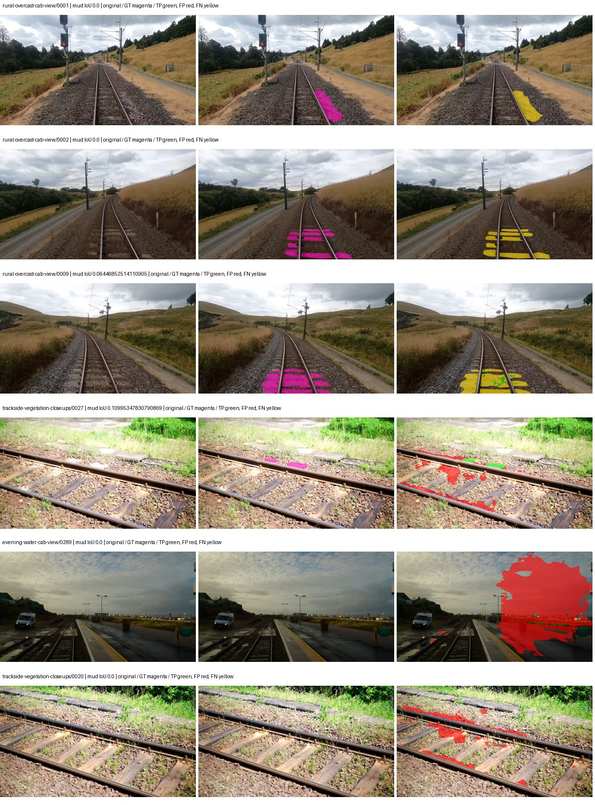
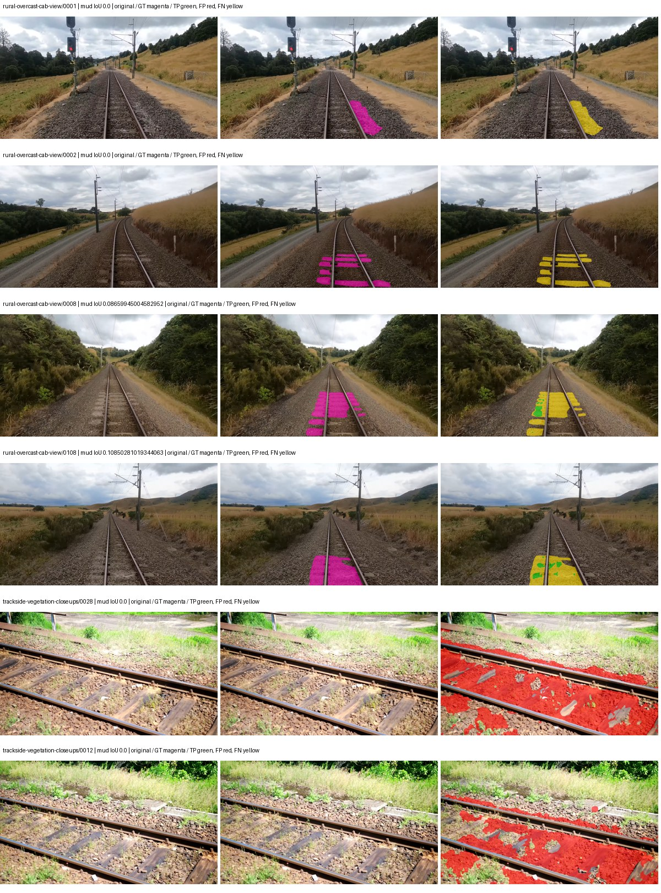
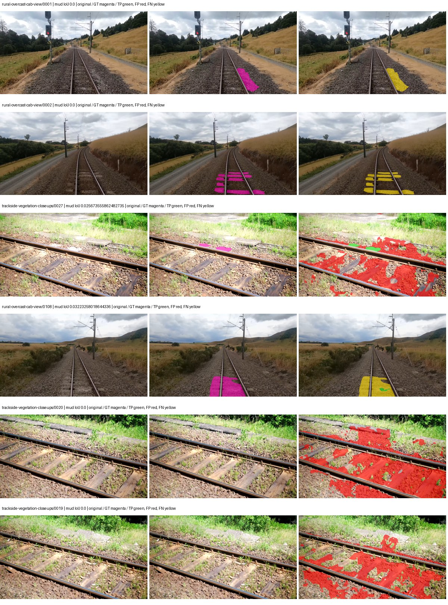

# native_resnet101_uper — rad_9_24_2026-fixed-grouped

[RAD 9/24: Scene-grouped split](../../README.md) · [Full model records](record.json)

Primary result: the **final checkpoint** after the full step budget (no early stopping). The checkpoint with the best **mud-pumping validation IoU, pixels pooled over all validation images**, is kept as secondary evidence. A job is complete only after full statistics and isolated profiling are verified.

Study metrics of the final checkpoint, counting each class only on the validation images that contain it: mud-pumping IoU is the mean per-image IoU over the images with mud-pumping, precision and recall sum pixels over those images, and mIoU averages each class over the images that contain it, then over the classes present.

| Initialization path | Seed | Mud-pumping IoU, train-camera images with mud (%, n=17) | Mud-pumping IoU, all images with mud (%, n=18) | Mud precision, all images with mud (%) | Mud recall, all images with mud (%) | mIoU (each class over images that contain it) (%) |
| --- | --- | --- | --- | --- | --- | --- |
| rtis_only | 0 | 0.31 | 1.98 | 45.15 | 0.99 | 35.95 |
| cityscapes_to_rtis | 0 | 0.09 | 0.20 | 2.18 | 1.12 | 35.21 |
| railsem19_to_rtis | 0 | 0.10 | 0.17 | 1.72 | 0.47 | 43.45 |
| cityscapes_to_railsem19_to_rtis | 0 | — | — | — | — | — |

Per-class IoU: IoU (%) of every class, each averaged only over the validation images that contain the class (n = those images); — = no image contains it. mIoU averages the classes with at least one such image.

| Initialization path | Seed | mIoU (each class over images that contain it) | person (n=0) | truck (n=0) | rail-track (n=37) | vegetation-overgrowth (n=13) | car (n=3) | on-rails (n=0) | traffic-sign (n=9) | road (n=11) | sidewalk (n=12) | construction (n=12) | tram-track (n=2) | pole (n=21) | traffic-light (n=3) | mud-pumping (n=18) | fence (n=7) | terrain (n=35) | sky (n=28) | rail-embedded (n=3) | rail-raised (n=37) | trackbed (n=37) | standing-water (n=9) |
| --- | --- | --- | --- | --- | --- | --- | --- | --- | --- | --- | --- | --- | --- | --- | --- | --- | --- | --- | --- | --- | --- | --- | --- |
| rtis_only | 0 | 35.95 | — | — | 56.08 | 30.67 | 33.80 | — | 25.29 | 17.40 | 7.83 | 30.73 | 15.69 | 66.11 | 31.17 | 1.98 | 9.02 | 81.85 | 93.49 | 12.42 | 72.82 | 60.79 | 0.00 |
| cityscapes_to_rtis | 0 | 35.21 | — | — | 50.00 | 20.07 | 25.52 | — | 35.69 | 13.69 | 7.83 | 40.81 | 0.01 | 67.93 | 36.17 | 0.20 | 21.17 | 81.80 | 93.19 | 5.95 | 71.39 | 60.65 | 1.73 |
| railsem19_to_rtis | 0 | 43.45 | — | — | 56.66 | 33.02 | 37.14 | — | 48.48 | 9.12 | 17.32 | 56.01 | 25.53 | 72.59 | 43.71 | 0.17 | 23.85 | 86.84 | 96.16 | 36.76 | 73.45 | 65.24 | 0.00 |
| cityscapes_to_railsem19_to_rtis | 0 | — | — | — | — | — | — | — | — | — | — | — | — | — | — | — | — | — | — | — | — | — | — |

Everything below is the campaign's own record, with pixels pooled over all validation images: its evaluation is the checkpoint that scored best on that pooled mud IoU (secondary evidence here); the diagnostics also cover the final checkpoint (`final-auto-val`).

| Model | Initialization path | Seed | Status | Steps | Best step | Best-checkpoint mud IoU, pixels pooled (%) | Best-checkpoint mud precision, pixels pooled (%) | Best-checkpoint mud recall, pixels pooled (%) | Final mud IoU (trainer val, pixels pooled, %) | Best-checkpoint mIoU, pixels pooled (%) | Best-checkpoint fixed GT-class mIoU, pixels pooled (%) |
| --- | --- | --- | --- | --- | --- | --- | --- | --- | --- | --- | --- |
| native_resnet101_uper | rtis_only | 0 | completed | 4000 | 2592 | 1.55 | 3.07 | 3.04 | 0.84 | 31.65 | 36.93 |
| native_resnet101_uper | cityscapes_to_rtis | 0 | completed | 4000 | 1037 | 0.59 | 0.75 | 2.64 | 0.22 | 29.28 | 34.15 |
| native_resnet101_uper | railsem19_to_rtis | 0 | completed | 4000 | 518 | 0.34 | 0.44 | 1.52 | 0.12 | 40.89 | 47.70 |
| native_resnet101_uper | cityscapes_to_railsem19_to_rtis | 0 | collecting | 4000 | 518 | 0.34 | 0.64 | 0.73 | 0.09 | 38.65 | 42.94 |

Training: 217 images. Validation: 37 images. Test: 60 held out. Seeds: [0]. Seed variation measures optimization variability, not independent-recording uncertainty. Historical source checkpoints stay fixed across adaptation seeds.

Training code: `fce0ea0ac50b334d4252812c396e0e593def375d`. Split SHA-256: `12d7b367c72cda61d57686ff2ac28223530d0af49debd9fb7a0fbc68b908bc93`.

## rtis_only — seed 0

Status: **completed**. Started: 2026-10-11T08:08:43.503183+00:00. Finished: 2026-10-11T09:12:51.071114+00:00.

Recipe pretrained initializer: `{"arch": "native", "backbone_path": null, "batch_norm_momentum": null, "checkpoint": null, "classifier_path": null, "drop_path": null, "encoder_name": null, "encoder_weights": null, "head": "unified_head", "head_paths": [], "inactive_parameter_paths": [], "local_files_only": false, "lora_alpha": 32, "lora_dropout": 0.05, "lora_r": 16, "lora_targets": [], "native": {"auxiliary_heads": [], "backbone": {"in_channels": 3, "kind": "timm", "name": "resnet101.a1_in1k", "out_indices": [1, 2, 3, 4], "weights": "pretrained"}, "head": {"activation": "relu", "channels": 256, "dropout": 0.1, "in_indices": [0, 1, 2, 3], "kind": "uper", "norm": "group", "pool_bins": [1, 2, 3, 6]}, "neck": {"kind": "identity"}, "task": "multiclass"}, "revision": null, "smp_arch": null, "subfolder": null, "trust_remote_code": false, "tuning": "full"}`.

`rtis_only` uses the recipe initializer, which may include pretrained segmentation components. Transfer paths load the exact historical source checkpoint below and reset the classifier; they do not reset all query/decoder features.

Source checkpoint: `Recipe pretrained initialization`.

Config SHA-256: `16dc77e44b0346496eec0377e0734ca93951b76bbbd759ea92f8a27648eb3d6f`. Weights used for validation: `raw`.

### Mud-pumping and aggregate quality

| Metric | Selected checkpoint | Final training validation |
| --- | --- | --- |
| Mud IoU | 1.55 | 0.84 |
| Mud precision | 3.07 | 5.29 |
| Mud recall | 3.04 | 0.99 |
| Mud Dice/F1 | 3.05 | 1.67 |
| mIoU | 31.65 | 34.10 |
| Mean accuracy | 45.67 | 48.88 |
| Mean precision | 51.29 | 50.55 |
| Mean Dice | 41.75 | 43.94 |
| Mean specificity | 98.82 | 98.87 |
| Pixel accuracy | 81.85 | 82.76 |
| Frequency-weighted IoU | 71.40 | 72.35 |
| Fixed GT-present class mIoU | 36.93 | 39.78 |
| Boundary F1 | 39.26 | 40.03 |

The selected checkpoint has independent evaluation evidence. Final values are the trainer's final validation record, not a new independent evaluation. mIoU averages classes with nonzero union, so false positives on absent classes can change its denominator. The fixed GT-class mean is supplementary and excludes absent classes; their false positives remain in the confusion matrix.

### Resource usage and timing

| Measurement | Value |
| --- | --- |
| Peak training VRAM, retained training invocation (GiB) | 10.93 |
| Peak evaluation VRAM (GiB) | 7.54 |
| Retained training invocation wall time (seconds) | 3656.79 |
| Retained training invocation GPU-hours (one GPU) | 1.02 |
| Evaluation wall time (seconds) | 14.78 |
| Full evaluation pipeline images/second | 2.50 |
| Best full-state checkpoint (MiB) | 937.26 |
| Final full-state checkpoint (MiB) | 937.24 |
| Verified periodic checkpoints removed (GiB) | 7.32 |

VRAM uses the recorded allocator high-water mark; it is not total device usage including CUDA context. Resumed jobs' retained training invocation times and peaks are **not whole-campaign totals**. Earlier invocation resource records are not reconstructed here. Evaluation throughput includes loader, sliding-window inference and metrics; it is not model-only latency/FPS. Missing measurements are shown as —, never inferred from another dataset's run.

### Standardized inference performance

Dedicated model-only profiling waits for an idle worker-locked L40S: BF16, batch 1, 1024x1024, 20 warmup and 100 CUDA-event-timed public forwards. It excludes loading, preprocessing, tiling and metrics.

| Status | Parameters | Weight MiB | FPS | p50 ms | p95 ms | Peak reserved GiB |
| --- | --- | --- | --- | --- | --- | --- |
| complete | 61323093 | 233.93 | 61.65 | 14.92 | 21.60 | 1.31 |

```json
{
  "schema_version": 1,
  "model_id": "native_resnet101_uper",
  "measured_at": "2026-10-11T09:12:40+00:00",
  "status": "complete",
  "benchmark_scope": "rtis_selected_checkpoint_model_only",
  "applies_to": [
    "native_resnet101_uper--rtis_only--seed-0"
  ],
  "source": {
    "campaign_git_sha": "fce0ea0ac50b334d4252812c396e0e593def375d",
    "git_dirty": false,
    "config_hash": "797bea91f3b6",
    "resolved_config": "/data/izadia1/projects/segmentary-runs/rad_9_24_2026/fgall-seed0-20261007/configs/native_resnet101_uper--rtis_only--seed-0.yaml",
    "config_sha256": "16dc77e44b0346496eec0377e0734ca93951b76bbbd759ea92f8a27648eb3d6f",
    "checkpoint_sha256": "4e4e9e3200a05b1b3d3613247fe7c4bad48bdab46af81fd2944c93d2bb6366bc",
    "checkpoint_global_step": 2592,
    "checkpoint_bytes": 982793472,
    "checkpoint_kind": "resume checkpoint with optimizer and EMA state",
    "weights": "raw",
    "measured_checkpoint_job_id": "native_resnet101_uper--rtis_only--seed-0",
    "result_sha256": "ee81293b75356c64bf003cf8079f4c54a42ac6121f2bbde669d232770fea2497",
    "result_git_sha": "fce0ea0ac50b334d4252812c396e0e593def375d",
    "result_stage": "eval:rad_9_24_2026-fixed-grouped:val",
    "result_seed": 0
  },
  "hardware": {
    "gpu_name": "NVIDIA L40S",
    "gpu_uuid": "GPU-1c9b612f-e0b5-fbbc-150f-8c2ef13453c9",
    "logical_device": "cuda:0",
    "physical_visibility_token": "5",
    "compute_capability": [
      8,
      9
    ],
    "total_memory_bytes": 47677177856
  },
  "model": {
    "parameter_count": 61323093,
    "trainable_parameter_count": 61323093,
    "resident_parameter_bytes": 245292372,
    "parameter_dtype_counts": {
      "float32": 61323093
    }
  },
  "contract": {
    "backend": "pytorch",
    "precision": "bf16_autocast",
    "batch_size": 1,
    "input_shape_nchw": [
      1,
      3,
      1024,
      1024
    ],
    "warmup_iterations": 20,
    "measured_iterations": 100,
    "timing": "per-forward CUDA events with end-event synchronization",
    "includes_preprocessing": false,
    "includes_data_loader": false,
    "includes_sliding_window": false,
    "input_resident_on_gpu": true,
    "model_only": true,
    "entrypoint": "public model(image) dense-logits forward"
  },
  "measurements": {
    "latency": {
      "p50_ms": 14.920192241668701,
      "p95_ms": 21.595750045776366,
      "mean_ms": 16.21952548980713,
      "minimum_ms": 14.475263595581055,
      "maximum_ms": 23.797760009765625,
      "fps": 61.654084802199186,
      "raw_ms": [
        14.77017593383789,
        14.475263595581055,
        14.608384132385254,
        22.006784439086914,
        19.322879791259766,
        14.730239868164062,
        14.791680335998535,
        14.699520111083984,
        14.582783699035645,
        21.46816062927246,
        20.28441619873047,
        15.964159965515137,
        14.58995246887207,
        14.728192329406738,
        15.563776016235352,
        16.277503967285156,
        21.238784790039062,
        14.569472312927246,
        14.556159973144531,
        14.982144355773926,
        14.577664375305176,
        14.503935813903809,
        20.557823181152344,
        18.777088165283203,
        14.62275218963623,
        14.622719764709473,
        14.534655570983887,
        14.526464462280273,
        21.44870376586914,
        19.20921516418457,
        14.637056350708008,
        14.603263854980469,
        14.536704063415527,
        14.566399574279785,
        21.591039657592773,
        19.120128631591797,
        14.666751861572266,
        14.656512260437012,
        14.553119659423828,
        14.58995246887207,
        14.550080299377441,
        14.504960060119629,
        14.782464027404785,
        14.58790397644043,
        14.48038387298584,
        14.641152381896973,
        14.620672225952148,
        14.501888275146484,
        14.537728309631348,
        14.57049560546875,
        14.542847633361816,
        14.546943664550781,
        14.523391723632812,
        14.485504150390625,
        14.647295951843262,
        21.297088623046875,
        17.733631134033203,
        14.746623992919922,
        14.557151794433594,
        14.574591636657715,
        14.538751602172852,
        16.509952545166016,
        22.07539176940918,
        20.124671936035156,
        15.526911735534668,
        15.16543960571289,
        14.979071617126465,
        14.6943998336792,
        21.68524742126465,
        19.929088592529297,
        14.79475212097168,
        15.121408462524414,
        15.271936416625977,
        15.567872047424316,
        15.10912036895752,
        21.295103073120117,
        16.486400604248047,
        15.569952011108398,
        15.033344268798828,
        14.978048324584961,
        14.990336418151855,
        17.357824325561523,
        22.369279861450195,
        15.013888359069824,
        14.990336418151855,
        15.048704147338867,
        15.454272270202637,
        19.645408630371094,
        19.351551055908203,
        15.668224334716797,
        15.023072242736816,
        14.789600372314453,
        14.772224426269531,
        15.352831840515137,
        23.797760009765625,
        19.119104385375977,
        15.646719932556152,
        14.988287925720215,
        14.862336158752441,
        14.708736419677734
      ],
      "percentile_method": "numpy linear interpolation"
    },
    "peak_reserved_bytes": 1405091840,
    "memory_kind": "pytorch_cuda_allocator_peak_reserved_excluding_context",
    "process_total_bytes": 1933574144,
    "process_total_kind": "nvidia-smi used_memory of this PID on the benchmark GPU after the timed loop, including the CUDA context; null when the driver could not attribute memory to this PID",
    "benchmark_wall_clock_s": 15.021308310329914
  },
  "started_at": "2026-10-11T09:12:25+00:00",
  "finished_at": "2026-10-11T09:12:40+00:00",
  "environment": {
    "hostname": "hdrfs-app-001",
    "python": "3.11.15",
    "platform": "Linux-5.15.0-139-generic-x86_64-with-glibc2.35",
    "torch": "2.11.0+cu128",
    "torch_cuda": "12.8",
    "cudnn": 91900,
    "driver_version": "570.133.20",
    "cuda_available": true,
    "gpu_count": 1,
    "gpu_names": [
      "NVIDIA L40S"
    ],
    "cuda_visible_devices": "5",
    "packages": {
      "segmentary": "0.1.0",
      "torch": "2.11.0+cu128",
      "torchvision": "0.26.0+cu128",
      "transformers": "5.15.0",
      "timm": "1.0.28",
      "segmentation-models-pytorch": "0.5.0",
      "albumentations": "2.0.8",
      "lightning": "2.6.5",
      "numpy": "2.4.4"
    }
  }
}
```

### Per-class validation results

| Class | GT pixels | IoU (%) | Precision (%) | Recall (%) | Dice (%) | Boundary F1 (%) |
| --- | --- | --- | --- | --- | --- | --- |
| car | 29664 | 24.72 | 63.66 | 28.78 | 39.64 | 45.09 |
| construction | 311585 | 31.74 | 35.40 | 75.45 | 48.19 | 35.83 |
| fence | 265137 | 12.46 | 40.38 | 15.28 | 22.17 | 23.87 |
| mud-pumping | 1226250 | 1.55 | 3.07 | 3.04 | 3.05 | 4.50 |
| on-rails | 0 | 0.00 | 0.00 | — | 0.00 | 0.00 |
| person | 0 | 0.00 | 0.00 | — | 0.00 | 0.00 |
| pole | 628038 | 67.28 | 77.50 | 83.61 | 80.44 | 88.34 |
| rail-embedded | 16799 | 26.26 | 82.39 | 27.82 | 41.60 | 45.23 |
| rail-raised | 2969797 | 73.18 | 80.18 | 89.34 | 84.52 | 87.23 |
| rail-track | 6323197 | 40.89 | 69.39 | 49.88 | 58.04 | 58.31 |
| road | 1048831 | 8.01 | 29.92 | 9.86 | 14.83 | 14.26 |
| sidewalk | 1297367 | 18.12 | 52.78 | 21.62 | 30.68 | 11.10 |
| sky | 19121606 | 93.77 | 99.71 | 94.02 | 96.78 | 87.70 |
| standing-water | 95802 | 0.00 | 0.00 | 0.00 | 0.00 | 0.00 |
| terrain | 39239306 | 84.68 | 85.75 | 98.55 | 91.70 | 60.27 |
| trackbed | 10643081 | 48.48 | 60.69 | 70.68 | 65.30 | 50.19 |
| traffic-light | 19510 | 36.93 | 70.20 | 43.80 | 53.94 | 54.65 |
| traffic-sign | 13285 | 37.23 | 83.29 | 40.23 | 54.26 | 61.20 |
| tram-track | 56179 | 30.93 | 57.38 | 40.15 | 47.25 | 36.66 |
| truck | 0 | 0.00 | 0.00 | — | 0.00 | 0.00 |
| vegetation-overgrowth | 5901821 | 28.49 | 85.43 | 29.95 | 44.35 | 59.92 |

### Full-run accounting

| Measurement | Value |
| --- | --- |
| Full GPU-reserved wall seconds, all recorded worker attempts | 3855.48 |
| Full reserved GPU-hours | 1.07 |
| Whole-run timing complete | True |

| Phase | Wall seconds including failed attempts |
| --- | --- |
| training | 3663.97 |
| diagnostics | 124.89 |
| performance | 24.80 |

GPU-reserved time includes model loading, training, validation, collection, profiling, checkpoint I/O and orchestration while the worker owns one GPU. It is not GPU kernel-active time. Phase timings and sampled device memory/power/utilization are retained separately; sampled device memory is not the allocator high-water mark.

### Train/validation and raw/EMA diagnostics

| Checkpoint / weights / split | Images | Mud IoU (%) | Mud precision (%) | Mud recall (%) |
| --- | --- | --- | --- | --- |
| best-auto-train / raw | 217 | 93.32 | 94.99 | 98.15 |
| best-auto-val / raw | 37 | 1.55 | 3.07 | 3.04 |
| best-alternate-val / ema | 37 | 0.11 | 0.74 | 0.12 |
| final-auto-val / raw | 37 | 0.84 | 5.29 | 0.99 |

Train uses the evaluation transform without augmentation. Compare mud train/validation metrics for the same selected weights. Alternate EMA on running-stat BatchNorm is explicitly uncalibrated and is diagnostic only. Score-threshold curves use uncalibrated normalized scores and are pixel-level diagnostics, not event detection rates or a selected deployment operating point.

### Downloadable evidence

- best-auto-train: [per-image.csv](rtis_only--seed-0/best-auto-train/per-image.csv) · [per-image-confusion.json.gz](rtis_only--seed-0/best-auto-train/per-image-confusion.json.gz) · [groups.json](rtis_only--seed-0/best-auto-train/groups.json) · [mud-score-curves.json](rtis_only--seed-0/best-auto-train/mud-score-curves.json)
- best-auto-val: [per-image.csv](rtis_only--seed-0/best-auto-val/per-image.csv) · [per-image-confusion.json.gz](rtis_only--seed-0/best-auto-val/per-image-confusion.json.gz) · [groups.json](rtis_only--seed-0/best-auto-val/groups.json) · [mud-score-curves.json](rtis_only--seed-0/best-auto-val/mud-score-curves.json) · [examples.jpg](rtis_only--seed-0/best-auto-val/examples.jpg)
- best-alternate-val: [per-image.csv](rtis_only--seed-0/best-alternate-val/per-image.csv) · [per-image-confusion.json.gz](rtis_only--seed-0/best-alternate-val/per-image-confusion.json.gz) · [groups.json](rtis_only--seed-0/best-alternate-val/groups.json) · [mud-score-curves.json](rtis_only--seed-0/best-alternate-val/mud-score-curves.json)
- final-auto-val: [per-image.csv](rtis_only--seed-0/final-auto-val/per-image.csv) · [per-image-confusion.json.gz](rtis_only--seed-0/final-auto-val/per-image-confusion.json.gz) · [groups.json](rtis_only--seed-0/final-auto-val/groups.json) · [mud-score-curves.json](rtis_only--seed-0/final-auto-val/mud-score-curves.json)
- resources: [telemetry.csv](rtis_only--seed-0/resources/telemetry.csv)



Examples are two lowest and two highest mud-IoU positive images, plus up to two negative images with the most false-positive mud pixels. They are targeted diagnostic examples, not random samples. Green: true positive; red: false positive; yellow: false negative. Full predictions remain on HDRFS.

### Validation tracking

| Logged step | Overall mIoU (%) | Mud IoU (%) |
| --- | --- | --- |
| 258 | 16.77 | 0.24 |
| 518 | 20.35 | 0.56 |
| 777 | 21.01 | 0.00 |
| 1036 | 24.31 | 0.00 |
| 1295 | 24.93 | 0.31 |
| 1555 | 27.07 | 0.53 |
| 1814 | 29.66 | 0.92 |
| 2073 | 32.75 | 0.55 |
| 2332 | 32.07 | 0.04 |
| 2592 | 31.68 | 1.55 |
| 2851 | 32.74 | 0.53 |
| 3110 | 35.49 | 0.50 |
| 3369 | 34.37 | 0.69 |
| 3629 | 33.36 | 0.56 |
| 3888 | 34.87 | 0.64 |
| 4000 | 34.10 | 0.84 |

All retained scalar curves, including training loss and per-class IoU, are in record.json. Observed best mud on a curve is not necessarily a retained checkpoint: the pilot saved its selection-metric-best and final checkpoints. Step logging and checkpoint global_step may differ by one.

### Stopping and checkpoint provenance

```json
{
  "stopping": {
    "actual_steps": 4000,
    "maximum_steps": 4000,
    "min_delta": 0.0,
    "monitor": "val_iou/mud-pumping",
    "patience": null,
    "reason": "budget_complete"
  },
  "checkpoints": {
    "best": {
      "path": "/data/izadia1/projects/segmentary-runs/rad_9_24_2026/fgall-seed0-20261007/future-runs/native_resnet101_uper--rtis_only--seed-0_seed0/rtis/best.ckpt",
      "sha256": "4e4e9e3200a05b1b3d3613247fe7c4bad48bdab46af81fd2944c93d2bb6366bc",
      "global_step": 2592,
      "bytes": 982793472
    },
    "final": {
      "path": "/data/izadia1/projects/segmentary-runs/rad_9_24_2026/fgall-seed0-20261007/future-runs/native_resnet101_uper--rtis_only--seed-0_seed0/rtis/last.ckpt",
      "sha256": "18acf2c384d73218def79d11be95d5988368a807c5b78cd2699e913dce462405",
      "global_step": 4000,
      "bytes": 982771200
    }
  },
  "cleanup_error": null
}
```

### Resolved training, initialization and evaluation settings

The optimizer block is the base configuration. Stage LR scales are applied at runtime, and stage warmup is capped at min(base warmup, floor(stage budget / 10), stage budget - 1): 400 steps for this 4,000-step pilot. Model-internal native input grids may differ from augmentation crops (EoMT uses its 640 grid).

```json
{
  "name": "native_resnet101_uper--rtis_only--seed-0",
  "model": {
    "arch": "native",
    "checkpoint": null,
    "tuning": "full",
    "head": "unified_head",
    "lora_r": 16,
    "lora_alpha": 32,
    "lora_dropout": 0.05,
    "lora_targets": [],
    "drop_path": null,
    "revision": null,
    "subfolder": null,
    "local_files_only": false,
    "trust_remote_code": false,
    "backbone_path": null,
    "head_paths": [],
    "classifier_path": null,
    "inactive_parameter_paths": [],
    "smp_arch": null,
    "encoder_name": null,
    "encoder_weights": null,
    "native": {
      "task": "multiclass",
      "backbone": {
        "kind": "timm",
        "name": "resnet101.a1_in1k",
        "weights": "pretrained",
        "out_indices": [
          1,
          2,
          3,
          4
        ],
        "in_channels": 3
      },
      "neck": {
        "kind": "identity"
      },
      "head": {
        "kind": "uper",
        "in_indices": [
          0,
          1,
          2,
          3
        ],
        "channels": 256,
        "pool_bins": [
          1,
          2,
          3,
          6
        ],
        "dropout": 0.1,
        "norm": "group",
        "activation": "relu"
      },
      "auxiliary_heads": []
    },
    "batch_norm_momentum": null
  },
  "space": "paul-test-rtis",
  "taxonomy_root": "/data/izadia1/projects/segmentary-rad-fgall-fce0ea0a/taxonomy",
  "output_root": "/data/izadia1/projects/segmentary-runs/rad_9_24_2026/fgall-seed0-20261007/future-runs",
  "optim": {
    "backbone_lr": 0.0001,
    "head_lr_mult": 10.0,
    "weight_decay": 0.05,
    "llrd": 1.0,
    "warmup_iters": 1500,
    "warmup_ratio": 1e-06,
    "poly_power": 0.9,
    "min_lr_ratio": 0.0,
    "betas": [
      0.9,
      0.999
    ],
    "grad_clip": 1.0
  },
  "train": {
    "iters": 4000,
    "batch_size": 2,
    "accum": 8,
    "num_workers": 2,
    "precision": "bf16-mixed",
    "ema_decay": 0.9998,
    "val_every": 250,
    "ckpt_every": 500,
    "selection_metric": "val_iou/mud-pumping",
    "early_stopping_patience": null,
    "early_stopping_min_delta": 0.0,
    "seed": 0,
    "devices": 1
  },
  "eval": {
    "sliding_window": true,
    "window": [
      1024,
      1024
    ],
    "stride": [
      768,
      768
    ],
    "batch_size": 1,
    "num_workers": 2,
    "tta_scales": [],
    "tta_flip": false,
    "threshold": 0.5,
    "boundary_tolerance_frac": 0.0075,
    "save_confusion": true
  },
  "loss": {
    "task": "multiclass",
    "activation": "auto",
    "terms": [],
    "aux": "none",
    "aux_weight": 0.0,
    "ce_weight": 1.0,
    "label_smoothing": 0.0,
    "class_weights": null,
    "query": null
  },
  "aug": {
    "crop": [
      1024,
      1024
    ],
    "scale_min": 0.5,
    "scale_max": 2.0,
    "hflip_p": 0.5,
    "color_jitter_p": 0.5,
    "brightness": 0.25,
    "contrast": 0.25,
    "saturation": 0.25,
    "hue": 0.05
  },
  "stages": [
    {
      "name": "rtis",
      "data": [
        {
          "name": "rad_9_24_2026-fixed-grouped",
          "root": "/data/izadia1/datasets/rad_9_24_2026-fixed-grouped",
          "variant": null,
          "split_file": "splits.json",
          "train_split": "train",
          "val_split": "val",
          "limit": null,
          "loader": "folder",
          "mapping": "paul-test-rtis",
          "loader_options": {
            "require_groups": true
          }
        }
      ],
      "iters": null,
      "lr_scale": 1.0,
      "head_group_lr_scale": 1.0,
      "init_from": "pretrained",
      "reset_head": false,
      "freeze": null,
      "sample_weights": null
    }
  ]
}
```

### Hardware and software provenance

```json
{
  "training": {
    "cuda_available": true,
    "cuda_visible_devices": "5",
    "cudnn": 91900,
    "driver_version": "570.133.20",
    "gpu_count": 1,
    "gpu_names": [
      "NVIDIA L40S"
    ],
    "hostname": "hdrfs-app-001",
    "input_normalization": {
      "channel_order": "rgb",
      "mean": [
        0.485,
        0.456,
        0.406
      ],
      "source": "timm_pretrained_cfg",
      "std": [
        0.229,
        0.224,
        0.225
      ]
    },
    "model_origins": [
      {
        "hf_commit": null,
        "hf_name_or_path": null,
        "module": "backbone",
        "timm_pretrained": {
          "architecture": "resnet101",
          "hf_hub_id": "timm/resnet101.a1_in1k",
          "tag": "a1_in1k",
          "url": "https://github.com/huggingface/pytorch-image-models/releases/download/v0.1-rsb-weights/resnet101_a1_0-cdcb52a9.pth"
        }
      },
      {
        "hf_commit": null,
        "hf_name_or_path": null,
        "module": "backbone.model",
        "timm_pretrained": {
          "architecture": "resnet101",
          "hf_hub_id": "timm/resnet101.a1_in1k",
          "tag": "a1_in1k",
          "url": "https://github.com/huggingface/pytorch-image-models/releases/download/v0.1-rsb-weights/resnet101_a1_0-cdcb52a9.pth"
        }
      }
    ],
    "model_parameter_count": 61323093,
    "packages": {
      "albumentations": "2.0.8",
      "lightning": "2.6.5",
      "numpy": "2.4.4",
      "segmentary": "0.1.0",
      "segmentation-models-pytorch": "0.5.0",
      "timm": "1.0.28",
      "torch": "2.11.0+cu128",
      "torchvision": "0.26.0+cu128",
      "transformers": "5.15.0"
    },
    "platform": "Linux-5.15.0-139-generic-x86_64-with-glibc2.35",
    "python": "3.11.15",
    "torch": "2.11.0+cu128",
    "torch_cuda": "12.8",
    "trainable_parameter_count": 61323093,
    "training_stop": {
      "actual_steps": 4000,
      "maximum_steps": 4000,
      "min_delta": 0.0,
      "monitor": "val_iou/mud-pumping",
      "patience": null,
      "reason": "budget_complete"
    },
    "validation_weights": "raw"
  },
  "evaluation": {
    "cuda_available": true,
    "cuda_visible_devices": "5",
    "cudnn": 91900,
    "driver_version": "570.133.20",
    "gpu_count": 1,
    "gpu_names": [
      "NVIDIA L40S"
    ],
    "hostname": "hdrfs-app-001",
    "input_normalization": {
      "channel_order": "rgb",
      "mean": [
        0.485,
        0.456,
        0.406
      ],
      "source": "timm_pretrained_cfg",
      "std": [
        0.229,
        0.224,
        0.225
      ]
    },
    "packages": {
      "albumentations": "2.0.8",
      "lightning": "2.6.5",
      "numpy": "2.4.4",
      "segmentary": "0.1.0",
      "segmentation-models-pytorch": "0.5.0",
      "timm": "1.0.28",
      "torch": "2.11.0+cu128",
      "torchvision": "0.26.0+cu128",
      "transformers": "5.15.0"
    },
    "platform": "Linux-5.15.0-139-generic-x86_64-with-glibc2.35",
    "python": "3.11.15",
    "torch": "2.11.0+cu128",
    "torch_cuda": "12.8"
  }
}
```

## cityscapes_to_rtis — seed 0

Status: **completed**. Started: 2026-10-11T08:12:43.707314+00:00. Finished: 2026-10-11T09:15:59.799203+00:00.

Recipe pretrained initializer: `{"arch": "native", "backbone_path": null, "batch_norm_momentum": null, "checkpoint": null, "classifier_path": null, "drop_path": null, "encoder_name": null, "encoder_weights": null, "head": "unified_head", "head_paths": [], "inactive_parameter_paths": [], "local_files_only": false, "lora_alpha": 32, "lora_dropout": 0.05, "lora_r": 16, "lora_targets": [], "native": {"auxiliary_heads": [], "backbone": {"in_channels": 3, "kind": "timm", "name": "resnet101.a1_in1k", "out_indices": [1, 2, 3, 4], "weights": "pretrained"}, "head": {"activation": "relu", "channels": 256, "dropout": 0.1, "in_indices": [0, 1, 2, 3], "kind": "uper", "norm": "group", "pool_bins": [1, 2, 3, 6]}, "neck": {"kind": "identity"}, "task": "multiclass"}, "revision": null, "smp_arch": null, "subfolder": null, "trust_remote_code": false, "tuning": "full"}`.

`rtis_only` uses the recipe initializer, which may include pretrained segmentation components. Transfer paths load the exact historical source checkpoint below and reset the classifier; they do not reset all query/decoder features.

Source checkpoint: `{'name': 'native_resnet101_uper--cityscapes--seed-0', 'model': 'native_resnet101_uper', 'protocol': 'cityscapes', 'config': '/data/izadia1/projects/segmentary-runs/all-model-city-rail-seed0-rail20-b9eb3e1/accepted/native_resnet101_uper--cityscapes--seed-0/resolved-config.yaml', 'checkpoint': '/data/izadia1/projects/segmentary-runs/all-model-city-rail-seed0-a7c0b67/jobs/native_resnet101_uper--cityscapes--seed-0/attempt-001/train/native_resnet101_uper--cityscapes_seed0/cityscapes/last.ckpt', 'recorded_sha256': 'afa826b49282e2029b80737cc2f65d93f1cb70275d61bef4c399b264d96a4617', 'exists': True}`.

Config SHA-256: `24c953b1d501678c0343e3a866af32c275307e8206988b867f13ca82a77392d0`. Weights used for validation: `raw`.

### Mud-pumping and aggregate quality

| Metric | Selected checkpoint | Final training validation |
| --- | --- | --- |
| Mud IoU | 0.59 | 0.22 |
| Mud precision | 0.75 | 0.27 |
| Mud recall | 2.64 | 1.12 |
| Mud Dice/F1 | 1.17 | 0.44 |
| mIoU | 29.28 | 32.31 |
| Mean accuracy | 43.48 | 45.70 |
| Mean precision | 48.73 | 52.73 |
| Mean Dice | 37.80 | 41.37 |
| Mean specificity | 98.58 | 98.80 |
| Pixel accuracy | 78.51 | 80.89 |
| Frequency-weighted IoU | 67.99 | 71.74 |
| Fixed GT-present class mIoU | 34.15 | 37.69 |
| Boundary F1 | 34.48 | 37.90 |

The selected checkpoint has independent evaluation evidence. Final values are the trainer's final validation record, not a new independent evaluation. mIoU averages classes with nonzero union, so false positives on absent classes can change its denominator. The fixed GT-class mean is supplementary and excludes absent classes; their false positives remain in the confusion matrix.

### Resource usage and timing

| Measurement | Value |
| --- | --- |
| Peak training VRAM, retained training invocation (GiB) | 10.93 |
| Peak evaluation VRAM (GiB) | 7.54 |
| Retained training invocation wall time (seconds) | 3605.91 |
| Retained training invocation GPU-hours (one GPU) | 1.00 |
| Evaluation wall time (seconds) | 14.91 |
| Full evaluation pipeline images/second | 2.48 |
| Best full-state checkpoint (MiB) | 937.26 |
| Final full-state checkpoint (MiB) | 937.24 |
| Verified periodic checkpoints removed (GiB) | 7.32 |

VRAM uses the recorded allocator high-water mark; it is not total device usage including CUDA context. Resumed jobs' retained training invocation times and peaks are **not whole-campaign totals**. Earlier invocation resource records are not reconstructed here. Evaluation throughput includes loader, sliding-window inference and metrics; it is not model-only latency/FPS. Missing measurements are shown as —, never inferred from another dataset's run.

### Standardized inference performance

Dedicated model-only profiling waits for an idle worker-locked L40S: BF16, batch 1, 1024x1024, 20 warmup and 100 CUDA-event-timed public forwards. It excludes loading, preprocessing, tiling and metrics.

| Status | Parameters | Weight MiB | FPS | p50 ms | p95 ms | Peak reserved GiB |
| --- | --- | --- | --- | --- | --- | --- |
| complete | 61323093 | 233.93 | 64.27 | 15.37 | 16.85 | 1.36 |

```json
{
  "schema_version": 1,
  "model_id": "native_resnet101_uper",
  "measured_at": "2026-10-11T09:15:49+00:00",
  "status": "complete",
  "benchmark_scope": "rtis_selected_checkpoint_model_only",
  "applies_to": [
    "native_resnet101_uper--cityscapes_to_rtis--seed-0"
  ],
  "source": {
    "campaign_git_sha": "fce0ea0ac50b334d4252812c396e0e593def375d",
    "git_dirty": false,
    "config_hash": "44e195e7aec2",
    "resolved_config": "/data/izadia1/projects/segmentary-runs/rad_9_24_2026/fgall-seed0-20261007/configs/native_resnet101_uper--cityscapes_to_rtis--seed-0.yaml",
    "config_sha256": "24c953b1d501678c0343e3a866af32c275307e8206988b867f13ca82a77392d0",
    "checkpoint_sha256": "0c61893d32d21121031332f07af033f2a0fd227de2564ce96f603cc0b8a46053",
    "checkpoint_global_step": 1037,
    "checkpoint_bytes": 982793472,
    "checkpoint_kind": "resume checkpoint with optimizer and EMA state",
    "weights": "raw",
    "measured_checkpoint_job_id": "native_resnet101_uper--cityscapes_to_rtis--seed-0",
    "result_sha256": "f9993cc05ec6639885e689ea69a5d37393074e6f0490cc331b3273504cdbb6c1",
    "result_git_sha": "fce0ea0ac50b334d4252812c396e0e593def375d",
    "result_stage": "eval:rad_9_24_2026-fixed-grouped:val",
    "result_seed": 0
  },
  "hardware": {
    "gpu_name": "NVIDIA L40S",
    "gpu_uuid": "GPU-a5ad49e5-0536-5229-ba8a-f8a902808f53",
    "logical_device": "cuda:0",
    "physical_visibility_token": "7",
    "compute_capability": [
      8,
      9
    ],
    "total_memory_bytes": 47677177856
  },
  "model": {
    "parameter_count": 61323093,
    "trainable_parameter_count": 61323093,
    "resident_parameter_bytes": 245292372,
    "parameter_dtype_counts": {
      "float32": 61323093
    }
  },
  "contract": {
    "backend": "pytorch",
    "precision": "bf16_autocast",
    "batch_size": 1,
    "input_shape_nchw": [
      1,
      3,
      1024,
      1024
    ],
    "warmup_iterations": 20,
    "measured_iterations": 100,
    "timing": "per-forward CUDA events with end-event synchronization",
    "includes_preprocessing": false,
    "includes_data_loader": false,
    "includes_sliding_window": false,
    "input_resident_on_gpu": true,
    "model_only": true,
    "entrypoint": "public model(image) dense-logits forward"
  },
  "measurements": {
    "latency": {
      "p50_ms": 15.37385606765747,
      "p95_ms": 16.84654121398926,
      "mean_ms": 15.559650602340698,
      "minimum_ms": 14.964735984802246,
      "maximum_ms": 18.7903995513916,
      "fps": 64.26879533204725,
      "raw_ms": [
        15.674367904663086,
        15.30777645111084,
        15.79417610168457,
        15.15014362335205,
        15.308799743652344,
        17.04038429260254,
        15.362048149108887,
        15.028223991394043,
        15.087615966796875,
        15.417344093322754,
        16.651264190673828,
        15.097855567932129,
        15.325183868408203,
        15.874048233032227,
        15.11731243133545,
        15.180800437927246,
        14.995455741882324,
        14.98624038696289,
        16.119808197021484,
        15.62112045288086,
        14.99135971069336,
        15.261695861816406,
        15.626239776611328,
        15.420415878295898,
        15.385663986206055,
        15.016960144042969,
        15.172608375549316,
        16.84275245666504,
        15.332351684570312,
        15.292415618896484,
        16.20992088317871,
        15.780863761901855,
        15.313920021057129,
        15.065088272094727,
        15.589376449584961,
        15.24227237701416,
        15.59654426574707,
        15.152128219604492,
        15.003647804260254,
        16.829439163208008,
        15.725567817687988,
        15.450112342834473,
        15.229951858520508,
        15.285247802734375,
        15.79526424407959,
        15.749119758605957,
        15.063008308410645,
        15.277055740356445,
        15.727616310119629,
        15.790080070495605,
        15.055871963500977,
        15.105024337768555,
        15.126527786254883,
        15.644672393798828,
        15.030271530151367,
        14.964735984802246,
        15.037440299987793,
        15.627264022827148,
        15.88428783416748,
        15.136768341064453,
        15.033344268798828,
        15.347711563110352,
        15.633407592773438,
        15.328255653381348,
        15.293439865112305,
        15.532032012939453,
        15.926239967346191,
        15.133695602416992,
        15.017984390258789,
        15.329279899597168,
        15.605759620666504,
        15.228927612304688,
        15.139840126037598,
        15.857664108276367,
        16.00102424621582,
        15.435775756835938,
        15.138815879821777,
        15.580160140991211,
        15.096832275390625,
        15.248384475708008,
        15.676416397094727,
        15.149056434631348,
        15.493120193481445,
        15.477760314941406,
        15.723520278930664,
        15.440896034240723,
        18.25484848022461,
        18.7903995513916,
        18.535423278808594,
        15.533056259155273,
        16.918527603149414,
        15.628288269042969,
        15.70304012298584,
        15.732735633850098,
        15.723520278930664,
        15.441920280456543,
        15.160320281982422,
        15.263744354248047,
        15.390687942504883,
        15.047679901123047
      ],
      "percentile_method": "numpy linear interpolation"
    },
    "peak_reserved_bytes": 1461714944,
    "memory_kind": "pytorch_cuda_allocator_peak_reserved_excluding_context",
    "process_total_bytes": 1990197248,
    "process_total_kind": "nvidia-smi used_memory of this PID on the benchmark GPU after the timed loop, including the CUDA context; null when the driver could not attribute memory to this PID",
    "benchmark_wall_clock_s": 14.581463679671288
  },
  "started_at": "2026-10-11T09:15:35+00:00",
  "finished_at": "2026-10-11T09:15:49+00:00",
  "environment": {
    "hostname": "hdrfs-app-001",
    "python": "3.11.15",
    "platform": "Linux-5.15.0-139-generic-x86_64-with-glibc2.35",
    "torch": "2.11.0+cu128",
    "torch_cuda": "12.8",
    "cudnn": 91900,
    "driver_version": "570.133.20",
    "cuda_available": true,
    "gpu_count": 1,
    "gpu_names": [
      "NVIDIA L40S"
    ],
    "cuda_visible_devices": "7",
    "packages": {
      "segmentary": "0.1.0",
      "torch": "2.11.0+cu128",
      "torchvision": "0.26.0+cu128",
      "transformers": "5.15.0",
      "timm": "1.0.28",
      "segmentation-models-pytorch": "0.5.0",
      "albumentations": "2.0.8",
      "lightning": "2.6.5",
      "numpy": "2.4.4"
    }
  }
}
```

### Per-class validation results

| Class | GT pixels | IoU (%) | Precision (%) | Recall (%) | Dice (%) | Boundary F1 (%) |
| --- | --- | --- | --- | --- | --- | --- |
| car | 29664 | 56.59 | 71.95 | 72.61 | 72.28 | 58.92 |
| construction | 311585 | 20.20 | 22.17 | 69.45 | 33.61 | 28.91 |
| fence | 265137 | 17.53 | 45.68 | 22.15 | 29.83 | 32.09 |
| mud-pumping | 1226250 | 0.59 | 0.75 | 2.64 | 1.17 | 1.88 |
| on-rails | 0 | 0.00 | 0.00 | — | 0.00 | 0.00 |
| person | 0 | 0.00 | 0.00 | — | 0.00 | 0.00 |
| pole | 628038 | 69.21 | 81.93 | 81.67 | 81.80 | 90.27 |
| rail-embedded | 16799 | 10.15 | 85.39 | 10.33 | 18.44 | 21.31 |
| rail-raised | 2969797 | 69.92 | 79.17 | 85.67 | 82.29 | 87.81 |
| rail-track | 6323197 | 31.41 | 68.33 | 36.76 | 47.80 | 42.95 |
| road | 1048831 | 11.69 | 19.18 | 23.03 | 20.93 | 15.53 |
| sidewalk | 1297367 | 9.54 | 64.50 | 10.07 | 17.42 | 4.20 |
| sky | 19121606 | 97.21 | 99.17 | 98.01 | 98.59 | 91.94 |
| standing-water | 95802 | 1.42 | 2.50 | 3.18 | 2.80 | 6.36 |
| terrain | 39239306 | 79.71 | 81.26 | 97.66 | 88.71 | 50.47 |
| trackbed | 10643081 | 52.95 | 78.31 | 62.05 | 69.24 | 52.62 |
| traffic-light | 19510 | 40.00 | 78.75 | 44.84 | 57.14 | 57.53 |
| traffic-sign | 13285 | 37.92 | 59.92 | 50.82 | 54.99 | 56.72 |
| tram-track | 56179 | 4.39 | 10.04 | 7.23 | 8.41 | 3.62 |
| truck | 0 | 0.00 | 0.00 | — | 0.00 | 0.00 |
| vegetation-overgrowth | 5901821 | 4.36 | 74.38 | 4.42 | 8.35 | 20.98 |

### Full-run accounting

| Measurement | Value |
| --- | --- |
| Full GPU-reserved wall seconds, all recorded worker attempts | 3805.28 |
| Full reserved GPU-hours | 1.06 |
| Whole-run timing complete | True |

| Phase | Wall seconds including failed attempts |
| --- | --- |
| training | 3613.92 |
| diagnostics | 124.71 |
| performance | 24.06 |

GPU-reserved time includes model loading, training, validation, collection, profiling, checkpoint I/O and orchestration while the worker owns one GPU. It is not GPU kernel-active time. Phase timings and sampled device memory/power/utilization are retained separately; sampled device memory is not the allocator high-water mark.

### Train/validation and raw/EMA diagnostics

| Checkpoint / weights / split | Images | Mud IoU (%) | Mud precision (%) | Mud recall (%) |
| --- | --- | --- | --- | --- |
| best-auto-train / raw | 217 | 88.76 | 95.84 | 92.31 |
| best-auto-val / raw | 37 | 0.59 | 0.75 | 2.64 |
| best-alternate-val / ema | 37 | 0.29 | 0.35 | 1.54 |
| final-auto-val / raw | 37 | 0.22 | 0.27 | 1.12 |

Train uses the evaluation transform without augmentation. Compare mud train/validation metrics for the same selected weights. Alternate EMA on running-stat BatchNorm is explicitly uncalibrated and is diagnostic only. Score-threshold curves use uncalibrated normalized scores and are pixel-level diagnostics, not event detection rates or a selected deployment operating point.

### Downloadable evidence

- best-auto-train: [per-image.csv](cityscapes_to_rtis--seed-0/best-auto-train/per-image.csv) · [per-image-confusion.json.gz](cityscapes_to_rtis--seed-0/best-auto-train/per-image-confusion.json.gz) · [groups.json](cityscapes_to_rtis--seed-0/best-auto-train/groups.json) · [mud-score-curves.json](cityscapes_to_rtis--seed-0/best-auto-train/mud-score-curves.json)
- best-auto-val: [per-image.csv](cityscapes_to_rtis--seed-0/best-auto-val/per-image.csv) · [per-image-confusion.json.gz](cityscapes_to_rtis--seed-0/best-auto-val/per-image-confusion.json.gz) · [groups.json](cityscapes_to_rtis--seed-0/best-auto-val/groups.json) · [mud-score-curves.json](cityscapes_to_rtis--seed-0/best-auto-val/mud-score-curves.json) · [examples.jpg](cityscapes_to_rtis--seed-0/best-auto-val/examples.jpg)
- best-alternate-val: [per-image.csv](cityscapes_to_rtis--seed-0/best-alternate-val/per-image.csv) · [per-image-confusion.json.gz](cityscapes_to_rtis--seed-0/best-alternate-val/per-image-confusion.json.gz) · [groups.json](cityscapes_to_rtis--seed-0/best-alternate-val/groups.json) · [mud-score-curves.json](cityscapes_to_rtis--seed-0/best-alternate-val/mud-score-curves.json)
- final-auto-val: [per-image.csv](cityscapes_to_rtis--seed-0/final-auto-val/per-image.csv) · [per-image-confusion.json.gz](cityscapes_to_rtis--seed-0/final-auto-val/per-image-confusion.json.gz) · [groups.json](cityscapes_to_rtis--seed-0/final-auto-val/groups.json) · [mud-score-curves.json](cityscapes_to_rtis--seed-0/final-auto-val/mud-score-curves.json)
- resources: [telemetry.csv](cityscapes_to_rtis--seed-0/resources/telemetry.csv)



Examples are two lowest and two highest mud-IoU positive images, plus up to two negative images with the most false-positive mud pixels. They are targeted diagnostic examples, not random samples. Green: true positive; red: false positive; yellow: false negative. Full predictions remain on HDRFS.

### Validation tracking

| Logged step | Overall mIoU (%) | Mud IoU (%) |
| --- | --- | --- |
| 258 | 22.32 | 0.20 |
| 518 | 26.35 | 0.21 |
| 777 | 28.71 | 0.09 |
| 1036 | 29.29 | 0.59 |
| 1295 | 30.92 | 0.19 |
| 1555 | 31.02 | 0.23 |
| 1814 | 30.39 | 0.23 |
| 2073 | 29.62 | 0.20 |
| 2332 | 31.95 | 0.33 |
| 2592 | 32.21 | 0.37 |
| 2851 | 30.87 | 0.30 |
| 3110 | 30.76 | 0.19 |
| 3369 | 31.17 | 0.34 |
| 3629 | 31.75 | 0.35 |
| 3888 | 32.05 | 0.23 |
| 4000 | 32.31 | 0.22 |

All retained scalar curves, including training loss and per-class IoU, are in record.json. Observed best mud on a curve is not necessarily a retained checkpoint: the pilot saved its selection-metric-best and final checkpoints. Step logging and checkpoint global_step may differ by one.

### Stopping and checkpoint provenance

```json
{
  "stopping": {
    "actual_steps": 4000,
    "maximum_steps": 4000,
    "min_delta": 0.0,
    "monitor": "val_iou/mud-pumping",
    "patience": null,
    "reason": "budget_complete"
  },
  "checkpoints": {
    "best": {
      "path": "/data/izadia1/projects/segmentary-runs/rad_9_24_2026/fgall-seed0-20261007/future-runs/native_resnet101_uper--cityscapes_to_rtis--seed-0_seed0/rtis/best.ckpt",
      "sha256": "0c61893d32d21121031332f07af033f2a0fd227de2564ce96f603cc0b8a46053",
      "global_step": 1037,
      "bytes": 982793472
    },
    "final": {
      "path": "/data/izadia1/projects/segmentary-runs/rad_9_24_2026/fgall-seed0-20261007/future-runs/native_resnet101_uper--cityscapes_to_rtis--seed-0_seed0/rtis/last.ckpt",
      "sha256": "7adf4e7659a77ab11dc217714afe7cafc3509c91a844569c4176102a03ac2359",
      "global_step": 4000,
      "bytes": 982771264
    }
  },
  "cleanup_error": null
}
```

### Resolved training, initialization and evaluation settings

The optimizer block is the base configuration. Stage LR scales are applied at runtime, and stage warmup is capped at min(base warmup, floor(stage budget / 10), stage budget - 1): 400 steps for this 4,000-step pilot. Model-internal native input grids may differ from augmentation crops (EoMT uses its 640 grid).

```json
{
  "name": "native_resnet101_uper--cityscapes_to_rtis--seed-0",
  "model": {
    "arch": "native",
    "checkpoint": null,
    "tuning": "full",
    "head": "unified_head",
    "lora_r": 16,
    "lora_alpha": 32,
    "lora_dropout": 0.05,
    "lora_targets": [],
    "drop_path": null,
    "revision": null,
    "subfolder": null,
    "local_files_only": false,
    "trust_remote_code": false,
    "backbone_path": null,
    "head_paths": [],
    "classifier_path": null,
    "inactive_parameter_paths": [],
    "smp_arch": null,
    "encoder_name": null,
    "encoder_weights": null,
    "native": {
      "task": "multiclass",
      "backbone": {
        "kind": "timm",
        "name": "resnet101.a1_in1k",
        "weights": "pretrained",
        "out_indices": [
          1,
          2,
          3,
          4
        ],
        "in_channels": 3
      },
      "neck": {
        "kind": "identity"
      },
      "head": {
        "kind": "uper",
        "in_indices": [
          0,
          1,
          2,
          3
        ],
        "channels": 256,
        "pool_bins": [
          1,
          2,
          3,
          6
        ],
        "dropout": 0.1,
        "norm": "group",
        "activation": "relu"
      },
      "auxiliary_heads": []
    },
    "batch_norm_momentum": null
  },
  "space": "paul-test-rtis",
  "taxonomy_root": "/data/izadia1/projects/segmentary-rad-fgall-fce0ea0a/taxonomy",
  "output_root": "/data/izadia1/projects/segmentary-runs/rad_9_24_2026/fgall-seed0-20261007/future-runs",
  "optim": {
    "backbone_lr": 0.0001,
    "head_lr_mult": 10.0,
    "weight_decay": 0.05,
    "llrd": 1.0,
    "warmup_iters": 1500,
    "warmup_ratio": 1e-06,
    "poly_power": 0.9,
    "min_lr_ratio": 0.0,
    "betas": [
      0.9,
      0.999
    ],
    "grad_clip": 1.0
  },
  "train": {
    "iters": 4000,
    "batch_size": 2,
    "accum": 8,
    "num_workers": 2,
    "precision": "bf16-mixed",
    "ema_decay": 0.9998,
    "val_every": 250,
    "ckpt_every": 500,
    "selection_metric": "val_iou/mud-pumping",
    "early_stopping_patience": null,
    "early_stopping_min_delta": 0.0,
    "seed": 0,
    "devices": 1
  },
  "eval": {
    "sliding_window": true,
    "window": [
      1024,
      1024
    ],
    "stride": [
      768,
      768
    ],
    "batch_size": 1,
    "num_workers": 2,
    "tta_scales": [],
    "tta_flip": false,
    "threshold": 0.5,
    "boundary_tolerance_frac": 0.0075,
    "save_confusion": true
  },
  "loss": {
    "task": "multiclass",
    "activation": "auto",
    "terms": [],
    "aux": "none",
    "aux_weight": 0.0,
    "ce_weight": 1.0,
    "label_smoothing": 0.0,
    "class_weights": null,
    "query": null
  },
  "aug": {
    "crop": [
      1024,
      1024
    ],
    "scale_min": 0.5,
    "scale_max": 2.0,
    "hflip_p": 0.5,
    "color_jitter_p": 0.5,
    "brightness": 0.25,
    "contrast": 0.25,
    "saturation": 0.25,
    "hue": 0.05
  },
  "stages": [
    {
      "name": "rtis",
      "data": [
        {
          "name": "rad_9_24_2026-fixed-grouped",
          "root": "/data/izadia1/datasets/rad_9_24_2026-fixed-grouped",
          "variant": null,
          "split_file": "splits.json",
          "train_split": "train",
          "val_split": "val",
          "limit": null,
          "loader": "folder",
          "mapping": "paul-test-rtis",
          "loader_options": {
            "require_groups": true
          }
        }
      ],
      "iters": null,
      "lr_scale": 0.1,
      "head_group_lr_scale": 1.0,
      "init_from": "/data/izadia1/projects/segmentary-runs/all-model-city-rail-seed0-a7c0b67/jobs/native_resnet101_uper--cityscapes--seed-0/attempt-001/train/native_resnet101_uper--cityscapes_seed0/cityscapes/last.ckpt",
      "reset_head": true,
      "freeze": null,
      "sample_weights": null
    }
  ]
}
```

### Hardware and software provenance

```json
{
  "training": {
    "cuda_available": true,
    "cuda_visible_devices": "7",
    "cudnn": 91900,
    "driver_version": "570.133.20",
    "gpu_count": 1,
    "gpu_names": [
      "NVIDIA L40S"
    ],
    "hostname": "hdrfs-app-001",
    "input_normalization": {
      "channel_order": "rgb",
      "mean": [
        0.485,
        0.456,
        0.406
      ],
      "source": "timm_pretrained_cfg",
      "std": [
        0.229,
        0.224,
        0.225
      ]
    },
    "model_origins": [
      {
        "hf_commit": null,
        "hf_name_or_path": null,
        "module": "backbone",
        "timm_pretrained": {
          "architecture": "resnet101",
          "hf_hub_id": "timm/resnet101.a1_in1k",
          "tag": "a1_in1k",
          "url": "https://github.com/huggingface/pytorch-image-models/releases/download/v0.1-rsb-weights/resnet101_a1_0-cdcb52a9.pth"
        }
      },
      {
        "hf_commit": null,
        "hf_name_or_path": null,
        "module": "backbone.model",
        "timm_pretrained": {
          "architecture": "resnet101",
          "hf_hub_id": "timm/resnet101.a1_in1k",
          "tag": "a1_in1k",
          "url": "https://github.com/huggingface/pytorch-image-models/releases/download/v0.1-rsb-weights/resnet101_a1_0-cdcb52a9.pth"
        }
      }
    ],
    "model_parameter_count": 61323093,
    "packages": {
      "albumentations": "2.0.8",
      "lightning": "2.6.5",
      "numpy": "2.4.4",
      "segmentary": "0.1.0",
      "segmentation-models-pytorch": "0.5.0",
      "timm": "1.0.28",
      "torch": "2.11.0+cu128",
      "torchvision": "0.26.0+cu128",
      "transformers": "5.15.0"
    },
    "platform": "Linux-5.15.0-139-generic-x86_64-with-glibc2.35",
    "python": "3.11.15",
    "torch": "2.11.0+cu128",
    "torch_cuda": "12.8",
    "trainable_parameter_count": 61323093,
    "training_stop": {
      "actual_steps": 4000,
      "maximum_steps": 4000,
      "min_delta": 0.0,
      "monitor": "val_iou/mud-pumping",
      "patience": null,
      "reason": "budget_complete"
    },
    "validation_weights": "raw"
  },
  "evaluation": {
    "cuda_available": true,
    "cuda_visible_devices": "7",
    "cudnn": 91900,
    "driver_version": "570.133.20",
    "gpu_count": 1,
    "gpu_names": [
      "NVIDIA L40S"
    ],
    "hostname": "hdrfs-app-001",
    "input_normalization": {
      "channel_order": "rgb",
      "mean": [
        0.485,
        0.456,
        0.406
      ],
      "source": "timm_pretrained_cfg",
      "std": [
        0.229,
        0.224,
        0.225
      ]
    },
    "packages": {
      "albumentations": "2.0.8",
      "lightning": "2.6.5",
      "numpy": "2.4.4",
      "segmentary": "0.1.0",
      "segmentation-models-pytorch": "0.5.0",
      "timm": "1.0.28",
      "torch": "2.11.0+cu128",
      "torchvision": "0.26.0+cu128",
      "transformers": "5.15.0"
    },
    "platform": "Linux-5.15.0-139-generic-x86_64-with-glibc2.35",
    "python": "3.11.15",
    "torch": "2.11.0+cu128",
    "torch_cuda": "12.8"
  }
}
```

## railsem19_to_rtis — seed 0

Status: **completed**. Started: 2026-10-11T08:15:40.284425+00:00. Finished: 2026-10-11T09:18:42.343561+00:00.

Recipe pretrained initializer: `{"arch": "native", "backbone_path": null, "batch_norm_momentum": null, "checkpoint": null, "classifier_path": null, "drop_path": null, "encoder_name": null, "encoder_weights": null, "head": "unified_head", "head_paths": [], "inactive_parameter_paths": [], "local_files_only": false, "lora_alpha": 32, "lora_dropout": 0.05, "lora_r": 16, "lora_targets": [], "native": {"auxiliary_heads": [], "backbone": {"in_channels": 3, "kind": "timm", "name": "resnet101.a1_in1k", "out_indices": [1, 2, 3, 4], "weights": "pretrained"}, "head": {"activation": "relu", "channels": 256, "dropout": 0.1, "in_indices": [0, 1, 2, 3], "kind": "uper", "norm": "group", "pool_bins": [1, 2, 3, 6]}, "neck": {"kind": "identity"}, "task": "multiclass"}, "revision": null, "smp_arch": null, "subfolder": null, "trust_remote_code": false, "tuning": "full"}`.

`rtis_only` uses the recipe initializer, which may include pretrained segmentation components. Transfer paths load the exact historical source checkpoint below and reset the classifier; they do not reset all query/decoder features.

Source checkpoint: `{'name': 'native_resnet101_uper--railsem19--seed-0', 'model': 'native_resnet101_uper', 'protocol': 'railsem19', 'config': '/data/izadia1/projects/segmentary-runs/all-model-city-rail-seed0-rail20-b9eb3e1/accepted/native_resnet101_uper--railsem19--seed-0/resolved-config.yaml', 'checkpoint': '/data/izadia1/projects/segmentary-runs/all-model-city-rail-seed0-a7c0b67/jobs/native_resnet101_uper--railsem19--seed-0/attempt-001/train/native_resnet101_uper--railsem19_seed0/railsem19/last.ckpt', 'recorded_sha256': 'cc281f26902e994dc44ecc9be89ae89bc49c62fbca7504b77767379156685e4b', 'exists': True}`.

Config SHA-256: `bab6e14136a0a0bfb86c7ffedea8fc24a1aff9f06e8735bc8239a35c92022434`. Weights used for validation: `raw`.

### Mud-pumping and aggregate quality

| Metric | Selected checkpoint | Final training validation |
| --- | --- | --- |
| Mud IoU | 0.34 | 0.12 |
| Mud precision | 0.44 | 0.16 |
| Mud recall | 1.52 | 0.46 |
| Mud Dice/F1 | 0.68 | 0.23 |
| mIoU | 40.89 | 40.79 |
| Mean accuracy | 56.63 | 56.11 |
| Mean precision | 56.28 | 57.17 |
| Mean Dice | 51.07 | 50.58 |
| Mean specificity | 99.03 | 99.04 |
| Pixel accuracy | 83.53 | 83.95 |
| Frequency-weighted IoU | 76.16 | 75.99 |
| Fixed GT-present class mIoU | 47.70 | 47.59 |
| Boundary F1 | 49.28 | 47.90 |

The selected checkpoint has independent evaluation evidence. Final values are the trainer's final validation record, not a new independent evaluation. mIoU averages classes with nonzero union, so false positives on absent classes can change its denominator. The fixed GT-class mean is supplementary and excludes absent classes; their false positives remain in the confusion matrix.

### Resource usage and timing

| Measurement | Value |
| --- | --- |
| Peak training VRAM, retained training invocation (GiB) | 10.87 |
| Peak evaluation VRAM (GiB) | 7.54 |
| Retained training invocation wall time (seconds) | 3590.72 |
| Retained training invocation GPU-hours (one GPU) | 1.00 |
| Evaluation wall time (seconds) | 15.05 |
| Full evaluation pipeline images/second | 2.46 |
| Best full-state checkpoint (MiB) | 937.26 |
| Final full-state checkpoint (MiB) | 937.24 |
| Verified periodic checkpoints removed (GiB) | 7.32 |

VRAM uses the recorded allocator high-water mark; it is not total device usage including CUDA context. Resumed jobs' retained training invocation times and peaks are **not whole-campaign totals**. Earlier invocation resource records are not reconstructed here. Evaluation throughput includes loader, sliding-window inference and metrics; it is not model-only latency/FPS. Missing measurements are shown as —, never inferred from another dataset's run.

### Standardized inference performance

Dedicated model-only profiling waits for an idle worker-locked L40S: BF16, batch 1, 1024x1024, 20 warmup and 100 CUDA-event-timed public forwards. It excludes loading, preprocessing, tiling and metrics.

| Status | Parameters | Weight MiB | FPS | p50 ms | p95 ms | Peak reserved GiB |
| --- | --- | --- | --- | --- | --- | --- |
| complete | 61323093 | 233.93 | 64.06 | 15.41 | 16.59 | 1.31 |

```json
{
  "schema_version": 1,
  "model_id": "native_resnet101_uper",
  "measured_at": "2026-10-11T09:18:32+00:00",
  "status": "complete",
  "benchmark_scope": "rtis_selected_checkpoint_model_only",
  "applies_to": [
    "native_resnet101_uper--railsem19_to_rtis--seed-0"
  ],
  "source": {
    "campaign_git_sha": "fce0ea0ac50b334d4252812c396e0e593def375d",
    "git_dirty": false,
    "config_hash": "cd8ceca45d3a",
    "resolved_config": "/data/izadia1/projects/segmentary-runs/rad_9_24_2026/fgall-seed0-20261007/configs/native_resnet101_uper--railsem19_to_rtis--seed-0.yaml",
    "config_sha256": "bab6e14136a0a0bfb86c7ffedea8fc24a1aff9f06e8735bc8239a35c92022434",
    "checkpoint_sha256": "407e6a024f8932eab5d11f9353b42dcd9be1fc84197f3d384abf3a6b444ae05d",
    "checkpoint_global_step": 518,
    "checkpoint_bytes": 982793472,
    "checkpoint_kind": "resume checkpoint with optimizer and EMA state",
    "weights": "raw",
    "measured_checkpoint_job_id": "native_resnet101_uper--railsem19_to_rtis--seed-0",
    "result_sha256": "53ecf44c90d72339769198881a05a526c0de5e394b967d450d20f331a724bae8",
    "result_git_sha": "fce0ea0ac50b334d4252812c396e0e593def375d",
    "result_stage": "eval:rad_9_24_2026-fixed-grouped:val",
    "result_seed": 0
  },
  "hardware": {
    "gpu_name": "NVIDIA L40S",
    "gpu_uuid": "GPU-c76642eb-64c1-b0ac-b051-d2efd47b32c4",
    "logical_device": "cuda:0",
    "physical_visibility_token": "9",
    "compute_capability": [
      8,
      9
    ],
    "total_memory_bytes": 47677177856
  },
  "model": {
    "parameter_count": 61323093,
    "trainable_parameter_count": 61323093,
    "resident_parameter_bytes": 245292372,
    "parameter_dtype_counts": {
      "float32": 61323093
    }
  },
  "contract": {
    "backend": "pytorch",
    "precision": "bf16_autocast",
    "batch_size": 1,
    "input_shape_nchw": [
      1,
      3,
      1024,
      1024
    ],
    "warmup_iterations": 20,
    "measured_iterations": 100,
    "timing": "per-forward CUDA events with end-event synchronization",
    "includes_preprocessing": false,
    "includes_data_loader": false,
    "includes_sliding_window": false,
    "input_resident_on_gpu": true,
    "model_only": true,
    "entrypoint": "public model(image) dense-logits forward"
  },
  "measurements": {
    "latency": {
      "p50_ms": 15.410175800323486,
      "p95_ms": 16.58623809814453,
      "mean_ms": 15.610276756286622,
      "minimum_ms": 14.960639953613281,
      "maximum_ms": 17.156095504760742,
      "fps": 64.06036328582559,
      "raw_ms": [
        15.90988826751709,
        15.961088180541992,
        15.062015533447266,
        15.559712409973145,
        15.438847541809082,
        15.356927871704102,
        16.132095336914062,
        15.383551597595215,
        15.965184211730957,
        15.136768341064453,
        15.897600173950195,
        15.053824424743652,
        15.335424423217773,
        14.99135971069336,
        15.267840385437012,
        16.595935821533203,
        16.489471435546875,
        16.23040008544922,
        16.103424072265625,
        15.329279899597168,
        15.004672050476074,
        16.046079635620117,
        16.01638412475586,
        15.98361587524414,
        15.339520454406738,
        15.757311820983887,
        16.327680587768555,
        15.333375930786133,
        14.971903800964355,
        15.020031929016113,
        15.931391716003418,
        16.441343307495117,
        15.419391632080078,
        16.931840896606445,
        15.20025634765625,
        14.960639953613281,
        15.3057279586792,
        15.219712257385254,
        15.661055564880371,
        15.032320022583008,
        16.18739128112793,
        15.400959968566895,
        16.312320709228516,
        16.448511123657227,
        15.976448059082031,
        15.286272048950195,
        15.005696296691895,
        15.352831840515137,
        15.337471961975098,
        15.045632362365723,
        15.266816139221191,
        16.061439514160156,
        16.536575317382812,
        15.359999656677246,
        15.356927871704102,
        15.997952461242676,
        15.623167991638184,
        17.156095504760742,
        15.49516773223877,
        15.539199829101562,
        16.671743392944336,
        15.196160316467285,
        15.156224250793457,
        15.088640213012695,
        15.18182373046875,
        15.218688011169434,
        15.330304145812988,
        15.48083209991455,
        15.500288009643555,
        16.908287048339844,
        16.58470344543457,
        15.723520278930664,
        15.419391632080078,
        15.032383918762207,
        15.399935722351074,
        15.048704147338867,
        15.062015533447266,
        16.00819206237793,
        15.161343574523926,
        15.059967994689941,
        15.18387222290039,
        15.08351993560791,
        15.536128044128418,
        16.125951766967773,
        15.89452838897705,
        15.655936241149902,
        15.684608459472656,
        15.267871856689453,
        15.79417610168457,
        15.211520195007324,
        15.095808029174805,
        16.258047103881836,
        15.244288444519043,
        15.777791976928711,
        15.841279983520508,
        16.58572769165039,
        15.20025634765625,
        15.06713581085205,
        15.051775932312012,
        15.382528305053711
      ],
      "percentile_method": "numpy linear interpolation"
    },
    "peak_reserved_bytes": 1405091840,
    "memory_kind": "pytorch_cuda_allocator_peak_reserved_excluding_context",
    "process_total_bytes": 1933574144,
    "process_total_kind": "nvidia-smi used_memory of this PID on the benchmark GPU after the timed loop, including the CUDA context; null when the driver could not attribute memory to this PID",
    "benchmark_wall_clock_s": 15.15781144797802
  },
  "started_at": "2026-10-11T09:18:16+00:00",
  "finished_at": "2026-10-11T09:18:32+00:00",
  "environment": {
    "hostname": "hdrfs-app-001",
    "python": "3.11.15",
    "platform": "Linux-5.15.0-139-generic-x86_64-with-glibc2.35",
    "torch": "2.11.0+cu128",
    "torch_cuda": "12.8",
    "cudnn": 91900,
    "driver_version": "570.133.20",
    "cuda_available": true,
    "gpu_count": 1,
    "gpu_names": [
      "NVIDIA L40S"
    ],
    "cuda_visible_devices": "9",
    "packages": {
      "segmentary": "0.1.0",
      "torch": "2.11.0+cu128",
      "torchvision": "0.26.0+cu128",
      "transformers": "5.15.0",
      "timm": "1.0.28",
      "segmentation-models-pytorch": "0.5.0",
      "albumentations": "2.0.8",
      "lightning": "2.6.5",
      "numpy": "2.4.4"
    }
  }
}
```

### Per-class validation results

| Class | GT pixels | IoU (%) | Precision (%) | Recall (%) | Dice (%) | Boundary F1 (%) |
| --- | --- | --- | --- | --- | --- | --- |
| car | 29664 | 52.32 | 78.77 | 60.91 | 68.70 | 65.58 |
| construction | 311585 | 53.71 | 59.03 | 85.63 | 69.89 | 60.24 |
| fence | 265137 | 15.54 | 38.44 | 20.68 | 26.89 | 34.32 |
| mud-pumping | 1226250 | 0.34 | 0.44 | 1.52 | 0.68 | 0.86 |
| on-rails | 0 | 0.00 | 0.00 | — | 0.00 | 0.00 |
| person | 0 | 0.00 | 0.00 | — | 0.00 | 0.00 |
| pole | 628038 | 73.87 | 83.75 | 86.23 | 84.97 | 90.15 |
| rail-embedded | 16799 | 45.11 | 76.44 | 52.39 | 62.17 | 82.91 |
| rail-raised | 2969797 | 74.60 | 79.53 | 92.33 | 85.45 | 89.96 |
| rail-track | 6323197 | 37.94 | 63.35 | 48.60 | 55.01 | 52.86 |
| road | 1048831 | 24.63 | 45.68 | 34.83 | 39.52 | 31.12 |
| sidewalk | 1297367 | 41.23 | 79.41 | 46.16 | 58.38 | 38.73 |
| sky | 19121606 | 98.52 | 98.86 | 99.65 | 99.26 | 95.24 |
| standing-water | 95802 | 0.00 | 0.00 | 0.00 | 0.00 | 0.00 |
| terrain | 39239306 | 89.24 | 91.13 | 97.73 | 94.32 | 69.17 |
| trackbed | 10643081 | 57.87 | 76.82 | 70.12 | 73.32 | 58.30 |
| traffic-light | 19510 | 76.86 | 94.56 | 80.42 | 86.91 | 94.07 |
| traffic-sign | 13285 | 48.15 | 71.01 | 59.92 | 65.00 | 65.71 |
| tram-track | 56179 | 38.65 | 63.08 | 49.94 | 55.75 | 46.91 |
| truck | 0 | 0.00 | 0.00 | — | 0.00 | 0.00 |
| vegetation-overgrowth | 5901821 | 30.09 | 81.54 | 32.29 | 46.26 | 58.82 |

### Full-run accounting

| Measurement | Value |
| --- | --- |
| Full GPU-reserved wall seconds, all recorded worker attempts | 3790.92 |
| Full reserved GPU-hours | 1.05 |
| Whole-run timing complete | True |

| Phase | Wall seconds including failed attempts |
| --- | --- |
| training | 3598.79 |
| diagnostics | 124.41 |
| performance | 25.47 |

GPU-reserved time includes model loading, training, validation, collection, profiling, checkpoint I/O and orchestration while the worker owns one GPU. It is not GPU kernel-active time. Phase timings and sampled device memory/power/utilization are retained separately; sampled device memory is not the allocator high-water mark.

### Train/validation and raw/EMA diagnostics

| Checkpoint / weights / split | Images | Mud IoU (%) | Mud precision (%) | Mud recall (%) |
| --- | --- | --- | --- | --- |
| best-auto-train / raw | 217 | 88.62 | 97.88 | 90.35 |
| best-auto-val / raw | 37 | 0.34 | 0.44 | 1.52 |
| best-alternate-val / ema | 37 | 0.26 | 0.32 | 1.48 |
| final-auto-val / raw | 37 | 0.12 | 0.16 | 0.47 |

Train uses the evaluation transform without augmentation. Compare mud train/validation metrics for the same selected weights. Alternate EMA on running-stat BatchNorm is explicitly uncalibrated and is diagnostic only. Score-threshold curves use uncalibrated normalized scores and are pixel-level diagnostics, not event detection rates or a selected deployment operating point.

### Downloadable evidence

- best-auto-train: [per-image.csv](railsem19_to_rtis--seed-0/best-auto-train/per-image.csv) · [per-image-confusion.json.gz](railsem19_to_rtis--seed-0/best-auto-train/per-image-confusion.json.gz) · [groups.json](railsem19_to_rtis--seed-0/best-auto-train/groups.json) · [mud-score-curves.json](railsem19_to_rtis--seed-0/best-auto-train/mud-score-curves.json)
- best-auto-val: [per-image.csv](railsem19_to_rtis--seed-0/best-auto-val/per-image.csv) · [per-image-confusion.json.gz](railsem19_to_rtis--seed-0/best-auto-val/per-image-confusion.json.gz) · [groups.json](railsem19_to_rtis--seed-0/best-auto-val/groups.json) · [mud-score-curves.json](railsem19_to_rtis--seed-0/best-auto-val/mud-score-curves.json) · [examples.jpg](railsem19_to_rtis--seed-0/best-auto-val/examples.jpg)
- best-alternate-val: [per-image.csv](railsem19_to_rtis--seed-0/best-alternate-val/per-image.csv) · [per-image-confusion.json.gz](railsem19_to_rtis--seed-0/best-alternate-val/per-image-confusion.json.gz) · [groups.json](railsem19_to_rtis--seed-0/best-alternate-val/groups.json) · [mud-score-curves.json](railsem19_to_rtis--seed-0/best-alternate-val/mud-score-curves.json)
- final-auto-val: [per-image.csv](railsem19_to_rtis--seed-0/final-auto-val/per-image.csv) · [per-image-confusion.json.gz](railsem19_to_rtis--seed-0/final-auto-val/per-image-confusion.json.gz) · [groups.json](railsem19_to_rtis--seed-0/final-auto-val/groups.json) · [mud-score-curves.json](railsem19_to_rtis--seed-0/final-auto-val/mud-score-curves.json)
- resources: [telemetry.csv](railsem19_to_rtis--seed-0/resources/telemetry.csv)



Examples are two lowest and two highest mud-IoU positive images, plus up to two negative images with the most false-positive mud pixels. They are targeted diagnostic examples, not random samples. Green: true positive; red: false positive; yellow: false negative. Full predictions remain on HDRFS.

### Validation tracking

| Logged step | Overall mIoU (%) | Mud IoU (%) |
| --- | --- | --- |
| 258 | 29.05 | 0.08 |
| 518 | 40.90 | 0.34 |
| 777 | 41.62 | 0.08 |
| 1036 | 39.88 | 0.09 |
| 1295 | 40.94 | 0.03 |
| 1555 | 43.01 | 0.22 |
| 1814 | 42.12 | 0.05 |
| 2073 | 41.27 | 0.15 |
| 2332 | 42.15 | 0.20 |
| 2592 | 42.06 | 0.23 |
| 2851 | 40.31 | 0.15 |
| 3110 | 40.45 | 0.19 |
| 3369 | 40.83 | 0.16 |
| 3629 | 40.64 | 0.18 |
| 3888 | 41.06 | 0.14 |
| 4000 | 40.79 | 0.12 |

All retained scalar curves, including training loss and per-class IoU, are in record.json. Observed best mud on a curve is not necessarily a retained checkpoint: the pilot saved its selection-metric-best and final checkpoints. Step logging and checkpoint global_step may differ by one.

### Stopping and checkpoint provenance

```json
{
  "stopping": {
    "actual_steps": 4000,
    "maximum_steps": 4000,
    "min_delta": 0.0,
    "monitor": "val_iou/mud-pumping",
    "patience": null,
    "reason": "budget_complete"
  },
  "checkpoints": {
    "best": {
      "path": "/data/izadia1/projects/segmentary-runs/rad_9_24_2026/fgall-seed0-20261007/future-runs/native_resnet101_uper--railsem19_to_rtis--seed-0_seed0/rtis/best.ckpt",
      "sha256": "407e6a024f8932eab5d11f9353b42dcd9be1fc84197f3d384abf3a6b444ae05d",
      "global_step": 518,
      "bytes": 982793472
    },
    "final": {
      "path": "/data/izadia1/projects/segmentary-runs/rad_9_24_2026/fgall-seed0-20261007/future-runs/native_resnet101_uper--railsem19_to_rtis--seed-0_seed0/rtis/last.ckpt",
      "sha256": "6d6792a9042f6355cbc3c7b3d373e35bf6fec2957dc22544fdfab7dab8e4d93f",
      "global_step": 4000,
      "bytes": 982771264
    }
  },
  "cleanup_error": null
}
```

### Resolved training, initialization and evaluation settings

The optimizer block is the base configuration. Stage LR scales are applied at runtime, and stage warmup is capped at min(base warmup, floor(stage budget / 10), stage budget - 1): 400 steps for this 4,000-step pilot. Model-internal native input grids may differ from augmentation crops (EoMT uses its 640 grid).

```json
{
  "name": "native_resnet101_uper--railsem19_to_rtis--seed-0",
  "model": {
    "arch": "native",
    "checkpoint": null,
    "tuning": "full",
    "head": "unified_head",
    "lora_r": 16,
    "lora_alpha": 32,
    "lora_dropout": 0.05,
    "lora_targets": [],
    "drop_path": null,
    "revision": null,
    "subfolder": null,
    "local_files_only": false,
    "trust_remote_code": false,
    "backbone_path": null,
    "head_paths": [],
    "classifier_path": null,
    "inactive_parameter_paths": [],
    "smp_arch": null,
    "encoder_name": null,
    "encoder_weights": null,
    "native": {
      "task": "multiclass",
      "backbone": {
        "kind": "timm",
        "name": "resnet101.a1_in1k",
        "weights": "pretrained",
        "out_indices": [
          1,
          2,
          3,
          4
        ],
        "in_channels": 3
      },
      "neck": {
        "kind": "identity"
      },
      "head": {
        "kind": "uper",
        "in_indices": [
          0,
          1,
          2,
          3
        ],
        "channels": 256,
        "pool_bins": [
          1,
          2,
          3,
          6
        ],
        "dropout": 0.1,
        "norm": "group",
        "activation": "relu"
      },
      "auxiliary_heads": []
    },
    "batch_norm_momentum": null
  },
  "space": "paul-test-rtis",
  "taxonomy_root": "/data/izadia1/projects/segmentary-rad-fgall-fce0ea0a/taxonomy",
  "output_root": "/data/izadia1/projects/segmentary-runs/rad_9_24_2026/fgall-seed0-20261007/future-runs",
  "optim": {
    "backbone_lr": 0.0001,
    "head_lr_mult": 10.0,
    "weight_decay": 0.05,
    "llrd": 1.0,
    "warmup_iters": 1500,
    "warmup_ratio": 1e-06,
    "poly_power": 0.9,
    "min_lr_ratio": 0.0,
    "betas": [
      0.9,
      0.999
    ],
    "grad_clip": 1.0
  },
  "train": {
    "iters": 4000,
    "batch_size": 2,
    "accum": 8,
    "num_workers": 2,
    "precision": "bf16-mixed",
    "ema_decay": 0.9998,
    "val_every": 250,
    "ckpt_every": 500,
    "selection_metric": "val_iou/mud-pumping",
    "early_stopping_patience": null,
    "early_stopping_min_delta": 0.0,
    "seed": 0,
    "devices": 1
  },
  "eval": {
    "sliding_window": true,
    "window": [
      1024,
      1024
    ],
    "stride": [
      768,
      768
    ],
    "batch_size": 1,
    "num_workers": 2,
    "tta_scales": [],
    "tta_flip": false,
    "threshold": 0.5,
    "boundary_tolerance_frac": 0.0075,
    "save_confusion": true
  },
  "loss": {
    "task": "multiclass",
    "activation": "auto",
    "terms": [],
    "aux": "none",
    "aux_weight": 0.0,
    "ce_weight": 1.0,
    "label_smoothing": 0.0,
    "class_weights": null,
    "query": null
  },
  "aug": {
    "crop": [
      1024,
      1024
    ],
    "scale_min": 0.5,
    "scale_max": 2.0,
    "hflip_p": 0.5,
    "color_jitter_p": 0.5,
    "brightness": 0.25,
    "contrast": 0.25,
    "saturation": 0.25,
    "hue": 0.05
  },
  "stages": [
    {
      "name": "rtis",
      "data": [
        {
          "name": "rad_9_24_2026-fixed-grouped",
          "root": "/data/izadia1/datasets/rad_9_24_2026-fixed-grouped",
          "variant": null,
          "split_file": "splits.json",
          "train_split": "train",
          "val_split": "val",
          "limit": null,
          "loader": "folder",
          "mapping": "paul-test-rtis",
          "loader_options": {
            "require_groups": true
          }
        }
      ],
      "iters": null,
      "lr_scale": 0.1,
      "head_group_lr_scale": 1.0,
      "init_from": "/data/izadia1/projects/segmentary-runs/all-model-city-rail-seed0-a7c0b67/jobs/native_resnet101_uper--railsem19--seed-0/attempt-001/train/native_resnet101_uper--railsem19_seed0/railsem19/last.ckpt",
      "reset_head": true,
      "freeze": null,
      "sample_weights": null
    }
  ]
}
```

### Hardware and software provenance

```json
{
  "training": {
    "cuda_available": true,
    "cuda_visible_devices": "9",
    "cudnn": 91900,
    "driver_version": "570.133.20",
    "gpu_count": 1,
    "gpu_names": [
      "NVIDIA L40S"
    ],
    "hostname": "hdrfs-app-001",
    "input_normalization": {
      "channel_order": "rgb",
      "mean": [
        0.485,
        0.456,
        0.406
      ],
      "source": "timm_pretrained_cfg",
      "std": [
        0.229,
        0.224,
        0.225
      ]
    },
    "model_origins": [
      {
        "hf_commit": null,
        "hf_name_or_path": null,
        "module": "backbone",
        "timm_pretrained": {
          "architecture": "resnet101",
          "hf_hub_id": "timm/resnet101.a1_in1k",
          "tag": "a1_in1k",
          "url": "https://github.com/huggingface/pytorch-image-models/releases/download/v0.1-rsb-weights/resnet101_a1_0-cdcb52a9.pth"
        }
      },
      {
        "hf_commit": null,
        "hf_name_or_path": null,
        "module": "backbone.model",
        "timm_pretrained": {
          "architecture": "resnet101",
          "hf_hub_id": "timm/resnet101.a1_in1k",
          "tag": "a1_in1k",
          "url": "https://github.com/huggingface/pytorch-image-models/releases/download/v0.1-rsb-weights/resnet101_a1_0-cdcb52a9.pth"
        }
      }
    ],
    "model_parameter_count": 61323093,
    "packages": {
      "albumentations": "2.0.8",
      "lightning": "2.6.5",
      "numpy": "2.4.4",
      "segmentary": "0.1.0",
      "segmentation-models-pytorch": "0.5.0",
      "timm": "1.0.28",
      "torch": "2.11.0+cu128",
      "torchvision": "0.26.0+cu128",
      "transformers": "5.15.0"
    },
    "platform": "Linux-5.15.0-139-generic-x86_64-with-glibc2.35",
    "python": "3.11.15",
    "torch": "2.11.0+cu128",
    "torch_cuda": "12.8",
    "trainable_parameter_count": 61323093,
    "training_stop": {
      "actual_steps": 4000,
      "maximum_steps": 4000,
      "min_delta": 0.0,
      "monitor": "val_iou/mud-pumping",
      "patience": null,
      "reason": "budget_complete"
    },
    "validation_weights": "raw"
  },
  "evaluation": {
    "cuda_available": true,
    "cuda_visible_devices": "9",
    "cudnn": 91900,
    "driver_version": "570.133.20",
    "gpu_count": 1,
    "gpu_names": [
      "NVIDIA L40S"
    ],
    "hostname": "hdrfs-app-001",
    "input_normalization": {
      "channel_order": "rgb",
      "mean": [
        0.485,
        0.456,
        0.406
      ],
      "source": "timm_pretrained_cfg",
      "std": [
        0.229,
        0.224,
        0.225
      ]
    },
    "packages": {
      "albumentations": "2.0.8",
      "lightning": "2.6.5",
      "numpy": "2.4.4",
      "segmentary": "0.1.0",
      "segmentation-models-pytorch": "0.5.0",
      "timm": "1.0.28",
      "torch": "2.11.0+cu128",
      "torchvision": "0.26.0+cu128",
      "transformers": "5.15.0"
    },
    "platform": "Linux-5.15.0-139-generic-x86_64-with-glibc2.35",
    "python": "3.11.15",
    "torch": "2.11.0+cu128",
    "torch_cuda": "12.8"
  }
}
```

## cityscapes_to_railsem19_to_rtis — seed 0

Status: **collecting**. Started: 2026-10-11T08:18:53.651980+00:00. Finished: —.

Recipe pretrained initializer: `{"arch": "native", "backbone_path": null, "batch_norm_momentum": null, "checkpoint": null, "classifier_path": null, "drop_path": null, "encoder_name": null, "encoder_weights": null, "head": "unified_head", "head_paths": [], "inactive_parameter_paths": [], "local_files_only": false, "lora_alpha": 32, "lora_dropout": 0.05, "lora_r": 16, "lora_targets": [], "native": {"auxiliary_heads": [], "backbone": {"in_channels": 3, "kind": "timm", "name": "resnet101.a1_in1k", "out_indices": [1, 2, 3, 4], "weights": "pretrained"}, "head": {"activation": "relu", "channels": 256, "dropout": 0.1, "in_indices": [0, 1, 2, 3], "kind": "uper", "norm": "group", "pool_bins": [1, 2, 3, 6]}, "neck": {"kind": "identity"}, "task": "multiclass"}, "revision": null, "smp_arch": null, "subfolder": null, "trust_remote_code": false, "tuning": "full"}`.

`rtis_only` uses the recipe initializer, which may include pretrained segmentation components. Transfer paths load the exact historical source checkpoint below and reset the classifier; they do not reset all query/decoder features.

Source checkpoint: `{'name': 'native_resnet101_uper--cityscapes_to_railsem19--seed-0', 'model': 'native_resnet101_uper', 'protocol': 'cityscapes_to_railsem19', 'config': '/data/izadia1/projects/segmentary-runs/all-model-city-rail-seed0-rail20-b9eb3e1/jobs/native_resnet101_uper--cityscapes_to_railsem19--seed-0/attempt-001/resolved-config.yaml', 'checkpoint': '/data/izadia1/projects/segmentary-runs/all-model-city-rail-seed0-rail20-b9eb3e1/jobs/native_resnet101_uper--cityscapes_to_railsem19--seed-0/attempt-001/train/native_resnet101_uper--cityscapes_to_railsem19_seed0/railsem19/last.ckpt', 'recorded_sha256': '2534fb4a2c21e6d162e9a0134a78eab309142db45037ce392476c1bef155d91b', 'exists': True}`.

Config SHA-256: `5a442b4b51527648cb38a1e45c0d92d01fcc91d52a897ff55be30633d887b4cf`. Weights used for validation: `raw`.

### Mud-pumping and aggregate quality

| Metric | Selected checkpoint | Final training validation |
| --- | --- | --- |
| Mud IoU | 0.34 | 0.09 |
| Mud precision | 0.64 | 0.17 |
| Mud recall | 0.73 | 0.20 |
| Mud Dice/F1 | 0.68 | 0.18 |
| mIoU | 38.65 | 37.39 |
| Mean accuracy | 52.79 | 51.77 |
| Mean precision | 55.52 | 56.23 |
| Mean Dice | 48.99 | 46.79 |
| Mean specificity | 99.04 | 99.00 |
| Pixel accuracy | 84.10 | 84.09 |
| Frequency-weighted IoU | 75.29 | 74.83 |
| Fixed GT-present class mIoU | 42.94 | 43.62 |
| Boundary F1 | 48.38 | 43.74 |

The selected checkpoint has independent evaluation evidence. Final values are the trainer's final validation record, not a new independent evaluation. mIoU averages classes with nonzero union, so false positives on absent classes can change its denominator. The fixed GT-class mean is supplementary and excludes absent classes; their false positives remain in the confusion matrix.

### Resource usage and timing

| Measurement | Value |
| --- | --- |
| Peak training VRAM, retained training invocation (GiB) | 10.94 |
| Peak evaluation VRAM (GiB) | 7.54 |
| Retained training invocation wall time (seconds) | 3597.02 |
| Retained training invocation GPU-hours (one GPU) | 1.00 |
| Evaluation wall time (seconds) | 15.23 |
| Full evaluation pipeline images/second | 2.43 |
| Best full-state checkpoint (MiB) | 937.26 |
| Final full-state checkpoint (MiB) | 937.24 |
| Verified periodic checkpoints removed (GiB) | — |

VRAM uses the recorded allocator high-water mark; it is not total device usage including CUDA context. Resumed jobs' retained training invocation times and peaks are **not whole-campaign totals**. Earlier invocation resource records are not reconstructed here. Evaluation throughput includes loader, sliding-window inference and metrics; it is not model-only latency/FPS. Missing measurements are shown as —, never inferred from another dataset's run.

### Standardized inference performance

Dedicated model-only profiling waits for an idle worker-locked L40S: BF16, batch 1, 1024x1024, 20 warmup and 100 CUDA-event-timed public forwards. It excludes loading, preprocessing, tiling and metrics.

| Status | Parameters | Weight MiB | FPS | p50 ms | p95 ms | Peak reserved GiB |
| --- | --- | --- | --- | --- | --- | --- |
| waiting_for_idle_gpu | — | — | — | — | — | — |

```json
{
  "status": "waiting_for_idle_gpu",
  "contract": "L40S; batch 1; 1024x1024; BF16; 20 warmup; 100 timed forwards"
}
```

### Per-class validation results

| Class | GT pixels | IoU (%) | Precision (%) | Recall (%) | Dice (%) | Boundary F1 (%) |
| --- | --- | --- | --- | --- | --- | --- |
| car | 29664 | 12.38 | 49.96 | 14.13 | 22.03 | 35.35 |
| construction | 311585 | 43.65 | 45.95 | 89.69 | 60.77 | 60.77 |
| fence | 265137 | 20.47 | 47.89 | 26.34 | 33.99 | 35.90 |
| mud-pumping | 1226250 | 0.34 | 0.64 | 0.73 | 0.68 | 1.18 |
| on-rails | 0 | 0.00 | 0.00 | — | 0.00 | 0.00 |
| person | 0 | — | — | — | — | — |
| pole | 628038 | 72.06 | 79.05 | 89.07 | 83.76 | 89.68 |
| rail-embedded | 16799 | 28.01 | 64.47 | 33.13 | 43.77 | 81.82 |
| rail-raised | 2969797 | 75.99 | 81.39 | 91.96 | 86.35 | 91.13 |
| rail-track | 6323197 | 33.78 | 72.84 | 38.65 | 50.50 | 46.08 |
| road | 1048831 | 13.61 | 35.71 | 18.03 | 23.97 | 23.70 |
| sidewalk | 1297367 | 38.93 | 63.03 | 50.44 | 56.04 | 24.61 |
| sky | 19121606 | 98.39 | 98.69 | 99.69 | 99.19 | 94.31 |
| standing-water | 95802 | 0.00 | 0.00 | 0.00 | 0.00 | 0.00 |
| terrain | 39239306 | 88.67 | 91.53 | 96.60 | 94.00 | 66.55 |
| trackbed | 10643081 | 55.36 | 61.58 | 84.58 | 71.27 | 52.16 |
| traffic-light | 19510 | 72.71 | 96.28 | 74.81 | 84.20 | 85.55 |
| traffic-sign | 13285 | 46.87 | 67.14 | 60.83 | 63.83 | 68.48 |
| tram-track | 56179 | 39.07 | 70.83 | 46.56 | 56.19 | 49.68 |
| truck | 0 | 0.00 | 0.00 | — | 0.00 | 0.00 |
| vegetation-overgrowth | 5901821 | 32.63 | 83.35 | 34.91 | 49.21 | 60.63 |

### Validation tracking

| Logged step | Overall mIoU (%) | Mud IoU (%) |
| --- | --- | --- |
| 258 | 28.70 | 0.00 |
| 518 | 38.63 | 0.34 |
| 777 | 39.52 | 0.14 |
| 1036 | 38.74 | 0.03 |
| 1295 | 38.94 | 0.19 |
| 1555 | 36.75 | 0.33 |
| 1814 | 37.71 | 0.00 |
| 2073 | 37.13 | 0.27 |
| 2332 | 38.90 | 0.00 |
| 2592 | 37.88 | 0.09 |
| 2851 | 37.10 | 0.19 |
| 3110 | 38.24 | 0.19 |
| 3369 | 37.62 | 0.13 |
| 3629 | 37.25 | 0.24 |
| 3888 | 37.38 | 0.12 |
| 4000 | 37.39 | 0.09 |

All retained scalar curves, including training loss and per-class IoU, are in record.json. Observed best mud on a curve is not necessarily a retained checkpoint: the pilot saved its selection-metric-best and final checkpoints. Step logging and checkpoint global_step may differ by one.

### Stopping and checkpoint provenance

```json
{
  "stopping": {
    "actual_steps": 4000,
    "maximum_steps": 4000,
    "min_delta": 0.0,
    "monitor": "val_iou/mud-pumping",
    "patience": null,
    "reason": "budget_complete"
  },
  "checkpoints": {
    "best": {
      "path": "/data/izadia1/projects/segmentary-runs/rad_9_24_2026/fgall-seed0-20261007/future-runs/native_resnet101_uper--cityscapes_to_railsem19_to_rtis--seed-0_seed0/rtis/best.ckpt",
      "sha256": "cd5ac145bd96c46bc11d452c6de48695d7a0e2d73126ea6b10b469f1f377e51f",
      "global_step": 518,
      "bytes": 982793536
    },
    "final": {
      "path": "/data/izadia1/projects/segmentary-runs/rad_9_24_2026/fgall-seed0-20261007/future-runs/native_resnet101_uper--cityscapes_to_railsem19_to_rtis--seed-0_seed0/rtis/last.ckpt",
      "sha256": "ec07a5913d4d4819dd68048d3dc8177d04ca6e3999cfbb6fe23367c350760953",
      "global_step": 4000,
      "bytes": 982771328
    }
  },
  "cleanup_error": null
}
```

### Resolved training, initialization and evaluation settings

The optimizer block is the base configuration. Stage LR scales are applied at runtime, and stage warmup is capped at min(base warmup, floor(stage budget / 10), stage budget - 1): 400 steps for this 4,000-step pilot. Model-internal native input grids may differ from augmentation crops (EoMT uses its 640 grid).

```json
{
  "name": "native_resnet101_uper--cityscapes_to_railsem19_to_rtis--seed-0",
  "model": {
    "arch": "native",
    "checkpoint": null,
    "tuning": "full",
    "head": "unified_head",
    "lora_r": 16,
    "lora_alpha": 32,
    "lora_dropout": 0.05,
    "lora_targets": [],
    "drop_path": null,
    "revision": null,
    "subfolder": null,
    "local_files_only": false,
    "trust_remote_code": false,
    "backbone_path": null,
    "head_paths": [],
    "classifier_path": null,
    "inactive_parameter_paths": [],
    "smp_arch": null,
    "encoder_name": null,
    "encoder_weights": null,
    "native": {
      "task": "multiclass",
      "backbone": {
        "kind": "timm",
        "name": "resnet101.a1_in1k",
        "weights": "pretrained",
        "out_indices": [
          1,
          2,
          3,
          4
        ],
        "in_channels": 3
      },
      "neck": {
        "kind": "identity"
      },
      "head": {
        "kind": "uper",
        "in_indices": [
          0,
          1,
          2,
          3
        ],
        "channels": 256,
        "pool_bins": [
          1,
          2,
          3,
          6
        ],
        "dropout": 0.1,
        "norm": "group",
        "activation": "relu"
      },
      "auxiliary_heads": []
    },
    "batch_norm_momentum": null
  },
  "space": "paul-test-rtis",
  "taxonomy_root": "/data/izadia1/projects/segmentary-rad-fgall-fce0ea0a/taxonomy",
  "output_root": "/data/izadia1/projects/segmentary-runs/rad_9_24_2026/fgall-seed0-20261007/future-runs",
  "optim": {
    "backbone_lr": 0.0001,
    "head_lr_mult": 10.0,
    "weight_decay": 0.05,
    "llrd": 1.0,
    "warmup_iters": 1500,
    "warmup_ratio": 1e-06,
    "poly_power": 0.9,
    "min_lr_ratio": 0.0,
    "betas": [
      0.9,
      0.999
    ],
    "grad_clip": 1.0
  },
  "train": {
    "iters": 4000,
    "batch_size": 2,
    "accum": 8,
    "num_workers": 2,
    "precision": "bf16-mixed",
    "ema_decay": 0.9998,
    "val_every": 250,
    "ckpt_every": 500,
    "selection_metric": "val_iou/mud-pumping",
    "early_stopping_patience": null,
    "early_stopping_min_delta": 0.0,
    "seed": 0,
    "devices": 1
  },
  "eval": {
    "sliding_window": true,
    "window": [
      1024,
      1024
    ],
    "stride": [
      768,
      768
    ],
    "batch_size": 1,
    "num_workers": 2,
    "tta_scales": [],
    "tta_flip": false,
    "threshold": 0.5,
    "boundary_tolerance_frac": 0.0075,
    "save_confusion": true
  },
  "loss": {
    "task": "multiclass",
    "activation": "auto",
    "terms": [],
    "aux": "none",
    "aux_weight": 0.0,
    "ce_weight": 1.0,
    "label_smoothing": 0.0,
    "class_weights": null,
    "query": null
  },
  "aug": {
    "crop": [
      1024,
      1024
    ],
    "scale_min": 0.5,
    "scale_max": 2.0,
    "hflip_p": 0.5,
    "color_jitter_p": 0.5,
    "brightness": 0.25,
    "contrast": 0.25,
    "saturation": 0.25,
    "hue": 0.05
  },
  "stages": [
    {
      "name": "rtis",
      "data": [
        {
          "name": "rad_9_24_2026-fixed-grouped",
          "root": "/data/izadia1/datasets/rad_9_24_2026-fixed-grouped",
          "variant": null,
          "split_file": "splits.json",
          "train_split": "train",
          "val_split": "val",
          "limit": null,
          "loader": "folder",
          "mapping": "paul-test-rtis",
          "loader_options": {
            "require_groups": true
          }
        }
      ],
      "iters": null,
      "lr_scale": 0.1,
      "head_group_lr_scale": 1.0,
      "init_from": "/data/izadia1/projects/segmentary-runs/all-model-city-rail-seed0-rail20-b9eb3e1/jobs/native_resnet101_uper--cityscapes_to_railsem19--seed-0/attempt-001/train/native_resnet101_uper--cityscapes_to_railsem19_seed0/railsem19/last.ckpt",
      "reset_head": true,
      "freeze": null,
      "sample_weights": null
    }
  ]
}
```

### Hardware and software provenance

```json
{
  "training": {
    "cuda_available": true,
    "cuda_visible_devices": "3",
    "cudnn": 91900,
    "driver_version": "570.133.20",
    "gpu_count": 1,
    "gpu_names": [
      "NVIDIA L40S"
    ],
    "hostname": "hdrfs-app-001",
    "input_normalization": {
      "channel_order": "rgb",
      "mean": [
        0.485,
        0.456,
        0.406
      ],
      "source": "timm_pretrained_cfg",
      "std": [
        0.229,
        0.224,
        0.225
      ]
    },
    "model_origins": [
      {
        "hf_commit": null,
        "hf_name_or_path": null,
        "module": "backbone",
        "timm_pretrained": {
          "architecture": "resnet101",
          "hf_hub_id": "timm/resnet101.a1_in1k",
          "tag": "a1_in1k",
          "url": "https://github.com/huggingface/pytorch-image-models/releases/download/v0.1-rsb-weights/resnet101_a1_0-cdcb52a9.pth"
        }
      },
      {
        "hf_commit": null,
        "hf_name_or_path": null,
        "module": "backbone.model",
        "timm_pretrained": {
          "architecture": "resnet101",
          "hf_hub_id": "timm/resnet101.a1_in1k",
          "tag": "a1_in1k",
          "url": "https://github.com/huggingface/pytorch-image-models/releases/download/v0.1-rsb-weights/resnet101_a1_0-cdcb52a9.pth"
        }
      }
    ],
    "model_parameter_count": 61323093,
    "packages": {
      "albumentations": "2.0.8",
      "lightning": "2.6.5",
      "numpy": "2.4.4",
      "segmentary": "0.1.0",
      "segmentation-models-pytorch": "0.5.0",
      "timm": "1.0.28",
      "torch": "2.11.0+cu128",
      "torchvision": "0.26.0+cu128",
      "transformers": "5.15.0"
    },
    "platform": "Linux-5.15.0-139-generic-x86_64-with-glibc2.35",
    "python": "3.11.15",
    "torch": "2.11.0+cu128",
    "torch_cuda": "12.8",
    "trainable_parameter_count": 61323093,
    "training_stop": {
      "actual_steps": 4000,
      "maximum_steps": 4000,
      "min_delta": 0.0,
      "monitor": "val_iou/mud-pumping",
      "patience": null,
      "reason": "budget_complete"
    },
    "validation_weights": "raw"
  },
  "evaluation": {
    "cuda_available": true,
    "cuda_visible_devices": "3",
    "cudnn": 91900,
    "driver_version": "570.133.20",
    "gpu_count": 1,
    "gpu_names": [
      "NVIDIA L40S"
    ],
    "hostname": "hdrfs-app-001",
    "input_normalization": {
      "channel_order": "rgb",
      "mean": [
        0.485,
        0.456,
        0.406
      ],
      "source": "timm_pretrained_cfg",
      "std": [
        0.229,
        0.224,
        0.225
      ]
    },
    "packages": {
      "albumentations": "2.0.8",
      "lightning": "2.6.5",
      "numpy": "2.4.4",
      "segmentary": "0.1.0",
      "segmentation-models-pytorch": "0.5.0",
      "timm": "1.0.28",
      "torch": "2.11.0+cu128",
      "torchvision": "0.26.0+cu128",
      "transformers": "5.15.0"
    },
    "platform": "Linux-5.15.0-139-generic-x86_64-with-glibc2.35",
    "python": "3.11.15",
    "torch": "2.11.0+cu128",
    "torch_cuda": "12.8"
  }
}
```
