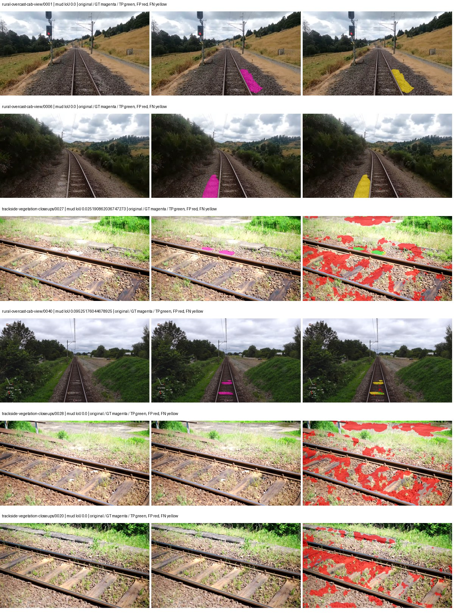
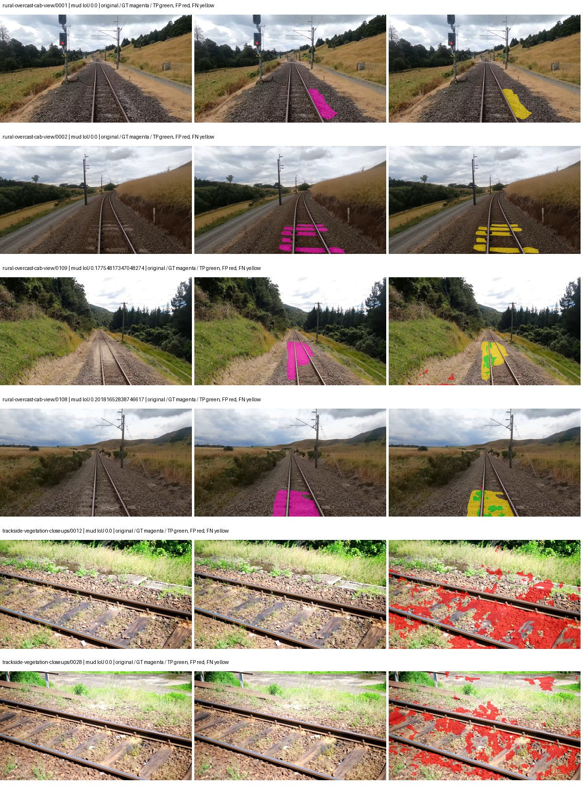
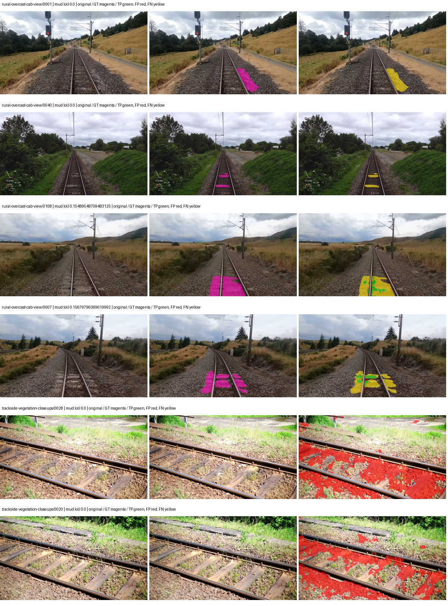
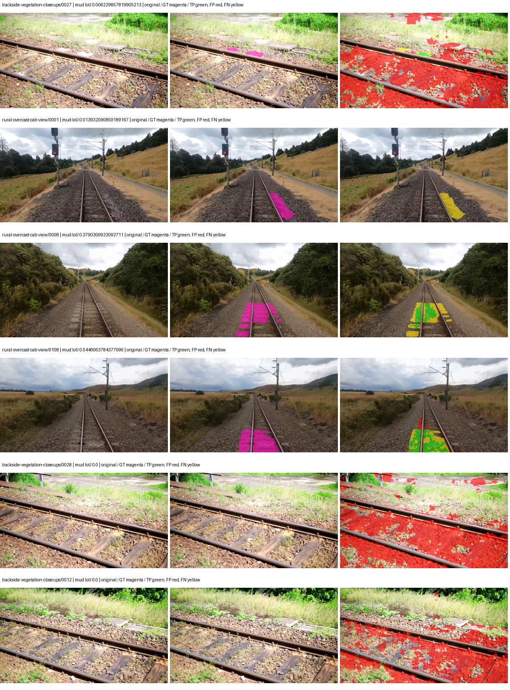

# native_resnet18_fpn_segformer_aux — rad_9_24_2026-fixed-grouped

[RAD 9/24: Scene-grouped split](../../README.md) · [Full model records](record.json)

Primary result: the **final checkpoint** after the full step budget (no early stopping). The checkpoint with the best **mud-pumping validation IoU, pixels pooled over all validation images**, is kept as secondary evidence. A job is complete only after full statistics and isolated profiling are verified.

Study metrics of the final checkpoint, counting each class only on the validation images that contain it: mud-pumping IoU is the mean per-image IoU over the images with mud-pumping, precision and recall sum pixels over those images, and mIoU averages each class over the images that contain it, then over the classes present.

| Initialization path | Seed | Mud-pumping IoU, train-camera images with mud (%, n=17) | Mud-pumping IoU, all images with mud (%, n=18) | Mud precision, all images with mud (%) | Mud recall, all images with mud (%) | mIoU (each class over images that contain it) (%) |
| --- | --- | --- | --- | --- | --- | --- |
| rtis_only | 0 | 0.00 | 0.01 | 0.17 | 0.02 | 30.19 |
| cityscapes_to_rtis | 0 | 0.75 | 1.07 | 11.90 | 1.69 | 31.96 |
| railsem19_to_rtis | 0 | 1.20 | 1.33 | 13.14 | 1.77 | 37.07 |
| cityscapes_to_railsem19_to_rtis | 0 | 4.80 | 4.60 | 14.54 | 5.61 | 34.77 |

Per-class IoU: IoU (%) of every class, each averaged only over the validation images that contain the class (n = those images); — = no image contains it. mIoU averages the classes with at least one such image.

| Initialization path | Seed | mIoU (each class over images that contain it) | person (n=0) | truck (n=0) | rail-track (n=37) | vegetation-overgrowth (n=13) | car (n=3) | on-rails (n=0) | traffic-sign (n=9) | road (n=11) | sidewalk (n=12) | construction (n=12) | tram-track (n=2) | pole (n=21) | traffic-light (n=3) | mud-pumping (n=18) | fence (n=7) | terrain (n=35) | sky (n=28) | rail-embedded (n=3) | rail-raised (n=37) | trackbed (n=37) | standing-water (n=9) |
| --- | --- | --- | --- | --- | --- | --- | --- | --- | --- | --- | --- | --- | --- | --- | --- | --- | --- | --- | --- | --- | --- | --- | --- |
| rtis_only | 0 | 30.19 | — | — | 53.22 | 30.22 | 1.78 | — | 10.07 | 4.61 | 12.62 | 28.48 | 0.48 | 59.85 | 38.82 | 0.01 | 12.55 | 77.24 | 90.99 | 1.70 | 69.15 | 48.15 | 3.49 |
| cityscapes_to_rtis | 0 | 31.96 | — | — | 47.47 | 16.85 | 15.07 | — | 16.31 | 13.61 | 3.52 | 28.64 | 4.36 | 64.99 | 40.83 | 1.07 | 20.60 | 80.25 | 93.42 | 1.78 | 69.72 | 56.17 | 0.56 |
| railsem19_to_rtis | 0 | 37.07 | — | — | 55.26 | 33.23 | 29.96 | — | 23.41 | 16.52 | 14.95 | 37.82 | 8.22 | 67.90 | 47.56 | 1.33 | 15.87 | 85.35 | 95.80 | 0.03 | 70.17 | 60.58 | 3.35 |
| cityscapes_to_railsem19_to_rtis | 0 | 34.77 | — | — | 54.76 | 20.32 | 26.70 | — | 25.48 | 19.87 | 5.48 | 41.73 | 3.48 | 67.12 | 44.97 | 4.60 | 8.50 | 80.56 | 93.19 | 1.24 | 68.04 | 57.70 | 2.18 |

Everything below is the campaign's own record, with pixels pooled over all validation images: its evaluation is the checkpoint that scored best on that pooled mud IoU (secondary evidence here); the diagnostics also cover the final checkpoint (`final-auto-val`).

| Model | Initialization path | Seed | Status | Steps | Best step | Best-checkpoint mud IoU, pixels pooled (%) | Best-checkpoint mud precision, pixels pooled (%) | Best-checkpoint mud recall, pixels pooled (%) | Final mud IoU (trainer val, pixels pooled, %) | Best-checkpoint mIoU, pixels pooled (%) | Best-checkpoint fixed GT-class mIoU, pixels pooled (%) |
| --- | --- | --- | --- | --- | --- | --- | --- | --- | --- | --- | --- |
| native_resnet18_fpn_segformer_aux | rtis_only | 0 | completed | 4000 | 259 | 0.53 | 0.85 | 1.41 | 0.01 | 18.57 | 19.60 |
| native_resnet18_fpn_segformer_aux | cityscapes_to_rtis | 0 | completed | 4000 | 1296 | 1.93 | 2.67 | 6.54 | 1.03 | 24.68 | 28.80 |
| native_resnet18_fpn_segformer_aux | railsem19_to_rtis | 0 | completed | 4000 | 1037 | 1.61 | 2.19 | 5.78 | 0.90 | 34.11 | 39.80 |
| native_resnet18_fpn_segformer_aux | cityscapes_to_railsem19_to_rtis | 0 | completed | 4000 | 1037 | 4.64 | 5.73 | 19.66 | 2.19 | 32.62 | 36.24 |

Training: 217 images. Validation: 37 images. Test: 60 held out. Seeds: [0]. Seed variation measures optimization variability, not independent-recording uncertainty. Historical source checkpoints stay fixed across adaptation seeds.

Training code: `fce0ea0ac50b334d4252812c396e0e593def375d`. Split SHA-256: `12d7b367c72cda61d57686ff2ac28223530d0af49debd9fb7a0fbc68b908bc93`.

## rtis_only — seed 0

Status: **completed**. Started: 2026-10-11T09:12:59.231310+00:00. Finished: 2026-10-11T09:54:57.053224+00:00.

Recipe pretrained initializer: `{"arch": "native", "backbone_path": null, "batch_norm_momentum": null, "checkpoint": null, "classifier_path": null, "drop_path": null, "encoder_name": null, "encoder_weights": null, "head": "unified_head", "head_paths": [], "inactive_parameter_paths": [], "local_files_only": false, "lora_alpha": 32, "lora_dropout": 0.05, "lora_r": 16, "lora_targets": [], "native": {"auxiliary_heads": [{"head": {"activation": "relu", "channels": 64, "dilation": 1, "dropout": 0.1, "in_indices": [2], "kernel_size": 3, "kind": "fcn", "norm": "group", "num_convs": 1}, "loss_weight": 0.4, "name": "aux_s16"}], "backbone": {"in_channels": 3, "kind": "timm", "name": "resnet18.a1_in1k", "out_indices": [1, 2, 3, 4], "weights": "pretrained"}, "head": {"activation": "relu", "channels": 128, "dropout": 0.1, "in_indices": [0, 1, 2, 3], "kind": "segformer", "norm": "group"}, "neck": {"activation": "relu", "kind": "fpn", "norm": "group", "num_outputs": 4, "out_channels": 128}, "task": "multiclass"}, "revision": null, "smp_arch": null, "subfolder": null, "trust_remote_code": false, "tuning": "full"}`.

`rtis_only` uses the recipe initializer, which may include pretrained segmentation components. Transfer paths load the exact historical source checkpoint below and reset the classifier; they do not reset all query/decoder features.

Source checkpoint: `Recipe pretrained initialization`.

Config SHA-256: `7dbc311656dc569a9146780d2df3bc6fdb8e416d34fce780d0db440d166dcdc8`. Weights used for validation: `raw`.

### Mud-pumping and aggregate quality

| Metric | Selected checkpoint | Final training validation |
| --- | --- | --- |
| Mud IoU | 0.53 | 0.01 |
| Mud precision | 0.85 | 0.01 |
| Mud recall | 1.41 | 0.02 |
| Mud Dice/F1 | 1.06 | 0.01 |
| mIoU | 18.57 | 27.08 |
| Mean accuracy | 25.36 | 39.82 |
| Mean precision | 26.32 | 48.97 |
| Mean Dice | 23.28 | 35.36 |
| Mean specificity | 98.31 | 98.74 |
| Pixel accuracy | 76.04 | 79.59 |
| Frequency-weighted IoU | 62.39 | 69.92 |
| Fixed GT-present class mIoU | 19.60 | 31.60 |
| Boundary F1 | 19.60 | 32.42 |

The selected checkpoint has independent evaluation evidence. Final values are the trainer's final validation record, not a new independent evaluation. mIoU averages classes with nonzero union, so false positives on absent classes can change its denominator. The fixed GT-class mean is supplementary and excludes absent classes; their false positives remain in the confusion matrix.

### Resource usage and timing

| Measurement | Value |
| --- | --- |
| Peak training VRAM, retained training invocation (GiB) | 7.76 |
| Peak evaluation VRAM (GiB) | 6.87 |
| Retained training invocation wall time (seconds) | 2383.70 |
| Retained training invocation GPU-hours (one GPU) | 0.66 |
| Evaluation wall time (seconds) | 11.75 |
| Full evaluation pipeline images/second | 3.15 |
| Best full-state checkpoint (MiB) | 184.91 |
| Final full-state checkpoint (MiB) | 184.90 |
| Verified periodic checkpoints removed (GiB) | 1.44 |

VRAM uses the recorded allocator high-water mark; it is not total device usage including CUDA context. Resumed jobs' retained training invocation times and peaks are **not whole-campaign totals**. Earlier invocation resource records are not reconstructed here. Evaluation throughput includes loader, sliding-window inference and metrics; it is not model-only latency/FPS. Missing measurements are shown as —, never inferred from another dataset's run.

### Standardized inference performance

Dedicated model-only profiling waits for an idle worker-locked L40S: BF16, batch 1, 1024x1024, 20 warmup and 100 CUDA-event-timed public forwards. It excludes loading, preprocessing, tiling and metrics.

| Status | Parameters | Weight MiB | FPS | p50 ms | p95 ms | Peak reserved GiB |
| --- | --- | --- | --- | --- | --- | --- |
| complete | 12100522 | 46.16 | 256.01 | 3.83 | 4.22 | 0.61 |

```json
{
  "schema_version": 1,
  "model_id": "native_resnet18_fpn_segformer_aux",
  "measured_at": "2026-10-11T09:54:53+00:00",
  "status": "complete",
  "benchmark_scope": "rtis_selected_checkpoint_model_only",
  "applies_to": [
    "native_resnet18_fpn_segformer_aux--rtis_only--seed-0"
  ],
  "source": {
    "campaign_git_sha": "fce0ea0ac50b334d4252812c396e0e593def375d",
    "git_dirty": false,
    "config_hash": "db43d3d42fdb",
    "resolved_config": "/data/izadia1/projects/segmentary-runs/rad_9_24_2026/fgall-seed0-20261007/configs/native_resnet18_fpn_segformer_aux--rtis_only--seed-0.yaml",
    "config_sha256": "7dbc311656dc569a9146780d2df3bc6fdb8e416d34fce780d0db440d166dcdc8",
    "checkpoint_sha256": "74fd16c760e6c58465a0c3335233a42b894142938fb6dd4536b145b124bbb517",
    "checkpoint_global_step": 259,
    "checkpoint_bytes": 193887095,
    "checkpoint_kind": "resume checkpoint with optimizer and EMA state",
    "weights": "raw",
    "measured_checkpoint_job_id": "native_resnet18_fpn_segformer_aux--rtis_only--seed-0",
    "result_sha256": "dd5c0ac07d39847ca9c3b7dc244e068ab4afe8d5b7566818a9cdcc22b433c355",
    "result_git_sha": "fce0ea0ac50b334d4252812c396e0e593def375d",
    "result_stage": "eval:rad_9_24_2026-fixed-grouped:val",
    "result_seed": 0
  },
  "hardware": {
    "gpu_name": "NVIDIA L40S",
    "gpu_uuid": "GPU-1c9b612f-e0b5-fbbc-150f-8c2ef13453c9",
    "logical_device": "cuda:0",
    "physical_visibility_token": "5",
    "compute_capability": [
      8,
      9
    ],
    "total_memory_bytes": 47677177856
  },
  "model": {
    "parameter_count": 12100522,
    "trainable_parameter_count": 12100522,
    "resident_parameter_bytes": 48402088,
    "parameter_dtype_counts": {
      "float32": 12100522
    }
  },
  "contract": {
    "backend": "pytorch",
    "precision": "bf16_autocast",
    "batch_size": 1,
    "input_shape_nchw": [
      1,
      3,
      1024,
      1024
    ],
    "warmup_iterations": 20,
    "measured_iterations": 100,
    "timing": "per-forward CUDA events with end-event synchronization",
    "includes_preprocessing": false,
    "includes_data_loader": false,
    "includes_sliding_window": false,
    "input_resident_on_gpu": true,
    "model_only": true,
    "entrypoint": "public model(image) dense-logits forward"
  },
  "measurements": {
    "latency": {
      "p50_ms": 3.8333441019058228,
      "p95_ms": 4.215807914733887,
      "mean_ms": 3.9061494278907776,
      "minimum_ms": 3.802112102508545,
      "maximum_ms": 4.527103900909424,
      "fps": 256.0065912634517,
      "raw_ms": [
        4.527103900909424,
        3.82259202003479,
        4.171775817871094,
        4.136960029602051,
        4.215807914733887,
        4.031487941741943,
        3.832832098007202,
        3.8492159843444824,
        3.817471981048584,
        3.8143999576568604,
        3.8256640434265137,
        3.826688051223755,
        3.82259202003479,
        3.812351942062378,
        3.8143999576568604,
        3.8440959453582764,
        4.145120143890381,
        3.8410239219665527,
        3.802112102508545,
        4.042751789093018,
        4.242432117462158,
        3.813375949859619,
        3.808255910873413,
        3.8184640407562256,
        4.091904163360596,
        3.87174391746521,
        3.817471981048584,
        3.815455913543701,
        3.8881280422210693,
        3.826688051223755,
        3.8205440044403076,
        3.867647886276245,
        4.013055801391602,
        4.038656234741211,
        3.8164479732513428,
        3.856384038925171,
        3.827712059020996,
        3.8103039264678955,
        3.8440959453582764,
        4.140031814575195,
        3.852288007736206,
        3.818495988845825,
        3.8154239654541016,
        3.989504098892212,
        4.215807914733887,
        3.821568012237549,
        4.069375991821289,
        3.8645761013031006,
        3.8359038829803467,
        4.124671936035156,
        3.9813120365142822,
        4.0570878982543945,
        3.8348801136016846,
        3.8338561058044434,
        3.817471981048584,
        3.8062078952789307,
        3.8164479732513428,
        3.8287360668182373,
        3.837951898574829,
        4.361216068267822,
        3.8789119720458984,
        3.817471981048584,
        3.826688051223755,
        3.9833600521087646,
        4.077568054199219,
        3.9976959228515625,
        3.8553600311279297,
        3.8164479732513428,
        3.836927890777588,
        3.8307840824127197,
        3.8451199531555176,
        3.810271978378296,
        3.831808090209961,
        3.817471981048584,
        3.813375949859619,
        3.821568012237549,
        3.9342079162597656,
        3.818495988845825,
        3.8154239654541016,
        3.82259202003479,
        3.827712059020996,
        4.092927932739258,
        4.336639881134033,
        4.097023963928223,
        3.8205440044403076,
        3.812351942062378,
        3.8164479732513428,
        3.821568012237549,
        3.8154239654541016,
        3.8236160278320312,
        3.8256640434265137,
        3.807231903076172,
        3.8164479732513428,
        3.813375949859619,
        3.8778560161590576,
        3.8840320110321045,
        3.8635520935058594,
        3.8502399921417236,
        3.8359038829803467,
        3.916800022125244
      ],
      "percentile_method": "numpy linear interpolation"
    },
    "peak_reserved_bytes": 656408576,
    "memory_kind": "pytorch_cuda_allocator_peak_reserved_excluding_context",
    "process_total_bytes": 1184890880,
    "process_total_kind": "nvidia-smi used_memory of this PID on the benchmark GPU after the timed loop, including the CUDA context; null when the driver could not attribute memory to this PID",
    "benchmark_wall_clock_s": 10.697448544204235
  },
  "started_at": "2026-10-11T09:54:43+00:00",
  "finished_at": "2026-10-11T09:54:53+00:00",
  "environment": {
    "hostname": "hdrfs-app-001",
    "python": "3.11.15",
    "platform": "Linux-5.15.0-139-generic-x86_64-with-glibc2.35",
    "torch": "2.11.0+cu128",
    "torch_cuda": "12.8",
    "cudnn": 91900,
    "driver_version": "570.133.20",
    "cuda_available": true,
    "gpu_count": 1,
    "gpu_names": [
      "NVIDIA L40S"
    ],
    "cuda_visible_devices": "5",
    "packages": {
      "segmentary": "0.1.0",
      "torch": "2.11.0+cu128",
      "torchvision": "0.26.0+cu128",
      "transformers": "5.15.0",
      "timm": "1.0.28",
      "segmentation-models-pytorch": "0.5.0",
      "albumentations": "2.0.8",
      "lightning": "2.6.5",
      "numpy": "2.4.4"
    }
  }
}
```

### Per-class validation results

| Class | GT pixels | IoU (%) | Precision (%) | Recall (%) | Dice (%) | Boundary F1 (%) |
| --- | --- | --- | --- | --- | --- | --- |
| car | 29664 | 0.00 | 0.00 | 0.00 | 0.00 | 0.00 |
| construction | 311585 | 15.50 | 18.32 | 50.20 | 26.84 | 23.50 |
| fence | 265137 | 0.00 | 0.00 | 0.00 | 0.00 | 0.00 |
| mud-pumping | 1226250 | 0.53 | 0.85 | 1.41 | 1.06 | 2.58 |
| on-rails | 0 | 0.00 | 0.00 | — | 0.00 | 0.00 |
| person | 0 | — | — | — | — | — |
| pole | 628038 | 30.57 | 63.67 | 37.03 | 46.83 | 71.84 |
| rail-embedded | 16799 | 0.00 | 0.00 | 0.00 | 0.00 | 0.00 |
| rail-raised | 2969797 | 64.99 | 80.26 | 77.36 | 78.78 | 84.41 |
| rail-track | 6323197 | 22.10 | 50.20 | 28.31 | 36.20 | 40.41 |
| road | 1048831 | 0.00 | 0.00 | 0.00 | 0.00 | 0.00 |
| sidewalk | 1297367 | 1.46 | 44.29 | 1.49 | 2.89 | 0.10 |
| sky | 19121606 | 89.28 | 99.62 | 89.59 | 94.34 | 62.60 |
| standing-water | 95802 | 0.00 | 0.00 | 0.00 | 0.00 | 0.00 |
| terrain | 39239306 | 74.56 | 75.81 | 97.84 | 85.43 | 37.15 |
| trackbed | 10643081 | 53.87 | 67.07 | 73.24 | 70.02 | 49.86 |
| traffic-light | 19510 | 0.00 | 0.00 | 0.00 | 0.00 | 0.00 |
| traffic-sign | 13285 | 0.00 | 0.00 | 0.00 | 0.00 | 0.00 |
| tram-track | 56179 | 0.00 | 0.00 | 0.00 | 0.00 | 0.00 |
| truck | 0 | — | — | — | — | — |
| vegetation-overgrowth | 5901821 | 0.00 | 0.00 | 0.00 | 0.00 | 0.00 |

### Full-run accounting

| Measurement | Value |
| --- | --- |
| Full GPU-reserved wall seconds, all recorded worker attempts | 2525.63 |
| Full reserved GPU-hours | 0.70 |
| Whole-run timing complete | True |

| Phase | Wall seconds including failed attempts |
| --- | --- |
| training | 2390.10 |
| diagnostics | 87.80 |
| performance | 18.62 |

GPU-reserved time includes model loading, training, validation, collection, profiling, checkpoint I/O and orchestration while the worker owns one GPU. It is not GPU kernel-active time. Phase timings and sampled device memory/power/utilization are retained separately; sampled device memory is not the allocator high-water mark.

### Train/validation and raw/EMA diagnostics

| Checkpoint / weights / split | Images | Mud IoU (%) | Mud precision (%) | Mud recall (%) |
| --- | --- | --- | --- | --- |
| best-auto-train / raw | 217 | 73.82 | 80.07 | 90.44 |
| best-auto-val / raw | 37 | 0.53 | 0.85 | 1.41 |
| best-alternate-val / ema | 37 | 0.64 | 0.83 | 2.66 |
| final-auto-val / raw | 37 | 0.01 | 0.01 | 0.02 |

Train uses the evaluation transform without augmentation. Compare mud train/validation metrics for the same selected weights. Alternate EMA on running-stat BatchNorm is explicitly uncalibrated and is diagnostic only. Score-threshold curves use uncalibrated normalized scores and are pixel-level diagnostics, not event detection rates or a selected deployment operating point.

### Downloadable evidence

- best-auto-train: [per-image.csv](rtis_only--seed-0/best-auto-train/per-image.csv) · [per-image-confusion.json.gz](rtis_only--seed-0/best-auto-train/per-image-confusion.json.gz) · [groups.json](rtis_only--seed-0/best-auto-train/groups.json) · [mud-score-curves.json](rtis_only--seed-0/best-auto-train/mud-score-curves.json)
- best-auto-val: [per-image.csv](rtis_only--seed-0/best-auto-val/per-image.csv) · [per-image-confusion.json.gz](rtis_only--seed-0/best-auto-val/per-image-confusion.json.gz) · [groups.json](rtis_only--seed-0/best-auto-val/groups.json) · [mud-score-curves.json](rtis_only--seed-0/best-auto-val/mud-score-curves.json) · [examples.jpg](rtis_only--seed-0/best-auto-val/examples.jpg)
- best-alternate-val: [per-image.csv](rtis_only--seed-0/best-alternate-val/per-image.csv) · [per-image-confusion.json.gz](rtis_only--seed-0/best-alternate-val/per-image-confusion.json.gz) · [groups.json](rtis_only--seed-0/best-alternate-val/groups.json) · [mud-score-curves.json](rtis_only--seed-0/best-alternate-val/mud-score-curves.json)
- final-auto-val: [per-image.csv](rtis_only--seed-0/final-auto-val/per-image.csv) · [per-image-confusion.json.gz](rtis_only--seed-0/final-auto-val/per-image-confusion.json.gz) · [groups.json](rtis_only--seed-0/final-auto-val/groups.json) · [mud-score-curves.json](rtis_only--seed-0/final-auto-val/mud-score-curves.json)
- resources: [telemetry.csv](rtis_only--seed-0/resources/telemetry.csv)



Examples are two lowest and two highest mud-IoU positive images, plus up to two negative images with the most false-positive mud pixels. They are targeted diagnostic examples, not random samples. Green: true positive; red: false positive; yellow: false negative. Full predictions remain on HDRFS.

### Validation tracking

| Logged step | Overall mIoU (%) | Mud IoU (%) |
| --- | --- | --- |
| 258 | 18.57 | 0.53 |
| 518 | 21.38 | 0.14 |
| 777 | 21.03 | 0.45 |
| 1036 | 20.89 | 0.51 |
| 1295 | 19.53 | 0.14 |
| 1555 | 22.20 | 0.12 |
| 1814 | 23.57 | 0.23 |
| 2073 | 23.55 | 0.00 |
| 2332 | 23.72 | 0.07 |
| 2592 | 23.87 | 0.10 |
| 2851 | 26.70 | 0.01 |
| 3110 | 24.69 | 0.13 |
| 3369 | 28.31 | 0.01 |
| 3629 | 26.71 | 0.00 |
| 3888 | 26.62 | 0.01 |
| 4000 | 27.08 | 0.01 |

All retained scalar curves, including training loss and per-class IoU, are in record.json. Observed best mud on a curve is not necessarily a retained checkpoint: the pilot saved its selection-metric-best and final checkpoints. Step logging and checkpoint global_step may differ by one.

### Stopping and checkpoint provenance

```json
{
  "stopping": {
    "actual_steps": 4000,
    "maximum_steps": 4000,
    "min_delta": 0.0,
    "monitor": "val_iou/mud-pumping",
    "patience": null,
    "reason": "budget_complete"
  },
  "checkpoints": {
    "best": {
      "path": "/data/izadia1/projects/segmentary-runs/rad_9_24_2026/fgall-seed0-20261007/future-runs/native_resnet18_fpn_segformer_aux--rtis_only--seed-0_seed0/rtis/best.ckpt",
      "sha256": "74fd16c760e6c58465a0c3335233a42b894142938fb6dd4536b145b124bbb517",
      "global_step": 259,
      "bytes": 193887095
    },
    "final": {
      "path": "/data/izadia1/projects/segmentary-runs/rad_9_24_2026/fgall-seed0-20261007/future-runs/native_resnet18_fpn_segformer_aux--rtis_only--seed-0_seed0/rtis/last.ckpt",
      "sha256": "c763350e122bd0b53c9000b13892373d087cfcd1856b330bed74ca605a5cd05f",
      "global_step": 4000,
      "bytes": 193881719
    }
  },
  "cleanup_error": null
}
```

### Resolved training, initialization and evaluation settings

The optimizer block is the base configuration. Stage LR scales are applied at runtime, and stage warmup is capped at min(base warmup, floor(stage budget / 10), stage budget - 1): 400 steps for this 4,000-step pilot. Model-internal native input grids may differ from augmentation crops (EoMT uses its 640 grid).

```json
{
  "name": "native_resnet18_fpn_segformer_aux--rtis_only--seed-0",
  "model": {
    "arch": "native",
    "checkpoint": null,
    "tuning": "full",
    "head": "unified_head",
    "lora_r": 16,
    "lora_alpha": 32,
    "lora_dropout": 0.05,
    "lora_targets": [],
    "drop_path": null,
    "revision": null,
    "subfolder": null,
    "local_files_only": false,
    "trust_remote_code": false,
    "backbone_path": null,
    "head_paths": [],
    "classifier_path": null,
    "inactive_parameter_paths": [],
    "smp_arch": null,
    "encoder_name": null,
    "encoder_weights": null,
    "native": {
      "task": "multiclass",
      "backbone": {
        "kind": "timm",
        "name": "resnet18.a1_in1k",
        "weights": "pretrained",
        "out_indices": [
          1,
          2,
          3,
          4
        ],
        "in_channels": 3
      },
      "neck": {
        "kind": "fpn",
        "out_channels": 128,
        "num_outputs": 4,
        "norm": "group",
        "activation": "relu"
      },
      "head": {
        "kind": "segformer",
        "in_indices": [
          0,
          1,
          2,
          3
        ],
        "channels": 128,
        "dropout": 0.1,
        "norm": "group",
        "activation": "relu"
      },
      "auxiliary_heads": [
        {
          "name": "aux_s16",
          "loss_weight": 0.4,
          "head": {
            "kind": "fcn",
            "in_indices": [
              2
            ],
            "channels": 64,
            "num_convs": 1,
            "kernel_size": 3,
            "dilation": 1,
            "dropout": 0.1,
            "norm": "group",
            "activation": "relu"
          }
        }
      ]
    },
    "batch_norm_momentum": null
  },
  "space": "paul-test-rtis",
  "taxonomy_root": "/data/izadia1/projects/segmentary-rad-fgall-fce0ea0a/taxonomy",
  "output_root": "/data/izadia1/projects/segmentary-runs/rad_9_24_2026/fgall-seed0-20261007/future-runs",
  "optim": {
    "backbone_lr": 0.0001,
    "head_lr_mult": 10.0,
    "weight_decay": 0.05,
    "llrd": 1.0,
    "warmup_iters": 1500,
    "warmup_ratio": 1e-06,
    "poly_power": 0.9,
    "min_lr_ratio": 0.0,
    "betas": [
      0.9,
      0.999
    ],
    "grad_clip": 1.0
  },
  "train": {
    "iters": 4000,
    "batch_size": 2,
    "accum": 8,
    "num_workers": 2,
    "precision": "bf16-mixed",
    "ema_decay": 0.9998,
    "val_every": 250,
    "ckpt_every": 500,
    "selection_metric": "val_iou/mud-pumping",
    "early_stopping_patience": null,
    "early_stopping_min_delta": 0.0,
    "seed": 0,
    "devices": 1
  },
  "eval": {
    "sliding_window": true,
    "window": [
      1024,
      1024
    ],
    "stride": [
      768,
      768
    ],
    "batch_size": 1,
    "num_workers": 2,
    "tta_scales": [],
    "tta_flip": false,
    "threshold": 0.5,
    "boundary_tolerance_frac": 0.0075,
    "save_confusion": true
  },
  "loss": {
    "task": "multiclass",
    "activation": "auto",
    "terms": [],
    "aux": "none",
    "aux_weight": 0.0,
    "ce_weight": 1.0,
    "label_smoothing": 0.0,
    "class_weights": null,
    "query": null
  },
  "aug": {
    "crop": [
      1024,
      1024
    ],
    "scale_min": 0.5,
    "scale_max": 2.0,
    "hflip_p": 0.5,
    "color_jitter_p": 0.5,
    "brightness": 0.25,
    "contrast": 0.25,
    "saturation": 0.25,
    "hue": 0.05
  },
  "stages": [
    {
      "name": "rtis",
      "data": [
        {
          "name": "rad_9_24_2026-fixed-grouped",
          "root": "/data/izadia1/datasets/rad_9_24_2026-fixed-grouped",
          "variant": null,
          "split_file": "splits.json",
          "train_split": "train",
          "val_split": "val",
          "limit": null,
          "loader": "folder",
          "mapping": "paul-test-rtis",
          "loader_options": {
            "require_groups": true
          }
        }
      ],
      "iters": null,
      "lr_scale": 1.0,
      "head_group_lr_scale": 1.0,
      "init_from": "pretrained",
      "reset_head": false,
      "freeze": null,
      "sample_weights": null
    }
  ]
}
```

### Hardware and software provenance

```json
{
  "training": {
    "cuda_available": true,
    "cuda_visible_devices": "5",
    "cudnn": 91900,
    "driver_version": "570.133.20",
    "gpu_count": 1,
    "gpu_names": [
      "NVIDIA L40S"
    ],
    "hostname": "hdrfs-app-001",
    "input_normalization": {
      "channel_order": "rgb",
      "mean": [
        0.485,
        0.456,
        0.406
      ],
      "source": "timm_pretrained_cfg",
      "std": [
        0.229,
        0.224,
        0.225
      ]
    },
    "model_origins": [
      {
        "hf_commit": null,
        "hf_name_or_path": null,
        "module": "backbone",
        "timm_pretrained": {
          "architecture": "resnet18",
          "hf_hub_id": "timm/resnet18.a1_in1k",
          "tag": "a1_in1k",
          "url": "https://github.com/huggingface/pytorch-image-models/releases/download/v0.1-rsb-weights/resnet18_a1_0-d63eafa0.pth"
        }
      },
      {
        "hf_commit": null,
        "hf_name_or_path": null,
        "module": "backbone.model",
        "timm_pretrained": {
          "architecture": "resnet18",
          "hf_hub_id": "timm/resnet18.a1_in1k",
          "tag": "a1_in1k",
          "url": "https://github.com/huggingface/pytorch-image-models/releases/download/v0.1-rsb-weights/resnet18_a1_0-d63eafa0.pth"
        }
      }
    ],
    "model_parameter_count": 12100522,
    "packages": {
      "albumentations": "2.0.8",
      "lightning": "2.6.5",
      "numpy": "2.4.4",
      "segmentary": "0.1.0",
      "segmentation-models-pytorch": "0.5.0",
      "timm": "1.0.28",
      "torch": "2.11.0+cu128",
      "torchvision": "0.26.0+cu128",
      "transformers": "5.15.0"
    },
    "platform": "Linux-5.15.0-139-generic-x86_64-with-glibc2.35",
    "python": "3.11.15",
    "torch": "2.11.0+cu128",
    "torch_cuda": "12.8",
    "trainable_parameter_count": 12100522,
    "training_stop": {
      "actual_steps": 4000,
      "maximum_steps": 4000,
      "min_delta": 0.0,
      "monitor": "val_iou/mud-pumping",
      "patience": null,
      "reason": "budget_complete"
    },
    "validation_weights": "raw"
  },
  "evaluation": {
    "cuda_available": true,
    "cuda_visible_devices": "5",
    "cudnn": 91900,
    "driver_version": "570.133.20",
    "gpu_count": 1,
    "gpu_names": [
      "NVIDIA L40S"
    ],
    "hostname": "hdrfs-app-001",
    "input_normalization": {
      "channel_order": "rgb",
      "mean": [
        0.485,
        0.456,
        0.406
      ],
      "source": "timm_pretrained_cfg",
      "std": [
        0.229,
        0.224,
        0.225
      ]
    },
    "packages": {
      "albumentations": "2.0.8",
      "lightning": "2.6.5",
      "numpy": "2.4.4",
      "segmentary": "0.1.0",
      "segmentation-models-pytorch": "0.5.0",
      "timm": "1.0.28",
      "torch": "2.11.0+cu128",
      "torchvision": "0.26.0+cu128",
      "transformers": "5.15.0"
    },
    "platform": "Linux-5.15.0-139-generic-x86_64-with-glibc2.35",
    "python": "3.11.15",
    "torch": "2.11.0+cu128",
    "torch_cuda": "12.8"
  }
}
```

## cityscapes_to_rtis — seed 0

Status: **completed**. Started: 2026-10-11T09:16:08.057546+00:00. Finished: 2026-10-11T09:59:02.025981+00:00.

Recipe pretrained initializer: `{"arch": "native", "backbone_path": null, "batch_norm_momentum": null, "checkpoint": null, "classifier_path": null, "drop_path": null, "encoder_name": null, "encoder_weights": null, "head": "unified_head", "head_paths": [], "inactive_parameter_paths": [], "local_files_only": false, "lora_alpha": 32, "lora_dropout": 0.05, "lora_r": 16, "lora_targets": [], "native": {"auxiliary_heads": [{"head": {"activation": "relu", "channels": 64, "dilation": 1, "dropout": 0.1, "in_indices": [2], "kernel_size": 3, "kind": "fcn", "norm": "group", "num_convs": 1}, "loss_weight": 0.4, "name": "aux_s16"}], "backbone": {"in_channels": 3, "kind": "timm", "name": "resnet18.a1_in1k", "out_indices": [1, 2, 3, 4], "weights": "pretrained"}, "head": {"activation": "relu", "channels": 128, "dropout": 0.1, "in_indices": [0, 1, 2, 3], "kind": "segformer", "norm": "group"}, "neck": {"activation": "relu", "kind": "fpn", "norm": "group", "num_outputs": 4, "out_channels": 128}, "task": "multiclass"}, "revision": null, "smp_arch": null, "subfolder": null, "trust_remote_code": false, "tuning": "full"}`.

`rtis_only` uses the recipe initializer, which may include pretrained segmentation components. Transfer paths load the exact historical source checkpoint below and reset the classifier; they do not reset all query/decoder features.

Source checkpoint: `{'name': 'native_resnet18_fpn_segformer_aux--cityscapes--seed-0', 'model': 'native_resnet18_fpn_segformer_aux', 'protocol': 'cityscapes', 'config': '/data/izadia1/projects/segmentary-runs/all-model-city-rail-seed0-rail20-b9eb3e1/jobs/native_resnet18_fpn_segformer_aux--cityscapes--seed-0/attempt-001/resolved-config.yaml', 'checkpoint': '/data/izadia1/projects/segmentary-runs/all-model-city-rail-seed0-rail20-b9eb3e1/jobs/native_resnet18_fpn_segformer_aux--cityscapes--seed-0/attempt-001/train/native_resnet18_fpn_segformer_aux--cityscapes_seed0/cityscapes/last.ckpt', 'recorded_sha256': '805a02915710313f53e77271b3b98d37b7ff1e6edab8d2f12a4c5410b2bb953c', 'exists': True}`.

Config SHA-256: `a722c02d0929855d5416ed741c1657659806dbf7e293f6e4a3ed7cec03ded642`. Weights used for validation: `raw`.

### Mud-pumping and aggregate quality

| Metric | Selected checkpoint | Final training validation |
| --- | --- | --- |
| Mud IoU | 1.93 | 1.03 |
| Mud precision | 2.67 | 2.56 |
| Mud recall | 6.54 | 1.69 |
| Mud Dice/F1 | 3.79 | 2.04 |
| mIoU | 24.68 | 29.74 |
| Mean accuracy | 36.48 | 42.94 |
| Mean precision | 42.69 | 47.17 |
| Mean Dice | 31.87 | 38.12 |
| Mean specificity | 98.70 | 98.74 |
| Pixel accuracy | 79.99 | 81.32 |
| Frequency-weighted IoU | 69.45 | 69.98 |
| Fixed GT-present class mIoU | 28.80 | 34.70 |
| Boundary F1 | 28.36 | 33.22 |

The selected checkpoint has independent evaluation evidence. Final values are the trainer's final validation record, not a new independent evaluation. mIoU averages classes with nonzero union, so false positives on absent classes can change its denominator. The fixed GT-class mean is supplementary and excludes absent classes; their false positives remain in the confusion matrix.

### Resource usage and timing

| Measurement | Value |
| --- | --- |
| Peak training VRAM, retained training invocation (GiB) | 7.76 |
| Peak evaluation VRAM (GiB) | 6.87 |
| Retained training invocation wall time (seconds) | 2440.64 |
| Retained training invocation GPU-hours (one GPU) | 0.68 |
| Evaluation wall time (seconds) | 11.50 |
| Full evaluation pipeline images/second | 3.22 |
| Best full-state checkpoint (MiB) | 184.91 |
| Final full-state checkpoint (MiB) | 184.90 |
| Verified periodic checkpoints removed (GiB) | 1.44 |

VRAM uses the recorded allocator high-water mark; it is not total device usage including CUDA context. Resumed jobs' retained training invocation times and peaks are **not whole-campaign totals**. Earlier invocation resource records are not reconstructed here. Evaluation throughput includes loader, sliding-window inference and metrics; it is not model-only latency/FPS. Missing measurements are shown as —, never inferred from another dataset's run.

### Standardized inference performance

Dedicated model-only profiling waits for an idle worker-locked L40S: BF16, batch 1, 1024x1024, 20 warmup and 100 CUDA-event-timed public forwards. It excludes loading, preprocessing, tiling and metrics.

| Status | Parameters | Weight MiB | FPS | p50 ms | p95 ms | Peak reserved GiB |
| --- | --- | --- | --- | --- | --- | --- |
| complete | 12100522 | 46.16 | 252.54 | 3.87 | 4.30 | 0.61 |

```json
{
  "schema_version": 1,
  "model_id": "native_resnet18_fpn_segformer_aux",
  "measured_at": "2026-10-11T09:58:58+00:00",
  "status": "complete",
  "benchmark_scope": "rtis_selected_checkpoint_model_only",
  "applies_to": [
    "native_resnet18_fpn_segformer_aux--cityscapes_to_rtis--seed-0"
  ],
  "source": {
    "campaign_git_sha": "fce0ea0ac50b334d4252812c396e0e593def375d",
    "git_dirty": false,
    "config_hash": "6eca6b95a107",
    "resolved_config": "/data/izadia1/projects/segmentary-runs/rad_9_24_2026/fgall-seed0-20261007/configs/native_resnet18_fpn_segformer_aux--cityscapes_to_rtis--seed-0.yaml",
    "config_sha256": "a722c02d0929855d5416ed741c1657659806dbf7e293f6e4a3ed7cec03ded642",
    "checkpoint_sha256": "1ba8b98ec1f61b713db06275b613a0013b3aaf2f7414c213cd842d67f97da29b",
    "checkpoint_global_step": 1296,
    "checkpoint_bytes": 193887479,
    "checkpoint_kind": "resume checkpoint with optimizer and EMA state",
    "weights": "raw",
    "measured_checkpoint_job_id": "native_resnet18_fpn_segformer_aux--cityscapes_to_rtis--seed-0",
    "result_sha256": "3fa8c9dab6190f4cf2702cb2b089790662817834a26612ce9353ade6e88bc8c0",
    "result_git_sha": "fce0ea0ac50b334d4252812c396e0e593def375d",
    "result_stage": "eval:rad_9_24_2026-fixed-grouped:val",
    "result_seed": 0
  },
  "hardware": {
    "gpu_name": "NVIDIA L40S",
    "gpu_uuid": "GPU-a5ad49e5-0536-5229-ba8a-f8a902808f53",
    "logical_device": "cuda:0",
    "physical_visibility_token": "7",
    "compute_capability": [
      8,
      9
    ],
    "total_memory_bytes": 47677177856
  },
  "model": {
    "parameter_count": 12100522,
    "trainable_parameter_count": 12100522,
    "resident_parameter_bytes": 48402088,
    "parameter_dtype_counts": {
      "float32": 12100522
    }
  },
  "contract": {
    "backend": "pytorch",
    "precision": "bf16_autocast",
    "batch_size": 1,
    "input_shape_nchw": [
      1,
      3,
      1024,
      1024
    ],
    "warmup_iterations": 20,
    "measured_iterations": 100,
    "timing": "per-forward CUDA events with end-event synchronization",
    "includes_preprocessing": false,
    "includes_data_loader": false,
    "includes_sliding_window": false,
    "input_resident_on_gpu": true,
    "model_only": true,
    "entrypoint": "public model(image) dense-logits forward"
  },
  "measurements": {
    "latency": {
      "p50_ms": 3.874303936958313,
      "p95_ms": 4.299161434173584,
      "mean_ms": 3.959797432422638,
      "minimum_ms": 3.843071937561035,
      "maximum_ms": 5.032959938049316,
      "fps": 252.5381707185439,
      "raw_ms": [
        3.967008113861084,
        3.8901760578155518,
        3.8881280422210693,
        3.890239953994751,
        3.865567922592163,
        4.242432117462158,
        3.8543360233306885,
        3.880959987640381,
        3.9229440689086914,
        3.866624116897583,
        3.924992084503174,
        3.9393599033355713,
        3.8778879642486572,
        3.8645761013031006,
        3.906559944152832,
        3.9045119285583496,
        3.901439905166626,
        3.9096319675445557,
        3.8533120155334473,
        4.2987518310546875,
        4.602880001068115,
        5.032959938049316,
        4.7032318115234375,
        3.9935998916625977,
        3.8502399921417236,
        3.872767925262451,
        3.845088005065918,
        3.852288007736206,
        3.856384038925171,
        3.861504077911377,
        4.064256191253662,
        3.8737919330596924,
        4.0273919105529785,
        3.970047950744629,
        4.306943893432617,
        4.078591823577881,
        3.852288007736206,
        3.857408046722412,
        3.87174391746521,
        3.84716796875,
        3.8594560623168945,
        4.072447776794434,
        3.8645761013031006,
        4.147200107574463,
        3.865600109100342,
        3.8492159843444824,
        3.848191976547241,
        3.8502399921417236,
        3.8440959453582764,
        3.8594560623168945,
        3.851263999938965,
        3.867647886276245,
        3.856384038925171,
        3.8502399921417236,
        3.8502399921417236,
        3.8686718940734863,
        3.8839681148529053,
        3.8584320545196533,
        3.87174391746521,
        4.365312099456787,
        3.9147520065307617,
        4.171775817871094,
        3.886080026626587,
        3.8604800701141357,
        3.8543360233306885,
        3.861504077911377,
        3.881983995437622,
        3.861504077911377,
        3.861504077911377,
        3.8553600311279297,
        3.843071937561035,
        3.8881280422210693,
        4.046847820281982,
        4.260863780975342,
        4.150271892547607,
        3.87174391746521,
        3.862528085708618,
        4.219903945922852,
        3.8594560623168945,
        3.9925758838653564,
        3.896320104598999,
        3.9106240272521973,
        3.8748159408569336,
        3.861504077911377,
        3.881983995437622,
        3.8737919330596924,
        3.8799359798431396,
        3.866624116897583,
        3.8440959453582764,
        4.217855930328369,
        4.272128105163574,
        4.281343936920166,
        4.114431858062744,
        3.8891520500183105,
        3.857408046722412,
        3.8645761013031006,
        3.865600109100342,
        3.9096319675445557,
        3.886080026626587,
        3.872767925262451
      ],
      "percentile_method": "numpy linear interpolation"
    },
    "peak_reserved_bytes": 656408576,
    "memory_kind": "pytorch_cuda_allocator_peak_reserved_excluding_context",
    "process_total_bytes": 1184890880,
    "process_total_kind": "nvidia-smi used_memory of this PID on the benchmark GPU after the timed loop, including the CUDA context; null when the driver could not attribute memory to this PID",
    "benchmark_wall_clock_s": 10.10919651389122
  },
  "started_at": "2026-10-11T09:58:48+00:00",
  "finished_at": "2026-10-11T09:58:58+00:00",
  "environment": {
    "hostname": "hdrfs-app-001",
    "python": "3.11.15",
    "platform": "Linux-5.15.0-139-generic-x86_64-with-glibc2.35",
    "torch": "2.11.0+cu128",
    "torch_cuda": "12.8",
    "cudnn": 91900,
    "driver_version": "570.133.20",
    "cuda_available": true,
    "gpu_count": 1,
    "gpu_names": [
      "NVIDIA L40S"
    ],
    "cuda_visible_devices": "7",
    "packages": {
      "segmentary": "0.1.0",
      "torch": "2.11.0+cu128",
      "torchvision": "0.26.0+cu128",
      "transformers": "5.15.0",
      "timm": "1.0.28",
      "segmentation-models-pytorch": "0.5.0",
      "albumentations": "2.0.8",
      "lightning": "2.6.5",
      "numpy": "2.4.4"
    }
  }
}
```

### Per-class validation results

| Class | GT pixels | IoU (%) | Precision (%) | Recall (%) | Dice (%) | Boundary F1 (%) |
| --- | --- | --- | --- | --- | --- | --- |
| car | 29664 | 0.00 | 0.00 | 0.00 | 0.00 | 0.00 |
| construction | 311585 | 31.72 | 35.94 | 72.98 | 48.16 | 31.72 |
| fence | 265137 | 10.81 | 15.94 | 25.13 | 19.51 | 16.84 |
| mud-pumping | 1226250 | 1.93 | 2.67 | 6.54 | 3.79 | 4.32 |
| on-rails | 0 | 0.00 | 0.00 | — | 0.00 | 0.00 |
| person | 0 | 0.00 | 0.00 | — | 0.00 | 0.00 |
| pole | 628038 | 62.82 | 76.96 | 77.37 | 77.17 | 83.22 |
| rail-embedded | 16799 | 0.00 | 0.00 | 0.00 | 0.00 | 0.00 |
| rail-raised | 2969797 | 68.00 | 81.45 | 80.45 | 80.95 | 85.99 |
| rail-track | 6323197 | 32.12 | 68.64 | 37.64 | 48.62 | 48.14 |
| road | 1048831 | 9.67 | 22.93 | 14.32 | 17.63 | 14.75 |
| sidewalk | 1297367 | 17.26 | 82.47 | 17.91 | 29.44 | 9.89 |
| sky | 19121606 | 96.59 | 98.85 | 97.68 | 98.26 | 84.32 |
| standing-water | 95802 | 0.05 | 0.12 | 0.10 | 0.11 | 5.62 |
| terrain | 39239306 | 82.05 | 83.92 | 97.37 | 90.14 | 45.82 |
| trackbed | 10643081 | 52.70 | 66.24 | 72.04 | 69.02 | 49.02 |
| traffic-light | 19510 | 31.71 | 85.96 | 33.44 | 48.15 | 42.51 |
| traffic-sign | 13285 | 5.15 | 91.25 | 5.18 | 9.80 | 26.84 |
| tram-track | 56179 | 3.06 | 6.70 | 5.33 | 5.94 | 0.49 |
| truck | 0 | 0.00 | 0.00 | — | 0.00 | 0.00 |
| vegetation-overgrowth | 5901821 | 12.68 | 76.51 | 13.19 | 22.50 | 46.12 |

### Full-run accounting

| Measurement | Value |
| --- | --- |
| Full GPU-reserved wall seconds, all recorded worker attempts | 2581.89 |
| Full reserved GPU-hours | 0.72 |
| Whole-run timing complete | True |

| Phase | Wall seconds including failed attempts |
| --- | --- |
| training | 2447.75 |
| diagnostics | 87.09 |
| performance | 17.59 |

GPU-reserved time includes model loading, training, validation, collection, profiling, checkpoint I/O and orchestration while the worker owns one GPU. It is not GPU kernel-active time. Phase timings and sampled device memory/power/utilization are retained separately; sampled device memory is not the allocator high-water mark.

### Train/validation and raw/EMA diagnostics

| Checkpoint / weights / split | Images | Mud IoU (%) | Mud precision (%) | Mud recall (%) |
| --- | --- | --- | --- | --- |
| best-auto-train / raw | 217 | 87.69 | 92.45 | 94.45 |
| best-auto-val / raw | 37 | 1.93 | 2.67 | 6.54 |
| best-alternate-val / ema | 37 | 0.76 | 1.27 | 1.87 |
| final-auto-val / raw | 37 | 1.03 | 2.57 | 1.69 |

Train uses the evaluation transform without augmentation. Compare mud train/validation metrics for the same selected weights. Alternate EMA on running-stat BatchNorm is explicitly uncalibrated and is diagnostic only. Score-threshold curves use uncalibrated normalized scores and are pixel-level diagnostics, not event detection rates or a selected deployment operating point.

### Downloadable evidence

- best-auto-train: [per-image.csv](cityscapes_to_rtis--seed-0/best-auto-train/per-image.csv) · [per-image-confusion.json.gz](cityscapes_to_rtis--seed-0/best-auto-train/per-image-confusion.json.gz) · [groups.json](cityscapes_to_rtis--seed-0/best-auto-train/groups.json) · [mud-score-curves.json](cityscapes_to_rtis--seed-0/best-auto-train/mud-score-curves.json)
- best-auto-val: [per-image.csv](cityscapes_to_rtis--seed-0/best-auto-val/per-image.csv) · [per-image-confusion.json.gz](cityscapes_to_rtis--seed-0/best-auto-val/per-image-confusion.json.gz) · [groups.json](cityscapes_to_rtis--seed-0/best-auto-val/groups.json) · [mud-score-curves.json](cityscapes_to_rtis--seed-0/best-auto-val/mud-score-curves.json) · [examples.jpg](cityscapes_to_rtis--seed-0/best-auto-val/examples.jpg)
- best-alternate-val: [per-image.csv](cityscapes_to_rtis--seed-0/best-alternate-val/per-image.csv) · [per-image-confusion.json.gz](cityscapes_to_rtis--seed-0/best-alternate-val/per-image-confusion.json.gz) · [groups.json](cityscapes_to_rtis--seed-0/best-alternate-val/groups.json) · [mud-score-curves.json](cityscapes_to_rtis--seed-0/best-alternate-val/mud-score-curves.json)
- final-auto-val: [per-image.csv](cityscapes_to_rtis--seed-0/final-auto-val/per-image.csv) · [per-image-confusion.json.gz](cityscapes_to_rtis--seed-0/final-auto-val/per-image-confusion.json.gz) · [groups.json](cityscapes_to_rtis--seed-0/final-auto-val/groups.json) · [mud-score-curves.json](cityscapes_to_rtis--seed-0/final-auto-val/mud-score-curves.json)
- resources: [telemetry.csv](cityscapes_to_rtis--seed-0/resources/telemetry.csv)



Examples are two lowest and two highest mud-IoU positive images, plus up to two negative images with the most false-positive mud pixels. They are targeted diagnostic examples, not random samples. Green: true positive; red: false positive; yellow: false negative. Full predictions remain on HDRFS.

### Validation tracking

| Logged step | Overall mIoU (%) | Mud IoU (%) |
| --- | --- | --- |
| 258 | 18.10 | 0.53 |
| 518 | 20.87 | 0.14 |
| 777 | 21.52 | 0.53 |
| 1036 | 23.53 | 0.77 |
| 1295 | 24.69 | 1.93 |
| 1555 | 24.98 | 0.26 |
| 1814 | 24.86 | 0.31 |
| 2073 | 29.35 | 0.81 |
| 2332 | 28.17 | 0.57 |
| 2592 | 26.33 | 1.21 |
| 2851 | 28.13 | 0.22 |
| 3110 | 28.67 | 0.50 |
| 3369 | 29.21 | 0.97 |
| 3629 | 28.77 | 0.85 |
| 3888 | 29.26 | 0.98 |
| 4000 | 29.74 | 1.03 |

All retained scalar curves, including training loss and per-class IoU, are in record.json. Observed best mud on a curve is not necessarily a retained checkpoint: the pilot saved its selection-metric-best and final checkpoints. Step logging and checkpoint global_step may differ by one.

### Stopping and checkpoint provenance

```json
{
  "stopping": {
    "actual_steps": 4000,
    "maximum_steps": 4000,
    "min_delta": 0.0,
    "monitor": "val_iou/mud-pumping",
    "patience": null,
    "reason": "budget_complete"
  },
  "checkpoints": {
    "best": {
      "path": "/data/izadia1/projects/segmentary-runs/rad_9_24_2026/fgall-seed0-20261007/future-runs/native_resnet18_fpn_segformer_aux--cityscapes_to_rtis--seed-0_seed0/rtis/best.ckpt",
      "sha256": "1ba8b98ec1f61b713db06275b613a0013b3aaf2f7414c213cd842d67f97da29b",
      "global_step": 1296,
      "bytes": 193887479
    },
    "final": {
      "path": "/data/izadia1/projects/segmentary-runs/rad_9_24_2026/fgall-seed0-20261007/future-runs/native_resnet18_fpn_segformer_aux--cityscapes_to_rtis--seed-0_seed0/rtis/last.ckpt",
      "sha256": "b6843aa2e9feb305732fb84c7ef8421042f6272f8fc909795bba40c9e394044b",
      "global_step": 4000,
      "bytes": 193881783
    }
  },
  "cleanup_error": null
}
```

### Resolved training, initialization and evaluation settings

The optimizer block is the base configuration. Stage LR scales are applied at runtime, and stage warmup is capped at min(base warmup, floor(stage budget / 10), stage budget - 1): 400 steps for this 4,000-step pilot. Model-internal native input grids may differ from augmentation crops (EoMT uses its 640 grid).

```json
{
  "name": "native_resnet18_fpn_segformer_aux--cityscapes_to_rtis--seed-0",
  "model": {
    "arch": "native",
    "checkpoint": null,
    "tuning": "full",
    "head": "unified_head",
    "lora_r": 16,
    "lora_alpha": 32,
    "lora_dropout": 0.05,
    "lora_targets": [],
    "drop_path": null,
    "revision": null,
    "subfolder": null,
    "local_files_only": false,
    "trust_remote_code": false,
    "backbone_path": null,
    "head_paths": [],
    "classifier_path": null,
    "inactive_parameter_paths": [],
    "smp_arch": null,
    "encoder_name": null,
    "encoder_weights": null,
    "native": {
      "task": "multiclass",
      "backbone": {
        "kind": "timm",
        "name": "resnet18.a1_in1k",
        "weights": "pretrained",
        "out_indices": [
          1,
          2,
          3,
          4
        ],
        "in_channels": 3
      },
      "neck": {
        "kind": "fpn",
        "out_channels": 128,
        "num_outputs": 4,
        "norm": "group",
        "activation": "relu"
      },
      "head": {
        "kind": "segformer",
        "in_indices": [
          0,
          1,
          2,
          3
        ],
        "channels": 128,
        "dropout": 0.1,
        "norm": "group",
        "activation": "relu"
      },
      "auxiliary_heads": [
        {
          "name": "aux_s16",
          "loss_weight": 0.4,
          "head": {
            "kind": "fcn",
            "in_indices": [
              2
            ],
            "channels": 64,
            "num_convs": 1,
            "kernel_size": 3,
            "dilation": 1,
            "dropout": 0.1,
            "norm": "group",
            "activation": "relu"
          }
        }
      ]
    },
    "batch_norm_momentum": null
  },
  "space": "paul-test-rtis",
  "taxonomy_root": "/data/izadia1/projects/segmentary-rad-fgall-fce0ea0a/taxonomy",
  "output_root": "/data/izadia1/projects/segmentary-runs/rad_9_24_2026/fgall-seed0-20261007/future-runs",
  "optim": {
    "backbone_lr": 0.0001,
    "head_lr_mult": 10.0,
    "weight_decay": 0.05,
    "llrd": 1.0,
    "warmup_iters": 1500,
    "warmup_ratio": 1e-06,
    "poly_power": 0.9,
    "min_lr_ratio": 0.0,
    "betas": [
      0.9,
      0.999
    ],
    "grad_clip": 1.0
  },
  "train": {
    "iters": 4000,
    "batch_size": 2,
    "accum": 8,
    "num_workers": 2,
    "precision": "bf16-mixed",
    "ema_decay": 0.9998,
    "val_every": 250,
    "ckpt_every": 500,
    "selection_metric": "val_iou/mud-pumping",
    "early_stopping_patience": null,
    "early_stopping_min_delta": 0.0,
    "seed": 0,
    "devices": 1
  },
  "eval": {
    "sliding_window": true,
    "window": [
      1024,
      1024
    ],
    "stride": [
      768,
      768
    ],
    "batch_size": 1,
    "num_workers": 2,
    "tta_scales": [],
    "tta_flip": false,
    "threshold": 0.5,
    "boundary_tolerance_frac": 0.0075,
    "save_confusion": true
  },
  "loss": {
    "task": "multiclass",
    "activation": "auto",
    "terms": [],
    "aux": "none",
    "aux_weight": 0.0,
    "ce_weight": 1.0,
    "label_smoothing": 0.0,
    "class_weights": null,
    "query": null
  },
  "aug": {
    "crop": [
      1024,
      1024
    ],
    "scale_min": 0.5,
    "scale_max": 2.0,
    "hflip_p": 0.5,
    "color_jitter_p": 0.5,
    "brightness": 0.25,
    "contrast": 0.25,
    "saturation": 0.25,
    "hue": 0.05
  },
  "stages": [
    {
      "name": "rtis",
      "data": [
        {
          "name": "rad_9_24_2026-fixed-grouped",
          "root": "/data/izadia1/datasets/rad_9_24_2026-fixed-grouped",
          "variant": null,
          "split_file": "splits.json",
          "train_split": "train",
          "val_split": "val",
          "limit": null,
          "loader": "folder",
          "mapping": "paul-test-rtis",
          "loader_options": {
            "require_groups": true
          }
        }
      ],
      "iters": null,
      "lr_scale": 0.1,
      "head_group_lr_scale": 1.0,
      "init_from": "/data/izadia1/projects/segmentary-runs/all-model-city-rail-seed0-rail20-b9eb3e1/jobs/native_resnet18_fpn_segformer_aux--cityscapes--seed-0/attempt-001/train/native_resnet18_fpn_segformer_aux--cityscapes_seed0/cityscapes/last.ckpt",
      "reset_head": true,
      "freeze": null,
      "sample_weights": null
    }
  ]
}
```

### Hardware and software provenance

```json
{
  "training": {
    "cuda_available": true,
    "cuda_visible_devices": "7",
    "cudnn": 91900,
    "driver_version": "570.133.20",
    "gpu_count": 1,
    "gpu_names": [
      "NVIDIA L40S"
    ],
    "hostname": "hdrfs-app-001",
    "input_normalization": {
      "channel_order": "rgb",
      "mean": [
        0.485,
        0.456,
        0.406
      ],
      "source": "timm_pretrained_cfg",
      "std": [
        0.229,
        0.224,
        0.225
      ]
    },
    "model_origins": [
      {
        "hf_commit": null,
        "hf_name_or_path": null,
        "module": "backbone",
        "timm_pretrained": {
          "architecture": "resnet18",
          "hf_hub_id": "timm/resnet18.a1_in1k",
          "tag": "a1_in1k",
          "url": "https://github.com/huggingface/pytorch-image-models/releases/download/v0.1-rsb-weights/resnet18_a1_0-d63eafa0.pth"
        }
      },
      {
        "hf_commit": null,
        "hf_name_or_path": null,
        "module": "backbone.model",
        "timm_pretrained": {
          "architecture": "resnet18",
          "hf_hub_id": "timm/resnet18.a1_in1k",
          "tag": "a1_in1k",
          "url": "https://github.com/huggingface/pytorch-image-models/releases/download/v0.1-rsb-weights/resnet18_a1_0-d63eafa0.pth"
        }
      }
    ],
    "model_parameter_count": 12100522,
    "packages": {
      "albumentations": "2.0.8",
      "lightning": "2.6.5",
      "numpy": "2.4.4",
      "segmentary": "0.1.0",
      "segmentation-models-pytorch": "0.5.0",
      "timm": "1.0.28",
      "torch": "2.11.0+cu128",
      "torchvision": "0.26.0+cu128",
      "transformers": "5.15.0"
    },
    "platform": "Linux-5.15.0-139-generic-x86_64-with-glibc2.35",
    "python": "3.11.15",
    "torch": "2.11.0+cu128",
    "torch_cuda": "12.8",
    "trainable_parameter_count": 12100522,
    "training_stop": {
      "actual_steps": 4000,
      "maximum_steps": 4000,
      "min_delta": 0.0,
      "monitor": "val_iou/mud-pumping",
      "patience": null,
      "reason": "budget_complete"
    },
    "validation_weights": "raw"
  },
  "evaluation": {
    "cuda_available": true,
    "cuda_visible_devices": "7",
    "cudnn": 91900,
    "driver_version": "570.133.20",
    "gpu_count": 1,
    "gpu_names": [
      "NVIDIA L40S"
    ],
    "hostname": "hdrfs-app-001",
    "input_normalization": {
      "channel_order": "rgb",
      "mean": [
        0.485,
        0.456,
        0.406
      ],
      "source": "timm_pretrained_cfg",
      "std": [
        0.229,
        0.224,
        0.225
      ]
    },
    "packages": {
      "albumentations": "2.0.8",
      "lightning": "2.6.5",
      "numpy": "2.4.4",
      "segmentary": "0.1.0",
      "segmentation-models-pytorch": "0.5.0",
      "timm": "1.0.28",
      "torch": "2.11.0+cu128",
      "torchvision": "0.26.0+cu128",
      "transformers": "5.15.0"
    },
    "platform": "Linux-5.15.0-139-generic-x86_64-with-glibc2.35",
    "python": "3.11.15",
    "torch": "2.11.0+cu128",
    "torch_cuda": "12.8"
  }
}
```

## railsem19_to_rtis — seed 0

Status: **completed**. Started: 2026-10-11T09:18:50.685993+00:00. Finished: 2026-10-11T10:00:20.953795+00:00.

Recipe pretrained initializer: `{"arch": "native", "backbone_path": null, "batch_norm_momentum": null, "checkpoint": null, "classifier_path": null, "drop_path": null, "encoder_name": null, "encoder_weights": null, "head": "unified_head", "head_paths": [], "inactive_parameter_paths": [], "local_files_only": false, "lora_alpha": 32, "lora_dropout": 0.05, "lora_r": 16, "lora_targets": [], "native": {"auxiliary_heads": [{"head": {"activation": "relu", "channels": 64, "dilation": 1, "dropout": 0.1, "in_indices": [2], "kernel_size": 3, "kind": "fcn", "norm": "group", "num_convs": 1}, "loss_weight": 0.4, "name": "aux_s16"}], "backbone": {"in_channels": 3, "kind": "timm", "name": "resnet18.a1_in1k", "out_indices": [1, 2, 3, 4], "weights": "pretrained"}, "head": {"activation": "relu", "channels": 128, "dropout": 0.1, "in_indices": [0, 1, 2, 3], "kind": "segformer", "norm": "group"}, "neck": {"activation": "relu", "kind": "fpn", "norm": "group", "num_outputs": 4, "out_channels": 128}, "task": "multiclass"}, "revision": null, "smp_arch": null, "subfolder": null, "trust_remote_code": false, "tuning": "full"}`.

`rtis_only` uses the recipe initializer, which may include pretrained segmentation components. Transfer paths load the exact historical source checkpoint below and reset the classifier; they do not reset all query/decoder features.

Source checkpoint: `{'name': 'native_resnet18_fpn_segformer_aux--railsem19--seed-0', 'model': 'native_resnet18_fpn_segformer_aux', 'protocol': 'railsem19', 'config': '/data/izadia1/projects/segmentary-runs/all-model-city-rail-seed0-rail20-b9eb3e1/jobs/native_resnet18_fpn_segformer_aux--railsem19--seed-0/attempt-001/resolved-config.yaml', 'checkpoint': '/data/izadia1/projects/segmentary-runs/all-model-city-rail-seed0-rail20-b9eb3e1/jobs/native_resnet18_fpn_segformer_aux--railsem19--seed-0/attempt-001/train/native_resnet18_fpn_segformer_aux--railsem19_seed0/railsem19/last.ckpt', 'recorded_sha256': '84d0c9c26e004608afa024992b6f89b2ba97d24ea78d57a2c7a5f74719805c41', 'exists': True}`.

Config SHA-256: `6624f4f4cf23bea49cd2d7780d92f7705883410e036c8c4e40f2c36f455f90bc`. Weights used for validation: `raw`.

### Mud-pumping and aggregate quality

| Metric | Selected checkpoint | Final training validation |
| --- | --- | --- |
| Mud IoU | 1.61 | 0.90 |
| Mud precision | 2.19 | 1.79 |
| Mud recall | 5.78 | 1.77 |
| Mud Dice/F1 | 3.18 | 1.78 |
| mIoU | 34.11 | 35.61 |
| Mean accuracy | 45.57 | 49.78 |
| Mean precision | 57.35 | 54.49 |
| Mean Dice | 43.37 | 44.34 |
| Mean specificity | 98.91 | 99.01 |
| Pixel accuracy | 82.95 | 84.16 |
| Frequency-weighted IoU | 73.73 | 74.91 |
| Fixed GT-present class mIoU | 39.80 | 41.54 |
| Boundary F1 | 39.79 | 39.44 |

The selected checkpoint has independent evaluation evidence. Final values are the trainer's final validation record, not a new independent evaluation. mIoU averages classes with nonzero union, so false positives on absent classes can change its denominator. The fixed GT-class mean is supplementary and excludes absent classes; their false positives remain in the confusion matrix.

### Resource usage and timing

| Measurement | Value |
| --- | --- |
| Peak training VRAM, retained training invocation (GiB) | 7.76 |
| Peak evaluation VRAM (GiB) | 6.87 |
| Retained training invocation wall time (seconds) | 2357.76 |
| Retained training invocation GPU-hours (one GPU) | 0.65 |
| Evaluation wall time (seconds) | 11.35 |
| Full evaluation pipeline images/second | 3.26 |
| Best full-state checkpoint (MiB) | 184.91 |
| Final full-state checkpoint (MiB) | 184.90 |
| Verified periodic checkpoints removed (GiB) | 1.44 |

VRAM uses the recorded allocator high-water mark; it is not total device usage including CUDA context. Resumed jobs' retained training invocation times and peaks are **not whole-campaign totals**. Earlier invocation resource records are not reconstructed here. Evaluation throughput includes loader, sliding-window inference and metrics; it is not model-only latency/FPS. Missing measurements are shown as —, never inferred from another dataset's run.

### Standardized inference performance

Dedicated model-only profiling waits for an idle worker-locked L40S: BF16, batch 1, 1024x1024, 20 warmup and 100 CUDA-event-timed public forwards. It excludes loading, preprocessing, tiling and metrics.

| Status | Parameters | Weight MiB | FPS | p50 ms | p95 ms | Peak reserved GiB |
| --- | --- | --- | --- | --- | --- | --- |
| complete | 12100522 | 46.16 | 257.07 | 3.83 | 4.22 | 0.61 |

```json
{
  "schema_version": 1,
  "model_id": "native_resnet18_fpn_segformer_aux",
  "measured_at": "2026-10-11T10:00:17+00:00",
  "status": "complete",
  "benchmark_scope": "rtis_selected_checkpoint_model_only",
  "applies_to": [
    "native_resnet18_fpn_segformer_aux--railsem19_to_rtis--seed-0"
  ],
  "source": {
    "campaign_git_sha": "fce0ea0ac50b334d4252812c396e0e593def375d",
    "git_dirty": false,
    "config_hash": "92738fd85d8f",
    "resolved_config": "/data/izadia1/projects/segmentary-runs/rad_9_24_2026/fgall-seed0-20261007/configs/native_resnet18_fpn_segformer_aux--railsem19_to_rtis--seed-0.yaml",
    "config_sha256": "6624f4f4cf23bea49cd2d7780d92f7705883410e036c8c4e40f2c36f455f90bc",
    "checkpoint_sha256": "6a36adc022874f67935dda23b1209b540deca42d009714ebe7a116bb3ba64454",
    "checkpoint_global_step": 1037,
    "checkpoint_bytes": 193887479,
    "checkpoint_kind": "resume checkpoint with optimizer and EMA state",
    "weights": "raw",
    "measured_checkpoint_job_id": "native_resnet18_fpn_segformer_aux--railsem19_to_rtis--seed-0",
    "result_sha256": "5f327cf479579a3dcdb0e3b7e5c6739e00b6e7a7f7bf7ca820dedc1c96977f38",
    "result_git_sha": "fce0ea0ac50b334d4252812c396e0e593def375d",
    "result_stage": "eval:rad_9_24_2026-fixed-grouped:val",
    "result_seed": 0
  },
  "hardware": {
    "gpu_name": "NVIDIA L40S",
    "gpu_uuid": "GPU-c76642eb-64c1-b0ac-b051-d2efd47b32c4",
    "logical_device": "cuda:0",
    "physical_visibility_token": "9",
    "compute_capability": [
      8,
      9
    ],
    "total_memory_bytes": 47677177856
  },
  "model": {
    "parameter_count": 12100522,
    "trainable_parameter_count": 12100522,
    "resident_parameter_bytes": 48402088,
    "parameter_dtype_counts": {
      "float32": 12100522
    }
  },
  "contract": {
    "backend": "pytorch",
    "precision": "bf16_autocast",
    "batch_size": 1,
    "input_shape_nchw": [
      1,
      3,
      1024,
      1024
    ],
    "warmup_iterations": 20,
    "measured_iterations": 100,
    "timing": "per-forward CUDA events with end-event synchronization",
    "includes_preprocessing": false,
    "includes_data_loader": false,
    "includes_sliding_window": false,
    "input_resident_on_gpu": true,
    "model_only": true,
    "entrypoint": "public model(image) dense-logits forward"
  },
  "measurements": {
    "latency": {
      "p50_ms": 3.8297760486602783,
      "p95_ms": 4.215961527824402,
      "mean_ms": 3.89006528377533,
      "minimum_ms": 3.8062078952789307,
      "maximum_ms": 4.353024005889893,
      "fps": 257.06509455530124,
      "raw_ms": [
        4.3089919090271,
        3.895296096801758,
        3.8410239219665527,
        3.826688051223755,
        3.8451199531555176,
        3.8154239654541016,
        3.8359360694885254,
        3.82259202003479,
        3.8287360668182373,
        3.8307840824127197,
        3.8359038829803467,
        3.8348801136016846,
        3.9372799396514893,
        4.04582405090332,
        4.176896095275879,
        3.8348801136016846,
        3.815455913543701,
        3.8062078952789307,
        3.818495988845825,
        4.126719951629639,
        3.8287360668182373,
        3.812351942062378,
        3.817471981048584,
        3.813375949859619,
        3.8164479732513428,
        3.8154239654541016,
        3.8103039264678955,
        3.8154239654541016,
        3.9137279987335205,
        3.831808090209961,
        3.8195199966430664,
        3.837951898574829,
        3.8359038829803467,
        3.8451199531555176,
        4.353024005889893,
        3.9045119285583496,
        4.034560203552246,
        3.827712059020996,
        3.8195199966430664,
        3.902463912963867,
        3.8143999576568604,
        3.821568012237549,
        3.8205440044403076,
        3.821568012237549,
        3.8307840824127197,
        3.8143999576568604,
        4.197375774383545,
        3.8440959453582764,
        3.8195199966430664,
        3.8502399921417236,
        4.286464214324951,
        4.312064170837402,
        3.920896053314209,
        3.821568012237549,
        3.92192006111145,
        3.8256640434265137,
        3.8256640434265137,
        3.8236160278320312,
        3.82259202003479,
        3.8307840824127197,
        3.8154239654541016,
        3.8154239654541016,
        3.821568012237549,
        3.826688051223755,
        4.199423789978027,
        4.215807914733887,
        3.8297600746154785,
        3.829792022705078,
        3.813375949859619,
        3.82259202003479,
        3.8195199966430664,
        3.823647975921631,
        3.8686718940734863,
        3.851263999938965,
        3.817471981048584,
        4.2188801765441895,
        3.8410239219665527,
        3.8359038829803467,
        4.176896095275879,
        3.848191976547241,
        3.910655975341797,
        4.182015895843506,
        3.8338561058044434,
        3.818495988845825,
        3.8164479732513428,
        3.8338561058044434,
        3.8164479732513428,
        3.8134400844573975,
        3.8348801136016846,
        3.8113279342651367,
        3.8307840824127197,
        3.8297600746154785,
        3.8195199966430664,
        3.827712059020996,
        3.8103039264678955,
        3.8287360668182373,
        3.9188480377197266,
        3.8246400356292725,
        4.00383996963501,
        3.985408067703247
      ],
      "percentile_method": "numpy linear interpolation"
    },
    "peak_reserved_bytes": 656408576,
    "memory_kind": "pytorch_cuda_allocator_peak_reserved_excluding_context",
    "process_total_bytes": 1184890880,
    "process_total_kind": "nvidia-smi used_memory of this PID on the benchmark GPU after the timed loop, including the CUDA context; null when the driver could not attribute memory to this PID",
    "benchmark_wall_clock_s": 10.6427605971694
  },
  "started_at": "2026-10-11T10:00:06+00:00",
  "finished_at": "2026-10-11T10:00:17+00:00",
  "environment": {
    "hostname": "hdrfs-app-001",
    "python": "3.11.15",
    "platform": "Linux-5.15.0-139-generic-x86_64-with-glibc2.35",
    "torch": "2.11.0+cu128",
    "torch_cuda": "12.8",
    "cudnn": 91900,
    "driver_version": "570.133.20",
    "cuda_available": true,
    "gpu_count": 1,
    "gpu_names": [
      "NVIDIA L40S"
    ],
    "cuda_visible_devices": "9",
    "packages": {
      "segmentary": "0.1.0",
      "torch": "2.11.0+cu128",
      "torchvision": "0.26.0+cu128",
      "transformers": "5.15.0",
      "timm": "1.0.28",
      "segmentation-models-pytorch": "0.5.0",
      "albumentations": "2.0.8",
      "lightning": "2.6.5",
      "numpy": "2.4.4"
    }
  }
}
```

### Per-class validation results

| Class | GT pixels | IoU (%) | Precision (%) | Recall (%) | Dice (%) | Boundary F1 (%) |
| --- | --- | --- | --- | --- | --- | --- |
| car | 29664 | 39.58 | 76.71 | 44.98 | 56.71 | 35.77 |
| construction | 311585 | 57.62 | 72.10 | 74.15 | 73.11 | 61.05 |
| fence | 265137 | 12.78 | 54.43 | 14.32 | 22.67 | 35.30 |
| mud-pumping | 1226250 | 1.61 | 2.19 | 5.78 | 3.18 | 5.81 |
| on-rails | 0 | 0.00 | 0.00 | — | 0.00 | 0.00 |
| person | 0 | 0.00 | 0.00 | — | 0.00 | 0.00 |
| pole | 628038 | 69.33 | 85.74 | 78.36 | 81.88 | 90.06 |
| rail-embedded | 16799 | 2.32 | 67.18 | 2.35 | 4.54 | 13.87 |
| rail-raised | 2969797 | 73.88 | 85.11 | 84.86 | 84.98 | 89.73 |
| rail-track | 6323197 | 34.22 | 75.52 | 38.49 | 50.99 | 48.22 |
| road | 1048831 | 21.09 | 47.45 | 27.51 | 34.83 | 31.95 |
| sidewalk | 1297367 | 37.60 | 96.75 | 38.08 | 54.65 | 10.74 |
| sky | 19121606 | 98.02 | 99.23 | 98.78 | 99.00 | 93.13 |
| standing-water | 95802 | 4.54 | 10.05 | 7.63 | 8.68 | 14.30 |
| terrain | 39239306 | 86.20 | 87.13 | 98.78 | 92.59 | 55.22 |
| trackbed | 10643081 | 56.11 | 67.47 | 76.92 | 71.89 | 51.21 |
| traffic-light | 19510 | 58.88 | 98.96 | 59.24 | 74.12 | 67.60 |
| traffic-sign | 13285 | 35.13 | 71.92 | 40.72 | 51.99 | 58.66 |
| tram-track | 56179 | 2.73 | 25.98 | 2.97 | 5.32 | 12.29 |
| truck | 0 | 0.00 | 0.00 | — | 0.00 | 0.00 |
| vegetation-overgrowth | 5901821 | 24.72 | 80.52 | 26.29 | 39.64 | 60.76 |

### Full-run accounting

| Measurement | Value |
| --- | --- |
| Full GPU-reserved wall seconds, all recorded worker attempts | 2498.24 |
| Full reserved GPU-hours | 0.69 |
| Whole-run timing complete | True |

| Phase | Wall seconds including failed attempts |
| --- | --- |
| training | 2364.66 |
| diagnostics | 86.91 |
| performance | 18.18 |

GPU-reserved time includes model loading, training, validation, collection, profiling, checkpoint I/O and orchestration while the worker owns one GPU. It is not GPU kernel-active time. Phase timings and sampled device memory/power/utilization are retained separately; sampled device memory is not the allocator high-water mark.

### Train/validation and raw/EMA diagnostics

| Checkpoint / weights / split | Images | Mud IoU (%) | Mud precision (%) | Mud recall (%) |
| --- | --- | --- | --- | --- |
| best-auto-train / raw | 217 | 87.65 | 91.46 | 95.47 |
| best-auto-val / raw | 37 | 1.61 | 2.19 | 5.78 |
| best-alternate-val / ema | 37 | 0.23 | 0.34 | 0.67 |
| final-auto-val / raw | 37 | 0.90 | 1.78 | 1.77 |

Train uses the evaluation transform without augmentation. Compare mud train/validation metrics for the same selected weights. Alternate EMA on running-stat BatchNorm is explicitly uncalibrated and is diagnostic only. Score-threshold curves use uncalibrated normalized scores and are pixel-level diagnostics, not event detection rates or a selected deployment operating point.

### Downloadable evidence

- best-auto-train: [per-image.csv](railsem19_to_rtis--seed-0/best-auto-train/per-image.csv) · [per-image-confusion.json.gz](railsem19_to_rtis--seed-0/best-auto-train/per-image-confusion.json.gz) · [groups.json](railsem19_to_rtis--seed-0/best-auto-train/groups.json) · [mud-score-curves.json](railsem19_to_rtis--seed-0/best-auto-train/mud-score-curves.json)
- best-auto-val: [per-image.csv](railsem19_to_rtis--seed-0/best-auto-val/per-image.csv) · [per-image-confusion.json.gz](railsem19_to_rtis--seed-0/best-auto-val/per-image-confusion.json.gz) · [groups.json](railsem19_to_rtis--seed-0/best-auto-val/groups.json) · [mud-score-curves.json](railsem19_to_rtis--seed-0/best-auto-val/mud-score-curves.json) · [examples.jpg](railsem19_to_rtis--seed-0/best-auto-val/examples.jpg)
- best-alternate-val: [per-image.csv](railsem19_to_rtis--seed-0/best-alternate-val/per-image.csv) · [per-image-confusion.json.gz](railsem19_to_rtis--seed-0/best-alternate-val/per-image-confusion.json.gz) · [groups.json](railsem19_to_rtis--seed-0/best-alternate-val/groups.json) · [mud-score-curves.json](railsem19_to_rtis--seed-0/best-alternate-val/mud-score-curves.json)
- final-auto-val: [per-image.csv](railsem19_to_rtis--seed-0/final-auto-val/per-image.csv) · [per-image-confusion.json.gz](railsem19_to_rtis--seed-0/final-auto-val/per-image-confusion.json.gz) · [groups.json](railsem19_to_rtis--seed-0/final-auto-val/groups.json) · [mud-score-curves.json](railsem19_to_rtis--seed-0/final-auto-val/mud-score-curves.json)
- resources: [telemetry.csv](railsem19_to_rtis--seed-0/resources/telemetry.csv)



Examples are two lowest and two highest mud-IoU positive images, plus up to two negative images with the most false-positive mud pixels. They are targeted diagnostic examples, not random samples. Green: true positive; red: false positive; yellow: false negative. Full predictions remain on HDRFS.

### Validation tracking

| Logged step | Overall mIoU (%) | Mud IoU (%) |
| --- | --- | --- |
| 258 | 27.14 | 0.12 |
| 518 | 26.63 | 0.02 |
| 777 | 29.97 | 0.79 |
| 1036 | 34.12 | 1.62 |
| 1295 | 34.34 | 0.44 |
| 1555 | 36.21 | 0.26 |
| 1814 | 36.06 | 0.35 |
| 2073 | 34.38 | 0.35 |
| 2332 | 36.45 | 0.23 |
| 2592 | 35.67 | 0.59 |
| 2851 | 36.00 | 0.17 |
| 3110 | 36.11 | 0.13 |
| 3369 | 35.24 | 0.99 |
| 3629 | 35.20 | 0.65 |
| 3888 | 35.49 | 0.83 |
| 4000 | 35.61 | 0.90 |

All retained scalar curves, including training loss and per-class IoU, are in record.json. Observed best mud on a curve is not necessarily a retained checkpoint: the pilot saved its selection-metric-best and final checkpoints. Step logging and checkpoint global_step may differ by one.

### Stopping and checkpoint provenance

```json
{
  "stopping": {
    "actual_steps": 4000,
    "maximum_steps": 4000,
    "min_delta": 0.0,
    "monitor": "val_iou/mud-pumping",
    "patience": null,
    "reason": "budget_complete"
  },
  "checkpoints": {
    "best": {
      "path": "/data/izadia1/projects/segmentary-runs/rad_9_24_2026/fgall-seed0-20261007/future-runs/native_resnet18_fpn_segformer_aux--railsem19_to_rtis--seed-0_seed0/rtis/best.ckpt",
      "sha256": "6a36adc022874f67935dda23b1209b540deca42d009714ebe7a116bb3ba64454",
      "global_step": 1037,
      "bytes": 193887479
    },
    "final": {
      "path": "/data/izadia1/projects/segmentary-runs/rad_9_24_2026/fgall-seed0-20261007/future-runs/native_resnet18_fpn_segformer_aux--railsem19_to_rtis--seed-0_seed0/rtis/last.ckpt",
      "sha256": "bf7bc759de81b7e04f06b3fb4c94c0eba26f47f5eb8fc30ed1b3d643dd94661d",
      "global_step": 4000,
      "bytes": 193881783
    }
  },
  "cleanup_error": null
}
```

### Resolved training, initialization and evaluation settings

The optimizer block is the base configuration. Stage LR scales are applied at runtime, and stage warmup is capped at min(base warmup, floor(stage budget / 10), stage budget - 1): 400 steps for this 4,000-step pilot. Model-internal native input grids may differ from augmentation crops (EoMT uses its 640 grid).

```json
{
  "name": "native_resnet18_fpn_segformer_aux--railsem19_to_rtis--seed-0",
  "model": {
    "arch": "native",
    "checkpoint": null,
    "tuning": "full",
    "head": "unified_head",
    "lora_r": 16,
    "lora_alpha": 32,
    "lora_dropout": 0.05,
    "lora_targets": [],
    "drop_path": null,
    "revision": null,
    "subfolder": null,
    "local_files_only": false,
    "trust_remote_code": false,
    "backbone_path": null,
    "head_paths": [],
    "classifier_path": null,
    "inactive_parameter_paths": [],
    "smp_arch": null,
    "encoder_name": null,
    "encoder_weights": null,
    "native": {
      "task": "multiclass",
      "backbone": {
        "kind": "timm",
        "name": "resnet18.a1_in1k",
        "weights": "pretrained",
        "out_indices": [
          1,
          2,
          3,
          4
        ],
        "in_channels": 3
      },
      "neck": {
        "kind": "fpn",
        "out_channels": 128,
        "num_outputs": 4,
        "norm": "group",
        "activation": "relu"
      },
      "head": {
        "kind": "segformer",
        "in_indices": [
          0,
          1,
          2,
          3
        ],
        "channels": 128,
        "dropout": 0.1,
        "norm": "group",
        "activation": "relu"
      },
      "auxiliary_heads": [
        {
          "name": "aux_s16",
          "loss_weight": 0.4,
          "head": {
            "kind": "fcn",
            "in_indices": [
              2
            ],
            "channels": 64,
            "num_convs": 1,
            "kernel_size": 3,
            "dilation": 1,
            "dropout": 0.1,
            "norm": "group",
            "activation": "relu"
          }
        }
      ]
    },
    "batch_norm_momentum": null
  },
  "space": "paul-test-rtis",
  "taxonomy_root": "/data/izadia1/projects/segmentary-rad-fgall-fce0ea0a/taxonomy",
  "output_root": "/data/izadia1/projects/segmentary-runs/rad_9_24_2026/fgall-seed0-20261007/future-runs",
  "optim": {
    "backbone_lr": 0.0001,
    "head_lr_mult": 10.0,
    "weight_decay": 0.05,
    "llrd": 1.0,
    "warmup_iters": 1500,
    "warmup_ratio": 1e-06,
    "poly_power": 0.9,
    "min_lr_ratio": 0.0,
    "betas": [
      0.9,
      0.999
    ],
    "grad_clip": 1.0
  },
  "train": {
    "iters": 4000,
    "batch_size": 2,
    "accum": 8,
    "num_workers": 2,
    "precision": "bf16-mixed",
    "ema_decay": 0.9998,
    "val_every": 250,
    "ckpt_every": 500,
    "selection_metric": "val_iou/mud-pumping",
    "early_stopping_patience": null,
    "early_stopping_min_delta": 0.0,
    "seed": 0,
    "devices": 1
  },
  "eval": {
    "sliding_window": true,
    "window": [
      1024,
      1024
    ],
    "stride": [
      768,
      768
    ],
    "batch_size": 1,
    "num_workers": 2,
    "tta_scales": [],
    "tta_flip": false,
    "threshold": 0.5,
    "boundary_tolerance_frac": 0.0075,
    "save_confusion": true
  },
  "loss": {
    "task": "multiclass",
    "activation": "auto",
    "terms": [],
    "aux": "none",
    "aux_weight": 0.0,
    "ce_weight": 1.0,
    "label_smoothing": 0.0,
    "class_weights": null,
    "query": null
  },
  "aug": {
    "crop": [
      1024,
      1024
    ],
    "scale_min": 0.5,
    "scale_max": 2.0,
    "hflip_p": 0.5,
    "color_jitter_p": 0.5,
    "brightness": 0.25,
    "contrast": 0.25,
    "saturation": 0.25,
    "hue": 0.05
  },
  "stages": [
    {
      "name": "rtis",
      "data": [
        {
          "name": "rad_9_24_2026-fixed-grouped",
          "root": "/data/izadia1/datasets/rad_9_24_2026-fixed-grouped",
          "variant": null,
          "split_file": "splits.json",
          "train_split": "train",
          "val_split": "val",
          "limit": null,
          "loader": "folder",
          "mapping": "paul-test-rtis",
          "loader_options": {
            "require_groups": true
          }
        }
      ],
      "iters": null,
      "lr_scale": 0.1,
      "head_group_lr_scale": 1.0,
      "init_from": "/data/izadia1/projects/segmentary-runs/all-model-city-rail-seed0-rail20-b9eb3e1/jobs/native_resnet18_fpn_segformer_aux--railsem19--seed-0/attempt-001/train/native_resnet18_fpn_segformer_aux--railsem19_seed0/railsem19/last.ckpt",
      "reset_head": true,
      "freeze": null,
      "sample_weights": null
    }
  ]
}
```

### Hardware and software provenance

```json
{
  "training": {
    "cuda_available": true,
    "cuda_visible_devices": "9",
    "cudnn": 91900,
    "driver_version": "570.133.20",
    "gpu_count": 1,
    "gpu_names": [
      "NVIDIA L40S"
    ],
    "hostname": "hdrfs-app-001",
    "input_normalization": {
      "channel_order": "rgb",
      "mean": [
        0.485,
        0.456,
        0.406
      ],
      "source": "timm_pretrained_cfg",
      "std": [
        0.229,
        0.224,
        0.225
      ]
    },
    "model_origins": [
      {
        "hf_commit": null,
        "hf_name_or_path": null,
        "module": "backbone",
        "timm_pretrained": {
          "architecture": "resnet18",
          "hf_hub_id": "timm/resnet18.a1_in1k",
          "tag": "a1_in1k",
          "url": "https://github.com/huggingface/pytorch-image-models/releases/download/v0.1-rsb-weights/resnet18_a1_0-d63eafa0.pth"
        }
      },
      {
        "hf_commit": null,
        "hf_name_or_path": null,
        "module": "backbone.model",
        "timm_pretrained": {
          "architecture": "resnet18",
          "hf_hub_id": "timm/resnet18.a1_in1k",
          "tag": "a1_in1k",
          "url": "https://github.com/huggingface/pytorch-image-models/releases/download/v0.1-rsb-weights/resnet18_a1_0-d63eafa0.pth"
        }
      }
    ],
    "model_parameter_count": 12100522,
    "packages": {
      "albumentations": "2.0.8",
      "lightning": "2.6.5",
      "numpy": "2.4.4",
      "segmentary": "0.1.0",
      "segmentation-models-pytorch": "0.5.0",
      "timm": "1.0.28",
      "torch": "2.11.0+cu128",
      "torchvision": "0.26.0+cu128",
      "transformers": "5.15.0"
    },
    "platform": "Linux-5.15.0-139-generic-x86_64-with-glibc2.35",
    "python": "3.11.15",
    "torch": "2.11.0+cu128",
    "torch_cuda": "12.8",
    "trainable_parameter_count": 12100522,
    "training_stop": {
      "actual_steps": 4000,
      "maximum_steps": 4000,
      "min_delta": 0.0,
      "monitor": "val_iou/mud-pumping",
      "patience": null,
      "reason": "budget_complete"
    },
    "validation_weights": "raw"
  },
  "evaluation": {
    "cuda_available": true,
    "cuda_visible_devices": "9",
    "cudnn": 91900,
    "driver_version": "570.133.20",
    "gpu_count": 1,
    "gpu_names": [
      "NVIDIA L40S"
    ],
    "hostname": "hdrfs-app-001",
    "input_normalization": {
      "channel_order": "rgb",
      "mean": [
        0.485,
        0.456,
        0.406
      ],
      "source": "timm_pretrained_cfg",
      "std": [
        0.229,
        0.224,
        0.225
      ]
    },
    "packages": {
      "albumentations": "2.0.8",
      "lightning": "2.6.5",
      "numpy": "2.4.4",
      "segmentary": "0.1.0",
      "segmentation-models-pytorch": "0.5.0",
      "timm": "1.0.28",
      "torch": "2.11.0+cu128",
      "torchvision": "0.26.0+cu128",
      "transformers": "5.15.0"
    },
    "platform": "Linux-5.15.0-139-generic-x86_64-with-glibc2.35",
    "python": "3.11.15",
    "torch": "2.11.0+cu128",
    "torch_cuda": "12.8"
  }
}
```

## cityscapes_to_railsem19_to_rtis — seed 0

Status: **completed**. Started: 2026-10-11T09:20:31.197009+00:00. Finished: 2026-10-11T10:02:45.924405+00:00.

Recipe pretrained initializer: `{"arch": "native", "backbone_path": null, "batch_norm_momentum": null, "checkpoint": null, "classifier_path": null, "drop_path": null, "encoder_name": null, "encoder_weights": null, "head": "unified_head", "head_paths": [], "inactive_parameter_paths": [], "local_files_only": false, "lora_alpha": 32, "lora_dropout": 0.05, "lora_r": 16, "lora_targets": [], "native": {"auxiliary_heads": [{"head": {"activation": "relu", "channels": 64, "dilation": 1, "dropout": 0.1, "in_indices": [2], "kernel_size": 3, "kind": "fcn", "norm": "group", "num_convs": 1}, "loss_weight": 0.4, "name": "aux_s16"}], "backbone": {"in_channels": 3, "kind": "timm", "name": "resnet18.a1_in1k", "out_indices": [1, 2, 3, 4], "weights": "pretrained"}, "head": {"activation": "relu", "channels": 128, "dropout": 0.1, "in_indices": [0, 1, 2, 3], "kind": "segformer", "norm": "group"}, "neck": {"activation": "relu", "kind": "fpn", "norm": "group", "num_outputs": 4, "out_channels": 128}, "task": "multiclass"}, "revision": null, "smp_arch": null, "subfolder": null, "trust_remote_code": false, "tuning": "full"}`.

`rtis_only` uses the recipe initializer, which may include pretrained segmentation components. Transfer paths load the exact historical source checkpoint below and reset the classifier; they do not reset all query/decoder features.

Source checkpoint: `{'name': 'native_resnet18_fpn_segformer_aux--cityscapes_to_railsem19--seed-0', 'model': 'native_resnet18_fpn_segformer_aux', 'protocol': 'cityscapes_to_railsem19', 'config': '/data/izadia1/projects/segmentary-runs/all-model-city-rail-seed0-rail20-b9eb3e1/jobs/native_resnet18_fpn_segformer_aux--cityscapes_to_railsem19--seed-0/attempt-001/resolved-config.yaml', 'checkpoint': '/data/izadia1/projects/segmentary-runs/all-model-city-rail-seed0-rail20-b9eb3e1/jobs/native_resnet18_fpn_segformer_aux--cityscapes_to_railsem19--seed-0/attempt-001/train/native_resnet18_fpn_segformer_aux--cityscapes_to_railsem19_seed0/railsem19/last.ckpt', 'recorded_sha256': '651ffe6eee1346f78b375a2c79674c38a2e21120b7eb2f12796cc7bc73d0487a', 'exists': True}`.

Config SHA-256: `7eda2f77c7dd518055d7ee10d39c0fbd84c82d4f60c19ac0c3ef92f95bd15c2f`. Weights used for validation: `raw`.

### Mud-pumping and aggregate quality

| Metric | Selected checkpoint | Final training validation |
| --- | --- | --- |
| Mud IoU | 4.64 | 2.19 |
| Mud precision | 5.73 | 3.48 |
| Mud recall | 19.66 | 5.61 |
| Mud Dice/F1 | 8.87 | 4.29 |
| mIoU | 32.62 | 32.42 |
| Mean accuracy | 43.51 | 46.81 |
| Mean precision | 59.10 | 47.25 |
| Mean Dice | 41.57 | 41.11 |
| Mean specificity | 98.70 | 98.78 |
| Pixel accuracy | 80.02 | 81.33 |
| Frequency-weighted IoU | 69.72 | 70.86 |
| Fixed GT-present class mIoU | 36.24 | 37.82 |
| Boundary F1 | 38.71 | 36.29 |

The selected checkpoint has independent evaluation evidence. Final values are the trainer's final validation record, not a new independent evaluation. mIoU averages classes with nonzero union, so false positives on absent classes can change its denominator. The fixed GT-class mean is supplementary and excludes absent classes; their false positives remain in the confusion matrix.

### Resource usage and timing

| Measurement | Value |
| --- | --- |
| Peak training VRAM, retained training invocation (GiB) | 7.76 |
| Peak evaluation VRAM (GiB) | 6.87 |
| Retained training invocation wall time (seconds) | 2400.81 |
| Retained training invocation GPU-hours (one GPU) | 0.67 |
| Evaluation wall time (seconds) | 11.52 |
| Full evaluation pipeline images/second | 3.21 |
| Best full-state checkpoint (MiB) | 184.91 |
| Final full-state checkpoint (MiB) | 184.90 |
| Verified periodic checkpoints removed (GiB) | 1.44 |

VRAM uses the recorded allocator high-water mark; it is not total device usage including CUDA context. Resumed jobs' retained training invocation times and peaks are **not whole-campaign totals**. Earlier invocation resource records are not reconstructed here. Evaluation throughput includes loader, sliding-window inference and metrics; it is not model-only latency/FPS. Missing measurements are shown as —, never inferred from another dataset's run.

### Standardized inference performance

Dedicated model-only profiling waits for an idle worker-locked L40S: BF16, batch 1, 1024x1024, 20 warmup and 100 CUDA-event-timed public forwards. It excludes loading, preprocessing, tiling and metrics.

| Status | Parameters | Weight MiB | FPS | p50 ms | p95 ms | Peak reserved GiB |
| --- | --- | --- | --- | --- | --- | --- |
| complete | 12100522 | 46.16 | 255.38 | 3.88 | 4.25 | 0.61 |

```json
{
  "schema_version": 1,
  "model_id": "native_resnet18_fpn_segformer_aux",
  "measured_at": "2026-10-11T10:02:42+00:00",
  "status": "complete",
  "benchmark_scope": "rtis_selected_checkpoint_model_only",
  "applies_to": [
    "native_resnet18_fpn_segformer_aux--cityscapes_to_railsem19_to_rtis--seed-0"
  ],
  "source": {
    "campaign_git_sha": "fce0ea0ac50b334d4252812c396e0e593def375d",
    "git_dirty": false,
    "config_hash": "f5d798aafe61",
    "resolved_config": "/data/izadia1/projects/segmentary-runs/rad_9_24_2026/fgall-seed0-20261007/configs/native_resnet18_fpn_segformer_aux--cityscapes_to_railsem19_to_rtis--seed-0.yaml",
    "config_sha256": "7eda2f77c7dd518055d7ee10d39c0fbd84c82d4f60c19ac0c3ef92f95bd15c2f",
    "checkpoint_sha256": "28cb23df6abe8d8bb9ec33d7f1c918a3bba3d4f0b00687af322aa26cc67a3c8d",
    "checkpoint_global_step": 1037,
    "checkpoint_bytes": 193887543,
    "checkpoint_kind": "resume checkpoint with optimizer and EMA state",
    "weights": "raw",
    "measured_checkpoint_job_id": "native_resnet18_fpn_segformer_aux--cityscapes_to_railsem19_to_rtis--seed-0",
    "result_sha256": "f8479e653f84396b5aab03bc1c32b0104f6dee7f869700730568094a6d6decad",
    "result_git_sha": "fce0ea0ac50b334d4252812c396e0e593def375d",
    "result_stage": "eval:rad_9_24_2026-fixed-grouped:val",
    "result_seed": 0
  },
  "hardware": {
    "gpu_name": "NVIDIA L40S",
    "gpu_uuid": "GPU-fc5dde96-210d-0afa-ac74-7f88477d622b",
    "logical_device": "cuda:0",
    "physical_visibility_token": "4",
    "compute_capability": [
      8,
      9
    ],
    "total_memory_bytes": 47677177856
  },
  "model": {
    "parameter_count": 12100522,
    "trainable_parameter_count": 12100522,
    "resident_parameter_bytes": 48402088,
    "parameter_dtype_counts": {
      "float32": 12100522
    }
  },
  "contract": {
    "backend": "pytorch",
    "precision": "bf16_autocast",
    "batch_size": 1,
    "input_shape_nchw": [
      1,
      3,
      1024,
      1024
    ],
    "warmup_iterations": 20,
    "measured_iterations": 100,
    "timing": "per-forward CUDA events with end-event synchronization",
    "includes_preprocessing": false,
    "includes_data_loader": false,
    "includes_sliding_window": false,
    "input_resident_on_gpu": true,
    "model_only": true,
    "entrypoint": "public model(image) dense-logits forward"
  },
  "measurements": {
    "latency": {
      "p50_ms": 3.875839948654175,
      "p95_ms": 4.253747177124024,
      "mean_ms": 3.91566624879837,
      "minimum_ms": 3.827712059020996,
      "maximum_ms": 4.424704074859619,
      "fps": 255.38438070580645,
      "raw_ms": [
        4.014080047607422,
        3.8604800701141357,
        3.9813120365142822,
        3.886080026626587,
        3.905535936355591,
        3.8861119747161865,
        3.8830080032348633,
        3.8440959453582764,
        3.8533120155334473,
        3.941375970840454,
        3.8533120155334473,
        3.9004158973693848,
        3.874783992767334,
        3.881983995437622,
        3.8645761013031006,
        3.8533120155334473,
        3.860383987426758,
        3.8686718940734863,
        3.8830080032348633,
        3.848191976547241,
        3.8686718940734863,
        4.3816962242126465,
        3.931040048599243,
        4.254720211029053,
        4.077568054199219,
        3.8696959018707275,
        3.8594560623168945,
        3.8942720890045166,
        3.8686718940734863,
        3.867647886276245,
        3.880959987640381,
        3.8707520961761475,
        3.9086079597473145,
        3.8778879642486572,
        3.8645761013031006,
        3.965951919555664,
        4.424704074859619,
        3.876768112182617,
        3.861504077911377,
        3.8646080493927,
        3.8789119720458984,
        3.8942720890045166,
        3.9577600955963135,
        3.875839948654175,
        3.881983995437622,
        3.846143960952759,
        3.8379199504852295,
        3.882944107055664,
        3.891200065612793,
        3.872767925262451,
        3.8533120155334473,
        3.846143960952759,
        3.836927890777588,
        3.8543360233306885,
        3.8543360233306885,
        3.8502399921417236,
        3.875839948654175,
        3.8798398971557617,
        3.827712059020996,
        3.87174391746521,
        4.253695964813232,
        4.114431858062744,
        4.333568096160889,
        3.8644800186157227,
        3.8553600311279297,
        3.8348801136016846,
        3.8451199531555176,
        3.9127039909362793,
        3.8492159843444824,
        3.8901760578155518,
        3.8932480812072754,
        3.8440959453582764,
        3.8932480812072754,
        3.8676159381866455,
        3.843071937561035,
        3.8809280395507812,
        3.866624116897583,
        3.892224073410034,
        3.861504077911377,
        3.965951919555664,
        4.198400020599365,
        3.8778879642486572,
        3.8553600311279297,
        3.8973441123962402,
        3.8604800701141357,
        3.8901760578155518,
        3.875839948654175,
        3.861504077911377,
        3.857311964035034,
        3.875839948654175,
        3.8799359798431396,
        3.8993918895721436,
        3.9127039909362793,
        3.8942720890045166,
        3.8748159408569336,
        3.861504077911377,
        3.941312074661255,
        3.87174391746521,
        4.291584014892578,
        4.143104076385498
      ],
      "percentile_method": "numpy linear interpolation"
    },
    "peak_reserved_bytes": 656408576,
    "memory_kind": "pytorch_cuda_allocator_peak_reserved_excluding_context",
    "process_total_bytes": 1184890880,
    "process_total_kind": "nvidia-smi used_memory of this PID on the benchmark GPU after the timed loop, including the CUDA context; null when the driver could not attribute memory to this PID",
    "benchmark_wall_clock_s": 10.495526254177094
  },
  "started_at": "2026-10-11T10:02:31+00:00",
  "finished_at": "2026-10-11T10:02:42+00:00",
  "environment": {
    "hostname": "hdrfs-app-001",
    "python": "3.11.15",
    "platform": "Linux-5.15.0-139-generic-x86_64-with-glibc2.35",
    "torch": "2.11.0+cu128",
    "torch_cuda": "12.8",
    "cudnn": 91900,
    "driver_version": "570.133.20",
    "cuda_available": true,
    "gpu_count": 1,
    "gpu_names": [
      "NVIDIA L40S"
    ],
    "cuda_visible_devices": "4",
    "packages": {
      "segmentary": "0.1.0",
      "torch": "2.11.0+cu128",
      "torchvision": "0.26.0+cu128",
      "transformers": "5.15.0",
      "timm": "1.0.28",
      "segmentation-models-pytorch": "0.5.0",
      "albumentations": "2.0.8",
      "lightning": "2.6.5",
      "numpy": "2.4.4"
    }
  }
}
```

### Per-class validation results

| Class | GT pixels | IoU (%) | Precision (%) | Recall (%) | Dice (%) | Boundary F1 (%) |
| --- | --- | --- | --- | --- | --- | --- |
| car | 29664 | 32.47 | 93.04 | 33.28 | 49.03 | 38.90 |
| construction | 311585 | 55.69 | 71.07 | 72.00 | 71.54 | 62.97 |
| fence | 265137 | 3.77 | 33.95 | 4.06 | 7.26 | 16.10 |
| mud-pumping | 1226250 | 4.64 | 5.73 | 19.66 | 8.87 | 12.07 |
| on-rails | 0 | 0.00 | 0.00 | — | 0.00 | 0.00 |
| person | 0 | — | — | — | — | — |
| pole | 628038 | 67.12 | 88.54 | 73.50 | 80.32 | 88.26 |
| rail-embedded | 16799 | 5.86 | 91.57 | 5.89 | 11.06 | 19.64 |
| rail-raised | 2969797 | 69.46 | 85.35 | 78.87 | 81.98 | 88.46 |
| rail-track | 6323197 | 35.21 | 75.78 | 39.67 | 52.08 | 52.14 |
| road | 1048831 | 15.05 | 24.12 | 28.58 | 26.16 | 27.70 |
| sidewalk | 1297367 | 6.85 | 96.27 | 6.87 | 12.82 | 7.28 |
| sky | 19121606 | 95.10 | 99.43 | 95.61 | 97.49 | 82.44 |
| standing-water | 95802 | 0.24 | 0.34 | 0.82 | 0.48 | 2.20 |
| terrain | 39239306 | 82.71 | 83.78 | 98.48 | 90.53 | 49.69 |
| trackbed | 10643081 | 54.12 | 68.58 | 71.97 | 70.23 | 49.24 |
| traffic-light | 19510 | 69.15 | 86.36 | 77.63 | 81.76 | 64.06 |
| traffic-sign | 13285 | 31.58 | 73.45 | 35.65 | 48.00 | 49.39 |
| tram-track | 56179 | 13.76 | 19.88 | 30.89 | 24.19 | 18.53 |
| truck | 0 | 0.00 | 0.00 | — | 0.00 | 0.00 |
| vegetation-overgrowth | 5901821 | 9.61 | 84.79 | 9.78 | 17.53 | 45.17 |

### Full-run accounting

| Measurement | Value |
| --- | --- |
| Full GPU-reserved wall seconds, all recorded worker attempts | 2543.04 |
| Full reserved GPU-hours | 0.71 |
| Whole-run timing complete | True |

| Phase | Wall seconds including failed attempts |
| --- | --- |
| training | 2408.45 |
| diagnostics | 86.85 |
| performance | 18.30 |

GPU-reserved time includes model loading, training, validation, collection, profiling, checkpoint I/O and orchestration while the worker owns one GPU. It is not GPU kernel-active time. Phase timings and sampled device memory/power/utilization are retained separately; sampled device memory is not the allocator high-water mark.

### Train/validation and raw/EMA diagnostics

| Checkpoint / weights / split | Images | Mud IoU (%) | Mud precision (%) | Mud recall (%) |
| --- | --- | --- | --- | --- |
| best-auto-train / raw | 217 | 85.77 | 87.95 | 97.19 |
| best-auto-val / raw | 37 | 4.64 | 5.73 | 19.66 |
| best-alternate-val / ema | 37 | 1.38 | 1.94 | 4.55 |
| final-auto-val / raw | 37 | 2.20 | 3.48 | 5.61 |

Train uses the evaluation transform without augmentation. Compare mud train/validation metrics for the same selected weights. Alternate EMA on running-stat BatchNorm is explicitly uncalibrated and is diagnostic only. Score-threshold curves use uncalibrated normalized scores and are pixel-level diagnostics, not event detection rates or a selected deployment operating point.

### Downloadable evidence

- best-auto-train: [per-image.csv](cityscapes_to_railsem19_to_rtis--seed-0/best-auto-train/per-image.csv) · [per-image-confusion.json.gz](cityscapes_to_railsem19_to_rtis--seed-0/best-auto-train/per-image-confusion.json.gz) · [groups.json](cityscapes_to_railsem19_to_rtis--seed-0/best-auto-train/groups.json) · [mud-score-curves.json](cityscapes_to_railsem19_to_rtis--seed-0/best-auto-train/mud-score-curves.json)
- best-auto-val: [per-image.csv](cityscapes_to_railsem19_to_rtis--seed-0/best-auto-val/per-image.csv) · [per-image-confusion.json.gz](cityscapes_to_railsem19_to_rtis--seed-0/best-auto-val/per-image-confusion.json.gz) · [groups.json](cityscapes_to_railsem19_to_rtis--seed-0/best-auto-val/groups.json) · [mud-score-curves.json](cityscapes_to_railsem19_to_rtis--seed-0/best-auto-val/mud-score-curves.json) · [examples.jpg](cityscapes_to_railsem19_to_rtis--seed-0/best-auto-val/examples.jpg)
- best-alternate-val: [per-image.csv](cityscapes_to_railsem19_to_rtis--seed-0/best-alternate-val/per-image.csv) · [per-image-confusion.json.gz](cityscapes_to_railsem19_to_rtis--seed-0/best-alternate-val/per-image-confusion.json.gz) · [groups.json](cityscapes_to_railsem19_to_rtis--seed-0/best-alternate-val/groups.json) · [mud-score-curves.json](cityscapes_to_railsem19_to_rtis--seed-0/best-alternate-val/mud-score-curves.json)
- final-auto-val: [per-image.csv](cityscapes_to_railsem19_to_rtis--seed-0/final-auto-val/per-image.csv) · [per-image-confusion.json.gz](cityscapes_to_railsem19_to_rtis--seed-0/final-auto-val/per-image-confusion.json.gz) · [groups.json](cityscapes_to_railsem19_to_rtis--seed-0/final-auto-val/groups.json) · [mud-score-curves.json](cityscapes_to_railsem19_to_rtis--seed-0/final-auto-val/mud-score-curves.json)
- resources: [telemetry.csv](cityscapes_to_railsem19_to_rtis--seed-0/resources/telemetry.csv)



Examples are two lowest and two highest mud-IoU positive images, plus up to two negative images with the most false-positive mud pixels. They are targeted diagnostic examples, not random samples. Green: true positive; red: false positive; yellow: false negative. Full predictions remain on HDRFS.

### Validation tracking

| Logged step | Overall mIoU (%) | Mud IoU (%) |
| --- | --- | --- |
| 258 | 25.36 | 0.28 |
| 518 | 25.82 | 0.80 |
| 777 | 28.31 | 1.45 |
| 1036 | 32.62 | 4.64 |
| 1295 | 30.61 | 3.11 |
| 1555 | 32.02 | 0.71 |
| 1814 | 31.49 | 0.66 |
| 2073 | 32.78 | 1.96 |
| 2332 | 32.73 | 0.78 |
| 2592 | 31.24 | 3.18 |
| 2851 | 32.30 | 0.75 |
| 3110 | 32.88 | 0.95 |
| 3369 | 34.13 | 2.10 |
| 3629 | 31.80 | 1.87 |
| 3888 | 32.36 | 2.27 |
| 4000 | 32.42 | 2.19 |

All retained scalar curves, including training loss and per-class IoU, are in record.json. Observed best mud on a curve is not necessarily a retained checkpoint: the pilot saved its selection-metric-best and final checkpoints. Step logging and checkpoint global_step may differ by one.

### Stopping and checkpoint provenance

```json
{
  "stopping": {
    "actual_steps": 4000,
    "maximum_steps": 4000,
    "min_delta": 0.0,
    "monitor": "val_iou/mud-pumping",
    "patience": null,
    "reason": "budget_complete"
  },
  "checkpoints": {
    "best": {
      "path": "/data/izadia1/projects/segmentary-runs/rad_9_24_2026/fgall-seed0-20261007/future-runs/native_resnet18_fpn_segformer_aux--cityscapes_to_railsem19_to_rtis--seed-0_seed0/rtis/best.ckpt",
      "sha256": "28cb23df6abe8d8bb9ec33d7f1c918a3bba3d4f0b00687af322aa26cc67a3c8d",
      "global_step": 1037,
      "bytes": 193887543
    },
    "final": {
      "path": "/data/izadia1/projects/segmentary-runs/rad_9_24_2026/fgall-seed0-20261007/future-runs/native_resnet18_fpn_segformer_aux--cityscapes_to_railsem19_to_rtis--seed-0_seed0/rtis/last.ckpt",
      "sha256": "c6239643d4f432d1a918eaf4621184fd4fee5197a539d234a4e25aa0f14916a0",
      "global_step": 4000,
      "bytes": 193881847
    }
  },
  "cleanup_error": null
}
```

### Resolved training, initialization and evaluation settings

The optimizer block is the base configuration. Stage LR scales are applied at runtime, and stage warmup is capped at min(base warmup, floor(stage budget / 10), stage budget - 1): 400 steps for this 4,000-step pilot. Model-internal native input grids may differ from augmentation crops (EoMT uses its 640 grid).

```json
{
  "name": "native_resnet18_fpn_segformer_aux--cityscapes_to_railsem19_to_rtis--seed-0",
  "model": {
    "arch": "native",
    "checkpoint": null,
    "tuning": "full",
    "head": "unified_head",
    "lora_r": 16,
    "lora_alpha": 32,
    "lora_dropout": 0.05,
    "lora_targets": [],
    "drop_path": null,
    "revision": null,
    "subfolder": null,
    "local_files_only": false,
    "trust_remote_code": false,
    "backbone_path": null,
    "head_paths": [],
    "classifier_path": null,
    "inactive_parameter_paths": [],
    "smp_arch": null,
    "encoder_name": null,
    "encoder_weights": null,
    "native": {
      "task": "multiclass",
      "backbone": {
        "kind": "timm",
        "name": "resnet18.a1_in1k",
        "weights": "pretrained",
        "out_indices": [
          1,
          2,
          3,
          4
        ],
        "in_channels": 3
      },
      "neck": {
        "kind": "fpn",
        "out_channels": 128,
        "num_outputs": 4,
        "norm": "group",
        "activation": "relu"
      },
      "head": {
        "kind": "segformer",
        "in_indices": [
          0,
          1,
          2,
          3
        ],
        "channels": 128,
        "dropout": 0.1,
        "norm": "group",
        "activation": "relu"
      },
      "auxiliary_heads": [
        {
          "name": "aux_s16",
          "loss_weight": 0.4,
          "head": {
            "kind": "fcn",
            "in_indices": [
              2
            ],
            "channels": 64,
            "num_convs": 1,
            "kernel_size": 3,
            "dilation": 1,
            "dropout": 0.1,
            "norm": "group",
            "activation": "relu"
          }
        }
      ]
    },
    "batch_norm_momentum": null
  },
  "space": "paul-test-rtis",
  "taxonomy_root": "/data/izadia1/projects/segmentary-rad-fgall-fce0ea0a/taxonomy",
  "output_root": "/data/izadia1/projects/segmentary-runs/rad_9_24_2026/fgall-seed0-20261007/future-runs",
  "optim": {
    "backbone_lr": 0.0001,
    "head_lr_mult": 10.0,
    "weight_decay": 0.05,
    "llrd": 1.0,
    "warmup_iters": 1500,
    "warmup_ratio": 1e-06,
    "poly_power": 0.9,
    "min_lr_ratio": 0.0,
    "betas": [
      0.9,
      0.999
    ],
    "grad_clip": 1.0
  },
  "train": {
    "iters": 4000,
    "batch_size": 2,
    "accum": 8,
    "num_workers": 2,
    "precision": "bf16-mixed",
    "ema_decay": 0.9998,
    "val_every": 250,
    "ckpt_every": 500,
    "selection_metric": "val_iou/mud-pumping",
    "early_stopping_patience": null,
    "early_stopping_min_delta": 0.0,
    "seed": 0,
    "devices": 1
  },
  "eval": {
    "sliding_window": true,
    "window": [
      1024,
      1024
    ],
    "stride": [
      768,
      768
    ],
    "batch_size": 1,
    "num_workers": 2,
    "tta_scales": [],
    "tta_flip": false,
    "threshold": 0.5,
    "boundary_tolerance_frac": 0.0075,
    "save_confusion": true
  },
  "loss": {
    "task": "multiclass",
    "activation": "auto",
    "terms": [],
    "aux": "none",
    "aux_weight": 0.0,
    "ce_weight": 1.0,
    "label_smoothing": 0.0,
    "class_weights": null,
    "query": null
  },
  "aug": {
    "crop": [
      1024,
      1024
    ],
    "scale_min": 0.5,
    "scale_max": 2.0,
    "hflip_p": 0.5,
    "color_jitter_p": 0.5,
    "brightness": 0.25,
    "contrast": 0.25,
    "saturation": 0.25,
    "hue": 0.05
  },
  "stages": [
    {
      "name": "rtis",
      "data": [
        {
          "name": "rad_9_24_2026-fixed-grouped",
          "root": "/data/izadia1/datasets/rad_9_24_2026-fixed-grouped",
          "variant": null,
          "split_file": "splits.json",
          "train_split": "train",
          "val_split": "val",
          "limit": null,
          "loader": "folder",
          "mapping": "paul-test-rtis",
          "loader_options": {
            "require_groups": true
          }
        }
      ],
      "iters": null,
      "lr_scale": 0.1,
      "head_group_lr_scale": 1.0,
      "init_from": "/data/izadia1/projects/segmentary-runs/all-model-city-rail-seed0-rail20-b9eb3e1/jobs/native_resnet18_fpn_segformer_aux--cityscapes_to_railsem19--seed-0/attempt-001/train/native_resnet18_fpn_segformer_aux--cityscapes_to_railsem19_seed0/railsem19/last.ckpt",
      "reset_head": true,
      "freeze": null,
      "sample_weights": null
    }
  ]
}
```

### Hardware and software provenance

```json
{
  "training": {
    "cuda_available": true,
    "cuda_visible_devices": "4",
    "cudnn": 91900,
    "driver_version": "570.133.20",
    "gpu_count": 1,
    "gpu_names": [
      "NVIDIA L40S"
    ],
    "hostname": "hdrfs-app-001",
    "input_normalization": {
      "channel_order": "rgb",
      "mean": [
        0.485,
        0.456,
        0.406
      ],
      "source": "timm_pretrained_cfg",
      "std": [
        0.229,
        0.224,
        0.225
      ]
    },
    "model_origins": [
      {
        "hf_commit": null,
        "hf_name_or_path": null,
        "module": "backbone",
        "timm_pretrained": {
          "architecture": "resnet18",
          "hf_hub_id": "timm/resnet18.a1_in1k",
          "tag": "a1_in1k",
          "url": "https://github.com/huggingface/pytorch-image-models/releases/download/v0.1-rsb-weights/resnet18_a1_0-d63eafa0.pth"
        }
      },
      {
        "hf_commit": null,
        "hf_name_or_path": null,
        "module": "backbone.model",
        "timm_pretrained": {
          "architecture": "resnet18",
          "hf_hub_id": "timm/resnet18.a1_in1k",
          "tag": "a1_in1k",
          "url": "https://github.com/huggingface/pytorch-image-models/releases/download/v0.1-rsb-weights/resnet18_a1_0-d63eafa0.pth"
        }
      }
    ],
    "model_parameter_count": 12100522,
    "packages": {
      "albumentations": "2.0.8",
      "lightning": "2.6.5",
      "numpy": "2.4.4",
      "segmentary": "0.1.0",
      "segmentation-models-pytorch": "0.5.0",
      "timm": "1.0.28",
      "torch": "2.11.0+cu128",
      "torchvision": "0.26.0+cu128",
      "transformers": "5.15.0"
    },
    "platform": "Linux-5.15.0-139-generic-x86_64-with-glibc2.35",
    "python": "3.11.15",
    "torch": "2.11.0+cu128",
    "torch_cuda": "12.8",
    "trainable_parameter_count": 12100522,
    "training_stop": {
      "actual_steps": 4000,
      "maximum_steps": 4000,
      "min_delta": 0.0,
      "monitor": "val_iou/mud-pumping",
      "patience": null,
      "reason": "budget_complete"
    },
    "validation_weights": "raw"
  },
  "evaluation": {
    "cuda_available": true,
    "cuda_visible_devices": "4",
    "cudnn": 91900,
    "driver_version": "570.133.20",
    "gpu_count": 1,
    "gpu_names": [
      "NVIDIA L40S"
    ],
    "hostname": "hdrfs-app-001",
    "input_normalization": {
      "channel_order": "rgb",
      "mean": [
        0.485,
        0.456,
        0.406
      ],
      "source": "timm_pretrained_cfg",
      "std": [
        0.229,
        0.224,
        0.225
      ]
    },
    "packages": {
      "albumentations": "2.0.8",
      "lightning": "2.6.5",
      "numpy": "2.4.4",
      "segmentary": "0.1.0",
      "segmentation-models-pytorch": "0.5.0",
      "timm": "1.0.28",
      "torch": "2.11.0+cu128",
      "torchvision": "0.26.0+cu128",
      "transformers": "5.15.0"
    },
    "platform": "Linux-5.15.0-139-generic-x86_64-with-glibc2.35",
    "python": "3.11.15",
    "torch": "2.11.0+cu128",
    "torch_cuda": "12.8"
  }
}
```
