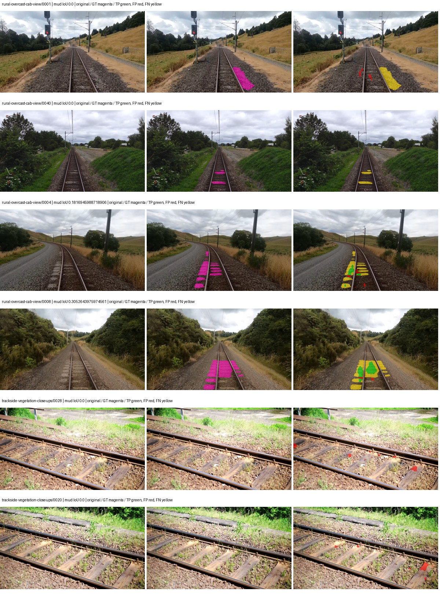
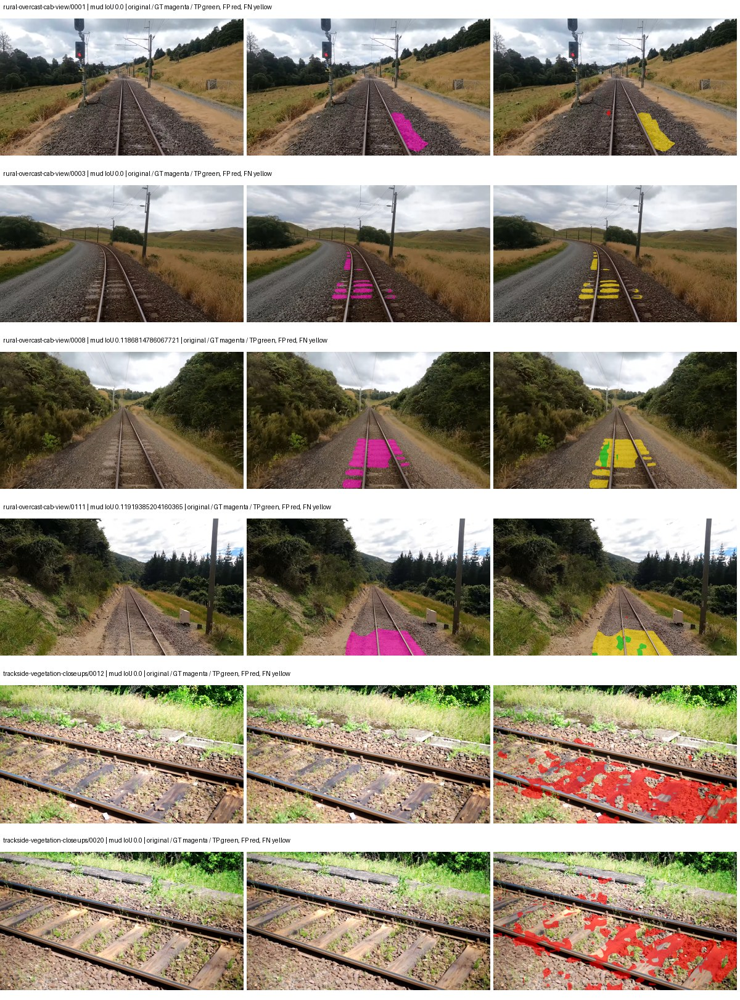
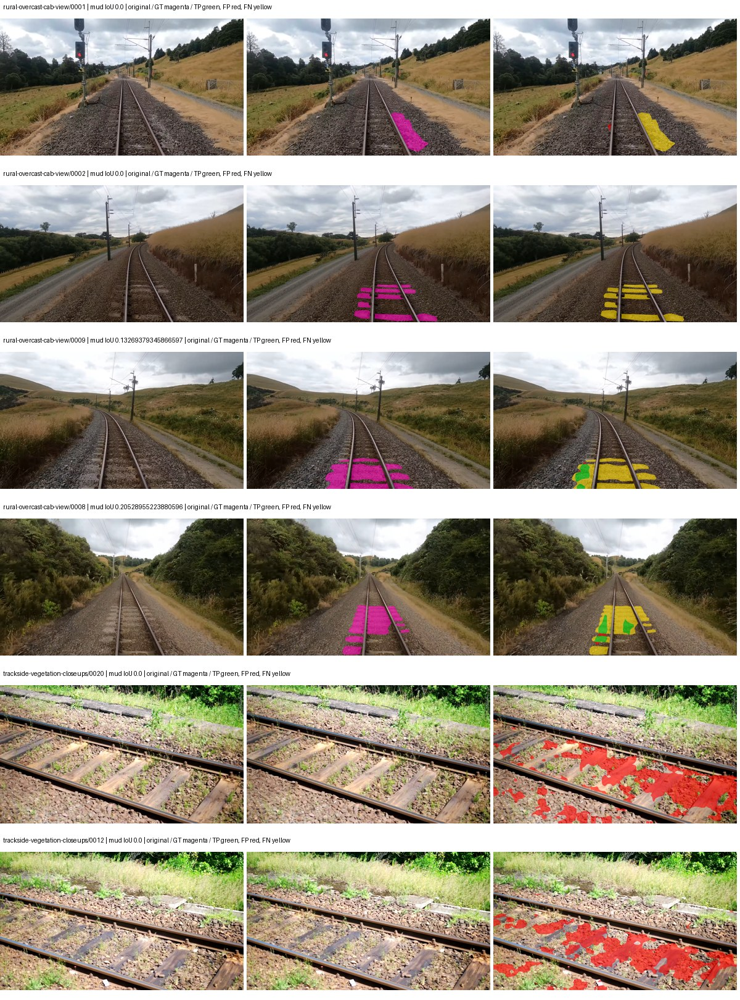
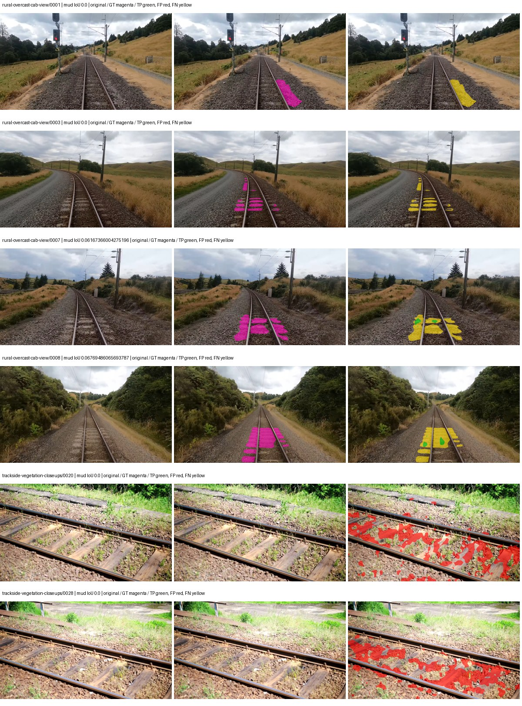

# native_resnet50_aspp — rad_9_24_2026-fixed-grouped

[RAD 9/24: Scene-grouped split](../../README.md) · [Full model records](record.json)

Primary result: the **final checkpoint** after the full step budget (no early stopping). The checkpoint with the best **mud-pumping validation IoU, pixels pooled over all validation images**, is kept as secondary evidence. A job is complete only after full statistics and isolated profiling are verified.

Study metrics of the final checkpoint, counting each class only on the validation images that contain it: mud-pumping IoU is the mean per-image IoU over the images with mud-pumping, precision and recall sum pixels over those images, and mIoU averages each class over the images that contain it, then over the classes present.

| Initialization path | Seed | Mud-pumping IoU, train-camera images with mud (%, n=17) | Mud-pumping IoU, all images with mud (%, n=18) | Mud precision, all images with mud (%) | Mud recall, all images with mud (%) | mIoU (each class over images that contain it) (%) |
| --- | --- | --- | --- | --- | --- | --- |
| rtis_only | 0 | 0.51 | 0.49 | 10.38 | 0.49 | 31.00 |
| cityscapes_to_rtis | 0 | 0.88 | 0.90 | 4.26 | 1.57 | 30.52 |
| railsem19_to_rtis | 0 | 3.06 | 2.92 | 9.92 | 3.70 | 34.31 |
| cityscapes_to_railsem19_to_rtis | 0 | 0.52 | 0.55 | 3.48 | 0.90 | 32.39 |

Per-class IoU: IoU (%) of every class, each averaged only over the validation images that contain the class (n = those images); — = no image contains it. mIoU averages the classes with at least one such image.

| Initialization path | Seed | mIoU (each class over images that contain it) | person (n=0) | truck (n=0) | rail-track (n=37) | vegetation-overgrowth (n=13) | car (n=3) | on-rails (n=0) | traffic-sign (n=9) | road (n=11) | sidewalk (n=12) | construction (n=12) | tram-track (n=2) | pole (n=21) | traffic-light (n=3) | mud-pumping (n=18) | fence (n=7) | terrain (n=35) | sky (n=28) | rail-embedded (n=3) | rail-raised (n=37) | trackbed (n=37) | standing-water (n=9) |
| --- | --- | --- | --- | --- | --- | --- | --- | --- | --- | --- | --- | --- | --- | --- | --- | --- | --- | --- | --- | --- | --- | --- | --- |
| rtis_only | 0 | 31.00 | — | — | 53.40 | 25.02 | 7.26 | — | 15.58 | 21.01 | 14.32 | 34.95 | 4.78 | 39.80 | 27.14 | 0.49 | 14.99 | 82.74 | 92.93 | 7.94 | 59.24 | 56.33 | 0.10 |
| cityscapes_to_rtis | 0 | 30.52 | — | — | 50.99 | 15.08 | 23.71 | — | 17.87 | 10.10 | 12.32 | 37.97 | 1.28 | 42.47 | 26.39 | 0.90 | 22.69 | 78.81 | 93.89 | 1.92 | 57.37 | 52.97 | 2.58 |
| railsem19_to_rtis | 0 | 34.31 | — | — | 54.68 | 21.80 | 16.48 | — | 18.01 | 19.92 | 15.48 | 41.63 | 3.02 | 46.65 | 42.20 | 2.92 | 14.63 | 84.04 | 95.10 | 14.79 | 65.81 | 60.42 | 0.00 |
| cityscapes_to_railsem19_to_rtis | 0 | 32.39 | — | — | 53.45 | 19.06 | 20.12 | — | 17.82 | 19.78 | 14.01 | 39.91 | 9.60 | 46.96 | 23.53 | 0.55 | 17.78 | 81.38 | 94.68 | 4.75 | 63.39 | 55.88 | 0.28 |

Everything below is the campaign's own record, with pixels pooled over all validation images: its evaluation is the checkpoint that scored best on that pooled mud IoU (secondary evidence here); the diagnostics also cover the final checkpoint (`final-auto-val`).

| Model | Initialization path | Seed | Status | Steps | Best step | Best-checkpoint mud IoU, pixels pooled (%) | Best-checkpoint mud precision, pixels pooled (%) | Best-checkpoint mud recall, pixels pooled (%) | Final mud IoU (trainer val, pixels pooled, %) | Best-checkpoint mIoU, pixels pooled (%) | Best-checkpoint fixed GT-class mIoU, pixels pooled (%) |
| --- | --- | --- | --- | --- | --- | --- | --- | --- | --- | --- | --- |
| native_resnet50_aspp | rtis_only | 0 | completed | 4000 | 777 | 7.89 | 48.61 | 8.61 | 0.44 | 25.06 | 27.85 |
| native_resnet50_aspp | cityscapes_to_rtis | 0 | completed | 4000 | 1814 | 1.66 | 2.48 | 4.75 | 0.62 | 27.85 | 32.49 |
| native_resnet50_aspp | railsem19_to_rtis | 0 | completed | 4000 | 1814 | 2.55 | 3.60 | 8.00 | 1.34 | 33.24 | 38.78 |
| native_resnet50_aspp | cityscapes_to_railsem19_to_rtis | 0 | completed | 4000 | 3370 | 1.10 | 1.79 | 2.74 | 0.38 | 31.24 | 36.45 |

Training: 217 images. Validation: 37 images. Test: 60 held out. Seeds: [0]. Seed variation measures optimization variability, not independent-recording uncertainty. Historical source checkpoints stay fixed across adaptation seeds.

Training code: `fce0ea0ac50b334d4252812c396e0e593def375d`. Split SHA-256: `12d7b367c72cda61d57686ff2ac28223530d0af49debd9fb7a0fbc68b908bc93`.

## rtis_only — seed 0

Status: **completed**. Started: 2026-10-11T09:21:39.617532+00:00. Finished: 2026-10-11T10:14:42.905657+00:00.

Recipe pretrained initializer: `{"arch": "native", "backbone_path": null, "batch_norm_momentum": null, "checkpoint": null, "classifier_path": null, "drop_path": null, "encoder_name": null, "encoder_weights": null, "head": "unified_head", "head_paths": [], "inactive_parameter_paths": [], "local_files_only": false, "lora_alpha": 32, "lora_dropout": 0.05, "lora_r": 16, "lora_targets": [], "native": {"auxiliary_heads": [], "backbone": {"in_channels": 3, "kind": "timm", "name": "resnet50.a1_in1k", "out_indices": [1, 2, 3, 4], "weights": "pretrained"}, "head": {"activation": "relu", "channels": 256, "dilation_rates": [6, 12, 18], "dropout": 0.1, "in_index": 3, "kind": "aspp", "norm": "group"}, "neck": {"kind": "identity"}, "task": "multiclass"}, "revision": null, "smp_arch": null, "subfolder": null, "trust_remote_code": false, "tuning": "full"}`.

`rtis_only` uses the recipe initializer, which may include pretrained segmentation components. Transfer paths load the exact historical source checkpoint below and reset the classifier; they do not reset all query/decoder features.

Source checkpoint: `Recipe pretrained initialization`.

Config SHA-256: `f340d91ac8e5dd600b359604b829cafab8df0d019486ae7405411c8ed3b2fed9`. Weights used for validation: `raw`.

### Mud-pumping and aggregate quality

| Metric | Selected checkpoint | Final training validation |
| --- | --- | --- |
| Mud IoU | 7.89 | 0.44 |
| Mud precision | 48.61 | 4.02 |
| Mud recall | 8.61 | 0.49 |
| Mud Dice/F1 | 14.63 | 0.87 |
| mIoU | 25.06 | 30.44 |
| Mean accuracy | 35.63 | 44.39 |
| Mean precision | 50.49 | 49.58 |
| Mean Dice | 34.03 | 39.95 |
| Mean specificity | 98.56 | 98.87 |
| Pixel accuracy | 78.57 | 82.31 |
| Frequency-weighted IoU | 66.21 | 71.88 |
| Fixed GT-present class mIoU | 27.85 | 35.51 |
| Boundary F1 | 30.98 | 36.72 |

The selected checkpoint has independent evaluation evidence. Final values are the trainer's final validation record, not a new independent evaluation. mIoU averages classes with nonzero union, so false positives on absent classes can change its denominator. The fixed GT-class mean is supplementary and excludes absent classes; their false positives remain in the confusion matrix.

### Resource usage and timing

| Measurement | Value |
| --- | --- |
| Peak training VRAM, retained training invocation (GiB) | 8.27 |
| Peak evaluation VRAM (GiB) | 6.75 |
| Retained training invocation wall time (seconds) | 3054.42 |
| Retained training invocation GPU-hours (one GPU) | 0.85 |
| Evaluation wall time (seconds) | 10.51 |
| Full evaluation pipeline images/second | 3.52 |
| Best full-state checkpoint (MiB) | 596.61 |
| Final full-state checkpoint (MiB) | 596.60 |
| Verified periodic checkpoints removed (GiB) | 4.66 |

VRAM uses the recorded allocator high-water mark; it is not total device usage including CUDA context. Resumed jobs' retained training invocation times and peaks are **not whole-campaign totals**. Earlier invocation resource records are not reconstructed here. Evaluation throughput includes loader, sliding-window inference and metrics; it is not model-only latency/FPS. Missing measurements are shown as —, never inferred from another dataset's run.

### Standardized inference performance

Dedicated model-only profiling waits for an idle worker-locked L40S: BF16, batch 1, 1024x1024, 20 warmup and 100 CUDA-event-timed public forwards. It excludes loading, preprocessing, tiling and metrics.

| Status | Parameters | Weight MiB | FPS | p50 ms | p95 ms | Peak reserved GiB |
| --- | --- | --- | --- | --- | --- | --- |
| complete | 39048277 | 148.96 | 225.57 | 4.32 | 5.02 | 0.53 |

```json
{
  "schema_version": 1,
  "model_id": "native_resnet50_aspp",
  "measured_at": "2026-10-11T10:14:36+00:00",
  "status": "complete",
  "benchmark_scope": "rtis_selected_checkpoint_model_only",
  "applies_to": [
    "native_resnet50_aspp--rtis_only--seed-0"
  ],
  "source": {
    "campaign_git_sha": "fce0ea0ac50b334d4252812c396e0e593def375d",
    "git_dirty": false,
    "config_hash": "32d81a0d0bfc",
    "resolved_config": "/data/izadia1/projects/segmentary-runs/rad_9_24_2026/fgall-seed0-20261007/configs/native_resnet50_aspp--rtis_only--seed-0.yaml",
    "config_sha256": "f340d91ac8e5dd600b359604b829cafab8df0d019486ae7405411c8ed3b2fed9",
    "checkpoint_sha256": "2698fa9918de9bdb8b20e2e78309f39567e2ba432a54b0f4782a6b98df4b8299",
    "checkpoint_global_step": 777,
    "checkpoint_bytes": 625594525,
    "checkpoint_kind": "resume checkpoint with optimizer and EMA state",
    "weights": "raw",
    "measured_checkpoint_job_id": "native_resnet50_aspp--rtis_only--seed-0",
    "result_sha256": "f21e505490b776655c7e52b52c0298f02c3cfa1f2f570d419770fbd6d0e3d387",
    "result_git_sha": "fce0ea0ac50b334d4252812c396e0e593def375d",
    "result_stage": "eval:rad_9_24_2026-fixed-grouped:val",
    "result_seed": 0
  },
  "hardware": {
    "gpu_name": "NVIDIA L40S",
    "gpu_uuid": "GPU-e2e96741-aec9-e90b-5c46-d0d58be90a56",
    "logical_device": "cuda:0",
    "physical_visibility_token": "8",
    "compute_capability": [
      8,
      9
    ],
    "total_memory_bytes": 47677177856
  },
  "model": {
    "parameter_count": 39048277,
    "trainable_parameter_count": 39048277,
    "resident_parameter_bytes": 156193108,
    "parameter_dtype_counts": {
      "float32": 39048277
    }
  },
  "contract": {
    "backend": "pytorch",
    "precision": "bf16_autocast",
    "batch_size": 1,
    "input_shape_nchw": [
      1,
      3,
      1024,
      1024
    ],
    "warmup_iterations": 20,
    "measured_iterations": 100,
    "timing": "per-forward CUDA events with end-event synchronization",
    "includes_preprocessing": false,
    "includes_data_loader": false,
    "includes_sliding_window": false,
    "input_resident_on_gpu": true,
    "model_only": true,
    "entrypoint": "public model(image) dense-logits forward"
  },
  "measurements": {
    "latency": {
      "p50_ms": 4.324351787567139,
      "p95_ms": 5.024307298660278,
      "mean_ms": 4.433273921012878,
      "minimum_ms": 4.304895877838135,
      "maximum_ms": 5.21830415725708,
      "fps": 225.5669326589971,
      "raw_ms": [
        4.335616111755371,
        4.3284478187561035,
        4.319231986999512,
        4.325376033782959,
        4.578303813934326,
        4.322303771972656,
        4.314112186431885,
        4.314112186431885,
        4.324351787567139,
        4.322303771972656,
        4.321280002593994,
        4.325376033782959,
        4.316160202026367,
        4.304895877838135,
        4.324351787567139,
        4.323328018188477,
        4.488192081451416,
        4.386816024780273,
        4.31001615524292,
        4.317183971405029,
        4.322303771972656,
        4.315104007720947,
        4.675583839416504,
        4.316160202026367,
        4.320320129394531,
        4.398079872131348,
        5.035007953643799,
        4.751359939575195,
        4.316160202026367,
        4.319231986999512,
        4.317183971405029,
        4.325376033782959,
        4.324351787567139,
        4.319231986999512,
        5.055520057678223,
        4.407296180725098,
        4.315135955810547,
        4.316160202026367,
        4.324351787567139,
        4.516863822937012,
        4.3284478187561035,
        4.327424049377441,
        4.323328018188477,
        4.332543849945068,
        4.324351787567139,
        4.323328018188477,
        4.333568096160889,
        4.320256233215332,
        4.314112186431885,
        4.455391883850098,
        4.600831985473633,
        4.935679912567139,
        4.319231986999512,
        4.329472064971924,
        4.819968223571777,
        5.21830415725708,
        4.619264125823975,
        4.325376033782959,
        4.3089919090271,
        4.316160202026367,
        4.322303771972656,
        4.624383926391602,
        5.023744106292725,
        4.319231986999512,
        4.321280002593994,
        4.326399803161621,
        5.042175769805908,
        4.379648208618164,
        4.311039924621582,
        4.319231986999512,
        4.327424049377441,
        4.320256233215332,
        4.31820821762085,
        4.320256233215332,
        4.315135955810547,
        4.320256233215332,
        4.322303771972656,
        4.318175792694092,
        4.334591865539551,
        4.324351787567139,
        4.324351787567139,
        4.361152172088623,
        4.992000102996826,
        4.984831809997559,
        4.317183971405029,
        4.320256233215332,
        4.305920124053955,
        4.31820821762085,
        4.3089919090271,
        4.324351787567139,
        4.320256233215332,
        4.31820821762085,
        4.316160202026367,
        5.06163215637207,
        4.917247772216797,
        4.761568069458008,
        4.677631855010986,
        4.468736171722412,
        4.332543849945068,
        4.317183971405029
      ],
      "percentile_method": "numpy linear interpolation"
    },
    "peak_reserved_bytes": 570425344,
    "memory_kind": "pytorch_cuda_allocator_peak_reserved_excluding_context",
    "process_total_bytes": 1098907648,
    "process_total_kind": "nvidia-smi used_memory of this PID on the benchmark GPU after the timed loop, including the CUDA context; null when the driver could not attribute memory to this PID",
    "benchmark_wall_clock_s": 11.685248896479607
  },
  "started_at": "2026-10-11T10:14:24+00:00",
  "finished_at": "2026-10-11T10:14:36+00:00",
  "environment": {
    "hostname": "hdrfs-app-001",
    "python": "3.11.15",
    "platform": "Linux-5.15.0-139-generic-x86_64-with-glibc2.35",
    "torch": "2.11.0+cu128",
    "torch_cuda": "12.8",
    "cudnn": 91900,
    "driver_version": "570.133.20",
    "cuda_available": true,
    "gpu_count": 1,
    "gpu_names": [
      "NVIDIA L40S"
    ],
    "cuda_visible_devices": "8",
    "packages": {
      "segmentary": "0.1.0",
      "torch": "2.11.0+cu128",
      "torchvision": "0.26.0+cu128",
      "transformers": "5.15.0",
      "timm": "1.0.28",
      "segmentation-models-pytorch": "0.5.0",
      "albumentations": "2.0.8",
      "lightning": "2.6.5",
      "numpy": "2.4.4"
    }
  }
}
```

### Per-class validation results

| Class | GT pixels | IoU (%) | Precision (%) | Recall (%) | Dice (%) | Boundary F1 (%) |
| --- | --- | --- | --- | --- | --- | --- |
| car | 29664 | 12.39 | 52.18 | 13.97 | 22.04 | 19.79 |
| construction | 311585 | 14.74 | 15.76 | 69.30 | 25.69 | 20.91 |
| fence | 265137 | 4.14 | 28.46 | 4.62 | 7.95 | 13.65 |
| mud-pumping | 1226250 | 7.89 | 48.61 | 8.61 | 14.63 | 19.42 |
| on-rails | 0 | 0.00 | 0.00 | — | 0.00 | 0.00 |
| person | 0 | — | — | — | — | — |
| pole | 628038 | 46.61 | 72.58 | 56.56 | 63.58 | 68.08 |
| rail-embedded | 16799 | 13.29 | 41.81 | 16.31 | 23.47 | 24.13 |
| rail-raised | 2969797 | 59.11 | 82.22 | 67.77 | 74.30 | 79.46 |
| rail-track | 6323197 | 33.41 | 72.11 | 38.37 | 50.09 | 44.13 |
| road | 1048831 | 8.92 | 22.94 | 12.74 | 16.38 | 12.28 |
| sidewalk | 1297367 | 30.97 | 87.29 | 32.44 | 47.30 | 12.35 |
| sky | 19121606 | 93.09 | 95.71 | 97.15 | 96.42 | 75.86 |
| standing-water | 95802 | 0.00 | 0.00 | 0.00 | 0.00 | 0.20 |
| terrain | 39239306 | 78.61 | 81.13 | 96.19 | 88.02 | 44.50 |
| trackbed | 10643081 | 48.01 | 59.67 | 71.07 | 64.87 | 48.93 |
| traffic-light | 19510 | 26.13 | 71.63 | 29.14 | 41.43 | 44.21 |
| traffic-sign | 13285 | 7.99 | 79.65 | 8.16 | 14.80 | 37.59 |
| tram-track | 56179 | 7.74 | 23.21 | 10.41 | 14.37 | 18.66 |
| truck | 0 | 0.00 | 0.00 | — | 0.00 | 0.00 |
| vegetation-overgrowth | 5901821 | 8.23 | 74.78 | 8.47 | 15.21 | 35.38 |

### Full-run accounting

| Measurement | Value |
| --- | --- |
| Full GPU-reserved wall seconds, all recorded worker attempts | 3191.13 |
| Full reserved GPU-hours | 0.89 |
| Whole-run timing complete | True |

| Phase | Wall seconds including failed attempts |
| --- | --- |
| training | 3061.44 |
| diagnostics | 76.44 |
| performance | 20.18 |

GPU-reserved time includes model loading, training, validation, collection, profiling, checkpoint I/O and orchestration while the worker owns one GPU. It is not GPU kernel-active time. Phase timings and sampled device memory/power/utilization are retained separately; sampled device memory is not the allocator high-water mark.

### Train/validation and raw/EMA diagnostics

| Checkpoint / weights / split | Images | Mud IoU (%) | Mud precision (%) | Mud recall (%) |
| --- | --- | --- | --- | --- |
| best-auto-train / raw | 217 | 87.68 | 93.23 | 93.64 |
| best-auto-val / raw | 37 | 7.89 | 48.61 | 8.61 |
| best-alternate-val / ema | 37 | 1.98 | 28.22 | 2.09 |
| final-auto-val / raw | 37 | 0.43 | 4.00 | 0.49 |

Train uses the evaluation transform without augmentation. Compare mud train/validation metrics for the same selected weights. Alternate EMA on running-stat BatchNorm is explicitly uncalibrated and is diagnostic only. Score-threshold curves use uncalibrated normalized scores and are pixel-level diagnostics, not event detection rates or a selected deployment operating point.

### Downloadable evidence

- best-auto-train: [per-image.csv](rtis_only--seed-0/best-auto-train/per-image.csv) · [per-image-confusion.json.gz](rtis_only--seed-0/best-auto-train/per-image-confusion.json.gz) · [groups.json](rtis_only--seed-0/best-auto-train/groups.json) · [mud-score-curves.json](rtis_only--seed-0/best-auto-train/mud-score-curves.json)
- best-auto-val: [per-image.csv](rtis_only--seed-0/best-auto-val/per-image.csv) · [per-image-confusion.json.gz](rtis_only--seed-0/best-auto-val/per-image-confusion.json.gz) · [groups.json](rtis_only--seed-0/best-auto-val/groups.json) · [mud-score-curves.json](rtis_only--seed-0/best-auto-val/mud-score-curves.json) · [examples.jpg](rtis_only--seed-0/best-auto-val/examples.jpg)
- best-alternate-val: [per-image.csv](rtis_only--seed-0/best-alternate-val/per-image.csv) · [per-image-confusion.json.gz](rtis_only--seed-0/best-alternate-val/per-image-confusion.json.gz) · [groups.json](rtis_only--seed-0/best-alternate-val/groups.json) · [mud-score-curves.json](rtis_only--seed-0/best-alternate-val/mud-score-curves.json)
- final-auto-val: [per-image.csv](rtis_only--seed-0/final-auto-val/per-image.csv) · [per-image-confusion.json.gz](rtis_only--seed-0/final-auto-val/per-image-confusion.json.gz) · [groups.json](rtis_only--seed-0/final-auto-val/groups.json) · [mud-score-curves.json](rtis_only--seed-0/final-auto-val/mud-score-curves.json)
- resources: [telemetry.csv](rtis_only--seed-0/resources/telemetry.csv)



Examples are two lowest and two highest mud-IoU positive images, plus up to two negative images with the most false-positive mud pixels. They are targeted diagnostic examples, not random samples. Green: true positive; red: false positive; yellow: false negative. Full predictions remain on HDRFS.

### Validation tracking

| Logged step | Overall mIoU (%) | Mud IoU (%) |
| --- | --- | --- |
| 258 | 18.62 | 0.20 |
| 518 | 19.42 | 0.26 |
| 777 | 25.06 | 7.89 |
| 1036 | 23.58 | 1.36 |
| 1295 | 26.56 | 7.55 |
| 1555 | 28.55 | 4.10 |
| 1814 | 27.42 | 1.27 |
| 2073 | 29.45 | 4.02 |
| 2332 | 27.95 | 1.47 |
| 2592 | 27.81 | 0.26 |
| 2851 | 28.54 | 0.35 |
| 3110 | 29.99 | 0.07 |
| 3369 | 29.92 | 0.63 |
| 3629 | 29.78 | 0.32 |
| 3888 | 30.62 | 1.09 |
| 4000 | 30.44 | 0.44 |

All retained scalar curves, including training loss and per-class IoU, are in record.json. Observed best mud on a curve is not necessarily a retained checkpoint: the pilot saved its selection-metric-best and final checkpoints. Step logging and checkpoint global_step may differ by one.

### Stopping and checkpoint provenance

```json
{
  "stopping": {
    "actual_steps": 4000,
    "maximum_steps": 4000,
    "min_delta": 0.0,
    "monitor": "val_iou/mud-pumping",
    "patience": null,
    "reason": "budget_complete"
  },
  "checkpoints": {
    "best": {
      "path": "/data/izadia1/projects/segmentary-runs/rad_9_24_2026/fgall-seed0-20261007/future-runs/native_resnet50_aspp--rtis_only--seed-0_seed0/rtis/best.ckpt",
      "sha256": "2698fa9918de9bdb8b20e2e78309f39567e2ba432a54b0f4782a6b98df4b8299",
      "global_step": 777,
      "bytes": 625594525
    },
    "final": {
      "path": "/data/izadia1/projects/segmentary-runs/rad_9_24_2026/fgall-seed0-20261007/future-runs/native_resnet50_aspp--rtis_only--seed-0_seed0/rtis/last.ckpt",
      "sha256": "70030cd979f5561bde178856c1db42dd3089cff5a00325670f8b6156ea8ae3e4",
      "global_step": 4000,
      "bytes": 625583325
    }
  },
  "cleanup_error": null
}
```

### Resolved training, initialization and evaluation settings

The optimizer block is the base configuration. Stage LR scales are applied at runtime, and stage warmup is capped at min(base warmup, floor(stage budget / 10), stage budget - 1): 400 steps for this 4,000-step pilot. Model-internal native input grids may differ from augmentation crops (EoMT uses its 640 grid).

```json
{
  "name": "native_resnet50_aspp--rtis_only--seed-0",
  "model": {
    "arch": "native",
    "checkpoint": null,
    "tuning": "full",
    "head": "unified_head",
    "lora_r": 16,
    "lora_alpha": 32,
    "lora_dropout": 0.05,
    "lora_targets": [],
    "drop_path": null,
    "revision": null,
    "subfolder": null,
    "local_files_only": false,
    "trust_remote_code": false,
    "backbone_path": null,
    "head_paths": [],
    "classifier_path": null,
    "inactive_parameter_paths": [],
    "smp_arch": null,
    "encoder_name": null,
    "encoder_weights": null,
    "native": {
      "task": "multiclass",
      "backbone": {
        "kind": "timm",
        "name": "resnet50.a1_in1k",
        "weights": "pretrained",
        "out_indices": [
          1,
          2,
          3,
          4
        ],
        "in_channels": 3
      },
      "neck": {
        "kind": "identity"
      },
      "head": {
        "kind": "aspp",
        "in_index": 3,
        "channels": 256,
        "dilation_rates": [
          6,
          12,
          18
        ],
        "dropout": 0.1,
        "norm": "group",
        "activation": "relu"
      },
      "auxiliary_heads": []
    },
    "batch_norm_momentum": null
  },
  "space": "paul-test-rtis",
  "taxonomy_root": "/data/izadia1/projects/segmentary-rad-fgall-fce0ea0a/taxonomy",
  "output_root": "/data/izadia1/projects/segmentary-runs/rad_9_24_2026/fgall-seed0-20261007/future-runs",
  "optim": {
    "backbone_lr": 0.0001,
    "head_lr_mult": 10.0,
    "weight_decay": 0.05,
    "llrd": 1.0,
    "warmup_iters": 1500,
    "warmup_ratio": 1e-06,
    "poly_power": 0.9,
    "min_lr_ratio": 0.0,
    "betas": [
      0.9,
      0.999
    ],
    "grad_clip": 1.0
  },
  "train": {
    "iters": 4000,
    "batch_size": 2,
    "accum": 8,
    "num_workers": 2,
    "precision": "bf16-mixed",
    "ema_decay": 0.9998,
    "val_every": 250,
    "ckpt_every": 500,
    "selection_metric": "val_iou/mud-pumping",
    "early_stopping_patience": null,
    "early_stopping_min_delta": 0.0,
    "seed": 0,
    "devices": 1
  },
  "eval": {
    "sliding_window": true,
    "window": [
      1024,
      1024
    ],
    "stride": [
      768,
      768
    ],
    "batch_size": 1,
    "num_workers": 2,
    "tta_scales": [],
    "tta_flip": false,
    "threshold": 0.5,
    "boundary_tolerance_frac": 0.0075,
    "save_confusion": true
  },
  "loss": {
    "task": "multiclass",
    "activation": "auto",
    "terms": [],
    "aux": "none",
    "aux_weight": 0.0,
    "ce_weight": 1.0,
    "label_smoothing": 0.0,
    "class_weights": null,
    "query": null
  },
  "aug": {
    "crop": [
      1024,
      1024
    ],
    "scale_min": 0.5,
    "scale_max": 2.0,
    "hflip_p": 0.5,
    "color_jitter_p": 0.5,
    "brightness": 0.25,
    "contrast": 0.25,
    "saturation": 0.25,
    "hue": 0.05
  },
  "stages": [
    {
      "name": "rtis",
      "data": [
        {
          "name": "rad_9_24_2026-fixed-grouped",
          "root": "/data/izadia1/datasets/rad_9_24_2026-fixed-grouped",
          "variant": null,
          "split_file": "splits.json",
          "train_split": "train",
          "val_split": "val",
          "limit": null,
          "loader": "folder",
          "mapping": "paul-test-rtis",
          "loader_options": {
            "require_groups": true
          }
        }
      ],
      "iters": null,
      "lr_scale": 1.0,
      "head_group_lr_scale": 1.0,
      "init_from": "pretrained",
      "reset_head": false,
      "freeze": null,
      "sample_weights": null
    }
  ]
}
```

### Hardware and software provenance

```json
{
  "training": {
    "cuda_available": true,
    "cuda_visible_devices": "8",
    "cudnn": 91900,
    "driver_version": "570.133.20",
    "gpu_count": 1,
    "gpu_names": [
      "NVIDIA L40S"
    ],
    "hostname": "hdrfs-app-001",
    "input_normalization": {
      "channel_order": "rgb",
      "mean": [
        0.485,
        0.456,
        0.406
      ],
      "source": "timm_pretrained_cfg",
      "std": [
        0.229,
        0.224,
        0.225
      ]
    },
    "model_origins": [
      {
        "hf_commit": null,
        "hf_name_or_path": null,
        "module": "backbone",
        "timm_pretrained": {
          "architecture": "resnet50",
          "hf_hub_id": "timm/resnet50.a1_in1k",
          "tag": "a1_in1k",
          "url": "https://github.com/rwightman/pytorch-image-models/releases/download/v0.1-rsb-weights/resnet50_a1_0-14fe96d1.pth"
        }
      },
      {
        "hf_commit": null,
        "hf_name_or_path": null,
        "module": "backbone.model",
        "timm_pretrained": {
          "architecture": "resnet50",
          "hf_hub_id": "timm/resnet50.a1_in1k",
          "tag": "a1_in1k",
          "url": "https://github.com/rwightman/pytorch-image-models/releases/download/v0.1-rsb-weights/resnet50_a1_0-14fe96d1.pth"
        }
      }
    ],
    "model_parameter_count": 39048277,
    "packages": {
      "albumentations": "2.0.8",
      "lightning": "2.6.5",
      "numpy": "2.4.4",
      "segmentary": "0.1.0",
      "segmentation-models-pytorch": "0.5.0",
      "timm": "1.0.28",
      "torch": "2.11.0+cu128",
      "torchvision": "0.26.0+cu128",
      "transformers": "5.15.0"
    },
    "platform": "Linux-5.15.0-139-generic-x86_64-with-glibc2.35",
    "python": "3.11.15",
    "torch": "2.11.0+cu128",
    "torch_cuda": "12.8",
    "trainable_parameter_count": 39048277,
    "training_stop": {
      "actual_steps": 4000,
      "maximum_steps": 4000,
      "min_delta": 0.0,
      "monitor": "val_iou/mud-pumping",
      "patience": null,
      "reason": "budget_complete"
    },
    "validation_weights": "raw"
  },
  "evaluation": {
    "cuda_available": true,
    "cuda_visible_devices": "8",
    "cudnn": 91900,
    "driver_version": "570.133.20",
    "gpu_count": 1,
    "gpu_names": [
      "NVIDIA L40S"
    ],
    "hostname": "hdrfs-app-001",
    "input_normalization": {
      "channel_order": "rgb",
      "mean": [
        0.485,
        0.456,
        0.406
      ],
      "source": "timm_pretrained_cfg",
      "std": [
        0.229,
        0.224,
        0.225
      ]
    },
    "packages": {
      "albumentations": "2.0.8",
      "lightning": "2.6.5",
      "numpy": "2.4.4",
      "segmentary": "0.1.0",
      "segmentation-models-pytorch": "0.5.0",
      "timm": "1.0.28",
      "torch": "2.11.0+cu128",
      "torchvision": "0.26.0+cu128",
      "transformers": "5.15.0"
    },
    "platform": "Linux-5.15.0-139-generic-x86_64-with-glibc2.35",
    "python": "3.11.15",
    "torch": "2.11.0+cu128",
    "torch_cuda": "12.8"
  }
}
```

## cityscapes_to_rtis — seed 0

Status: **completed**. Started: 2026-10-11T09:21:51.350227+00:00. Finished: 2026-10-11T10:14:56.540421+00:00.

Recipe pretrained initializer: `{"arch": "native", "backbone_path": null, "batch_norm_momentum": null, "checkpoint": null, "classifier_path": null, "drop_path": null, "encoder_name": null, "encoder_weights": null, "head": "unified_head", "head_paths": [], "inactive_parameter_paths": [], "local_files_only": false, "lora_alpha": 32, "lora_dropout": 0.05, "lora_r": 16, "lora_targets": [], "native": {"auxiliary_heads": [], "backbone": {"in_channels": 3, "kind": "timm", "name": "resnet50.a1_in1k", "out_indices": [1, 2, 3, 4], "weights": "pretrained"}, "head": {"activation": "relu", "channels": 256, "dilation_rates": [6, 12, 18], "dropout": 0.1, "in_index": 3, "kind": "aspp", "norm": "group"}, "neck": {"kind": "identity"}, "task": "multiclass"}, "revision": null, "smp_arch": null, "subfolder": null, "trust_remote_code": false, "tuning": "full"}`.

`rtis_only` uses the recipe initializer, which may include pretrained segmentation components. Transfer paths load the exact historical source checkpoint below and reset the classifier; they do not reset all query/decoder features.

Source checkpoint: `{'name': 'native_resnet50_aspp--cityscapes--seed-0', 'model': 'native_resnet50_aspp', 'protocol': 'cityscapes', 'config': '/data/izadia1/projects/segmentary-runs/all-model-city-rail-seed0-rail20-b9eb3e1/accepted/native_resnet50_aspp--cityscapes--seed-0/resolved-config.yaml', 'checkpoint': '/data/izadia1/projects/segmentary-runs/all-model-city-rail-seed0-a7c0b67/jobs/native_resnet50_aspp--cityscapes--seed-0/attempt-001/train/native_resnet50_aspp--cityscapes_seed0/cityscapes/last.ckpt', 'recorded_sha256': '2bb9db7fa588bb8889c2ba8894d5320005d9e94afe00406d7d133de08e0a16ac', 'exists': True}`.

Config SHA-256: `8d66980e2e4eab72985d46456cd320f56c6b3be59584c4c77bd8d4ed6b4d226d`. Weights used for validation: `raw`.

### Mud-pumping and aggregate quality

| Metric | Selected checkpoint | Final training validation |
| --- | --- | --- |
| Mud IoU | 1.66 | 0.62 |
| Mud precision | 2.48 | 1.00 |
| Mud recall | 4.75 | 1.58 |
| Mud Dice/F1 | 3.26 | 1.23 |
| mIoU | 27.85 | 29.07 |
| Mean accuracy | 41.55 | 41.64 |
| Mean precision | 47.06 | 52.13 |
| Mean Dice | 36.80 | 38.34 |
| Mean specificity | 98.61 | 98.69 |
| Pixel accuracy | 79.03 | 80.32 |
| Frequency-weighted IoU | 68.10 | 69.26 |
| Fixed GT-present class mIoU | 32.49 | 33.92 |
| Boundary F1 | 32.81 | 34.73 |

The selected checkpoint has independent evaluation evidence. Final values are the trainer's final validation record, not a new independent evaluation. mIoU averages classes with nonzero union, so false positives on absent classes can change its denominator. The fixed GT-class mean is supplementary and excludes absent classes; their false positives remain in the confusion matrix.

### Resource usage and timing

| Measurement | Value |
| --- | --- |
| Peak training VRAM, retained training invocation (GiB) | 8.27 |
| Peak evaluation VRAM (GiB) | 6.75 |
| Retained training invocation wall time (seconds) | 3056.16 |
| Retained training invocation GPU-hours (one GPU) | 0.85 |
| Evaluation wall time (seconds) | 10.15 |
| Full evaluation pipeline images/second | 3.64 |
| Best full-state checkpoint (MiB) | 596.61 |
| Final full-state checkpoint (MiB) | 596.60 |
| Verified periodic checkpoints removed (GiB) | 4.66 |

VRAM uses the recorded allocator high-water mark; it is not total device usage including CUDA context. Resumed jobs' retained training invocation times and peaks are **not whole-campaign totals**. Earlier invocation resource records are not reconstructed here. Evaluation throughput includes loader, sliding-window inference and metrics; it is not model-only latency/FPS. Missing measurements are shown as —, never inferred from another dataset's run.

### Standardized inference performance

Dedicated model-only profiling waits for an idle worker-locked L40S: BF16, batch 1, 1024x1024, 20 warmup and 100 CUDA-event-timed public forwards. It excludes loading, preprocessing, tiling and metrics.

| Status | Parameters | Weight MiB | FPS | p50 ms | p95 ms | Peak reserved GiB |
| --- | --- | --- | --- | --- | --- | --- |
| complete | 39048277 | 148.96 | 221.58 | 4.45 | 4.87 | 0.53 |

```json
{
  "schema_version": 1,
  "model_id": "native_resnet50_aspp",
  "measured_at": "2026-10-11T10:14:49+00:00",
  "status": "complete",
  "benchmark_scope": "rtis_selected_checkpoint_model_only",
  "applies_to": [
    "native_resnet50_aspp--cityscapes_to_rtis--seed-0"
  ],
  "source": {
    "campaign_git_sha": "fce0ea0ac50b334d4252812c396e0e593def375d",
    "git_dirty": false,
    "config_hash": "a89b5996aa86",
    "resolved_config": "/data/izadia1/projects/segmentary-runs/rad_9_24_2026/fgall-seed0-20261007/configs/native_resnet50_aspp--cityscapes_to_rtis--seed-0.yaml",
    "config_sha256": "8d66980e2e4eab72985d46456cd320f56c6b3be59584c4c77bd8d4ed6b4d226d",
    "checkpoint_sha256": "9b8b2db111c1734c4453bf4e9ecb7d37827073e2fdcbcd00c90f8f1719009179",
    "checkpoint_global_step": 1814,
    "checkpoint_bytes": 625594589,
    "checkpoint_kind": "resume checkpoint with optimizer and EMA state",
    "weights": "raw",
    "measured_checkpoint_job_id": "native_resnet50_aspp--cityscapes_to_rtis--seed-0",
    "result_sha256": "934546040196803c0040ead5cdeda7774b829e65a0bd6189d931f1d6d06fb829",
    "result_git_sha": "fce0ea0ac50b334d4252812c396e0e593def375d",
    "result_stage": "eval:rad_9_24_2026-fixed-grouped:val",
    "result_seed": 0
  },
  "hardware": {
    "gpu_name": "NVIDIA L40S",
    "gpu_uuid": "GPU-804aea8b-5f62-423e-72c6-49e1ed15c4e4",
    "logical_device": "cuda:0",
    "physical_visibility_token": "6",
    "compute_capability": [
      8,
      9
    ],
    "total_memory_bytes": 47677177856
  },
  "model": {
    "parameter_count": 39048277,
    "trainable_parameter_count": 39048277,
    "resident_parameter_bytes": 156193108,
    "parameter_dtype_counts": {
      "float32": 39048277
    }
  },
  "contract": {
    "backend": "pytorch",
    "precision": "bf16_autocast",
    "batch_size": 1,
    "input_shape_nchw": [
      1,
      3,
      1024,
      1024
    ],
    "warmup_iterations": 20,
    "measured_iterations": 100,
    "timing": "per-forward CUDA events with end-event synchronization",
    "includes_preprocessing": false,
    "includes_data_loader": false,
    "includes_sliding_window": false,
    "input_resident_on_gpu": true,
    "model_only": true,
    "entrypoint": "public model(image) dense-logits forward"
  },
  "measurements": {
    "latency": {
      "p50_ms": 4.44927978515625,
      "p95_ms": 4.8728574991226195,
      "mean_ms": 4.5131158447265625,
      "minimum_ms": 4.434944152832031,
      "maximum_ms": 5.108767986297607,
      "fps": 221.57640849579994,
      "raw_ms": [
        4.552703857421875,
        4.444159984588623,
        4.453375816345215,
        4.440063953399658,
        4.440063953399658,
        4.872191905975342,
        4.591616153717041,
        4.472832202911377,
        4.4410881996154785,
        4.434944152832031,
        4.444159984588623,
        4.455423831939697,
        4.448256015777588,
        4.4410881996154785,
        4.443136215209961,
        4.9541120529174805,
        4.484096050262451,
        4.462560176849365,
        4.603903770446777,
        4.463615894317627,
        4.443136215209961,
        4.444159984588623,
        4.463615894317627,
        4.465663909912109,
        4.4410881996154785,
        4.4410881996154785,
        4.455423831939697,
        4.445184230804443,
        4.453375816345215,
        4.44927978515625,
        4.4410881996154785,
        4.45030403137207,
        4.743167877197266,
        4.923391819000244,
        4.4759039878845215,
        4.4410881996154785,
        4.444159984588623,
        4.452352046966553,
        4.443136215209961,
        4.536352157592773,
        4.826111793518066,
        4.4462080001831055,
        4.444159984588623,
        4.7175679206848145,
        4.86195182800293,
        4.445184230804443,
        4.445184230804443,
        4.451327800750732,
        4.434944152832031,
        4.451327800750732,
        4.4462080001831055,
        4.448256015777588,
        4.45030403137207,
        4.448256015777588,
        4.445184230804443,
        4.445184230804443,
        4.44927978515625,
        4.444159984588623,
        4.443136215209961,
        4.440063953399658,
        4.757503986358643,
        4.8015360832214355,
        4.858880043029785,
        4.555776119232178,
        4.448256015777588,
        4.45747184753418,
        4.443136215209961,
        4.445184230804443,
        4.447231769561768,
        4.451327800750732,
        4.445184230804443,
        4.445184230804443,
        4.442111968994141,
        4.448256015777588,
        4.576255798339844,
        5.108767986297607,
        4.926464080810547,
        4.459519863128662,
        4.442111968994141,
        4.451327800750732,
        4.445184230804443,
        4.45030403137207,
        4.444159984588623,
        4.454400062561035,
        4.448256015777588,
        4.4462080001831055,
        4.44927978515625,
        4.44927978515625,
        4.451327800750732,
        4.448256015777588,
        4.443136215209961,
        4.44927978515625,
        4.445184230804443,
        4.45030403137207,
        4.447231769561768,
        4.45030403137207,
        4.761568069458008,
        4.885503768920898,
        4.44927978515625,
        4.451295852661133
      ],
      "percentile_method": "numpy linear interpolation"
    },
    "peak_reserved_bytes": 570425344,
    "memory_kind": "pytorch_cuda_allocator_peak_reserved_excluding_context",
    "process_total_bytes": 1098907648,
    "process_total_kind": "nvidia-smi used_memory of this PID on the benchmark GPU after the timed loop, including the CUDA context; null when the driver could not attribute memory to this PID",
    "benchmark_wall_clock_s": 11.605529703199863
  },
  "started_at": "2026-10-11T10:14:37+00:00",
  "finished_at": "2026-10-11T10:14:49+00:00",
  "environment": {
    "hostname": "hdrfs-app-001",
    "python": "3.11.15",
    "platform": "Linux-5.15.0-139-generic-x86_64-with-glibc2.35",
    "torch": "2.11.0+cu128",
    "torch_cuda": "12.8",
    "cudnn": 91900,
    "driver_version": "570.133.20",
    "cuda_available": true,
    "gpu_count": 1,
    "gpu_names": [
      "NVIDIA L40S"
    ],
    "cuda_visible_devices": "6",
    "packages": {
      "segmentary": "0.1.0",
      "torch": "2.11.0+cu128",
      "torchvision": "0.26.0+cu128",
      "transformers": "5.15.0",
      "timm": "1.0.28",
      "segmentation-models-pytorch": "0.5.0",
      "albumentations": "2.0.8",
      "lightning": "2.6.5",
      "numpy": "2.4.4"
    }
  }
}
```

### Per-class validation results

| Class | GT pixels | IoU (%) | Precision (%) | Recall (%) | Dice (%) | Boundary F1 (%) |
| --- | --- | --- | --- | --- | --- | --- |
| car | 29664 | 42.08 | 62.10 | 56.62 | 59.23 | 39.54 |
| construction | 311585 | 20.93 | 23.82 | 63.30 | 34.61 | 24.66 |
| fence | 265137 | 28.59 | 67.15 | 33.24 | 44.47 | 46.80 |
| mud-pumping | 1226250 | 1.66 | 2.48 | 4.75 | 3.26 | 4.48 |
| on-rails | 0 | 0.00 | 0.00 | — | 0.00 | 0.00 |
| person | 0 | 0.00 | 0.00 | — | 0.00 | 0.00 |
| pole | 628038 | 51.20 | 82.21 | 57.58 | 67.72 | 72.17 |
| rail-embedded | 16799 | 0.45 | 35.98 | 0.46 | 0.91 | 12.05 |
| rail-raised | 2969797 | 62.17 | 70.74 | 83.70 | 76.67 | 84.05 |
| rail-track | 6323197 | 32.84 | 73.31 | 37.29 | 49.44 | 40.76 |
| road | 1048831 | 4.73 | 21.11 | 5.75 | 9.04 | 11.64 |
| sidewalk | 1297367 | 38.62 | 94.23 | 39.56 | 55.72 | 12.10 |
| sky | 19121606 | 96.86 | 98.79 | 98.03 | 98.41 | 86.10 |
| standing-water | 95802 | 1.04 | 1.09 | 17.47 | 2.06 | 3.07 |
| terrain | 39239306 | 78.77 | 81.30 | 96.19 | 88.12 | 45.65 |
| trackbed | 10643081 | 52.72 | 71.62 | 66.64 | 69.04 | 51.41 |
| traffic-light | 19510 | 30.16 | 67.44 | 35.30 | 46.35 | 48.88 |
| traffic-sign | 13285 | 29.67 | 54.79 | 39.29 | 45.76 | 60.60 |
| tram-track | 56179 | 0.00 | 0.00 | 0.00 | 0.00 | 4.58 |
| truck | 0 | 0.00 | 0.00 | — | 0.00 | 0.00 |
| vegetation-overgrowth | 5901821 | 12.34 | 80.04 | 12.73 | 21.96 | 40.58 |

### Full-run accounting

| Measurement | Value |
| --- | --- |
| Full GPU-reserved wall seconds, all recorded worker attempts | 3193.68 |
| Full reserved GPU-hours | 0.89 |
| Whole-run timing complete | True |

| Phase | Wall seconds including failed attempts |
| --- | --- |
| training | 3063.58 |
| diagnostics | 76.73 |
| performance | 20.19 |

GPU-reserved time includes model loading, training, validation, collection, profiling, checkpoint I/O and orchestration while the worker owns one GPU. It is not GPU kernel-active time. Phase timings and sampled device memory/power/utilization are retained separately; sampled device memory is not the allocator high-water mark.

### Train/validation and raw/EMA diagnostics

| Checkpoint / weights / split | Images | Mud IoU (%) | Mud precision (%) | Mud recall (%) |
| --- | --- | --- | --- | --- |
| best-auto-train / raw | 217 | 90.57 | 94.84 | 95.27 |
| best-auto-val / raw | 37 | 1.66 | 2.48 | 4.75 |
| best-alternate-val / ema | 37 | 0.93 | 1.84 | 1.86 |
| final-auto-val / raw | 37 | 0.61 | 0.99 | 1.57 |

Train uses the evaluation transform without augmentation. Compare mud train/validation metrics for the same selected weights. Alternate EMA on running-stat BatchNorm is explicitly uncalibrated and is diagnostic only. Score-threshold curves use uncalibrated normalized scores and are pixel-level diagnostics, not event detection rates or a selected deployment operating point.

### Downloadable evidence

- best-auto-train: [per-image.csv](cityscapes_to_rtis--seed-0/best-auto-train/per-image.csv) · [per-image-confusion.json.gz](cityscapes_to_rtis--seed-0/best-auto-train/per-image-confusion.json.gz) · [groups.json](cityscapes_to_rtis--seed-0/best-auto-train/groups.json) · [mud-score-curves.json](cityscapes_to_rtis--seed-0/best-auto-train/mud-score-curves.json)
- best-auto-val: [per-image.csv](cityscapes_to_rtis--seed-0/best-auto-val/per-image.csv) · [per-image-confusion.json.gz](cityscapes_to_rtis--seed-0/best-auto-val/per-image-confusion.json.gz) · [groups.json](cityscapes_to_rtis--seed-0/best-auto-val/groups.json) · [mud-score-curves.json](cityscapes_to_rtis--seed-0/best-auto-val/mud-score-curves.json) · [examples.jpg](cityscapes_to_rtis--seed-0/best-auto-val/examples.jpg)
- best-alternate-val: [per-image.csv](cityscapes_to_rtis--seed-0/best-alternate-val/per-image.csv) · [per-image-confusion.json.gz](cityscapes_to_rtis--seed-0/best-alternate-val/per-image-confusion.json.gz) · [groups.json](cityscapes_to_rtis--seed-0/best-alternate-val/groups.json) · [mud-score-curves.json](cityscapes_to_rtis--seed-0/best-alternate-val/mud-score-curves.json)
- final-auto-val: [per-image.csv](cityscapes_to_rtis--seed-0/final-auto-val/per-image.csv) · [per-image-confusion.json.gz](cityscapes_to_rtis--seed-0/final-auto-val/per-image-confusion.json.gz) · [groups.json](cityscapes_to_rtis--seed-0/final-auto-val/groups.json) · [mud-score-curves.json](cityscapes_to_rtis--seed-0/final-auto-val/mud-score-curves.json)
- resources: [telemetry.csv](cityscapes_to_rtis--seed-0/resources/telemetry.csv)



Examples are two lowest and two highest mud-IoU positive images, plus up to two negative images with the most false-positive mud pixels. They are targeted diagnostic examples, not random samples. Green: true positive; red: false positive; yellow: false negative. Full predictions remain on HDRFS.

### Validation tracking

| Logged step | Overall mIoU (%) | Mud IoU (%) |
| --- | --- | --- |
| 258 | 20.36 | 0.46 |
| 518 | 24.22 | 1.22 |
| 777 | 27.24 | 0.45 |
| 1036 | 26.58 | 0.36 |
| 1295 | 29.18 | 0.57 |
| 1555 | 26.41 | 0.80 |
| 1814 | 27.84 | 1.66 |
| 2073 | 28.54 | 0.74 |
| 2332 | 28.48 | 1.58 |
| 2592 | 27.67 | 0.65 |
| 2851 | 30.10 | 0.79 |
| 3110 | 27.23 | 0.20 |
| 3369 | 28.68 | 1.35 |
| 3629 | 28.30 | 0.69 |
| 3888 | 28.75 | 1.11 |
| 4000 | 29.07 | 0.62 |

All retained scalar curves, including training loss and per-class IoU, are in record.json. Observed best mud on a curve is not necessarily a retained checkpoint: the pilot saved its selection-metric-best and final checkpoints. Step logging and checkpoint global_step may differ by one.

### Stopping and checkpoint provenance

```json
{
  "stopping": {
    "actual_steps": 4000,
    "maximum_steps": 4000,
    "min_delta": 0.0,
    "monitor": "val_iou/mud-pumping",
    "patience": null,
    "reason": "budget_complete"
  },
  "checkpoints": {
    "best": {
      "path": "/data/izadia1/projects/segmentary-runs/rad_9_24_2026/fgall-seed0-20261007/future-runs/native_resnet50_aspp--cityscapes_to_rtis--seed-0_seed0/rtis/best.ckpt",
      "sha256": "9b8b2db111c1734c4453bf4e9ecb7d37827073e2fdcbcd00c90f8f1719009179",
      "global_step": 1814,
      "bytes": 625594589
    },
    "final": {
      "path": "/data/izadia1/projects/segmentary-runs/rad_9_24_2026/fgall-seed0-20261007/future-runs/native_resnet50_aspp--cityscapes_to_rtis--seed-0_seed0/rtis/last.ckpt",
      "sha256": "0983e388004f238f3a5298e51fc2411842691a7b2a42894df8f1cb13de376cbe",
      "global_step": 4000,
      "bytes": 625583325
    }
  },
  "cleanup_error": null
}
```

### Resolved training, initialization and evaluation settings

The optimizer block is the base configuration. Stage LR scales are applied at runtime, and stage warmup is capped at min(base warmup, floor(stage budget / 10), stage budget - 1): 400 steps for this 4,000-step pilot. Model-internal native input grids may differ from augmentation crops (EoMT uses its 640 grid).

```json
{
  "name": "native_resnet50_aspp--cityscapes_to_rtis--seed-0",
  "model": {
    "arch": "native",
    "checkpoint": null,
    "tuning": "full",
    "head": "unified_head",
    "lora_r": 16,
    "lora_alpha": 32,
    "lora_dropout": 0.05,
    "lora_targets": [],
    "drop_path": null,
    "revision": null,
    "subfolder": null,
    "local_files_only": false,
    "trust_remote_code": false,
    "backbone_path": null,
    "head_paths": [],
    "classifier_path": null,
    "inactive_parameter_paths": [],
    "smp_arch": null,
    "encoder_name": null,
    "encoder_weights": null,
    "native": {
      "task": "multiclass",
      "backbone": {
        "kind": "timm",
        "name": "resnet50.a1_in1k",
        "weights": "pretrained",
        "out_indices": [
          1,
          2,
          3,
          4
        ],
        "in_channels": 3
      },
      "neck": {
        "kind": "identity"
      },
      "head": {
        "kind": "aspp",
        "in_index": 3,
        "channels": 256,
        "dilation_rates": [
          6,
          12,
          18
        ],
        "dropout": 0.1,
        "norm": "group",
        "activation": "relu"
      },
      "auxiliary_heads": []
    },
    "batch_norm_momentum": null
  },
  "space": "paul-test-rtis",
  "taxonomy_root": "/data/izadia1/projects/segmentary-rad-fgall-fce0ea0a/taxonomy",
  "output_root": "/data/izadia1/projects/segmentary-runs/rad_9_24_2026/fgall-seed0-20261007/future-runs",
  "optim": {
    "backbone_lr": 0.0001,
    "head_lr_mult": 10.0,
    "weight_decay": 0.05,
    "llrd": 1.0,
    "warmup_iters": 1500,
    "warmup_ratio": 1e-06,
    "poly_power": 0.9,
    "min_lr_ratio": 0.0,
    "betas": [
      0.9,
      0.999
    ],
    "grad_clip": 1.0
  },
  "train": {
    "iters": 4000,
    "batch_size": 2,
    "accum": 8,
    "num_workers": 2,
    "precision": "bf16-mixed",
    "ema_decay": 0.9998,
    "val_every": 250,
    "ckpt_every": 500,
    "selection_metric": "val_iou/mud-pumping",
    "early_stopping_patience": null,
    "early_stopping_min_delta": 0.0,
    "seed": 0,
    "devices": 1
  },
  "eval": {
    "sliding_window": true,
    "window": [
      1024,
      1024
    ],
    "stride": [
      768,
      768
    ],
    "batch_size": 1,
    "num_workers": 2,
    "tta_scales": [],
    "tta_flip": false,
    "threshold": 0.5,
    "boundary_tolerance_frac": 0.0075,
    "save_confusion": true
  },
  "loss": {
    "task": "multiclass",
    "activation": "auto",
    "terms": [],
    "aux": "none",
    "aux_weight": 0.0,
    "ce_weight": 1.0,
    "label_smoothing": 0.0,
    "class_weights": null,
    "query": null
  },
  "aug": {
    "crop": [
      1024,
      1024
    ],
    "scale_min": 0.5,
    "scale_max": 2.0,
    "hflip_p": 0.5,
    "color_jitter_p": 0.5,
    "brightness": 0.25,
    "contrast": 0.25,
    "saturation": 0.25,
    "hue": 0.05
  },
  "stages": [
    {
      "name": "rtis",
      "data": [
        {
          "name": "rad_9_24_2026-fixed-grouped",
          "root": "/data/izadia1/datasets/rad_9_24_2026-fixed-grouped",
          "variant": null,
          "split_file": "splits.json",
          "train_split": "train",
          "val_split": "val",
          "limit": null,
          "loader": "folder",
          "mapping": "paul-test-rtis",
          "loader_options": {
            "require_groups": true
          }
        }
      ],
      "iters": null,
      "lr_scale": 0.1,
      "head_group_lr_scale": 1.0,
      "init_from": "/data/izadia1/projects/segmentary-runs/all-model-city-rail-seed0-a7c0b67/jobs/native_resnet50_aspp--cityscapes--seed-0/attempt-001/train/native_resnet50_aspp--cityscapes_seed0/cityscapes/last.ckpt",
      "reset_head": true,
      "freeze": null,
      "sample_weights": null
    }
  ]
}
```

### Hardware and software provenance

```json
{
  "training": {
    "cuda_available": true,
    "cuda_visible_devices": "6",
    "cudnn": 91900,
    "driver_version": "570.133.20",
    "gpu_count": 1,
    "gpu_names": [
      "NVIDIA L40S"
    ],
    "hostname": "hdrfs-app-001",
    "input_normalization": {
      "channel_order": "rgb",
      "mean": [
        0.485,
        0.456,
        0.406
      ],
      "source": "timm_pretrained_cfg",
      "std": [
        0.229,
        0.224,
        0.225
      ]
    },
    "model_origins": [
      {
        "hf_commit": null,
        "hf_name_or_path": null,
        "module": "backbone",
        "timm_pretrained": {
          "architecture": "resnet50",
          "hf_hub_id": "timm/resnet50.a1_in1k",
          "tag": "a1_in1k",
          "url": "https://github.com/rwightman/pytorch-image-models/releases/download/v0.1-rsb-weights/resnet50_a1_0-14fe96d1.pth"
        }
      },
      {
        "hf_commit": null,
        "hf_name_or_path": null,
        "module": "backbone.model",
        "timm_pretrained": {
          "architecture": "resnet50",
          "hf_hub_id": "timm/resnet50.a1_in1k",
          "tag": "a1_in1k",
          "url": "https://github.com/rwightman/pytorch-image-models/releases/download/v0.1-rsb-weights/resnet50_a1_0-14fe96d1.pth"
        }
      }
    ],
    "model_parameter_count": 39048277,
    "packages": {
      "albumentations": "2.0.8",
      "lightning": "2.6.5",
      "numpy": "2.4.4",
      "segmentary": "0.1.0",
      "segmentation-models-pytorch": "0.5.0",
      "timm": "1.0.28",
      "torch": "2.11.0+cu128",
      "torchvision": "0.26.0+cu128",
      "transformers": "5.15.0"
    },
    "platform": "Linux-5.15.0-139-generic-x86_64-with-glibc2.35",
    "python": "3.11.15",
    "torch": "2.11.0+cu128",
    "torch_cuda": "12.8",
    "trainable_parameter_count": 39048277,
    "training_stop": {
      "actual_steps": 4000,
      "maximum_steps": 4000,
      "min_delta": 0.0,
      "monitor": "val_iou/mud-pumping",
      "patience": null,
      "reason": "budget_complete"
    },
    "validation_weights": "raw"
  },
  "evaluation": {
    "cuda_available": true,
    "cuda_visible_devices": "6",
    "cudnn": 91900,
    "driver_version": "570.133.20",
    "gpu_count": 1,
    "gpu_names": [
      "NVIDIA L40S"
    ],
    "hostname": "hdrfs-app-001",
    "input_normalization": {
      "channel_order": "rgb",
      "mean": [
        0.485,
        0.456,
        0.406
      ],
      "source": "timm_pretrained_cfg",
      "std": [
        0.229,
        0.224,
        0.225
      ]
    },
    "packages": {
      "albumentations": "2.0.8",
      "lightning": "2.6.5",
      "numpy": "2.4.4",
      "segmentary": "0.1.0",
      "segmentation-models-pytorch": "0.5.0",
      "timm": "1.0.28",
      "torch": "2.11.0+cu128",
      "torchvision": "0.26.0+cu128",
      "transformers": "5.15.0"
    },
    "platform": "Linux-5.15.0-139-generic-x86_64-with-glibc2.35",
    "python": "3.11.15",
    "torch": "2.11.0+cu128",
    "torch_cuda": "12.8"
  }
}
```

## railsem19_to_rtis — seed 0

Status: **completed**. Started: 2026-10-11T09:22:08.621132+00:00. Finished: 2026-10-11T10:15:11.789252+00:00.

Recipe pretrained initializer: `{"arch": "native", "backbone_path": null, "batch_norm_momentum": null, "checkpoint": null, "classifier_path": null, "drop_path": null, "encoder_name": null, "encoder_weights": null, "head": "unified_head", "head_paths": [], "inactive_parameter_paths": [], "local_files_only": false, "lora_alpha": 32, "lora_dropout": 0.05, "lora_r": 16, "lora_targets": [], "native": {"auxiliary_heads": [], "backbone": {"in_channels": 3, "kind": "timm", "name": "resnet50.a1_in1k", "out_indices": [1, 2, 3, 4], "weights": "pretrained"}, "head": {"activation": "relu", "channels": 256, "dilation_rates": [6, 12, 18], "dropout": 0.1, "in_index": 3, "kind": "aspp", "norm": "group"}, "neck": {"kind": "identity"}, "task": "multiclass"}, "revision": null, "smp_arch": null, "subfolder": null, "trust_remote_code": false, "tuning": "full"}`.

`rtis_only` uses the recipe initializer, which may include pretrained segmentation components. Transfer paths load the exact historical source checkpoint below and reset the classifier; they do not reset all query/decoder features.

Source checkpoint: `{'name': 'native_resnet50_aspp--railsem19--seed-0', 'model': 'native_resnet50_aspp', 'protocol': 'railsem19', 'config': '/data/izadia1/projects/segmentary-runs/all-model-city-rail-seed0-rail20-b9eb3e1/jobs/native_resnet50_aspp--railsem19--seed-0/attempt-001/resolved-config.yaml', 'checkpoint': '/data/izadia1/projects/segmentary-runs/all-model-city-rail-seed0-rail20-b9eb3e1/jobs/native_resnet50_aspp--railsem19--seed-0/attempt-001/train/native_resnet50_aspp--railsem19_seed0/railsem19/last.ckpt', 'recorded_sha256': 'f58bec4c4d854bf973143d5f23a040180b39ab511ac2e716e6c8d35527dfe485', 'exists': True}`.

Config SHA-256: `edac6e8b8a25d207a4452a055d119ae3191fd71e31fa87d0caafb622c96192bb`. Weights used for validation: `raw`.

### Mud-pumping and aggregate quality

| Metric | Selected checkpoint | Final training validation |
| --- | --- | --- |
| Mud IoU | 2.55 | 1.34 |
| Mud precision | 3.60 | 2.06 |
| Mud recall | 8.00 | 3.70 |
| Mud Dice/F1 | 4.96 | 2.64 |
| mIoU | 33.24 | 34.55 |
| Mean accuracy | 47.07 | 47.91 |
| Mean precision | 52.11 | 54.83 |
| Mean Dice | 42.55 | 44.26 |
| Mean specificity | 98.81 | 98.91 |
| Pixel accuracy | 81.49 | 82.74 |
| Frequency-weighted IoU | 71.53 | 73.33 |
| Fixed GT-present class mIoU | 38.78 | 40.31 |
| Boundary F1 | 41.09 | 43.88 |

The selected checkpoint has independent evaluation evidence. Final values are the trainer's final validation record, not a new independent evaluation. mIoU averages classes with nonzero union, so false positives on absent classes can change its denominator. The fixed GT-class mean is supplementary and excludes absent classes; their false positives remain in the confusion matrix.

### Resource usage and timing

| Measurement | Value |
| --- | --- |
| Peak training VRAM, retained training invocation (GiB) | 8.27 |
| Peak evaluation VRAM (GiB) | 6.75 |
| Retained training invocation wall time (seconds) | 3054.85 |
| Retained training invocation GPU-hours (one GPU) | 0.85 |
| Evaluation wall time (seconds) | 10.26 |
| Full evaluation pipeline images/second | 3.61 |
| Best full-state checkpoint (MiB) | 596.61 |
| Final full-state checkpoint (MiB) | 596.60 |
| Verified periodic checkpoints removed (GiB) | 4.66 |

VRAM uses the recorded allocator high-water mark; it is not total device usage including CUDA context. Resumed jobs' retained training invocation times and peaks are **not whole-campaign totals**. Earlier invocation resource records are not reconstructed here. Evaluation throughput includes loader, sliding-window inference and metrics; it is not model-only latency/FPS. Missing measurements are shown as —, never inferred from another dataset's run.

### Standardized inference performance

Dedicated model-only profiling waits for an idle worker-locked L40S: BF16, batch 1, 1024x1024, 20 warmup and 100 CUDA-event-timed public forwards. It excludes loading, preprocessing, tiling and metrics.

| Status | Parameters | Weight MiB | FPS | p50 ms | p95 ms | Peak reserved GiB |
| --- | --- | --- | --- | --- | --- | --- |
| complete | 39048277 | 148.96 | 226.09 | 4.39 | 4.58 | 0.53 |

```json
{
  "schema_version": 1,
  "model_id": "native_resnet50_aspp",
  "measured_at": "2026-10-11T10:15:04+00:00",
  "status": "complete",
  "benchmark_scope": "rtis_selected_checkpoint_model_only",
  "applies_to": [
    "native_resnet50_aspp--railsem19_to_rtis--seed-0"
  ],
  "source": {
    "campaign_git_sha": "fce0ea0ac50b334d4252812c396e0e593def375d",
    "git_dirty": false,
    "config_hash": "f5586d192614",
    "resolved_config": "/data/izadia1/projects/segmentary-runs/rad_9_24_2026/fgall-seed0-20261007/configs/native_resnet50_aspp--railsem19_to_rtis--seed-0.yaml",
    "config_sha256": "edac6e8b8a25d207a4452a055d119ae3191fd71e31fa87d0caafb622c96192bb",
    "checkpoint_sha256": "7c9c1155a1f8aaff60d2e0901c2a453be29ce74fc9ea9187a425c1fbe16aed86",
    "checkpoint_global_step": 1814,
    "checkpoint_bytes": 625594589,
    "checkpoint_kind": "resume checkpoint with optimizer and EMA state",
    "weights": "raw",
    "measured_checkpoint_job_id": "native_resnet50_aspp--railsem19_to_rtis--seed-0",
    "result_sha256": "0d1b987d0ebc44e96965597c9a460b0043dc0e95aac8702f5e4699d9de7d656d",
    "result_git_sha": "fce0ea0ac50b334d4252812c396e0e593def375d",
    "result_stage": "eval:rad_9_24_2026-fixed-grouped:val",
    "result_seed": 0
  },
  "hardware": {
    "gpu_name": "NVIDIA L40S",
    "gpu_uuid": "GPU-2f8008a1-9b67-11f6-987b-b393a672322c",
    "logical_device": "cuda:0",
    "physical_visibility_token": "3",
    "compute_capability": [
      8,
      9
    ],
    "total_memory_bytes": 47677177856
  },
  "model": {
    "parameter_count": 39048277,
    "trainable_parameter_count": 39048277,
    "resident_parameter_bytes": 156193108,
    "parameter_dtype_counts": {
      "float32": 39048277
    }
  },
  "contract": {
    "backend": "pytorch",
    "precision": "bf16_autocast",
    "batch_size": 1,
    "input_shape_nchw": [
      1,
      3,
      1024,
      1024
    ],
    "warmup_iterations": 20,
    "measured_iterations": 100,
    "timing": "per-forward CUDA events with end-event synchronization",
    "includes_preprocessing": false,
    "includes_data_loader": false,
    "includes_sliding_window": false,
    "input_resident_on_gpu": true,
    "model_only": true,
    "entrypoint": "public model(image) dense-logits forward"
  },
  "measurements": {
    "latency": {
      "p50_ms": 4.390880107879639,
      "p95_ms": 4.579993653297424,
      "mean_ms": 4.4229657220840455,
      "minimum_ms": 4.377600193023682,
      "maximum_ms": 4.830207824707031,
      "fps": 226.0926407380821,
      "raw_ms": [
        4.577216148376465,
        4.420608043670654,
        4.385791778564453,
        4.3878397941589355,
        4.521984100341797,
        4.424704074859619,
        4.392960071563721,
        4.389887809753418,
        4.420608043670654,
        4.380671977996826,
        4.3878397941589355,
        4.383743762969971,
        4.3878397941589355,
        4.390912055969238,
        4.391903877258301,
        4.420608043670654,
        4.3948798179626465,
        4.3878397941589355,
        4.3878397941589355,
        4.390912055969238,
        4.382719993591309,
        4.382719993591309,
        4.396031856536865,
        4.830207824707031,
        4.377664089202881,
        4.390912055969238,
        4.38483190536499,
        4.389887809753418,
        4.494336128234863,
        4.393983840942383,
        4.61516809463501,
        4.385791778564453,
        4.388864040374756,
        4.607999801635742,
        4.3878397941589355,
        4.530176162719727,
        4.396927833557129,
        4.383743762969971,
        4.3908162117004395,
        4.379648208618164,
        4.505568027496338,
        4.383743762969971,
        4.380671977996826,
        4.398079872131348,
        4.388832092285156,
        4.382719993591309,
        4.384768009185791,
        4.572159767150879,
        4.388864040374756,
        4.386816024780273,
        4.385791778564453,
        4.389823913574219,
        4.386816024780273,
        4.3919358253479,
        4.3970561027526855,
        4.396031856536865,
        4.377600193023682,
        4.592639923095703,
        4.545536041259766,
        4.384768009185791,
        4.3878397941589355,
        4.388864040374756,
        4.383808135986328,
        4.390848159790039,
        4.386752128601074,
        4.509759902954102,
        4.388735771179199,
        4.393983840942383,
        4.534272193908691,
        4.390912055969238,
        4.3878397941589355,
        4.395008087158203,
        4.551648139953613,
        4.386816024780273,
        4.398079872131348,
        4.384768009185791,
        4.392960071563721,
        4.388864040374756,
        4.386816024780273,
        4.3919358253479,
        4.382719993591309,
        4.3919358253479,
        4.383743762969971,
        4.3919358253479,
        4.390912055969238,
        4.388864040374756,
        4.384736061096191,
        4.383743762969971,
        4.391839981079102,
        4.398143768310547,
        4.818912029266357,
        4.392960071563721,
        4.391871929168701,
        4.3970561027526855,
        4.390912055969238,
        4.509696006774902,
        4.389887809753418,
        4.388864040374756,
        4.390912055969238,
        4.5793280601501465
      ],
      "percentile_method": "numpy linear interpolation"
    },
    "peak_reserved_bytes": 570425344,
    "memory_kind": "pytorch_cuda_allocator_peak_reserved_excluding_context",
    "process_total_bytes": 1098907648,
    "process_total_kind": "nvidia-smi used_memory of this PID on the benchmark GPU after the timed loop, including the CUDA context; null when the driver could not attribute memory to this PID",
    "benchmark_wall_clock_s": 11.422451749444008
  },
  "started_at": "2026-10-11T10:14:53+00:00",
  "finished_at": "2026-10-11T10:15:04+00:00",
  "environment": {
    "hostname": "hdrfs-app-001",
    "python": "3.11.15",
    "platform": "Linux-5.15.0-139-generic-x86_64-with-glibc2.35",
    "torch": "2.11.0+cu128",
    "torch_cuda": "12.8",
    "cudnn": 91900,
    "driver_version": "570.133.20",
    "cuda_available": true,
    "gpu_count": 1,
    "gpu_names": [
      "NVIDIA L40S"
    ],
    "cuda_visible_devices": "3",
    "packages": {
      "segmentary": "0.1.0",
      "torch": "2.11.0+cu128",
      "torchvision": "0.26.0+cu128",
      "transformers": "5.15.0",
      "timm": "1.0.28",
      "segmentation-models-pytorch": "0.5.0",
      "albumentations": "2.0.8",
      "lightning": "2.6.5",
      "numpy": "2.4.4"
    }
  }
}
```

### Per-class validation results

| Class | GT pixels | IoU (%) | Precision (%) | Recall (%) | Dice (%) | Boundary F1 (%) |
| --- | --- | --- | --- | --- | --- | --- |
| car | 29664 | 28.56 | 54.79 | 37.37 | 44.43 | 44.84 |
| construction | 311585 | 41.12 | 45.61 | 80.67 | 58.28 | 48.06 |
| fence | 265137 | 17.01 | 41.19 | 22.46 | 29.07 | 30.48 |
| mud-pumping | 1226250 | 2.55 | 3.60 | 8.00 | 4.96 | 5.57 |
| on-rails | 0 | 0.00 | 0.00 | — | 0.00 | 0.00 |
| person | 0 | 0.00 | 0.00 | — | 0.00 | 0.00 |
| pole | 628038 | 58.15 | 80.22 | 67.88 | 73.54 | 80.73 |
| rail-embedded | 16799 | 16.07 | 78.41 | 16.82 | 27.69 | 60.09 |
| rail-raised | 2969797 | 70.29 | 75.43 | 91.17 | 82.56 | 87.98 |
| rail-track | 6323197 | 34.52 | 71.64 | 39.99 | 51.33 | 43.00 |
| road | 1048831 | 18.22 | 49.59 | 22.36 | 30.82 | 24.79 |
| sidewalk | 1297367 | 48.75 | 86.39 | 52.80 | 65.54 | 16.47 |
| sky | 19121606 | 97.86 | 98.85 | 98.98 | 98.92 | 93.73 |
| standing-water | 95802 | 0.00 | 0.00 | 0.00 | 0.00 | 0.00 |
| terrain | 39239306 | 83.91 | 85.30 | 98.09 | 91.25 | 58.16 |
| trackbed | 10643081 | 54.75 | 70.33 | 71.19 | 70.76 | 53.91 |
| traffic-light | 19510 | 76.63 | 92.18 | 81.96 | 86.77 | 93.58 |
| traffic-sign | 13285 | 36.45 | 69.39 | 43.44 | 53.43 | 61.21 |
| tram-track | 56179 | 2.26 | 12.93 | 2.67 | 4.42 | 23.52 |
| truck | 0 | 0.00 | 0.00 | — | 0.00 | 0.00 |
| vegetation-overgrowth | 5901821 | 11.03 | 78.41 | 11.37 | 19.87 | 36.78 |

### Full-run accounting

| Measurement | Value |
| --- | --- |
| Full GPU-reserved wall seconds, all recorded worker attempts | 3191.52 |
| Full reserved GPU-hours | 0.89 |
| Whole-run timing complete | True |

| Phase | Wall seconds including failed attempts |
| --- | --- |
| training | 3062.19 |
| diagnostics | 76.63 |
| performance | 19.89 |

GPU-reserved time includes model loading, training, validation, collection, profiling, checkpoint I/O and orchestration while the worker owns one GPU. It is not GPU kernel-active time. Phase timings and sampled device memory/power/utilization are retained separately; sampled device memory is not the allocator high-water mark.

### Train/validation and raw/EMA diagnostics

| Checkpoint / weights / split | Images | Mud IoU (%) | Mud precision (%) | Mud recall (%) |
| --- | --- | --- | --- | --- |
| best-auto-train / raw | 217 | 90.20 | 97.40 | 92.42 |
| best-auto-val / raw | 37 | 2.55 | 3.60 | 8.00 |
| best-alternate-val / ema | 37 | 1.47 | 3.25 | 2.63 |
| final-auto-val / raw | 37 | 1.34 | 2.06 | 3.70 |

Train uses the evaluation transform without augmentation. Compare mud train/validation metrics for the same selected weights. Alternate EMA on running-stat BatchNorm is explicitly uncalibrated and is diagnostic only. Score-threshold curves use uncalibrated normalized scores and are pixel-level diagnostics, not event detection rates or a selected deployment operating point.

### Downloadable evidence

- best-auto-train: [per-image.csv](railsem19_to_rtis--seed-0/best-auto-train/per-image.csv) · [per-image-confusion.json.gz](railsem19_to_rtis--seed-0/best-auto-train/per-image-confusion.json.gz) · [groups.json](railsem19_to_rtis--seed-0/best-auto-train/groups.json) · [mud-score-curves.json](railsem19_to_rtis--seed-0/best-auto-train/mud-score-curves.json)
- best-auto-val: [per-image.csv](railsem19_to_rtis--seed-0/best-auto-val/per-image.csv) · [per-image-confusion.json.gz](railsem19_to_rtis--seed-0/best-auto-val/per-image-confusion.json.gz) · [groups.json](railsem19_to_rtis--seed-0/best-auto-val/groups.json) · [mud-score-curves.json](railsem19_to_rtis--seed-0/best-auto-val/mud-score-curves.json) · [examples.jpg](railsem19_to_rtis--seed-0/best-auto-val/examples.jpg)
- best-alternate-val: [per-image.csv](railsem19_to_rtis--seed-0/best-alternate-val/per-image.csv) · [per-image-confusion.json.gz](railsem19_to_rtis--seed-0/best-alternate-val/per-image-confusion.json.gz) · [groups.json](railsem19_to_rtis--seed-0/best-alternate-val/groups.json) · [mud-score-curves.json](railsem19_to_rtis--seed-0/best-alternate-val/mud-score-curves.json)
- final-auto-val: [per-image.csv](railsem19_to_rtis--seed-0/final-auto-val/per-image.csv) · [per-image-confusion.json.gz](railsem19_to_rtis--seed-0/final-auto-val/per-image-confusion.json.gz) · [groups.json](railsem19_to_rtis--seed-0/final-auto-val/groups.json) · [mud-score-curves.json](railsem19_to_rtis--seed-0/final-auto-val/mud-score-curves.json)
- resources: [telemetry.csv](railsem19_to_rtis--seed-0/resources/telemetry.csv)



Examples are two lowest and two highest mud-IoU positive images, plus up to two negative images with the most false-positive mud pixels. They are targeted diagnostic examples, not random samples. Green: true positive; red: false positive; yellow: false negative. Full predictions remain on HDRFS.

### Validation tracking

| Logged step | Overall mIoU (%) | Mud IoU (%) |
| --- | --- | --- |
| 258 | 24.64 | 0.24 |
| 518 | 32.14 | 1.69 |
| 777 | 31.32 | 0.28 |
| 1036 | 32.24 | 0.87 |
| 1295 | 32.61 | 0.54 |
| 1555 | 32.40 | 0.95 |
| 1814 | 33.25 | 2.54 |
| 2073 | 32.92 | 1.12 |
| 2332 | 32.75 | 1.91 |
| 2592 | 32.87 | 1.88 |
| 2851 | 34.09 | 1.37 |
| 3110 | 34.11 | 0.31 |
| 3369 | 33.94 | 0.84 |
| 3629 | 33.30 | 1.03 |
| 3888 | 33.05 | 1.42 |
| 4000 | 34.55 | 1.34 |

All retained scalar curves, including training loss and per-class IoU, are in record.json. Observed best mud on a curve is not necessarily a retained checkpoint: the pilot saved its selection-metric-best and final checkpoints. Step logging and checkpoint global_step may differ by one.

### Stopping and checkpoint provenance

```json
{
  "stopping": {
    "actual_steps": 4000,
    "maximum_steps": 4000,
    "min_delta": 0.0,
    "monitor": "val_iou/mud-pumping",
    "patience": null,
    "reason": "budget_complete"
  },
  "checkpoints": {
    "best": {
      "path": "/data/izadia1/projects/segmentary-runs/rad_9_24_2026/fgall-seed0-20261007/future-runs/native_resnet50_aspp--railsem19_to_rtis--seed-0_seed0/rtis/best.ckpt",
      "sha256": "7c9c1155a1f8aaff60d2e0901c2a453be29ce74fc9ea9187a425c1fbe16aed86",
      "global_step": 1814,
      "bytes": 625594589
    },
    "final": {
      "path": "/data/izadia1/projects/segmentary-runs/rad_9_24_2026/fgall-seed0-20261007/future-runs/native_resnet50_aspp--railsem19_to_rtis--seed-0_seed0/rtis/last.ckpt",
      "sha256": "042583aa70bdb5c6fd9e8d78371f800f002f97914c1edf9347633bba2a1900c0",
      "global_step": 4000,
      "bytes": 625583325
    }
  },
  "cleanup_error": null
}
```

### Resolved training, initialization and evaluation settings

The optimizer block is the base configuration. Stage LR scales are applied at runtime, and stage warmup is capped at min(base warmup, floor(stage budget / 10), stage budget - 1): 400 steps for this 4,000-step pilot. Model-internal native input grids may differ from augmentation crops (EoMT uses its 640 grid).

```json
{
  "name": "native_resnet50_aspp--railsem19_to_rtis--seed-0",
  "model": {
    "arch": "native",
    "checkpoint": null,
    "tuning": "full",
    "head": "unified_head",
    "lora_r": 16,
    "lora_alpha": 32,
    "lora_dropout": 0.05,
    "lora_targets": [],
    "drop_path": null,
    "revision": null,
    "subfolder": null,
    "local_files_only": false,
    "trust_remote_code": false,
    "backbone_path": null,
    "head_paths": [],
    "classifier_path": null,
    "inactive_parameter_paths": [],
    "smp_arch": null,
    "encoder_name": null,
    "encoder_weights": null,
    "native": {
      "task": "multiclass",
      "backbone": {
        "kind": "timm",
        "name": "resnet50.a1_in1k",
        "weights": "pretrained",
        "out_indices": [
          1,
          2,
          3,
          4
        ],
        "in_channels": 3
      },
      "neck": {
        "kind": "identity"
      },
      "head": {
        "kind": "aspp",
        "in_index": 3,
        "channels": 256,
        "dilation_rates": [
          6,
          12,
          18
        ],
        "dropout": 0.1,
        "norm": "group",
        "activation": "relu"
      },
      "auxiliary_heads": []
    },
    "batch_norm_momentum": null
  },
  "space": "paul-test-rtis",
  "taxonomy_root": "/data/izadia1/projects/segmentary-rad-fgall-fce0ea0a/taxonomy",
  "output_root": "/data/izadia1/projects/segmentary-runs/rad_9_24_2026/fgall-seed0-20261007/future-runs",
  "optim": {
    "backbone_lr": 0.0001,
    "head_lr_mult": 10.0,
    "weight_decay": 0.05,
    "llrd": 1.0,
    "warmup_iters": 1500,
    "warmup_ratio": 1e-06,
    "poly_power": 0.9,
    "min_lr_ratio": 0.0,
    "betas": [
      0.9,
      0.999
    ],
    "grad_clip": 1.0
  },
  "train": {
    "iters": 4000,
    "batch_size": 2,
    "accum": 8,
    "num_workers": 2,
    "precision": "bf16-mixed",
    "ema_decay": 0.9998,
    "val_every": 250,
    "ckpt_every": 500,
    "selection_metric": "val_iou/mud-pumping",
    "early_stopping_patience": null,
    "early_stopping_min_delta": 0.0,
    "seed": 0,
    "devices": 1
  },
  "eval": {
    "sliding_window": true,
    "window": [
      1024,
      1024
    ],
    "stride": [
      768,
      768
    ],
    "batch_size": 1,
    "num_workers": 2,
    "tta_scales": [],
    "tta_flip": false,
    "threshold": 0.5,
    "boundary_tolerance_frac": 0.0075,
    "save_confusion": true
  },
  "loss": {
    "task": "multiclass",
    "activation": "auto",
    "terms": [],
    "aux": "none",
    "aux_weight": 0.0,
    "ce_weight": 1.0,
    "label_smoothing": 0.0,
    "class_weights": null,
    "query": null
  },
  "aug": {
    "crop": [
      1024,
      1024
    ],
    "scale_min": 0.5,
    "scale_max": 2.0,
    "hflip_p": 0.5,
    "color_jitter_p": 0.5,
    "brightness": 0.25,
    "contrast": 0.25,
    "saturation": 0.25,
    "hue": 0.05
  },
  "stages": [
    {
      "name": "rtis",
      "data": [
        {
          "name": "rad_9_24_2026-fixed-grouped",
          "root": "/data/izadia1/datasets/rad_9_24_2026-fixed-grouped",
          "variant": null,
          "split_file": "splits.json",
          "train_split": "train",
          "val_split": "val",
          "limit": null,
          "loader": "folder",
          "mapping": "paul-test-rtis",
          "loader_options": {
            "require_groups": true
          }
        }
      ],
      "iters": null,
      "lr_scale": 0.1,
      "head_group_lr_scale": 1.0,
      "init_from": "/data/izadia1/projects/segmentary-runs/all-model-city-rail-seed0-rail20-b9eb3e1/jobs/native_resnet50_aspp--railsem19--seed-0/attempt-001/train/native_resnet50_aspp--railsem19_seed0/railsem19/last.ckpt",
      "reset_head": true,
      "freeze": null,
      "sample_weights": null
    }
  ]
}
```

### Hardware and software provenance

```json
{
  "training": {
    "cuda_available": true,
    "cuda_visible_devices": "3",
    "cudnn": 91900,
    "driver_version": "570.133.20",
    "gpu_count": 1,
    "gpu_names": [
      "NVIDIA L40S"
    ],
    "hostname": "hdrfs-app-001",
    "input_normalization": {
      "channel_order": "rgb",
      "mean": [
        0.485,
        0.456,
        0.406
      ],
      "source": "timm_pretrained_cfg",
      "std": [
        0.229,
        0.224,
        0.225
      ]
    },
    "model_origins": [
      {
        "hf_commit": null,
        "hf_name_or_path": null,
        "module": "backbone",
        "timm_pretrained": {
          "architecture": "resnet50",
          "hf_hub_id": "timm/resnet50.a1_in1k",
          "tag": "a1_in1k",
          "url": "https://github.com/rwightman/pytorch-image-models/releases/download/v0.1-rsb-weights/resnet50_a1_0-14fe96d1.pth"
        }
      },
      {
        "hf_commit": null,
        "hf_name_or_path": null,
        "module": "backbone.model",
        "timm_pretrained": {
          "architecture": "resnet50",
          "hf_hub_id": "timm/resnet50.a1_in1k",
          "tag": "a1_in1k",
          "url": "https://github.com/rwightman/pytorch-image-models/releases/download/v0.1-rsb-weights/resnet50_a1_0-14fe96d1.pth"
        }
      }
    ],
    "model_parameter_count": 39048277,
    "packages": {
      "albumentations": "2.0.8",
      "lightning": "2.6.5",
      "numpy": "2.4.4",
      "segmentary": "0.1.0",
      "segmentation-models-pytorch": "0.5.0",
      "timm": "1.0.28",
      "torch": "2.11.0+cu128",
      "torchvision": "0.26.0+cu128",
      "transformers": "5.15.0"
    },
    "platform": "Linux-5.15.0-139-generic-x86_64-with-glibc2.35",
    "python": "3.11.15",
    "torch": "2.11.0+cu128",
    "torch_cuda": "12.8",
    "trainable_parameter_count": 39048277,
    "training_stop": {
      "actual_steps": 4000,
      "maximum_steps": 4000,
      "min_delta": 0.0,
      "monitor": "val_iou/mud-pumping",
      "patience": null,
      "reason": "budget_complete"
    },
    "validation_weights": "raw"
  },
  "evaluation": {
    "cuda_available": true,
    "cuda_visible_devices": "3",
    "cudnn": 91900,
    "driver_version": "570.133.20",
    "gpu_count": 1,
    "gpu_names": [
      "NVIDIA L40S"
    ],
    "hostname": "hdrfs-app-001",
    "input_normalization": {
      "channel_order": "rgb",
      "mean": [
        0.485,
        0.456,
        0.406
      ],
      "source": "timm_pretrained_cfg",
      "std": [
        0.229,
        0.224,
        0.225
      ]
    },
    "packages": {
      "albumentations": "2.0.8",
      "lightning": "2.6.5",
      "numpy": "2.4.4",
      "segmentary": "0.1.0",
      "segmentation-models-pytorch": "0.5.0",
      "timm": "1.0.28",
      "torch": "2.11.0+cu128",
      "torchvision": "0.26.0+cu128",
      "transformers": "5.15.0"
    },
    "platform": "Linux-5.15.0-139-generic-x86_64-with-glibc2.35",
    "python": "3.11.15",
    "torch": "2.11.0+cu128",
    "torch_cuda": "12.8"
  }
}
```

## cityscapes_to_railsem19_to_rtis — seed 0

Status: **completed**. Started: 2026-10-11T09:26:07.417883+00:00. Finished: 2026-10-11T10:19:13.970793+00:00.

Recipe pretrained initializer: `{"arch": "native", "backbone_path": null, "batch_norm_momentum": null, "checkpoint": null, "classifier_path": null, "drop_path": null, "encoder_name": null, "encoder_weights": null, "head": "unified_head", "head_paths": [], "inactive_parameter_paths": [], "local_files_only": false, "lora_alpha": 32, "lora_dropout": 0.05, "lora_r": 16, "lora_targets": [], "native": {"auxiliary_heads": [], "backbone": {"in_channels": 3, "kind": "timm", "name": "resnet50.a1_in1k", "out_indices": [1, 2, 3, 4], "weights": "pretrained"}, "head": {"activation": "relu", "channels": 256, "dilation_rates": [6, 12, 18], "dropout": 0.1, "in_index": 3, "kind": "aspp", "norm": "group"}, "neck": {"kind": "identity"}, "task": "multiclass"}, "revision": null, "smp_arch": null, "subfolder": null, "trust_remote_code": false, "tuning": "full"}`.

`rtis_only` uses the recipe initializer, which may include pretrained segmentation components. Transfer paths load the exact historical source checkpoint below and reset the classifier; they do not reset all query/decoder features.

Source checkpoint: `{'name': 'native_resnet50_aspp--cityscapes_to_railsem19--seed-0', 'model': 'native_resnet50_aspp', 'protocol': 'cityscapes_to_railsem19', 'config': '/data/izadia1/projects/segmentary-runs/all-model-city-rail-seed0-rail20-b9eb3e1/jobs/native_resnet50_aspp--cityscapes_to_railsem19--seed-0/attempt-001/resolved-config.yaml', 'checkpoint': '/data/izadia1/projects/segmentary-runs/all-model-city-rail-seed0-rail20-b9eb3e1/jobs/native_resnet50_aspp--cityscapes_to_railsem19--seed-0/attempt-001/train/native_resnet50_aspp--cityscapes_to_railsem19_seed0/railsem19/last.ckpt', 'recorded_sha256': 'f4bd749d8d31300a4ef73df6dfab392bcda23cf4b677facd54965c950f078c7a', 'exists': True}`.

Config SHA-256: `1345750dcf6ac6219ce0ffa6160004f6197078b728e51f6d247425d0008176f8`. Weights used for validation: `raw`.

### Mud-pumping and aggregate quality

| Metric | Selected checkpoint | Final training validation |
| --- | --- | --- |
| Mud IoU | 1.10 | 0.38 |
| Mud precision | 1.79 | 0.66 |
| Mud recall | 2.74 | 0.90 |
| Mud Dice/F1 | 2.17 | 0.76 |
| mIoU | 31.24 | 32.26 |
| Mean accuracy | 43.49 | 44.27 |
| Mean precision | 55.22 | 56.47 |
| Mean Dice | 41.16 | 42.36 |
| Mean specificity | 98.80 | 98.80 |
| Pixel accuracy | 82.00 | 81.98 |
| Frequency-weighted IoU | 71.37 | 71.30 |
| Fixed GT-present class mIoU | 36.45 | 37.64 |
| Boundary F1 | 38.79 | 38.89 |

The selected checkpoint has independent evaluation evidence. Final values are the trainer's final validation record, not a new independent evaluation. mIoU averages classes with nonzero union, so false positives on absent classes can change its denominator. The fixed GT-class mean is supplementary and excludes absent classes; their false positives remain in the confusion matrix.

### Resource usage and timing

| Measurement | Value |
| --- | --- |
| Peak training VRAM, retained training invocation (GiB) | 8.27 |
| Peak evaluation VRAM (GiB) | 6.75 |
| Retained training invocation wall time (seconds) | 3055.27 |
| Retained training invocation GPU-hours (one GPU) | 0.85 |
| Evaluation wall time (seconds) | 10.25 |
| Full evaluation pipeline images/second | 3.61 |
| Best full-state checkpoint (MiB) | 596.61 |
| Final full-state checkpoint (MiB) | 596.60 |
| Verified periodic checkpoints removed (GiB) | 4.66 |

VRAM uses the recorded allocator high-water mark; it is not total device usage including CUDA context. Resumed jobs' retained training invocation times and peaks are **not whole-campaign totals**. Earlier invocation resource records are not reconstructed here. Evaluation throughput includes loader, sliding-window inference and metrics; it is not model-only latency/FPS. Missing measurements are shown as —, never inferred from another dataset's run.

### Standardized inference performance

Dedicated model-only profiling waits for an idle worker-locked L40S: BF16, batch 1, 1024x1024, 20 warmup and 100 CUDA-event-timed public forwards. It excludes loading, preprocessing, tiling and metrics.

| Status | Parameters | Weight MiB | FPS | p50 ms | p95 ms | Peak reserved GiB |
| --- | --- | --- | --- | --- | --- | --- |
| complete | 39048277 | 148.96 | 210.83 | 4.65 | 5.32 | 0.53 |

```json
{
  "schema_version": 1,
  "model_id": "native_resnet50_aspp",
  "measured_at": "2026-10-11T10:19:06+00:00",
  "status": "complete",
  "benchmark_scope": "rtis_selected_checkpoint_model_only",
  "applies_to": [
    "native_resnet50_aspp--cityscapes_to_railsem19_to_rtis--seed-0"
  ],
  "source": {
    "campaign_git_sha": "fce0ea0ac50b334d4252812c396e0e593def375d",
    "git_dirty": false,
    "config_hash": "6d890e65636d",
    "resolved_config": "/data/izadia1/projects/segmentary-runs/rad_9_24_2026/fgall-seed0-20261007/configs/native_resnet50_aspp--cityscapes_to_railsem19_to_rtis--seed-0.yaml",
    "config_sha256": "1345750dcf6ac6219ce0ffa6160004f6197078b728e51f6d247425d0008176f8",
    "checkpoint_sha256": "defcde983dac0c7a8490363c22a2e4610479179d4cbc402e0059f2a3e601e2ff",
    "checkpoint_global_step": 3370,
    "checkpoint_bytes": 625594653,
    "checkpoint_kind": "resume checkpoint with optimizer and EMA state",
    "weights": "raw",
    "measured_checkpoint_job_id": "native_resnet50_aspp--cityscapes_to_railsem19_to_rtis--seed-0",
    "result_sha256": "14da68d16f80be6525b8e2953eebdabb8f2c8c355b0f46872710a131e7d5eb8c",
    "result_git_sha": "fce0ea0ac50b334d4252812c396e0e593def375d",
    "result_stage": "eval:rad_9_24_2026-fixed-grouped:val",
    "result_seed": 0
  },
  "hardware": {
    "gpu_name": "NVIDIA L40S",
    "gpu_uuid": "GPU-931d0911-fc78-1638-e3d7-1ba868cbd286",
    "logical_device": "cuda:0",
    "physical_visibility_token": "2",
    "compute_capability": [
      8,
      9
    ],
    "total_memory_bytes": 47677177856
  },
  "model": {
    "parameter_count": 39048277,
    "trainable_parameter_count": 39048277,
    "resident_parameter_bytes": 156193108,
    "parameter_dtype_counts": {
      "float32": 39048277
    }
  },
  "contract": {
    "backend": "pytorch",
    "precision": "bf16_autocast",
    "batch_size": 1,
    "input_shape_nchw": [
      1,
      3,
      1024,
      1024
    ],
    "warmup_iterations": 20,
    "measured_iterations": 100,
    "timing": "per-forward CUDA events with end-event synchronization",
    "includes_preprocessing": false,
    "includes_data_loader": false,
    "includes_sliding_window": false,
    "input_resident_on_gpu": true,
    "model_only": true,
    "entrypoint": "public model(image) dense-logits forward"
  },
  "measurements": {
    "latency": {
      "p50_ms": 4.6484479904174805,
      "p95_ms": 5.321011161804199,
      "mean_ms": 4.7430956745147705,
      "minimum_ms": 4.379551887512207,
      "maximum_ms": 6.948863983154297,
      "fps": 210.83277011954902,
      "raw_ms": [
        4.4615678787231445,
        4.419583797454834,
        4.45849609375,
        4.469759941101074,
        4.495359897613525,
        4.472832202911377,
        4.455423831939697,
        4.528128147125244,
        4.532351970672607,
        4.604928016662598,
        4.622335910797119,
        4.471807956695557,
        4.40934419631958,
        4.379551887512207,
        5.033919811248779,
        4.738048076629639,
        4.398079872131348,
        4.434016227722168,
        4.393983840942383,
        4.876287937164307,
        4.521984100341797,
        5.185535907745361,
        4.833280086517334,
        4.670464038848877,
        5.222400188446045,
        4.975615978240967,
        4.4113922119140625,
        4.3919358253479,
        4.398079872131348,
        4.397984027862549,
        4.4165120124816895,
        4.415487766265869,
        4.432896137237549,
        4.44927978515625,
        4.454400062561035,
        4.960256099700928,
        5.115903854370117,
        5.916672229766846,
        6.948863983154297,
        4.410367965698242,
        4.684671878814697,
        4.55782413482666,
        4.418560028076172,
        4.779007911682129,
        4.552703857421875,
        4.612095832824707,
        5.297215938568115,
        5.404672145843506,
        4.984831809997559,
        5.024767875671387,
        4.588543891906738,
        4.482048034667969,
        4.39404821395874,
        4.414463996887207,
        4.441055774688721,
        4.493311882019043,
        4.743167877197266,
        4.788224220275879,
        4.694015979766846,
        5.173247814178467,
        4.934656143188477,
        4.6438398361206055,
        4.7421441078186035,
        4.6530561447143555,
        4.516736030578613,
        4.741119861602783,
        5.304319858551025,
        4.581376075744629,
        4.873216152191162,
        4.431807994842529,
        4.420608043670654,
        4.454463958740234,
        4.4514241218566895,
        4.521952152252197,
        4.774911880493164,
        4.727807998657227,
        5.31660795211792,
        5.6596479415893555,
        5.513216018676758,
        4.946944236755371,
        4.740096092224121,
        4.727807998657227,
        4.739071846008301,
        4.7421441078186035,
        4.676608085632324,
        5.06982421875,
        5.230591773986816,
        4.927455902099609,
        4.85478401184082,
        4.723711967468262,
        4.826111793518066,
        4.610047817230225,
        4.873216152191162,
        4.968448162078857,
        5.188608169555664,
        5.025887966156006,
        4.787199974060059,
        4.563968181610107,
        4.56601619720459,
        4.544511795043945
      ],
      "percentile_method": "numpy linear interpolation"
    },
    "peak_reserved_bytes": 570425344,
    "memory_kind": "pytorch_cuda_allocator_peak_reserved_excluding_context",
    "process_total_bytes": 1098907648,
    "process_total_kind": "nvidia-smi used_memory of this PID on the benchmark GPU after the timed loop, including the CUDA context; null when the driver could not attribute memory to this PID",
    "benchmark_wall_clock_s": 12.29174342751503
  },
  "started_at": "2026-10-11T10:18:54+00:00",
  "finished_at": "2026-10-11T10:19:06+00:00",
  "environment": {
    "hostname": "hdrfs-app-001",
    "python": "3.11.15",
    "platform": "Linux-5.15.0-139-generic-x86_64-with-glibc2.35",
    "torch": "2.11.0+cu128",
    "torch_cuda": "12.8",
    "cudnn": 91900,
    "driver_version": "570.133.20",
    "cuda_available": true,
    "gpu_count": 1,
    "gpu_names": [
      "NVIDIA L40S"
    ],
    "cuda_visible_devices": "2",
    "packages": {
      "segmentary": "0.1.0",
      "torch": "2.11.0+cu128",
      "torchvision": "0.26.0+cu128",
      "transformers": "5.15.0",
      "timm": "1.0.28",
      "segmentation-models-pytorch": "0.5.0",
      "albumentations": "2.0.8",
      "lightning": "2.6.5",
      "numpy": "2.4.4"
    }
  }
}
```

### Per-class validation results

| Class | GT pixels | IoU (%) | Precision (%) | Recall (%) | Dice (%) | Boundary F1 (%) |
| --- | --- | --- | --- | --- | --- | --- |
| car | 29664 | 31.18 | 60.56 | 39.13 | 47.54 | 43.24 |
| construction | 311585 | 46.69 | 54.69 | 76.13 | 63.66 | 53.62 |
| fence | 265137 | 22.19 | 58.34 | 26.37 | 36.33 | 35.95 |
| mud-pumping | 1226250 | 1.10 | 1.79 | 2.74 | 2.17 | 1.89 |
| on-rails | 0 | 0.00 | 0.00 | — | 0.00 | 0.00 |
| person | 0 | 0.00 | 0.00 | — | 0.00 | 0.00 |
| pole | 628038 | 57.67 | 79.27 | 67.91 | 73.15 | 79.02 |
| rail-embedded | 16799 | 11.42 | 73.30 | 11.91 | 20.49 | 30.28 |
| rail-raised | 2969797 | 70.47 | 80.99 | 84.45 | 82.68 | 88.96 |
| rail-track | 6323197 | 34.28 | 76.09 | 38.41 | 51.05 | 43.01 |
| road | 1048831 | 15.55 | 48.28 | 18.66 | 26.92 | 21.65 |
| sidewalk | 1297367 | 44.19 | 86.92 | 47.33 | 61.29 | 15.05 |
| sky | 19121606 | 97.48 | 98.91 | 98.54 | 98.72 | 91.44 |
| standing-water | 95802 | 0.08 | 0.11 | 0.23 | 0.15 | 0.68 |
| terrain | 39239306 | 83.34 | 84.24 | 98.75 | 90.92 | 54.79 |
| trackbed | 10643081 | 53.39 | 65.34 | 74.48 | 69.61 | 52.36 |
| traffic-light | 19510 | 25.38 | 85.66 | 26.50 | 40.48 | 48.90 |
| traffic-sign | 13285 | 33.70 | 63.59 | 41.76 | 50.41 | 68.31 |
| tram-track | 56179 | 10.43 | 63.63 | 11.09 | 18.90 | 34.74 |
| truck | 0 | 0.00 | 0.00 | — | 0.00 | 0.00 |
| vegetation-overgrowth | 5901821 | 17.55 | 77.90 | 18.47 | 29.86 | 50.79 |

### Full-run accounting

| Measurement | Value |
| --- | --- |
| Full GPU-reserved wall seconds, all recorded worker attempts | 3195.05 |
| Full reserved GPU-hours | 0.89 |
| Whole-run timing complete | True |

| Phase | Wall seconds including failed attempts |
| --- | --- |
| training | 3062.74 |
| diagnostics | 78.32 |
| performance | 20.69 |

GPU-reserved time includes model loading, training, validation, collection, profiling, checkpoint I/O and orchestration while the worker owns one GPU. It is not GPU kernel-active time. Phase timings and sampled device memory/power/utilization are retained separately; sampled device memory is not the allocator high-water mark.

### Train/validation and raw/EMA diagnostics

| Checkpoint / weights / split | Images | Mud IoU (%) | Mud precision (%) | Mud recall (%) |
| --- | --- | --- | --- | --- |
| best-auto-train / raw | 217 | 92.83 | 97.32 | 95.26 |
| best-auto-val / raw | 37 | 1.10 | 1.79 | 2.74 |
| best-alternate-val / ema | 37 | 0.59 | 0.98 | 1.46 |
| final-auto-val / raw | 37 | 0.39 | 0.67 | 0.90 |

Train uses the evaluation transform without augmentation. Compare mud train/validation metrics for the same selected weights. Alternate EMA on running-stat BatchNorm is explicitly uncalibrated and is diagnostic only. Score-threshold curves use uncalibrated normalized scores and are pixel-level diagnostics, not event detection rates or a selected deployment operating point.

### Downloadable evidence

- best-auto-train: [per-image.csv](cityscapes_to_railsem19_to_rtis--seed-0/best-auto-train/per-image.csv) · [per-image-confusion.json.gz](cityscapes_to_railsem19_to_rtis--seed-0/best-auto-train/per-image-confusion.json.gz) · [groups.json](cityscapes_to_railsem19_to_rtis--seed-0/best-auto-train/groups.json) · [mud-score-curves.json](cityscapes_to_railsem19_to_rtis--seed-0/best-auto-train/mud-score-curves.json)
- best-auto-val: [per-image.csv](cityscapes_to_railsem19_to_rtis--seed-0/best-auto-val/per-image.csv) · [per-image-confusion.json.gz](cityscapes_to_railsem19_to_rtis--seed-0/best-auto-val/per-image-confusion.json.gz) · [groups.json](cityscapes_to_railsem19_to_rtis--seed-0/best-auto-val/groups.json) · [mud-score-curves.json](cityscapes_to_railsem19_to_rtis--seed-0/best-auto-val/mud-score-curves.json) · [examples.jpg](cityscapes_to_railsem19_to_rtis--seed-0/best-auto-val/examples.jpg)
- best-alternate-val: [per-image.csv](cityscapes_to_railsem19_to_rtis--seed-0/best-alternate-val/per-image.csv) · [per-image-confusion.json.gz](cityscapes_to_railsem19_to_rtis--seed-0/best-alternate-val/per-image-confusion.json.gz) · [groups.json](cityscapes_to_railsem19_to_rtis--seed-0/best-alternate-val/groups.json) · [mud-score-curves.json](cityscapes_to_railsem19_to_rtis--seed-0/best-alternate-val/mud-score-curves.json)
- final-auto-val: [per-image.csv](cityscapes_to_railsem19_to_rtis--seed-0/final-auto-val/per-image.csv) · [per-image-confusion.json.gz](cityscapes_to_railsem19_to_rtis--seed-0/final-auto-val/per-image-confusion.json.gz) · [groups.json](cityscapes_to_railsem19_to_rtis--seed-0/final-auto-val/groups.json) · [mud-score-curves.json](cityscapes_to_railsem19_to_rtis--seed-0/final-auto-val/mud-score-curves.json)
- resources: [telemetry.csv](cityscapes_to_railsem19_to_rtis--seed-0/resources/telemetry.csv)



Examples are two lowest and two highest mud-IoU positive images, plus up to two negative images with the most false-positive mud pixels. They are targeted diagnostic examples, not random samples. Green: true positive; red: false positive; yellow: false negative. Full predictions remain on HDRFS.

### Validation tracking

| Logged step | Overall mIoU (%) | Mud IoU (%) |
| --- | --- | --- |
| 258 | 25.29 | 0.12 |
| 518 | 35.81 | 0.95 |
| 777 | 32.49 | 0.11 |
| 1036 | 32.11 | 0.14 |
| 1295 | 33.33 | 0.38 |
| 1555 | 32.16 | 0.42 |
| 1814 | 31.20 | 0.69 |
| 2073 | 31.42 | 0.38 |
| 2332 | 31.88 | 0.49 |
| 2592 | 30.74 | 0.54 |
| 2851 | 34.88 | 0.45 |
| 3110 | 30.98 | 0.16 |
| 3369 | 31.22 | 1.10 |
| 3629 | 31.58 | 0.53 |
| 3888 | 31.00 | 0.99 |
| 4000 | 32.26 | 0.38 |

All retained scalar curves, including training loss and per-class IoU, are in record.json. Observed best mud on a curve is not necessarily a retained checkpoint: the pilot saved its selection-metric-best and final checkpoints. Step logging and checkpoint global_step may differ by one.

### Stopping and checkpoint provenance

```json
{
  "stopping": {
    "actual_steps": 4000,
    "maximum_steps": 4000,
    "min_delta": 0.0,
    "monitor": "val_iou/mud-pumping",
    "patience": null,
    "reason": "budget_complete"
  },
  "checkpoints": {
    "best": {
      "path": "/data/izadia1/projects/segmentary-runs/rad_9_24_2026/fgall-seed0-20261007/future-runs/native_resnet50_aspp--cityscapes_to_railsem19_to_rtis--seed-0_seed0/rtis/best.ckpt",
      "sha256": "defcde983dac0c7a8490363c22a2e4610479179d4cbc402e0059f2a3e601e2ff",
      "global_step": 3370,
      "bytes": 625594653
    },
    "final": {
      "path": "/data/izadia1/projects/segmentary-runs/rad_9_24_2026/fgall-seed0-20261007/future-runs/native_resnet50_aspp--cityscapes_to_railsem19_to_rtis--seed-0_seed0/rtis/last.ckpt",
      "sha256": "5d821b19cc943be990476282f9dbc7fb61e48c83dfabfd0578de6ff3d179b1c5",
      "global_step": 4000,
      "bytes": 625583389
    }
  },
  "cleanup_error": null
}
```

### Resolved training, initialization and evaluation settings

The optimizer block is the base configuration. Stage LR scales are applied at runtime, and stage warmup is capped at min(base warmup, floor(stage budget / 10), stage budget - 1): 400 steps for this 4,000-step pilot. Model-internal native input grids may differ from augmentation crops (EoMT uses its 640 grid).

```json
{
  "name": "native_resnet50_aspp--cityscapes_to_railsem19_to_rtis--seed-0",
  "model": {
    "arch": "native",
    "checkpoint": null,
    "tuning": "full",
    "head": "unified_head",
    "lora_r": 16,
    "lora_alpha": 32,
    "lora_dropout": 0.05,
    "lora_targets": [],
    "drop_path": null,
    "revision": null,
    "subfolder": null,
    "local_files_only": false,
    "trust_remote_code": false,
    "backbone_path": null,
    "head_paths": [],
    "classifier_path": null,
    "inactive_parameter_paths": [],
    "smp_arch": null,
    "encoder_name": null,
    "encoder_weights": null,
    "native": {
      "task": "multiclass",
      "backbone": {
        "kind": "timm",
        "name": "resnet50.a1_in1k",
        "weights": "pretrained",
        "out_indices": [
          1,
          2,
          3,
          4
        ],
        "in_channels": 3
      },
      "neck": {
        "kind": "identity"
      },
      "head": {
        "kind": "aspp",
        "in_index": 3,
        "channels": 256,
        "dilation_rates": [
          6,
          12,
          18
        ],
        "dropout": 0.1,
        "norm": "group",
        "activation": "relu"
      },
      "auxiliary_heads": []
    },
    "batch_norm_momentum": null
  },
  "space": "paul-test-rtis",
  "taxonomy_root": "/data/izadia1/projects/segmentary-rad-fgall-fce0ea0a/taxonomy",
  "output_root": "/data/izadia1/projects/segmentary-runs/rad_9_24_2026/fgall-seed0-20261007/future-runs",
  "optim": {
    "backbone_lr": 0.0001,
    "head_lr_mult": 10.0,
    "weight_decay": 0.05,
    "llrd": 1.0,
    "warmup_iters": 1500,
    "warmup_ratio": 1e-06,
    "poly_power": 0.9,
    "min_lr_ratio": 0.0,
    "betas": [
      0.9,
      0.999
    ],
    "grad_clip": 1.0
  },
  "train": {
    "iters": 4000,
    "batch_size": 2,
    "accum": 8,
    "num_workers": 2,
    "precision": "bf16-mixed",
    "ema_decay": 0.9998,
    "val_every": 250,
    "ckpt_every": 500,
    "selection_metric": "val_iou/mud-pumping",
    "early_stopping_patience": null,
    "early_stopping_min_delta": 0.0,
    "seed": 0,
    "devices": 1
  },
  "eval": {
    "sliding_window": true,
    "window": [
      1024,
      1024
    ],
    "stride": [
      768,
      768
    ],
    "batch_size": 1,
    "num_workers": 2,
    "tta_scales": [],
    "tta_flip": false,
    "threshold": 0.5,
    "boundary_tolerance_frac": 0.0075,
    "save_confusion": true
  },
  "loss": {
    "task": "multiclass",
    "activation": "auto",
    "terms": [],
    "aux": "none",
    "aux_weight": 0.0,
    "ce_weight": 1.0,
    "label_smoothing": 0.0,
    "class_weights": null,
    "query": null
  },
  "aug": {
    "crop": [
      1024,
      1024
    ],
    "scale_min": 0.5,
    "scale_max": 2.0,
    "hflip_p": 0.5,
    "color_jitter_p": 0.5,
    "brightness": 0.25,
    "contrast": 0.25,
    "saturation": 0.25,
    "hue": 0.05
  },
  "stages": [
    {
      "name": "rtis",
      "data": [
        {
          "name": "rad_9_24_2026-fixed-grouped",
          "root": "/data/izadia1/datasets/rad_9_24_2026-fixed-grouped",
          "variant": null,
          "split_file": "splits.json",
          "train_split": "train",
          "val_split": "val",
          "limit": null,
          "loader": "folder",
          "mapping": "paul-test-rtis",
          "loader_options": {
            "require_groups": true
          }
        }
      ],
      "iters": null,
      "lr_scale": 0.1,
      "head_group_lr_scale": 1.0,
      "init_from": "/data/izadia1/projects/segmentary-runs/all-model-city-rail-seed0-rail20-b9eb3e1/jobs/native_resnet50_aspp--cityscapes_to_railsem19--seed-0/attempt-001/train/native_resnet50_aspp--cityscapes_to_railsem19_seed0/railsem19/last.ckpt",
      "reset_head": true,
      "freeze": null,
      "sample_weights": null
    }
  ]
}
```

### Hardware and software provenance

```json
{
  "training": {
    "cuda_available": true,
    "cuda_visible_devices": "2",
    "cudnn": 91900,
    "driver_version": "570.133.20",
    "gpu_count": 1,
    "gpu_names": [
      "NVIDIA L40S"
    ],
    "hostname": "hdrfs-app-001",
    "input_normalization": {
      "channel_order": "rgb",
      "mean": [
        0.485,
        0.456,
        0.406
      ],
      "source": "timm_pretrained_cfg",
      "std": [
        0.229,
        0.224,
        0.225
      ]
    },
    "model_origins": [
      {
        "hf_commit": null,
        "hf_name_or_path": null,
        "module": "backbone",
        "timm_pretrained": {
          "architecture": "resnet50",
          "hf_hub_id": "timm/resnet50.a1_in1k",
          "tag": "a1_in1k",
          "url": "https://github.com/rwightman/pytorch-image-models/releases/download/v0.1-rsb-weights/resnet50_a1_0-14fe96d1.pth"
        }
      },
      {
        "hf_commit": null,
        "hf_name_or_path": null,
        "module": "backbone.model",
        "timm_pretrained": {
          "architecture": "resnet50",
          "hf_hub_id": "timm/resnet50.a1_in1k",
          "tag": "a1_in1k",
          "url": "https://github.com/rwightman/pytorch-image-models/releases/download/v0.1-rsb-weights/resnet50_a1_0-14fe96d1.pth"
        }
      }
    ],
    "model_parameter_count": 39048277,
    "packages": {
      "albumentations": "2.0.8",
      "lightning": "2.6.5",
      "numpy": "2.4.4",
      "segmentary": "0.1.0",
      "segmentation-models-pytorch": "0.5.0",
      "timm": "1.0.28",
      "torch": "2.11.0+cu128",
      "torchvision": "0.26.0+cu128",
      "transformers": "5.15.0"
    },
    "platform": "Linux-5.15.0-139-generic-x86_64-with-glibc2.35",
    "python": "3.11.15",
    "torch": "2.11.0+cu128",
    "torch_cuda": "12.8",
    "trainable_parameter_count": 39048277,
    "training_stop": {
      "actual_steps": 4000,
      "maximum_steps": 4000,
      "min_delta": 0.0,
      "monitor": "val_iou/mud-pumping",
      "patience": null,
      "reason": "budget_complete"
    },
    "validation_weights": "raw"
  },
  "evaluation": {
    "cuda_available": true,
    "cuda_visible_devices": "2",
    "cudnn": 91900,
    "driver_version": "570.133.20",
    "gpu_count": 1,
    "gpu_names": [
      "NVIDIA L40S"
    ],
    "hostname": "hdrfs-app-001",
    "input_normalization": {
      "channel_order": "rgb",
      "mean": [
        0.485,
        0.456,
        0.406
      ],
      "source": "timm_pretrained_cfg",
      "std": [
        0.229,
        0.224,
        0.225
      ]
    },
    "packages": {
      "albumentations": "2.0.8",
      "lightning": "2.6.5",
      "numpy": "2.4.4",
      "segmentary": "0.1.0",
      "segmentation-models-pytorch": "0.5.0",
      "timm": "1.0.28",
      "torch": "2.11.0+cu128",
      "torchvision": "0.26.0+cu128",
      "transformers": "5.15.0"
    },
    "platform": "Linux-5.15.0-139-generic-x86_64-with-glibc2.35",
    "python": "3.11.15",
    "torch": "2.11.0+cu128",
    "torch_cuda": "12.8"
  }
}
```
