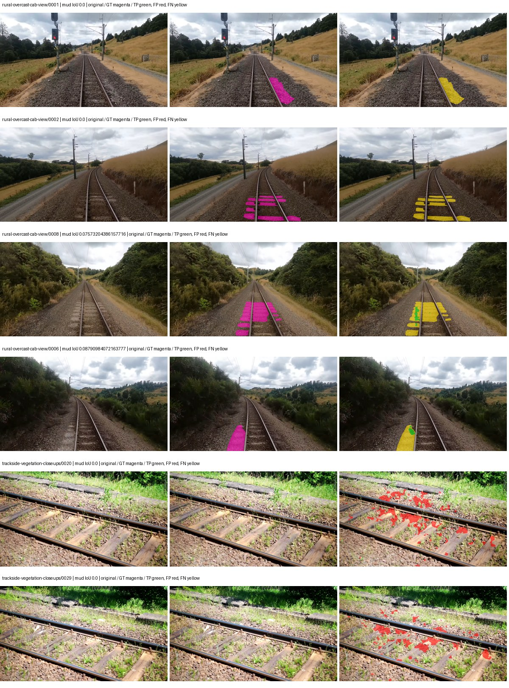
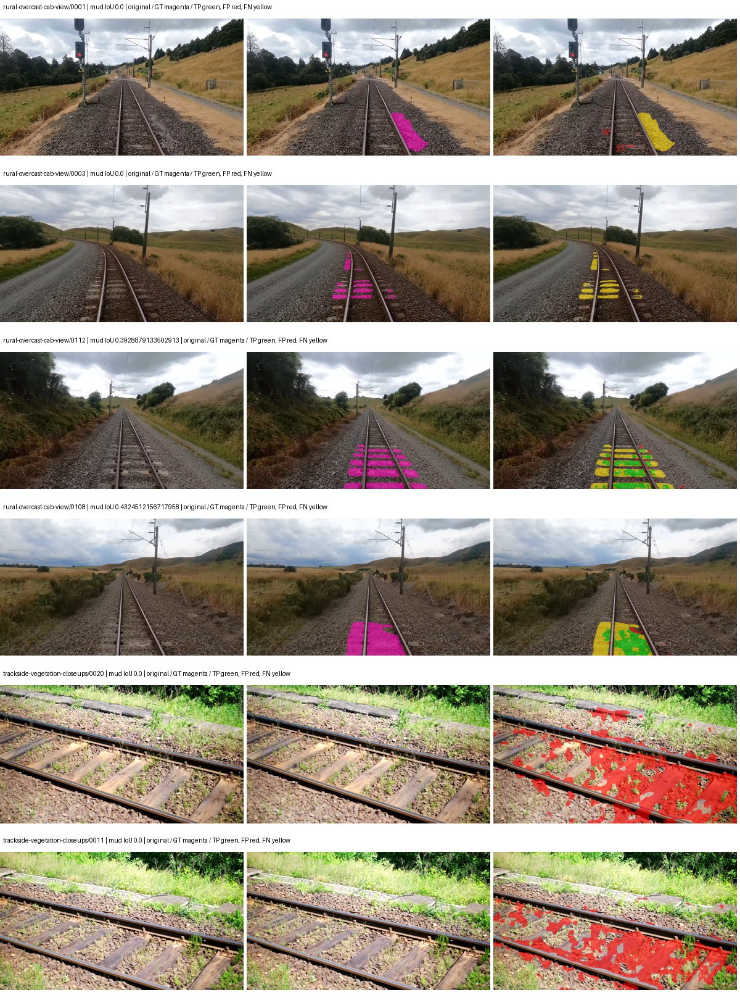
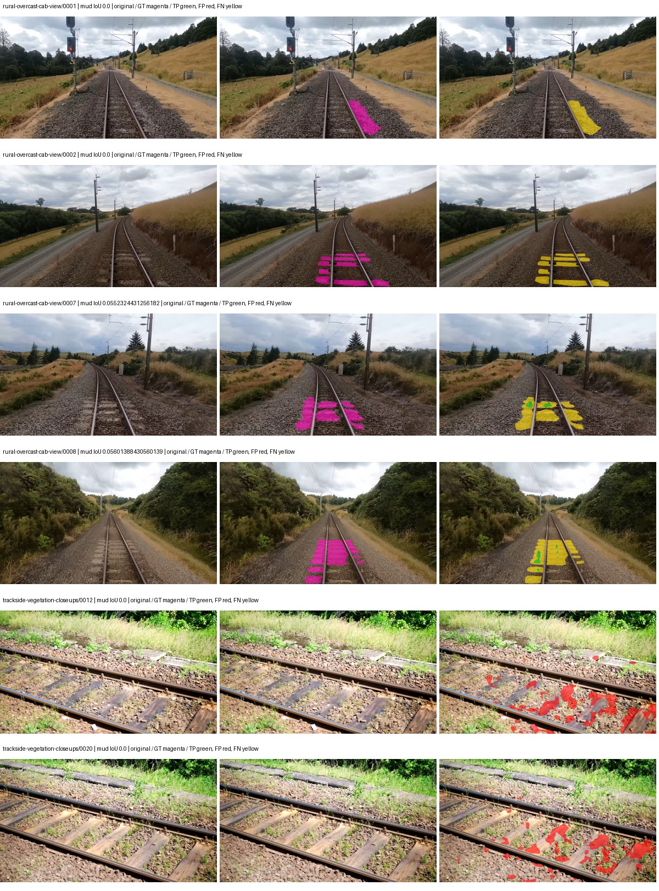
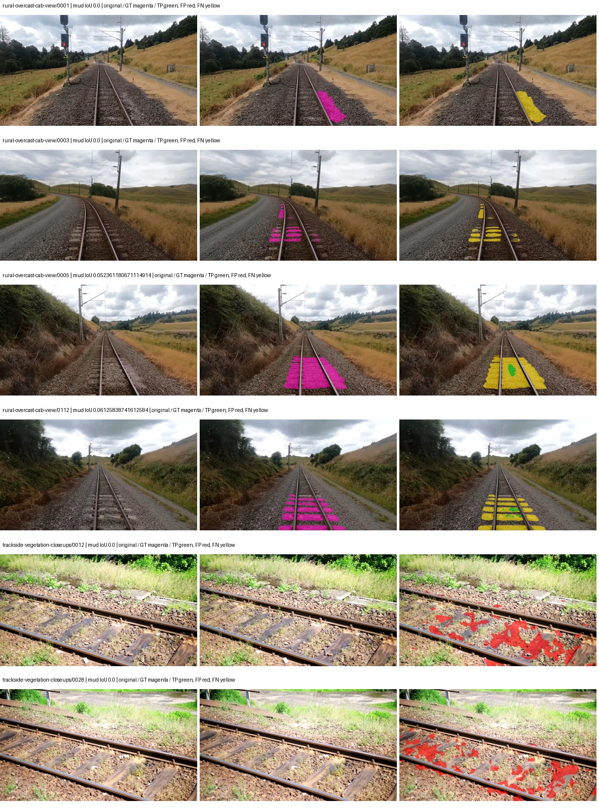

# native_resnet50_deeplabv3plus — rad_9_24_2026-fixed-grouped

[RAD 9/24: Scene-grouped split](../../README.md) · [Full model records](record.json)

Primary result: the **final checkpoint** after the full step budget (no early stopping). The checkpoint with the best **mud-pumping validation IoU, pixels pooled over all validation images**, is kept as secondary evidence. A job is complete only after full statistics and isolated profiling are verified.

Study metrics of the final checkpoint, counting each class only on the validation images that contain it: mud-pumping IoU is the mean per-image IoU over the images with mud-pumping, precision and recall sum pixels over those images, and mIoU averages each class over the images that contain it, then over the classes present.

| Initialization path | Seed | Mud-pumping IoU, train-camera images with mud (%, n=17) | Mud-pumping IoU, all images with mud (%, n=18) | Mud precision, all images with mud (%) | Mud recall, all images with mud (%) | mIoU (each class over images that contain it) (%) |
| --- | --- | --- | --- | --- | --- | --- |
| rtis_only | 0 | 0.69 | 0.89 | 12.23 | 1.00 | 33.50 |
| cityscapes_to_rtis | 0 | 0.17 | 0.22 | 2.08 | 0.46 | 34.47 |
| railsem19_to_rtis | 0 | 0.36 | 0.36 | 1.73 | 0.53 | 38.62 |
| cityscapes_to_railsem19_to_rtis | 0 | 0.34 | 0.45 | 6.12 | 0.93 | 37.83 |

Per-class IoU: IoU (%) of every class, each averaged only over the validation images that contain the class (n = those images); — = no image contains it. mIoU averages the classes with at least one such image.

| Initialization path | Seed | mIoU (each class over images that contain it) | person (n=0) | truck (n=0) | rail-track (n=37) | vegetation-overgrowth (n=13) | car (n=3) | on-rails (n=0) | traffic-sign (n=9) | road (n=11) | sidewalk (n=12) | construction (n=12) | tram-track (n=2) | pole (n=21) | traffic-light (n=3) | mud-pumping (n=18) | fence (n=7) | terrain (n=35) | sky (n=28) | rail-embedded (n=3) | rail-raised (n=37) | trackbed (n=37) | standing-water (n=9) |
| --- | --- | --- | --- | --- | --- | --- | --- | --- | --- | --- | --- | --- | --- | --- | --- | --- | --- | --- | --- | --- | --- | --- | --- |
| rtis_only | 0 | 33.50 | — | — | 56.49 | 29.93 | 6.33 | — | 16.90 | 18.16 | 15.03 | 34.56 | 0.96 | 62.45 | 33.56 | 0.89 | 14.16 | 83.57 | 94.12 | 7.59 | 69.10 | 58.90 | 0.33 |
| cityscapes_to_rtis | 0 | 34.47 | — | — | 52.19 | 23.44 | 19.80 | — | 18.97 | 12.24 | 10.74 | 45.98 | 3.74 | 67.71 | 35.20 | 0.22 | 21.87 | 80.71 | 91.86 | 7.46 | 68.27 | 59.82 | 0.23 |
| railsem19_to_rtis | 0 | 38.62 | — | — | 56.56 | 31.38 | 19.51 | — | 37.19 | 14.89 | 16.17 | 50.69 | 9.35 | 70.13 | 37.58 | 0.36 | 16.93 | 84.69 | 96.19 | 19.29 | 71.63 | 62.70 | 0.00 |
| cityscapes_to_railsem19_to_rtis | 0 | 37.83 | — | — | 55.63 | 37.18 | 21.71 | — | 32.10 | 20.91 | 16.44 | 53.74 | 5.81 | 69.79 | 31.67 | 0.45 | 20.17 | 84.96 | 95.57 | 5.64 | 67.54 | 61.06 | 0.56 |

Everything below is the campaign's own record, with pixels pooled over all validation images: its evaluation is the checkpoint that scored best on that pooled mud IoU (secondary evidence here); the diagnostics also cover the final checkpoint (`final-auto-val`).

| Model | Initialization path | Seed | Status | Steps | Best step | Best-checkpoint mud IoU, pixels pooled (%) | Best-checkpoint mud precision, pixels pooled (%) | Best-checkpoint mud recall, pixels pooled (%) | Final mud IoU (trainer val, pixels pooled, %) | Best-checkpoint mIoU, pixels pooled (%) | Best-checkpoint fixed GT-class mIoU, pixels pooled (%) |
| --- | --- | --- | --- | --- | --- | --- | --- | --- | --- | --- | --- |
| native_resnet50_deeplabv3plus | rtis_only | 0 | completed | 4000 | 1037 | 2.40 | 7.36 | 3.43 | 0.59 | 24.74 | 28.86 |
| native_resnet50_deeplabv3plus | cityscapes_to_rtis | 0 | completed | 4000 | 777 | 5.01 | 6.55 | 17.57 | 0.18 | 28.95 | 33.78 |
| native_resnet50_deeplabv3plus | railsem19_to_rtis | 0 | completed | 4000 | 777 | 0.72 | 1.98 | 1.11 | 0.19 | 38.77 | 45.24 |
| native_resnet50_deeplabv3plus | cityscapes_to_railsem19_to_rtis | 0 | completed | 4000 | 777 | 0.92 | 1.76 | 1.89 | 0.56 | 34.55 | 40.31 |

Training: 217 images. Validation: 37 images. Test: 60 held out. Seeds: [0]. Seed variation measures optimization variability, not independent-recording uncertainty. Historical source checkpoints stay fixed across adaptation seeds.

Training code: `fce0ea0ac50b334d4252812c396e0e593def375d`. Split SHA-256: `12d7b367c72cda61d57686ff2ac28223530d0af49debd9fb7a0fbc68b908bc93`.

## rtis_only — seed 0

Status: **completed**. Started: 2026-10-11T09:55:05.350291+00:00. Finished: 2026-10-11T10:39:56.410141+00:00.

Recipe pretrained initializer: `{"arch": "native", "backbone_path": null, "batch_norm_momentum": null, "checkpoint": null, "classifier_path": null, "drop_path": null, "encoder_name": null, "encoder_weights": null, "head": "unified_head", "head_paths": [], "inactive_parameter_paths": [], "local_files_only": false, "lora_alpha": 32, "lora_dropout": 0.05, "lora_r": 16, "lora_targets": [], "native": {"auxiliary_heads": [], "backbone": {"in_channels": 3, "kind": "timm", "name": "resnet50.a1_in1k", "out_indices": [1, 2, 3, 4], "weights": "pretrained"}, "head": {"activation": "relu", "channels": 256, "dilation_rates": [6, 12, 18], "dropout": 0.1, "high_index": 3, "kind": "deeplabv3plus", "low_channels": 48, "low_index": 0, "norm": "group"}, "neck": {"kind": "identity"}, "task": "multiclass"}, "revision": null, "smp_arch": null, "subfolder": null, "trust_remote_code": false, "tuning": "full"}`.

`rtis_only` uses the recipe initializer, which may include pretrained segmentation components. Transfer paths load the exact historical source checkpoint below and reset the classifier; they do not reset all query/decoder features.

Source checkpoint: `Recipe pretrained initialization`.

Config SHA-256: `50c1039b1f434bb891a7fbae0a7b6e17b7ad56767237e7f28abc4dad76ac2b1d`. Weights used for validation: `raw`.

### Mud-pumping and aggregate quality

| Metric | Selected checkpoint | Final training validation |
| --- | --- | --- |
| Mud IoU | 2.40 | 0.59 |
| Mud precision | 7.36 | 1.41 |
| Mud recall | 3.43 | 1.00 |
| Mud Dice/F1 | 4.68 | 1.17 |
| mIoU | 24.74 | 31.68 |
| Mean accuracy | 36.26 | 44.42 |
| Mean precision | 40.09 | 49.01 |
| Mean Dice | 31.82 | 40.45 |
| Mean specificity | 98.72 | 98.96 |
| Pixel accuracy | 79.75 | 83.81 |
| Frequency-weighted IoU | 69.67 | 74.10 |
| Fixed GT-present class mIoU | 28.86 | 36.96 |
| Boundary F1 | 29.64 | 37.50 |

The selected checkpoint has independent evaluation evidence. Final values are the trainer's final validation record, not a new independent evaluation. mIoU averages classes with nonzero union, so false positives on absent classes can change its denominator. The fixed GT-class mean is supplementary and excludes absent classes; their false positives remain in the confusion matrix.

### Resource usage and timing

| Measurement | Value |
| --- | --- |
| Peak training VRAM, retained training invocation (GiB) | 9.36 |
| Peak evaluation VRAM (GiB) | 7.25 |
| Retained training invocation wall time (seconds) | 2546.36 |
| Retained training invocation GPU-hours (one GPU) | 0.71 |
| Evaluation wall time (seconds) | 11.34 |
| Full evaluation pipeline images/second | 3.26 |
| Best full-state checkpoint (MiB) | 616.52 |
| Final full-state checkpoint (MiB) | 616.51 |
| Verified periodic checkpoints removed (GiB) | 4.82 |

VRAM uses the recorded allocator high-water mark; it is not total device usage including CUDA context. Resumed jobs' retained training invocation times and peaks are **not whole-campaign totals**. Earlier invocation resource records are not reconstructed here. Evaluation throughput includes loader, sliding-window inference and metrics; it is not model-only latency/FPS. Missing measurements are shown as —, never inferred from another dataset's run.

### Standardized inference performance

Dedicated model-only profiling waits for an idle worker-locked L40S: BF16, batch 1, 1024x1024, 20 warmup and 100 CUDA-event-timed public forwards. It excludes loading, preprocessing, tiling and metrics.

| Status | Parameters | Weight MiB | FPS | p50 ms | p95 ms | Peak reserved GiB |
| --- | --- | --- | --- | --- | --- | --- |
| complete | 40351925 | 153.93 | 136.44 | 7.29 | 7.52 | 0.82 |

```json
{
  "schema_version": 1,
  "model_id": "native_resnet50_deeplabv3plus",
  "measured_at": "2026-10-11T10:39:49+00:00",
  "status": "complete",
  "benchmark_scope": "rtis_selected_checkpoint_model_only",
  "applies_to": [
    "native_resnet50_deeplabv3plus--rtis_only--seed-0"
  ],
  "source": {
    "campaign_git_sha": "fce0ea0ac50b334d4252812c396e0e593def375d",
    "git_dirty": false,
    "config_hash": "8788f2e5b8de",
    "resolved_config": "/data/izadia1/projects/segmentary-runs/rad_9_24_2026/fgall-seed0-20261007/configs/native_resnet50_deeplabv3plus--rtis_only--seed-0.yaml",
    "config_sha256": "50c1039b1f434bb891a7fbae0a7b6e17b7ad56767237e7f28abc4dad76ac2b1d",
    "checkpoint_sha256": "82b87dc853f942677d1c3995fc2adb36e6052e7a41dbc9e69d9a2e7852abba57",
    "checkpoint_global_step": 1037,
    "checkpoint_bytes": 646467248,
    "checkpoint_kind": "resume checkpoint with optimizer and EMA state",
    "weights": "raw",
    "measured_checkpoint_job_id": "native_resnet50_deeplabv3plus--rtis_only--seed-0",
    "result_sha256": "30ac58efe36442e9734494691df997eb9b04d3463eeb9ff7c0175bc920c690e9",
    "result_git_sha": "fce0ea0ac50b334d4252812c396e0e593def375d",
    "result_stage": "eval:rad_9_24_2026-fixed-grouped:val",
    "result_seed": 0
  },
  "hardware": {
    "gpu_name": "NVIDIA L40S",
    "gpu_uuid": "GPU-1c9b612f-e0b5-fbbc-150f-8c2ef13453c9",
    "logical_device": "cuda:0",
    "physical_visibility_token": "5",
    "compute_capability": [
      8,
      9
    ],
    "total_memory_bytes": 47677177856
  },
  "model": {
    "parameter_count": 40351925,
    "trainable_parameter_count": 40351925,
    "resident_parameter_bytes": 161407700,
    "parameter_dtype_counts": {
      "float32": 40351925
    }
  },
  "contract": {
    "backend": "pytorch",
    "precision": "bf16_autocast",
    "batch_size": 1,
    "input_shape_nchw": [
      1,
      3,
      1024,
      1024
    ],
    "warmup_iterations": 20,
    "measured_iterations": 100,
    "timing": "per-forward CUDA events with end-event synchronization",
    "includes_preprocessing": false,
    "includes_data_loader": false,
    "includes_sliding_window": false,
    "input_resident_on_gpu": true,
    "model_only": true,
    "entrypoint": "public model(image) dense-logits forward"
  },
  "measurements": {
    "latency": {
      "p50_ms": 7.293440103530884,
      "p95_ms": 7.521587014198303,
      "mean_ms": 7.329249272346496,
      "minimum_ms": 7.254015922546387,
      "maximum_ms": 7.887904167175293,
      "fps": 136.43962196415308,
      "raw_ms": [
        7.887904167175293,
        7.3072638511657715,
        7.300096035003662,
        7.507967948913574,
        7.628799915313721,
        7.327744007110596,
        7.304192066192627,
        7.28166389465332,
        7.444479942321777,
        7.299071788787842,
        7.282688140869141,
        7.269375801086426,
        7.285759925842285,
        7.275519847869873,
        7.292928218841553,
        7.273471832275391,
        7.29804801940918,
        7.274496078491211,
        7.284736156463623,
        7.2775678634643555,
        7.433216094970703,
        7.270400047302246,
        7.364607810974121,
        7.300096035003662,
        7.2867841720581055,
        7.29091215133667,
        7.321599960327148,
        7.287807941436768,
        7.376895904541016,
        7.399424076080322,
        7.313407897949219,
        7.2775678634643555,
        7.288832187652588,
        7.29804801940918,
        7.302112102508545,
        7.29804801940918,
        7.301119804382324,
        7.28985595703125,
        7.296000003814697,
        7.28985595703125,
        7.283679962158203,
        7.566336154937744,
        7.799808025360107,
        7.3471999168396,
        7.299071788787842,
        7.444479942321777,
        7.296000003814697,
        7.3072638511657715,
        7.279615879058838,
        7.28985595703125,
        7.278592109680176,
        7.254015922546387,
        7.270400047302246,
        7.305215835571289,
        7.284736156463623,
        7.287807941436768,
        7.297023773193359,
        7.519231796264648,
        7.294976234436035,
        7.28985595703125,
        7.299071788787842,
        7.683072090148926,
        7.28985595703125,
        7.292928218841553,
        7.305215835571289,
        7.287807941436768,
        7.475200176239014,
        7.311359882354736,
        7.271423816680908,
        7.308288097381592,
        7.28985595703125,
        7.3021440505981445,
        7.305215835571289,
        7.284736156463623,
        7.28166389465332,
        7.287807941436768,
        7.280608177185059,
        7.29088020324707,
        7.296000003814697,
        7.2867841720581055,
        7.291903972625732,
        7.299071788787842,
        7.275519847869873,
        7.293951988220215,
        7.287807941436768,
        7.296000003814697,
        7.280640125274658,
        7.2867841720581055,
        7.304192066192627,
        7.29804801940918,
        7.282688140869141,
        7.29091215133667,
        7.292928218841553,
        7.279615879058838,
        7.483391761779785,
        7.2867841720581055,
        7.284736156463623,
        7.2775678634643555,
        7.297023773193359,
        7.4199042320251465
      ],
      "percentile_method": "numpy linear interpolation"
    },
    "peak_reserved_bytes": 878706688,
    "memory_kind": "pytorch_cuda_allocator_peak_reserved_excluding_context",
    "process_total_bytes": 1407188992,
    "process_total_kind": "nvidia-smi used_memory of this PID on the benchmark GPU after the timed loop, including the CUDA context; null when the driver could not attribute memory to this PID",
    "benchmark_wall_clock_s": 13.424699768424034
  },
  "started_at": "2026-10-11T10:39:35+00:00",
  "finished_at": "2026-10-11T10:39:49+00:00",
  "environment": {
    "hostname": "hdrfs-app-001",
    "python": "3.11.15",
    "platform": "Linux-5.15.0-139-generic-x86_64-with-glibc2.35",
    "torch": "2.11.0+cu128",
    "torch_cuda": "12.8",
    "cudnn": 91900,
    "driver_version": "570.133.20",
    "cuda_available": true,
    "gpu_count": 1,
    "gpu_names": [
      "NVIDIA L40S"
    ],
    "cuda_visible_devices": "5",
    "packages": {
      "segmentary": "0.1.0",
      "torch": "2.11.0+cu128",
      "torchvision": "0.26.0+cu128",
      "transformers": "5.15.0",
      "timm": "1.0.28",
      "segmentation-models-pytorch": "0.5.0",
      "albumentations": "2.0.8",
      "lightning": "2.6.5",
      "numpy": "2.4.4"
    }
  }
}
```

### Per-class validation results

| Class | GT pixels | IoU (%) | Precision (%) | Recall (%) | Dice (%) | Boundary F1 (%) |
| --- | --- | --- | --- | --- | --- | --- |
| car | 29664 | 0.00 | 0.00 | 0.00 | 0.00 | 0.00 |
| construction | 311585 | 25.46 | 30.51 | 60.59 | 40.59 | 31.21 |
| fence | 265137 | 12.65 | 31.23 | 17.54 | 22.46 | 24.04 |
| mud-pumping | 1226250 | 2.40 | 7.36 | 3.43 | 4.68 | 5.44 |
| on-rails | 0 | 0.00 | 0.00 | — | 0.00 | 0.00 |
| person | 0 | 0.00 | 0.00 | — | 0.00 | 0.00 |
| pole | 628038 | 56.56 | 74.76 | 69.92 | 72.25 | 84.61 |
| rail-embedded | 16799 | 0.30 | 24.52 | 0.30 | 0.60 | 5.72 |
| rail-raised | 2969797 | 65.83 | 71.61 | 89.07 | 79.39 | 82.48 |
| rail-track | 6323197 | 38.93 | 60.52 | 52.18 | 56.04 | 52.43 |
| road | 1048831 | 4.39 | 16.75 | 5.62 | 8.42 | 9.95 |
| sidewalk | 1297367 | 12.01 | 49.75 | 13.67 | 21.45 | 11.30 |
| sky | 19121606 | 96.94 | 99.00 | 97.90 | 98.44 | 88.83 |
| standing-water | 95802 | 0.01 | 0.01 | 0.16 | 0.01 | 0.18 |
| terrain | 39239306 | 80.73 | 84.70 | 94.50 | 89.34 | 50.46 |
| trackbed | 10643081 | 43.49 | 66.54 | 55.66 | 60.62 | 49.16 |
| traffic-light | 19510 | 42.74 | 75.54 | 49.60 | 59.88 | 55.65 |
| traffic-sign | 13285 | 0.02 | 75.00 | 0.02 | 0.05 | 6.15 |
| tram-track | 56179 | 0.00 | 0.00 | 0.00 | 0.00 | 0.00 |
| truck | 0 | 0.00 | 0.00 | — | 0.00 | 0.00 |
| vegetation-overgrowth | 5901821 | 37.04 | 74.01 | 42.58 | 54.06 | 64.76 |

### Full-run accounting

| Measurement | Value |
| --- | --- |
| Full GPU-reserved wall seconds, all recorded worker attempts | 2698.98 |
| Full reserved GPU-hours | 0.75 |
| Whole-run timing complete | True |

| Phase | Wall seconds including failed attempts |
| --- | --- |
| training | 2553.30 |
| diagnostics | 89.92 |
| performance | 22.19 |

GPU-reserved time includes model loading, training, validation, collection, profiling, checkpoint I/O and orchestration while the worker owns one GPU. It is not GPU kernel-active time. Phase timings and sampled device memory/power/utilization are retained separately; sampled device memory is not the allocator high-water mark.

### Train/validation and raw/EMA diagnostics

| Checkpoint / weights / split | Images | Mud IoU (%) | Mud precision (%) | Mud recall (%) |
| --- | --- | --- | --- | --- |
| best-auto-train / raw | 217 | 89.63 | 96.07 | 93.04 |
| best-auto-val / raw | 37 | 2.40 | 7.36 | 3.43 |
| best-alternate-val / ema | 37 | 0.57 | 1.50 | 0.91 |
| final-auto-val / raw | 37 | 0.59 | 1.41 | 1.00 |

Train uses the evaluation transform without augmentation. Compare mud train/validation metrics for the same selected weights. Alternate EMA on running-stat BatchNorm is explicitly uncalibrated and is diagnostic only. Score-threshold curves use uncalibrated normalized scores and are pixel-level diagnostics, not event detection rates or a selected deployment operating point.

### Downloadable evidence

- best-auto-train: [per-image.csv](rtis_only--seed-0/best-auto-train/per-image.csv) · [per-image-confusion.json.gz](rtis_only--seed-0/best-auto-train/per-image-confusion.json.gz) · [groups.json](rtis_only--seed-0/best-auto-train/groups.json) · [mud-score-curves.json](rtis_only--seed-0/best-auto-train/mud-score-curves.json)
- best-auto-val: [per-image.csv](rtis_only--seed-0/best-auto-val/per-image.csv) · [per-image-confusion.json.gz](rtis_only--seed-0/best-auto-val/per-image-confusion.json.gz) · [groups.json](rtis_only--seed-0/best-auto-val/groups.json) · [mud-score-curves.json](rtis_only--seed-0/best-auto-val/mud-score-curves.json) · [examples.jpg](rtis_only--seed-0/best-auto-val/examples.jpg)
- best-alternate-val: [per-image.csv](rtis_only--seed-0/best-alternate-val/per-image.csv) · [per-image-confusion.json.gz](rtis_only--seed-0/best-alternate-val/per-image-confusion.json.gz) · [groups.json](rtis_only--seed-0/best-alternate-val/groups.json) · [mud-score-curves.json](rtis_only--seed-0/best-alternate-val/mud-score-curves.json)
- final-auto-val: [per-image.csv](rtis_only--seed-0/final-auto-val/per-image.csv) · [per-image-confusion.json.gz](rtis_only--seed-0/final-auto-val/per-image-confusion.json.gz) · [groups.json](rtis_only--seed-0/final-auto-val/groups.json) · [mud-score-curves.json](rtis_only--seed-0/final-auto-val/mud-score-curves.json)
- resources: [telemetry.csv](rtis_only--seed-0/resources/telemetry.csv)



Examples are two lowest and two highest mud-IoU positive images, plus up to two negative images with the most false-positive mud pixels. They are targeted diagnostic examples, not random samples. Green: true positive; red: false positive; yellow: false negative. Full predictions remain on HDRFS.

### Validation tracking

| Logged step | Overall mIoU (%) | Mud IoU (%) |
| --- | --- | --- |
| 258 | 19.34 | 0.15 |
| 518 | 24.28 | 1.52 |
| 777 | 21.27 | 0.93 |
| 1036 | 24.75 | 2.39 |
| 1295 | 27.41 | 1.08 |
| 1555 | 28.67 | 0.35 |
| 1814 | 27.25 | 0.49 |
| 2073 | 30.69 | 0.41 |
| 2332 | 28.69 | 0.16 |
| 2592 | 30.78 | 0.18 |
| 2851 | 29.34 | 0.89 |
| 3110 | 31.01 | 0.35 |
| 3369 | 30.91 | 0.30 |
| 3629 | 31.66 | 0.28 |
| 3888 | 31.34 | 0.42 |
| 4000 | 31.68 | 0.59 |

All retained scalar curves, including training loss and per-class IoU, are in record.json. Observed best mud on a curve is not necessarily a retained checkpoint: the pilot saved its selection-metric-best and final checkpoints. Step logging and checkpoint global_step may differ by one.

### Stopping and checkpoint provenance

```json
{
  "stopping": {
    "actual_steps": 4000,
    "maximum_steps": 4000,
    "min_delta": 0.0,
    "monitor": "val_iou/mud-pumping",
    "patience": null,
    "reason": "budget_complete"
  },
  "checkpoints": {
    "best": {
      "path": "/data/izadia1/projects/segmentary-runs/rad_9_24_2026/fgall-seed0-20261007/future-runs/native_resnet50_deeplabv3plus--rtis_only--seed-0_seed0/rtis/best.ckpt",
      "sha256": "82b87dc853f942677d1c3995fc2adb36e6052e7a41dbc9e69d9a2e7852abba57",
      "global_step": 1037,
      "bytes": 646467248
    },
    "final": {
      "path": "/data/izadia1/projects/segmentary-runs/rad_9_24_2026/fgall-seed0-20261007/future-runs/native_resnet50_deeplabv3plus--rtis_only--seed-0_seed0/rtis/last.ckpt",
      "sha256": "9d76b4b6165b5b4bd18d37a28a3728a1ebe01de47bab13cb6ee2791c8a13bb13",
      "global_step": 4000,
      "bytes": 646455536
    }
  },
  "cleanup_error": null
}
```

### Resolved training, initialization and evaluation settings

The optimizer block is the base configuration. Stage LR scales are applied at runtime, and stage warmup is capped at min(base warmup, floor(stage budget / 10), stage budget - 1): 400 steps for this 4,000-step pilot. Model-internal native input grids may differ from augmentation crops (EoMT uses its 640 grid).

```json
{
  "name": "native_resnet50_deeplabv3plus--rtis_only--seed-0",
  "model": {
    "arch": "native",
    "checkpoint": null,
    "tuning": "full",
    "head": "unified_head",
    "lora_r": 16,
    "lora_alpha": 32,
    "lora_dropout": 0.05,
    "lora_targets": [],
    "drop_path": null,
    "revision": null,
    "subfolder": null,
    "local_files_only": false,
    "trust_remote_code": false,
    "backbone_path": null,
    "head_paths": [],
    "classifier_path": null,
    "inactive_parameter_paths": [],
    "smp_arch": null,
    "encoder_name": null,
    "encoder_weights": null,
    "native": {
      "task": "multiclass",
      "backbone": {
        "kind": "timm",
        "name": "resnet50.a1_in1k",
        "weights": "pretrained",
        "out_indices": [
          1,
          2,
          3,
          4
        ],
        "in_channels": 3
      },
      "neck": {
        "kind": "identity"
      },
      "head": {
        "kind": "deeplabv3plus",
        "low_index": 0,
        "high_index": 3,
        "channels": 256,
        "low_channels": 48,
        "dilation_rates": [
          6,
          12,
          18
        ],
        "dropout": 0.1,
        "norm": "group",
        "activation": "relu"
      },
      "auxiliary_heads": []
    },
    "batch_norm_momentum": null
  },
  "space": "paul-test-rtis",
  "taxonomy_root": "/data/izadia1/projects/segmentary-rad-fgall-fce0ea0a/taxonomy",
  "output_root": "/data/izadia1/projects/segmentary-runs/rad_9_24_2026/fgall-seed0-20261007/future-runs",
  "optim": {
    "backbone_lr": 0.0001,
    "head_lr_mult": 10.0,
    "weight_decay": 0.05,
    "llrd": 1.0,
    "warmup_iters": 1500,
    "warmup_ratio": 1e-06,
    "poly_power": 0.9,
    "min_lr_ratio": 0.0,
    "betas": [
      0.9,
      0.999
    ],
    "grad_clip": 1.0
  },
  "train": {
    "iters": 4000,
    "batch_size": 2,
    "accum": 8,
    "num_workers": 2,
    "precision": "bf16-mixed",
    "ema_decay": 0.9998,
    "val_every": 250,
    "ckpt_every": 500,
    "selection_metric": "val_iou/mud-pumping",
    "early_stopping_patience": null,
    "early_stopping_min_delta": 0.0,
    "seed": 0,
    "devices": 1
  },
  "eval": {
    "sliding_window": true,
    "window": [
      1024,
      1024
    ],
    "stride": [
      768,
      768
    ],
    "batch_size": 1,
    "num_workers": 2,
    "tta_scales": [],
    "tta_flip": false,
    "threshold": 0.5,
    "boundary_tolerance_frac": 0.0075,
    "save_confusion": true
  },
  "loss": {
    "task": "multiclass",
    "activation": "auto",
    "terms": [],
    "aux": "none",
    "aux_weight": 0.0,
    "ce_weight": 1.0,
    "label_smoothing": 0.0,
    "class_weights": null,
    "query": null
  },
  "aug": {
    "crop": [
      1024,
      1024
    ],
    "scale_min": 0.5,
    "scale_max": 2.0,
    "hflip_p": 0.5,
    "color_jitter_p": 0.5,
    "brightness": 0.25,
    "contrast": 0.25,
    "saturation": 0.25,
    "hue": 0.05
  },
  "stages": [
    {
      "name": "rtis",
      "data": [
        {
          "name": "rad_9_24_2026-fixed-grouped",
          "root": "/data/izadia1/datasets/rad_9_24_2026-fixed-grouped",
          "variant": null,
          "split_file": "splits.json",
          "train_split": "train",
          "val_split": "val",
          "limit": null,
          "loader": "folder",
          "mapping": "paul-test-rtis",
          "loader_options": {
            "require_groups": true
          }
        }
      ],
      "iters": null,
      "lr_scale": 1.0,
      "head_group_lr_scale": 1.0,
      "init_from": "pretrained",
      "reset_head": false,
      "freeze": null,
      "sample_weights": null
    }
  ]
}
```

### Hardware and software provenance

```json
{
  "training": {
    "cuda_available": true,
    "cuda_visible_devices": "5",
    "cudnn": 91900,
    "driver_version": "570.133.20",
    "gpu_count": 1,
    "gpu_names": [
      "NVIDIA L40S"
    ],
    "hostname": "hdrfs-app-001",
    "input_normalization": {
      "channel_order": "rgb",
      "mean": [
        0.485,
        0.456,
        0.406
      ],
      "source": "timm_pretrained_cfg",
      "std": [
        0.229,
        0.224,
        0.225
      ]
    },
    "model_origins": [
      {
        "hf_commit": null,
        "hf_name_or_path": null,
        "module": "backbone",
        "timm_pretrained": {
          "architecture": "resnet50",
          "hf_hub_id": "timm/resnet50.a1_in1k",
          "tag": "a1_in1k",
          "url": "https://github.com/rwightman/pytorch-image-models/releases/download/v0.1-rsb-weights/resnet50_a1_0-14fe96d1.pth"
        }
      },
      {
        "hf_commit": null,
        "hf_name_or_path": null,
        "module": "backbone.model",
        "timm_pretrained": {
          "architecture": "resnet50",
          "hf_hub_id": "timm/resnet50.a1_in1k",
          "tag": "a1_in1k",
          "url": "https://github.com/rwightman/pytorch-image-models/releases/download/v0.1-rsb-weights/resnet50_a1_0-14fe96d1.pth"
        }
      }
    ],
    "model_parameter_count": 40351925,
    "packages": {
      "albumentations": "2.0.8",
      "lightning": "2.6.5",
      "numpy": "2.4.4",
      "segmentary": "0.1.0",
      "segmentation-models-pytorch": "0.5.0",
      "timm": "1.0.28",
      "torch": "2.11.0+cu128",
      "torchvision": "0.26.0+cu128",
      "transformers": "5.15.0"
    },
    "platform": "Linux-5.15.0-139-generic-x86_64-with-glibc2.35",
    "python": "3.11.15",
    "torch": "2.11.0+cu128",
    "torch_cuda": "12.8",
    "trainable_parameter_count": 40351925,
    "training_stop": {
      "actual_steps": 4000,
      "maximum_steps": 4000,
      "min_delta": 0.0,
      "monitor": "val_iou/mud-pumping",
      "patience": null,
      "reason": "budget_complete"
    },
    "validation_weights": "raw"
  },
  "evaluation": {
    "cuda_available": true,
    "cuda_visible_devices": "5",
    "cudnn": 91900,
    "driver_version": "570.133.20",
    "gpu_count": 1,
    "gpu_names": [
      "NVIDIA L40S"
    ],
    "hostname": "hdrfs-app-001",
    "input_normalization": {
      "channel_order": "rgb",
      "mean": [
        0.485,
        0.456,
        0.406
      ],
      "source": "timm_pretrained_cfg",
      "std": [
        0.229,
        0.224,
        0.225
      ]
    },
    "packages": {
      "albumentations": "2.0.8",
      "lightning": "2.6.5",
      "numpy": "2.4.4",
      "segmentary": "0.1.0",
      "segmentation-models-pytorch": "0.5.0",
      "timm": "1.0.28",
      "torch": "2.11.0+cu128",
      "torchvision": "0.26.0+cu128",
      "transformers": "5.15.0"
    },
    "platform": "Linux-5.15.0-139-generic-x86_64-with-glibc2.35",
    "python": "3.11.15",
    "torch": "2.11.0+cu128",
    "torch_cuda": "12.8"
  }
}
```

## cityscapes_to_rtis — seed 0

Status: **completed**. Started: 2026-10-11T09:59:10.719433+00:00. Finished: 2026-10-11T10:43:39.411286+00:00.

Recipe pretrained initializer: `{"arch": "native", "backbone_path": null, "batch_norm_momentum": null, "checkpoint": null, "classifier_path": null, "drop_path": null, "encoder_name": null, "encoder_weights": null, "head": "unified_head", "head_paths": [], "inactive_parameter_paths": [], "local_files_only": false, "lora_alpha": 32, "lora_dropout": 0.05, "lora_r": 16, "lora_targets": [], "native": {"auxiliary_heads": [], "backbone": {"in_channels": 3, "kind": "timm", "name": "resnet50.a1_in1k", "out_indices": [1, 2, 3, 4], "weights": "pretrained"}, "head": {"activation": "relu", "channels": 256, "dilation_rates": [6, 12, 18], "dropout": 0.1, "high_index": 3, "kind": "deeplabv3plus", "low_channels": 48, "low_index": 0, "norm": "group"}, "neck": {"kind": "identity"}, "task": "multiclass"}, "revision": null, "smp_arch": null, "subfolder": null, "trust_remote_code": false, "tuning": "full"}`.

`rtis_only` uses the recipe initializer, which may include pretrained segmentation components. Transfer paths load the exact historical source checkpoint below and reset the classifier; they do not reset all query/decoder features.

Source checkpoint: `{'name': 'native_resnet50_deeplabv3plus--cityscapes--seed-0', 'model': 'native_resnet50_deeplabv3plus', 'protocol': 'cityscapes', 'config': '/data/izadia1/projects/segmentary-runs/all-model-city-rail-seed0-rail20-b9eb3e1/accepted/native_resnet50_deeplabv3plus--cityscapes--seed-0/resolved-config.yaml', 'checkpoint': '/data/izadia1/projects/segmentary-runs/current-main-fill-v2/jobs/native_resnet50_deeplabv3plus--cityscapes--seed-0/train/native_resnet50_deeplabv3plus--cityscapes_seed0/cityscapes/last.ckpt', 'recorded_sha256': 'fe67b933a9c445f846ca354ebb8e702c4982922b3c8e161233418537297fa36f', 'exists': True}`.

Config SHA-256: `5f75d2ad154d2495647ad7e1bb529995e1fb0ccbf77a0bcc8d0b37b0c2001ecd`. Weights used for validation: `raw`.

### Mud-pumping and aggregate quality

| Metric | Selected checkpoint | Final training validation |
| --- | --- | --- |
| Mud IoU | 5.01 | 0.18 |
| Mud precision | 6.55 | 0.31 |
| Mud recall | 17.57 | 0.46 |
| Mud Dice/F1 | 9.55 | 0.37 |
| mIoU | 28.95 | 29.74 |
| Mean accuracy | 43.03 | 42.90 |
| Mean precision | 44.21 | 53.07 |
| Mean Dice | 37.57 | 39.29 |
| Mean specificity | 98.84 | 98.80 |
| Pixel accuracy | 80.59 | 81.55 |
| Frequency-weighted IoU | 72.15 | 71.30 |
| Fixed GT-present class mIoU | 33.78 | 34.69 |
| Boundary F1 | 35.81 | 36.01 |

The selected checkpoint has independent evaluation evidence. Final values are the trainer's final validation record, not a new independent evaluation. mIoU averages classes with nonzero union, so false positives on absent classes can change its denominator. The fixed GT-class mean is supplementary and excludes absent classes; their false positives remain in the confusion matrix.

### Resource usage and timing

| Measurement | Value |
| --- | --- |
| Peak training VRAM, retained training invocation (GiB) | 9.36 |
| Peak evaluation VRAM (GiB) | 7.25 |
| Retained training invocation wall time (seconds) | 2523.16 |
| Retained training invocation GPU-hours (one GPU) | 0.70 |
| Evaluation wall time (seconds) | 12.41 |
| Full evaluation pipeline images/second | 2.98 |
| Best full-state checkpoint (MiB) | 616.52 |
| Final full-state checkpoint (MiB) | 616.51 |
| Verified periodic checkpoints removed (GiB) | 4.82 |

VRAM uses the recorded allocator high-water mark; it is not total device usage including CUDA context. Resumed jobs' retained training invocation times and peaks are **not whole-campaign totals**. Earlier invocation resource records are not reconstructed here. Evaluation throughput includes loader, sliding-window inference and metrics; it is not model-only latency/FPS. Missing measurements are shown as —, never inferred from another dataset's run.

### Standardized inference performance

Dedicated model-only profiling waits for an idle worker-locked L40S: BF16, batch 1, 1024x1024, 20 warmup and 100 CUDA-event-timed public forwards. It excludes loading, preprocessing, tiling and metrics.

| Status | Parameters | Weight MiB | FPS | p50 ms | p95 ms | Peak reserved GiB |
| --- | --- | --- | --- | --- | --- | --- |
| complete | 40351925 | 153.93 | 140.32 | 7.05 | 7.66 | 0.78 |

```json
{
  "schema_version": 1,
  "model_id": "native_resnet50_deeplabv3plus",
  "measured_at": "2026-10-11T10:43:32+00:00",
  "status": "complete",
  "benchmark_scope": "rtis_selected_checkpoint_model_only",
  "applies_to": [
    "native_resnet50_deeplabv3plus--cityscapes_to_rtis--seed-0"
  ],
  "source": {
    "campaign_git_sha": "fce0ea0ac50b334d4252812c396e0e593def375d",
    "git_dirty": false,
    "config_hash": "bfcc19144d39",
    "resolved_config": "/data/izadia1/projects/segmentary-runs/rad_9_24_2026/fgall-seed0-20261007/configs/native_resnet50_deeplabv3plus--cityscapes_to_rtis--seed-0.yaml",
    "config_sha256": "5f75d2ad154d2495647ad7e1bb529995e1fb0ccbf77a0bcc8d0b37b0c2001ecd",
    "checkpoint_sha256": "2788809d1342edd71176bd90044b11e11acff193427994901ec415199e21d909",
    "checkpoint_global_step": 777,
    "checkpoint_bytes": 646467248,
    "checkpoint_kind": "resume checkpoint with optimizer and EMA state",
    "weights": "raw",
    "measured_checkpoint_job_id": "native_resnet50_deeplabv3plus--cityscapes_to_rtis--seed-0",
    "result_sha256": "fd71bf08dc0361202a8b4950520dd224aaa762499194c16d8d0307559721b423",
    "result_git_sha": "fce0ea0ac50b334d4252812c396e0e593def375d",
    "result_stage": "eval:rad_9_24_2026-fixed-grouped:val",
    "result_seed": 0
  },
  "hardware": {
    "gpu_name": "NVIDIA L40S",
    "gpu_uuid": "GPU-a5ad49e5-0536-5229-ba8a-f8a902808f53",
    "logical_device": "cuda:0",
    "physical_visibility_token": "7",
    "compute_capability": [
      8,
      9
    ],
    "total_memory_bytes": 47677177856
  },
  "model": {
    "parameter_count": 40351925,
    "trainable_parameter_count": 40351925,
    "resident_parameter_bytes": 161407700,
    "parameter_dtype_counts": {
      "float32": 40351925
    }
  },
  "contract": {
    "backend": "pytorch",
    "precision": "bf16_autocast",
    "batch_size": 1,
    "input_shape_nchw": [
      1,
      3,
      1024,
      1024
    ],
    "warmup_iterations": 20,
    "measured_iterations": 100,
    "timing": "per-forward CUDA events with end-event synchronization",
    "includes_preprocessing": false,
    "includes_data_loader": false,
    "includes_sliding_window": false,
    "input_resident_on_gpu": true,
    "model_only": true,
    "entrypoint": "public model(image) dense-logits forward"
  },
  "measurements": {
    "latency": {
      "p50_ms": 7.054336071014404,
      "p95_ms": 7.655065703392029,
      "mean_ms": 7.126569252014161,
      "minimum_ms": 7.023615837097168,
      "maximum_ms": 8.018943786621094,
      "fps": 140.31997229485606,
      "raw_ms": [
        7.10041618347168,
        7.060480117797852,
        7.332863807678223,
        7.65337610244751,
        7.0502400398254395,
        7.054336071014404,
        7.062528133392334,
        7.048192024230957,
        7.059455871582031,
        7.052288055419922,
        7.053311824798584,
        7.071743965148926,
        7.052288055419922,
        7.058432102203369,
        7.059455871582031,
        7.054336071014404,
        7.051263809204102,
        7.059455871582031,
        7.038976192474365,
        7.049215793609619,
        7.054336071014404,
        7.047167778015137,
        7.044095993041992,
        7.687168121337891,
        7.049215793609619,
        7.054336071014404,
        7.053311824798584,
        7.3369598388671875,
        7.023615837097168,
        7.058432102203369,
        7.614463806152344,
        7.146495819091797,
        7.067647933959961,
        7.255040168762207,
        7.164927959442139,
        7.039999961853027,
        7.0655999183654785,
        7.052288055419922,
        7.046144008636475,
        7.059455871582031,
        7.0502400398254395,
        7.044095993041992,
        7.052288055419922,
        7.045119762420654,
        7.0502400398254395,
        7.054336071014404,
        7.055359840393066,
        7.845888137817383,
        7.055359840393066,
        7.054336071014404,
        7.054336071014404,
        7.046144008636475,
        7.053311824798584,
        7.061503887176514,
        7.070720195770264,
        8.018943786621094,
        7.04204797744751,
        7.052288055419922,
        7.047167778015137,
        7.060480117797852,
        7.063551902770996,
        7.085055828094482,
        7.051263809204102,
        7.053311824798584,
        7.047167778015137,
        7.041024208068848,
        7.069695949554443,
        7.04307222366333,
        7.070720195770264,
        7.055359840393066,
        7.057407855987549,
        7.061503887176514,
        7.051263809204102,
        7.047167778015137,
        7.401472091674805,
        7.147520065307617,
        7.0655999183654785,
        7.047167778015137,
        7.045119762420654,
        7.064576148986816,
        7.052288055419922,
        7.051263809204102,
        7.828512191772461,
        7.058432102203369,
        7.046144008636475,
        7.9585280418396,
        7.058432102203369,
        7.046144008636475,
        7.060480117797852,
        7.056384086608887,
        7.057407855987549,
        7.048192024230957,
        7.048192024230957,
        7.051263809204102,
        7.044095993041992,
        7.058432102203369,
        7.051263809204102,
        7.077888011932373,
        7.08403205871582,
        7.592959880828857
      ],
      "percentile_method": "numpy linear interpolation"
    },
    "peak_reserved_bytes": 838860800,
    "memory_kind": "pytorch_cuda_allocator_peak_reserved_excluding_context",
    "process_total_bytes": 1367343104,
    "process_total_kind": "nvidia-smi used_memory of this PID on the benchmark GPU after the timed loop, including the CUDA context; null when the driver could not attribute memory to this PID",
    "benchmark_wall_clock_s": 13.136703804135323
  },
  "started_at": "2026-10-11T10:43:18+00:00",
  "finished_at": "2026-10-11T10:43:32+00:00",
  "environment": {
    "hostname": "hdrfs-app-001",
    "python": "3.11.15",
    "platform": "Linux-5.15.0-139-generic-x86_64-with-glibc2.35",
    "torch": "2.11.0+cu128",
    "torch_cuda": "12.8",
    "cudnn": 91900,
    "driver_version": "570.133.20",
    "cuda_available": true,
    "gpu_count": 1,
    "gpu_names": [
      "NVIDIA L40S"
    ],
    "cuda_visible_devices": "7",
    "packages": {
      "segmentary": "0.1.0",
      "torch": "2.11.0+cu128",
      "torchvision": "0.26.0+cu128",
      "transformers": "5.15.0",
      "timm": "1.0.28",
      "segmentation-models-pytorch": "0.5.0",
      "albumentations": "2.0.8",
      "lightning": "2.6.5",
      "numpy": "2.4.4"
    }
  }
}
```

### Per-class validation results

| Class | GT pixels | IoU (%) | Precision (%) | Recall (%) | Dice (%) | Boundary F1 (%) |
| --- | --- | --- | --- | --- | --- | --- |
| car | 29664 | 3.03 | 15.72 | 3.62 | 5.89 | 17.69 |
| construction | 311585 | 25.14 | 27.74 | 72.83 | 40.18 | 37.37 |
| fence | 265137 | 24.14 | 44.06 | 34.80 | 38.89 | 37.27 |
| mud-pumping | 1226250 | 5.01 | 6.55 | 17.57 | 9.55 | 8.94 |
| on-rails | 0 | 0.00 | 0.00 | — | 0.00 | 0.00 |
| person | 0 | 0.00 | 0.00 | — | 0.00 | 0.00 |
| pole | 628038 | 68.37 | 76.32 | 86.78 | 81.21 | 88.22 |
| rail-embedded | 16799 | 8.14 | 49.39 | 8.88 | 15.06 | 12.52 |
| rail-raised | 2969797 | 69.57 | 80.12 | 84.09 | 82.06 | 88.74 |
| rail-track | 6323197 | 32.05 | 70.40 | 37.04 | 48.54 | 43.90 |
| road | 1048831 | 8.57 | 20.71 | 12.76 | 15.79 | 17.29 |
| sidewalk | 1297367 | 34.02 | 83.64 | 36.45 | 50.77 | 12.75 |
| sky | 19121606 | 98.19 | 99.01 | 99.17 | 99.09 | 93.54 |
| standing-water | 95802 | 0.01 | 0.02 | 0.33 | 0.03 | 0.14 |
| terrain | 39239306 | 83.78 | 88.43 | 94.09 | 91.17 | 53.34 |
| trackbed | 10643081 | 58.02 | 71.51 | 75.46 | 73.43 | 53.43 |
| traffic-light | 19510 | 41.97 | 79.26 | 47.16 | 59.13 | 66.70 |
| traffic-sign | 13285 | 25.03 | 43.12 | 37.37 | 40.04 | 50.02 |
| tram-track | 56179 | 1.46 | 8.00 | 1.75 | 2.87 | 16.09 |
| truck | 0 | 0.00 | 0.00 | — | 0.00 | 0.00 |
| vegetation-overgrowth | 5901821 | 21.44 | 64.47 | 24.32 | 35.31 | 54.05 |

### Full-run accounting

| Measurement | Value |
| --- | --- |
| Full GPU-reserved wall seconds, all recorded worker attempts | 2677.12 |
| Full reserved GPU-hours | 0.74 |
| Whole-run timing complete | True |

| Phase | Wall seconds including failed attempts |
| --- | --- |
| training | 2530.29 |
| diagnostics | 89.88 |
| performance | 21.95 |

GPU-reserved time includes model loading, training, validation, collection, profiling, checkpoint I/O and orchestration while the worker owns one GPU. It is not GPU kernel-active time. Phase timings and sampled device memory/power/utilization are retained separately; sampled device memory is not the allocator high-water mark.

### Train/validation and raw/EMA diagnostics

| Checkpoint / weights / split | Images | Mud IoU (%) | Mud precision (%) | Mud recall (%) |
| --- | --- | --- | --- | --- |
| best-auto-train / raw | 217 | 86.04 | 89.54 | 95.66 |
| best-auto-val / raw | 37 | 5.01 | 6.55 | 17.57 |
| best-alternate-val / ema | 37 | 0.10 | 0.19 | 0.22 |
| final-auto-val / raw | 37 | 0.18 | 0.30 | 0.46 |

Train uses the evaluation transform without augmentation. Compare mud train/validation metrics for the same selected weights. Alternate EMA on running-stat BatchNorm is explicitly uncalibrated and is diagnostic only. Score-threshold curves use uncalibrated normalized scores and are pixel-level diagnostics, not event detection rates or a selected deployment operating point.

### Downloadable evidence

- best-auto-train: [per-image.csv](cityscapes_to_rtis--seed-0/best-auto-train/per-image.csv) · [per-image-confusion.json.gz](cityscapes_to_rtis--seed-0/best-auto-train/per-image-confusion.json.gz) · [groups.json](cityscapes_to_rtis--seed-0/best-auto-train/groups.json) · [mud-score-curves.json](cityscapes_to_rtis--seed-0/best-auto-train/mud-score-curves.json)
- best-auto-val: [per-image.csv](cityscapes_to_rtis--seed-0/best-auto-val/per-image.csv) · [per-image-confusion.json.gz](cityscapes_to_rtis--seed-0/best-auto-val/per-image-confusion.json.gz) · [groups.json](cityscapes_to_rtis--seed-0/best-auto-val/groups.json) · [mud-score-curves.json](cityscapes_to_rtis--seed-0/best-auto-val/mud-score-curves.json) · [examples.jpg](cityscapes_to_rtis--seed-0/best-auto-val/examples.jpg)
- best-alternate-val: [per-image.csv](cityscapes_to_rtis--seed-0/best-alternate-val/per-image.csv) · [per-image-confusion.json.gz](cityscapes_to_rtis--seed-0/best-alternate-val/per-image-confusion.json.gz) · [groups.json](cityscapes_to_rtis--seed-0/best-alternate-val/groups.json) · [mud-score-curves.json](cityscapes_to_rtis--seed-0/best-alternate-val/mud-score-curves.json)
- final-auto-val: [per-image.csv](cityscapes_to_rtis--seed-0/final-auto-val/per-image.csv) · [per-image-confusion.json.gz](cityscapes_to_rtis--seed-0/final-auto-val/per-image-confusion.json.gz) · [groups.json](cityscapes_to_rtis--seed-0/final-auto-val/groups.json) · [mud-score-curves.json](cityscapes_to_rtis--seed-0/final-auto-val/mud-score-curves.json)
- resources: [telemetry.csv](cityscapes_to_rtis--seed-0/resources/telemetry.csv)



Examples are two lowest and two highest mud-IoU positive images, plus up to two negative images with the most false-positive mud pixels. They are targeted diagnostic examples, not random samples. Green: true positive; red: false positive; yellow: false negative. Full predictions remain on HDRFS.

### Validation tracking

| Logged step | Overall mIoU (%) | Mud IoU (%) |
| --- | --- | --- |
| 258 | 22.62 | 0.60 |
| 518 | 24.89 | 0.06 |
| 777 | 28.96 | 5.01 |
| 1036 | 28.11 | 0.48 |
| 1295 | 26.51 | 0.07 |
| 1555 | 29.59 | 0.84 |
| 1814 | 28.39 | 0.30 |
| 2073 | 30.16 | 0.17 |
| 2332 | 28.24 | 0.13 |
| 2592 | 29.60 | 0.20 |
| 2851 | 31.76 | 0.18 |
| 3110 | 29.40 | 0.15 |
| 3369 | 31.43 | 0.19 |
| 3629 | 30.41 | 0.23 |
| 3888 | 30.45 | 0.23 |
| 4000 | 29.74 | 0.18 |

All retained scalar curves, including training loss and per-class IoU, are in record.json. Observed best mud on a curve is not necessarily a retained checkpoint: the pilot saved its selection-metric-best and final checkpoints. Step logging and checkpoint global_step may differ by one.

### Stopping and checkpoint provenance

```json
{
  "stopping": {
    "actual_steps": 4000,
    "maximum_steps": 4000,
    "min_delta": 0.0,
    "monitor": "val_iou/mud-pumping",
    "patience": null,
    "reason": "budget_complete"
  },
  "checkpoints": {
    "best": {
      "path": "/data/izadia1/projects/segmentary-runs/rad_9_24_2026/fgall-seed0-20261007/future-runs/native_resnet50_deeplabv3plus--cityscapes_to_rtis--seed-0_seed0/rtis/best.ckpt",
      "sha256": "2788809d1342edd71176bd90044b11e11acff193427994901ec415199e21d909",
      "global_step": 777,
      "bytes": 646467248
    },
    "final": {
      "path": "/data/izadia1/projects/segmentary-runs/rad_9_24_2026/fgall-seed0-20261007/future-runs/native_resnet50_deeplabv3plus--cityscapes_to_rtis--seed-0_seed0/rtis/last.ckpt",
      "sha256": "e026abe70b8b52d49f96227dea64d62c8503421aa7f2d0d1c878034080f73524",
      "global_step": 4000,
      "bytes": 646455600
    }
  },
  "cleanup_error": null
}
```

### Resolved training, initialization and evaluation settings

The optimizer block is the base configuration. Stage LR scales are applied at runtime, and stage warmup is capped at min(base warmup, floor(stage budget / 10), stage budget - 1): 400 steps for this 4,000-step pilot. Model-internal native input grids may differ from augmentation crops (EoMT uses its 640 grid).

```json
{
  "name": "native_resnet50_deeplabv3plus--cityscapes_to_rtis--seed-0",
  "model": {
    "arch": "native",
    "checkpoint": null,
    "tuning": "full",
    "head": "unified_head",
    "lora_r": 16,
    "lora_alpha": 32,
    "lora_dropout": 0.05,
    "lora_targets": [],
    "drop_path": null,
    "revision": null,
    "subfolder": null,
    "local_files_only": false,
    "trust_remote_code": false,
    "backbone_path": null,
    "head_paths": [],
    "classifier_path": null,
    "inactive_parameter_paths": [],
    "smp_arch": null,
    "encoder_name": null,
    "encoder_weights": null,
    "native": {
      "task": "multiclass",
      "backbone": {
        "kind": "timm",
        "name": "resnet50.a1_in1k",
        "weights": "pretrained",
        "out_indices": [
          1,
          2,
          3,
          4
        ],
        "in_channels": 3
      },
      "neck": {
        "kind": "identity"
      },
      "head": {
        "kind": "deeplabv3plus",
        "low_index": 0,
        "high_index": 3,
        "channels": 256,
        "low_channels": 48,
        "dilation_rates": [
          6,
          12,
          18
        ],
        "dropout": 0.1,
        "norm": "group",
        "activation": "relu"
      },
      "auxiliary_heads": []
    },
    "batch_norm_momentum": null
  },
  "space": "paul-test-rtis",
  "taxonomy_root": "/data/izadia1/projects/segmentary-rad-fgall-fce0ea0a/taxonomy",
  "output_root": "/data/izadia1/projects/segmentary-runs/rad_9_24_2026/fgall-seed0-20261007/future-runs",
  "optim": {
    "backbone_lr": 0.0001,
    "head_lr_mult": 10.0,
    "weight_decay": 0.05,
    "llrd": 1.0,
    "warmup_iters": 1500,
    "warmup_ratio": 1e-06,
    "poly_power": 0.9,
    "min_lr_ratio": 0.0,
    "betas": [
      0.9,
      0.999
    ],
    "grad_clip": 1.0
  },
  "train": {
    "iters": 4000,
    "batch_size": 2,
    "accum": 8,
    "num_workers": 2,
    "precision": "bf16-mixed",
    "ema_decay": 0.9998,
    "val_every": 250,
    "ckpt_every": 500,
    "selection_metric": "val_iou/mud-pumping",
    "early_stopping_patience": null,
    "early_stopping_min_delta": 0.0,
    "seed": 0,
    "devices": 1
  },
  "eval": {
    "sliding_window": true,
    "window": [
      1024,
      1024
    ],
    "stride": [
      768,
      768
    ],
    "batch_size": 1,
    "num_workers": 2,
    "tta_scales": [],
    "tta_flip": false,
    "threshold": 0.5,
    "boundary_tolerance_frac": 0.0075,
    "save_confusion": true
  },
  "loss": {
    "task": "multiclass",
    "activation": "auto",
    "terms": [],
    "aux": "none",
    "aux_weight": 0.0,
    "ce_weight": 1.0,
    "label_smoothing": 0.0,
    "class_weights": null,
    "query": null
  },
  "aug": {
    "crop": [
      1024,
      1024
    ],
    "scale_min": 0.5,
    "scale_max": 2.0,
    "hflip_p": 0.5,
    "color_jitter_p": 0.5,
    "brightness": 0.25,
    "contrast": 0.25,
    "saturation": 0.25,
    "hue": 0.05
  },
  "stages": [
    {
      "name": "rtis",
      "data": [
        {
          "name": "rad_9_24_2026-fixed-grouped",
          "root": "/data/izadia1/datasets/rad_9_24_2026-fixed-grouped",
          "variant": null,
          "split_file": "splits.json",
          "train_split": "train",
          "val_split": "val",
          "limit": null,
          "loader": "folder",
          "mapping": "paul-test-rtis",
          "loader_options": {
            "require_groups": true
          }
        }
      ],
      "iters": null,
      "lr_scale": 0.1,
      "head_group_lr_scale": 1.0,
      "init_from": "/data/izadia1/projects/segmentary-runs/current-main-fill-v2/jobs/native_resnet50_deeplabv3plus--cityscapes--seed-0/train/native_resnet50_deeplabv3plus--cityscapes_seed0/cityscapes/last.ckpt",
      "reset_head": true,
      "freeze": null,
      "sample_weights": null
    }
  ]
}
```

### Hardware and software provenance

```json
{
  "training": {
    "cuda_available": true,
    "cuda_visible_devices": "7",
    "cudnn": 91900,
    "driver_version": "570.133.20",
    "gpu_count": 1,
    "gpu_names": [
      "NVIDIA L40S"
    ],
    "hostname": "hdrfs-app-001",
    "input_normalization": {
      "channel_order": "rgb",
      "mean": [
        0.485,
        0.456,
        0.406
      ],
      "source": "timm_pretrained_cfg",
      "std": [
        0.229,
        0.224,
        0.225
      ]
    },
    "model_origins": [
      {
        "hf_commit": null,
        "hf_name_or_path": null,
        "module": "backbone",
        "timm_pretrained": {
          "architecture": "resnet50",
          "hf_hub_id": "timm/resnet50.a1_in1k",
          "tag": "a1_in1k",
          "url": "https://github.com/rwightman/pytorch-image-models/releases/download/v0.1-rsb-weights/resnet50_a1_0-14fe96d1.pth"
        }
      },
      {
        "hf_commit": null,
        "hf_name_or_path": null,
        "module": "backbone.model",
        "timm_pretrained": {
          "architecture": "resnet50",
          "hf_hub_id": "timm/resnet50.a1_in1k",
          "tag": "a1_in1k",
          "url": "https://github.com/rwightman/pytorch-image-models/releases/download/v0.1-rsb-weights/resnet50_a1_0-14fe96d1.pth"
        }
      }
    ],
    "model_parameter_count": 40351925,
    "packages": {
      "albumentations": "2.0.8",
      "lightning": "2.6.5",
      "numpy": "2.4.4",
      "segmentary": "0.1.0",
      "segmentation-models-pytorch": "0.5.0",
      "timm": "1.0.28",
      "torch": "2.11.0+cu128",
      "torchvision": "0.26.0+cu128",
      "transformers": "5.15.0"
    },
    "platform": "Linux-5.15.0-139-generic-x86_64-with-glibc2.35",
    "python": "3.11.15",
    "torch": "2.11.0+cu128",
    "torch_cuda": "12.8",
    "trainable_parameter_count": 40351925,
    "training_stop": {
      "actual_steps": 4000,
      "maximum_steps": 4000,
      "min_delta": 0.0,
      "monitor": "val_iou/mud-pumping",
      "patience": null,
      "reason": "budget_complete"
    },
    "validation_weights": "raw"
  },
  "evaluation": {
    "cuda_available": true,
    "cuda_visible_devices": "7",
    "cudnn": 91900,
    "driver_version": "570.133.20",
    "gpu_count": 1,
    "gpu_names": [
      "NVIDIA L40S"
    ],
    "hostname": "hdrfs-app-001",
    "input_normalization": {
      "channel_order": "rgb",
      "mean": [
        0.485,
        0.456,
        0.406
      ],
      "source": "timm_pretrained_cfg",
      "std": [
        0.229,
        0.224,
        0.225
      ]
    },
    "packages": {
      "albumentations": "2.0.8",
      "lightning": "2.6.5",
      "numpy": "2.4.4",
      "segmentary": "0.1.0",
      "segmentation-models-pytorch": "0.5.0",
      "timm": "1.0.28",
      "torch": "2.11.0+cu128",
      "torchvision": "0.26.0+cu128",
      "transformers": "5.15.0"
    },
    "platform": "Linux-5.15.0-139-generic-x86_64-with-glibc2.35",
    "python": "3.11.15",
    "torch": "2.11.0+cu128",
    "torch_cuda": "12.8"
  }
}
```

## railsem19_to_rtis — seed 0

Status: **completed**. Started: 2026-10-11T10:00:30.134352+00:00. Finished: 2026-10-11T10:44:59.757334+00:00.

Recipe pretrained initializer: `{"arch": "native", "backbone_path": null, "batch_norm_momentum": null, "checkpoint": null, "classifier_path": null, "drop_path": null, "encoder_name": null, "encoder_weights": null, "head": "unified_head", "head_paths": [], "inactive_parameter_paths": [], "local_files_only": false, "lora_alpha": 32, "lora_dropout": 0.05, "lora_r": 16, "lora_targets": [], "native": {"auxiliary_heads": [], "backbone": {"in_channels": 3, "kind": "timm", "name": "resnet50.a1_in1k", "out_indices": [1, 2, 3, 4], "weights": "pretrained"}, "head": {"activation": "relu", "channels": 256, "dilation_rates": [6, 12, 18], "dropout": 0.1, "high_index": 3, "kind": "deeplabv3plus", "low_channels": 48, "low_index": 0, "norm": "group"}, "neck": {"kind": "identity"}, "task": "multiclass"}, "revision": null, "smp_arch": null, "subfolder": null, "trust_remote_code": false, "tuning": "full"}`.

`rtis_only` uses the recipe initializer, which may include pretrained segmentation components. Transfer paths load the exact historical source checkpoint below and reset the classifier; they do not reset all query/decoder features.

Source checkpoint: `{'name': 'native_resnet50_deeplabv3plus--railsem19--seed-0', 'model': 'native_resnet50_deeplabv3plus', 'protocol': 'railsem19', 'config': '/data/izadia1/projects/segmentary-runs/all-model-city-rail-seed0-rail20-b9eb3e1/accepted/native_resnet50_deeplabv3plus--railsem19--seed-0/resolved-config.yaml', 'checkpoint': '/data/izadia1/projects/segmentary-runs/all-model-city-rail-seed0-a7c0b67/jobs/native_resnet50_deeplabv3plus--railsem19--seed-0/attempt-001/train/native_resnet50_deeplabv3plus--railsem19_seed0/railsem19/last.ckpt', 'recorded_sha256': 'e5cba336d47eefa437c7b0dfd6391c82bccdb83e927d1f70b9032d8e6cd608f3', 'exists': True}`.

Config SHA-256: `df69ecad9787500ebd45f1b9ae3111f225512a897fa33b26261301f0276b51d1`. Weights used for validation: `raw`.

### Mud-pumping and aggregate quality

| Metric | Selected checkpoint | Final training validation |
| --- | --- | --- |
| Mud IoU | 0.72 | 0.19 |
| Mud precision | 1.98 | 0.30 |
| Mud recall | 1.11 | 0.53 |
| Mud Dice/F1 | 1.42 | 0.38 |
| mIoU | 38.77 | 35.88 |
| Mean accuracy | 54.15 | 48.83 |
| Mean precision | 54.94 | 55.97 |
| Mean Dice | 48.91 | 45.88 |
| Mean specificity | 99.06 | 98.99 |
| Pixel accuracy | 85.06 | 83.55 |
| Frequency-weighted IoU | 76.09 | 75.49 |
| Fixed GT-present class mIoU | 45.24 | 41.86 |
| Boundary F1 | 48.10 | 45.45 |

The selected checkpoint has independent evaluation evidence. Final values are the trainer's final validation record, not a new independent evaluation. mIoU averages classes with nonzero union, so false positives on absent classes can change its denominator. The fixed GT-class mean is supplementary and excludes absent classes; their false positives remain in the confusion matrix.

### Resource usage and timing

| Measurement | Value |
| --- | --- |
| Peak training VRAM, retained training invocation (GiB) | 9.35 |
| Peak evaluation VRAM (GiB) | 7.25 |
| Retained training invocation wall time (seconds) | 2525.65 |
| Retained training invocation GPU-hours (one GPU) | 0.70 |
| Evaluation wall time (seconds) | 11.25 |
| Full evaluation pipeline images/second | 3.29 |
| Best full-state checkpoint (MiB) | 616.52 |
| Final full-state checkpoint (MiB) | 616.51 |
| Verified periodic checkpoints removed (GiB) | 4.82 |

VRAM uses the recorded allocator high-water mark; it is not total device usage including CUDA context. Resumed jobs' retained training invocation times and peaks are **not whole-campaign totals**. Earlier invocation resource records are not reconstructed here. Evaluation throughput includes loader, sliding-window inference and metrics; it is not model-only latency/FPS. Missing measurements are shown as —, never inferred from another dataset's run.

### Standardized inference performance

Dedicated model-only profiling waits for an idle worker-locked L40S: BF16, batch 1, 1024x1024, 20 warmup and 100 CUDA-event-timed public forwards. It excludes loading, preprocessing, tiling and metrics.

| Status | Parameters | Weight MiB | FPS | p50 ms | p95 ms | Peak reserved GiB |
| --- | --- | --- | --- | --- | --- | --- |
| complete | 40351925 | 153.93 | 138.15 | 7.12 | 7.73 | 0.82 |

```json
{
  "schema_version": 1,
  "model_id": "native_resnet50_deeplabv3plus",
  "measured_at": "2026-10-11T10:44:52+00:00",
  "status": "complete",
  "benchmark_scope": "rtis_selected_checkpoint_model_only",
  "applies_to": [
    "native_resnet50_deeplabv3plus--railsem19_to_rtis--seed-0"
  ],
  "source": {
    "campaign_git_sha": "fce0ea0ac50b334d4252812c396e0e593def375d",
    "git_dirty": false,
    "config_hash": "0307dba97a14",
    "resolved_config": "/data/izadia1/projects/segmentary-runs/rad_9_24_2026/fgall-seed0-20261007/configs/native_resnet50_deeplabv3plus--railsem19_to_rtis--seed-0.yaml",
    "config_sha256": "df69ecad9787500ebd45f1b9ae3111f225512a897fa33b26261301f0276b51d1",
    "checkpoint_sha256": "5c4bd880f49e4bf02c459bdfe00c0a3ac5c214bb668226c37fc8668605743bc9",
    "checkpoint_global_step": 777,
    "checkpoint_bytes": 646467248,
    "checkpoint_kind": "resume checkpoint with optimizer and EMA state",
    "weights": "raw",
    "measured_checkpoint_job_id": "native_resnet50_deeplabv3plus--railsem19_to_rtis--seed-0",
    "result_sha256": "20f2cb945831cb1790e512b3ade4b47d293b6ff5b1607fba88fd154603f4a0c6",
    "result_git_sha": "fce0ea0ac50b334d4252812c396e0e593def375d",
    "result_stage": "eval:rad_9_24_2026-fixed-grouped:val",
    "result_seed": 0
  },
  "hardware": {
    "gpu_name": "NVIDIA L40S",
    "gpu_uuid": "GPU-c76642eb-64c1-b0ac-b051-d2efd47b32c4",
    "logical_device": "cuda:0",
    "physical_visibility_token": "9",
    "compute_capability": [
      8,
      9
    ],
    "total_memory_bytes": 47677177856
  },
  "model": {
    "parameter_count": 40351925,
    "trainable_parameter_count": 40351925,
    "resident_parameter_bytes": 161407700,
    "parameter_dtype_counts": {
      "float32": 40351925
    }
  },
  "contract": {
    "backend": "pytorch",
    "precision": "bf16_autocast",
    "batch_size": 1,
    "input_shape_nchw": [
      1,
      3,
      1024,
      1024
    ],
    "warmup_iterations": 20,
    "measured_iterations": 100,
    "timing": "per-forward CUDA events with end-event synchronization",
    "includes_preprocessing": false,
    "includes_data_loader": false,
    "includes_sliding_window": false,
    "input_resident_on_gpu": true,
    "model_only": true,
    "entrypoint": "public model(image) dense-logits forward"
  },
  "measurements": {
    "latency": {
      "p50_ms": 7.120352029800415,
      "p95_ms": 7.732428789138794,
      "mean_ms": 7.23856288433075,
      "minimum_ms": 7.068672180175781,
      "maximum_ms": 8.141823768615723,
      "fps": 138.1489690674223,
      "raw_ms": [
        7.254015922546387,
        7.106560230255127,
        7.687168121337891,
        7.068672180175781,
        7.069695949554443,
        7.097343921661377,
        7.14137601852417,
        7.09222412109375,
        7.09119987487793,
        7.080959796905518,
        7.099391937255859,
        7.085055828094482,
        7.078911781311035,
        7.09222412109375,
        7.523327827453613,
        7.09222412109375,
        7.0748162269592285,
        7.579648017883301,
        7.072768211364746,
        7.081984043121338,
        7.18233585357666,
        7.072768211364746,
        7.105535984039307,
        7.185408115386963,
        7.195648193359375,
        7.080959796905518,
        7.560192108154297,
        7.227392196655273,
        7.244800090789795,
        7.096320152282715,
        7.259136199951172,
        7.4403839111328125,
        7.185408115386963,
        7.070720195770264,
        7.1495680809021,
        7.2325119972229,
        7.168000221252441,
        7.908351898193359,
        8.141823768615723,
        8.014847755432129,
        7.629824161529541,
        7.285759925842285,
        7.293951988220215,
        7.109695911407471,
        7.094272136688232,
        7.1393280029296875,
        7.110655784606934,
        7.106560230255127,
        7.103487968444824,
        7.101439952850342,
        7.116799831390381,
        7.108543872833252,
        7.103487968444824,
        7.117824077606201,
        7.093247890472412,
        7.152639865875244,
        7.265279769897461,
        7.28879976272583,
        7.09119987487793,
        7.101439952850342,
        7.093247890472412,
        7.089151859283447,
        7.19974422454834,
        7.90015983581543,
        7.171072006225586,
        7.101439952850342,
        7.103487968444824,
        7.081984043121338,
        7.103487968444824,
        7.118783950805664,
        7.318528175354004,
        7.574528217315674,
        7.489535808563232,
        7.097343921661377,
        7.685120105743408,
        7.090176105499268,
        7.301119804382324,
        7.148543834686279,
        7.234560012817383,
        7.3758721351623535,
        7.7363200187683105,
        7.327744007110596,
        7.282688140869141,
        7.28985595703125,
        7.249919891357422,
        7.269375801086426,
        7.266304016113281,
        7.583744049072266,
        7.121920108795166,
        7.1393280029296875,
        7.334911823272705,
        7.732223987579346,
        7.1045122146606445,
        7.09222412109375,
        7.103487968444824,
        7.106560230255127,
        7.113728046417236,
        7.106560230255127,
        7.103487968444824,
        7.107583999633789
      ],
      "percentile_method": "numpy linear interpolation"
    },
    "peak_reserved_bytes": 878706688,
    "memory_kind": "pytorch_cuda_allocator_peak_reserved_excluding_context",
    "process_total_bytes": 1407188992,
    "process_total_kind": "nvidia-smi used_memory of this PID on the benchmark GPU after the timed loop, including the CUDA context; null when the driver could not attribute memory to this PID",
    "benchmark_wall_clock_s": 13.18557146936655
  },
  "started_at": "2026-10-11T10:44:39+00:00",
  "finished_at": "2026-10-11T10:44:52+00:00",
  "environment": {
    "hostname": "hdrfs-app-001",
    "python": "3.11.15",
    "platform": "Linux-5.15.0-139-generic-x86_64-with-glibc2.35",
    "torch": "2.11.0+cu128",
    "torch_cuda": "12.8",
    "cudnn": 91900,
    "driver_version": "570.133.20",
    "cuda_available": true,
    "gpu_count": 1,
    "gpu_names": [
      "NVIDIA L40S"
    ],
    "cuda_visible_devices": "9",
    "packages": {
      "segmentary": "0.1.0",
      "torch": "2.11.0+cu128",
      "torchvision": "0.26.0+cu128",
      "transformers": "5.15.0",
      "timm": "1.0.28",
      "segmentation-models-pytorch": "0.5.0",
      "albumentations": "2.0.8",
      "lightning": "2.6.5",
      "numpy": "2.4.4"
    }
  }
}
```

### Per-class validation results

| Class | GT pixels | IoU (%) | Precision (%) | Recall (%) | Dice (%) | Boundary F1 (%) |
| --- | --- | --- | --- | --- | --- | --- |
| car | 29664 | 28.12 | 61.61 | 34.10 | 43.90 | 48.74 |
| construction | 311585 | 57.17 | 67.32 | 79.14 | 72.75 | 64.18 |
| fence | 265137 | 22.20 | 58.92 | 26.27 | 36.34 | 45.02 |
| mud-pumping | 1226250 | 0.72 | 1.98 | 1.11 | 1.42 | 1.52 |
| on-rails | 0 | 0.00 | 0.00 | — | 0.00 | 0.00 |
| person | 0 | 0.00 | 0.00 | — | 0.00 | 0.00 |
| pole | 628038 | 70.67 | 87.79 | 78.37 | 82.81 | 91.75 |
| rail-embedded | 16799 | 35.81 | 71.66 | 41.72 | 52.74 | 82.75 |
| rail-raised | 2969797 | 73.84 | 81.49 | 88.71 | 84.95 | 89.71 |
| rail-track | 6323197 | 37.38 | 77.57 | 41.91 | 54.41 | 51.96 |
| road | 1048831 | 17.91 | 54.45 | 21.07 | 30.38 | 33.40 |
| sidewalk | 1297367 | 45.69 | 75.51 | 53.64 | 62.72 | 17.63 |
| sky | 19121606 | 98.57 | 99.20 | 99.36 | 99.28 | 96.14 |
| standing-water | 95802 | 0.00 | 0.00 | 0.00 | 0.00 | 0.00 |
| terrain | 39239306 | 87.77 | 89.42 | 97.94 | 93.49 | 64.01 |
| trackbed | 10643081 | 59.76 | 67.80 | 83.44 | 74.81 | 53.95 |
| traffic-light | 19510 | 78.57 | 82.26 | 94.60 | 88.00 | 84.27 |
| traffic-sign | 13285 | 38.39 | 53.57 | 57.52 | 55.48 | 64.91 |
| tram-track | 56179 | 25.24 | 50.12 | 33.72 | 40.31 | 53.17 |
| truck | 0 | 0.00 | 0.00 | — | 0.00 | 0.00 |
| vegetation-overgrowth | 5901821 | 36.42 | 73.03 | 42.08 | 53.40 | 67.05 |

### Full-run accounting

| Measurement | Value |
| --- | --- |
| Full GPU-reserved wall seconds, all recorded worker attempts | 2678.47 |
| Full reserved GPU-hours | 0.74 |
| Whole-run timing complete | True |

| Phase | Wall seconds including failed attempts |
| --- | --- |
| training | 2532.87 |
| diagnostics | 88.78 |
| performance | 22.27 |

GPU-reserved time includes model loading, training, validation, collection, profiling, checkpoint I/O and orchestration while the worker owns one GPU. It is not GPU kernel-active time. Phase timings and sampled device memory/power/utilization are retained separately; sampled device memory is not the allocator high-water mark.

### Train/validation and raw/EMA diagnostics

| Checkpoint / weights / split | Images | Mud IoU (%) | Mud precision (%) | Mud recall (%) |
| --- | --- | --- | --- | --- |
| best-auto-train / raw | 217 | 90.33 | 96.28 | 93.60 |
| best-auto-val / raw | 37 | 0.72 | 1.98 | 1.11 |
| best-alternate-val / ema | 37 | 0.06 | 0.13 | 0.12 |
| final-auto-val / raw | 37 | 0.19 | 0.29 | 0.53 |

Train uses the evaluation transform without augmentation. Compare mud train/validation metrics for the same selected weights. Alternate EMA on running-stat BatchNorm is explicitly uncalibrated and is diagnostic only. Score-threshold curves use uncalibrated normalized scores and are pixel-level diagnostics, not event detection rates or a selected deployment operating point.

### Downloadable evidence

- best-auto-train: [per-image.csv](railsem19_to_rtis--seed-0/best-auto-train/per-image.csv) · [per-image-confusion.json.gz](railsem19_to_rtis--seed-0/best-auto-train/per-image-confusion.json.gz) · [groups.json](railsem19_to_rtis--seed-0/best-auto-train/groups.json) · [mud-score-curves.json](railsem19_to_rtis--seed-0/best-auto-train/mud-score-curves.json)
- best-auto-val: [per-image.csv](railsem19_to_rtis--seed-0/best-auto-val/per-image.csv) · [per-image-confusion.json.gz](railsem19_to_rtis--seed-0/best-auto-val/per-image-confusion.json.gz) · [groups.json](railsem19_to_rtis--seed-0/best-auto-val/groups.json) · [mud-score-curves.json](railsem19_to_rtis--seed-0/best-auto-val/mud-score-curves.json) · [examples.jpg](railsem19_to_rtis--seed-0/best-auto-val/examples.jpg)
- best-alternate-val: [per-image.csv](railsem19_to_rtis--seed-0/best-alternate-val/per-image.csv) · [per-image-confusion.json.gz](railsem19_to_rtis--seed-0/best-alternate-val/per-image-confusion.json.gz) · [groups.json](railsem19_to_rtis--seed-0/best-alternate-val/groups.json) · [mud-score-curves.json](railsem19_to_rtis--seed-0/best-alternate-val/mud-score-curves.json)
- final-auto-val: [per-image.csv](railsem19_to_rtis--seed-0/final-auto-val/per-image.csv) · [per-image-confusion.json.gz](railsem19_to_rtis--seed-0/final-auto-val/per-image-confusion.json.gz) · [groups.json](railsem19_to_rtis--seed-0/final-auto-val/groups.json) · [mud-score-curves.json](railsem19_to_rtis--seed-0/final-auto-val/mud-score-curves.json)
- resources: [telemetry.csv](railsem19_to_rtis--seed-0/resources/telemetry.csv)



Examples are two lowest and two highest mud-IoU positive images, plus up to two negative images with the most false-positive mud pixels. They are targeted diagnostic examples, not random samples. Green: true positive; red: false positive; yellow: false negative. Full predictions remain on HDRFS.

### Validation tracking

| Logged step | Overall mIoU (%) | Mud IoU (%) |
| --- | --- | --- |
| 258 | 26.80 | 0.69 |
| 518 | 36.32 | 0.11 |
| 777 | 38.77 | 0.71 |
| 1036 | 36.31 | 0.05 |
| 1295 | 37.28 | 0.01 |
| 1555 | 36.62 | 0.23 |
| 1814 | 35.43 | 0.09 |
| 2073 | 36.13 | 0.25 |
| 2332 | 34.97 | 0.06 |
| 2592 | 35.92 | 0.15 |
| 2851 | 36.07 | 0.12 |
| 3110 | 35.72 | 0.18 |
| 3369 | 37.55 | 0.18 |
| 3629 | 35.55 | 0.26 |
| 3888 | 36.06 | 0.26 |
| 4000 | 35.88 | 0.19 |

All retained scalar curves, including training loss and per-class IoU, are in record.json. Observed best mud on a curve is not necessarily a retained checkpoint: the pilot saved its selection-metric-best and final checkpoints. Step logging and checkpoint global_step may differ by one.

### Stopping and checkpoint provenance

```json
{
  "stopping": {
    "actual_steps": 4000,
    "maximum_steps": 4000,
    "min_delta": 0.0,
    "monitor": "val_iou/mud-pumping",
    "patience": null,
    "reason": "budget_complete"
  },
  "checkpoints": {
    "best": {
      "path": "/data/izadia1/projects/segmentary-runs/rad_9_24_2026/fgall-seed0-20261007/future-runs/native_resnet50_deeplabv3plus--railsem19_to_rtis--seed-0_seed0/rtis/best.ckpt",
      "sha256": "5c4bd880f49e4bf02c459bdfe00c0a3ac5c214bb668226c37fc8668605743bc9",
      "global_step": 777,
      "bytes": 646467248
    },
    "final": {
      "path": "/data/izadia1/projects/segmentary-runs/rad_9_24_2026/fgall-seed0-20261007/future-runs/native_resnet50_deeplabv3plus--railsem19_to_rtis--seed-0_seed0/rtis/last.ckpt",
      "sha256": "da07a2bf67ee83712c07293b35a1f4d12192590164081c71209cdb3428cfb9cc",
      "global_step": 4000,
      "bytes": 646455600
    }
  },
  "cleanup_error": null
}
```

### Resolved training, initialization and evaluation settings

The optimizer block is the base configuration. Stage LR scales are applied at runtime, and stage warmup is capped at min(base warmup, floor(stage budget / 10), stage budget - 1): 400 steps for this 4,000-step pilot. Model-internal native input grids may differ from augmentation crops (EoMT uses its 640 grid).

```json
{
  "name": "native_resnet50_deeplabv3plus--railsem19_to_rtis--seed-0",
  "model": {
    "arch": "native",
    "checkpoint": null,
    "tuning": "full",
    "head": "unified_head",
    "lora_r": 16,
    "lora_alpha": 32,
    "lora_dropout": 0.05,
    "lora_targets": [],
    "drop_path": null,
    "revision": null,
    "subfolder": null,
    "local_files_only": false,
    "trust_remote_code": false,
    "backbone_path": null,
    "head_paths": [],
    "classifier_path": null,
    "inactive_parameter_paths": [],
    "smp_arch": null,
    "encoder_name": null,
    "encoder_weights": null,
    "native": {
      "task": "multiclass",
      "backbone": {
        "kind": "timm",
        "name": "resnet50.a1_in1k",
        "weights": "pretrained",
        "out_indices": [
          1,
          2,
          3,
          4
        ],
        "in_channels": 3
      },
      "neck": {
        "kind": "identity"
      },
      "head": {
        "kind": "deeplabv3plus",
        "low_index": 0,
        "high_index": 3,
        "channels": 256,
        "low_channels": 48,
        "dilation_rates": [
          6,
          12,
          18
        ],
        "dropout": 0.1,
        "norm": "group",
        "activation": "relu"
      },
      "auxiliary_heads": []
    },
    "batch_norm_momentum": null
  },
  "space": "paul-test-rtis",
  "taxonomy_root": "/data/izadia1/projects/segmentary-rad-fgall-fce0ea0a/taxonomy",
  "output_root": "/data/izadia1/projects/segmentary-runs/rad_9_24_2026/fgall-seed0-20261007/future-runs",
  "optim": {
    "backbone_lr": 0.0001,
    "head_lr_mult": 10.0,
    "weight_decay": 0.05,
    "llrd": 1.0,
    "warmup_iters": 1500,
    "warmup_ratio": 1e-06,
    "poly_power": 0.9,
    "min_lr_ratio": 0.0,
    "betas": [
      0.9,
      0.999
    ],
    "grad_clip": 1.0
  },
  "train": {
    "iters": 4000,
    "batch_size": 2,
    "accum": 8,
    "num_workers": 2,
    "precision": "bf16-mixed",
    "ema_decay": 0.9998,
    "val_every": 250,
    "ckpt_every": 500,
    "selection_metric": "val_iou/mud-pumping",
    "early_stopping_patience": null,
    "early_stopping_min_delta": 0.0,
    "seed": 0,
    "devices": 1
  },
  "eval": {
    "sliding_window": true,
    "window": [
      1024,
      1024
    ],
    "stride": [
      768,
      768
    ],
    "batch_size": 1,
    "num_workers": 2,
    "tta_scales": [],
    "tta_flip": false,
    "threshold": 0.5,
    "boundary_tolerance_frac": 0.0075,
    "save_confusion": true
  },
  "loss": {
    "task": "multiclass",
    "activation": "auto",
    "terms": [],
    "aux": "none",
    "aux_weight": 0.0,
    "ce_weight": 1.0,
    "label_smoothing": 0.0,
    "class_weights": null,
    "query": null
  },
  "aug": {
    "crop": [
      1024,
      1024
    ],
    "scale_min": 0.5,
    "scale_max": 2.0,
    "hflip_p": 0.5,
    "color_jitter_p": 0.5,
    "brightness": 0.25,
    "contrast": 0.25,
    "saturation": 0.25,
    "hue": 0.05
  },
  "stages": [
    {
      "name": "rtis",
      "data": [
        {
          "name": "rad_9_24_2026-fixed-grouped",
          "root": "/data/izadia1/datasets/rad_9_24_2026-fixed-grouped",
          "variant": null,
          "split_file": "splits.json",
          "train_split": "train",
          "val_split": "val",
          "limit": null,
          "loader": "folder",
          "mapping": "paul-test-rtis",
          "loader_options": {
            "require_groups": true
          }
        }
      ],
      "iters": null,
      "lr_scale": 0.1,
      "head_group_lr_scale": 1.0,
      "init_from": "/data/izadia1/projects/segmentary-runs/all-model-city-rail-seed0-a7c0b67/jobs/native_resnet50_deeplabv3plus--railsem19--seed-0/attempt-001/train/native_resnet50_deeplabv3plus--railsem19_seed0/railsem19/last.ckpt",
      "reset_head": true,
      "freeze": null,
      "sample_weights": null
    }
  ]
}
```

### Hardware and software provenance

```json
{
  "training": {
    "cuda_available": true,
    "cuda_visible_devices": "9",
    "cudnn": 91900,
    "driver_version": "570.133.20",
    "gpu_count": 1,
    "gpu_names": [
      "NVIDIA L40S"
    ],
    "hostname": "hdrfs-app-001",
    "input_normalization": {
      "channel_order": "rgb",
      "mean": [
        0.485,
        0.456,
        0.406
      ],
      "source": "timm_pretrained_cfg",
      "std": [
        0.229,
        0.224,
        0.225
      ]
    },
    "model_origins": [
      {
        "hf_commit": null,
        "hf_name_or_path": null,
        "module": "backbone",
        "timm_pretrained": {
          "architecture": "resnet50",
          "hf_hub_id": "timm/resnet50.a1_in1k",
          "tag": "a1_in1k",
          "url": "https://github.com/rwightman/pytorch-image-models/releases/download/v0.1-rsb-weights/resnet50_a1_0-14fe96d1.pth"
        }
      },
      {
        "hf_commit": null,
        "hf_name_or_path": null,
        "module": "backbone.model",
        "timm_pretrained": {
          "architecture": "resnet50",
          "hf_hub_id": "timm/resnet50.a1_in1k",
          "tag": "a1_in1k",
          "url": "https://github.com/rwightman/pytorch-image-models/releases/download/v0.1-rsb-weights/resnet50_a1_0-14fe96d1.pth"
        }
      }
    ],
    "model_parameter_count": 40351925,
    "packages": {
      "albumentations": "2.0.8",
      "lightning": "2.6.5",
      "numpy": "2.4.4",
      "segmentary": "0.1.0",
      "segmentation-models-pytorch": "0.5.0",
      "timm": "1.0.28",
      "torch": "2.11.0+cu128",
      "torchvision": "0.26.0+cu128",
      "transformers": "5.15.0"
    },
    "platform": "Linux-5.15.0-139-generic-x86_64-with-glibc2.35",
    "python": "3.11.15",
    "torch": "2.11.0+cu128",
    "torch_cuda": "12.8",
    "trainable_parameter_count": 40351925,
    "training_stop": {
      "actual_steps": 4000,
      "maximum_steps": 4000,
      "min_delta": 0.0,
      "monitor": "val_iou/mud-pumping",
      "patience": null,
      "reason": "budget_complete"
    },
    "validation_weights": "raw"
  },
  "evaluation": {
    "cuda_available": true,
    "cuda_visible_devices": "9",
    "cudnn": 91900,
    "driver_version": "570.133.20",
    "gpu_count": 1,
    "gpu_names": [
      "NVIDIA L40S"
    ],
    "hostname": "hdrfs-app-001",
    "input_normalization": {
      "channel_order": "rgb",
      "mean": [
        0.485,
        0.456,
        0.406
      ],
      "source": "timm_pretrained_cfg",
      "std": [
        0.229,
        0.224,
        0.225
      ]
    },
    "packages": {
      "albumentations": "2.0.8",
      "lightning": "2.6.5",
      "numpy": "2.4.4",
      "segmentary": "0.1.0",
      "segmentation-models-pytorch": "0.5.0",
      "timm": "1.0.28",
      "torch": "2.11.0+cu128",
      "torchvision": "0.26.0+cu128",
      "transformers": "5.15.0"
    },
    "platform": "Linux-5.15.0-139-generic-x86_64-with-glibc2.35",
    "python": "3.11.15",
    "torch": "2.11.0+cu128",
    "torch_cuda": "12.8"
  }
}
```

## cityscapes_to_railsem19_to_rtis — seed 0

Status: **completed**. Started: 2026-10-11T10:02:54.958044+00:00. Finished: 2026-10-11T10:47:46.676377+00:00.

Recipe pretrained initializer: `{"arch": "native", "backbone_path": null, "batch_norm_momentum": null, "checkpoint": null, "classifier_path": null, "drop_path": null, "encoder_name": null, "encoder_weights": null, "head": "unified_head", "head_paths": [], "inactive_parameter_paths": [], "local_files_only": false, "lora_alpha": 32, "lora_dropout": 0.05, "lora_r": 16, "lora_targets": [], "native": {"auxiliary_heads": [], "backbone": {"in_channels": 3, "kind": "timm", "name": "resnet50.a1_in1k", "out_indices": [1, 2, 3, 4], "weights": "pretrained"}, "head": {"activation": "relu", "channels": 256, "dilation_rates": [6, 12, 18], "dropout": 0.1, "high_index": 3, "kind": "deeplabv3plus", "low_channels": 48, "low_index": 0, "norm": "group"}, "neck": {"kind": "identity"}, "task": "multiclass"}, "revision": null, "smp_arch": null, "subfolder": null, "trust_remote_code": false, "tuning": "full"}`.

`rtis_only` uses the recipe initializer, which may include pretrained segmentation components. Transfer paths load the exact historical source checkpoint below and reset the classifier; they do not reset all query/decoder features.

Source checkpoint: `{'name': 'native_resnet50_deeplabv3plus--cityscapes_to_railsem19--seed-0', 'model': 'native_resnet50_deeplabv3plus', 'protocol': 'cityscapes_to_railsem19', 'config': '/data/izadia1/projects/segmentary-runs/all-model-city-rail-seed0-rail20-b9eb3e1/jobs/native_resnet50_deeplabv3plus--cityscapes_to_railsem19--seed-0/attempt-001/resolved-config.yaml', 'checkpoint': '/data/izadia1/projects/segmentary-runs/all-model-city-rail-seed0-rail20-b9eb3e1/jobs/native_resnet50_deeplabv3plus--cityscapes_to_railsem19--seed-0/attempt-001/train/native_resnet50_deeplabv3plus--cityscapes_to_railsem19_seed0/railsem19/last.ckpt', 'recorded_sha256': '3d0ecc36e2b4172fbfe64f818bb4efeda834e3b1c3629c5f1f3ca923ace5efc9', 'exists': True}`.

Config SHA-256: `5dca9aa3972c20cbf0d6eba039b4bbca3c6da68de29f3c1eddb5dfcc65cd1c19`. Weights used for validation: `raw`.

### Mud-pumping and aggregate quality

| Metric | Selected checkpoint | Final training validation |
| --- | --- | --- |
| Mud IoU | 0.92 | 0.56 |
| Mud precision | 1.76 | 1.41 |
| Mud recall | 1.89 | 0.92 |
| Mud Dice/F1 | 1.82 | 1.12 |
| mIoU | 34.55 | 33.97 |
| Mean accuracy | 49.47 | 48.35 |
| Mean precision | 56.32 | 55.86 |
| Mean Dice | 44.32 | 44.07 |
| Mean specificity | 99.03 | 99.07 |
| Pixel accuracy | 84.18 | 84.83 |
| Frequency-weighted IoU | 75.13 | 75.94 |
| Fixed GT-present class mIoU | 40.31 | 39.63 |
| Boundary F1 | 41.07 | 40.08 |

The selected checkpoint has independent evaluation evidence. Final values are the trainer's final validation record, not a new independent evaluation. mIoU averages classes with nonzero union, so false positives on absent classes can change its denominator. The fixed GT-class mean is supplementary and excludes absent classes; their false positives remain in the confusion matrix.

### Resource usage and timing

| Measurement | Value |
| --- | --- |
| Peak training VRAM, retained training invocation (GiB) | 9.36 |
| Peak evaluation VRAM (GiB) | 7.25 |
| Retained training invocation wall time (seconds) | 2544.49 |
| Retained training invocation GPU-hours (one GPU) | 0.71 |
| Evaluation wall time (seconds) | 11.63 |
| Full evaluation pipeline images/second | 3.18 |
| Best full-state checkpoint (MiB) | 616.52 |
| Final full-state checkpoint (MiB) | 616.51 |
| Verified periodic checkpoints removed (GiB) | 4.82 |

VRAM uses the recorded allocator high-water mark; it is not total device usage including CUDA context. Resumed jobs' retained training invocation times and peaks are **not whole-campaign totals**. Earlier invocation resource records are not reconstructed here. Evaluation throughput includes loader, sliding-window inference and metrics; it is not model-only latency/FPS. Missing measurements are shown as —, never inferred from another dataset's run.

### Standardized inference performance

Dedicated model-only profiling waits for an idle worker-locked L40S: BF16, batch 1, 1024x1024, 20 warmup and 100 CUDA-event-timed public forwards. It excludes loading, preprocessing, tiling and metrics.

| Status | Parameters | Weight MiB | FPS | p50 ms | p95 ms | Peak reserved GiB |
| --- | --- | --- | --- | --- | --- | --- |
| complete | 40351925 | 153.93 | 134.72 | 7.35 | 7.92 | 0.82 |

```json
{
  "schema_version": 1,
  "model_id": "native_resnet50_deeplabv3plus",
  "measured_at": "2026-10-11T10:47:39+00:00",
  "status": "complete",
  "benchmark_scope": "rtis_selected_checkpoint_model_only",
  "applies_to": [
    "native_resnet50_deeplabv3plus--cityscapes_to_railsem19_to_rtis--seed-0"
  ],
  "source": {
    "campaign_git_sha": "fce0ea0ac50b334d4252812c396e0e593def375d",
    "git_dirty": false,
    "config_hash": "fd408b12c13f",
    "resolved_config": "/data/izadia1/projects/segmentary-runs/rad_9_24_2026/fgall-seed0-20261007/configs/native_resnet50_deeplabv3plus--cityscapes_to_railsem19_to_rtis--seed-0.yaml",
    "config_sha256": "5dca9aa3972c20cbf0d6eba039b4bbca3c6da68de29f3c1eddb5dfcc65cd1c19",
    "checkpoint_sha256": "d4c461de969517d9c91e56343329925c6a2f33061be620aa89600e1729142887",
    "checkpoint_global_step": 777,
    "checkpoint_bytes": 646467312,
    "checkpoint_kind": "resume checkpoint with optimizer and EMA state",
    "weights": "raw",
    "measured_checkpoint_job_id": "native_resnet50_deeplabv3plus--cityscapes_to_railsem19_to_rtis--seed-0",
    "result_sha256": "c72bfcab0b4dca4def902c824074fa8b4711e400df021bcc20cf7e648e7fdbf9",
    "result_git_sha": "fce0ea0ac50b334d4252812c396e0e593def375d",
    "result_stage": "eval:rad_9_24_2026-fixed-grouped:val",
    "result_seed": 0
  },
  "hardware": {
    "gpu_name": "NVIDIA L40S",
    "gpu_uuid": "GPU-fc5dde96-210d-0afa-ac74-7f88477d622b",
    "logical_device": "cuda:0",
    "physical_visibility_token": "4",
    "compute_capability": [
      8,
      9
    ],
    "total_memory_bytes": 47677177856
  },
  "model": {
    "parameter_count": 40351925,
    "trainable_parameter_count": 40351925,
    "resident_parameter_bytes": 161407700,
    "parameter_dtype_counts": {
      "float32": 40351925
    }
  },
  "contract": {
    "backend": "pytorch",
    "precision": "bf16_autocast",
    "batch_size": 1,
    "input_shape_nchw": [
      1,
      3,
      1024,
      1024
    ],
    "warmup_iterations": 20,
    "measured_iterations": 100,
    "timing": "per-forward CUDA events with end-event synchronization",
    "includes_preprocessing": false,
    "includes_data_loader": false,
    "includes_sliding_window": false,
    "input_resident_on_gpu": true,
    "model_only": true,
    "entrypoint": "public model(image) dense-logits forward"
  },
  "measurements": {
    "latency": {
      "p50_ms": 7.34716796875,
      "p95_ms": 7.917260980606079,
      "mean_ms": 7.422983684539795,
      "minimum_ms": 7.222271919250488,
      "maximum_ms": 8.149056434631348,
      "fps": 134.71671803384777,
      "raw_ms": [
        7.802879810333252,
        7.506944179534912,
        7.4648637771606445,
        7.328735828399658,
        7.266304016113281,
        7.825407981872559,
        7.278592109680176,
        7.24889612197876,
        7.2396159172058105,
        7.2570881843566895,
        7.280640125274658,
        7.327744007110596,
        7.369728088378906,
        7.462912082672119,
        7.29804801940918,
        7.222271919250488,
        7.226367950439453,
        7.260159969329834,
        7.238656044006348,
        7.241727828979492,
        7.2867841720581055,
        7.622655868530273,
        8.123392105102539,
        7.368703842163086,
        7.714816093444824,
        7.95033597946167,
        7.544832229614258,
        7.472127914428711,
        7.453695774078369,
        7.555071830749512,
        7.408639907836914,
        8.045568466186523,
        7.260159969329834,
        7.260159969329834,
        7.245823860168457,
        7.2478718757629395,
        7.738368034362793,
        7.406559944152832,
        7.319551944732666,
        7.308288097381592,
        7.349247932434082,
        7.491583824157715,
        7.6472320556640625,
        7.3021440505981445,
        7.612415790557861,
        7.318528175354004,
        7.33900785446167,
        7.370751857757568,
        7.365632057189941,
        7.915520191192627,
        8.076288223266602,
        7.2775678634643555,
        7.480319976806641,
        7.294976234436035,
        7.345088005065918,
        7.3963518142700195,
        7.469056129455566,
        7.402527809143066,
        7.615392208099365,
        7.458847999572754,
        7.565311908721924,
        7.235583782196045,
        7.2325119972229,
        7.2427520751953125,
        7.399424076080322,
        7.337984085083008,
        7.39737606048584,
        7.530496120452881,
        8.149056434631348,
        7.2867841720581055,
        7.256063938140869,
        7.236608028411865,
        7.745535850524902,
        7.369728088378906,
        7.361536026000977,
        7.677951812744141,
        7.453695774078369,
        7.258111953735352,
        7.227392196655273,
        7.616511821746826,
        7.322624206542969,
        7.5735039710998535,
        7.442431926727295,
        7.50489616394043,
        7.524352073669434,
        7.582719802856445,
        7.337984085083008,
        7.297023773193359,
        7.224319934844971,
        7.251967906951904,
        7.2325119972229,
        7.2335357666015625,
        7.238656044006348,
        7.227392196655273,
        7.245823860168457,
        7.259136199951172,
        7.252992153167725,
        7.250944137573242,
        7.252992153167725,
        7.452672004699707
      ],
      "percentile_method": "numpy linear interpolation"
    },
    "peak_reserved_bytes": 878706688,
    "memory_kind": "pytorch_cuda_allocator_peak_reserved_excluding_context",
    "process_total_bytes": 1407188992,
    "process_total_kind": "nvidia-smi used_memory of this PID on the benchmark GPU after the timed loop, including the CUDA context; null when the driver could not attribute memory to this PID",
    "benchmark_wall_clock_s": 13.204220794141293
  },
  "started_at": "2026-10-11T10:47:25+00:00",
  "finished_at": "2026-10-11T10:47:39+00:00",
  "environment": {
    "hostname": "hdrfs-app-001",
    "python": "3.11.15",
    "platform": "Linux-5.15.0-139-generic-x86_64-with-glibc2.35",
    "torch": "2.11.0+cu128",
    "torch_cuda": "12.8",
    "cudnn": 91900,
    "driver_version": "570.133.20",
    "cuda_available": true,
    "gpu_count": 1,
    "gpu_names": [
      "NVIDIA L40S"
    ],
    "cuda_visible_devices": "4",
    "packages": {
      "segmentary": "0.1.0",
      "torch": "2.11.0+cu128",
      "torchvision": "0.26.0+cu128",
      "transformers": "5.15.0",
      "timm": "1.0.28",
      "segmentation-models-pytorch": "0.5.0",
      "albumentations": "2.0.8",
      "lightning": "2.6.5",
      "numpy": "2.4.4"
    }
  }
}
```

### Per-class validation results

| Class | GT pixels | IoU (%) | Precision (%) | Recall (%) | Dice (%) | Boundary F1 (%) |
| --- | --- | --- | --- | --- | --- | --- |
| car | 29664 | 44.70 | 66.08 | 58.02 | 61.79 | 46.59 |
| construction | 311585 | 36.38 | 40.59 | 77.85 | 53.36 | 50.70 |
| fence | 265137 | 24.39 | 78.08 | 26.18 | 39.21 | 46.51 |
| mud-pumping | 1226250 | 0.92 | 1.76 | 1.89 | 1.82 | 1.99 |
| on-rails | 0 | 0.00 | 0.00 | — | 0.00 | 0.00 |
| person | 0 | 0.00 | 0.00 | — | 0.00 | 0.00 |
| pole | 628038 | 71.98 | 83.73 | 83.69 | 83.71 | 91.16 |
| rail-embedded | 16799 | 7.72 | 78.81 | 7.88 | 14.33 | 31.82 |
| rail-raised | 2969797 | 73.88 | 82.74 | 87.34 | 84.98 | 90.52 |
| rail-track | 6323197 | 32.82 | 77.03 | 36.38 | 49.42 | 43.35 |
| road | 1048831 | 19.58 | 52.00 | 23.89 | 32.74 | 24.21 |
| sidewalk | 1297367 | 45.88 | 79.17 | 52.18 | 62.90 | 15.83 |
| sky | 19121606 | 98.45 | 99.44 | 99.00 | 99.22 | 95.57 |
| standing-water | 95802 | 0.06 | 0.12 | 0.11 | 0.12 | 0.99 |
| terrain | 39239306 | 87.86 | 90.52 | 96.76 | 93.54 | 63.83 |
| trackbed | 10643081 | 55.89 | 61.15 | 86.66 | 71.71 | 50.82 |
| traffic-light | 19510 | 47.61 | 82.08 | 53.14 | 64.51 | 62.85 |
| traffic-sign | 13285 | 35.89 | 51.65 | 54.05 | 52.82 | 59.50 |
| tram-track | 56179 | 7.24 | 80.05 | 7.38 | 13.51 | 21.19 |
| truck | 0 | 0.00 | 0.00 | — | 0.00 | 0.00 |
| vegetation-overgrowth | 5901821 | 34.36 | 77.81 | 38.09 | 51.14 | 65.09 |

### Full-run accounting

| Measurement | Value |
| --- | --- |
| Full GPU-reserved wall seconds, all recorded worker attempts | 2700.41 |
| Full reserved GPU-hours | 0.75 |
| Whole-run timing complete | True |

| Phase | Wall seconds including failed attempts |
| --- | --- |
| training | 2552.22 |
| diagnostics | 90.61 |
| performance | 22.00 |

GPU-reserved time includes model loading, training, validation, collection, profiling, checkpoint I/O and orchestration while the worker owns one GPU. It is not GPU kernel-active time. Phase timings and sampled device memory/power/utilization are retained separately; sampled device memory is not the allocator high-water mark.

### Train/validation and raw/EMA diagnostics

| Checkpoint / weights / split | Images | Mud IoU (%) | Mud precision (%) | Mud recall (%) |
| --- | --- | --- | --- | --- |
| best-auto-train / raw | 217 | 90.25 | 95.64 | 94.12 |
| best-auto-val / raw | 37 | 0.92 | 1.76 | 1.89 |
| best-alternate-val / ema | 37 | 0.19 | 0.36 | 0.40 |
| final-auto-val / raw | 37 | 0.56 | 1.41 | 0.93 |

Train uses the evaluation transform without augmentation. Compare mud train/validation metrics for the same selected weights. Alternate EMA on running-stat BatchNorm is explicitly uncalibrated and is diagnostic only. Score-threshold curves use uncalibrated normalized scores and are pixel-level diagnostics, not event detection rates or a selected deployment operating point.

### Downloadable evidence

- best-auto-train: [per-image.csv](cityscapes_to_railsem19_to_rtis--seed-0/best-auto-train/per-image.csv) · [per-image-confusion.json.gz](cityscapes_to_railsem19_to_rtis--seed-0/best-auto-train/per-image-confusion.json.gz) · [groups.json](cityscapes_to_railsem19_to_rtis--seed-0/best-auto-train/groups.json) · [mud-score-curves.json](cityscapes_to_railsem19_to_rtis--seed-0/best-auto-train/mud-score-curves.json)
- best-auto-val: [per-image.csv](cityscapes_to_railsem19_to_rtis--seed-0/best-auto-val/per-image.csv) · [per-image-confusion.json.gz](cityscapes_to_railsem19_to_rtis--seed-0/best-auto-val/per-image-confusion.json.gz) · [groups.json](cityscapes_to_railsem19_to_rtis--seed-0/best-auto-val/groups.json) · [mud-score-curves.json](cityscapes_to_railsem19_to_rtis--seed-0/best-auto-val/mud-score-curves.json) · [examples.jpg](cityscapes_to_railsem19_to_rtis--seed-0/best-auto-val/examples.jpg)
- best-alternate-val: [per-image.csv](cityscapes_to_railsem19_to_rtis--seed-0/best-alternate-val/per-image.csv) · [per-image-confusion.json.gz](cityscapes_to_railsem19_to_rtis--seed-0/best-alternate-val/per-image-confusion.json.gz) · [groups.json](cityscapes_to_railsem19_to_rtis--seed-0/best-alternate-val/groups.json) · [mud-score-curves.json](cityscapes_to_railsem19_to_rtis--seed-0/best-alternate-val/mud-score-curves.json)
- final-auto-val: [per-image.csv](cityscapes_to_railsem19_to_rtis--seed-0/final-auto-val/per-image.csv) · [per-image-confusion.json.gz](cityscapes_to_railsem19_to_rtis--seed-0/final-auto-val/per-image-confusion.json.gz) · [groups.json](cityscapes_to_railsem19_to_rtis--seed-0/final-auto-val/groups.json) · [mud-score-curves.json](cityscapes_to_railsem19_to_rtis--seed-0/final-auto-val/mud-score-curves.json)
- resources: [telemetry.csv](cityscapes_to_railsem19_to_rtis--seed-0/resources/telemetry.csv)



Examples are two lowest and two highest mud-IoU positive images, plus up to two negative images with the most false-positive mud pixels. They are targeted diagnostic examples, not random samples. Green: true positive; red: false positive; yellow: false negative. Full predictions remain on HDRFS.

### Validation tracking

| Logged step | Overall mIoU (%) | Mud IoU (%) |
| --- | --- | --- |
| 258 | 27.08 | 0.29 |
| 518 | 33.58 | 0.09 |
| 777 | 34.58 | 0.92 |
| 1036 | 32.84 | 0.24 |
| 1295 | 33.62 | 0.15 |
| 1555 | 33.62 | 0.55 |
| 1814 | 33.07 | 0.42 |
| 2073 | 32.93 | 0.31 |
| 2332 | 33.32 | 0.39 |
| 2592 | 34.23 | 0.55 |
| 2851 | 33.91 | 0.48 |
| 3110 | 33.61 | 0.58 |
| 3369 | 34.01 | 0.58 |
| 3629 | 33.94 | 0.75 |
| 3888 | 33.79 | 0.51 |
| 4000 | 33.97 | 0.56 |

All retained scalar curves, including training loss and per-class IoU, are in record.json. Observed best mud on a curve is not necessarily a retained checkpoint: the pilot saved its selection-metric-best and final checkpoints. Step logging and checkpoint global_step may differ by one.

### Stopping and checkpoint provenance

```json
{
  "stopping": {
    "actual_steps": 4000,
    "maximum_steps": 4000,
    "min_delta": 0.0,
    "monitor": "val_iou/mud-pumping",
    "patience": null,
    "reason": "budget_complete"
  },
  "checkpoints": {
    "best": {
      "path": "/data/izadia1/projects/segmentary-runs/rad_9_24_2026/fgall-seed0-20261007/future-runs/native_resnet50_deeplabv3plus--cityscapes_to_railsem19_to_rtis--seed-0_seed0/rtis/best.ckpt",
      "sha256": "d4c461de969517d9c91e56343329925c6a2f33061be620aa89600e1729142887",
      "global_step": 777,
      "bytes": 646467312
    },
    "final": {
      "path": "/data/izadia1/projects/segmentary-runs/rad_9_24_2026/fgall-seed0-20261007/future-runs/native_resnet50_deeplabv3plus--cityscapes_to_railsem19_to_rtis--seed-0_seed0/rtis/last.ckpt",
      "sha256": "17515326f10347fa0bfaffa0676c7b689ed8c571b4b97fb81ab2e189a9d239e5",
      "global_step": 4000,
      "bytes": 646455664
    }
  },
  "cleanup_error": null
}
```

### Resolved training, initialization and evaluation settings

The optimizer block is the base configuration. Stage LR scales are applied at runtime, and stage warmup is capped at min(base warmup, floor(stage budget / 10), stage budget - 1): 400 steps for this 4,000-step pilot. Model-internal native input grids may differ from augmentation crops (EoMT uses its 640 grid).

```json
{
  "name": "native_resnet50_deeplabv3plus--cityscapes_to_railsem19_to_rtis--seed-0",
  "model": {
    "arch": "native",
    "checkpoint": null,
    "tuning": "full",
    "head": "unified_head",
    "lora_r": 16,
    "lora_alpha": 32,
    "lora_dropout": 0.05,
    "lora_targets": [],
    "drop_path": null,
    "revision": null,
    "subfolder": null,
    "local_files_only": false,
    "trust_remote_code": false,
    "backbone_path": null,
    "head_paths": [],
    "classifier_path": null,
    "inactive_parameter_paths": [],
    "smp_arch": null,
    "encoder_name": null,
    "encoder_weights": null,
    "native": {
      "task": "multiclass",
      "backbone": {
        "kind": "timm",
        "name": "resnet50.a1_in1k",
        "weights": "pretrained",
        "out_indices": [
          1,
          2,
          3,
          4
        ],
        "in_channels": 3
      },
      "neck": {
        "kind": "identity"
      },
      "head": {
        "kind": "deeplabv3plus",
        "low_index": 0,
        "high_index": 3,
        "channels": 256,
        "low_channels": 48,
        "dilation_rates": [
          6,
          12,
          18
        ],
        "dropout": 0.1,
        "norm": "group",
        "activation": "relu"
      },
      "auxiliary_heads": []
    },
    "batch_norm_momentum": null
  },
  "space": "paul-test-rtis",
  "taxonomy_root": "/data/izadia1/projects/segmentary-rad-fgall-fce0ea0a/taxonomy",
  "output_root": "/data/izadia1/projects/segmentary-runs/rad_9_24_2026/fgall-seed0-20261007/future-runs",
  "optim": {
    "backbone_lr": 0.0001,
    "head_lr_mult": 10.0,
    "weight_decay": 0.05,
    "llrd": 1.0,
    "warmup_iters": 1500,
    "warmup_ratio": 1e-06,
    "poly_power": 0.9,
    "min_lr_ratio": 0.0,
    "betas": [
      0.9,
      0.999
    ],
    "grad_clip": 1.0
  },
  "train": {
    "iters": 4000,
    "batch_size": 2,
    "accum": 8,
    "num_workers": 2,
    "precision": "bf16-mixed",
    "ema_decay": 0.9998,
    "val_every": 250,
    "ckpt_every": 500,
    "selection_metric": "val_iou/mud-pumping",
    "early_stopping_patience": null,
    "early_stopping_min_delta": 0.0,
    "seed": 0,
    "devices": 1
  },
  "eval": {
    "sliding_window": true,
    "window": [
      1024,
      1024
    ],
    "stride": [
      768,
      768
    ],
    "batch_size": 1,
    "num_workers": 2,
    "tta_scales": [],
    "tta_flip": false,
    "threshold": 0.5,
    "boundary_tolerance_frac": 0.0075,
    "save_confusion": true
  },
  "loss": {
    "task": "multiclass",
    "activation": "auto",
    "terms": [],
    "aux": "none",
    "aux_weight": 0.0,
    "ce_weight": 1.0,
    "label_smoothing": 0.0,
    "class_weights": null,
    "query": null
  },
  "aug": {
    "crop": [
      1024,
      1024
    ],
    "scale_min": 0.5,
    "scale_max": 2.0,
    "hflip_p": 0.5,
    "color_jitter_p": 0.5,
    "brightness": 0.25,
    "contrast": 0.25,
    "saturation": 0.25,
    "hue": 0.05
  },
  "stages": [
    {
      "name": "rtis",
      "data": [
        {
          "name": "rad_9_24_2026-fixed-grouped",
          "root": "/data/izadia1/datasets/rad_9_24_2026-fixed-grouped",
          "variant": null,
          "split_file": "splits.json",
          "train_split": "train",
          "val_split": "val",
          "limit": null,
          "loader": "folder",
          "mapping": "paul-test-rtis",
          "loader_options": {
            "require_groups": true
          }
        }
      ],
      "iters": null,
      "lr_scale": 0.1,
      "head_group_lr_scale": 1.0,
      "init_from": "/data/izadia1/projects/segmentary-runs/all-model-city-rail-seed0-rail20-b9eb3e1/jobs/native_resnet50_deeplabv3plus--cityscapes_to_railsem19--seed-0/attempt-001/train/native_resnet50_deeplabv3plus--cityscapes_to_railsem19_seed0/railsem19/last.ckpt",
      "reset_head": true,
      "freeze": null,
      "sample_weights": null
    }
  ]
}
```

### Hardware and software provenance

```json
{
  "training": {
    "cuda_available": true,
    "cuda_visible_devices": "4",
    "cudnn": 91900,
    "driver_version": "570.133.20",
    "gpu_count": 1,
    "gpu_names": [
      "NVIDIA L40S"
    ],
    "hostname": "hdrfs-app-001",
    "input_normalization": {
      "channel_order": "rgb",
      "mean": [
        0.485,
        0.456,
        0.406
      ],
      "source": "timm_pretrained_cfg",
      "std": [
        0.229,
        0.224,
        0.225
      ]
    },
    "model_origins": [
      {
        "hf_commit": null,
        "hf_name_or_path": null,
        "module": "backbone",
        "timm_pretrained": {
          "architecture": "resnet50",
          "hf_hub_id": "timm/resnet50.a1_in1k",
          "tag": "a1_in1k",
          "url": "https://github.com/rwightman/pytorch-image-models/releases/download/v0.1-rsb-weights/resnet50_a1_0-14fe96d1.pth"
        }
      },
      {
        "hf_commit": null,
        "hf_name_or_path": null,
        "module": "backbone.model",
        "timm_pretrained": {
          "architecture": "resnet50",
          "hf_hub_id": "timm/resnet50.a1_in1k",
          "tag": "a1_in1k",
          "url": "https://github.com/rwightman/pytorch-image-models/releases/download/v0.1-rsb-weights/resnet50_a1_0-14fe96d1.pth"
        }
      }
    ],
    "model_parameter_count": 40351925,
    "packages": {
      "albumentations": "2.0.8",
      "lightning": "2.6.5",
      "numpy": "2.4.4",
      "segmentary": "0.1.0",
      "segmentation-models-pytorch": "0.5.0",
      "timm": "1.0.28",
      "torch": "2.11.0+cu128",
      "torchvision": "0.26.0+cu128",
      "transformers": "5.15.0"
    },
    "platform": "Linux-5.15.0-139-generic-x86_64-with-glibc2.35",
    "python": "3.11.15",
    "torch": "2.11.0+cu128",
    "torch_cuda": "12.8",
    "trainable_parameter_count": 40351925,
    "training_stop": {
      "actual_steps": 4000,
      "maximum_steps": 4000,
      "min_delta": 0.0,
      "monitor": "val_iou/mud-pumping",
      "patience": null,
      "reason": "budget_complete"
    },
    "validation_weights": "raw"
  },
  "evaluation": {
    "cuda_available": true,
    "cuda_visible_devices": "4",
    "cudnn": 91900,
    "driver_version": "570.133.20",
    "gpu_count": 1,
    "gpu_names": [
      "NVIDIA L40S"
    ],
    "hostname": "hdrfs-app-001",
    "input_normalization": {
      "channel_order": "rgb",
      "mean": [
        0.485,
        0.456,
        0.406
      ],
      "source": "timm_pretrained_cfg",
      "std": [
        0.229,
        0.224,
        0.225
      ]
    },
    "packages": {
      "albumentations": "2.0.8",
      "lightning": "2.6.5",
      "numpy": "2.4.4",
      "segmentary": "0.1.0",
      "segmentation-models-pytorch": "0.5.0",
      "timm": "1.0.28",
      "torch": "2.11.0+cu128",
      "torchvision": "0.26.0+cu128",
      "transformers": "5.15.0"
    },
    "platform": "Linux-5.15.0-139-generic-x86_64-with-glibc2.35",
    "python": "3.11.15",
    "torch": "2.11.0+cu128",
    "torch_cuda": "12.8"
  }
}
```
