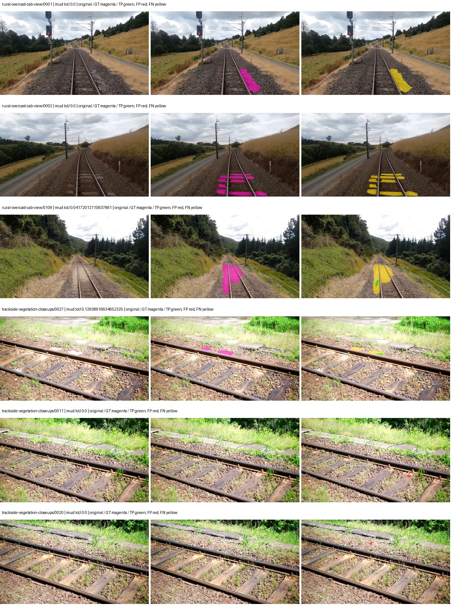
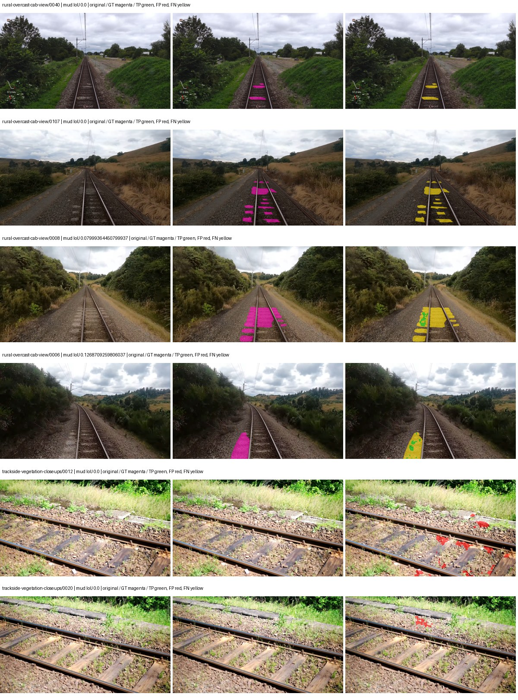
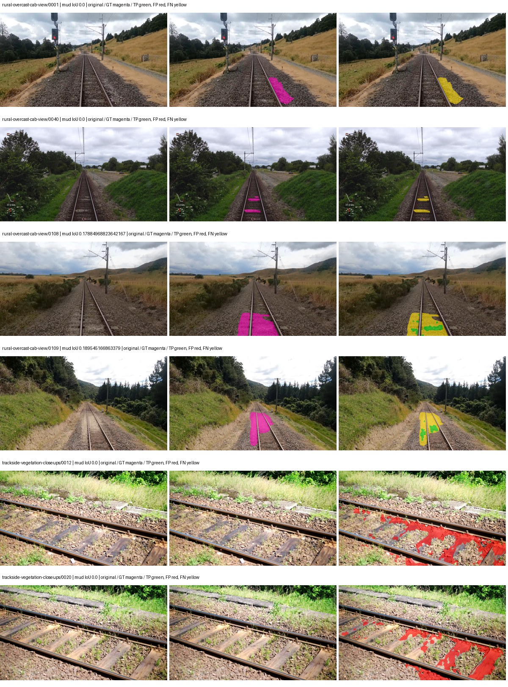
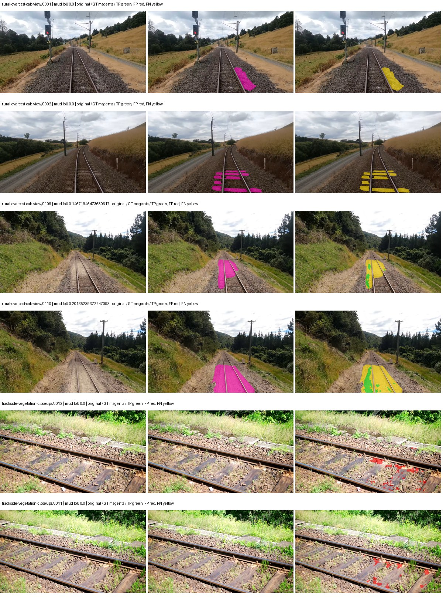

# native_resnet50_fpn_ocr — rad_9_24_2026-fixed-grouped

[RAD 9/24: Scene-grouped split](../../README.md) · [Full model records](record.json)

Primary result: the **final checkpoint** after the full step budget (no early stopping). The checkpoint with the best **mud-pumping validation IoU, pixels pooled over all validation images**, is kept as secondary evidence. A job is complete only after full statistics and isolated profiling are verified.

Study metrics of the final checkpoint, counting each class only on the validation images that contain it: mud-pumping IoU is the mean per-image IoU over the images with mud-pumping, precision and recall sum pixels over those images, and mIoU averages each class over the images that contain it, then over the classes present.

| Initialization path | Seed | Mud-pumping IoU, train-camera images with mud (%, n=17) | Mud-pumping IoU, all images with mud (%, n=18) | Mud precision, all images with mud (%) | Mud recall, all images with mud (%) | mIoU (each class over images that contain it) (%) |
| --- | --- | --- | --- | --- | --- | --- |
| rtis_only | 0 | 0.06 | 1.77 | 46.88 | 0.56 | 34.09 |
| cityscapes_to_rtis | 0 | 0.30 | 1.03 | 83.15 | 0.43 | 36.77 |
| railsem19_to_rtis | 0 | 0.47 | 0.45 | 96.46 | 0.47 | 42.48 |
| cityscapes_to_railsem19_to_rtis | 0 | 2.60 | 3.85 | 82.22 | 4.07 | 41.57 |

Per-class IoU: IoU (%) of every class, each averaged only over the validation images that contain the class (n = those images); — = no image contains it. mIoU averages the classes with at least one such image.

| Initialization path | Seed | mIoU (each class over images that contain it) | person (n=0) | truck (n=0) | rail-track (n=37) | vegetation-overgrowth (n=13) | car (n=3) | on-rails (n=0) | traffic-sign (n=9) | road (n=11) | sidewalk (n=12) | construction (n=12) | tram-track (n=2) | pole (n=21) | traffic-light (n=3) | mud-pumping (n=18) | fence (n=7) | terrain (n=35) | sky (n=28) | rail-embedded (n=3) | rail-raised (n=37) | trackbed (n=37) | standing-water (n=9) |
| --- | --- | --- | --- | --- | --- | --- | --- | --- | --- | --- | --- | --- | --- | --- | --- | --- | --- | --- | --- | --- | --- | --- | --- |
| rtis_only | 0 | 34.09 | — | — | 52.50 | 35.18 | 6.35 | — | 20.19 | 16.63 | 11.50 | 35.14 | 0.02 | 66.62 | 40.70 | 1.77 | 11.94 | 83.07 | 94.02 | 7.79 | 72.44 | 56.80 | 0.91 |
| cityscapes_to_rtis | 0 | 36.77 | — | — | 49.36 | 25.22 | 20.86 | — | 26.54 | 17.27 | 15.16 | 35.18 | 16.35 | 67.87 | 44.71 | 1.03 | 18.09 | 83.23 | 94.61 | 12.78 | 69.91 | 61.23 | 2.45 |
| railsem19_to_rtis | 0 | 42.48 | — | — | 60.16 | 42.38 | 29.50 | — | 45.50 | 15.86 | 17.07 | 53.34 | 26.22 | 68.76 | 37.47 | 0.45 | 19.73 | 86.35 | 95.73 | 29.04 | 73.29 | 63.53 | 0.21 |
| cityscapes_to_railsem19_to_rtis | 0 | 41.57 | — | — | 55.22 | 36.98 | 24.23 | — | 44.55 | 20.77 | 16.19 | 44.07 | 23.97 | 70.22 | 49.27 | 3.85 | 19.40 | 85.33 | 95.80 | 24.31 | 69.82 | 64.33 | 0.00 |

Everything below is the campaign's own record, with pixels pooled over all validation images: its evaluation is the checkpoint that scored best on that pooled mud IoU (secondary evidence here); the diagnostics also cover the final checkpoint (`final-auto-val`).

| Model | Initialization path | Seed | Status | Steps | Best step | Best-checkpoint mud IoU, pixels pooled (%) | Best-checkpoint mud precision, pixels pooled (%) | Best-checkpoint mud recall, pixels pooled (%) | Final mud IoU (trainer val, pixels pooled, %) | Best-checkpoint mIoU, pixels pooled (%) | Best-checkpoint fixed GT-class mIoU, pixels pooled (%) |
| --- | --- | --- | --- | --- | --- | --- | --- | --- | --- | --- | --- |
| native_resnet50_fpn_ocr | rtis_only | 0 | completed | 4000 | 2074 | 0.88 | 70.10 | 0.88 | 0.56 | 31.55 | 36.80 |
| native_resnet50_fpn_ocr | cityscapes_to_rtis | 0 | completed | 4000 | 1296 | 2.53 | 34.65 | 2.65 | 0.35 | 29.36 | 34.25 |
| native_resnet50_fpn_ocr | railsem19_to_rtis | 0 | completed | 4000 | 518 | 4.42 | 10.01 | 7.32 | 0.45 | 35.53 | 41.45 |
| native_resnet50_fpn_ocr | cityscapes_to_railsem19_to_rtis | 0 | completed | 4000 | 2851 | 4.60 | 26.09 | 5.28 | 3.86 | 38.60 | 45.03 |

Training: 217 images. Validation: 37 images. Test: 60 held out. Seeds: [0]. Seed variation measures optimization variability, not independent-recording uncertainty. Historical source checkpoints stay fixed across adaptation seeds.

Training code: `fce0ea0ac50b334d4252812c396e0e593def375d`. Split SHA-256: `12d7b367c72cda61d57686ff2ac28223530d0af49debd9fb7a0fbc68b908bc93`.

## rtis_only — seed 0

Status: **completed**. Started: 2026-10-11T10:14:50.992296+00:00. Finished: 2026-10-11T11:41:27.880749+00:00.

Recipe pretrained initializer: `{"arch": "native", "backbone_path": null, "batch_norm_momentum": null, "checkpoint": null, "classifier_path": null, "drop_path": null, "encoder_name": null, "encoder_weights": null, "head": "unified_head", "head_paths": [], "inactive_parameter_paths": [], "local_files_only": false, "lora_alpha": 32, "lora_dropout": 0.05, "lora_r": 16, "lora_targets": [], "native": {"auxiliary_heads": [], "backbone": {"in_channels": 3, "kind": "timm", "name": "resnet50.a1_in1k", "out_indices": [1, 2, 3, 4], "weights": "pretrained"}, "head": {"activation": "relu", "attention_scale": 1, "channels": 512, "coarse_loss_weight": 0.4, "dropout": 0.05, "in_indices": [0, 1, 2, 3], "key_channels": 256, "kind": "ocr", "norm": "group"}, "neck": {"activation": "relu", "kind": "fpn", "norm": "group", "num_outputs": 4, "out_channels": 256}, "task": "multiclass"}, "revision": null, "smp_arch": null, "subfolder": null, "trust_remote_code": false, "tuning": "full"}`.

`rtis_only` uses the recipe initializer, which may include pretrained segmentation components. Transfer paths load the exact historical source checkpoint below and reset the classifier; they do not reset all query/decoder features.

Source checkpoint: `Recipe pretrained initialization`.

Config SHA-256: `32085e6ce4e6bfb166a43a3da4574f9e6ffe85d4a2ff4ae1d9c2affc597217ba`. Weights used for validation: `raw`.

### Mud-pumping and aggregate quality

| Metric | Selected checkpoint | Final training validation |
| --- | --- | --- |
| Mud IoU | 0.88 | 0.56 |
| Mud precision | 70.10 | 27.85 |
| Mud recall | 0.88 | 0.56 |
| Mud Dice/F1 | 1.74 | 1.11 |
| mIoU | 31.55 | 30.54 |
| Mean accuracy | 46.95 | 42.76 |
| Mean precision | 50.36 | 49.18 |
| Mean Dice | 40.16 | 39.00 |
| Mean specificity | 98.98 | 98.96 |
| Pixel accuracy | 82.80 | 83.41 |
| Frequency-weighted IoU | 73.48 | 73.86 |
| Fixed GT-present class mIoU | 36.80 | 35.63 |
| Boundary F1 | 35.44 | 36.81 |

The selected checkpoint has independent evaluation evidence. Final values are the trainer's final validation record, not a new independent evaluation. mIoU averages classes with nonzero union, so false positives on absent classes can change its denominator. The fixed GT-class mean is supplementary and excludes absent classes; their false positives remain in the confusion matrix.

### Resource usage and timing

| Measurement | Value |
| --- | --- |
| Peak training VRAM, retained training invocation (GiB) | 11.64 |
| Peak evaluation VRAM (GiB) | 7.02 |
| Retained training invocation wall time (seconds) | 4998.53 |
| Retained training invocation GPU-hours (one GPU) | 1.39 |
| Evaluation wall time (seconds) | 16.90 |
| Full evaluation pipeline images/second | 2.19 |
| Best full-state checkpoint (MiB) | 498.97 |
| Final full-state checkpoint (MiB) | 498.96 |
| Verified periodic checkpoints removed (GiB) | 3.90 |

VRAM uses the recorded allocator high-water mark; it is not total device usage including CUDA context. Resumed jobs' retained training invocation times and peaks are **not whole-campaign totals**. Earlier invocation resource records are not reconstructed here. Evaluation throughput includes loader, sliding-window inference and metrics; it is not model-only latency/FPS. Missing measurements are shown as —, never inferred from another dataset's run.

### Standardized inference performance

Dedicated model-only profiling waits for an idle worker-locked L40S: BF16, batch 1, 1024x1024, 20 warmup and 100 CUDA-event-timed public forwards. It excludes loading, preprocessing, tiling and metrics.

| Status | Parameters | Weight MiB | FPS | p50 ms | p95 ms | Peak reserved GiB |
| --- | --- | --- | --- | --- | --- | --- |
| complete | 32646762 | 124.54 | 47.85 | 20.78 | 21.55 | 1.46 |

```json
{
  "schema_version": 1,
  "model_id": "native_resnet50_fpn_ocr",
  "measured_at": "2026-10-11T11:41:21+00:00",
  "status": "complete",
  "benchmark_scope": "rtis_selected_checkpoint_model_only",
  "applies_to": [
    "native_resnet50_fpn_ocr--rtis_only--seed-0"
  ],
  "source": {
    "campaign_git_sha": "fce0ea0ac50b334d4252812c396e0e593def375d",
    "git_dirty": false,
    "config_hash": "a970cdd8d6bf",
    "resolved_config": "/data/izadia1/projects/segmentary-runs/rad_9_24_2026/fgall-seed0-20261007/configs/native_resnet50_fpn_ocr--rtis_only--seed-0.yaml",
    "config_sha256": "32085e6ce4e6bfb166a43a3da4574f9e6ffe85d4a2ff4ae1d9c2affc597217ba",
    "checkpoint_sha256": "09c46053684e9864f9c9028fffbdb14150e838aabc78bbe0c82034543c354ee6",
    "checkpoint_global_step": 2074,
    "checkpoint_bytes": 523206954,
    "checkpoint_kind": "resume checkpoint with optimizer and EMA state",
    "weights": "raw",
    "measured_checkpoint_job_id": "native_resnet50_fpn_ocr--rtis_only--seed-0",
    "result_sha256": "7dc1a1b6050321fd033e45f6235e6ce0f70c78473cd6c0a6b214bdfc4ff64a1f",
    "result_git_sha": "fce0ea0ac50b334d4252812c396e0e593def375d",
    "result_stage": "eval:rad_9_24_2026-fixed-grouped:val",
    "result_seed": 0
  },
  "hardware": {
    "gpu_name": "NVIDIA L40S",
    "gpu_uuid": "GPU-e2e96741-aec9-e90b-5c46-d0d58be90a56",
    "logical_device": "cuda:0",
    "physical_visibility_token": "8",
    "compute_capability": [
      8,
      9
    ],
    "total_memory_bytes": 47677177856
  },
  "model": {
    "parameter_count": 32646762,
    "trainable_parameter_count": 32646762,
    "resident_parameter_bytes": 130587048,
    "parameter_dtype_counts": {
      "float32": 32646762
    }
  },
  "contract": {
    "backend": "pytorch",
    "precision": "bf16_autocast",
    "batch_size": 1,
    "input_shape_nchw": [
      1,
      3,
      1024,
      1024
    ],
    "warmup_iterations": 20,
    "measured_iterations": 100,
    "timing": "per-forward CUDA events with end-event synchronization",
    "includes_preprocessing": false,
    "includes_data_loader": false,
    "includes_sliding_window": false,
    "input_resident_on_gpu": true,
    "model_only": true,
    "entrypoint": "public model(image) dense-logits forward"
  },
  "measurements": {
    "latency": {
      "p50_ms": 20.775424003601074,
      "p95_ms": 21.552332210540772,
      "mean_ms": 20.897474784851074,
      "minimum_ms": 20.511743545532227,
      "maximum_ms": 21.997568130493164,
      "fps": 47.852671688586824,
      "raw_ms": [
        21.098495483398438,
        21.28998374938965,
        20.750335693359375,
        20.8220157623291,
        21.146623611450195,
        20.587520599365234,
        20.533248901367188,
        20.545536041259766,
        20.805631637573242,
        20.534303665161133,
        21.126144409179688,
        20.87014389038086,
        20.549631118774414,
        20.574207305908203,
        20.550655364990234,
        20.560895919799805,
        21.23468780517578,
        21.997568130493164,
        20.61516761779785,
        20.55174446105957,
        21.184511184692383,
        20.65920066833496,
        20.773887634277344,
        20.744192123413086,
        20.551679611206055,
        21.09542465209961,
        20.66227149963379,
        20.594688415527344,
        20.770816802978516,
        20.676576614379883,
        20.940799713134766,
        21.85318374633789,
        21.122047424316406,
        21.20806312561035,
        21.743616104125977,
        20.84351921081543,
        20.534271240234375,
        21.195775985717773,
        21.48863983154297,
        20.570112228393555,
        20.618240356445312,
        20.65715217590332,
        20.973567962646484,
        20.511743545532227,
        21.106687545776367,
        21.108736038208008,
        20.563968658447266,
        21.146623611450195,
        21.550079345703125,
        20.525056838989258,
        21.186559677124023,
        21.136383056640625,
        20.555776596069336,
        20.570112228393555,
        21.116928100585938,
        21.595136642456055,
        21.172224044799805,
        20.65407943725586,
        20.590591430664062,
        21.126144409179688,
        20.65510368347168,
        20.776960372924805,
        21.838848114013672,
        20.546560287475586,
        20.551679611206055,
        20.797439575195312,
        21.11078453063965,
        20.577280044555664,
        21.002239227294922,
        21.5316162109375,
        20.584447860717773,
        20.745216369628906,
        21.07494354248047,
        20.606975555419922,
        21.236736297607422,
        20.69811248779297,
        20.590591430664062,
        21.09235191345215,
        20.594688415527344,
        20.555776596069336,
        20.569087982177734,
        21.44767951965332,
        21.091327667236328,
        20.571136474609375,
        21.427200317382812,
        21.180416107177734,
        20.6080322265625,
        20.581375122070312,
        21.186559677124023,
        20.8855037689209,
        21.129215240478516,
        21.146623611450195,
        20.67862319946289,
        20.583423614501953,
        21.04422378540039,
        20.81996726989746,
        20.705280303955078,
        21.26131248474121,
        20.6376953125,
        20.600831985473633
      ],
      "percentile_method": "numpy linear interpolation"
    },
    "peak_reserved_bytes": 1562378240,
    "memory_kind": "pytorch_cuda_allocator_peak_reserved_excluding_context",
    "process_total_bytes": 2099249152,
    "process_total_kind": "nvidia-smi used_memory of this PID on the benchmark GPU after the timed loop, including the CUDA context; null when the driver could not attribute memory to this PID",
    "benchmark_wall_clock_s": 15.378468424081802
  },
  "started_at": "2026-10-11T11:41:06+00:00",
  "finished_at": "2026-10-11T11:41:21+00:00",
  "environment": {
    "hostname": "hdrfs-app-001",
    "python": "3.11.15",
    "platform": "Linux-5.15.0-139-generic-x86_64-with-glibc2.35",
    "torch": "2.11.0+cu128",
    "torch_cuda": "12.8",
    "cudnn": 91900,
    "driver_version": "570.133.20",
    "cuda_available": true,
    "gpu_count": 1,
    "gpu_names": [
      "NVIDIA L40S"
    ],
    "cuda_visible_devices": "8",
    "packages": {
      "segmentary": "0.1.0",
      "torch": "2.11.0+cu128",
      "torchvision": "0.26.0+cu128",
      "transformers": "5.15.0",
      "timm": "1.0.28",
      "segmentation-models-pytorch": "0.5.0",
      "albumentations": "2.0.8",
      "lightning": "2.6.5",
      "numpy": "2.4.4"
    }
  }
}
```

### Per-class validation results

| Class | GT pixels | IoU (%) | Precision (%) | Recall (%) | Dice (%) | Boundary F1 (%) |
| --- | --- | --- | --- | --- | --- | --- |
| car | 29664 | 0.00 | 0.00 | 0.00 | 0.00 | 0.00 |
| construction | 311585 | 34.34 | 38.62 | 75.61 | 51.13 | 36.87 |
| fence | 265137 | 8.03 | 14.87 | 14.85 | 14.86 | 15.46 |
| mud-pumping | 1226250 | 0.88 | 70.10 | 0.88 | 1.74 | 3.04 |
| on-rails | 0 | 0.00 | 0.00 | — | 0.00 | 0.00 |
| person | 0 | 0.00 | 0.00 | — | 0.00 | 0.00 |
| pole | 628038 | 64.67 | 77.72 | 79.39 | 78.54 | 86.37 |
| rail-embedded | 16799 | 6.02 | 92.79 | 6.05 | 11.36 | 8.41 |
| rail-raised | 2969797 | 73.71 | 80.61 | 89.59 | 84.87 | 87.67 |
| rail-track | 6323197 | 35.26 | 58.38 | 47.10 | 52.14 | 52.40 |
| road | 1048831 | 24.19 | 44.97 | 34.37 | 38.96 | 26.75 |
| sidewalk | 1297367 | 32.72 | 76.25 | 36.43 | 49.30 | 15.70 |
| sky | 19121606 | 95.76 | 98.87 | 96.82 | 97.83 | 83.14 |
| standing-water | 95802 | 5.67 | 7.20 | 21.05 | 10.73 | 11.13 |
| terrain | 39239306 | 85.95 | 91.31 | 93.61 | 92.44 | 57.50 |
| trackbed | 10643081 | 49.77 | 60.02 | 74.46 | 66.46 | 48.79 |
| traffic-light | 19510 | 67.23 | 84.13 | 76.99 | 80.40 | 78.70 |
| traffic-sign | 13285 | 34.77 | 72.26 | 40.12 | 51.59 | 63.88 |
| tram-track | 56179 | 0.28 | 25.98 | 0.28 | 0.56 | 7.33 |
| truck | 0 | 0.00 | 0.00 | — | 0.00 | 0.00 |
| vegetation-overgrowth | 5901821 | 43.24 | 63.60 | 57.47 | 60.38 | 61.13 |

### Full-run accounting

| Measurement | Value |
| --- | --- |
| Full GPU-reserved wall seconds, all recorded worker attempts | 5204.58 |
| Full reserved GPU-hours | 1.45 |
| Whole-run timing complete | True |

| Phase | Wall seconds including failed attempts |
| --- | --- |
| training | 5005.79 |
| diagnostics | 137.55 |
| performance | 23.49 |

GPU-reserved time includes model loading, training, validation, collection, profiling, checkpoint I/O and orchestration while the worker owns one GPU. It is not GPU kernel-active time. Phase timings and sampled device memory/power/utilization are retained separately; sampled device memory is not the allocator high-water mark.

### Train/validation and raw/EMA diagnostics

| Checkpoint / weights / split | Images | Mud IoU (%) | Mud precision (%) | Mud recall (%) |
| --- | --- | --- | --- | --- |
| best-auto-train / raw | 217 | 92.78 | 96.42 | 96.09 |
| best-auto-val / raw | 37 | 0.88 | 70.10 | 0.88 |
| best-alternate-val / ema | 37 | 0.49 | 20.29 | 0.50 |
| final-auto-val / raw | 37 | 0.56 | 27.61 | 0.56 |

Train uses the evaluation transform without augmentation. Compare mud train/validation metrics for the same selected weights. Alternate EMA on running-stat BatchNorm is explicitly uncalibrated and is diagnostic only. Score-threshold curves use uncalibrated normalized scores and are pixel-level diagnostics, not event detection rates or a selected deployment operating point.

### Downloadable evidence

- best-auto-train: [per-image.csv](rtis_only--seed-0/best-auto-train/per-image.csv) · [per-image-confusion.json.gz](rtis_only--seed-0/best-auto-train/per-image-confusion.json.gz) · [groups.json](rtis_only--seed-0/best-auto-train/groups.json) · [mud-score-curves.json](rtis_only--seed-0/best-auto-train/mud-score-curves.json)
- best-auto-val: [per-image.csv](rtis_only--seed-0/best-auto-val/per-image.csv) · [per-image-confusion.json.gz](rtis_only--seed-0/best-auto-val/per-image-confusion.json.gz) · [groups.json](rtis_only--seed-0/best-auto-val/groups.json) · [mud-score-curves.json](rtis_only--seed-0/best-auto-val/mud-score-curves.json) · [examples.jpg](rtis_only--seed-0/best-auto-val/examples.jpg)
- best-alternate-val: [per-image.csv](rtis_only--seed-0/best-alternate-val/per-image.csv) · [per-image-confusion.json.gz](rtis_only--seed-0/best-alternate-val/per-image-confusion.json.gz) · [groups.json](rtis_only--seed-0/best-alternate-val/groups.json) · [mud-score-curves.json](rtis_only--seed-0/best-alternate-val/mud-score-curves.json)
- final-auto-val: [per-image.csv](rtis_only--seed-0/final-auto-val/per-image.csv) · [per-image-confusion.json.gz](rtis_only--seed-0/final-auto-val/per-image-confusion.json.gz) · [groups.json](rtis_only--seed-0/final-auto-val/groups.json) · [mud-score-curves.json](rtis_only--seed-0/final-auto-val/mud-score-curves.json)
- resources: [telemetry.csv](rtis_only--seed-0/resources/telemetry.csv)



Examples are two lowest and two highest mud-IoU positive images, plus up to two negative images with the most false-positive mud pixels. They are targeted diagnostic examples, not random samples. Green: true positive; red: false positive; yellow: false negative. Full predictions remain on HDRFS.

### Validation tracking

| Logged step | Overall mIoU (%) | Mud IoU (%) |
| --- | --- | --- |
| 258 | 17.72 | 0.36 |
| 518 | 19.32 | 0.29 |
| 777 | 21.24 | 0.80 |
| 1036 | 22.04 | 0.18 |
| 1295 | 25.31 | 0.18 |
| 1555 | 27.80 | 0.33 |
| 1814 | 29.74 | 0.36 |
| 2073 | 31.54 | 0.88 |
| 2332 | 27.04 | 0.43 |
| 2592 | 30.77 | 0.71 |
| 2851 | 29.21 | 0.38 |
| 3110 | 29.71 | 0.44 |
| 3369 | 30.70 | 0.65 |
| 3629 | 30.30 | 0.50 |
| 3888 | 30.62 | 0.59 |
| 4000 | 30.54 | 0.56 |

All retained scalar curves, including training loss and per-class IoU, are in record.json. Observed best mud on a curve is not necessarily a retained checkpoint: the pilot saved its selection-metric-best and final checkpoints. Step logging and checkpoint global_step may differ by one.

### Stopping and checkpoint provenance

```json
{
  "stopping": {
    "actual_steps": 4000,
    "maximum_steps": 4000,
    "min_delta": 0.0,
    "monitor": "val_iou/mud-pumping",
    "patience": null,
    "reason": "budget_complete"
  },
  "checkpoints": {
    "best": {
      "path": "/data/izadia1/projects/segmentary-runs/rad_9_24_2026/fgall-seed0-20261007/future-runs/native_resnet50_fpn_ocr--rtis_only--seed-0_seed0/rtis/best.ckpt",
      "sha256": "09c46053684e9864f9c9028fffbdb14150e838aabc78bbe0c82034543c354ee6",
      "global_step": 2074,
      "bytes": 523206954
    },
    "final": {
      "path": "/data/izadia1/projects/segmentary-runs/rad_9_24_2026/fgall-seed0-20261007/future-runs/native_resnet50_fpn_ocr--rtis_only--seed-0_seed0/rtis/last.ckpt",
      "sha256": "b9a3cbdc7e951591138d6b922b22ed6c361d37755ae6dc7bd9abd05a9f9f17a3",
      "global_step": 4000,
      "bytes": 523194602
    }
  },
  "cleanup_error": null
}
```

### Resolved training, initialization and evaluation settings

The optimizer block is the base configuration. Stage LR scales are applied at runtime, and stage warmup is capped at min(base warmup, floor(stage budget / 10), stage budget - 1): 400 steps for this 4,000-step pilot. Model-internal native input grids may differ from augmentation crops (EoMT uses its 640 grid).

```json
{
  "name": "native_resnet50_fpn_ocr--rtis_only--seed-0",
  "model": {
    "arch": "native",
    "checkpoint": null,
    "tuning": "full",
    "head": "unified_head",
    "lora_r": 16,
    "lora_alpha": 32,
    "lora_dropout": 0.05,
    "lora_targets": [],
    "drop_path": null,
    "revision": null,
    "subfolder": null,
    "local_files_only": false,
    "trust_remote_code": false,
    "backbone_path": null,
    "head_paths": [],
    "classifier_path": null,
    "inactive_parameter_paths": [],
    "smp_arch": null,
    "encoder_name": null,
    "encoder_weights": null,
    "native": {
      "task": "multiclass",
      "backbone": {
        "kind": "timm",
        "name": "resnet50.a1_in1k",
        "weights": "pretrained",
        "out_indices": [
          1,
          2,
          3,
          4
        ],
        "in_channels": 3
      },
      "neck": {
        "kind": "fpn",
        "out_channels": 256,
        "num_outputs": 4,
        "norm": "group",
        "activation": "relu"
      },
      "head": {
        "kind": "ocr",
        "in_indices": [
          0,
          1,
          2,
          3
        ],
        "channels": 512,
        "key_channels": 256,
        "attention_scale": 1,
        "dropout": 0.05,
        "coarse_loss_weight": 0.4,
        "norm": "group",
        "activation": "relu"
      },
      "auxiliary_heads": []
    },
    "batch_norm_momentum": null
  },
  "space": "paul-test-rtis",
  "taxonomy_root": "/data/izadia1/projects/segmentary-rad-fgall-fce0ea0a/taxonomy",
  "output_root": "/data/izadia1/projects/segmentary-runs/rad_9_24_2026/fgall-seed0-20261007/future-runs",
  "optim": {
    "backbone_lr": 0.0001,
    "head_lr_mult": 10.0,
    "weight_decay": 0.05,
    "llrd": 1.0,
    "warmup_iters": 1500,
    "warmup_ratio": 1e-06,
    "poly_power": 0.9,
    "min_lr_ratio": 0.0,
    "betas": [
      0.9,
      0.999
    ],
    "grad_clip": 1.0
  },
  "train": {
    "iters": 4000,
    "batch_size": 2,
    "accum": 8,
    "num_workers": 2,
    "precision": "bf16-mixed",
    "ema_decay": 0.9998,
    "val_every": 250,
    "ckpt_every": 500,
    "selection_metric": "val_iou/mud-pumping",
    "early_stopping_patience": null,
    "early_stopping_min_delta": 0.0,
    "seed": 0,
    "devices": 1
  },
  "eval": {
    "sliding_window": true,
    "window": [
      1024,
      1024
    ],
    "stride": [
      768,
      768
    ],
    "batch_size": 1,
    "num_workers": 2,
    "tta_scales": [],
    "tta_flip": false,
    "threshold": 0.5,
    "boundary_tolerance_frac": 0.0075,
    "save_confusion": true
  },
  "loss": {
    "task": "multiclass",
    "activation": "auto",
    "terms": [],
    "aux": "none",
    "aux_weight": 0.0,
    "ce_weight": 1.0,
    "label_smoothing": 0.0,
    "class_weights": null,
    "query": null
  },
  "aug": {
    "crop": [
      1024,
      1024
    ],
    "scale_min": 0.5,
    "scale_max": 2.0,
    "hflip_p": 0.5,
    "color_jitter_p": 0.5,
    "brightness": 0.25,
    "contrast": 0.25,
    "saturation": 0.25,
    "hue": 0.05
  },
  "stages": [
    {
      "name": "rtis",
      "data": [
        {
          "name": "rad_9_24_2026-fixed-grouped",
          "root": "/data/izadia1/datasets/rad_9_24_2026-fixed-grouped",
          "variant": null,
          "split_file": "splits.json",
          "train_split": "train",
          "val_split": "val",
          "limit": null,
          "loader": "folder",
          "mapping": "paul-test-rtis",
          "loader_options": {
            "require_groups": true
          }
        }
      ],
      "iters": null,
      "lr_scale": 1.0,
      "head_group_lr_scale": 1.0,
      "init_from": "pretrained",
      "reset_head": false,
      "freeze": null,
      "sample_weights": null
    }
  ]
}
```

### Hardware and software provenance

```json
{
  "training": {
    "cuda_available": true,
    "cuda_visible_devices": "8",
    "cudnn": 91900,
    "driver_version": "570.133.20",
    "gpu_count": 1,
    "gpu_names": [
      "NVIDIA L40S"
    ],
    "hostname": "hdrfs-app-001",
    "input_normalization": {
      "channel_order": "rgb",
      "mean": [
        0.485,
        0.456,
        0.406
      ],
      "source": "timm_pretrained_cfg",
      "std": [
        0.229,
        0.224,
        0.225
      ]
    },
    "model_origins": [
      {
        "hf_commit": null,
        "hf_name_or_path": null,
        "module": "backbone",
        "timm_pretrained": {
          "architecture": "resnet50",
          "hf_hub_id": "timm/resnet50.a1_in1k",
          "tag": "a1_in1k",
          "url": "https://github.com/rwightman/pytorch-image-models/releases/download/v0.1-rsb-weights/resnet50_a1_0-14fe96d1.pth"
        }
      },
      {
        "hf_commit": null,
        "hf_name_or_path": null,
        "module": "backbone.model",
        "timm_pretrained": {
          "architecture": "resnet50",
          "hf_hub_id": "timm/resnet50.a1_in1k",
          "tag": "a1_in1k",
          "url": "https://github.com/rwightman/pytorch-image-models/releases/download/v0.1-rsb-weights/resnet50_a1_0-14fe96d1.pth"
        }
      }
    ],
    "model_parameter_count": 32646762,
    "packages": {
      "albumentations": "2.0.8",
      "lightning": "2.6.5",
      "numpy": "2.4.4",
      "segmentary": "0.1.0",
      "segmentation-models-pytorch": "0.5.0",
      "timm": "1.0.28",
      "torch": "2.11.0+cu128",
      "torchvision": "0.26.0+cu128",
      "transformers": "5.15.0"
    },
    "platform": "Linux-5.15.0-139-generic-x86_64-with-glibc2.35",
    "python": "3.11.15",
    "torch": "2.11.0+cu128",
    "torch_cuda": "12.8",
    "trainable_parameter_count": 32646762,
    "training_stop": {
      "actual_steps": 4000,
      "maximum_steps": 4000,
      "min_delta": 0.0,
      "monitor": "val_iou/mud-pumping",
      "patience": null,
      "reason": "budget_complete"
    },
    "validation_weights": "raw"
  },
  "evaluation": {
    "cuda_available": true,
    "cuda_visible_devices": "8",
    "cudnn": 91900,
    "driver_version": "570.133.20",
    "gpu_count": 1,
    "gpu_names": [
      "NVIDIA L40S"
    ],
    "hostname": "hdrfs-app-001",
    "input_normalization": {
      "channel_order": "rgb",
      "mean": [
        0.485,
        0.456,
        0.406
      ],
      "source": "timm_pretrained_cfg",
      "std": [
        0.229,
        0.224,
        0.225
      ]
    },
    "packages": {
      "albumentations": "2.0.8",
      "lightning": "2.6.5",
      "numpy": "2.4.4",
      "segmentary": "0.1.0",
      "segmentation-models-pytorch": "0.5.0",
      "timm": "1.0.28",
      "torch": "2.11.0+cu128",
      "torchvision": "0.26.0+cu128",
      "transformers": "5.15.0"
    },
    "platform": "Linux-5.15.0-139-generic-x86_64-with-glibc2.35",
    "python": "3.11.15",
    "torch": "2.11.0+cu128",
    "torch_cuda": "12.8"
  }
}
```

## cityscapes_to_rtis — seed 0

Status: **completed**. Started: 2026-10-11T10:15:05.309914+00:00. Finished: 2026-10-11T11:41:50.165268+00:00.

Recipe pretrained initializer: `{"arch": "native", "backbone_path": null, "batch_norm_momentum": null, "checkpoint": null, "classifier_path": null, "drop_path": null, "encoder_name": null, "encoder_weights": null, "head": "unified_head", "head_paths": [], "inactive_parameter_paths": [], "local_files_only": false, "lora_alpha": 32, "lora_dropout": 0.05, "lora_r": 16, "lora_targets": [], "native": {"auxiliary_heads": [], "backbone": {"in_channels": 3, "kind": "timm", "name": "resnet50.a1_in1k", "out_indices": [1, 2, 3, 4], "weights": "pretrained"}, "head": {"activation": "relu", "attention_scale": 1, "channels": 512, "coarse_loss_weight": 0.4, "dropout": 0.05, "in_indices": [0, 1, 2, 3], "key_channels": 256, "kind": "ocr", "norm": "group"}, "neck": {"activation": "relu", "kind": "fpn", "norm": "group", "num_outputs": 4, "out_channels": 256}, "task": "multiclass"}, "revision": null, "smp_arch": null, "subfolder": null, "trust_remote_code": false, "tuning": "full"}`.

`rtis_only` uses the recipe initializer, which may include pretrained segmentation components. Transfer paths load the exact historical source checkpoint below and reset the classifier; they do not reset all query/decoder features.

Source checkpoint: `{'name': 'native_resnet50_fpn_ocr--cityscapes--seed-0', 'model': 'native_resnet50_fpn_ocr', 'protocol': 'cityscapes', 'config': '/data/izadia1/projects/segmentary-runs/all-model-city-rail-seed0-rail20-b9eb3e1/accepted/native_resnet50_fpn_ocr--cityscapes--seed-0/resolved-config.yaml', 'checkpoint': '/data/izadia1/projects/segmentary-runs/all-model-city-rail-seed0-a7c0b67/jobs/native_resnet50_fpn_ocr--cityscapes--seed-0/attempt-001/train/native_resnet50_fpn_ocr--cityscapes_seed0/cityscapes/last.ckpt', 'recorded_sha256': 'b83bf800493df55699f2f3c17f3d1c8c0acfeab2e1929da870d845b8805a0244', 'exists': True}`.

Config SHA-256: `5b3d5c59b1cb8773ad11c2c4407f9ab98fa90e31aea92bc8485ebded6af81305`. Weights used for validation: `raw`.

### Mud-pumping and aggregate quality

| Metric | Selected checkpoint | Final training validation |
| --- | --- | --- |
| Mud IoU | 2.53 | 0.35 |
| Mud precision | 34.65 | 1.82 |
| Mud recall | 2.65 | 0.42 |
| Mud Dice/F1 | 4.93 | 0.69 |
| mIoU | 29.36 | 35.40 |
| Mean accuracy | 43.76 | 50.33 |
| Mean precision | 53.83 | 54.57 |
| Mean Dice | 37.66 | 45.51 |
| Mean specificity | 98.62 | 98.96 |
| Pixel accuracy | 79.07 | 83.76 |
| Frequency-weighted IoU | 68.58 | 73.72 |
| Fixed GT-present class mIoU | 34.25 | 41.30 |
| Boundary F1 | 36.68 | 41.67 |

The selected checkpoint has independent evaluation evidence. Final values are the trainer's final validation record, not a new independent evaluation. mIoU averages classes with nonzero union, so false positives on absent classes can change its denominator. The fixed GT-class mean is supplementary and excludes absent classes; their false positives remain in the confusion matrix.

### Resource usage and timing

| Measurement | Value |
| --- | --- |
| Peak training VRAM, retained training invocation (GiB) | 11.64 |
| Peak evaluation VRAM (GiB) | 7.02 |
| Retained training invocation wall time (seconds) | 5005.67 |
| Retained training invocation GPU-hours (one GPU) | 1.39 |
| Evaluation wall time (seconds) | 16.93 |
| Full evaluation pipeline images/second | 2.19 |
| Best full-state checkpoint (MiB) | 498.97 |
| Final full-state checkpoint (MiB) | 498.96 |
| Verified periodic checkpoints removed (GiB) | 3.90 |

VRAM uses the recorded allocator high-water mark; it is not total device usage including CUDA context. Resumed jobs' retained training invocation times and peaks are **not whole-campaign totals**. Earlier invocation resource records are not reconstructed here. Evaluation throughput includes loader, sliding-window inference and metrics; it is not model-only latency/FPS. Missing measurements are shown as —, never inferred from another dataset's run.

### Standardized inference performance

Dedicated model-only profiling waits for an idle worker-locked L40S: BF16, batch 1, 1024x1024, 20 warmup and 100 CUDA-event-timed public forwards. It excludes loading, preprocessing, tiling and metrics.

| Status | Parameters | Weight MiB | FPS | p50 ms | p95 ms | Peak reserved GiB |
| --- | --- | --- | --- | --- | --- | --- |
| complete | 32646762 | 124.54 | 47.95 | 20.77 | 21.29 | 1.46 |

```json
{
  "schema_version": 1,
  "model_id": "native_resnet50_fpn_ocr",
  "measured_at": "2026-10-11T11:41:44+00:00",
  "status": "complete",
  "benchmark_scope": "rtis_selected_checkpoint_model_only",
  "applies_to": [
    "native_resnet50_fpn_ocr--cityscapes_to_rtis--seed-0"
  ],
  "source": {
    "campaign_git_sha": "fce0ea0ac50b334d4252812c396e0e593def375d",
    "git_dirty": false,
    "config_hash": "1f09748698de",
    "resolved_config": "/data/izadia1/projects/segmentary-runs/rad_9_24_2026/fgall-seed0-20261007/configs/native_resnet50_fpn_ocr--cityscapes_to_rtis--seed-0.yaml",
    "config_sha256": "5b3d5c59b1cb8773ad11c2c4407f9ab98fa90e31aea92bc8485ebded6af81305",
    "checkpoint_sha256": "1967b6d5ca2470292cf003fb302196a8eb6f8bbf79b6f85ab477d095fa16ec6a",
    "checkpoint_global_step": 1296,
    "checkpoint_bytes": 523207018,
    "checkpoint_kind": "resume checkpoint with optimizer and EMA state",
    "weights": "raw",
    "measured_checkpoint_job_id": "native_resnet50_fpn_ocr--cityscapes_to_rtis--seed-0",
    "result_sha256": "911dccdbbd3c7070e5ef5f68f820a635c8bd43ac58179495e77e9824f0823cc0",
    "result_git_sha": "fce0ea0ac50b334d4252812c396e0e593def375d",
    "result_stage": "eval:rad_9_24_2026-fixed-grouped:val",
    "result_seed": 0
  },
  "hardware": {
    "gpu_name": "NVIDIA L40S",
    "gpu_uuid": "GPU-804aea8b-5f62-423e-72c6-49e1ed15c4e4",
    "logical_device": "cuda:0",
    "physical_visibility_token": "6",
    "compute_capability": [
      8,
      9
    ],
    "total_memory_bytes": 47677177856
  },
  "model": {
    "parameter_count": 32646762,
    "trainable_parameter_count": 32646762,
    "resident_parameter_bytes": 130587048,
    "parameter_dtype_counts": {
      "float32": 32646762
    }
  },
  "contract": {
    "backend": "pytorch",
    "precision": "bf16_autocast",
    "batch_size": 1,
    "input_shape_nchw": [
      1,
      3,
      1024,
      1024
    ],
    "warmup_iterations": 20,
    "measured_iterations": 100,
    "timing": "per-forward CUDA events with end-event synchronization",
    "includes_preprocessing": false,
    "includes_data_loader": false,
    "includes_sliding_window": false,
    "input_resident_on_gpu": true,
    "model_only": true,
    "entrypoint": "public model(image) dense-logits forward"
  },
  "measurements": {
    "latency": {
      "p50_ms": 20.774911880493164,
      "p95_ms": 21.287578201293947,
      "mean_ms": 20.85382080078125,
      "minimum_ms": 20.705280303955078,
      "maximum_ms": 21.65452766418457,
      "fps": 47.952843248875375,
      "raw_ms": [
        21.245952606201172,
        20.918272018432617,
        21.582847595214844,
        21.285888671875,
        21.170175552368164,
        20.927488327026367,
        20.758527755737305,
        20.755456924438477,
        21.20806312561035,
        20.86604881286621,
        20.777984619140625,
        21.24185562133789,
        21.013504028320312,
        20.728832244873047,
        21.136383056640625,
        21.65452766418457,
        20.920320510864258,
        21.2674560546875,
        20.754432678222656,
        20.744192123413086,
        20.797439575195312,
        20.705280303955078,
        20.733951568603516,
        20.752384185791016,
        20.736000061035156,
        20.740095138549805,
        20.785152435302734,
        20.753408432006836,
        20.724735260009766,
        20.759552001953125,
        20.712448120117188,
        20.756479263305664,
        20.747264862060547,
        20.775936126708984,
        20.774911880493164,
        20.808704376220703,
        20.754432678222656,
        20.749311447143555,
        20.747264862060547,
        21.399551391601562,
        20.767744064331055,
        20.780031204223633,
        20.937728881835938,
        20.781024932861328,
        20.776960372924805,
        20.754432678222656,
        21.0196475982666,
        20.752384185791016,
        20.875263214111328,
        20.716543197631836,
        20.805631637573242,
        20.774911880493164,
        20.758527755737305,
        21.128192901611328,
        20.765695571899414,
        20.760576248168945,
        20.740095138549805,
        20.749311447143555,
        20.8035831451416,
        20.748287200927734,
        20.87014389038086,
        20.764671325683594,
        20.788223266601562,
        20.912128448486328,
        20.777984619140625,
        20.765695571899414,
        20.776960372924805,
        21.319679260253906,
        20.728832244873047,
        20.814847946166992,
        20.70732879638672,
        20.720640182495117,
        20.766719818115234,
        20.784128189086914,
        20.736000061035156,
        20.754432678222656,
        20.756479263305664,
        20.742143630981445,
        20.777984619140625,
        20.834304809570312,
        20.769792556762695,
        20.742143630981445,
        20.780000686645508,
        20.762624740600586,
        20.797439575195312,
        20.754432678222656,
        20.81177520751953,
        20.782079696655273,
        20.748287200927734,
        20.776960372924805,
        21.351423263549805,
        20.794368743896484,
        20.750335693359375,
        21.163007736206055,
        20.831199645996094,
        20.752384185791016,
        20.751392364501953,
        20.774911880493164,
        20.766719818115234,
        20.752384185791016
      ],
      "percentile_method": "numpy linear interpolation"
    },
    "peak_reserved_bytes": 1562378240,
    "memory_kind": "pytorch_cuda_allocator_peak_reserved_excluding_context",
    "process_total_bytes": 2099249152,
    "process_total_kind": "nvidia-smi used_memory of this PID on the benchmark GPU after the timed loop, including the CUDA context; null when the driver could not attribute memory to this PID",
    "benchmark_wall_clock_s": 15.370151691138744
  },
  "started_at": "2026-10-11T11:41:28+00:00",
  "finished_at": "2026-10-11T11:41:44+00:00",
  "environment": {
    "hostname": "hdrfs-app-001",
    "python": "3.11.15",
    "platform": "Linux-5.15.0-139-generic-x86_64-with-glibc2.35",
    "torch": "2.11.0+cu128",
    "torch_cuda": "12.8",
    "cudnn": 91900,
    "driver_version": "570.133.20",
    "cuda_available": true,
    "gpu_count": 1,
    "gpu_names": [
      "NVIDIA L40S"
    ],
    "cuda_visible_devices": "6",
    "packages": {
      "segmentary": "0.1.0",
      "torch": "2.11.0+cu128",
      "torchvision": "0.26.0+cu128",
      "transformers": "5.15.0",
      "timm": "1.0.28",
      "segmentation-models-pytorch": "0.5.0",
      "albumentations": "2.0.8",
      "lightning": "2.6.5",
      "numpy": "2.4.4"
    }
  }
}
```

### Per-class validation results

| Class | GT pixels | IoU (%) | Precision (%) | Recall (%) | Dice (%) | Boundary F1 (%) |
| --- | --- | --- | --- | --- | --- | --- |
| car | 29664 | 5.88 | 33.59 | 6.65 | 11.10 | 36.16 |
| construction | 311585 | 18.99 | 20.19 | 76.02 | 31.91 | 34.63 |
| fence | 265137 | 6.23 | 46.54 | 6.71 | 11.73 | 29.85 |
| mud-pumping | 1226250 | 2.53 | 34.65 | 2.65 | 4.93 | 13.20 |
| on-rails | 0 | 0.00 | 0.00 | — | 0.00 | 0.00 |
| person | 0 | 0.00 | 0.00 | — | 0.00 | 0.00 |
| pole | 628038 | 67.56 | 80.93 | 80.35 | 80.64 | 87.01 |
| rail-embedded | 16799 | 8.59 | 94.71 | 8.63 | 15.82 | 20.79 |
| rail-raised | 2969797 | 72.34 | 78.23 | 90.58 | 83.95 | 87.26 |
| rail-track | 6323197 | 29.16 | 65.62 | 34.42 | 45.16 | 42.81 |
| road | 1048831 | 8.11 | 15.65 | 14.41 | 15.00 | 8.18 |
| sidewalk | 1297367 | 41.24 | 84.96 | 44.49 | 58.40 | 10.23 |
| sky | 19121606 | 98.15 | 99.19 | 98.95 | 99.07 | 93.20 |
| standing-water | 95802 | 0.75 | 0.76 | 29.94 | 1.49 | 3.50 |
| terrain | 39239306 | 78.28 | 81.22 | 95.58 | 87.82 | 47.12 |
| trackbed | 10643081 | 56.84 | 78.32 | 67.46 | 72.48 | 56.20 |
| traffic-light | 19510 | 64.60 | 90.21 | 69.47 | 78.49 | 73.57 |
| traffic-sign | 13285 | 31.74 | 88.20 | 33.15 | 48.19 | 63.39 |
| tram-track | 56179 | 17.61 | 59.67 | 19.98 | 29.94 | 22.19 |
| truck | 0 | 0.00 | 0.00 | — | 0.00 | 0.00 |
| vegetation-overgrowth | 5901821 | 7.97 | 77.76 | 8.16 | 14.76 | 41.01 |

### Full-run accounting

| Measurement | Value |
| --- | --- |
| Full GPU-reserved wall seconds, all recorded worker attempts | 5213.27 |
| Full reserved GPU-hours | 1.45 |
| Whole-run timing complete | True |

| Phase | Wall seconds including failed attempts |
| --- | --- |
| training | 5012.79 |
| diagnostics | 138.67 |
| performance | 23.51 |

GPU-reserved time includes model loading, training, validation, collection, profiling, checkpoint I/O and orchestration while the worker owns one GPU. It is not GPU kernel-active time. Phase timings and sampled device memory/power/utilization are retained separately; sampled device memory is not the allocator high-water mark.

### Train/validation and raw/EMA diagnostics

| Checkpoint / weights / split | Images | Mud IoU (%) | Mud precision (%) | Mud recall (%) |
| --- | --- | --- | --- | --- |
| best-auto-train / raw | 217 | 91.76 | 93.81 | 97.67 |
| best-auto-val / raw | 37 | 2.53 | 34.65 | 2.65 |
| best-alternate-val / ema | 37 | 0.21 | 15.53 | 0.21 |
| final-auto-val / raw | 37 | 0.35 | 1.82 | 0.43 |

Train uses the evaluation transform without augmentation. Compare mud train/validation metrics for the same selected weights. Alternate EMA on running-stat BatchNorm is explicitly uncalibrated and is diagnostic only. Score-threshold curves use uncalibrated normalized scores and are pixel-level diagnostics, not event detection rates or a selected deployment operating point.

### Downloadable evidence

- best-auto-train: [per-image.csv](cityscapes_to_rtis--seed-0/best-auto-train/per-image.csv) · [per-image-confusion.json.gz](cityscapes_to_rtis--seed-0/best-auto-train/per-image-confusion.json.gz) · [groups.json](cityscapes_to_rtis--seed-0/best-auto-train/groups.json) · [mud-score-curves.json](cityscapes_to_rtis--seed-0/best-auto-train/mud-score-curves.json)
- best-auto-val: [per-image.csv](cityscapes_to_rtis--seed-0/best-auto-val/per-image.csv) · [per-image-confusion.json.gz](cityscapes_to_rtis--seed-0/best-auto-val/per-image-confusion.json.gz) · [groups.json](cityscapes_to_rtis--seed-0/best-auto-val/groups.json) · [mud-score-curves.json](cityscapes_to_rtis--seed-0/best-auto-val/mud-score-curves.json) · [examples.jpg](cityscapes_to_rtis--seed-0/best-auto-val/examples.jpg)
- best-alternate-val: [per-image.csv](cityscapes_to_rtis--seed-0/best-alternate-val/per-image.csv) · [per-image-confusion.json.gz](cityscapes_to_rtis--seed-0/best-alternate-val/per-image-confusion.json.gz) · [groups.json](cityscapes_to_rtis--seed-0/best-alternate-val/groups.json) · [mud-score-curves.json](cityscapes_to_rtis--seed-0/best-alternate-val/mud-score-curves.json)
- final-auto-val: [per-image.csv](cityscapes_to_rtis--seed-0/final-auto-val/per-image.csv) · [per-image-confusion.json.gz](cityscapes_to_rtis--seed-0/final-auto-val/per-image-confusion.json.gz) · [groups.json](cityscapes_to_rtis--seed-0/final-auto-val/groups.json) · [mud-score-curves.json](cityscapes_to_rtis--seed-0/final-auto-val/mud-score-curves.json)
- resources: [telemetry.csv](cityscapes_to_rtis--seed-0/resources/telemetry.csv)



Examples are two lowest and two highest mud-IoU positive images, plus up to two negative images with the most false-positive mud pixels. They are targeted diagnostic examples, not random samples. Green: true positive; red: false positive; yellow: false negative. Full predictions remain on HDRFS.

### Validation tracking

| Logged step | Overall mIoU (%) | Mud IoU (%) |
| --- | --- | --- |
| 258 | 20.57 | 0.00 |
| 518 | 23.99 | 0.28 |
| 777 | 32.76 | 0.04 |
| 1036 | 30.56 | 0.65 |
| 1295 | 29.37 | 2.53 |
| 1555 | 35.17 | 0.15 |
| 1814 | 33.99 | 0.14 |
| 2073 | 29.61 | 0.10 |
| 2332 | 31.30 | 0.13 |
| 2592 | 30.95 | 0.33 |
| 2851 | 34.00 | 0.65 |
| 3110 | 33.71 | 0.22 |
| 3369 | 31.89 | 0.21 |
| 3629 | 35.09 | 0.15 |
| 3888 | 32.73 | 0.31 |
| 4000 | 35.40 | 0.35 |

All retained scalar curves, including training loss and per-class IoU, are in record.json. Observed best mud on a curve is not necessarily a retained checkpoint: the pilot saved its selection-metric-best and final checkpoints. Step logging and checkpoint global_step may differ by one.

### Stopping and checkpoint provenance

```json
{
  "stopping": {
    "actual_steps": 4000,
    "maximum_steps": 4000,
    "min_delta": 0.0,
    "monitor": "val_iou/mud-pumping",
    "patience": null,
    "reason": "budget_complete"
  },
  "checkpoints": {
    "best": {
      "path": "/data/izadia1/projects/segmentary-runs/rad_9_24_2026/fgall-seed0-20261007/future-runs/native_resnet50_fpn_ocr--cityscapes_to_rtis--seed-0_seed0/rtis/best.ckpt",
      "sha256": "1967b6d5ca2470292cf003fb302196a8eb6f8bbf79b6f85ab477d095fa16ec6a",
      "global_step": 1296,
      "bytes": 523207018
    },
    "final": {
      "path": "/data/izadia1/projects/segmentary-runs/rad_9_24_2026/fgall-seed0-20261007/future-runs/native_resnet50_fpn_ocr--cityscapes_to_rtis--seed-0_seed0/rtis/last.ckpt",
      "sha256": "335f7eee8012704c3f9fac8c9b26b83aac82b6fd9e0d4dae8a2c1d7cfdd1f667",
      "global_step": 4000,
      "bytes": 523194666
    }
  },
  "cleanup_error": null
}
```

### Resolved training, initialization and evaluation settings

The optimizer block is the base configuration. Stage LR scales are applied at runtime, and stage warmup is capped at min(base warmup, floor(stage budget / 10), stage budget - 1): 400 steps for this 4,000-step pilot. Model-internal native input grids may differ from augmentation crops (EoMT uses its 640 grid).

```json
{
  "name": "native_resnet50_fpn_ocr--cityscapes_to_rtis--seed-0",
  "model": {
    "arch": "native",
    "checkpoint": null,
    "tuning": "full",
    "head": "unified_head",
    "lora_r": 16,
    "lora_alpha": 32,
    "lora_dropout": 0.05,
    "lora_targets": [],
    "drop_path": null,
    "revision": null,
    "subfolder": null,
    "local_files_only": false,
    "trust_remote_code": false,
    "backbone_path": null,
    "head_paths": [],
    "classifier_path": null,
    "inactive_parameter_paths": [],
    "smp_arch": null,
    "encoder_name": null,
    "encoder_weights": null,
    "native": {
      "task": "multiclass",
      "backbone": {
        "kind": "timm",
        "name": "resnet50.a1_in1k",
        "weights": "pretrained",
        "out_indices": [
          1,
          2,
          3,
          4
        ],
        "in_channels": 3
      },
      "neck": {
        "kind": "fpn",
        "out_channels": 256,
        "num_outputs": 4,
        "norm": "group",
        "activation": "relu"
      },
      "head": {
        "kind": "ocr",
        "in_indices": [
          0,
          1,
          2,
          3
        ],
        "channels": 512,
        "key_channels": 256,
        "attention_scale": 1,
        "dropout": 0.05,
        "coarse_loss_weight": 0.4,
        "norm": "group",
        "activation": "relu"
      },
      "auxiliary_heads": []
    },
    "batch_norm_momentum": null
  },
  "space": "paul-test-rtis",
  "taxonomy_root": "/data/izadia1/projects/segmentary-rad-fgall-fce0ea0a/taxonomy",
  "output_root": "/data/izadia1/projects/segmentary-runs/rad_9_24_2026/fgall-seed0-20261007/future-runs",
  "optim": {
    "backbone_lr": 0.0001,
    "head_lr_mult": 10.0,
    "weight_decay": 0.05,
    "llrd": 1.0,
    "warmup_iters": 1500,
    "warmup_ratio": 1e-06,
    "poly_power": 0.9,
    "min_lr_ratio": 0.0,
    "betas": [
      0.9,
      0.999
    ],
    "grad_clip": 1.0
  },
  "train": {
    "iters": 4000,
    "batch_size": 2,
    "accum": 8,
    "num_workers": 2,
    "precision": "bf16-mixed",
    "ema_decay": 0.9998,
    "val_every": 250,
    "ckpt_every": 500,
    "selection_metric": "val_iou/mud-pumping",
    "early_stopping_patience": null,
    "early_stopping_min_delta": 0.0,
    "seed": 0,
    "devices": 1
  },
  "eval": {
    "sliding_window": true,
    "window": [
      1024,
      1024
    ],
    "stride": [
      768,
      768
    ],
    "batch_size": 1,
    "num_workers": 2,
    "tta_scales": [],
    "tta_flip": false,
    "threshold": 0.5,
    "boundary_tolerance_frac": 0.0075,
    "save_confusion": true
  },
  "loss": {
    "task": "multiclass",
    "activation": "auto",
    "terms": [],
    "aux": "none",
    "aux_weight": 0.0,
    "ce_weight": 1.0,
    "label_smoothing": 0.0,
    "class_weights": null,
    "query": null
  },
  "aug": {
    "crop": [
      1024,
      1024
    ],
    "scale_min": 0.5,
    "scale_max": 2.0,
    "hflip_p": 0.5,
    "color_jitter_p": 0.5,
    "brightness": 0.25,
    "contrast": 0.25,
    "saturation": 0.25,
    "hue": 0.05
  },
  "stages": [
    {
      "name": "rtis",
      "data": [
        {
          "name": "rad_9_24_2026-fixed-grouped",
          "root": "/data/izadia1/datasets/rad_9_24_2026-fixed-grouped",
          "variant": null,
          "split_file": "splits.json",
          "train_split": "train",
          "val_split": "val",
          "limit": null,
          "loader": "folder",
          "mapping": "paul-test-rtis",
          "loader_options": {
            "require_groups": true
          }
        }
      ],
      "iters": null,
      "lr_scale": 0.1,
      "head_group_lr_scale": 1.0,
      "init_from": "/data/izadia1/projects/segmentary-runs/all-model-city-rail-seed0-a7c0b67/jobs/native_resnet50_fpn_ocr--cityscapes--seed-0/attempt-001/train/native_resnet50_fpn_ocr--cityscapes_seed0/cityscapes/last.ckpt",
      "reset_head": true,
      "freeze": null,
      "sample_weights": null
    }
  ]
}
```

### Hardware and software provenance

```json
{
  "training": {
    "cuda_available": true,
    "cuda_visible_devices": "6",
    "cudnn": 91900,
    "driver_version": "570.133.20",
    "gpu_count": 1,
    "gpu_names": [
      "NVIDIA L40S"
    ],
    "hostname": "hdrfs-app-001",
    "input_normalization": {
      "channel_order": "rgb",
      "mean": [
        0.485,
        0.456,
        0.406
      ],
      "source": "timm_pretrained_cfg",
      "std": [
        0.229,
        0.224,
        0.225
      ]
    },
    "model_origins": [
      {
        "hf_commit": null,
        "hf_name_or_path": null,
        "module": "backbone",
        "timm_pretrained": {
          "architecture": "resnet50",
          "hf_hub_id": "timm/resnet50.a1_in1k",
          "tag": "a1_in1k",
          "url": "https://github.com/rwightman/pytorch-image-models/releases/download/v0.1-rsb-weights/resnet50_a1_0-14fe96d1.pth"
        }
      },
      {
        "hf_commit": null,
        "hf_name_or_path": null,
        "module": "backbone.model",
        "timm_pretrained": {
          "architecture": "resnet50",
          "hf_hub_id": "timm/resnet50.a1_in1k",
          "tag": "a1_in1k",
          "url": "https://github.com/rwightman/pytorch-image-models/releases/download/v0.1-rsb-weights/resnet50_a1_0-14fe96d1.pth"
        }
      }
    ],
    "model_parameter_count": 32646762,
    "packages": {
      "albumentations": "2.0.8",
      "lightning": "2.6.5",
      "numpy": "2.4.4",
      "segmentary": "0.1.0",
      "segmentation-models-pytorch": "0.5.0",
      "timm": "1.0.28",
      "torch": "2.11.0+cu128",
      "torchvision": "0.26.0+cu128",
      "transformers": "5.15.0"
    },
    "platform": "Linux-5.15.0-139-generic-x86_64-with-glibc2.35",
    "python": "3.11.15",
    "torch": "2.11.0+cu128",
    "torch_cuda": "12.8",
    "trainable_parameter_count": 32646762,
    "training_stop": {
      "actual_steps": 4000,
      "maximum_steps": 4000,
      "min_delta": 0.0,
      "monitor": "val_iou/mud-pumping",
      "patience": null,
      "reason": "budget_complete"
    },
    "validation_weights": "raw"
  },
  "evaluation": {
    "cuda_available": true,
    "cuda_visible_devices": "6",
    "cudnn": 91900,
    "driver_version": "570.133.20",
    "gpu_count": 1,
    "gpu_names": [
      "NVIDIA L40S"
    ],
    "hostname": "hdrfs-app-001",
    "input_normalization": {
      "channel_order": "rgb",
      "mean": [
        0.485,
        0.456,
        0.406
      ],
      "source": "timm_pretrained_cfg",
      "std": [
        0.229,
        0.224,
        0.225
      ]
    },
    "packages": {
      "albumentations": "2.0.8",
      "lightning": "2.6.5",
      "numpy": "2.4.4",
      "segmentary": "0.1.0",
      "segmentation-models-pytorch": "0.5.0",
      "timm": "1.0.28",
      "torch": "2.11.0+cu128",
      "torchvision": "0.26.0+cu128",
      "transformers": "5.15.0"
    },
    "platform": "Linux-5.15.0-139-generic-x86_64-with-glibc2.35",
    "python": "3.11.15",
    "torch": "2.11.0+cu128",
    "torch_cuda": "12.8"
  }
}
```

## railsem19_to_rtis — seed 0

Status: **completed**. Started: 2026-10-11T10:15:20.307832+00:00. Finished: 2026-10-11T11:41:33.867208+00:00.

Recipe pretrained initializer: `{"arch": "native", "backbone_path": null, "batch_norm_momentum": null, "checkpoint": null, "classifier_path": null, "drop_path": null, "encoder_name": null, "encoder_weights": null, "head": "unified_head", "head_paths": [], "inactive_parameter_paths": [], "local_files_only": false, "lora_alpha": 32, "lora_dropout": 0.05, "lora_r": 16, "lora_targets": [], "native": {"auxiliary_heads": [], "backbone": {"in_channels": 3, "kind": "timm", "name": "resnet50.a1_in1k", "out_indices": [1, 2, 3, 4], "weights": "pretrained"}, "head": {"activation": "relu", "attention_scale": 1, "channels": 512, "coarse_loss_weight": 0.4, "dropout": 0.05, "in_indices": [0, 1, 2, 3], "key_channels": 256, "kind": "ocr", "norm": "group"}, "neck": {"activation": "relu", "kind": "fpn", "norm": "group", "num_outputs": 4, "out_channels": 256}, "task": "multiclass"}, "revision": null, "smp_arch": null, "subfolder": null, "trust_remote_code": false, "tuning": "full"}`.

`rtis_only` uses the recipe initializer, which may include pretrained segmentation components. Transfer paths load the exact historical source checkpoint below and reset the classifier; they do not reset all query/decoder features.

Source checkpoint: `{'name': 'native_resnet50_fpn_ocr--railsem19--seed-0', 'model': 'native_resnet50_fpn_ocr', 'protocol': 'railsem19', 'config': '/data/izadia1/projects/segmentary-runs/all-model-city-rail-seed0-rail20-b9eb3e1/jobs/native_resnet50_fpn_ocr--railsem19--seed-0/attempt-001/resolved-config.yaml', 'checkpoint': '/data/izadia1/projects/segmentary-runs/all-model-city-rail-seed0-rail20-b9eb3e1/jobs/native_resnet50_fpn_ocr--railsem19--seed-0/attempt-001/train/native_resnet50_fpn_ocr--railsem19_seed0/railsem19/last.ckpt', 'recorded_sha256': '6f3149650f92b0be1c47a6088e97523b3f420290f33aa5abaebce39e1f153ffd', 'exists': True}`.

Config SHA-256: `ac5ecf2493e10c9b5e52632d5a96f3963a4416f8a159db055a269c6988c0ca0c`. Weights used for validation: `raw`.

### Mud-pumping and aggregate quality

| Metric | Selected checkpoint | Final training validation |
| --- | --- | --- |
| Mud IoU | 4.42 | 0.45 |
| Mud precision | 10.01 | 8.79 |
| Mud recall | 7.32 | 0.47 |
| Mud Dice/F1 | 8.46 | 0.89 |
| mIoU | 35.53 | 39.61 |
| Mean accuracy | 49.55 | 56.33 |
| Mean precision | 56.30 | 55.00 |
| Mean Dice | 44.70 | 49.91 |
| Mean specificity | 98.96 | 99.14 |
| Pixel accuracy | 84.00 | 86.24 |
| Frequency-weighted IoU | 74.08 | 77.58 |
| Fixed GT-present class mIoU | 41.45 | 46.21 |
| Boundary F1 | 40.79 | 46.23 |

The selected checkpoint has independent evaluation evidence. Final values are the trainer's final validation record, not a new independent evaluation. mIoU averages classes with nonzero union, so false positives on absent classes can change its denominator. The fixed GT-class mean is supplementary and excludes absent classes; their false positives remain in the confusion matrix.

### Resource usage and timing

| Measurement | Value |
| --- | --- |
| Peak training VRAM, retained training invocation (GiB) | 11.64 |
| Peak evaluation VRAM (GiB) | 7.02 |
| Retained training invocation wall time (seconds) | 4974.99 |
| Retained training invocation GPU-hours (one GPU) | 1.38 |
| Evaluation wall time (seconds) | 16.97 |
| Full evaluation pipeline images/second | 2.18 |
| Best full-state checkpoint (MiB) | 498.97 |
| Final full-state checkpoint (MiB) | 498.96 |
| Verified periodic checkpoints removed (GiB) | 3.90 |

VRAM uses the recorded allocator high-water mark; it is not total device usage including CUDA context. Resumed jobs' retained training invocation times and peaks are **not whole-campaign totals**. Earlier invocation resource records are not reconstructed here. Evaluation throughput includes loader, sliding-window inference and metrics; it is not model-only latency/FPS. Missing measurements are shown as —, never inferred from another dataset's run.

### Standardized inference performance

Dedicated model-only profiling waits for an idle worker-locked L40S: BF16, batch 1, 1024x1024, 20 warmup and 100 CUDA-event-timed public forwards. It excludes loading, preprocessing, tiling and metrics.

| Status | Parameters | Weight MiB | FPS | p50 ms | p95 ms | Peak reserved GiB |
| --- | --- | --- | --- | --- | --- | --- |
| complete | 32646762 | 124.54 | 48.18 | 20.69 | 21.12 | 1.46 |

```json
{
  "schema_version": 1,
  "model_id": "native_resnet50_fpn_ocr",
  "measured_at": "2026-10-11T11:41:27+00:00",
  "status": "complete",
  "benchmark_scope": "rtis_selected_checkpoint_model_only",
  "applies_to": [
    "native_resnet50_fpn_ocr--railsem19_to_rtis--seed-0"
  ],
  "source": {
    "campaign_git_sha": "fce0ea0ac50b334d4252812c396e0e593def375d",
    "git_dirty": false,
    "config_hash": "9e793ee9e832",
    "resolved_config": "/data/izadia1/projects/segmentary-runs/rad_9_24_2026/fgall-seed0-20261007/configs/native_resnet50_fpn_ocr--railsem19_to_rtis--seed-0.yaml",
    "config_sha256": "ac5ecf2493e10c9b5e52632d5a96f3963a4416f8a159db055a269c6988c0ca0c",
    "checkpoint_sha256": "0096c1786f394ac20e5184d14b22c117e56c32d6a631f9557d4456fbfda39659",
    "checkpoint_global_step": 518,
    "checkpoint_bytes": 523207018,
    "checkpoint_kind": "resume checkpoint with optimizer and EMA state",
    "weights": "raw",
    "measured_checkpoint_job_id": "native_resnet50_fpn_ocr--railsem19_to_rtis--seed-0",
    "result_sha256": "3e3b9fd604e5fd1f815c2eb612d8b7c6519cc0998bbb065c22881077c597c71d",
    "result_git_sha": "fce0ea0ac50b334d4252812c396e0e593def375d",
    "result_stage": "eval:rad_9_24_2026-fixed-grouped:val",
    "result_seed": 0
  },
  "hardware": {
    "gpu_name": "NVIDIA L40S",
    "gpu_uuid": "GPU-2f8008a1-9b67-11f6-987b-b393a672322c",
    "logical_device": "cuda:0",
    "physical_visibility_token": "3",
    "compute_capability": [
      8,
      9
    ],
    "total_memory_bytes": 47677177856
  },
  "model": {
    "parameter_count": 32646762,
    "trainable_parameter_count": 32646762,
    "resident_parameter_bytes": 130587048,
    "parameter_dtype_counts": {
      "float32": 32646762
    }
  },
  "contract": {
    "backend": "pytorch",
    "precision": "bf16_autocast",
    "batch_size": 1,
    "input_shape_nchw": [
      1,
      3,
      1024,
      1024
    ],
    "warmup_iterations": 20,
    "measured_iterations": 100,
    "timing": "per-forward CUDA events with end-event synchronization",
    "includes_preprocessing": false,
    "includes_data_loader": false,
    "includes_sliding_window": false,
    "input_resident_on_gpu": true,
    "model_only": true,
    "entrypoint": "public model(image) dense-logits forward"
  },
  "measurements": {
    "latency": {
      "p50_ms": 20.68992042541504,
      "p95_ms": 21.11964168548584,
      "mean_ms": 20.75580280303955,
      "minimum_ms": 20.598783493041992,
      "maximum_ms": 21.576704025268555,
      "fps": 48.17929759158998,
      "raw_ms": [
        20.907936096191406,
        20.68889617919922,
        20.6561279296875,
        20.66022491455078,
        20.669536590576172,
        20.61516761779785,
        20.736000061035156,
        20.695039749145508,
        20.68172836303711,
        20.668415069580078,
        21.180416107177734,
        20.635648727416992,
        20.700159072875977,
        20.709375381469727,
        21.171199798583984,
        20.64793586730957,
        20.6694393157959,
        21.116928100585938,
        20.720640182495117,
        21.20400047302246,
        20.598783493041992,
        20.65715217590332,
        20.68284797668457,
        20.64896011352539,
        20.63555145263672,
        20.66022491455078,
        20.696063995361328,
        20.727807998657227,
        20.66431999206543,
        20.665279388427734,
        20.64691162109375,
        20.69708824157715,
        20.686847686767578,
        20.722688674926758,
        20.963327407836914,
        20.63155174255371,
        20.64179229736328,
        20.64588737487793,
        20.65305519104004,
        20.69094467163086,
        20.824127197265625,
        20.68275260925293,
        20.668415069580078,
        20.65407943725586,
        20.726783752441406,
        20.66022491455078,
        20.6561279296875,
        20.790271759033203,
        20.729856491088867,
        20.708351135253906,
        20.616191864013672,
        20.901887893676758,
        20.61414337158203,
        20.964351654052734,
        20.65203285217285,
        20.65817642211914,
        20.968448638916016,
        20.7061767578125,
        20.64896011352539,
        20.712448120117188,
        20.63155174255371,
        20.67251205444336,
        20.736000061035156,
        20.67251205444336,
        20.703231811523438,
        20.668415069580078,
        20.716543197631836,
        20.66227149963379,
        20.65817642211914,
        20.677631378173828,
        21.008384704589844,
        20.72774314880371,
        20.69811248779297,
        20.717567443847656,
        20.64998435974121,
        20.677631378173828,
        20.703231811523438,
        21.030912399291992,
        20.68377685546875,
        20.67148780822754,
        20.694015502929688,
        20.683807373046875,
        20.64793586730957,
        20.83020782470703,
        20.630592346191406,
        20.67967987060547,
        20.916223526000977,
        20.69708824157715,
        20.987903594970703,
        21.20806312561035,
        21.10361671447754,
        20.69196891784668,
        20.911104202270508,
        21.576704025268555,
        21.04115104675293,
        20.832256317138672,
        21.105663299560547,
        20.668415069580078,
        20.709312438964844,
        20.701183319091797
      ],
      "percentile_method": "numpy linear interpolation"
    },
    "peak_reserved_bytes": 1562378240,
    "memory_kind": "pytorch_cuda_allocator_peak_reserved_excluding_context",
    "process_total_bytes": 2099249152,
    "process_total_kind": "nvidia-smi used_memory of this PID on the benchmark GPU after the timed loop, including the CUDA context; null when the driver could not attribute memory to this PID",
    "benchmark_wall_clock_s": 15.326471328735352
  },
  "started_at": "2026-10-11T11:41:12+00:00",
  "finished_at": "2026-10-11T11:41:27+00:00",
  "environment": {
    "hostname": "hdrfs-app-001",
    "python": "3.11.15",
    "platform": "Linux-5.15.0-139-generic-x86_64-with-glibc2.35",
    "torch": "2.11.0+cu128",
    "torch_cuda": "12.8",
    "cudnn": 91900,
    "driver_version": "570.133.20",
    "cuda_available": true,
    "gpu_count": 1,
    "gpu_names": [
      "NVIDIA L40S"
    ],
    "cuda_visible_devices": "3",
    "packages": {
      "segmentary": "0.1.0",
      "torch": "2.11.0+cu128",
      "torchvision": "0.26.0+cu128",
      "transformers": "5.15.0",
      "timm": "1.0.28",
      "segmentation-models-pytorch": "0.5.0",
      "albumentations": "2.0.8",
      "lightning": "2.6.5",
      "numpy": "2.4.4"
    }
  }
}
```

### Per-class validation results

| Class | GT pixels | IoU (%) | Precision (%) | Recall (%) | Dice (%) | Boundary F1 (%) |
| --- | --- | --- | --- | --- | --- | --- |
| car | 29664 | 11.80 | 45.84 | 13.72 | 21.12 | 21.67 |
| construction | 311585 | 56.75 | 65.56 | 80.85 | 72.41 | 66.54 |
| fence | 265137 | 6.19 | 63.93 | 6.42 | 11.67 | 28.56 |
| mud-pumping | 1226250 | 4.42 | 10.01 | 7.32 | 8.46 | 7.70 |
| on-rails | 0 | 0.00 | 0.00 | — | 0.00 | 0.00 |
| person | 0 | 0.00 | 0.00 | — | 0.00 | 0.00 |
| pole | 628038 | 72.36 | 87.18 | 80.97 | 83.96 | 91.31 |
| rail-embedded | 16799 | 12.68 | 88.83 | 12.88 | 22.50 | 25.45 |
| rail-raised | 2969797 | 74.33 | 78.25 | 93.68 | 85.28 | 88.79 |
| rail-track | 6323197 | 34.79 | 71.55 | 40.37 | 51.62 | 48.41 |
| road | 1048831 | 22.17 | 45.03 | 30.39 | 36.29 | 26.20 |
| sidewalk | 1297367 | 29.04 | 88.27 | 30.20 | 45.01 | 11.58 |
| sky | 19121606 | 98.17 | 99.11 | 99.04 | 99.08 | 93.34 |
| standing-water | 95802 | 0.06 | 0.07 | 0.41 | 0.12 | 0.63 |
| terrain | 39239306 | 85.91 | 87.16 | 98.37 | 92.42 | 57.61 |
| trackbed | 10643081 | 59.34 | 67.64 | 82.86 | 74.48 | 54.40 |
| traffic-light | 19510 | 81.42 | 91.56 | 88.02 | 89.76 | 91.17 |
| traffic-sign | 13285 | 43.38 | 63.13 | 58.10 | 60.51 | 60.00 |
| tram-track | 56179 | 27.38 | 45.01 | 41.14 | 42.99 | 22.81 |
| truck | 0 | 0.00 | 0.00 | — | 0.00 | 0.00 |
| vegetation-overgrowth | 5901821 | 25.88 | 84.08 | 27.21 | 41.12 | 60.38 |

### Full-run accounting

| Measurement | Value |
| --- | --- |
| Full GPU-reserved wall seconds, all recorded worker attempts | 5181.79 |
| Full reserved GPU-hours | 1.44 |
| Whole-run timing complete | True |

| Phase | Wall seconds including failed attempts |
| --- | --- |
| training | 4982.12 |
| diagnostics | 137.93 |
| performance | 23.73 |

GPU-reserved time includes model loading, training, validation, collection, profiling, checkpoint I/O and orchestration while the worker owns one GPU. It is not GPU kernel-active time. Phase timings and sampled device memory/power/utilization are retained separately; sampled device memory is not the allocator high-water mark.

### Train/validation and raw/EMA diagnostics

| Checkpoint / weights / split | Images | Mud IoU (%) | Mud precision (%) | Mud recall (%) |
| --- | --- | --- | --- | --- |
| best-auto-train / raw | 217 | 89.28 | 97.74 | 91.17 |
| best-auto-val / raw | 37 | 4.42 | 10.01 | 7.32 |
| best-alternate-val / ema | 37 | 3.01 | 13.31 | 3.74 |
| final-auto-val / raw | 37 | 0.45 | 8.72 | 0.47 |

Train uses the evaluation transform without augmentation. Compare mud train/validation metrics for the same selected weights. Alternate EMA on running-stat BatchNorm is explicitly uncalibrated and is diagnostic only. Score-threshold curves use uncalibrated normalized scores and are pixel-level diagnostics, not event detection rates or a selected deployment operating point.

### Downloadable evidence

- best-auto-train: [per-image.csv](railsem19_to_rtis--seed-0/best-auto-train/per-image.csv) · [per-image-confusion.json.gz](railsem19_to_rtis--seed-0/best-auto-train/per-image-confusion.json.gz) · [groups.json](railsem19_to_rtis--seed-0/best-auto-train/groups.json) · [mud-score-curves.json](railsem19_to_rtis--seed-0/best-auto-train/mud-score-curves.json)
- best-auto-val: [per-image.csv](railsem19_to_rtis--seed-0/best-auto-val/per-image.csv) · [per-image-confusion.json.gz](railsem19_to_rtis--seed-0/best-auto-val/per-image-confusion.json.gz) · [groups.json](railsem19_to_rtis--seed-0/best-auto-val/groups.json) · [mud-score-curves.json](railsem19_to_rtis--seed-0/best-auto-val/mud-score-curves.json) · [examples.jpg](railsem19_to_rtis--seed-0/best-auto-val/examples.jpg)
- best-alternate-val: [per-image.csv](railsem19_to_rtis--seed-0/best-alternate-val/per-image.csv) · [per-image-confusion.json.gz](railsem19_to_rtis--seed-0/best-alternate-val/per-image-confusion.json.gz) · [groups.json](railsem19_to_rtis--seed-0/best-alternate-val/groups.json) · [mud-score-curves.json](railsem19_to_rtis--seed-0/best-alternate-val/mud-score-curves.json)
- final-auto-val: [per-image.csv](railsem19_to_rtis--seed-0/final-auto-val/per-image.csv) · [per-image-confusion.json.gz](railsem19_to_rtis--seed-0/final-auto-val/per-image-confusion.json.gz) · [groups.json](railsem19_to_rtis--seed-0/final-auto-val/groups.json) · [mud-score-curves.json](railsem19_to_rtis--seed-0/final-auto-val/mud-score-curves.json)
- resources: [telemetry.csv](railsem19_to_rtis--seed-0/resources/telemetry.csv)



Examples are two lowest and two highest mud-IoU positive images, plus up to two negative images with the most false-positive mud pixels. They are targeted diagnostic examples, not random samples. Green: true positive; red: false positive; yellow: false negative. Full predictions remain on HDRFS.

### Validation tracking

| Logged step | Overall mIoU (%) | Mud IoU (%) |
| --- | --- | --- |
| 258 | 26.98 | 0.00 |
| 518 | 35.53 | 4.40 |
| 777 | 39.37 | 1.43 |
| 1036 | 37.16 | 2.18 |
| 1295 | 38.25 | 1.18 |
| 1555 | 39.36 | 0.69 |
| 1814 | 37.71 | 0.16 |
| 2073 | 36.37 | 0.29 |
| 2332 | 38.45 | 0.10 |
| 2592 | 39.41 | 0.16 |
| 2851 | 39.38 | 0.73 |
| 3110 | 38.53 | 0.11 |
| 3369 | 38.06 | 0.28 |
| 3629 | 39.85 | 1.18 |
| 3888 | 38.87 | 0.39 |
| 4000 | 39.61 | 0.45 |

All retained scalar curves, including training loss and per-class IoU, are in record.json. Observed best mud on a curve is not necessarily a retained checkpoint: the pilot saved its selection-metric-best and final checkpoints. Step logging and checkpoint global_step may differ by one.

### Stopping and checkpoint provenance

```json
{
  "stopping": {
    "actual_steps": 4000,
    "maximum_steps": 4000,
    "min_delta": 0.0,
    "monitor": "val_iou/mud-pumping",
    "patience": null,
    "reason": "budget_complete"
  },
  "checkpoints": {
    "best": {
      "path": "/data/izadia1/projects/segmentary-runs/rad_9_24_2026/fgall-seed0-20261007/future-runs/native_resnet50_fpn_ocr--railsem19_to_rtis--seed-0_seed0/rtis/best.ckpt",
      "sha256": "0096c1786f394ac20e5184d14b22c117e56c32d6a631f9557d4456fbfda39659",
      "global_step": 518,
      "bytes": 523207018
    },
    "final": {
      "path": "/data/izadia1/projects/segmentary-runs/rad_9_24_2026/fgall-seed0-20261007/future-runs/native_resnet50_fpn_ocr--railsem19_to_rtis--seed-0_seed0/rtis/last.ckpt",
      "sha256": "dce66bced9763aecee9ce269f9ed92ad25fd28a91239cf3e7b1cb9ff7aa3d700",
      "global_step": 4000,
      "bytes": 523194666
    }
  },
  "cleanup_error": null
}
```

### Resolved training, initialization and evaluation settings

The optimizer block is the base configuration. Stage LR scales are applied at runtime, and stage warmup is capped at min(base warmup, floor(stage budget / 10), stage budget - 1): 400 steps for this 4,000-step pilot. Model-internal native input grids may differ from augmentation crops (EoMT uses its 640 grid).

```json
{
  "name": "native_resnet50_fpn_ocr--railsem19_to_rtis--seed-0",
  "model": {
    "arch": "native",
    "checkpoint": null,
    "tuning": "full",
    "head": "unified_head",
    "lora_r": 16,
    "lora_alpha": 32,
    "lora_dropout": 0.05,
    "lora_targets": [],
    "drop_path": null,
    "revision": null,
    "subfolder": null,
    "local_files_only": false,
    "trust_remote_code": false,
    "backbone_path": null,
    "head_paths": [],
    "classifier_path": null,
    "inactive_parameter_paths": [],
    "smp_arch": null,
    "encoder_name": null,
    "encoder_weights": null,
    "native": {
      "task": "multiclass",
      "backbone": {
        "kind": "timm",
        "name": "resnet50.a1_in1k",
        "weights": "pretrained",
        "out_indices": [
          1,
          2,
          3,
          4
        ],
        "in_channels": 3
      },
      "neck": {
        "kind": "fpn",
        "out_channels": 256,
        "num_outputs": 4,
        "norm": "group",
        "activation": "relu"
      },
      "head": {
        "kind": "ocr",
        "in_indices": [
          0,
          1,
          2,
          3
        ],
        "channels": 512,
        "key_channels": 256,
        "attention_scale": 1,
        "dropout": 0.05,
        "coarse_loss_weight": 0.4,
        "norm": "group",
        "activation": "relu"
      },
      "auxiliary_heads": []
    },
    "batch_norm_momentum": null
  },
  "space": "paul-test-rtis",
  "taxonomy_root": "/data/izadia1/projects/segmentary-rad-fgall-fce0ea0a/taxonomy",
  "output_root": "/data/izadia1/projects/segmentary-runs/rad_9_24_2026/fgall-seed0-20261007/future-runs",
  "optim": {
    "backbone_lr": 0.0001,
    "head_lr_mult": 10.0,
    "weight_decay": 0.05,
    "llrd": 1.0,
    "warmup_iters": 1500,
    "warmup_ratio": 1e-06,
    "poly_power": 0.9,
    "min_lr_ratio": 0.0,
    "betas": [
      0.9,
      0.999
    ],
    "grad_clip": 1.0
  },
  "train": {
    "iters": 4000,
    "batch_size": 2,
    "accum": 8,
    "num_workers": 2,
    "precision": "bf16-mixed",
    "ema_decay": 0.9998,
    "val_every": 250,
    "ckpt_every": 500,
    "selection_metric": "val_iou/mud-pumping",
    "early_stopping_patience": null,
    "early_stopping_min_delta": 0.0,
    "seed": 0,
    "devices": 1
  },
  "eval": {
    "sliding_window": true,
    "window": [
      1024,
      1024
    ],
    "stride": [
      768,
      768
    ],
    "batch_size": 1,
    "num_workers": 2,
    "tta_scales": [],
    "tta_flip": false,
    "threshold": 0.5,
    "boundary_tolerance_frac": 0.0075,
    "save_confusion": true
  },
  "loss": {
    "task": "multiclass",
    "activation": "auto",
    "terms": [],
    "aux": "none",
    "aux_weight": 0.0,
    "ce_weight": 1.0,
    "label_smoothing": 0.0,
    "class_weights": null,
    "query": null
  },
  "aug": {
    "crop": [
      1024,
      1024
    ],
    "scale_min": 0.5,
    "scale_max": 2.0,
    "hflip_p": 0.5,
    "color_jitter_p": 0.5,
    "brightness": 0.25,
    "contrast": 0.25,
    "saturation": 0.25,
    "hue": 0.05
  },
  "stages": [
    {
      "name": "rtis",
      "data": [
        {
          "name": "rad_9_24_2026-fixed-grouped",
          "root": "/data/izadia1/datasets/rad_9_24_2026-fixed-grouped",
          "variant": null,
          "split_file": "splits.json",
          "train_split": "train",
          "val_split": "val",
          "limit": null,
          "loader": "folder",
          "mapping": "paul-test-rtis",
          "loader_options": {
            "require_groups": true
          }
        }
      ],
      "iters": null,
      "lr_scale": 0.1,
      "head_group_lr_scale": 1.0,
      "init_from": "/data/izadia1/projects/segmentary-runs/all-model-city-rail-seed0-rail20-b9eb3e1/jobs/native_resnet50_fpn_ocr--railsem19--seed-0/attempt-001/train/native_resnet50_fpn_ocr--railsem19_seed0/railsem19/last.ckpt",
      "reset_head": true,
      "freeze": null,
      "sample_weights": null
    }
  ]
}
```

### Hardware and software provenance

```json
{
  "training": {
    "cuda_available": true,
    "cuda_visible_devices": "3",
    "cudnn": 91900,
    "driver_version": "570.133.20",
    "gpu_count": 1,
    "gpu_names": [
      "NVIDIA L40S"
    ],
    "hostname": "hdrfs-app-001",
    "input_normalization": {
      "channel_order": "rgb",
      "mean": [
        0.485,
        0.456,
        0.406
      ],
      "source": "timm_pretrained_cfg",
      "std": [
        0.229,
        0.224,
        0.225
      ]
    },
    "model_origins": [
      {
        "hf_commit": null,
        "hf_name_or_path": null,
        "module": "backbone",
        "timm_pretrained": {
          "architecture": "resnet50",
          "hf_hub_id": "timm/resnet50.a1_in1k",
          "tag": "a1_in1k",
          "url": "https://github.com/rwightman/pytorch-image-models/releases/download/v0.1-rsb-weights/resnet50_a1_0-14fe96d1.pth"
        }
      },
      {
        "hf_commit": null,
        "hf_name_or_path": null,
        "module": "backbone.model",
        "timm_pretrained": {
          "architecture": "resnet50",
          "hf_hub_id": "timm/resnet50.a1_in1k",
          "tag": "a1_in1k",
          "url": "https://github.com/rwightman/pytorch-image-models/releases/download/v0.1-rsb-weights/resnet50_a1_0-14fe96d1.pth"
        }
      }
    ],
    "model_parameter_count": 32646762,
    "packages": {
      "albumentations": "2.0.8",
      "lightning": "2.6.5",
      "numpy": "2.4.4",
      "segmentary": "0.1.0",
      "segmentation-models-pytorch": "0.5.0",
      "timm": "1.0.28",
      "torch": "2.11.0+cu128",
      "torchvision": "0.26.0+cu128",
      "transformers": "5.15.0"
    },
    "platform": "Linux-5.15.0-139-generic-x86_64-with-glibc2.35",
    "python": "3.11.15",
    "torch": "2.11.0+cu128",
    "torch_cuda": "12.8",
    "trainable_parameter_count": 32646762,
    "training_stop": {
      "actual_steps": 4000,
      "maximum_steps": 4000,
      "min_delta": 0.0,
      "monitor": "val_iou/mud-pumping",
      "patience": null,
      "reason": "budget_complete"
    },
    "validation_weights": "raw"
  },
  "evaluation": {
    "cuda_available": true,
    "cuda_visible_devices": "3",
    "cudnn": 91900,
    "driver_version": "570.133.20",
    "gpu_count": 1,
    "gpu_names": [
      "NVIDIA L40S"
    ],
    "hostname": "hdrfs-app-001",
    "input_normalization": {
      "channel_order": "rgb",
      "mean": [
        0.485,
        0.456,
        0.406
      ],
      "source": "timm_pretrained_cfg",
      "std": [
        0.229,
        0.224,
        0.225
      ]
    },
    "packages": {
      "albumentations": "2.0.8",
      "lightning": "2.6.5",
      "numpy": "2.4.4",
      "segmentary": "0.1.0",
      "segmentation-models-pytorch": "0.5.0",
      "timm": "1.0.28",
      "torch": "2.11.0+cu128",
      "torchvision": "0.26.0+cu128",
      "transformers": "5.15.0"
    },
    "platform": "Linux-5.15.0-139-generic-x86_64-with-glibc2.35",
    "python": "3.11.15",
    "torch": "2.11.0+cu128",
    "torch_cuda": "12.8"
  }
}
```

## cityscapes_to_railsem19_to_rtis — seed 0

Status: **completed**. Started: 2026-10-11T10:19:22.890818+00:00. Finished: 2026-10-11T11:46:20.787469+00:00.

Recipe pretrained initializer: `{"arch": "native", "backbone_path": null, "batch_norm_momentum": null, "checkpoint": null, "classifier_path": null, "drop_path": null, "encoder_name": null, "encoder_weights": null, "head": "unified_head", "head_paths": [], "inactive_parameter_paths": [], "local_files_only": false, "lora_alpha": 32, "lora_dropout": 0.05, "lora_r": 16, "lora_targets": [], "native": {"auxiliary_heads": [], "backbone": {"in_channels": 3, "kind": "timm", "name": "resnet50.a1_in1k", "out_indices": [1, 2, 3, 4], "weights": "pretrained"}, "head": {"activation": "relu", "attention_scale": 1, "channels": 512, "coarse_loss_weight": 0.4, "dropout": 0.05, "in_indices": [0, 1, 2, 3], "key_channels": 256, "kind": "ocr", "norm": "group"}, "neck": {"activation": "relu", "kind": "fpn", "norm": "group", "num_outputs": 4, "out_channels": 256}, "task": "multiclass"}, "revision": null, "smp_arch": null, "subfolder": null, "trust_remote_code": false, "tuning": "full"}`.

`rtis_only` uses the recipe initializer, which may include pretrained segmentation components. Transfer paths load the exact historical source checkpoint below and reset the classifier; they do not reset all query/decoder features.

Source checkpoint: `{'name': 'native_resnet50_fpn_ocr--cityscapes_to_railsem19--seed-0', 'model': 'native_resnet50_fpn_ocr', 'protocol': 'cityscapes_to_railsem19', 'config': '/data/izadia1/projects/segmentary-runs/all-model-city-rail-seed0-rail20-b9eb3e1/jobs/native_resnet50_fpn_ocr--cityscapes_to_railsem19--seed-0/attempt-001/resolved-config.yaml', 'checkpoint': '/data/izadia1/projects/segmentary-runs/all-model-city-rail-seed0-rail20-b9eb3e1/jobs/native_resnet50_fpn_ocr--cityscapes_to_railsem19--seed-0/attempt-001/train/native_resnet50_fpn_ocr--cityscapes_to_railsem19_seed0/railsem19/last.ckpt', 'recorded_sha256': '8a22d35bfda749fb510151c03beab601d87777946583408ad718a5212cfcbaa2', 'exists': True}`.

Config SHA-256: `449dca0bb4886dd6816c14638e5c306adac411d5c0826a1b44b888e16c5413d4`. Weights used for validation: `raw`.

### Mud-pumping and aggregate quality

| Metric | Selected checkpoint | Final training validation |
| --- | --- | --- |
| Mud IoU | 4.60 | 3.86 |
| Mud precision | 26.09 | 42.08 |
| Mud recall | 5.28 | 4.07 |
| Mud Dice/F1 | 8.79 | 7.43 |
| mIoU | 38.60 | 42.51 |
| Mean accuracy | 54.04 | 56.01 |
| Mean precision | 56.31 | 61.00 |
| Mean Dice | 48.41 | 53.20 |
| Mean specificity | 99.08 | 99.09 |
| Pixel accuracy | 85.52 | 85.67 |
| Frequency-weighted IoU | 76.32 | 76.42 |
| Fixed GT-present class mIoU | 45.03 | 47.24 |
| Boundary F1 | 44.82 | 48.45 |

The selected checkpoint has independent evaluation evidence. Final values are the trainer's final validation record, not a new independent evaluation. mIoU averages classes with nonzero union, so false positives on absent classes can change its denominator. The fixed GT-class mean is supplementary and excludes absent classes; their false positives remain in the confusion matrix.

### Resource usage and timing

| Measurement | Value |
| --- | --- |
| Peak training VRAM, retained training invocation (GiB) | 11.64 |
| Peak evaluation VRAM (GiB) | 7.02 |
| Retained training invocation wall time (seconds) | 5017.66 |
| Retained training invocation GPU-hours (one GPU) | 1.39 |
| Evaluation wall time (seconds) | 17.34 |
| Full evaluation pipeline images/second | 2.13 |
| Best full-state checkpoint (MiB) | 498.97 |
| Final full-state checkpoint (MiB) | 498.96 |
| Verified periodic checkpoints removed (GiB) | 3.90 |

VRAM uses the recorded allocator high-water mark; it is not total device usage including CUDA context. Resumed jobs' retained training invocation times and peaks are **not whole-campaign totals**. Earlier invocation resource records are not reconstructed here. Evaluation throughput includes loader, sliding-window inference and metrics; it is not model-only latency/FPS. Missing measurements are shown as —, never inferred from another dataset's run.

### Standardized inference performance

Dedicated model-only profiling waits for an idle worker-locked L40S: BF16, batch 1, 1024x1024, 20 warmup and 100 CUDA-event-timed public forwards. It excludes loading, preprocessing, tiling and metrics.

| Status | Parameters | Weight MiB | FPS | p50 ms | p95 ms | Peak reserved GiB |
| --- | --- | --- | --- | --- | --- | --- |
| complete | 32646762 | 124.54 | 48.44 | 20.61 | 21.00 | 1.46 |

```json
{
  "schema_version": 1,
  "model_id": "native_resnet50_fpn_ocr",
  "measured_at": "2026-10-11T11:46:14+00:00",
  "status": "complete",
  "benchmark_scope": "rtis_selected_checkpoint_model_only",
  "applies_to": [
    "native_resnet50_fpn_ocr--cityscapes_to_railsem19_to_rtis--seed-0"
  ],
  "source": {
    "campaign_git_sha": "fce0ea0ac50b334d4252812c396e0e593def375d",
    "git_dirty": false,
    "config_hash": "1766b62a3656",
    "resolved_config": "/data/izadia1/projects/segmentary-runs/rad_9_24_2026/fgall-seed0-20261007/configs/native_resnet50_fpn_ocr--cityscapes_to_railsem19_to_rtis--seed-0.yaml",
    "config_sha256": "449dca0bb4886dd6816c14638e5c306adac411d5c0826a1b44b888e16c5413d4",
    "checkpoint_sha256": "8203a5ae6e121a530fef919994c608ce0efad0d8a33e0d2d6420c5e85659b73a",
    "checkpoint_global_step": 2851,
    "checkpoint_bytes": 523207082,
    "checkpoint_kind": "resume checkpoint with optimizer and EMA state",
    "weights": "raw",
    "measured_checkpoint_job_id": "native_resnet50_fpn_ocr--cityscapes_to_railsem19_to_rtis--seed-0",
    "result_sha256": "89f33e12bb2a0f4875d4b59c1376068e6707216979393b8acfd4314cbd1dedb2",
    "result_git_sha": "fce0ea0ac50b334d4252812c396e0e593def375d",
    "result_stage": "eval:rad_9_24_2026-fixed-grouped:val",
    "result_seed": 0
  },
  "hardware": {
    "gpu_name": "NVIDIA L40S",
    "gpu_uuid": "GPU-931d0911-fc78-1638-e3d7-1ba868cbd286",
    "logical_device": "cuda:0",
    "physical_visibility_token": "2",
    "compute_capability": [
      8,
      9
    ],
    "total_memory_bytes": 47677177856
  },
  "model": {
    "parameter_count": 32646762,
    "trainable_parameter_count": 32646762,
    "resident_parameter_bytes": 130587048,
    "parameter_dtype_counts": {
      "float32": 32646762
    }
  },
  "contract": {
    "backend": "pytorch",
    "precision": "bf16_autocast",
    "batch_size": 1,
    "input_shape_nchw": [
      1,
      3,
      1024,
      1024
    ],
    "warmup_iterations": 20,
    "measured_iterations": 100,
    "timing": "per-forward CUDA events with end-event synchronization",
    "includes_preprocessing": false,
    "includes_data_loader": false,
    "includes_sliding_window": false,
    "input_resident_on_gpu": true,
    "model_only": true,
    "entrypoint": "public model(image) dense-logits forward"
  },
  "measurements": {
    "latency": {
      "p50_ms": 20.606975555419922,
      "p95_ms": 21.004483222961426,
      "mean_ms": 20.64612096786499,
      "minimum_ms": 20.544511795043945,
      "maximum_ms": 21.313472747802734,
      "fps": 48.435248517455996,
      "raw_ms": [
        20.945920944213867,
        20.578304290771484,
        20.594688415527344,
        20.544511795043945,
        20.64691162109375,
        21.00115203857422,
        20.610048294067383,
        20.544511795043945,
        20.571136474609375,
        20.63257598876953,
        20.612096786499023,
        20.61414337158203,
        20.850688934326172,
        20.584447860717773,
        20.606975555419922,
        20.561920166015625,
        20.603904724121094,
        20.611072540283203,
        20.61311912536621,
        20.607999801635742,
        20.617216110229492,
        20.606975555419922,
        20.590591430664062,
        20.601856231689453,
        20.595712661743164,
        20.620288848876953,
        20.58639907836914,
        20.62131118774414,
        20.6243839263916,
        20.571136474609375,
        20.625408172607422,
        20.573183059692383,
        21.06777572631836,
        20.564992904663086,
        20.60095977783203,
        20.617216110229492,
        20.62950325012207,
        20.607999801635742,
        20.60688018798828,
        20.575231552124023,
        20.603904724121094,
        20.572160720825195,
        20.626432418823242,
        20.597759246826172,
        20.620288848876953,
        20.6059513092041,
        20.600831985473633,
        20.6059513092041,
        20.64179229736328,
        20.6243839263916,
        20.587615966796875,
        20.6243839263916,
        20.602880477905273,
        20.595712661743164,
        20.66329574584961,
        20.63155174255371,
        20.597759246826172,
        20.641727447509766,
        20.598783493041992,
        20.562944412231445,
        20.58131217956543,
        20.600831985473633,
        20.61414337158203,
        20.606975555419922,
        20.610048294067383,
        20.61414337158203,
        20.571136474609375,
        20.579328536987305,
        20.621440887451172,
        20.569087982177734,
        20.60492706298828,
        20.588544845581055,
        20.600831985473633,
        20.69811248779297,
        20.964351654052734,
        20.625408172607422,
        20.600831985473633,
        21.313472747802734,
        21.0882568359375,
        21.27564811706543,
        21.121023178100586,
        20.6428165435791,
        20.546560287475586,
        20.617216110229492,
        20.591615676879883,
        20.6243839263916,
        20.65305519104004,
        20.564895629882812,
        20.61311912536621,
        20.6428165435791,
        20.58025550842285,
        20.583423614501953,
        20.62233543395996,
        20.612096786499023,
        20.620256423950195,
        20.63974380493164,
        20.594751358032227,
        20.602880477905273,
        20.574207305908203,
        20.588544845581055
      ],
      "percentile_method": "numpy linear interpolation"
    },
    "peak_reserved_bytes": 1562378240,
    "memory_kind": "pytorch_cuda_allocator_peak_reserved_excluding_context",
    "process_total_bytes": 2099249152,
    "process_total_kind": "nvidia-smi used_memory of this PID on the benchmark GPU after the timed loop, including the CUDA context; null when the driver could not attribute memory to this PID",
    "benchmark_wall_clock_s": 15.46463243663311
  },
  "started_at": "2026-10-11T11:45:59+00:00",
  "finished_at": "2026-10-11T11:46:14+00:00",
  "environment": {
    "hostname": "hdrfs-app-001",
    "python": "3.11.15",
    "platform": "Linux-5.15.0-139-generic-x86_64-with-glibc2.35",
    "torch": "2.11.0+cu128",
    "torch_cuda": "12.8",
    "cudnn": 91900,
    "driver_version": "570.133.20",
    "cuda_available": true,
    "gpu_count": 1,
    "gpu_names": [
      "NVIDIA L40S"
    ],
    "cuda_visible_devices": "2",
    "packages": {
      "segmentary": "0.1.0",
      "torch": "2.11.0+cu128",
      "torchvision": "0.26.0+cu128",
      "transformers": "5.15.0",
      "timm": "1.0.28",
      "segmentation-models-pytorch": "0.5.0",
      "albumentations": "2.0.8",
      "lightning": "2.6.5",
      "numpy": "2.4.4"
    }
  }
}
```

### Per-class validation results

| Class | GT pixels | IoU (%) | Precision (%) | Recall (%) | Dice (%) | Boundary F1 (%) |
| --- | --- | --- | --- | --- | --- | --- |
| car | 29664 | 49.25 | 73.68 | 59.77 | 66.00 | 46.97 |
| construction | 311585 | 58.11 | 64.25 | 85.88 | 73.51 | 63.00 |
| fence | 265137 | 13.03 | 51.06 | 14.89 | 23.06 | 34.34 |
| mud-pumping | 1226250 | 4.60 | 26.09 | 5.28 | 8.79 | 7.36 |
| on-rails | 0 | 0.00 | 0.00 | — | 0.00 | 0.00 |
| person | 0 | 0.00 | 0.00 | — | 0.00 | 0.00 |
| pole | 628038 | 73.62 | 85.68 | 83.96 | 84.81 | 90.72 |
| rail-embedded | 16799 | 14.68 | 87.41 | 15.00 | 25.61 | 46.57 |
| rail-raised | 2969797 | 72.46 | 79.72 | 88.84 | 84.03 | 85.71 |
| rail-track | 6323197 | 36.92 | 63.68 | 46.76 | 53.93 | 49.73 |
| road | 1048831 | 13.75 | 40.13 | 17.30 | 24.18 | 21.61 |
| sidewalk | 1297367 | 35.88 | 57.30 | 48.98 | 52.81 | 15.83 |
| sky | 19121606 | 98.55 | 99.25 | 99.29 | 99.27 | 95.52 |
| standing-water | 95802 | 0.33 | 5.10 | 0.35 | 0.65 | 11.91 |
| terrain | 39239306 | 87.86 | 89.61 | 97.83 | 93.54 | 60.50 |
| trackbed | 10643081 | 59.31 | 68.91 | 80.97 | 74.46 | 52.99 |
| traffic-light | 19510 | 76.42 | 88.07 | 85.25 | 86.64 | 89.40 |
| traffic-sign | 13285 | 45.63 | 65.36 | 60.19 | 62.67 | 64.60 |
| tram-track | 56179 | 26.58 | 59.15 | 32.56 | 42.00 | 33.05 |
| truck | 0 | 0.00 | 0.00 | — | 0.00 | 0.00 |
| vegetation-overgrowth | 5901821 | 43.55 | 78.10 | 49.61 | 60.67 | 71.34 |

### Full-run accounting

| Measurement | Value |
| --- | --- |
| Full GPU-reserved wall seconds, all recorded worker attempts | 5226.51 |
| Full reserved GPU-hours | 1.45 |
| Whole-run timing complete | True |

| Phase | Wall seconds including failed attempts |
| --- | --- |
| training | 5025.14 |
| diagnostics | 138.48 |
| performance | 23.55 |

GPU-reserved time includes model loading, training, validation, collection, profiling, checkpoint I/O and orchestration while the worker owns one GPU. It is not GPU kernel-active time. Phase timings and sampled device memory/power/utilization are retained separately; sampled device memory is not the allocator high-water mark.

### Train/validation and raw/EMA diagnostics

| Checkpoint / weights / split | Images | Mud IoU (%) | Mud precision (%) | Mud recall (%) |
| --- | --- | --- | --- | --- |
| best-auto-train / raw | 217 | 95.47 | 97.89 | 97.48 |
| best-auto-val / raw | 37 | 4.60 | 26.09 | 5.28 |
| best-alternate-val / ema | 37 | 1.94 | 7.31 | 2.56 |
| final-auto-val / raw | 37 | 3.85 | 41.95 | 4.07 |

Train uses the evaluation transform without augmentation. Compare mud train/validation metrics for the same selected weights. Alternate EMA on running-stat BatchNorm is explicitly uncalibrated and is diagnostic only. Score-threshold curves use uncalibrated normalized scores and are pixel-level diagnostics, not event detection rates or a selected deployment operating point.

### Downloadable evidence

- best-auto-train: [per-image.csv](cityscapes_to_railsem19_to_rtis--seed-0/best-auto-train/per-image.csv) · [per-image-confusion.json.gz](cityscapes_to_railsem19_to_rtis--seed-0/best-auto-train/per-image-confusion.json.gz) · [groups.json](cityscapes_to_railsem19_to_rtis--seed-0/best-auto-train/groups.json) · [mud-score-curves.json](cityscapes_to_railsem19_to_rtis--seed-0/best-auto-train/mud-score-curves.json)
- best-auto-val: [per-image.csv](cityscapes_to_railsem19_to_rtis--seed-0/best-auto-val/per-image.csv) · [per-image-confusion.json.gz](cityscapes_to_railsem19_to_rtis--seed-0/best-auto-val/per-image-confusion.json.gz) · [groups.json](cityscapes_to_railsem19_to_rtis--seed-0/best-auto-val/groups.json) · [mud-score-curves.json](cityscapes_to_railsem19_to_rtis--seed-0/best-auto-val/mud-score-curves.json) · [examples.jpg](cityscapes_to_railsem19_to_rtis--seed-0/best-auto-val/examples.jpg)
- best-alternate-val: [per-image.csv](cityscapes_to_railsem19_to_rtis--seed-0/best-alternate-val/per-image.csv) · [per-image-confusion.json.gz](cityscapes_to_railsem19_to_rtis--seed-0/best-alternate-val/per-image-confusion.json.gz) · [groups.json](cityscapes_to_railsem19_to_rtis--seed-0/best-alternate-val/groups.json) · [mud-score-curves.json](cityscapes_to_railsem19_to_rtis--seed-0/best-alternate-val/mud-score-curves.json)
- final-auto-val: [per-image.csv](cityscapes_to_railsem19_to_rtis--seed-0/final-auto-val/per-image.csv) · [per-image-confusion.json.gz](cityscapes_to_railsem19_to_rtis--seed-0/final-auto-val/per-image-confusion.json.gz) · [groups.json](cityscapes_to_railsem19_to_rtis--seed-0/final-auto-val/groups.json) · [mud-score-curves.json](cityscapes_to_railsem19_to_rtis--seed-0/final-auto-val/mud-score-curves.json)
- resources: [telemetry.csv](cityscapes_to_railsem19_to_rtis--seed-0/resources/telemetry.csv)



Examples are two lowest and two highest mud-IoU positive images, plus up to two negative images with the most false-positive mud pixels. They are targeted diagnostic examples, not random samples. Green: true positive; red: false positive; yellow: false negative. Full predictions remain on HDRFS.

### Validation tracking

| Logged step | Overall mIoU (%) | Mud IoU (%) |
| --- | --- | --- |
| 258 | 25.94 | 0.71 |
| 518 | 34.60 | 1.15 |
| 777 | 38.65 | 0.04 |
| 1036 | 39.82 | 1.15 |
| 1295 | 36.37 | 1.88 |
| 1555 | 39.96 | 2.22 |
| 1814 | 40.43 | 0.81 |
| 2073 | 37.89 | 1.40 |
| 2332 | 39.36 | 0.51 |
| 2592 | 39.10 | 1.60 |
| 2851 | 38.59 | 4.60 |
| 3110 | 42.93 | 1.74 |
| 3369 | 38.17 | 1.39 |
| 3629 | 41.85 | 2.84 |
| 3888 | 41.98 | 1.74 |
| 4000 | 42.51 | 3.86 |

All retained scalar curves, including training loss and per-class IoU, are in record.json. Observed best mud on a curve is not necessarily a retained checkpoint: the pilot saved its selection-metric-best and final checkpoints. Step logging and checkpoint global_step may differ by one.

### Stopping and checkpoint provenance

```json
{
  "stopping": {
    "actual_steps": 4000,
    "maximum_steps": 4000,
    "min_delta": 0.0,
    "monitor": "val_iou/mud-pumping",
    "patience": null,
    "reason": "budget_complete"
  },
  "checkpoints": {
    "best": {
      "path": "/data/izadia1/projects/segmentary-runs/rad_9_24_2026/fgall-seed0-20261007/future-runs/native_resnet50_fpn_ocr--cityscapes_to_railsem19_to_rtis--seed-0_seed0/rtis/best.ckpt",
      "sha256": "8203a5ae6e121a530fef919994c608ce0efad0d8a33e0d2d6420c5e85659b73a",
      "global_step": 2851,
      "bytes": 523207082
    },
    "final": {
      "path": "/data/izadia1/projects/segmentary-runs/rad_9_24_2026/fgall-seed0-20261007/future-runs/native_resnet50_fpn_ocr--cityscapes_to_railsem19_to_rtis--seed-0_seed0/rtis/last.ckpt",
      "sha256": "39d6fb494e6ffe136a03dd7fdee499f0bde2da4f84fe3eb4d3d7e2e5b63b95e8",
      "global_step": 4000,
      "bytes": 523194730
    }
  },
  "cleanup_error": null
}
```

### Resolved training, initialization and evaluation settings

The optimizer block is the base configuration. Stage LR scales are applied at runtime, and stage warmup is capped at min(base warmup, floor(stage budget / 10), stage budget - 1): 400 steps for this 4,000-step pilot. Model-internal native input grids may differ from augmentation crops (EoMT uses its 640 grid).

```json
{
  "name": "native_resnet50_fpn_ocr--cityscapes_to_railsem19_to_rtis--seed-0",
  "model": {
    "arch": "native",
    "checkpoint": null,
    "tuning": "full",
    "head": "unified_head",
    "lora_r": 16,
    "lora_alpha": 32,
    "lora_dropout": 0.05,
    "lora_targets": [],
    "drop_path": null,
    "revision": null,
    "subfolder": null,
    "local_files_only": false,
    "trust_remote_code": false,
    "backbone_path": null,
    "head_paths": [],
    "classifier_path": null,
    "inactive_parameter_paths": [],
    "smp_arch": null,
    "encoder_name": null,
    "encoder_weights": null,
    "native": {
      "task": "multiclass",
      "backbone": {
        "kind": "timm",
        "name": "resnet50.a1_in1k",
        "weights": "pretrained",
        "out_indices": [
          1,
          2,
          3,
          4
        ],
        "in_channels": 3
      },
      "neck": {
        "kind": "fpn",
        "out_channels": 256,
        "num_outputs": 4,
        "norm": "group",
        "activation": "relu"
      },
      "head": {
        "kind": "ocr",
        "in_indices": [
          0,
          1,
          2,
          3
        ],
        "channels": 512,
        "key_channels": 256,
        "attention_scale": 1,
        "dropout": 0.05,
        "coarse_loss_weight": 0.4,
        "norm": "group",
        "activation": "relu"
      },
      "auxiliary_heads": []
    },
    "batch_norm_momentum": null
  },
  "space": "paul-test-rtis",
  "taxonomy_root": "/data/izadia1/projects/segmentary-rad-fgall-fce0ea0a/taxonomy",
  "output_root": "/data/izadia1/projects/segmentary-runs/rad_9_24_2026/fgall-seed0-20261007/future-runs",
  "optim": {
    "backbone_lr": 0.0001,
    "head_lr_mult": 10.0,
    "weight_decay": 0.05,
    "llrd": 1.0,
    "warmup_iters": 1500,
    "warmup_ratio": 1e-06,
    "poly_power": 0.9,
    "min_lr_ratio": 0.0,
    "betas": [
      0.9,
      0.999
    ],
    "grad_clip": 1.0
  },
  "train": {
    "iters": 4000,
    "batch_size": 2,
    "accum": 8,
    "num_workers": 2,
    "precision": "bf16-mixed",
    "ema_decay": 0.9998,
    "val_every": 250,
    "ckpt_every": 500,
    "selection_metric": "val_iou/mud-pumping",
    "early_stopping_patience": null,
    "early_stopping_min_delta": 0.0,
    "seed": 0,
    "devices": 1
  },
  "eval": {
    "sliding_window": true,
    "window": [
      1024,
      1024
    ],
    "stride": [
      768,
      768
    ],
    "batch_size": 1,
    "num_workers": 2,
    "tta_scales": [],
    "tta_flip": false,
    "threshold": 0.5,
    "boundary_tolerance_frac": 0.0075,
    "save_confusion": true
  },
  "loss": {
    "task": "multiclass",
    "activation": "auto",
    "terms": [],
    "aux": "none",
    "aux_weight": 0.0,
    "ce_weight": 1.0,
    "label_smoothing": 0.0,
    "class_weights": null,
    "query": null
  },
  "aug": {
    "crop": [
      1024,
      1024
    ],
    "scale_min": 0.5,
    "scale_max": 2.0,
    "hflip_p": 0.5,
    "color_jitter_p": 0.5,
    "brightness": 0.25,
    "contrast": 0.25,
    "saturation": 0.25,
    "hue": 0.05
  },
  "stages": [
    {
      "name": "rtis",
      "data": [
        {
          "name": "rad_9_24_2026-fixed-grouped",
          "root": "/data/izadia1/datasets/rad_9_24_2026-fixed-grouped",
          "variant": null,
          "split_file": "splits.json",
          "train_split": "train",
          "val_split": "val",
          "limit": null,
          "loader": "folder",
          "mapping": "paul-test-rtis",
          "loader_options": {
            "require_groups": true
          }
        }
      ],
      "iters": null,
      "lr_scale": 0.1,
      "head_group_lr_scale": 1.0,
      "init_from": "/data/izadia1/projects/segmentary-runs/all-model-city-rail-seed0-rail20-b9eb3e1/jobs/native_resnet50_fpn_ocr--cityscapes_to_railsem19--seed-0/attempt-001/train/native_resnet50_fpn_ocr--cityscapes_to_railsem19_seed0/railsem19/last.ckpt",
      "reset_head": true,
      "freeze": null,
      "sample_weights": null
    }
  ]
}
```

### Hardware and software provenance

```json
{
  "training": {
    "cuda_available": true,
    "cuda_visible_devices": "2",
    "cudnn": 91900,
    "driver_version": "570.133.20",
    "gpu_count": 1,
    "gpu_names": [
      "NVIDIA L40S"
    ],
    "hostname": "hdrfs-app-001",
    "input_normalization": {
      "channel_order": "rgb",
      "mean": [
        0.485,
        0.456,
        0.406
      ],
      "source": "timm_pretrained_cfg",
      "std": [
        0.229,
        0.224,
        0.225
      ]
    },
    "model_origins": [
      {
        "hf_commit": null,
        "hf_name_or_path": null,
        "module": "backbone",
        "timm_pretrained": {
          "architecture": "resnet50",
          "hf_hub_id": "timm/resnet50.a1_in1k",
          "tag": "a1_in1k",
          "url": "https://github.com/rwightman/pytorch-image-models/releases/download/v0.1-rsb-weights/resnet50_a1_0-14fe96d1.pth"
        }
      },
      {
        "hf_commit": null,
        "hf_name_or_path": null,
        "module": "backbone.model",
        "timm_pretrained": {
          "architecture": "resnet50",
          "hf_hub_id": "timm/resnet50.a1_in1k",
          "tag": "a1_in1k",
          "url": "https://github.com/rwightman/pytorch-image-models/releases/download/v0.1-rsb-weights/resnet50_a1_0-14fe96d1.pth"
        }
      }
    ],
    "model_parameter_count": 32646762,
    "packages": {
      "albumentations": "2.0.8",
      "lightning": "2.6.5",
      "numpy": "2.4.4",
      "segmentary": "0.1.0",
      "segmentation-models-pytorch": "0.5.0",
      "timm": "1.0.28",
      "torch": "2.11.0+cu128",
      "torchvision": "0.26.0+cu128",
      "transformers": "5.15.0"
    },
    "platform": "Linux-5.15.0-139-generic-x86_64-with-glibc2.35",
    "python": "3.11.15",
    "torch": "2.11.0+cu128",
    "torch_cuda": "12.8",
    "trainable_parameter_count": 32646762,
    "training_stop": {
      "actual_steps": 4000,
      "maximum_steps": 4000,
      "min_delta": 0.0,
      "monitor": "val_iou/mud-pumping",
      "patience": null,
      "reason": "budget_complete"
    },
    "validation_weights": "raw"
  },
  "evaluation": {
    "cuda_available": true,
    "cuda_visible_devices": "2",
    "cudnn": 91900,
    "driver_version": "570.133.20",
    "gpu_count": 1,
    "gpu_names": [
      "NVIDIA L40S"
    ],
    "hostname": "hdrfs-app-001",
    "input_normalization": {
      "channel_order": "rgb",
      "mean": [
        0.485,
        0.456,
        0.406
      ],
      "source": "timm_pretrained_cfg",
      "std": [
        0.229,
        0.224,
        0.225
      ]
    },
    "packages": {
      "albumentations": "2.0.8",
      "lightning": "2.6.5",
      "numpy": "2.4.4",
      "segmentary": "0.1.0",
      "segmentation-models-pytorch": "0.5.0",
      "timm": "1.0.28",
      "torch": "2.11.0+cu128",
      "torchvision": "0.26.0+cu128",
      "transformers": "5.15.0"
    },
    "platform": "Linux-5.15.0-139-generic-x86_64-with-glibc2.35",
    "python": "3.11.15",
    "torch": "2.11.0+cu128",
    "torch_cuda": "12.8"
  }
}
```
