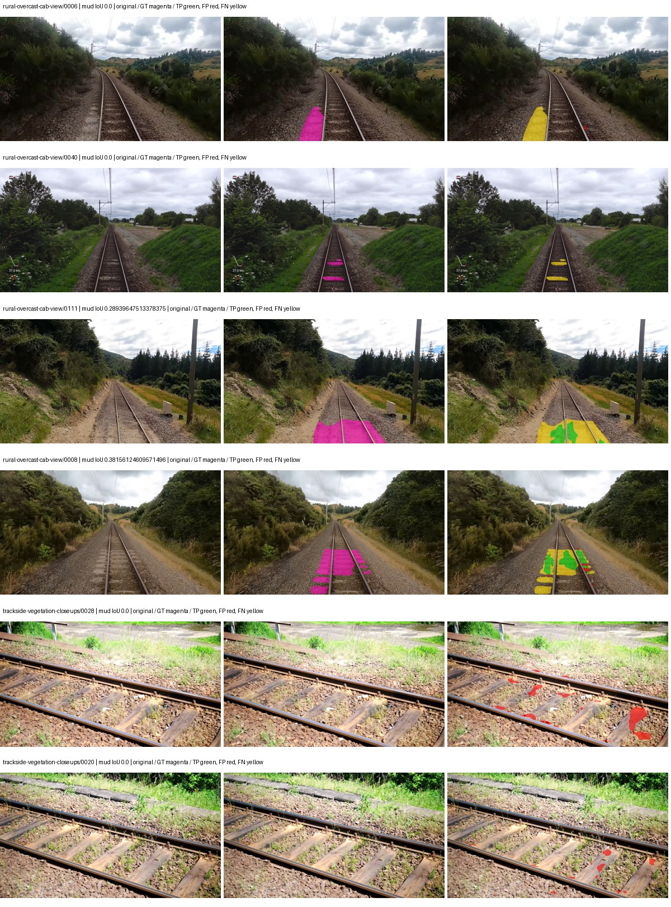
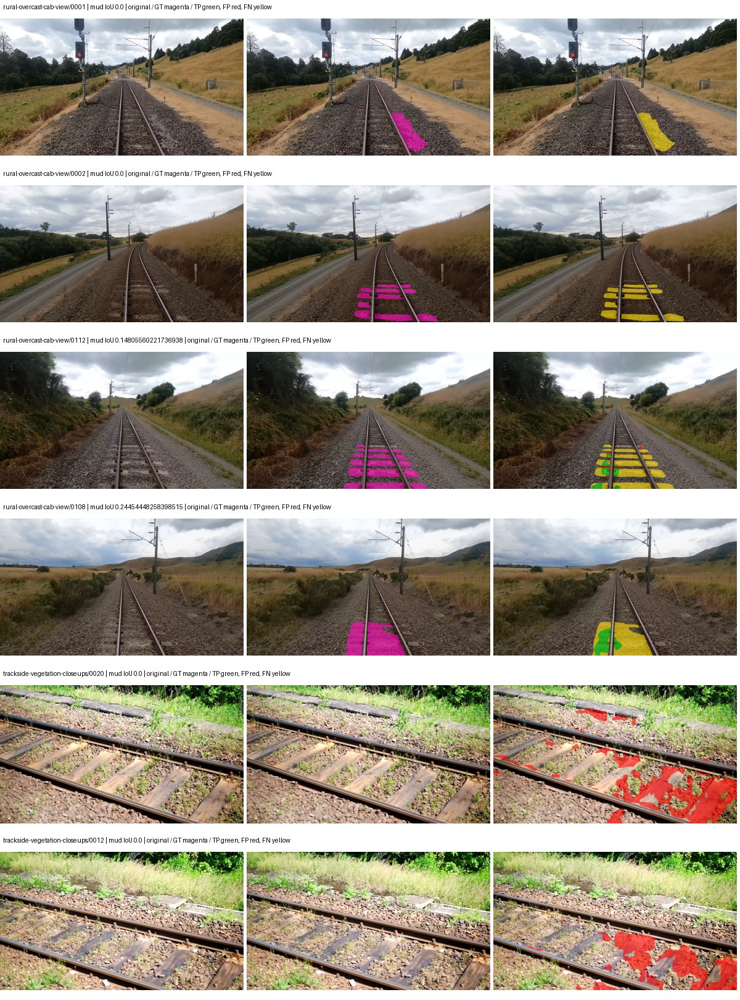
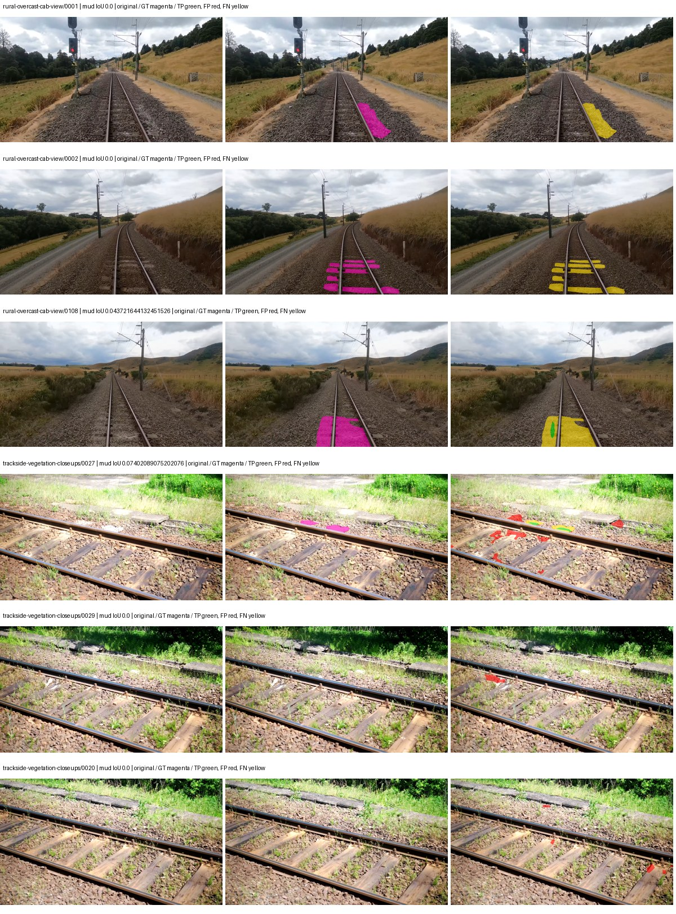
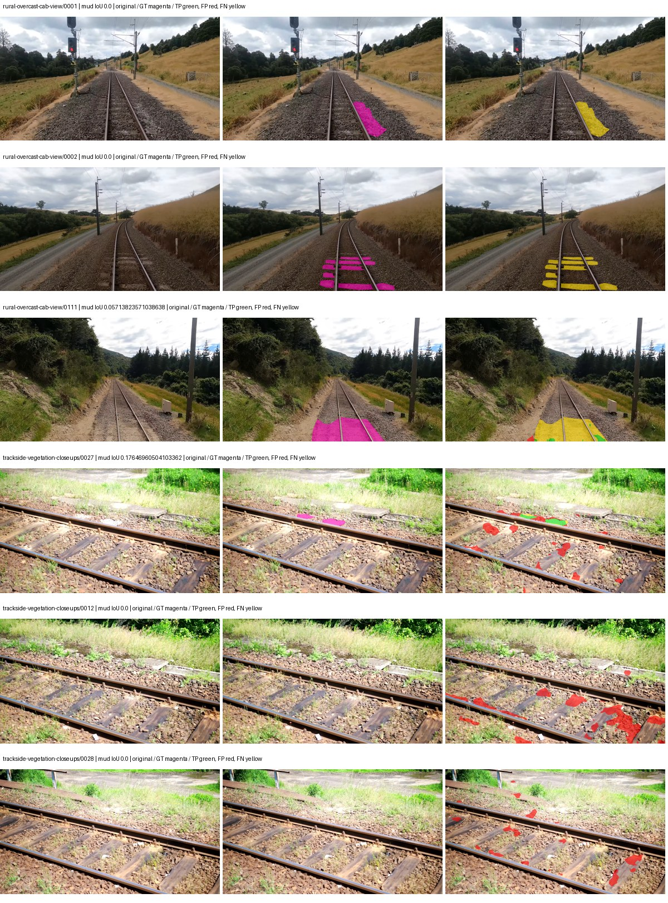

# native_resnet50_psp — rad_9_24_2026-fixed-grouped

[RAD 9/24: Scene-grouped split](../../README.md) · [Full model records](record.json)

Primary result: the **final checkpoint** after the full step budget (no early stopping). The checkpoint with the best **mud-pumping validation IoU, pixels pooled over all validation images**, is kept as secondary evidence. A job is complete only after full statistics and isolated profiling are verified.

Study metrics of the final checkpoint, counting each class only on the validation images that contain it: mud-pumping IoU is the mean per-image IoU over the images with mud-pumping, precision and recall sum pixels over those images, and mIoU averages each class over the images that contain it, then over the classes present.

| Initialization path | Seed | Mud-pumping IoU, train-camera images with mud (%, n=17) | Mud-pumping IoU, all images with mud (%, n=18) | Mud precision, all images with mud (%) | Mud recall, all images with mud (%) | mIoU (each class over images that contain it) (%) |
| --- | --- | --- | --- | --- | --- | --- |
| rtis_only | 0 | 2.35 | 2.57 | 46.63 | 1.99 | 30.26 |
| cityscapes_to_rtis | 0 | 0.07 | 0.06 | 3.77 | 0.08 | 30.45 |
| railsem19_to_rtis | 0 | 0.22 | 0.21 | 6.07 | 0.29 | 34.52 |
| cityscapes_to_railsem19_to_rtis | 0 | 0.09 | 0.79 | 20.17 | 0.52 | 33.68 |

Per-class IoU: IoU (%) of every class, each averaged only over the validation images that contain the class (n = those images); — = no image contains it. mIoU averages the classes with at least one such image.

| Initialization path | Seed | mIoU (each class over images that contain it) | person (n=0) | truck (n=0) | rail-track (n=37) | vegetation-overgrowth (n=13) | car (n=3) | on-rails (n=0) | traffic-sign (n=9) | road (n=11) | sidewalk (n=12) | construction (n=12) | tram-track (n=2) | pole (n=21) | traffic-light (n=3) | mud-pumping (n=18) | fence (n=7) | terrain (n=35) | sky (n=28) | rail-embedded (n=3) | rail-raised (n=37) | trackbed (n=37) | standing-water (n=9) |
| --- | --- | --- | --- | --- | --- | --- | --- | --- | --- | --- | --- | --- | --- | --- | --- | --- | --- | --- | --- | --- | --- | --- | --- |
| rtis_only | 0 | 30.26 | — | — | 53.20 | 33.95 | 6.75 | — | 9.10 | 7.47 | 8.07 | 33.34 | 8.19 | 34.57 | 23.87 | 2.57 | 18.94 | 82.64 | 92.66 | 5.48 | 61.83 | 62.09 | 0.00 |
| cityscapes_to_rtis | 0 | 30.45 | — | — | 48.67 | 26.57 | 19.85 | — | 17.15 | 14.76 | 10.15 | 29.01 | 5.02 | 39.63 | 31.82 | 0.06 | 13.15 | 79.57 | 94.17 | 4.03 | 59.28 | 54.92 | 0.21 |
| railsem19_to_rtis | 0 | 34.52 | — | — | 56.77 | 34.31 | 20.19 | — | 23.05 | 16.42 | 17.20 | 38.89 | 12.40 | 45.23 | 27.16 | 0.21 | 17.45 | 83.36 | 95.29 | 8.03 | 66.44 | 58.93 | 0.00 |
| cityscapes_to_railsem19_to_rtis | 0 | 33.68 | — | — | 55.00 | 30.16 | 22.40 | — | 20.34 | 16.45 | 15.36 | 36.96 | 12.37 | 43.93 | 31.09 | 0.79 | 19.39 | 81.61 | 95.35 | 2.19 | 62.23 | 59.77 | 0.92 |

Everything below is the campaign's own record, with pixels pooled over all validation images: its evaluation is the checkpoint that scored best on that pooled mud IoU (secondary evidence here); the diagnostics also cover the final checkpoint (`final-auto-val`).

| Model | Initialization path | Seed | Status | Steps | Best step | Best-checkpoint mud IoU, pixels pooled (%) | Best-checkpoint mud precision, pixels pooled (%) | Best-checkpoint mud recall, pixels pooled (%) | Final mud IoU (trainer val, pixels pooled, %) | Best-checkpoint mIoU, pixels pooled (%) | Best-checkpoint fixed GT-class mIoU, pixels pooled (%) |
| --- | --- | --- | --- | --- | --- | --- | --- | --- | --- | --- | --- |
| native_resnet50_psp | rtis_only | 0 | completed | 4000 | 2074 | 11.85 | 41.74 | 14.20 | 1.88 | 28.19 | 32.89 |
| native_resnet50_psp | cityscapes_to_rtis | 0 | completed | 4000 | 1037 | 2.17 | 5.87 | 3.33 | 0.06 | 30.73 | 35.85 |
| native_resnet50_psp | railsem19_to_rtis | 0 | completed | 4000 | 518 | 1.11 | 22.70 | 1.15 | 0.22 | 34.66 | 40.44 |
| native_resnet50_psp | cityscapes_to_railsem19_to_rtis | 0 | completed | 4000 | 2333 | 1.54 | 7.33 | 1.92 | 0.46 | 34.39 | 40.13 |

Training: 217 images. Validation: 37 images. Test: 60 held out. Seeds: [0]. Seed variation measures optimization variability, not independent-recording uncertainty. Historical source checkpoints stay fixed across adaptation seeds.

Training code: `fce0ea0ac50b334d4252812c396e0e593def375d`. Split SHA-256: `12d7b367c72cda61d57686ff2ac28223530d0af49debd9fb7a0fbc68b908bc93`.

## rtis_only — seed 0

Status: **completed**. Started: 2026-10-11T10:40:04.493000+00:00. Finished: 2026-10-11T11:33:43.851132+00:00.

Recipe pretrained initializer: `{"arch": "native", "backbone_path": null, "batch_norm_momentum": null, "checkpoint": null, "classifier_path": null, "drop_path": null, "encoder_name": null, "encoder_weights": null, "head": "unified_head", "head_paths": [], "inactive_parameter_paths": [], "local_files_only": false, "lora_alpha": 32, "lora_dropout": 0.05, "lora_r": 16, "lora_targets": [], "native": {"auxiliary_heads": [], "backbone": {"in_channels": 3, "kind": "timm", "name": "resnet50.a1_in1k", "out_indices": [1, 2, 3, 4], "weights": "pretrained"}, "head": {"activation": "relu", "channels": 256, "dropout": 0.1, "in_index": 3, "kind": "psp", "norm": "group", "pool_bins": [1, 2, 3, 6]}, "neck": {"kind": "identity"}, "task": "multiclass"}, "revision": null, "smp_arch": null, "subfolder": null, "trust_remote_code": false, "tuning": "full"}`.

`rtis_only` uses the recipe initializer, which may include pretrained segmentation components. Transfer paths load the exact historical source checkpoint below and reset the classifier; they do not reset all query/decoder features.

Source checkpoint: `Recipe pretrained initialization`.

Config SHA-256: `d60c2cb40da7c5d1f5e5506cf63b5247e88f67bc27081c88e3c4917e0f2039f2`. Weights used for validation: `raw`.

### Mud-pumping and aggregate quality

| Metric | Selected checkpoint | Final training validation |
| --- | --- | --- |
| Mud IoU | 11.85 | 1.88 |
| Mud precision | 41.74 | 26.59 |
| Mud recall | 14.20 | 1.99 |
| Mud Dice/F1 | 21.20 | 3.70 |
| mIoU | 28.19 | 27.35 |
| Mean accuracy | 44.25 | 42.86 |
| Mean precision | 46.82 | 46.41 |
| Mean Dice | 37.57 | 36.27 |
| Mean specificity | 98.94 | 98.90 |
| Pixel accuracy | 83.26 | 83.38 |
| Frequency-weighted IoU | 73.05 | 72.90 |
| Fixed GT-present class mIoU | 32.89 | 31.91 |
| Boundary F1 | 35.34 | 36.59 |

The selected checkpoint has independent evaluation evidence. Final values are the trainer's final validation record, not a new independent evaluation. mIoU averages classes with nonzero union, so false positives on absent classes can change its denominator. The fixed GT-class mean is supplementary and excludes absent classes; their false positives remain in the confusion matrix.

### Resource usage and timing

| Measurement | Value |
| --- | --- |
| Peak training VRAM, retained training invocation (GiB) | 8.29 |
| Peak evaluation VRAM (GiB) | 6.75 |
| Retained training invocation wall time (seconds) | 3090.53 |
| Retained training invocation GPU-hours (one GPU) | 0.86 |
| Evaluation wall time (seconds) | 10.42 |
| Full evaluation pipeline images/second | 3.55 |
| Best full-state checkpoint (MiB) | 567.64 |
| Final full-state checkpoint (MiB) | 567.63 |
| Verified periodic checkpoints removed (GiB) | 4.43 |

VRAM uses the recorded allocator high-water mark; it is not total device usage including CUDA context. Resumed jobs' retained training invocation times and peaks are **not whole-campaign totals**. Earlier invocation resource records are not reconstructed here. Evaluation throughput includes loader, sliding-window inference and metrics; it is not model-only latency/FPS. Missing measurements are shown as —, never inferred from another dataset's run.

### Standardized inference performance

Dedicated model-only profiling waits for an idle worker-locked L40S: BF16, batch 1, 1024x1024, 20 warmup and 100 CUDA-event-timed public forwards. It excludes loading, preprocessing, tiling and metrics.

| Status | Parameters | Weight MiB | FPS | p50 ms | p95 ms | Peak reserved GiB |
| --- | --- | --- | --- | --- | --- | --- |
| complete | 37149525 | 141.71 | 214.58 | 4.61 | 4.83 | 0.52 |

```json
{
  "schema_version": 1,
  "model_id": "native_resnet50_psp",
  "measured_at": "2026-10-11T11:33:37+00:00",
  "status": "complete",
  "benchmark_scope": "rtis_selected_checkpoint_model_only",
  "applies_to": [
    "native_resnet50_psp--rtis_only--seed-0"
  ],
  "source": {
    "campaign_git_sha": "fce0ea0ac50b334d4252812c396e0e593def375d",
    "git_dirty": false,
    "config_hash": "d0e0e8850e27",
    "resolved_config": "/data/izadia1/projects/segmentary-runs/rad_9_24_2026/fgall-seed0-20261007/configs/native_resnet50_psp--rtis_only--seed-0.yaml",
    "config_sha256": "d60c2cb40da7c5d1f5e5506cf63b5247e88f67bc27081c88e3c4917e0f2039f2",
    "checkpoint_sha256": "bc76d004f94bf597dd7bd26a5cb8fb91bd9ee092653b9b88d272f59bcc41bfc9",
    "checkpoint_global_step": 2074,
    "checkpoint_bytes": 595211303,
    "checkpoint_kind": "resume checkpoint with optimizer and EMA state",
    "weights": "raw",
    "measured_checkpoint_job_id": "native_resnet50_psp--rtis_only--seed-0",
    "result_sha256": "2faedd7b301946fd3f3d8ced2a21f3d4f52a322a1a11db7f2d6e899fc5e3f2d1",
    "result_git_sha": "fce0ea0ac50b334d4252812c396e0e593def375d",
    "result_stage": "eval:rad_9_24_2026-fixed-grouped:val",
    "result_seed": 0
  },
  "hardware": {
    "gpu_name": "NVIDIA L40S",
    "gpu_uuid": "GPU-1c9b612f-e0b5-fbbc-150f-8c2ef13453c9",
    "logical_device": "cuda:0",
    "physical_visibility_token": "5",
    "compute_capability": [
      8,
      9
    ],
    "total_memory_bytes": 47677177856
  },
  "model": {
    "parameter_count": 37149525,
    "trainable_parameter_count": 37149525,
    "resident_parameter_bytes": 148598100,
    "parameter_dtype_counts": {
      "float32": 37149525
    }
  },
  "contract": {
    "backend": "pytorch",
    "precision": "bf16_autocast",
    "batch_size": 1,
    "input_shape_nchw": [
      1,
      3,
      1024,
      1024
    ],
    "warmup_iterations": 20,
    "measured_iterations": 100,
    "timing": "per-forward CUDA events with end-event synchronization",
    "includes_preprocessing": false,
    "includes_data_loader": false,
    "includes_sliding_window": false,
    "input_resident_on_gpu": true,
    "model_only": true,
    "entrypoint": "public model(image) dense-logits forward"
  },
  "measurements": {
    "latency": {
      "p50_ms": 4.6141438484191895,
      "p95_ms": 4.834353446960449,
      "mean_ms": 4.66030556678772,
      "minimum_ms": 4.603903770446777,
      "maximum_ms": 6.069248199462891,
      "fps": 214.5782042977249,
      "raw_ms": [
        4.626431941986084,
        4.734975814819336,
        4.816864013671875,
        4.61516809463501,
        4.60595178604126,
        4.613120079040527,
        4.725759983062744,
        4.6141438484191895,
        4.610047817230225,
        4.60595178604126,
        5.163008213043213,
        4.628479957580566,
        4.791296005249023,
        4.607999801635742,
        4.60595178604126,
        4.874207973480225,
        4.622335910797119,
        4.60697603225708,
        4.624383926391602,
        4.60595178604126,
        4.6141438484191895,
        4.613120079040527,
        4.612095832824707,
        4.6561279296875,
        4.610047817230225,
        4.604928016662598,
        4.617216110229492,
        4.60595178604126,
        4.613120079040527,
        4.611072063446045,
        4.603903770446777,
        4.6141438484191895,
        4.81382417678833,
        4.626431941986084,
        4.618239879608154,
        4.61516809463501,
        4.60697603225708,
        4.612095832824707,
        4.61516809463501,
        4.611072063446045,
        4.618239879608154,
        4.61516809463501,
        4.617216110229492,
        4.619264125823975,
        4.61516809463501,
        4.604928016662598,
        4.61516809463501,
        4.6090240478515625,
        4.832255840301514,
        4.61516809463501,
        4.60697603225708,
        4.612095832824707,
        4.6090240478515625,
        4.611072063446045,
        4.611072063446045,
        4.799488067626953,
        4.613120079040527,
        4.612095832824707,
        4.60595178604126,
        4.616191864013672,
        6.069248199462891,
        4.610047817230225,
        4.6141438484191895,
        4.61516809463501,
        5.0483198165893555,
        4.786208152770996,
        4.621312141418457,
        4.612095832824707,
        4.619264125823975,
        4.604928016662598,
        4.616191864013672,
        4.612095832824707,
        4.611072063446045,
        4.607999801635742,
        4.646912097930908,
        4.7329277992248535,
        4.882431983947754,
        4.617216110229492,
        4.6141438484191895,
        4.612095832824707,
        4.61516809463501,
        4.612095832824707,
        4.610047817230225,
        4.613120079040527,
        4.60595178604126,
        4.617216110229492,
        4.624383926391602,
        4.61516809463501,
        4.616191864013672,
        4.6141438484191895,
        4.6090240478515625,
        4.607999801635742,
        4.616191864013672,
        4.6090240478515625,
        4.613120079040527,
        4.770815849304199,
        4.61516809463501,
        4.61516809463501,
        4.60697603225708,
        4.617216110229492
      ],
      "percentile_method": "numpy linear interpolation"
    },
    "peak_reserved_bytes": 557842432,
    "memory_kind": "pytorch_cuda_allocator_peak_reserved_excluding_context",
    "process_total_bytes": 1086324736,
    "process_total_kind": "nvidia-smi used_memory of this PID on the benchmark GPU after the timed loop, including the CUDA context; null when the driver could not attribute memory to this PID",
    "benchmark_wall_clock_s": 11.545042641460896
  },
  "started_at": "2026-10-11T11:33:25+00:00",
  "finished_at": "2026-10-11T11:33:37+00:00",
  "environment": {
    "hostname": "hdrfs-app-001",
    "python": "3.11.15",
    "platform": "Linux-5.15.0-139-generic-x86_64-with-glibc2.35",
    "torch": "2.11.0+cu128",
    "torch_cuda": "12.8",
    "cudnn": 91900,
    "driver_version": "570.133.20",
    "cuda_available": true,
    "gpu_count": 1,
    "gpu_names": [
      "NVIDIA L40S"
    ],
    "cuda_visible_devices": "5",
    "packages": {
      "segmentary": "0.1.0",
      "torch": "2.11.0+cu128",
      "torchvision": "0.26.0+cu128",
      "transformers": "5.15.0",
      "timm": "1.0.28",
      "segmentation-models-pytorch": "0.5.0",
      "albumentations": "2.0.8",
      "lightning": "2.6.5",
      "numpy": "2.4.4"
    }
  }
}
```

### Per-class validation results

| Class | GT pixels | IoU (%) | Precision (%) | Recall (%) | Dice (%) | Boundary F1 (%) |
| --- | --- | --- | --- | --- | --- | --- |
| car | 29664 | 6.46 | 31.40 | 7.53 | 12.14 | 13.92 |
| construction | 311585 | 37.49 | 44.10 | 71.44 | 54.54 | 46.28 |
| fence | 265137 | 19.12 | 48.50 | 23.99 | 32.10 | 32.79 |
| mud-pumping | 1226250 | 11.85 | 41.74 | 14.20 | 21.20 | 22.96 |
| on-rails | 0 | 0.00 | 0.00 | — | 0.00 | 0.00 |
| person | 0 | 0.00 | 0.00 | — | 0.00 | 0.00 |
| pole | 628038 | 47.41 | 77.58 | 54.94 | 64.33 | 70.93 |
| rail-embedded | 16799 | 11.49 | 51.86 | 12.86 | 20.61 | 18.81 |
| rail-raised | 2969797 | 67.88 | 76.48 | 85.80 | 80.87 | 85.64 |
| rail-track | 6323197 | 34.11 | 70.12 | 39.91 | 50.87 | 51.38 |
| road | 1048831 | 5.67 | 24.87 | 6.85 | 10.74 | 10.64 |
| sidewalk | 1297367 | 26.66 | 58.49 | 32.88 | 42.10 | 11.04 |
| sky | 19121606 | 93.22 | 98.95 | 94.15 | 96.49 | 87.09 |
| standing-water | 95802 | 0.00 | 0.00 | 0.00 | 0.00 | 0.00 |
| terrain | 39239306 | 85.97 | 88.10 | 97.26 | 92.46 | 62.63 |
| trackbed | 10643081 | 57.43 | 64.47 | 84.04 | 72.96 | 55.57 |
| traffic-light | 19510 | 7.40 | 7.56 | 77.66 | 13.78 | 32.43 |
| traffic-sign | 13285 | 22.83 | 62.71 | 26.41 | 37.17 | 47.53 |
| tram-track | 56179 | 18.19 | 66.43 | 20.03 | 30.77 | 33.38 |
| truck | 0 | 0.00 | 0.00 | — | 0.00 | 0.00 |
| vegetation-overgrowth | 5901821 | 38.83 | 69.89 | 46.64 | 55.94 | 59.19 |

### Full-run accounting

| Measurement | Value |
| --- | --- |
| Full GPU-reserved wall seconds, all recorded worker attempts | 3227.07 |
| Full reserved GPU-hours | 0.90 |
| Whole-run timing complete | True |

| Phase | Wall seconds including failed attempts |
| --- | --- |
| training | 3097.19 |
| diagnostics | 78.13 |
| performance | 19.85 |

GPU-reserved time includes model loading, training, validation, collection, profiling, checkpoint I/O and orchestration while the worker owns one GPU. It is not GPU kernel-active time. Phase timings and sampled device memory/power/utilization are retained separately; sampled device memory is not the allocator high-water mark.

### Train/validation and raw/EMA diagnostics

| Checkpoint / weights / split | Images | Mud IoU (%) | Mud precision (%) | Mud recall (%) |
| --- | --- | --- | --- | --- |
| best-auto-train / raw | 217 | 92.49 | 95.53 | 96.67 |
| best-auto-val / raw | 37 | 11.85 | 41.74 | 14.20 |
| best-alternate-val / ema | 37 | 2.12 | 18.14 | 2.34 |
| final-auto-val / raw | 37 | 1.89 | 26.57 | 1.99 |

Train uses the evaluation transform without augmentation. Compare mud train/validation metrics for the same selected weights. Alternate EMA on running-stat BatchNorm is explicitly uncalibrated and is diagnostic only. Score-threshold curves use uncalibrated normalized scores and are pixel-level diagnostics, not event detection rates or a selected deployment operating point.

### Downloadable evidence

- best-auto-train: [per-image.csv](rtis_only--seed-0/best-auto-train/per-image.csv) · [per-image-confusion.json.gz](rtis_only--seed-0/best-auto-train/per-image-confusion.json.gz) · [groups.json](rtis_only--seed-0/best-auto-train/groups.json) · [mud-score-curves.json](rtis_only--seed-0/best-auto-train/mud-score-curves.json)
- best-auto-val: [per-image.csv](rtis_only--seed-0/best-auto-val/per-image.csv) · [per-image-confusion.json.gz](rtis_only--seed-0/best-auto-val/per-image-confusion.json.gz) · [groups.json](rtis_only--seed-0/best-auto-val/groups.json) · [mud-score-curves.json](rtis_only--seed-0/best-auto-val/mud-score-curves.json) · [examples.jpg](rtis_only--seed-0/best-auto-val/examples.jpg)
- best-alternate-val: [per-image.csv](rtis_only--seed-0/best-alternate-val/per-image.csv) · [per-image-confusion.json.gz](rtis_only--seed-0/best-alternate-val/per-image-confusion.json.gz) · [groups.json](rtis_only--seed-0/best-alternate-val/groups.json) · [mud-score-curves.json](rtis_only--seed-0/best-alternate-val/mud-score-curves.json)
- final-auto-val: [per-image.csv](rtis_only--seed-0/final-auto-val/per-image.csv) · [per-image-confusion.json.gz](rtis_only--seed-0/final-auto-val/per-image-confusion.json.gz) · [groups.json](rtis_only--seed-0/final-auto-val/groups.json) · [mud-score-curves.json](rtis_only--seed-0/final-auto-val/mud-score-curves.json)
- resources: [telemetry.csv](rtis_only--seed-0/resources/telemetry.csv)



Examples are two lowest and two highest mud-IoU positive images, plus up to two negative images with the most false-positive mud pixels. They are targeted diagnostic examples, not random samples. Green: true positive; red: false positive; yellow: false negative. Full predictions remain on HDRFS.

### Validation tracking

| Logged step | Overall mIoU (%) | Mud IoU (%) |
| --- | --- | --- |
| 258 | 17.26 | 0.14 |
| 518 | 22.59 | 0.00 |
| 777 | 25.04 | 3.08 |
| 1036 | 27.73 | 1.26 |
| 1295 | 26.55 | 2.59 |
| 1555 | 25.48 | 1.97 |
| 1814 | 25.44 | 1.15 |
| 2073 | 28.22 | 11.84 |
| 2332 | 27.53 | 2.02 |
| 2592 | 26.35 | 1.00 |
| 2851 | 27.89 | 3.36 |
| 3110 | 27.38 | 2.23 |
| 3369 | 26.54 | 1.08 |
| 3629 | 27.36 | 8.52 |
| 3888 | 27.03 | 1.60 |
| 4000 | 27.35 | 1.88 |

All retained scalar curves, including training loss and per-class IoU, are in record.json. Observed best mud on a curve is not necessarily a retained checkpoint: the pilot saved its selection-metric-best and final checkpoints. Step logging and checkpoint global_step may differ by one.

### Stopping and checkpoint provenance

```json
{
  "stopping": {
    "actual_steps": 4000,
    "maximum_steps": 4000,
    "min_delta": 0.0,
    "monitor": "val_iou/mud-pumping",
    "patience": null,
    "reason": "budget_complete"
  },
  "checkpoints": {
    "best": {
      "path": "/data/izadia1/projects/segmentary-runs/rad_9_24_2026/fgall-seed0-20261007/future-runs/native_resnet50_psp--rtis_only--seed-0_seed0/rtis/best.ckpt",
      "sha256": "bc76d004f94bf597dd7bd26a5cb8fb91bd9ee092653b9b88d272f59bcc41bfc9",
      "global_step": 2074,
      "bytes": 595211303
    },
    "final": {
      "path": "/data/izadia1/projects/segmentary-runs/rad_9_24_2026/fgall-seed0-20261007/future-runs/native_resnet50_psp--rtis_only--seed-0_seed0/rtis/last.ckpt",
      "sha256": "4b0bb18c8dcf37619fc55ed6e554ff2b6190756b35ced7c36ab38e47249cb351",
      "global_step": 4000,
      "bytes": 595200167
    }
  },
  "cleanup_error": null
}
```

### Resolved training, initialization and evaluation settings

The optimizer block is the base configuration. Stage LR scales are applied at runtime, and stage warmup is capped at min(base warmup, floor(stage budget / 10), stage budget - 1): 400 steps for this 4,000-step pilot. Model-internal native input grids may differ from augmentation crops (EoMT uses its 640 grid).

```json
{
  "name": "native_resnet50_psp--rtis_only--seed-0",
  "model": {
    "arch": "native",
    "checkpoint": null,
    "tuning": "full",
    "head": "unified_head",
    "lora_r": 16,
    "lora_alpha": 32,
    "lora_dropout": 0.05,
    "lora_targets": [],
    "drop_path": null,
    "revision": null,
    "subfolder": null,
    "local_files_only": false,
    "trust_remote_code": false,
    "backbone_path": null,
    "head_paths": [],
    "classifier_path": null,
    "inactive_parameter_paths": [],
    "smp_arch": null,
    "encoder_name": null,
    "encoder_weights": null,
    "native": {
      "task": "multiclass",
      "backbone": {
        "kind": "timm",
        "name": "resnet50.a1_in1k",
        "weights": "pretrained",
        "out_indices": [
          1,
          2,
          3,
          4
        ],
        "in_channels": 3
      },
      "neck": {
        "kind": "identity"
      },
      "head": {
        "kind": "psp",
        "in_index": 3,
        "channels": 256,
        "pool_bins": [
          1,
          2,
          3,
          6
        ],
        "dropout": 0.1,
        "norm": "group",
        "activation": "relu"
      },
      "auxiliary_heads": []
    },
    "batch_norm_momentum": null
  },
  "space": "paul-test-rtis",
  "taxonomy_root": "/data/izadia1/projects/segmentary-rad-fgall-fce0ea0a/taxonomy",
  "output_root": "/data/izadia1/projects/segmentary-runs/rad_9_24_2026/fgall-seed0-20261007/future-runs",
  "optim": {
    "backbone_lr": 0.0001,
    "head_lr_mult": 10.0,
    "weight_decay": 0.05,
    "llrd": 1.0,
    "warmup_iters": 1500,
    "warmup_ratio": 1e-06,
    "poly_power": 0.9,
    "min_lr_ratio": 0.0,
    "betas": [
      0.9,
      0.999
    ],
    "grad_clip": 1.0
  },
  "train": {
    "iters": 4000,
    "batch_size": 2,
    "accum": 8,
    "num_workers": 2,
    "precision": "bf16-mixed",
    "ema_decay": 0.9998,
    "val_every": 250,
    "ckpt_every": 500,
    "selection_metric": "val_iou/mud-pumping",
    "early_stopping_patience": null,
    "early_stopping_min_delta": 0.0,
    "seed": 0,
    "devices": 1
  },
  "eval": {
    "sliding_window": true,
    "window": [
      1024,
      1024
    ],
    "stride": [
      768,
      768
    ],
    "batch_size": 1,
    "num_workers": 2,
    "tta_scales": [],
    "tta_flip": false,
    "threshold": 0.5,
    "boundary_tolerance_frac": 0.0075,
    "save_confusion": true
  },
  "loss": {
    "task": "multiclass",
    "activation": "auto",
    "terms": [],
    "aux": "none",
    "aux_weight": 0.0,
    "ce_weight": 1.0,
    "label_smoothing": 0.0,
    "class_weights": null,
    "query": null
  },
  "aug": {
    "crop": [
      1024,
      1024
    ],
    "scale_min": 0.5,
    "scale_max": 2.0,
    "hflip_p": 0.5,
    "color_jitter_p": 0.5,
    "brightness": 0.25,
    "contrast": 0.25,
    "saturation": 0.25,
    "hue": 0.05
  },
  "stages": [
    {
      "name": "rtis",
      "data": [
        {
          "name": "rad_9_24_2026-fixed-grouped",
          "root": "/data/izadia1/datasets/rad_9_24_2026-fixed-grouped",
          "variant": null,
          "split_file": "splits.json",
          "train_split": "train",
          "val_split": "val",
          "limit": null,
          "loader": "folder",
          "mapping": "paul-test-rtis",
          "loader_options": {
            "require_groups": true
          }
        }
      ],
      "iters": null,
      "lr_scale": 1.0,
      "head_group_lr_scale": 1.0,
      "init_from": "pretrained",
      "reset_head": false,
      "freeze": null,
      "sample_weights": null
    }
  ]
}
```

### Hardware and software provenance

```json
{
  "training": {
    "cuda_available": true,
    "cuda_visible_devices": "5",
    "cudnn": 91900,
    "driver_version": "570.133.20",
    "gpu_count": 1,
    "gpu_names": [
      "NVIDIA L40S"
    ],
    "hostname": "hdrfs-app-001",
    "input_normalization": {
      "channel_order": "rgb",
      "mean": [
        0.485,
        0.456,
        0.406
      ],
      "source": "timm_pretrained_cfg",
      "std": [
        0.229,
        0.224,
        0.225
      ]
    },
    "model_origins": [
      {
        "hf_commit": null,
        "hf_name_or_path": null,
        "module": "backbone",
        "timm_pretrained": {
          "architecture": "resnet50",
          "hf_hub_id": "timm/resnet50.a1_in1k",
          "tag": "a1_in1k",
          "url": "https://github.com/rwightman/pytorch-image-models/releases/download/v0.1-rsb-weights/resnet50_a1_0-14fe96d1.pth"
        }
      },
      {
        "hf_commit": null,
        "hf_name_or_path": null,
        "module": "backbone.model",
        "timm_pretrained": {
          "architecture": "resnet50",
          "hf_hub_id": "timm/resnet50.a1_in1k",
          "tag": "a1_in1k",
          "url": "https://github.com/rwightman/pytorch-image-models/releases/download/v0.1-rsb-weights/resnet50_a1_0-14fe96d1.pth"
        }
      }
    ],
    "model_parameter_count": 37149525,
    "packages": {
      "albumentations": "2.0.8",
      "lightning": "2.6.5",
      "numpy": "2.4.4",
      "segmentary": "0.1.0",
      "segmentation-models-pytorch": "0.5.0",
      "timm": "1.0.28",
      "torch": "2.11.0+cu128",
      "torchvision": "0.26.0+cu128",
      "transformers": "5.15.0"
    },
    "platform": "Linux-5.15.0-139-generic-x86_64-with-glibc2.35",
    "python": "3.11.15",
    "torch": "2.11.0+cu128",
    "torch_cuda": "12.8",
    "trainable_parameter_count": 37149525,
    "training_stop": {
      "actual_steps": 4000,
      "maximum_steps": 4000,
      "min_delta": 0.0,
      "monitor": "val_iou/mud-pumping",
      "patience": null,
      "reason": "budget_complete"
    },
    "validation_weights": "raw"
  },
  "evaluation": {
    "cuda_available": true,
    "cuda_visible_devices": "5",
    "cudnn": 91900,
    "driver_version": "570.133.20",
    "gpu_count": 1,
    "gpu_names": [
      "NVIDIA L40S"
    ],
    "hostname": "hdrfs-app-001",
    "input_normalization": {
      "channel_order": "rgb",
      "mean": [
        0.485,
        0.456,
        0.406
      ],
      "source": "timm_pretrained_cfg",
      "std": [
        0.229,
        0.224,
        0.225
      ]
    },
    "packages": {
      "albumentations": "2.0.8",
      "lightning": "2.6.5",
      "numpy": "2.4.4",
      "segmentary": "0.1.0",
      "segmentation-models-pytorch": "0.5.0",
      "timm": "1.0.28",
      "torch": "2.11.0+cu128",
      "torchvision": "0.26.0+cu128",
      "transformers": "5.15.0"
    },
    "platform": "Linux-5.15.0-139-generic-x86_64-with-glibc2.35",
    "python": "3.11.15",
    "torch": "2.11.0+cu128",
    "torch_cuda": "12.8"
  }
}
```

## cityscapes_to_rtis — seed 0

Status: **completed**. Started: 2026-10-11T10:43:48.151560+00:00. Finished: 2026-10-11T11:37:56.778542+00:00.

Recipe pretrained initializer: `{"arch": "native", "backbone_path": null, "batch_norm_momentum": null, "checkpoint": null, "classifier_path": null, "drop_path": null, "encoder_name": null, "encoder_weights": null, "head": "unified_head", "head_paths": [], "inactive_parameter_paths": [], "local_files_only": false, "lora_alpha": 32, "lora_dropout": 0.05, "lora_r": 16, "lora_targets": [], "native": {"auxiliary_heads": [], "backbone": {"in_channels": 3, "kind": "timm", "name": "resnet50.a1_in1k", "out_indices": [1, 2, 3, 4], "weights": "pretrained"}, "head": {"activation": "relu", "channels": 256, "dropout": 0.1, "in_index": 3, "kind": "psp", "norm": "group", "pool_bins": [1, 2, 3, 6]}, "neck": {"kind": "identity"}, "task": "multiclass"}, "revision": null, "smp_arch": null, "subfolder": null, "trust_remote_code": false, "tuning": "full"}`.

`rtis_only` uses the recipe initializer, which may include pretrained segmentation components. Transfer paths load the exact historical source checkpoint below and reset the classifier; they do not reset all query/decoder features.

Source checkpoint: `{'name': 'native_resnet50_psp--cityscapes--seed-0', 'model': 'native_resnet50_psp', 'protocol': 'cityscapes', 'config': '/data/izadia1/projects/segmentary-runs/all-model-city-rail-seed0-rail20-b9eb3e1/accepted/native_resnet50_psp--cityscapes--seed-0/resolved-config.yaml', 'checkpoint': '/data/izadia1/projects/segmentary-runs/current-main-fill-v2/jobs/native_resnet50_psp--cityscapes--seed-0/train/native_resnet50_psp--cityscapes_seed0/cityscapes/last.ckpt', 'recorded_sha256': '6665b49eff29d8d237a96290622adf375a75c2b114302bead67307bfd988fef5', 'exists': True}`.

Config SHA-256: `7bb9144425ec29a275c2b0d0c0d063fb909a4bcd3c3be3927b73332add6e3094`. Weights used for validation: `raw`.

### Mud-pumping and aggregate quality

| Metric | Selected checkpoint | Final training validation |
| --- | --- | --- |
| Mud IoU | 2.17 | 0.06 |
| Mud precision | 5.87 | 0.21 |
| Mud recall | 3.33 | 0.08 |
| Mud Dice/F1 | 4.25 | 0.11 |
| mIoU | 30.73 | 31.73 |
| Mean accuracy | 43.21 | 42.93 |
| Mean precision | 54.28 | 55.84 |
| Mean Dice | 40.31 | 42.11 |
| Mean specificity | 98.60 | 98.81 |
| Pixel accuracy | 79.00 | 81.94 |
| Frequency-weighted IoU | 67.57 | 71.13 |
| Fixed GT-present class mIoU | 35.85 | 35.26 |
| Boundary F1 | 35.63 | 38.11 |

The selected checkpoint has independent evaluation evidence. Final values are the trainer's final validation record, not a new independent evaluation. mIoU averages classes with nonzero union, so false positives on absent classes can change its denominator. The fixed GT-class mean is supplementary and excludes absent classes; their false positives remain in the confusion matrix.

### Resource usage and timing

| Measurement | Value |
| --- | --- |
| Peak training VRAM, retained training invocation (GiB) | 8.29 |
| Peak evaluation VRAM (GiB) | 6.75 |
| Retained training invocation wall time (seconds) | 3117.71 |
| Retained training invocation GPU-hours (one GPU) | 0.87 |
| Evaluation wall time (seconds) | 10.78 |
| Full evaluation pipeline images/second | 3.43 |
| Best full-state checkpoint (MiB) | 567.64 |
| Final full-state checkpoint (MiB) | 567.63 |
| Verified periodic checkpoints removed (GiB) | 4.43 |

VRAM uses the recorded allocator high-water mark; it is not total device usage including CUDA context. Resumed jobs' retained training invocation times and peaks are **not whole-campaign totals**. Earlier invocation resource records are not reconstructed here. Evaluation throughput includes loader, sliding-window inference and metrics; it is not model-only latency/FPS. Missing measurements are shown as —, never inferred from another dataset's run.

### Standardized inference performance

Dedicated model-only profiling waits for an idle worker-locked L40S: BF16, batch 1, 1024x1024, 20 warmup and 100 CUDA-event-timed public forwards. It excludes loading, preprocessing, tiling and metrics.

| Status | Parameters | Weight MiB | FPS | p50 ms | p95 ms | Peak reserved GiB |
| --- | --- | --- | --- | --- | --- | --- |
| complete | 37149525 | 141.71 | 213.70 | 4.52 | 5.42 | 0.52 |

```json
{
  "schema_version": 1,
  "model_id": "native_resnet50_psp",
  "measured_at": "2026-10-11T11:37:49+00:00",
  "status": "complete",
  "benchmark_scope": "rtis_selected_checkpoint_model_only",
  "applies_to": [
    "native_resnet50_psp--cityscapes_to_rtis--seed-0"
  ],
  "source": {
    "campaign_git_sha": "fce0ea0ac50b334d4252812c396e0e593def375d",
    "git_dirty": false,
    "config_hash": "4c58f833e168",
    "resolved_config": "/data/izadia1/projects/segmentary-runs/rad_9_24_2026/fgall-seed0-20261007/configs/native_resnet50_psp--cityscapes_to_rtis--seed-0.yaml",
    "config_sha256": "7bb9144425ec29a275c2b0d0c0d063fb909a4bcd3c3be3927b73332add6e3094",
    "checkpoint_sha256": "72e5f2334ed87e4364b477295ce35a36eeb5b5df8315fa350538943ba929a1cb",
    "checkpoint_global_step": 1037,
    "checkpoint_bytes": 595211303,
    "checkpoint_kind": "resume checkpoint with optimizer and EMA state",
    "weights": "raw",
    "measured_checkpoint_job_id": "native_resnet50_psp--cityscapes_to_rtis--seed-0",
    "result_sha256": "58fc8115277cbee4387931ce1dc23f7bb9ce52532299d0dd053362d8fa7cf4d0",
    "result_git_sha": "fce0ea0ac50b334d4252812c396e0e593def375d",
    "result_stage": "eval:rad_9_24_2026-fixed-grouped:val",
    "result_seed": 0
  },
  "hardware": {
    "gpu_name": "NVIDIA L40S",
    "gpu_uuid": "GPU-a5ad49e5-0536-5229-ba8a-f8a902808f53",
    "logical_device": "cuda:0",
    "physical_visibility_token": "7",
    "compute_capability": [
      8,
      9
    ],
    "total_memory_bytes": 47677177856
  },
  "model": {
    "parameter_count": 37149525,
    "trainable_parameter_count": 37149525,
    "resident_parameter_bytes": 148598100,
    "parameter_dtype_counts": {
      "float32": 37149525
    }
  },
  "contract": {
    "backend": "pytorch",
    "precision": "bf16_autocast",
    "batch_size": 1,
    "input_shape_nchw": [
      1,
      3,
      1024,
      1024
    ],
    "warmup_iterations": 20,
    "measured_iterations": 100,
    "timing": "per-forward CUDA events with end-event synchronization",
    "includes_preprocessing": false,
    "includes_data_loader": false,
    "includes_sliding_window": false,
    "input_resident_on_gpu": true,
    "model_only": true,
    "entrypoint": "public model(image) dense-logits forward"
  },
  "measurements": {
    "latency": {
      "p50_ms": 4.51584005355835,
      "p95_ms": 5.421260833740234,
      "mean_ms": 4.679505305290222,
      "minimum_ms": 4.498432159423828,
      "maximum_ms": 5.841919898986816,
      "fps": 213.69780238725045,
      "raw_ms": [
        4.59878396987915,
        4.5004801750183105,
        4.551680088043213,
        4.50867223739624,
        4.995071887969971,
        5.2797441482543945,
        4.695040225982666,
        4.585472106933594,
        4.512767791748047,
        4.505568027496338,
        4.514815807342529,
        4.49945592880249,
        4.5055999755859375,
        4.503551959991455,
        4.504576206207275,
        5.055488109588623,
        5.6842241287231445,
        5.253119945526123,
        4.772863864898682,
        4.592639923095703,
        4.518911838531494,
        4.501503944396973,
        4.499423980712891,
        4.509696006774902,
        4.501503944396973,
        5.328927993774414,
        4.846591949462891,
        4.911104202270508,
        4.50867223739624,
        5.182464122772217,
        5.444608211517334,
        4.71347188949585,
        4.516863822937012,
        4.526080131530762,
        4.501503944396973,
        4.512767791748047,
        4.513792037963867,
        4.506624221801758,
        4.504576206207275,
        5.420032024383545,
        5.481472015380859,
        4.765696048736572,
        4.583424091339111,
        4.5404157638549805,
        4.5199360847473145,
        4.506624221801758,
        4.50764799118042,
        4.509696006774902,
        4.501503944396973,
        4.516863822937012,
        4.506624221801758,
        4.51584005355835,
        4.5055999755859375,
        4.769792079925537,
        5.030911922454834,
        4.55782413482666,
        4.51584005355835,
        4.506624221801758,
        4.506624221801758,
        4.503551959991455,
        4.50764799118042,
        4.5107197761535645,
        4.514815807342529,
        4.498432159423828,
        4.509696006774902,
        4.642816066741943,
        4.513792037963867,
        5.841919898986816,
        5.0728960037231445,
        4.60697603225708,
        4.503551959991455,
        4.50867223739624,
        4.520959854125977,
        4.5055999755859375,
        4.508639812469482,
        4.55679988861084,
        4.50867223739624,
        4.502528190612793,
        4.503551959991455,
        4.503551959991455,
        4.504576206207275,
        4.503551959991455,
        4.892672061920166,
        4.518911838531494,
        4.50867223739624,
        5.341184139251709,
        5.169151782989502,
        4.5793280601501465,
        4.521984100341797,
        4.51584005355835,
        4.5055999755859375,
        4.509696006774902,
        4.49945592880249,
        4.5199360847473145,
        4.50867223739624,
        4.879360198974609,
        5.777408123016357,
        4.808703899383545,
        4.550655841827393,
        4.551680088043213
      ],
      "percentile_method": "numpy linear interpolation"
    },
    "peak_reserved_bytes": 557842432,
    "memory_kind": "pytorch_cuda_allocator_peak_reserved_excluding_context",
    "process_total_bytes": 1086324736,
    "process_total_kind": "nvidia-smi used_memory of this PID on the benchmark GPU after the timed loop, including the CUDA context; null when the driver could not attribute memory to this PID",
    "benchmark_wall_clock_s": 11.569999866187572
  },
  "started_at": "2026-10-11T11:37:38+00:00",
  "finished_at": "2026-10-11T11:37:49+00:00",
  "environment": {
    "hostname": "hdrfs-app-001",
    "python": "3.11.15",
    "platform": "Linux-5.15.0-139-generic-x86_64-with-glibc2.35",
    "torch": "2.11.0+cu128",
    "torch_cuda": "12.8",
    "cudnn": 91900,
    "driver_version": "570.133.20",
    "cuda_available": true,
    "gpu_count": 1,
    "gpu_names": [
      "NVIDIA L40S"
    ],
    "cuda_visible_devices": "7",
    "packages": {
      "segmentary": "0.1.0",
      "torch": "2.11.0+cu128",
      "torchvision": "0.26.0+cu128",
      "transformers": "5.15.0",
      "timm": "1.0.28",
      "segmentation-models-pytorch": "0.5.0",
      "albumentations": "2.0.8",
      "lightning": "2.6.5",
      "numpy": "2.4.4"
    }
  }
}
```

### Per-class validation results

| Class | GT pixels | IoU (%) | Precision (%) | Recall (%) | Dice (%) | Boundary F1 (%) |
| --- | --- | --- | --- | --- | --- | --- |
| car | 29664 | 56.61 | 74.11 | 70.56 | 72.29 | 54.82 |
| construction | 311585 | 39.66 | 48.90 | 67.74 | 56.80 | 45.29 |
| fence | 265137 | 20.02 | 50.48 | 24.91 | 33.36 | 36.01 |
| mud-pumping | 1226250 | 2.17 | 5.87 | 3.33 | 4.25 | 5.88 |
| on-rails | 0 | 0.00 | 0.00 | — | 0.00 | 0.00 |
| person | 0 | 0.00 | 0.00 | — | 0.00 | 0.00 |
| pole | 628038 | 47.05 | 81.87 | 52.52 | 63.99 | 70.14 |
| rail-embedded | 16799 | 2.33 | 84.01 | 2.35 | 4.56 | 10.24 |
| rail-raised | 2969797 | 66.81 | 78.59 | 81.68 | 80.11 | 83.92 |
| rail-track | 6323197 | 32.01 | 64.00 | 39.04 | 48.50 | 42.58 |
| road | 1048831 | 18.11 | 32.65 | 28.92 | 30.67 | 16.72 |
| sidewalk | 1297367 | 29.85 | 84.93 | 31.52 | 45.97 | 12.32 |
| sky | 19121606 | 94.26 | 98.87 | 95.29 | 97.04 | 83.86 |
| standing-water | 95802 | 0.12 | 0.12 | 2.47 | 0.23 | 0.78 |
| terrain | 39239306 | 76.93 | 80.89 | 94.03 | 86.96 | 51.27 |
| trackbed | 10643081 | 56.09 | 68.83 | 75.18 | 71.86 | 53.80 |
| traffic-light | 19510 | 53.49 | 98.13 | 54.04 | 69.70 | 64.79 |
| traffic-sign | 13285 | 30.99 | 78.03 | 33.96 | 47.32 | 53.08 |
| tram-track | 56179 | 2.21 | 41.33 | 2.29 | 4.33 | 15.26 |
| truck | 0 | 0.00 | 0.00 | — | 0.00 | 0.00 |
| vegetation-overgrowth | 5901821 | 16.61 | 68.37 | 17.99 | 28.48 | 47.50 |

### Full-run accounting

| Measurement | Value |
| --- | --- |
| Full GPU-reserved wall seconds, all recorded worker attempts | 3256.98 |
| Full reserved GPU-hours | 0.90 |
| Whole-run timing complete | True |

| Phase | Wall seconds including failed attempts |
| --- | --- |
| training | 3124.81 |
| diagnostics | 78.49 |
| performance | 20.26 |

GPU-reserved time includes model loading, training, validation, collection, profiling, checkpoint I/O and orchestration while the worker owns one GPU. It is not GPU kernel-active time. Phase timings and sampled device memory/power/utilization are retained separately; sampled device memory is not the allocator high-water mark.

### Train/validation and raw/EMA diagnostics

| Checkpoint / weights / split | Images | Mud IoU (%) | Mud precision (%) | Mud recall (%) |
| --- | --- | --- | --- | --- |
| best-auto-train / raw | 217 | 90.42 | 95.05 | 94.89 |
| best-auto-val / raw | 37 | 2.17 | 5.87 | 3.33 |
| best-alternate-val / ema | 37 | 1.89 | 7.05 | 2.51 |
| final-auto-val / raw | 37 | 0.06 | 0.23 | 0.08 |

Train uses the evaluation transform without augmentation. Compare mud train/validation metrics for the same selected weights. Alternate EMA on running-stat BatchNorm is explicitly uncalibrated and is diagnostic only. Score-threshold curves use uncalibrated normalized scores and are pixel-level diagnostics, not event detection rates or a selected deployment operating point.

### Downloadable evidence

- best-auto-train: [per-image.csv](cityscapes_to_rtis--seed-0/best-auto-train/per-image.csv) · [per-image-confusion.json.gz](cityscapes_to_rtis--seed-0/best-auto-train/per-image-confusion.json.gz) · [groups.json](cityscapes_to_rtis--seed-0/best-auto-train/groups.json) · [mud-score-curves.json](cityscapes_to_rtis--seed-0/best-auto-train/mud-score-curves.json)
- best-auto-val: [per-image.csv](cityscapes_to_rtis--seed-0/best-auto-val/per-image.csv) · [per-image-confusion.json.gz](cityscapes_to_rtis--seed-0/best-auto-val/per-image-confusion.json.gz) · [groups.json](cityscapes_to_rtis--seed-0/best-auto-val/groups.json) · [mud-score-curves.json](cityscapes_to_rtis--seed-0/best-auto-val/mud-score-curves.json) · [examples.jpg](cityscapes_to_rtis--seed-0/best-auto-val/examples.jpg)
- best-alternate-val: [per-image.csv](cityscapes_to_rtis--seed-0/best-alternate-val/per-image.csv) · [per-image-confusion.json.gz](cityscapes_to_rtis--seed-0/best-alternate-val/per-image-confusion.json.gz) · [groups.json](cityscapes_to_rtis--seed-0/best-alternate-val/groups.json) · [mud-score-curves.json](cityscapes_to_rtis--seed-0/best-alternate-val/mud-score-curves.json)
- final-auto-val: [per-image.csv](cityscapes_to_rtis--seed-0/final-auto-val/per-image.csv) · [per-image-confusion.json.gz](cityscapes_to_rtis--seed-0/final-auto-val/per-image-confusion.json.gz) · [groups.json](cityscapes_to_rtis--seed-0/final-auto-val/groups.json) · [mud-score-curves.json](cityscapes_to_rtis--seed-0/final-auto-val/mud-score-curves.json)
- resources: [telemetry.csv](cityscapes_to_rtis--seed-0/resources/telemetry.csv)



Examples are two lowest and two highest mud-IoU positive images, plus up to two negative images with the most false-positive mud pixels. They are targeted diagnostic examples, not random samples. Green: true positive; red: false positive; yellow: false negative. Full predictions remain on HDRFS.

### Validation tracking

| Logged step | Overall mIoU (%) | Mud IoU (%) |
| --- | --- | --- |
| 258 | 21.02 | 0.01 |
| 518 | 24.62 | 1.59 |
| 777 | 26.95 | 0.84 |
| 1036 | 30.74 | 2.17 |
| 1295 | 29.93 | 0.12 |
| 1555 | 27.47 | 0.15 |
| 1814 | 30.79 | 0.04 |
| 2073 | 30.81 | 0.04 |
| 2332 | 30.06 | 0.49 |
| 2592 | 31.32 | 0.27 |
| 2851 | 29.33 | 0.16 |
| 3110 | 29.04 | 0.02 |
| 3369 | 29.52 | 0.11 |
| 3629 | 31.60 | 0.09 |
| 3888 | 30.22 | 0.03 |
| 4000 | 31.73 | 0.06 |

All retained scalar curves, including training loss and per-class IoU, are in record.json. Observed best mud on a curve is not necessarily a retained checkpoint: the pilot saved its selection-metric-best and final checkpoints. Step logging and checkpoint global_step may differ by one.

### Stopping and checkpoint provenance

```json
{
  "stopping": {
    "actual_steps": 4000,
    "maximum_steps": 4000,
    "min_delta": 0.0,
    "monitor": "val_iou/mud-pumping",
    "patience": null,
    "reason": "budget_complete"
  },
  "checkpoints": {
    "best": {
      "path": "/data/izadia1/projects/segmentary-runs/rad_9_24_2026/fgall-seed0-20261007/future-runs/native_resnet50_psp--cityscapes_to_rtis--seed-0_seed0/rtis/best.ckpt",
      "sha256": "72e5f2334ed87e4364b477295ce35a36eeb5b5df8315fa350538943ba929a1cb",
      "global_step": 1037,
      "bytes": 595211303
    },
    "final": {
      "path": "/data/izadia1/projects/segmentary-runs/rad_9_24_2026/fgall-seed0-20261007/future-runs/native_resnet50_psp--cityscapes_to_rtis--seed-0_seed0/rtis/last.ckpt",
      "sha256": "99b4ed2a6514bdddbd838829f47986753763ac507696a4663823c1c94cf4cd61",
      "global_step": 4000,
      "bytes": 595200167
    }
  },
  "cleanup_error": null
}
```

### Resolved training, initialization and evaluation settings

The optimizer block is the base configuration. Stage LR scales are applied at runtime, and stage warmup is capped at min(base warmup, floor(stage budget / 10), stage budget - 1): 400 steps for this 4,000-step pilot. Model-internal native input grids may differ from augmentation crops (EoMT uses its 640 grid).

```json
{
  "name": "native_resnet50_psp--cityscapes_to_rtis--seed-0",
  "model": {
    "arch": "native",
    "checkpoint": null,
    "tuning": "full",
    "head": "unified_head",
    "lora_r": 16,
    "lora_alpha": 32,
    "lora_dropout": 0.05,
    "lora_targets": [],
    "drop_path": null,
    "revision": null,
    "subfolder": null,
    "local_files_only": false,
    "trust_remote_code": false,
    "backbone_path": null,
    "head_paths": [],
    "classifier_path": null,
    "inactive_parameter_paths": [],
    "smp_arch": null,
    "encoder_name": null,
    "encoder_weights": null,
    "native": {
      "task": "multiclass",
      "backbone": {
        "kind": "timm",
        "name": "resnet50.a1_in1k",
        "weights": "pretrained",
        "out_indices": [
          1,
          2,
          3,
          4
        ],
        "in_channels": 3
      },
      "neck": {
        "kind": "identity"
      },
      "head": {
        "kind": "psp",
        "in_index": 3,
        "channels": 256,
        "pool_bins": [
          1,
          2,
          3,
          6
        ],
        "dropout": 0.1,
        "norm": "group",
        "activation": "relu"
      },
      "auxiliary_heads": []
    },
    "batch_norm_momentum": null
  },
  "space": "paul-test-rtis",
  "taxonomy_root": "/data/izadia1/projects/segmentary-rad-fgall-fce0ea0a/taxonomy",
  "output_root": "/data/izadia1/projects/segmentary-runs/rad_9_24_2026/fgall-seed0-20261007/future-runs",
  "optim": {
    "backbone_lr": 0.0001,
    "head_lr_mult": 10.0,
    "weight_decay": 0.05,
    "llrd": 1.0,
    "warmup_iters": 1500,
    "warmup_ratio": 1e-06,
    "poly_power": 0.9,
    "min_lr_ratio": 0.0,
    "betas": [
      0.9,
      0.999
    ],
    "grad_clip": 1.0
  },
  "train": {
    "iters": 4000,
    "batch_size": 2,
    "accum": 8,
    "num_workers": 2,
    "precision": "bf16-mixed",
    "ema_decay": 0.9998,
    "val_every": 250,
    "ckpt_every": 500,
    "selection_metric": "val_iou/mud-pumping",
    "early_stopping_patience": null,
    "early_stopping_min_delta": 0.0,
    "seed": 0,
    "devices": 1
  },
  "eval": {
    "sliding_window": true,
    "window": [
      1024,
      1024
    ],
    "stride": [
      768,
      768
    ],
    "batch_size": 1,
    "num_workers": 2,
    "tta_scales": [],
    "tta_flip": false,
    "threshold": 0.5,
    "boundary_tolerance_frac": 0.0075,
    "save_confusion": true
  },
  "loss": {
    "task": "multiclass",
    "activation": "auto",
    "terms": [],
    "aux": "none",
    "aux_weight": 0.0,
    "ce_weight": 1.0,
    "label_smoothing": 0.0,
    "class_weights": null,
    "query": null
  },
  "aug": {
    "crop": [
      1024,
      1024
    ],
    "scale_min": 0.5,
    "scale_max": 2.0,
    "hflip_p": 0.5,
    "color_jitter_p": 0.5,
    "brightness": 0.25,
    "contrast": 0.25,
    "saturation": 0.25,
    "hue": 0.05
  },
  "stages": [
    {
      "name": "rtis",
      "data": [
        {
          "name": "rad_9_24_2026-fixed-grouped",
          "root": "/data/izadia1/datasets/rad_9_24_2026-fixed-grouped",
          "variant": null,
          "split_file": "splits.json",
          "train_split": "train",
          "val_split": "val",
          "limit": null,
          "loader": "folder",
          "mapping": "paul-test-rtis",
          "loader_options": {
            "require_groups": true
          }
        }
      ],
      "iters": null,
      "lr_scale": 0.1,
      "head_group_lr_scale": 1.0,
      "init_from": "/data/izadia1/projects/segmentary-runs/current-main-fill-v2/jobs/native_resnet50_psp--cityscapes--seed-0/train/native_resnet50_psp--cityscapes_seed0/cityscapes/last.ckpt",
      "reset_head": true,
      "freeze": null,
      "sample_weights": null
    }
  ]
}
```

### Hardware and software provenance

```json
{
  "training": {
    "cuda_available": true,
    "cuda_visible_devices": "7",
    "cudnn": 91900,
    "driver_version": "570.133.20",
    "gpu_count": 1,
    "gpu_names": [
      "NVIDIA L40S"
    ],
    "hostname": "hdrfs-app-001",
    "input_normalization": {
      "channel_order": "rgb",
      "mean": [
        0.485,
        0.456,
        0.406
      ],
      "source": "timm_pretrained_cfg",
      "std": [
        0.229,
        0.224,
        0.225
      ]
    },
    "model_origins": [
      {
        "hf_commit": null,
        "hf_name_or_path": null,
        "module": "backbone",
        "timm_pretrained": {
          "architecture": "resnet50",
          "hf_hub_id": "timm/resnet50.a1_in1k",
          "tag": "a1_in1k",
          "url": "https://github.com/rwightman/pytorch-image-models/releases/download/v0.1-rsb-weights/resnet50_a1_0-14fe96d1.pth"
        }
      },
      {
        "hf_commit": null,
        "hf_name_or_path": null,
        "module": "backbone.model",
        "timm_pretrained": {
          "architecture": "resnet50",
          "hf_hub_id": "timm/resnet50.a1_in1k",
          "tag": "a1_in1k",
          "url": "https://github.com/rwightman/pytorch-image-models/releases/download/v0.1-rsb-weights/resnet50_a1_0-14fe96d1.pth"
        }
      }
    ],
    "model_parameter_count": 37149525,
    "packages": {
      "albumentations": "2.0.8",
      "lightning": "2.6.5",
      "numpy": "2.4.4",
      "segmentary": "0.1.0",
      "segmentation-models-pytorch": "0.5.0",
      "timm": "1.0.28",
      "torch": "2.11.0+cu128",
      "torchvision": "0.26.0+cu128",
      "transformers": "5.15.0"
    },
    "platform": "Linux-5.15.0-139-generic-x86_64-with-glibc2.35",
    "python": "3.11.15",
    "torch": "2.11.0+cu128",
    "torch_cuda": "12.8",
    "trainable_parameter_count": 37149525,
    "training_stop": {
      "actual_steps": 4000,
      "maximum_steps": 4000,
      "min_delta": 0.0,
      "monitor": "val_iou/mud-pumping",
      "patience": null,
      "reason": "budget_complete"
    },
    "validation_weights": "raw"
  },
  "evaluation": {
    "cuda_available": true,
    "cuda_visible_devices": "7",
    "cudnn": 91900,
    "driver_version": "570.133.20",
    "gpu_count": 1,
    "gpu_names": [
      "NVIDIA L40S"
    ],
    "hostname": "hdrfs-app-001",
    "input_normalization": {
      "channel_order": "rgb",
      "mean": [
        0.485,
        0.456,
        0.406
      ],
      "source": "timm_pretrained_cfg",
      "std": [
        0.229,
        0.224,
        0.225
      ]
    },
    "packages": {
      "albumentations": "2.0.8",
      "lightning": "2.6.5",
      "numpy": "2.4.4",
      "segmentary": "0.1.0",
      "segmentation-models-pytorch": "0.5.0",
      "timm": "1.0.28",
      "torch": "2.11.0+cu128",
      "torchvision": "0.26.0+cu128",
      "transformers": "5.15.0"
    },
    "platform": "Linux-5.15.0-139-generic-x86_64-with-glibc2.35",
    "python": "3.11.15",
    "torch": "2.11.0+cu128",
    "torch_cuda": "12.8"
  }
}
```

## railsem19_to_rtis — seed 0

Status: **completed**. Started: 2026-10-11T10:45:08.523983+00:00. Finished: 2026-10-11T11:38:29.076043+00:00.

Recipe pretrained initializer: `{"arch": "native", "backbone_path": null, "batch_norm_momentum": null, "checkpoint": null, "classifier_path": null, "drop_path": null, "encoder_name": null, "encoder_weights": null, "head": "unified_head", "head_paths": [], "inactive_parameter_paths": [], "local_files_only": false, "lora_alpha": 32, "lora_dropout": 0.05, "lora_r": 16, "lora_targets": [], "native": {"auxiliary_heads": [], "backbone": {"in_channels": 3, "kind": "timm", "name": "resnet50.a1_in1k", "out_indices": [1, 2, 3, 4], "weights": "pretrained"}, "head": {"activation": "relu", "channels": 256, "dropout": 0.1, "in_index": 3, "kind": "psp", "norm": "group", "pool_bins": [1, 2, 3, 6]}, "neck": {"kind": "identity"}, "task": "multiclass"}, "revision": null, "smp_arch": null, "subfolder": null, "trust_remote_code": false, "tuning": "full"}`.

`rtis_only` uses the recipe initializer, which may include pretrained segmentation components. Transfer paths load the exact historical source checkpoint below and reset the classifier; they do not reset all query/decoder features.

Source checkpoint: `{'name': 'native_resnet50_psp--railsem19--seed-0', 'model': 'native_resnet50_psp', 'protocol': 'railsem19', 'config': '/data/izadia1/projects/segmentary-runs/all-model-city-rail-seed0-rail20-b9eb3e1/jobs/native_resnet50_psp--railsem19--seed-0/attempt-001/resolved-config.yaml', 'checkpoint': '/data/izadia1/projects/segmentary-runs/all-model-city-rail-seed0-rail20-b9eb3e1/jobs/native_resnet50_psp--railsem19--seed-0/attempt-001/train/native_resnet50_psp--railsem19_seed0/railsem19/last.ckpt', 'recorded_sha256': '8d3082cdb12ed9ba54481157deeab5c01981b2cb82b78435cf3b46a8099cf01e', 'exists': True}`.

Config SHA-256: `e1e4a88c349360b6f45fc5e79284ec98aae77d410088980b8ccffdb8320d4b7a`. Weights used for validation: `raw`.

### Mud-pumping and aggregate quality

| Metric | Selected checkpoint | Final training validation |
| --- | --- | --- |
| Mud IoU | 1.11 | 0.22 |
| Mud precision | 22.70 | 0.95 |
| Mud recall | 1.15 | 0.28 |
| Mud Dice/F1 | 2.19 | 0.43 |
| mIoU | 34.66 | 33.93 |
| Mean accuracy | 47.97 | 47.38 |
| Mean precision | 57.73 | 55.25 |
| Mean Dice | 44.54 | 44.37 |
| Mean specificity | 98.97 | 98.96 |
| Pixel accuracy | 83.87 | 84.01 |
| Frequency-weighted IoU | 74.42 | 74.16 |
| Fixed GT-present class mIoU | 40.44 | 39.59 |
| Boundary F1 | 40.11 | 41.44 |

The selected checkpoint has independent evaluation evidence. Final values are the trainer's final validation record, not a new independent evaluation. mIoU averages classes with nonzero union, so false positives on absent classes can change its denominator. The fixed GT-class mean is supplementary and excludes absent classes; their false positives remain in the confusion matrix.

### Resource usage and timing

| Measurement | Value |
| --- | --- |
| Peak training VRAM, retained training invocation (GiB) | 8.29 |
| Peak evaluation VRAM (GiB) | 6.75 |
| Retained training invocation wall time (seconds) | 3069.61 |
| Retained training invocation GPU-hours (one GPU) | 0.85 |
| Evaluation wall time (seconds) | 10.61 |
| Full evaluation pipeline images/second | 3.49 |
| Best full-state checkpoint (MiB) | 567.64 |
| Final full-state checkpoint (MiB) | 567.63 |
| Verified periodic checkpoints removed (GiB) | 4.43 |

VRAM uses the recorded allocator high-water mark; it is not total device usage including CUDA context. Resumed jobs' retained training invocation times and peaks are **not whole-campaign totals**. Earlier invocation resource records are not reconstructed here. Evaluation throughput includes loader, sliding-window inference and metrics; it is not model-only latency/FPS. Missing measurements are shown as —, never inferred from another dataset's run.

### Standardized inference performance

Dedicated model-only profiling waits for an idle worker-locked L40S: BF16, batch 1, 1024x1024, 20 warmup and 100 CUDA-event-timed public forwards. It excludes loading, preprocessing, tiling and metrics.

| Status | Parameters | Weight MiB | FPS | p50 ms | p95 ms | Peak reserved GiB |
| --- | --- | --- | --- | --- | --- | --- |
| complete | 37149525 | 141.71 | 219.18 | 4.51 | 4.74 | 0.52 |

```json
{
  "schema_version": 1,
  "model_id": "native_resnet50_psp",
  "measured_at": "2026-10-11T11:38:22+00:00",
  "status": "complete",
  "benchmark_scope": "rtis_selected_checkpoint_model_only",
  "applies_to": [
    "native_resnet50_psp--railsem19_to_rtis--seed-0"
  ],
  "source": {
    "campaign_git_sha": "fce0ea0ac50b334d4252812c396e0e593def375d",
    "git_dirty": false,
    "config_hash": "9790642f60fc",
    "resolved_config": "/data/izadia1/projects/segmentary-runs/rad_9_24_2026/fgall-seed0-20261007/configs/native_resnet50_psp--railsem19_to_rtis--seed-0.yaml",
    "config_sha256": "e1e4a88c349360b6f45fc5e79284ec98aae77d410088980b8ccffdb8320d4b7a",
    "checkpoint_sha256": "df5aac86e26ff0cb131881751d7cab5a1efd81d4fbc88f6080c894b2112fbef1",
    "checkpoint_global_step": 518,
    "checkpoint_bytes": 595211303,
    "checkpoint_kind": "resume checkpoint with optimizer and EMA state",
    "weights": "raw",
    "measured_checkpoint_job_id": "native_resnet50_psp--railsem19_to_rtis--seed-0",
    "result_sha256": "4a31fbab63016acfd6b55d840053e02719c12666a50ab0355ca47838ab041a65",
    "result_git_sha": "fce0ea0ac50b334d4252812c396e0e593def375d",
    "result_stage": "eval:rad_9_24_2026-fixed-grouped:val",
    "result_seed": 0
  },
  "hardware": {
    "gpu_name": "NVIDIA L40S",
    "gpu_uuid": "GPU-c76642eb-64c1-b0ac-b051-d2efd47b32c4",
    "logical_device": "cuda:0",
    "physical_visibility_token": "9",
    "compute_capability": [
      8,
      9
    ],
    "total_memory_bytes": 47677177856
  },
  "model": {
    "parameter_count": 37149525,
    "trainable_parameter_count": 37149525,
    "resident_parameter_bytes": 148598100,
    "parameter_dtype_counts": {
      "float32": 37149525
    }
  },
  "contract": {
    "backend": "pytorch",
    "precision": "bf16_autocast",
    "batch_size": 1,
    "input_shape_nchw": [
      1,
      3,
      1024,
      1024
    ],
    "warmup_iterations": 20,
    "measured_iterations": 100,
    "timing": "per-forward CUDA events with end-event synchronization",
    "includes_preprocessing": false,
    "includes_data_loader": false,
    "includes_sliding_window": false,
    "input_resident_on_gpu": true,
    "model_only": true,
    "entrypoint": "public model(image) dense-logits forward"
  },
  "measurements": {
    "latency": {
      "p50_ms": 4.511231899261475,
      "p95_ms": 4.737894177436828,
      "mean_ms": 4.562471680641174,
      "minimum_ms": 4.5004801750183105,
      "maximum_ms": 6.751232147216797,
      "fps": 219.1794426348018,
      "raw_ms": [
        4.652031898498535,
        4.502528190612793,
        4.513792037963867,
        4.516863822937012,
        4.504576206207275,
        4.5107197761535645,
        4.511744022369385,
        4.5107197761535645,
        4.506624221801758,
        4.512767791748047,
        4.5107197761535645,
        4.50764799118042,
        4.51584005355835,
        4.509696006774902,
        4.595712184906006,
        4.513792037963867,
        4.504608154296875,
        4.5004801750183105,
        4.506624221801758,
        4.511744022369385,
        4.514815807342529,
        4.5107197761535645,
        4.9100799560546875,
        4.968448162078857,
        4.61516809463501,
        4.5107197761535645,
        4.50867223739624,
        4.513760089874268,
        4.514815807342529,
        4.561920166015625,
        4.5107197761535645,
        4.502528190612793,
        4.501503944396973,
        4.506624221801758,
        4.728831768035889,
        5.194752216339111,
        4.727807998657227,
        4.506624221801758,
        4.502560138702393,
        4.5107197761535645,
        4.509696006774902,
        4.513792037963867,
        4.5107197761535645,
        4.5107197761535645,
        4.5004801750183105,
        4.504576206207275,
        4.521984100341797,
        4.530176162719727,
        4.514815807342529,
        4.512767791748047,
        4.504576206207275,
        4.504576206207275,
        4.509696006774902,
        4.506624221801758,
        4.512767791748047,
        4.512767791748047,
        4.502528190612793,
        4.50867223739624,
        4.514815807342529,
        4.511744022369385,
        4.513792037963867,
        4.516863822937012,
        4.5055999755859375,
        6.751232147216797,
        4.537343978881836,
        4.517888069152832,
        4.50764799118042,
        4.51475191116333,
        4.506624221801758,
        4.51478385925293,
        4.512767791748047,
        4.512767791748047,
        4.5055999755859375,
        4.5107197761535645,
        4.512767791748047,
        4.512767791748047,
        4.517888069152832,
        4.513792037963867,
        4.516863822937012,
        4.511744022369385,
        4.51584005355835,
        4.511744022369385,
        4.5004801750183105,
        4.509696006774902,
        4.512767791748047,
        4.50764799118042,
        4.506591796875,
        4.509696006774902,
        4.50867223739624,
        4.50867223739624,
        4.509696006774902,
        5.082079887390137,
        4.506624221801758,
        4.517888069152832,
        4.509696006774902,
        4.509696006774902,
        4.50764799118042,
        4.51584005355835,
        4.516863822937012,
        4.5055999755859375
      ],
      "percentile_method": "numpy linear interpolation"
    },
    "peak_reserved_bytes": 557842432,
    "memory_kind": "pytorch_cuda_allocator_peak_reserved_excluding_context",
    "process_total_bytes": 1086324736,
    "process_total_kind": "nvidia-smi used_memory of this PID on the benchmark GPU after the timed loop, including the CUDA context; null when the driver could not attribute memory to this PID",
    "benchmark_wall_clock_s": 11.29091289639473
  },
  "started_at": "2026-10-11T11:38:10+00:00",
  "finished_at": "2026-10-11T11:38:22+00:00",
  "environment": {
    "hostname": "hdrfs-app-001",
    "python": "3.11.15",
    "platform": "Linux-5.15.0-139-generic-x86_64-with-glibc2.35",
    "torch": "2.11.0+cu128",
    "torch_cuda": "12.8",
    "cudnn": 91900,
    "driver_version": "570.133.20",
    "cuda_available": true,
    "gpu_count": 1,
    "gpu_names": [
      "NVIDIA L40S"
    ],
    "cuda_visible_devices": "9",
    "packages": {
      "segmentary": "0.1.0",
      "torch": "2.11.0+cu128",
      "torchvision": "0.26.0+cu128",
      "transformers": "5.15.0",
      "timm": "1.0.28",
      "segmentation-models-pytorch": "0.5.0",
      "albumentations": "2.0.8",
      "lightning": "2.6.5",
      "numpy": "2.4.4"
    }
  }
}
```

### Per-class validation results

| Class | GT pixels | IoU (%) | Precision (%) | Recall (%) | Dice (%) | Boundary F1 (%) |
| --- | --- | --- | --- | --- | --- | --- |
| car | 29664 | 52.51 | 81.24 | 59.76 | 68.86 | 62.79 |
| construction | 311585 | 51.13 | 58.48 | 80.26 | 67.66 | 60.13 |
| fence | 265137 | 19.98 | 44.08 | 26.76 | 33.30 | 38.49 |
| mud-pumping | 1226250 | 1.11 | 22.70 | 1.15 | 2.19 | 3.48 |
| on-rails | 0 | 0.00 | 0.00 | — | 0.00 | 0.00 |
| person | 0 | 0.00 | 0.00 | — | 0.00 | 0.00 |
| pole | 628038 | 53.24 | 80.55 | 61.09 | 69.48 | 73.31 |
| rail-embedded | 16799 | 2.15 | 100.00 | 2.15 | 4.21 | 8.59 |
| rail-raised | 2969797 | 70.99 | 79.27 | 87.18 | 83.04 | 88.16 |
| rail-track | 6323197 | 40.42 | 60.30 | 55.09 | 57.57 | 55.96 |
| road | 1048831 | 22.41 | 42.25 | 32.31 | 36.62 | 23.86 |
| sidewalk | 1297367 | 48.06 | 89.04 | 51.08 | 64.92 | 17.75 |
| sky | 19121606 | 97.42 | 98.21 | 99.18 | 98.69 | 90.73 |
| standing-water | 95802 | 0.00 | 0.00 | 0.00 | 0.00 | 0.21 |
| terrain | 39239306 | 86.44 | 88.07 | 97.90 | 92.72 | 66.99 |
| trackbed | 10643081 | 55.23 | 71.45 | 70.87 | 71.16 | 57.70 |
| traffic-light | 19510 | 49.96 | 89.98 | 52.91 | 66.63 | 65.57 |
| traffic-sign | 13285 | 36.00 | 77.29 | 40.26 | 52.94 | 61.27 |
| tram-track | 56179 | 9.70 | 55.39 | 10.52 | 17.68 | 16.06 |
| truck | 0 | 0.00 | 0.00 | — | 0.00 | 0.00 |
| vegetation-overgrowth | 5901821 | 31.20 | 74.07 | 35.03 | 47.56 | 51.30 |

### Full-run accounting

| Measurement | Value |
| --- | --- |
| Full GPU-reserved wall seconds, all recorded worker attempts | 3208.99 |
| Full reserved GPU-hours | 0.89 |
| Whole-run timing complete | True |

| Phase | Wall seconds including failed attempts |
| --- | --- |
| training | 3077.06 |
| diagnostics | 78.31 |
| performance | 19.93 |

GPU-reserved time includes model loading, training, validation, collection, profiling, checkpoint I/O and orchestration while the worker owns one GPU. It is not GPU kernel-active time. Phase timings and sampled device memory/power/utilization are retained separately; sampled device memory is not the allocator high-water mark.

### Train/validation and raw/EMA diagnostics

| Checkpoint / weights / split | Images | Mud IoU (%) | Mud precision (%) | Mud recall (%) |
| --- | --- | --- | --- | --- |
| best-auto-train / raw | 217 | 88.60 | 94.67 | 93.25 |
| best-auto-val / raw | 37 | 1.11 | 22.70 | 1.15 |
| best-alternate-val / ema | 37 | 0.10 | 3.94 | 0.10 |
| final-auto-val / raw | 37 | 0.22 | 0.98 | 0.29 |

Train uses the evaluation transform without augmentation. Compare mud train/validation metrics for the same selected weights. Alternate EMA on running-stat BatchNorm is explicitly uncalibrated and is diagnostic only. Score-threshold curves use uncalibrated normalized scores and are pixel-level diagnostics, not event detection rates or a selected deployment operating point.

### Downloadable evidence

- best-auto-train: [per-image.csv](railsem19_to_rtis--seed-0/best-auto-train/per-image.csv) · [per-image-confusion.json.gz](railsem19_to_rtis--seed-0/best-auto-train/per-image-confusion.json.gz) · [groups.json](railsem19_to_rtis--seed-0/best-auto-train/groups.json) · [mud-score-curves.json](railsem19_to_rtis--seed-0/best-auto-train/mud-score-curves.json)
- best-auto-val: [per-image.csv](railsem19_to_rtis--seed-0/best-auto-val/per-image.csv) · [per-image-confusion.json.gz](railsem19_to_rtis--seed-0/best-auto-val/per-image-confusion.json.gz) · [groups.json](railsem19_to_rtis--seed-0/best-auto-val/groups.json) · [mud-score-curves.json](railsem19_to_rtis--seed-0/best-auto-val/mud-score-curves.json) · [examples.jpg](railsem19_to_rtis--seed-0/best-auto-val/examples.jpg)
- best-alternate-val: [per-image.csv](railsem19_to_rtis--seed-0/best-alternate-val/per-image.csv) · [per-image-confusion.json.gz](railsem19_to_rtis--seed-0/best-alternate-val/per-image-confusion.json.gz) · [groups.json](railsem19_to_rtis--seed-0/best-alternate-val/groups.json) · [mud-score-curves.json](railsem19_to_rtis--seed-0/best-alternate-val/mud-score-curves.json)
- final-auto-val: [per-image.csv](railsem19_to_rtis--seed-0/final-auto-val/per-image.csv) · [per-image-confusion.json.gz](railsem19_to_rtis--seed-0/final-auto-val/per-image-confusion.json.gz) · [groups.json](railsem19_to_rtis--seed-0/final-auto-val/groups.json) · [mud-score-curves.json](railsem19_to_rtis--seed-0/final-auto-val/mud-score-curves.json)
- resources: [telemetry.csv](railsem19_to_rtis--seed-0/resources/telemetry.csv)



Examples are two lowest and two highest mud-IoU positive images, plus up to two negative images with the most false-positive mud pixels. They are targeted diagnostic examples, not random samples. Green: true positive; red: false positive; yellow: false negative. Full predictions remain on HDRFS.

### Validation tracking

| Logged step | Overall mIoU (%) | Mud IoU (%) |
| --- | --- | --- |
| 258 | 27.88 | 0.00 |
| 518 | 34.66 | 1.10 |
| 777 | 33.01 | 0.66 |
| 1036 | 35.48 | 0.73 |
| 1295 | 34.25 | 0.05 |
| 1555 | 34.07 | 0.27 |
| 1814 | 33.77 | 0.02 |
| 2073 | 33.62 | 0.29 |
| 2332 | 34.21 | 0.48 |
| 2592 | 33.72 | 0.11 |
| 2851 | 33.90 | 0.11 |
| 3110 | 33.64 | 0.30 |
| 3369 | 34.33 | 0.24 |
| 3629 | 34.13 | 0.29 |
| 3888 | 33.57 | 0.12 |
| 4000 | 33.93 | 0.22 |

All retained scalar curves, including training loss and per-class IoU, are in record.json. Observed best mud on a curve is not necessarily a retained checkpoint: the pilot saved its selection-metric-best and final checkpoints. Step logging and checkpoint global_step may differ by one.

### Stopping and checkpoint provenance

```json
{
  "stopping": {
    "actual_steps": 4000,
    "maximum_steps": 4000,
    "min_delta": 0.0,
    "monitor": "val_iou/mud-pumping",
    "patience": null,
    "reason": "budget_complete"
  },
  "checkpoints": {
    "best": {
      "path": "/data/izadia1/projects/segmentary-runs/rad_9_24_2026/fgall-seed0-20261007/future-runs/native_resnet50_psp--railsem19_to_rtis--seed-0_seed0/rtis/best.ckpt",
      "sha256": "df5aac86e26ff0cb131881751d7cab5a1efd81d4fbc88f6080c894b2112fbef1",
      "global_step": 518,
      "bytes": 595211303
    },
    "final": {
      "path": "/data/izadia1/projects/segmentary-runs/rad_9_24_2026/fgall-seed0-20261007/future-runs/native_resnet50_psp--railsem19_to_rtis--seed-0_seed0/rtis/last.ckpt",
      "sha256": "ca597a5178cc1f50cbff0e3c9aada106f0354155c53c3bd7accc903caf20d435",
      "global_step": 4000,
      "bytes": 595200167
    }
  },
  "cleanup_error": null
}
```

### Resolved training, initialization and evaluation settings

The optimizer block is the base configuration. Stage LR scales are applied at runtime, and stage warmup is capped at min(base warmup, floor(stage budget / 10), stage budget - 1): 400 steps for this 4,000-step pilot. Model-internal native input grids may differ from augmentation crops (EoMT uses its 640 grid).

```json
{
  "name": "native_resnet50_psp--railsem19_to_rtis--seed-0",
  "model": {
    "arch": "native",
    "checkpoint": null,
    "tuning": "full",
    "head": "unified_head",
    "lora_r": 16,
    "lora_alpha": 32,
    "lora_dropout": 0.05,
    "lora_targets": [],
    "drop_path": null,
    "revision": null,
    "subfolder": null,
    "local_files_only": false,
    "trust_remote_code": false,
    "backbone_path": null,
    "head_paths": [],
    "classifier_path": null,
    "inactive_parameter_paths": [],
    "smp_arch": null,
    "encoder_name": null,
    "encoder_weights": null,
    "native": {
      "task": "multiclass",
      "backbone": {
        "kind": "timm",
        "name": "resnet50.a1_in1k",
        "weights": "pretrained",
        "out_indices": [
          1,
          2,
          3,
          4
        ],
        "in_channels": 3
      },
      "neck": {
        "kind": "identity"
      },
      "head": {
        "kind": "psp",
        "in_index": 3,
        "channels": 256,
        "pool_bins": [
          1,
          2,
          3,
          6
        ],
        "dropout": 0.1,
        "norm": "group",
        "activation": "relu"
      },
      "auxiliary_heads": []
    },
    "batch_norm_momentum": null
  },
  "space": "paul-test-rtis",
  "taxonomy_root": "/data/izadia1/projects/segmentary-rad-fgall-fce0ea0a/taxonomy",
  "output_root": "/data/izadia1/projects/segmentary-runs/rad_9_24_2026/fgall-seed0-20261007/future-runs",
  "optim": {
    "backbone_lr": 0.0001,
    "head_lr_mult": 10.0,
    "weight_decay": 0.05,
    "llrd": 1.0,
    "warmup_iters": 1500,
    "warmup_ratio": 1e-06,
    "poly_power": 0.9,
    "min_lr_ratio": 0.0,
    "betas": [
      0.9,
      0.999
    ],
    "grad_clip": 1.0
  },
  "train": {
    "iters": 4000,
    "batch_size": 2,
    "accum": 8,
    "num_workers": 2,
    "precision": "bf16-mixed",
    "ema_decay": 0.9998,
    "val_every": 250,
    "ckpt_every": 500,
    "selection_metric": "val_iou/mud-pumping",
    "early_stopping_patience": null,
    "early_stopping_min_delta": 0.0,
    "seed": 0,
    "devices": 1
  },
  "eval": {
    "sliding_window": true,
    "window": [
      1024,
      1024
    ],
    "stride": [
      768,
      768
    ],
    "batch_size": 1,
    "num_workers": 2,
    "tta_scales": [],
    "tta_flip": false,
    "threshold": 0.5,
    "boundary_tolerance_frac": 0.0075,
    "save_confusion": true
  },
  "loss": {
    "task": "multiclass",
    "activation": "auto",
    "terms": [],
    "aux": "none",
    "aux_weight": 0.0,
    "ce_weight": 1.0,
    "label_smoothing": 0.0,
    "class_weights": null,
    "query": null
  },
  "aug": {
    "crop": [
      1024,
      1024
    ],
    "scale_min": 0.5,
    "scale_max": 2.0,
    "hflip_p": 0.5,
    "color_jitter_p": 0.5,
    "brightness": 0.25,
    "contrast": 0.25,
    "saturation": 0.25,
    "hue": 0.05
  },
  "stages": [
    {
      "name": "rtis",
      "data": [
        {
          "name": "rad_9_24_2026-fixed-grouped",
          "root": "/data/izadia1/datasets/rad_9_24_2026-fixed-grouped",
          "variant": null,
          "split_file": "splits.json",
          "train_split": "train",
          "val_split": "val",
          "limit": null,
          "loader": "folder",
          "mapping": "paul-test-rtis",
          "loader_options": {
            "require_groups": true
          }
        }
      ],
      "iters": null,
      "lr_scale": 0.1,
      "head_group_lr_scale": 1.0,
      "init_from": "/data/izadia1/projects/segmentary-runs/all-model-city-rail-seed0-rail20-b9eb3e1/jobs/native_resnet50_psp--railsem19--seed-0/attempt-001/train/native_resnet50_psp--railsem19_seed0/railsem19/last.ckpt",
      "reset_head": true,
      "freeze": null,
      "sample_weights": null
    }
  ]
}
```

### Hardware and software provenance

```json
{
  "training": {
    "cuda_available": true,
    "cuda_visible_devices": "9",
    "cudnn": 91900,
    "driver_version": "570.133.20",
    "gpu_count": 1,
    "gpu_names": [
      "NVIDIA L40S"
    ],
    "hostname": "hdrfs-app-001",
    "input_normalization": {
      "channel_order": "rgb",
      "mean": [
        0.485,
        0.456,
        0.406
      ],
      "source": "timm_pretrained_cfg",
      "std": [
        0.229,
        0.224,
        0.225
      ]
    },
    "model_origins": [
      {
        "hf_commit": null,
        "hf_name_or_path": null,
        "module": "backbone",
        "timm_pretrained": {
          "architecture": "resnet50",
          "hf_hub_id": "timm/resnet50.a1_in1k",
          "tag": "a1_in1k",
          "url": "https://github.com/rwightman/pytorch-image-models/releases/download/v0.1-rsb-weights/resnet50_a1_0-14fe96d1.pth"
        }
      },
      {
        "hf_commit": null,
        "hf_name_or_path": null,
        "module": "backbone.model",
        "timm_pretrained": {
          "architecture": "resnet50",
          "hf_hub_id": "timm/resnet50.a1_in1k",
          "tag": "a1_in1k",
          "url": "https://github.com/rwightman/pytorch-image-models/releases/download/v0.1-rsb-weights/resnet50_a1_0-14fe96d1.pth"
        }
      }
    ],
    "model_parameter_count": 37149525,
    "packages": {
      "albumentations": "2.0.8",
      "lightning": "2.6.5",
      "numpy": "2.4.4",
      "segmentary": "0.1.0",
      "segmentation-models-pytorch": "0.5.0",
      "timm": "1.0.28",
      "torch": "2.11.0+cu128",
      "torchvision": "0.26.0+cu128",
      "transformers": "5.15.0"
    },
    "platform": "Linux-5.15.0-139-generic-x86_64-with-glibc2.35",
    "python": "3.11.15",
    "torch": "2.11.0+cu128",
    "torch_cuda": "12.8",
    "trainable_parameter_count": 37149525,
    "training_stop": {
      "actual_steps": 4000,
      "maximum_steps": 4000,
      "min_delta": 0.0,
      "monitor": "val_iou/mud-pumping",
      "patience": null,
      "reason": "budget_complete"
    },
    "validation_weights": "raw"
  },
  "evaluation": {
    "cuda_available": true,
    "cuda_visible_devices": "9",
    "cudnn": 91900,
    "driver_version": "570.133.20",
    "gpu_count": 1,
    "gpu_names": [
      "NVIDIA L40S"
    ],
    "hostname": "hdrfs-app-001",
    "input_normalization": {
      "channel_order": "rgb",
      "mean": [
        0.485,
        0.456,
        0.406
      ],
      "source": "timm_pretrained_cfg",
      "std": [
        0.229,
        0.224,
        0.225
      ]
    },
    "packages": {
      "albumentations": "2.0.8",
      "lightning": "2.6.5",
      "numpy": "2.4.4",
      "segmentary": "0.1.0",
      "segmentation-models-pytorch": "0.5.0",
      "timm": "1.0.28",
      "torch": "2.11.0+cu128",
      "torchvision": "0.26.0+cu128",
      "transformers": "5.15.0"
    },
    "platform": "Linux-5.15.0-139-generic-x86_64-with-glibc2.35",
    "python": "3.11.15",
    "torch": "2.11.0+cu128",
    "torch_cuda": "12.8"
  }
}
```

## cityscapes_to_railsem19_to_rtis — seed 0

Status: **completed**. Started: 2026-10-11T10:47:55.427685+00:00. Finished: 2026-10-11T11:41:40.839253+00:00.

Recipe pretrained initializer: `{"arch": "native", "backbone_path": null, "batch_norm_momentum": null, "checkpoint": null, "classifier_path": null, "drop_path": null, "encoder_name": null, "encoder_weights": null, "head": "unified_head", "head_paths": [], "inactive_parameter_paths": [], "local_files_only": false, "lora_alpha": 32, "lora_dropout": 0.05, "lora_r": 16, "lora_targets": [], "native": {"auxiliary_heads": [], "backbone": {"in_channels": 3, "kind": "timm", "name": "resnet50.a1_in1k", "out_indices": [1, 2, 3, 4], "weights": "pretrained"}, "head": {"activation": "relu", "channels": 256, "dropout": 0.1, "in_index": 3, "kind": "psp", "norm": "group", "pool_bins": [1, 2, 3, 6]}, "neck": {"kind": "identity"}, "task": "multiclass"}, "revision": null, "smp_arch": null, "subfolder": null, "trust_remote_code": false, "tuning": "full"}`.

`rtis_only` uses the recipe initializer, which may include pretrained segmentation components. Transfer paths load the exact historical source checkpoint below and reset the classifier; they do not reset all query/decoder features.

Source checkpoint: `{'name': 'native_resnet50_psp--cityscapes_to_railsem19--seed-0', 'model': 'native_resnet50_psp', 'protocol': 'cityscapes_to_railsem19', 'config': '/data/izadia1/projects/segmentary-runs/all-model-city-rail-seed0-rail20-b9eb3e1/jobs/native_resnet50_psp--cityscapes_to_railsem19--seed-0/attempt-001/resolved-config.yaml', 'checkpoint': '/data/izadia1/projects/segmentary-runs/all-model-city-rail-seed0-rail20-b9eb3e1/jobs/native_resnet50_psp--cityscapes_to_railsem19--seed-0/attempt-001/train/native_resnet50_psp--cityscapes_to_railsem19_seed0/railsem19/last.ckpt', 'recorded_sha256': '6e4773eeec522b2508c0a276d113f2e5886dd2d0ebff8ff039859a6aa0e0760c', 'exists': True}`.

Config SHA-256: `e3eefa49103d4eef1c71f80fc56dd9b70054cc192aa3ed88b5815945644a8707`. Weights used for validation: `raw`.

### Mud-pumping and aggregate quality

| Metric | Selected checkpoint | Final training validation |
| --- | --- | --- |
| Mud IoU | 1.54 | 0.46 |
| Mud precision | 7.33 | 4.31 |
| Mud recall | 1.92 | 0.52 |
| Mud Dice/F1 | 3.04 | 0.92 |
| mIoU | 34.39 | 33.58 |
| Mean accuracy | 47.55 | 46.86 |
| Mean precision | 57.80 | 57.60 |
| Mean Dice | 44.46 | 43.97 |
| Mean specificity | 98.99 | 98.91 |
| Pixel accuracy | 84.33 | 83.87 |
| Frequency-weighted IoU | 74.33 | 73.25 |
| Fixed GT-present class mIoU | 40.13 | 39.18 |
| Boundary F1 | 41.44 | 39.61 |

The selected checkpoint has independent evaluation evidence. Final values are the trainer's final validation record, not a new independent evaluation. mIoU averages classes with nonzero union, so false positives on absent classes can change its denominator. The fixed GT-class mean is supplementary and excludes absent classes; their false positives remain in the confusion matrix.

### Resource usage and timing

| Measurement | Value |
| --- | --- |
| Peak training VRAM, retained training invocation (GiB) | 8.29 |
| Peak evaluation VRAM (GiB) | 6.75 |
| Retained training invocation wall time (seconds) | 3095.76 |
| Retained training invocation GPU-hours (one GPU) | 0.86 |
| Evaluation wall time (seconds) | 10.29 |
| Full evaluation pipeline images/second | 3.60 |
| Best full-state checkpoint (MiB) | 567.64 |
| Final full-state checkpoint (MiB) | 567.63 |
| Verified periodic checkpoints removed (GiB) | 4.43 |

VRAM uses the recorded allocator high-water mark; it is not total device usage including CUDA context. Resumed jobs' retained training invocation times and peaks are **not whole-campaign totals**. Earlier invocation resource records are not reconstructed here. Evaluation throughput includes loader, sliding-window inference and metrics; it is not model-only latency/FPS. Missing measurements are shown as —, never inferred from another dataset's run.

### Standardized inference performance

Dedicated model-only profiling waits for an idle worker-locked L40S: BF16, batch 1, 1024x1024, 20 warmup and 100 CUDA-event-timed public forwards. It excludes loading, preprocessing, tiling and metrics.

| Status | Parameters | Weight MiB | FPS | p50 ms | p95 ms | Peak reserved GiB |
| --- | --- | --- | --- | --- | --- | --- |
| complete | 37149525 | 141.71 | 214.13 | 4.63 | 5.03 | 0.52 |

```json
{
  "schema_version": 1,
  "model_id": "native_resnet50_psp",
  "measured_at": "2026-10-11T11:41:34+00:00",
  "status": "complete",
  "benchmark_scope": "rtis_selected_checkpoint_model_only",
  "applies_to": [
    "native_resnet50_psp--cityscapes_to_railsem19_to_rtis--seed-0"
  ],
  "source": {
    "campaign_git_sha": "fce0ea0ac50b334d4252812c396e0e593def375d",
    "git_dirty": false,
    "config_hash": "b3afb213f3ae",
    "resolved_config": "/data/izadia1/projects/segmentary-runs/rad_9_24_2026/fgall-seed0-20261007/configs/native_resnet50_psp--cityscapes_to_railsem19_to_rtis--seed-0.yaml",
    "config_sha256": "e3eefa49103d4eef1c71f80fc56dd9b70054cc192aa3ed88b5815945644a8707",
    "checkpoint_sha256": "093c2f7d5b95a9729076f4085a272eaf6079f64dbb898fcf7aafcfaaaf54ddc2",
    "checkpoint_global_step": 2333,
    "checkpoint_bytes": 595211367,
    "checkpoint_kind": "resume checkpoint with optimizer and EMA state",
    "weights": "raw",
    "measured_checkpoint_job_id": "native_resnet50_psp--cityscapes_to_railsem19_to_rtis--seed-0",
    "result_sha256": "d71f065a2a6dc32bc85ea81f4fe89a821a42ee1419f67e39767ea55746fa5c94",
    "result_git_sha": "fce0ea0ac50b334d4252812c396e0e593def375d",
    "result_stage": "eval:rad_9_24_2026-fixed-grouped:val",
    "result_seed": 0
  },
  "hardware": {
    "gpu_name": "NVIDIA L40S",
    "gpu_uuid": "GPU-fc5dde96-210d-0afa-ac74-7f88477d622b",
    "logical_device": "cuda:0",
    "physical_visibility_token": "4",
    "compute_capability": [
      8,
      9
    ],
    "total_memory_bytes": 47677177856
  },
  "model": {
    "parameter_count": 37149525,
    "trainable_parameter_count": 37149525,
    "resident_parameter_bytes": 148598100,
    "parameter_dtype_counts": {
      "float32": 37149525
    }
  },
  "contract": {
    "backend": "pytorch",
    "precision": "bf16_autocast",
    "batch_size": 1,
    "input_shape_nchw": [
      1,
      3,
      1024,
      1024
    ],
    "warmup_iterations": 20,
    "measured_iterations": 100,
    "timing": "per-forward CUDA events with end-event synchronization",
    "includes_preprocessing": false,
    "includes_data_loader": false,
    "includes_sliding_window": false,
    "input_resident_on_gpu": true,
    "model_only": true,
    "entrypoint": "public model(image) dense-logits forward"
  },
  "measurements": {
    "latency": {
      "p50_ms": 4.625904083251953,
      "p95_ms": 5.034953784942627,
      "mean_ms": 4.670012192726135,
      "minimum_ms": 4.613120079040527,
      "maximum_ms": 5.438464164733887,
      "fps": 214.1322032429741,
      "raw_ms": [
        5.438464164733887,
        4.773888111114502,
        4.626399993896484,
        4.627456188201904,
        4.630527973175049,
        4.6233601570129395,
        4.624383926391602,
        4.6233601570129395,
        4.627456188201904,
        4.616191864013672,
        4.624256134033203,
        4.622335910797119,
        4.6253437995910645,
        4.620287895202637,
        4.618239879608154,
        4.627456188201904,
        4.625408172607422,
        4.629504203796387,
        4.941823959350586,
        5.088319778442383,
        4.634624004364014,
        4.622335910797119,
        4.623231887817383,
        4.6233601570129395,
        4.628479957580566,
        4.6233601570129395,
        4.617216110229492,
        4.6233601570129395,
        4.620287895202637,
        5.22649621963501,
        4.6387200355529785,
        4.624383926391602,
        4.625408172607422,
        4.6233601570129395,
        4.624383926391602,
        4.627456188201904,
        4.613120079040527,
        4.632575988769531,
        4.622335910797119,
        4.621407985687256,
        4.620287895202637,
        4.627456188201904,
        4.628479957580566,
        4.631552219390869,
        4.6233601570129395,
        4.630527973175049,
        4.619264125823975,
        4.624383926391602,
        4.629504203796387,
        5.053376197814941,
        5.2060160636901855,
        4.931583881378174,
        4.616191864013672,
        4.620287895202637,
        4.626431941986084,
        4.625376224517822,
        4.631552219390869,
        4.631584167480469,
        4.626431941986084,
        4.625408172607422,
        4.635647773742676,
        4.823040008544922,
        5.033984184265137,
        4.797440052032471,
        4.630655765533447,
        4.633600234985352,
        4.625408172607422,
        4.629504203796387,
        4.626431941986084,
        4.618239879608154,
        4.621312141418457,
        4.622335910797119,
        4.624383926391602,
        4.627456188201904,
        4.626431941986084,
        4.630527973175049,
        4.627456188201904,
        4.621312141418457,
        4.625408172607422,
        4.622335910797119,
        4.626431941986084,
        4.620287895202637,
        4.632575988769531,
        4.649983882904053,
        4.620287895202637,
        4.635647773742676,
        4.6233601570129395,
        4.620287895202637,
        4.628479957580566,
        4.624383926391602,
        4.625408172607422,
        4.624383926391602,
        4.628352165222168,
        4.628479957580566,
        4.625408172607422,
        4.618239879608154,
        4.627456188201904,
        4.622335910797119,
        4.628608226776123,
        4.628479957580566
      ],
      "percentile_method": "numpy linear interpolation"
    },
    "peak_reserved_bytes": 557842432,
    "memory_kind": "pytorch_cuda_allocator_peak_reserved_excluding_context",
    "process_total_bytes": 1086324736,
    "process_total_kind": "nvidia-smi used_memory of this PID on the benchmark GPU after the timed loop, including the CUDA context; null when the driver could not attribute memory to this PID",
    "benchmark_wall_clock_s": 11.495155811309814
  },
  "started_at": "2026-10-11T11:41:22+00:00",
  "finished_at": "2026-10-11T11:41:34+00:00",
  "environment": {
    "hostname": "hdrfs-app-001",
    "python": "3.11.15",
    "platform": "Linux-5.15.0-139-generic-x86_64-with-glibc2.35",
    "torch": "2.11.0+cu128",
    "torch_cuda": "12.8",
    "cudnn": 91900,
    "driver_version": "570.133.20",
    "cuda_available": true,
    "gpu_count": 1,
    "gpu_names": [
      "NVIDIA L40S"
    ],
    "cuda_visible_devices": "4",
    "packages": {
      "segmentary": "0.1.0",
      "torch": "2.11.0+cu128",
      "torchvision": "0.26.0+cu128",
      "transformers": "5.15.0",
      "timm": "1.0.28",
      "segmentation-models-pytorch": "0.5.0",
      "albumentations": "2.0.8",
      "lightning": "2.6.5",
      "numpy": "2.4.4"
    }
  }
}
```

### Per-class validation results

| Class | GT pixels | IoU (%) | Precision (%) | Recall (%) | Dice (%) | Boundary F1 (%) |
| --- | --- | --- | --- | --- | --- | --- |
| car | 29664 | 49.80 | 71.88 | 61.85 | 66.49 | 55.73 |
| construction | 311585 | 53.16 | 68.07 | 70.82 | 69.42 | 61.37 |
| fence | 265137 | 16.99 | 62.53 | 18.92 | 29.04 | 42.27 |
| mud-pumping | 1226250 | 1.54 | 7.33 | 1.92 | 3.04 | 5.06 |
| on-rails | 0 | 0.00 | 0.00 | — | 0.00 | 0.00 |
| person | 0 | 0.00 | 0.00 | — | 0.00 | 0.00 |
| pole | 628038 | 55.59 | 79.51 | 64.89 | 71.46 | 79.17 |
| rail-embedded | 16799 | 4.51 | 91.47 | 4.53 | 8.63 | 8.59 |
| rail-raised | 2969797 | 66.41 | 73.91 | 86.75 | 79.81 | 84.69 |
| rail-track | 6323197 | 38.99 | 68.82 | 47.35 | 56.10 | 50.85 |
| road | 1048831 | 17.11 | 48.36 | 20.94 | 29.22 | 22.58 |
| sidewalk | 1297367 | 45.39 | 78.04 | 52.03 | 62.44 | 17.37 |
| sky | 19121606 | 97.50 | 98.95 | 98.52 | 98.73 | 92.46 |
| standing-water | 95802 | 0.62 | 1.25 | 1.21 | 1.23 | 2.66 |
| terrain | 39239306 | 86.64 | 88.07 | 98.16 | 92.84 | 64.40 |
| trackbed | 10643081 | 56.79 | 65.10 | 81.65 | 72.44 | 55.19 |
| traffic-light | 19510 | 50.62 | 93.25 | 52.55 | 67.22 | 69.04 |
| traffic-sign | 13285 | 32.92 | 59.52 | 42.41 | 49.53 | 64.81 |
| tram-track | 56179 | 17.22 | 79.87 | 18.00 | 29.38 | 35.87 |
| truck | 0 | 0.00 | 0.00 | — | 0.00 | 0.00 |
| vegetation-overgrowth | 5901821 | 30.47 | 77.84 | 33.36 | 46.70 | 58.08 |

### Full-run accounting

| Measurement | Value |
| --- | --- |
| Full GPU-reserved wall seconds, all recorded worker attempts | 3233.83 |
| Full reserved GPU-hours | 0.90 |
| Whole-run timing complete | True |

| Phase | Wall seconds including failed attempts |
| --- | --- |
| training | 3103.03 |
| diagnostics | 78.51 |
| performance | 19.93 |

GPU-reserved time includes model loading, training, validation, collection, profiling, checkpoint I/O and orchestration while the worker owns one GPU. It is not GPU kernel-active time. Phase timings and sampled device memory/power/utilization are retained separately; sampled device memory is not the allocator high-water mark.

### Train/validation and raw/EMA diagnostics

| Checkpoint / weights / split | Images | Mud IoU (%) | Mud precision (%) | Mud recall (%) |
| --- | --- | --- | --- | --- |
| best-auto-train / raw | 217 | 93.87 | 97.13 | 96.55 |
| best-auto-val / raw | 37 | 1.54 | 7.33 | 1.92 |
| best-alternate-val / ema | 37 | 0.83 | 7.65 | 0.92 |
| final-auto-val / raw | 37 | 0.46 | 4.28 | 0.52 |

Train uses the evaluation transform without augmentation. Compare mud train/validation metrics for the same selected weights. Alternate EMA on running-stat BatchNorm is explicitly uncalibrated and is diagnostic only. Score-threshold curves use uncalibrated normalized scores and are pixel-level diagnostics, not event detection rates or a selected deployment operating point.

### Downloadable evidence

- best-auto-train: [per-image.csv](cityscapes_to_railsem19_to_rtis--seed-0/best-auto-train/per-image.csv) · [per-image-confusion.json.gz](cityscapes_to_railsem19_to_rtis--seed-0/best-auto-train/per-image-confusion.json.gz) · [groups.json](cityscapes_to_railsem19_to_rtis--seed-0/best-auto-train/groups.json) · [mud-score-curves.json](cityscapes_to_railsem19_to_rtis--seed-0/best-auto-train/mud-score-curves.json)
- best-auto-val: [per-image.csv](cityscapes_to_railsem19_to_rtis--seed-0/best-auto-val/per-image.csv) · [per-image-confusion.json.gz](cityscapes_to_railsem19_to_rtis--seed-0/best-auto-val/per-image-confusion.json.gz) · [groups.json](cityscapes_to_railsem19_to_rtis--seed-0/best-auto-val/groups.json) · [mud-score-curves.json](cityscapes_to_railsem19_to_rtis--seed-0/best-auto-val/mud-score-curves.json) · [examples.jpg](cityscapes_to_railsem19_to_rtis--seed-0/best-auto-val/examples.jpg)
- best-alternate-val: [per-image.csv](cityscapes_to_railsem19_to_rtis--seed-0/best-alternate-val/per-image.csv) · [per-image-confusion.json.gz](cityscapes_to_railsem19_to_rtis--seed-0/best-alternate-val/per-image-confusion.json.gz) · [groups.json](cityscapes_to_railsem19_to_rtis--seed-0/best-alternate-val/groups.json) · [mud-score-curves.json](cityscapes_to_railsem19_to_rtis--seed-0/best-alternate-val/mud-score-curves.json)
- final-auto-val: [per-image.csv](cityscapes_to_railsem19_to_rtis--seed-0/final-auto-val/per-image.csv) · [per-image-confusion.json.gz](cityscapes_to_railsem19_to_rtis--seed-0/final-auto-val/per-image-confusion.json.gz) · [groups.json](cityscapes_to_railsem19_to_rtis--seed-0/final-auto-val/groups.json) · [mud-score-curves.json](cityscapes_to_railsem19_to_rtis--seed-0/final-auto-val/mud-score-curves.json)
- resources: [telemetry.csv](cityscapes_to_railsem19_to_rtis--seed-0/resources/telemetry.csv)



Examples are two lowest and two highest mud-IoU positive images, plus up to two negative images with the most false-positive mud pixels. They are targeted diagnostic examples, not random samples. Green: true positive; red: false positive; yellow: false negative. Full predictions remain on HDRFS.

### Validation tracking

| Logged step | Overall mIoU (%) | Mud IoU (%) |
| --- | --- | --- |
| 258 | 24.95 | 0.01 |
| 518 | 31.09 | 0.94 |
| 777 | 32.23 | 1.44 |
| 1036 | 31.89 | 0.77 |
| 1295 | 34.02 | 0.68 |
| 1555 | 33.88 | 0.40 |
| 1814 | 33.27 | 0.56 |
| 2073 | 32.91 | 0.58 |
| 2332 | 34.43 | 1.55 |
| 2592 | 32.48 | 0.63 |
| 2851 | 33.11 | 0.58 |
| 3110 | 32.82 | 0.58 |
| 3369 | 33.89 | 0.67 |
| 3629 | 33.88 | 0.63 |
| 3888 | 33.14 | 0.68 |
| 4000 | 33.58 | 0.46 |

All retained scalar curves, including training loss and per-class IoU, are in record.json. Observed best mud on a curve is not necessarily a retained checkpoint: the pilot saved its selection-metric-best and final checkpoints. Step logging and checkpoint global_step may differ by one.

### Stopping and checkpoint provenance

```json
{
  "stopping": {
    "actual_steps": 4000,
    "maximum_steps": 4000,
    "min_delta": 0.0,
    "monitor": "val_iou/mud-pumping",
    "patience": null,
    "reason": "budget_complete"
  },
  "checkpoints": {
    "best": {
      "path": "/data/izadia1/projects/segmentary-runs/rad_9_24_2026/fgall-seed0-20261007/future-runs/native_resnet50_psp--cityscapes_to_railsem19_to_rtis--seed-0_seed0/rtis/best.ckpt",
      "sha256": "093c2f7d5b95a9729076f4085a272eaf6079f64dbb898fcf7aafcfaaaf54ddc2",
      "global_step": 2333,
      "bytes": 595211367
    },
    "final": {
      "path": "/data/izadia1/projects/segmentary-runs/rad_9_24_2026/fgall-seed0-20261007/future-runs/native_resnet50_psp--cityscapes_to_railsem19_to_rtis--seed-0_seed0/rtis/last.ckpt",
      "sha256": "84f488ddc960d4af2597a2b6595c01db369effd4b5ecaedb5bf539a938e25c21",
      "global_step": 4000,
      "bytes": 595200231
    }
  },
  "cleanup_error": null
}
```

### Resolved training, initialization and evaluation settings

The optimizer block is the base configuration. Stage LR scales are applied at runtime, and stage warmup is capped at min(base warmup, floor(stage budget / 10), stage budget - 1): 400 steps for this 4,000-step pilot. Model-internal native input grids may differ from augmentation crops (EoMT uses its 640 grid).

```json
{
  "name": "native_resnet50_psp--cityscapes_to_railsem19_to_rtis--seed-0",
  "model": {
    "arch": "native",
    "checkpoint": null,
    "tuning": "full",
    "head": "unified_head",
    "lora_r": 16,
    "lora_alpha": 32,
    "lora_dropout": 0.05,
    "lora_targets": [],
    "drop_path": null,
    "revision": null,
    "subfolder": null,
    "local_files_only": false,
    "trust_remote_code": false,
    "backbone_path": null,
    "head_paths": [],
    "classifier_path": null,
    "inactive_parameter_paths": [],
    "smp_arch": null,
    "encoder_name": null,
    "encoder_weights": null,
    "native": {
      "task": "multiclass",
      "backbone": {
        "kind": "timm",
        "name": "resnet50.a1_in1k",
        "weights": "pretrained",
        "out_indices": [
          1,
          2,
          3,
          4
        ],
        "in_channels": 3
      },
      "neck": {
        "kind": "identity"
      },
      "head": {
        "kind": "psp",
        "in_index": 3,
        "channels": 256,
        "pool_bins": [
          1,
          2,
          3,
          6
        ],
        "dropout": 0.1,
        "norm": "group",
        "activation": "relu"
      },
      "auxiliary_heads": []
    },
    "batch_norm_momentum": null
  },
  "space": "paul-test-rtis",
  "taxonomy_root": "/data/izadia1/projects/segmentary-rad-fgall-fce0ea0a/taxonomy",
  "output_root": "/data/izadia1/projects/segmentary-runs/rad_9_24_2026/fgall-seed0-20261007/future-runs",
  "optim": {
    "backbone_lr": 0.0001,
    "head_lr_mult": 10.0,
    "weight_decay": 0.05,
    "llrd": 1.0,
    "warmup_iters": 1500,
    "warmup_ratio": 1e-06,
    "poly_power": 0.9,
    "min_lr_ratio": 0.0,
    "betas": [
      0.9,
      0.999
    ],
    "grad_clip": 1.0
  },
  "train": {
    "iters": 4000,
    "batch_size": 2,
    "accum": 8,
    "num_workers": 2,
    "precision": "bf16-mixed",
    "ema_decay": 0.9998,
    "val_every": 250,
    "ckpt_every": 500,
    "selection_metric": "val_iou/mud-pumping",
    "early_stopping_patience": null,
    "early_stopping_min_delta": 0.0,
    "seed": 0,
    "devices": 1
  },
  "eval": {
    "sliding_window": true,
    "window": [
      1024,
      1024
    ],
    "stride": [
      768,
      768
    ],
    "batch_size": 1,
    "num_workers": 2,
    "tta_scales": [],
    "tta_flip": false,
    "threshold": 0.5,
    "boundary_tolerance_frac": 0.0075,
    "save_confusion": true
  },
  "loss": {
    "task": "multiclass",
    "activation": "auto",
    "terms": [],
    "aux": "none",
    "aux_weight": 0.0,
    "ce_weight": 1.0,
    "label_smoothing": 0.0,
    "class_weights": null,
    "query": null
  },
  "aug": {
    "crop": [
      1024,
      1024
    ],
    "scale_min": 0.5,
    "scale_max": 2.0,
    "hflip_p": 0.5,
    "color_jitter_p": 0.5,
    "brightness": 0.25,
    "contrast": 0.25,
    "saturation": 0.25,
    "hue": 0.05
  },
  "stages": [
    {
      "name": "rtis",
      "data": [
        {
          "name": "rad_9_24_2026-fixed-grouped",
          "root": "/data/izadia1/datasets/rad_9_24_2026-fixed-grouped",
          "variant": null,
          "split_file": "splits.json",
          "train_split": "train",
          "val_split": "val",
          "limit": null,
          "loader": "folder",
          "mapping": "paul-test-rtis",
          "loader_options": {
            "require_groups": true
          }
        }
      ],
      "iters": null,
      "lr_scale": 0.1,
      "head_group_lr_scale": 1.0,
      "init_from": "/data/izadia1/projects/segmentary-runs/all-model-city-rail-seed0-rail20-b9eb3e1/jobs/native_resnet50_psp--cityscapes_to_railsem19--seed-0/attempt-001/train/native_resnet50_psp--cityscapes_to_railsem19_seed0/railsem19/last.ckpt",
      "reset_head": true,
      "freeze": null,
      "sample_weights": null
    }
  ]
}
```

### Hardware and software provenance

```json
{
  "training": {
    "cuda_available": true,
    "cuda_visible_devices": "4",
    "cudnn": 91900,
    "driver_version": "570.133.20",
    "gpu_count": 1,
    "gpu_names": [
      "NVIDIA L40S"
    ],
    "hostname": "hdrfs-app-001",
    "input_normalization": {
      "channel_order": "rgb",
      "mean": [
        0.485,
        0.456,
        0.406
      ],
      "source": "timm_pretrained_cfg",
      "std": [
        0.229,
        0.224,
        0.225
      ]
    },
    "model_origins": [
      {
        "hf_commit": null,
        "hf_name_or_path": null,
        "module": "backbone",
        "timm_pretrained": {
          "architecture": "resnet50",
          "hf_hub_id": "timm/resnet50.a1_in1k",
          "tag": "a1_in1k",
          "url": "https://github.com/rwightman/pytorch-image-models/releases/download/v0.1-rsb-weights/resnet50_a1_0-14fe96d1.pth"
        }
      },
      {
        "hf_commit": null,
        "hf_name_or_path": null,
        "module": "backbone.model",
        "timm_pretrained": {
          "architecture": "resnet50",
          "hf_hub_id": "timm/resnet50.a1_in1k",
          "tag": "a1_in1k",
          "url": "https://github.com/rwightman/pytorch-image-models/releases/download/v0.1-rsb-weights/resnet50_a1_0-14fe96d1.pth"
        }
      }
    ],
    "model_parameter_count": 37149525,
    "packages": {
      "albumentations": "2.0.8",
      "lightning": "2.6.5",
      "numpy": "2.4.4",
      "segmentary": "0.1.0",
      "segmentation-models-pytorch": "0.5.0",
      "timm": "1.0.28",
      "torch": "2.11.0+cu128",
      "torchvision": "0.26.0+cu128",
      "transformers": "5.15.0"
    },
    "platform": "Linux-5.15.0-139-generic-x86_64-with-glibc2.35",
    "python": "3.11.15",
    "torch": "2.11.0+cu128",
    "torch_cuda": "12.8",
    "trainable_parameter_count": 37149525,
    "training_stop": {
      "actual_steps": 4000,
      "maximum_steps": 4000,
      "min_delta": 0.0,
      "monitor": "val_iou/mud-pumping",
      "patience": null,
      "reason": "budget_complete"
    },
    "validation_weights": "raw"
  },
  "evaluation": {
    "cuda_available": true,
    "cuda_visible_devices": "4",
    "cudnn": 91900,
    "driver_version": "570.133.20",
    "gpu_count": 1,
    "gpu_names": [
      "NVIDIA L40S"
    ],
    "hostname": "hdrfs-app-001",
    "input_normalization": {
      "channel_order": "rgb",
      "mean": [
        0.485,
        0.456,
        0.406
      ],
      "source": "timm_pretrained_cfg",
      "std": [
        0.229,
        0.224,
        0.225
      ]
    },
    "packages": {
      "albumentations": "2.0.8",
      "lightning": "2.6.5",
      "numpy": "2.4.4",
      "segmentary": "0.1.0",
      "segmentation-models-pytorch": "0.5.0",
      "timm": "1.0.28",
      "torch": "2.11.0+cu128",
      "torchvision": "0.26.0+cu128",
      "transformers": "5.15.0"
    },
    "platform": "Linux-5.15.0-139-generic-x86_64-with-glibc2.35",
    "python": "3.11.15",
    "torch": "2.11.0+cu128",
    "torch_cuda": "12.8"
  }
}
```
