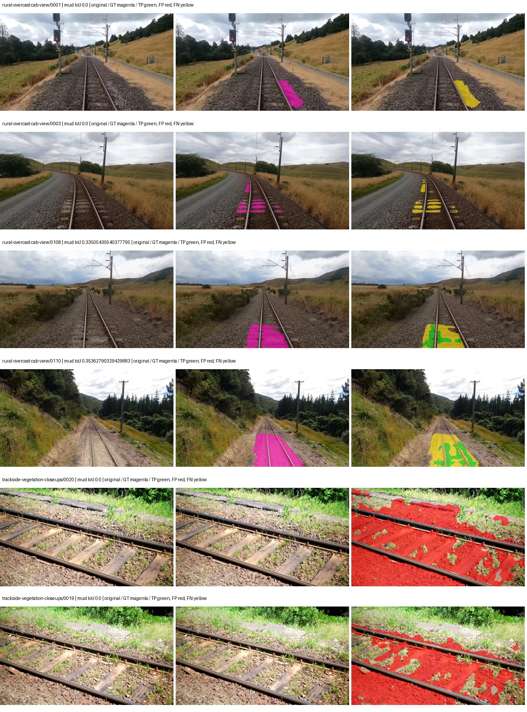
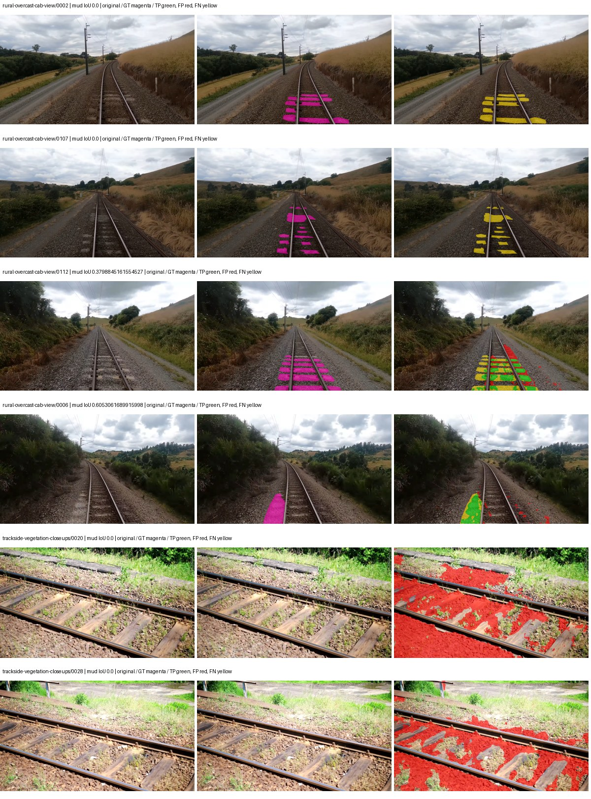
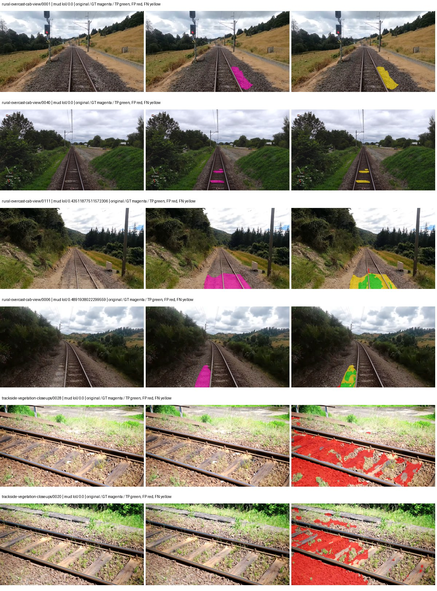
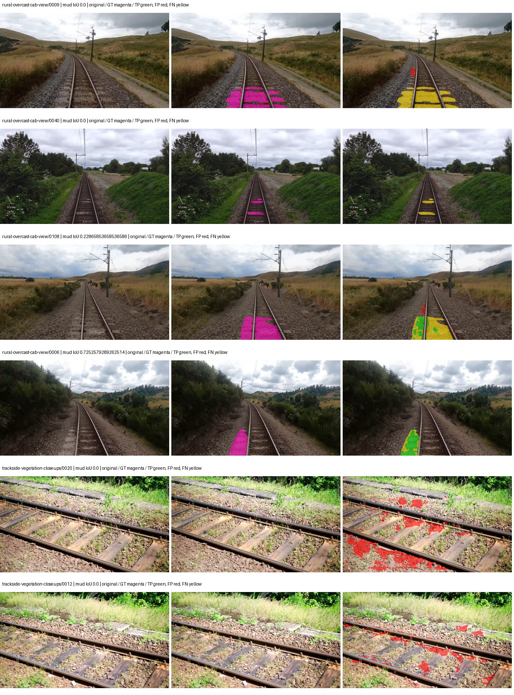

# segformer_b0 — rad_9_24_2026-fixed-grouped

[RAD 9/24: Scene-grouped split](../../README.md) · [Full model records](record.json)

Primary result: the **final checkpoint** after the full step budget (no early stopping). The checkpoint with the best **mud-pumping validation IoU, pixels pooled over all validation images**, is kept as secondary evidence. A job is complete only after full statistics and isolated profiling are verified.

Study metrics of the final checkpoint, counting each class only on the validation images that contain it: mud-pumping IoU is the mean per-image IoU over the images with mud-pumping, precision and recall sum pixels over those images, and mIoU averages each class over the images that contain it, then over the classes present.

| Initialization path | Seed | Mud-pumping IoU, train-camera images with mud (%, n=17) | Mud-pumping IoU, all images with mud (%, n=18) | Mud precision, all images with mud (%) | Mud recall, all images with mud (%) | mIoU (each class over images that contain it) (%) |
| --- | --- | --- | --- | --- | --- | --- |
| rtis_only | 0 | 6.81 | 6.56 | 17.99 | 9.81 | 34.32 |
| cityscapes_to_rtis | 0 | 4.25 | 4.09 | 7.97 | 4.22 | 31.09 |
| railsem19_to_rtis | 0 | 8.88 | 8.49 | 25.05 | 8.90 | 41.38 |
| cityscapes_to_railsem19_to_rtis | 0 | 8.52 | 8.36 | 48.90 | 8.13 | 35.76 |

Per-class IoU: IoU (%) of every class, each averaged only over the validation images that contain the class (n = those images); — = no image contains it. mIoU averages the classes with at least one such image.

| Initialization path | Seed | mIoU (each class over images that contain it) | person (n=0) | truck (n=0) | rail-track (n=37) | vegetation-overgrowth (n=13) | car (n=3) | on-rails (n=0) | traffic-sign (n=9) | road (n=11) | sidewalk (n=12) | construction (n=12) | tram-track (n=2) | pole (n=21) | traffic-light (n=3) | mud-pumping (n=18) | fence (n=7) | terrain (n=35) | sky (n=28) | rail-embedded (n=3) | rail-raised (n=37) | trackbed (n=37) | standing-water (n=9) |
| --- | --- | --- | --- | --- | --- | --- | --- | --- | --- | --- | --- | --- | --- | --- | --- | --- | --- | --- | --- | --- | --- | --- | --- |
| rtis_only | 0 | 34.32 | — | — | 49.65 | 42.49 | 7.71 | — | 8.52 | 24.08 | 21.01 | 34.24 | 1.43 | 57.25 | 45.51 | 6.56 | 10.78 | 84.37 | 96.00 | 5.59 | 71.16 | 50.74 | 0.69 |
| cityscapes_to_rtis | 0 | 31.09 | — | — | 43.78 | 38.00 | 8.32 | — | 11.66 | 10.07 | 2.71 | 27.72 | 5.03 | 63.30 | 39.77 | 4.09 | 5.15 | 80.63 | 95.71 | 1.98 | 66.15 | 51.11 | 4.33 |
| railsem19_to_rtis | 0 | 41.38 | — | — | 57.12 | 42.18 | 18.58 | — | 23.38 | 19.30 | 16.96 | 41.03 | 42.68 | 67.46 | 40.54 | 8.49 | 21.35 | 85.67 | 96.76 | 30.51 | 70.60 | 60.50 | 1.79 |
| cityscapes_to_railsem19_to_rtis | 0 | 35.76 | — | — | 51.66 | 41.94 | 26.87 | — | 18.20 | 15.24 | 6.70 | 33.57 | 0.43 | 66.91 | 50.71 | 8.36 | 6.99 | 80.55 | 96.75 | 5.94 | 70.78 | 56.91 | 5.26 |

Everything below is the campaign's own record, with pixels pooled over all validation images: its evaluation is the checkpoint that scored best on that pooled mud IoU (secondary evidence here); the diagnostics also cover the final checkpoint (`final-auto-val`).

| Model | Initialization path | Seed | Status | Steps | Best step | Best-checkpoint mud IoU, pixels pooled (%) | Best-checkpoint mud precision, pixels pooled (%) | Best-checkpoint mud recall, pixels pooled (%) | Final mud IoU (trainer val, pixels pooled, %) | Best-checkpoint mIoU, pixels pooled (%) | Best-checkpoint fixed GT-class mIoU, pixels pooled (%) |
| --- | --- | --- | --- | --- | --- | --- | --- | --- | --- | --- | --- |
| segformer_b0 | rtis_only | 0 | completed | 4000 | 3629 | 2.86 | 3.58 | 12.46 | 2.29 | 32.25 | 37.63 |
| segformer_b0 | cityscapes_to_rtis | 0 | completed | 4000 | 1296 | 3.40 | 4.17 | 15.53 | 1.37 | 22.52 | 26.27 |
| segformer_b0 | railsem19_to_rtis | 0 | completed | 4000 | 1296 | 6.48 | 9.38 | 17.31 | 3.82 | 35.29 | 41.17 |
| segformer_b0 | cityscapes_to_railsem19_to_rtis | 0 | completed | 4000 | 3370 | 6.57 | 14.44 | 10.76 | 6.08 | 33.34 | 38.90 |

Training: 217 images. Validation: 37 images. Test: 60 held out. Seeds: [0]. Seed variation measures optimization variability, not independent-recording uncertainty. Historical source checkpoints stay fixed across adaptation seeds.

Training code: `fce0ea0ac50b334d4252812c396e0e593def375d`. Split SHA-256: `12d7b367c72cda61d57686ff2ac28223530d0af49debd9fb7a0fbc68b908bc93`.

## rtis_only — seed 0

Status: **completed**. Started: 2026-10-11T11:33:52.030788+00:00. Finished: 2026-10-11T12:16:12.490101+00:00.

Recipe pretrained initializer: `nvidia/mit-b0`.

`rtis_only` uses the recipe initializer, which may include pretrained segmentation components. Transfer paths load the exact historical source checkpoint below and reset the classifier; they do not reset all query/decoder features.

Source checkpoint: `Recipe pretrained initialization`.

Config SHA-256: `e3867e2029060ec990f8f72f589f3289c57c451c62593a725efe98d2866a75b4`. Weights used for validation: `raw`.

### Mud-pumping and aggregate quality

| Metric | Selected checkpoint | Final training validation |
| --- | --- | --- |
| Mud IoU | 2.86 | 2.29 |
| Mud precision | 3.58 | 2.89 |
| Mud recall | 12.46 | 9.81 |
| Mud Dice/F1 | 5.56 | 4.47 |
| mIoU | 32.25 | 32.57 |
| Mean accuracy | 43.85 | 44.16 |
| Mean precision | 56.95 | 55.99 |
| Mean Dice | 41.47 | 41.56 |
| Mean specificity | 98.96 | 98.95 |
| Pixel accuracy | 82.85 | 82.83 |
| Frequency-weighted IoU | 74.81 | 74.75 |
| Fixed GT-present class mIoU | 37.63 | 37.99 |
| Boundary F1 | 40.59 | 40.49 |

The selected checkpoint has independent evaluation evidence. Final values are the trainer's final validation record, not a new independent evaluation. mIoU averages classes with nonzero union, so false positives on absent classes can change its denominator. The fixed GT-class mean is supplementary and excludes absent classes; their false positives remain in the confusion matrix.

### Resource usage and timing

| Measurement | Value |
| --- | --- |
| Peak training VRAM, retained training invocation (GiB) | 7.79 |
| Peak evaluation VRAM (GiB) | 7.03 |
| Retained training invocation wall time (seconds) | 2398.89 |
| Retained training invocation GPU-hours (one GPU) | 0.67 |
| Evaluation wall time (seconds) | 12.87 |
| Full evaluation pipeline images/second | 2.87 |
| Best full-state checkpoint (MiB) | 57.10 |
| Final full-state checkpoint (MiB) | 57.09 |
| Verified periodic checkpoints removed (GiB) | 0.45 |

VRAM uses the recorded allocator high-water mark; it is not total device usage including CUDA context. Resumed jobs' retained training invocation times and peaks are **not whole-campaign totals**. Earlier invocation resource records are not reconstructed here. Evaluation throughput includes loader, sliding-window inference and metrics; it is not model-only latency/FPS. Missing measurements are shown as —, never inferred from another dataset's run.

### Standardized inference performance

Dedicated model-only profiling waits for an idle worker-locked L40S: BF16, batch 1, 1024x1024, 20 warmup and 100 CUDA-event-timed public forwards. It excludes loading, preprocessing, tiling and metrics.

| Status | Parameters | Weight MiB | FPS | p50 ms | p95 ms | Peak reserved GiB |
| --- | --- | --- | --- | --- | --- | --- |
| complete | 3719541 | 14.19 | 133.40 | 7.34 | 8.13 | 0.89 |

```json
{
  "schema_version": 1,
  "model_id": "segformer_b0",
  "measured_at": "2026-10-11T12:16:10+00:00",
  "status": "complete",
  "benchmark_scope": "rtis_selected_checkpoint_model_only",
  "applies_to": [
    "segformer_b0--rtis_only--seed-0"
  ],
  "source": {
    "campaign_git_sha": "fce0ea0ac50b334d4252812c396e0e593def375d",
    "git_dirty": false,
    "config_hash": "83d0f2b62ab2",
    "resolved_config": "/data/izadia1/projects/segmentary-runs/rad_9_24_2026/fgall-seed0-20261007/configs/segformer_b0--rtis_only--seed-0.yaml",
    "config_sha256": "e3867e2029060ec990f8f72f589f3289c57c451c62593a725efe98d2866a75b4",
    "checkpoint_sha256": "e8e07636fc46e9d83c387a1612190fc76edd7bcbe7e2d02925e1da7bbc0e228d",
    "checkpoint_global_step": 3629,
    "checkpoint_bytes": 59869710,
    "checkpoint_kind": "resume checkpoint with optimizer and EMA state",
    "weights": "raw",
    "measured_checkpoint_job_id": "segformer_b0--rtis_only--seed-0",
    "result_sha256": "99e67b5e9a34aecd4500bde157581825dbcb11578ff75ff040be48d1fafd2dc7",
    "result_git_sha": "fce0ea0ac50b334d4252812c396e0e593def375d",
    "result_stage": "eval:rad_9_24_2026-fixed-grouped:val",
    "result_seed": 0
  },
  "hardware": {
    "gpu_name": "NVIDIA L40S",
    "gpu_uuid": "GPU-1c9b612f-e0b5-fbbc-150f-8c2ef13453c9",
    "logical_device": "cuda:0",
    "physical_visibility_token": "5",
    "compute_capability": [
      8,
      9
    ],
    "total_memory_bytes": 47677177856
  },
  "model": {
    "parameter_count": 3719541,
    "trainable_parameter_count": 3719541,
    "resident_parameter_bytes": 14878164,
    "parameter_dtype_counts": {
      "float32": 3719541
    }
  },
  "contract": {
    "backend": "pytorch",
    "precision": "bf16_autocast",
    "batch_size": 1,
    "input_shape_nchw": [
      1,
      3,
      1024,
      1024
    ],
    "warmup_iterations": 20,
    "measured_iterations": 100,
    "timing": "per-forward CUDA events with end-event synchronization",
    "includes_preprocessing": false,
    "includes_data_loader": false,
    "includes_sliding_window": false,
    "input_resident_on_gpu": true,
    "model_only": true,
    "entrypoint": "public model(image) dense-logits forward"
  },
  "measurements": {
    "latency": {
      "p50_ms": 7.340543985366821,
      "p95_ms": 8.130201482772828,
      "mean_ms": 7.496355829238891,
      "minimum_ms": 7.2130560874938965,
      "maximum_ms": 8.771583557128906,
      "fps": 133.39815008508347,
      "raw_ms": [
        7.523327827453613,
        7.274496078491211,
        7.246848106384277,
        7.7414398193359375,
        7.826432228088379,
        7.279615879058838,
        7.227392196655273,
        7.260159969329834,
        7.2130560874938965,
        7.269375801086426,
        7.267327785491943,
        7.365632057189941,
        7.620607852935791,
        7.849952220916748,
        8.126463890075684,
        7.406591892242432,
        7.412735939025879,
        8.348671913146973,
        7.530496120452881,
        7.469056129455566,
        7.33900785446167,
        8.10905647277832,
        7.868415832519531,
        7.359488010406494,
        7.462912082672119,
        7.522304058074951,
        7.730175971984863,
        7.837696075439453,
        7.434239864349365,
        7.325695991516113,
        7.303167819976807,
        8.201215744018555,
        8.053759574890137,
        7.444479942321777,
        7.394303798675537,
        7.304192066192627,
        7.285759925842285,
        7.332863807678223,
        8.075263977050781,
        7.986176013946533,
        7.714816093444824,
        8.018943786621094,
        7.848959922790527,
        7.433216094970703,
        7.365632057189941,
        7.395328044891357,
        7.285759925842285,
        7.317503929138184,
        7.270400047302246,
        7.294976234436035,
        7.264256000518799,
        7.287807941436768,
        7.2570881843566895,
        7.250944137573242,
        7.569407939910889,
        7.224319934844971,
        7.250944137573242,
        7.355391979217529,
        7.317503929138184,
        7.278592109680176,
        7.251967906951904,
        7.262207984924316,
        7.329792022705078,
        7.326720237731934,
        7.812096118927002,
        8.734720230102539,
        7.48851203918457,
        7.406591892242432,
        7.3021440505981445,
        7.337984085083008,
        7.2775678634643555,
        7.223296165466309,
        7.310336112976074,
        7.729152202606201,
        7.639039993286133,
        8.771583557128906,
        8.256511688232422,
        7.342080116271973,
        7.769087791442871,
        7.313407897949219,
        7.219200134277344,
        7.2427520751953125,
        7.2406721115112305,
        7.282688140869141,
        7.502848148345947,
        7.928832054138184,
        7.358463764190674,
        7.635968208312988,
        7.245823860168457,
        7.305215835571289,
        7.285759925842285,
        7.243775844573975,
        7.283711910247803,
        7.344128131866455,
        7.230463981628418,
        7.772160053253174,
        7.225376129150391,
        7.267327785491943,
        7.2325439453125,
        7.271423816680908
      ],
      "percentile_method": "numpy linear interpolation"
    },
    "peak_reserved_bytes": 960495616,
    "memory_kind": "pytorch_cuda_allocator_peak_reserved_excluding_context",
    "process_total_bytes": 1497366528,
    "process_total_kind": "nvidia-smi used_memory of this PID on the benchmark GPU after the timed loop, including the CUDA context; null when the driver could not attribute memory to this PID",
    "benchmark_wall_clock_s": 4.530208386480808
  },
  "started_at": "2026-10-11T12:16:05+00:00",
  "finished_at": "2026-10-11T12:16:10+00:00",
  "environment": {
    "hostname": "hdrfs-app-001",
    "python": "3.11.15",
    "platform": "Linux-5.15.0-139-generic-x86_64-with-glibc2.35",
    "torch": "2.11.0+cu128",
    "torch_cuda": "12.8",
    "cudnn": 91900,
    "driver_version": "570.133.20",
    "cuda_available": true,
    "gpu_count": 1,
    "gpu_names": [
      "NVIDIA L40S"
    ],
    "cuda_visible_devices": "5",
    "packages": {
      "segmentary": "0.1.0",
      "torch": "2.11.0+cu128",
      "torchvision": "0.26.0+cu128",
      "transformers": "5.15.0",
      "timm": "1.0.28",
      "segmentation-models-pytorch": "0.5.0",
      "albumentations": "2.0.8",
      "lightning": "2.6.5",
      "numpy": "2.4.4"
    }
  }
}
```

### Per-class validation results

| Class | GT pixels | IoU (%) | Precision (%) | Recall (%) | Dice (%) | Boundary F1 (%) |
| --- | --- | --- | --- | --- | --- | --- |
| car | 29664 | 6.75 | 44.07 | 7.39 | 12.65 | 43.45 |
| construction | 311585 | 39.40 | 49.44 | 65.98 | 56.53 | 53.22 |
| fence | 265137 | 9.66 | 60.21 | 10.31 | 17.61 | 28.47 |
| mud-pumping | 1226250 | 2.86 | 3.58 | 12.46 | 5.56 | 6.17 |
| on-rails | 0 | 0.00 | 0.00 | — | 0.00 | 0.00 |
| person | 0 | 0.00 | 0.00 | — | 0.00 | 0.00 |
| pole | 628038 | 63.26 | 83.09 | 72.61 | 77.50 | 87.74 |
| rail-embedded | 16799 | 14.12 | 99.16 | 14.14 | 24.75 | 26.77 |
| rail-raised | 2969797 | 71.21 | 83.28 | 83.08 | 83.18 | 90.25 |
| rail-track | 6323197 | 31.80 | 68.13 | 37.36 | 48.26 | 45.11 |
| road | 1048831 | 28.05 | 75.73 | 30.82 | 43.81 | 36.67 |
| sidewalk | 1297367 | 49.21 | 85.10 | 53.85 | 65.96 | 28.48 |
| sky | 19121606 | 97.89 | 99.35 | 98.51 | 98.93 | 93.91 |
| standing-water | 95802 | 1.50 | 2.41 | 3.85 | 2.96 | 5.85 |
| terrain | 39239306 | 87.70 | 89.48 | 97.78 | 93.44 | 63.73 |
| trackbed | 10643081 | 49.82 | 68.98 | 64.20 | 66.50 | 50.44 |
| traffic-light | 19510 | 56.49 | 92.45 | 59.22 | 72.20 | 76.83 |
| traffic-sign | 13285 | 19.14 | 75.12 | 20.44 | 32.13 | 40.53 |
| tram-track | 56179 | 3.61 | 43.03 | 3.79 | 6.97 | 8.76 |
| truck | 0 | 0.00 | 0.00 | — | 0.00 | 0.00 |
| vegetation-overgrowth | 5901821 | 44.79 | 73.38 | 53.48 | 61.87 | 65.95 |

### Full-run accounting

| Measurement | Value |
| --- | --- |
| Full GPU-reserved wall seconds, all recorded worker attempts | 2548.27 |
| Full reserved GPU-hours | 0.71 |
| Whole-run timing complete | True |

| Phase | Wall seconds including failed attempts |
| --- | --- |
| training | 2405.81 |
| diagnostics | 101.59 |
| performance | 11.79 |

GPU-reserved time includes model loading, training, validation, collection, profiling, checkpoint I/O and orchestration while the worker owns one GPU. It is not GPU kernel-active time. Phase timings and sampled device memory/power/utilization are retained separately; sampled device memory is not the allocator high-water mark.

### Train/validation and raw/EMA diagnostics

| Checkpoint / weights / split | Images | Mud IoU (%) | Mud precision (%) | Mud recall (%) |
| --- | --- | --- | --- | --- |
| best-auto-train / raw | 217 | 94.66 | 96.54 | 97.99 |
| best-auto-val / raw | 37 | 2.86 | 3.58 | 12.46 |
| best-alternate-val / ema | 37 | 1.81 | 2.39 | 6.95 |
| final-auto-val / raw | 37 | 2.29 | 2.90 | 9.81 |

Train uses the evaluation transform without augmentation. Compare mud train/validation metrics for the same selected weights. Alternate EMA on running-stat BatchNorm is explicitly uncalibrated and is diagnostic only. Score-threshold curves use uncalibrated normalized scores and are pixel-level diagnostics, not event detection rates or a selected deployment operating point.

### Downloadable evidence

- best-auto-train: [per-image.csv](rtis_only--seed-0/best-auto-train/per-image.csv) · [per-image-confusion.json.gz](rtis_only--seed-0/best-auto-train/per-image-confusion.json.gz) · [groups.json](rtis_only--seed-0/best-auto-train/groups.json) · [mud-score-curves.json](rtis_only--seed-0/best-auto-train/mud-score-curves.json)
- best-auto-val: [per-image.csv](rtis_only--seed-0/best-auto-val/per-image.csv) · [per-image-confusion.json.gz](rtis_only--seed-0/best-auto-val/per-image-confusion.json.gz) · [groups.json](rtis_only--seed-0/best-auto-val/groups.json) · [mud-score-curves.json](rtis_only--seed-0/best-auto-val/mud-score-curves.json) · [examples.jpg](rtis_only--seed-0/best-auto-val/examples.jpg)
- best-alternate-val: [per-image.csv](rtis_only--seed-0/best-alternate-val/per-image.csv) · [per-image-confusion.json.gz](rtis_only--seed-0/best-alternate-val/per-image-confusion.json.gz) · [groups.json](rtis_only--seed-0/best-alternate-val/groups.json) · [mud-score-curves.json](rtis_only--seed-0/best-alternate-val/mud-score-curves.json)
- final-auto-val: [per-image.csv](rtis_only--seed-0/final-auto-val/per-image.csv) · [per-image-confusion.json.gz](rtis_only--seed-0/final-auto-val/per-image-confusion.json.gz) · [groups.json](rtis_only--seed-0/final-auto-val/groups.json) · [mud-score-curves.json](rtis_only--seed-0/final-auto-val/mud-score-curves.json)
- resources: [telemetry.csv](rtis_only--seed-0/resources/telemetry.csv)



Examples are two lowest and two highest mud-IoU positive images, plus up to two negative images with the most false-positive mud pixels. They are targeted diagnostic examples, not random samples. Green: true positive; red: false positive; yellow: false negative. Full predictions remain on HDRFS.

### Validation tracking

| Logged step | Overall mIoU (%) | Mud IoU (%) |
| --- | --- | --- |
| 258 | 20.25 | 0.15 |
| 518 | 23.03 | 0.20 |
| 777 | 22.39 | 0.16 |
| 1036 | 24.35 | 0.57 |
| 1295 | 26.31 | 1.67 |
| 1555 | 27.23 | 1.53 |
| 1814 | 29.32 | 0.99 |
| 2073 | 32.71 | 1.49 |
| 2332 | 32.67 | 1.72 |
| 2592 | 32.57 | 1.90 |
| 2851 | 31.03 | 2.22 |
| 3110 | 33.07 | 1.86 |
| 3369 | 33.03 | 2.42 |
| 3629 | 32.23 | 2.86 |
| 3888 | 32.52 | 1.96 |
| 4000 | 32.57 | 2.29 |

All retained scalar curves, including training loss and per-class IoU, are in record.json. Observed best mud on a curve is not necessarily a retained checkpoint: the pilot saved its selection-metric-best and final checkpoints. Step logging and checkpoint global_step may differ by one.

### Stopping and checkpoint provenance

```json
{
  "stopping": {
    "actual_steps": 4000,
    "maximum_steps": 4000,
    "min_delta": 0.0,
    "monitor": "val_iou/mud-pumping",
    "patience": null,
    "reason": "budget_complete"
  },
  "checkpoints": {
    "best": {
      "path": "/data/izadia1/projects/segmentary-runs/rad_9_24_2026/fgall-seed0-20261007/future-runs/segformer_b0--rtis_only--seed-0_seed0/rtis/best.ckpt",
      "sha256": "e8e07636fc46e9d83c387a1612190fc76edd7bcbe7e2d02925e1da7bbc0e228d",
      "global_step": 3629,
      "bytes": 59869710
    },
    "final": {
      "path": "/data/izadia1/projects/segmentary-runs/rad_9_24_2026/fgall-seed0-20261007/future-runs/segformer_b0--rtis_only--seed-0_seed0/rtis/last.ckpt",
      "sha256": "c8c2f95b243183bf46e231166e29a0b481013cf55473b0521569c8ad9d6f0e7b",
      "global_step": 4000,
      "bytes": 59859790
    }
  },
  "cleanup_error": null
}
```

### Resolved training, initialization and evaluation settings

The optimizer block is the base configuration. Stage LR scales are applied at runtime, and stage warmup is capped at min(base warmup, floor(stage budget / 10), stage budget - 1): 400 steps for this 4,000-step pilot. Model-internal native input grids may differ from augmentation crops (EoMT uses its 640 grid).

```json
{
  "name": "segformer_b0--rtis_only--seed-0",
  "model": {
    "arch": "segformer_b0",
    "checkpoint": "nvidia/mit-b0",
    "tuning": "full",
    "head": "unified_head",
    "lora_r": 16,
    "lora_alpha": 32,
    "lora_dropout": 0.05,
    "lora_targets": [],
    "drop_path": null,
    "revision": null,
    "subfolder": null,
    "local_files_only": false,
    "trust_remote_code": false,
    "backbone_path": null,
    "head_paths": [],
    "classifier_path": null,
    "inactive_parameter_paths": [],
    "smp_arch": null,
    "encoder_name": null,
    "encoder_weights": null,
    "native": null,
    "batch_norm_momentum": null
  },
  "space": "paul-test-rtis",
  "taxonomy_root": "/data/izadia1/projects/segmentary-rad-fgall-fce0ea0a/taxonomy",
  "output_root": "/data/izadia1/projects/segmentary-runs/rad_9_24_2026/fgall-seed0-20261007/future-runs",
  "optim": {
    "backbone_lr": 6e-05,
    "head_lr_mult": 10.0,
    "weight_decay": 0.05,
    "llrd": 1.0,
    "warmup_iters": 1500,
    "warmup_ratio": 1e-06,
    "poly_power": 0.9,
    "min_lr_ratio": 0.0,
    "betas": [
      0.9,
      0.999
    ],
    "grad_clip": 1.0
  },
  "train": {
    "iters": 4000,
    "batch_size": 2,
    "accum": 8,
    "num_workers": 2,
    "precision": "bf16-mixed",
    "ema_decay": 0.9998,
    "val_every": 250,
    "ckpt_every": 500,
    "selection_metric": "val_iou/mud-pumping",
    "early_stopping_patience": null,
    "early_stopping_min_delta": 0.0,
    "seed": 0,
    "devices": 1
  },
  "eval": {
    "sliding_window": true,
    "window": [
      1024,
      1024
    ],
    "stride": [
      768,
      768
    ],
    "batch_size": 1,
    "num_workers": 2,
    "tta_scales": [],
    "tta_flip": false,
    "threshold": 0.5,
    "boundary_tolerance_frac": 0.0075,
    "save_confusion": true
  },
  "loss": {
    "task": "multiclass",
    "activation": "auto",
    "terms": [],
    "aux": "none",
    "aux_weight": 0.0,
    "ce_weight": 1.0,
    "label_smoothing": 0.0,
    "class_weights": null,
    "query": null
  },
  "aug": {
    "crop": [
      1024,
      1024
    ],
    "scale_min": 0.5,
    "scale_max": 2.0,
    "hflip_p": 0.5,
    "color_jitter_p": 0.5,
    "brightness": 0.25,
    "contrast": 0.25,
    "saturation": 0.25,
    "hue": 0.05
  },
  "stages": [
    {
      "name": "rtis",
      "data": [
        {
          "name": "rad_9_24_2026-fixed-grouped",
          "root": "/data/izadia1/datasets/rad_9_24_2026-fixed-grouped",
          "variant": null,
          "split_file": "splits.json",
          "train_split": "train",
          "val_split": "val",
          "limit": null,
          "loader": "folder",
          "mapping": "paul-test-rtis",
          "loader_options": {
            "require_groups": true
          }
        }
      ],
      "iters": null,
      "lr_scale": 1.0,
      "head_group_lr_scale": 1.0,
      "init_from": "pretrained",
      "reset_head": false,
      "freeze": null,
      "sample_weights": null
    }
  ]
}
```

### Hardware and software provenance

```json
{
  "training": {
    "cuda_available": true,
    "cuda_visible_devices": "5",
    "cudnn": 91900,
    "driver_version": "570.133.20",
    "gpu_count": 1,
    "gpu_names": [
      "NVIDIA L40S"
    ],
    "hostname": "hdrfs-app-001",
    "input_normalization": {
      "channel_order": "rgb",
      "mean": [
        0.485,
        0.456,
        0.406
      ],
      "source": "imagenet",
      "std": [
        0.229,
        0.224,
        0.225
      ]
    },
    "model_origins": [
      {
        "hf_commit": "80983a413c30d36a39c20203974ae7807835e2b4",
        "hf_name_or_path": "nvidia/mit-b0",
        "module": "model",
        "timm_pretrained": {}
      },
      {
        "hf_commit": "80983a413c30d36a39c20203974ae7807835e2b4",
        "hf_name_or_path": "nvidia/mit-b0",
        "module": "model.segformer",
        "timm_pretrained": {}
      },
      {
        "hf_commit": "80983a413c30d36a39c20203974ae7807835e2b4",
        "hf_name_or_path": "nvidia/mit-b0",
        "module": "model.segformer.stages.0.blocks.0.attention",
        "timm_pretrained": {}
      },
      {
        "hf_commit": "80983a413c30d36a39c20203974ae7807835e2b4",
        "hf_name_or_path": "nvidia/mit-b0",
        "module": "model.segformer.stages.0.blocks.1.attention",
        "timm_pretrained": {}
      },
      {
        "hf_commit": "80983a413c30d36a39c20203974ae7807835e2b4",
        "hf_name_or_path": "nvidia/mit-b0",
        "module": "model.segformer.stages.1.blocks.0.attention",
        "timm_pretrained": {}
      },
      {
        "hf_commit": "80983a413c30d36a39c20203974ae7807835e2b4",
        "hf_name_or_path": "nvidia/mit-b0",
        "module": "model.segformer.stages.1.blocks.1.attention",
        "timm_pretrained": {}
      },
      {
        "hf_commit": "80983a413c30d36a39c20203974ae7807835e2b4",
        "hf_name_or_path": "nvidia/mit-b0",
        "module": "model.segformer.stages.2.blocks.0.attention",
        "timm_pretrained": {}
      },
      {
        "hf_commit": "80983a413c30d36a39c20203974ae7807835e2b4",
        "hf_name_or_path": "nvidia/mit-b0",
        "module": "model.segformer.stages.2.blocks.1.attention",
        "timm_pretrained": {}
      },
      {
        "hf_commit": "80983a413c30d36a39c20203974ae7807835e2b4",
        "hf_name_or_path": "nvidia/mit-b0",
        "module": "model.segformer.stages.3.blocks.0.attention",
        "timm_pretrained": {}
      },
      {
        "hf_commit": "80983a413c30d36a39c20203974ae7807835e2b4",
        "hf_name_or_path": "nvidia/mit-b0",
        "module": "model.segformer.stages.3.blocks.1.attention",
        "timm_pretrained": {}
      },
      {
        "hf_commit": "80983a413c30d36a39c20203974ae7807835e2b4",
        "hf_name_or_path": "nvidia/mit-b0",
        "module": "model.decode_head",
        "timm_pretrained": {}
      }
    ],
    "model_parameter_count": 3719541,
    "packages": {
      "albumentations": "2.0.8",
      "lightning": "2.6.5",
      "numpy": "2.4.4",
      "segmentary": "0.1.0",
      "segmentation-models-pytorch": "0.5.0",
      "timm": "1.0.28",
      "torch": "2.11.0+cu128",
      "torchvision": "0.26.0+cu128",
      "transformers": "5.15.0"
    },
    "platform": "Linux-5.15.0-139-generic-x86_64-with-glibc2.35",
    "python": "3.11.15",
    "torch": "2.11.0+cu128",
    "torch_cuda": "12.8",
    "trainable_parameter_count": 3719541,
    "training_stop": {
      "actual_steps": 4000,
      "maximum_steps": 4000,
      "min_delta": 0.0,
      "monitor": "val_iou/mud-pumping",
      "patience": null,
      "reason": "budget_complete"
    },
    "validation_weights": "raw"
  },
  "evaluation": {
    "cuda_available": true,
    "cuda_visible_devices": "5",
    "cudnn": 91900,
    "driver_version": "570.133.20",
    "gpu_count": 1,
    "gpu_names": [
      "NVIDIA L40S"
    ],
    "hostname": "hdrfs-app-001",
    "input_normalization": {
      "channel_order": "rgb",
      "mean": [
        0.485,
        0.456,
        0.406
      ],
      "source": "imagenet",
      "std": [
        0.229,
        0.224,
        0.225
      ]
    },
    "packages": {
      "albumentations": "2.0.8",
      "lightning": "2.6.5",
      "numpy": "2.4.4",
      "segmentary": "0.1.0",
      "segmentation-models-pytorch": "0.5.0",
      "timm": "1.0.28",
      "torch": "2.11.0+cu128",
      "torchvision": "0.26.0+cu128",
      "transformers": "5.15.0"
    },
    "platform": "Linux-5.15.0-139-generic-x86_64-with-glibc2.35",
    "python": "3.11.15",
    "torch": "2.11.0+cu128",
    "torch_cuda": "12.8"
  }
}
```

## cityscapes_to_rtis — seed 0

Status: **completed**. Started: 2026-10-11T11:38:04.931781+00:00. Finished: 2026-10-11T12:19:30.470598+00:00.

Recipe pretrained initializer: `nvidia/mit-b0`.

`rtis_only` uses the recipe initializer, which may include pretrained segmentation components. Transfer paths load the exact historical source checkpoint below and reset the classifier; they do not reset all query/decoder features.

Source checkpoint: `{'name': 'segformer_b0--cityscapes--seed-0', 'model': 'segformer_b0', 'protocol': 'cityscapes', 'config': '/data/izadia1/projects/segmentary-runs/all-model-city-rail-seed0-rail20-b9eb3e1/accepted/segformer_b0--cityscapes--seed-0/resolved-config.yaml', 'checkpoint': '/data/izadia1/projects/segmentary-runs/current-main-fill-v2/jobs/segformer_b0--cityscapes--seed-0/train/segformer_b0--cityscapes_seed0/cityscapes/last.ckpt', 'recorded_sha256': '47048ef71b774dfe61882fdac1cf32d638d8d41a094b3f91a14900021015ac59', 'exists': True}`.

Config SHA-256: `2177a2eea53ac5b5ec15bba89ab00bb94fe639e79bf51b4887f7ca9f36132a01`. Weights used for validation: `raw`.

### Mud-pumping and aggregate quality

| Metric | Selected checkpoint | Final training validation |
| --- | --- | --- |
| Mud IoU | 3.40 | 1.37 |
| Mud precision | 4.17 | 2.00 |
| Mud recall | 15.53 | 4.22 |
| Mud Dice/F1 | 6.58 | 2.71 |
| mIoU | 22.52 | 27.36 |
| Mean accuracy | 32.41 | 39.23 |
| Mean precision | 32.62 | 41.39 |
| Mean Dice | 27.99 | 35.23 |
| Mean specificity | 98.70 | 98.80 |
| Pixel accuracy | 79.27 | 80.94 |
| Frequency-weighted IoU | 70.26 | 71.75 |
| Fixed GT-present class mIoU | 26.27 | 31.92 |
| Boundary F1 | 26.52 | 34.85 |

The selected checkpoint has independent evaluation evidence. Final values are the trainer's final validation record, not a new independent evaluation. mIoU averages classes with nonzero union, so false positives on absent classes can change its denominator. The fixed GT-class mean is supplementary and excludes absent classes; their false positives remain in the confusion matrix.

### Resource usage and timing

| Measurement | Value |
| --- | --- |
| Peak training VRAM, retained training invocation (GiB) | 7.80 |
| Peak evaluation VRAM (GiB) | 7.03 |
| Retained training invocation wall time (seconds) | 2343.87 |
| Retained training invocation GPU-hours (one GPU) | 0.65 |
| Evaluation wall time (seconds) | 13.01 |
| Full evaluation pipeline images/second | 2.84 |
| Best full-state checkpoint (MiB) | 57.10 |
| Final full-state checkpoint (MiB) | 57.09 |
| Verified periodic checkpoints removed (GiB) | 0.45 |

VRAM uses the recorded allocator high-water mark; it is not total device usage including CUDA context. Resumed jobs' retained training invocation times and peaks are **not whole-campaign totals**. Earlier invocation resource records are not reconstructed here. Evaluation throughput includes loader, sliding-window inference and metrics; it is not model-only latency/FPS. Missing measurements are shown as —, never inferred from another dataset's run.

### Standardized inference performance

Dedicated model-only profiling waits for an idle worker-locked L40S: BF16, batch 1, 1024x1024, 20 warmup and 100 CUDA-event-timed public forwards. It excludes loading, preprocessing, tiling and metrics.

| Status | Parameters | Weight MiB | FPS | p50 ms | p95 ms | Peak reserved GiB |
| --- | --- | --- | --- | --- | --- | --- |
| complete | 3719541 | 14.19 | 135.12 | 7.28 | 7.84 | 0.89 |

```json
{
  "schema_version": 1,
  "model_id": "segformer_b0",
  "measured_at": "2026-10-11T12:19:28+00:00",
  "status": "complete",
  "benchmark_scope": "rtis_selected_checkpoint_model_only",
  "applies_to": [
    "segformer_b0--cityscapes_to_rtis--seed-0"
  ],
  "source": {
    "campaign_git_sha": "fce0ea0ac50b334d4252812c396e0e593def375d",
    "git_dirty": false,
    "config_hash": "6127af21508f",
    "resolved_config": "/data/izadia1/projects/segmentary-runs/rad_9_24_2026/fgall-seed0-20261007/configs/segformer_b0--cityscapes_to_rtis--seed-0.yaml",
    "config_sha256": "2177a2eea53ac5b5ec15bba89ab00bb94fe639e79bf51b4887f7ca9f36132a01",
    "checkpoint_sha256": "78cbdf7fb947d2d485d5b10b2b7ae9b98e8b29c6218b5d8ba12855e5fd21ad39",
    "checkpoint_global_step": 1296,
    "checkpoint_bytes": 59869710,
    "checkpoint_kind": "resume checkpoint with optimizer and EMA state",
    "weights": "raw",
    "measured_checkpoint_job_id": "segformer_b0--cityscapes_to_rtis--seed-0",
    "result_sha256": "0490874f052e7e510c2df3228348ad98b743338555a17af3b8df743e340c45b5",
    "result_git_sha": "fce0ea0ac50b334d4252812c396e0e593def375d",
    "result_stage": "eval:rad_9_24_2026-fixed-grouped:val",
    "result_seed": 0
  },
  "hardware": {
    "gpu_name": "NVIDIA L40S",
    "gpu_uuid": "GPU-a5ad49e5-0536-5229-ba8a-f8a902808f53",
    "logical_device": "cuda:0",
    "physical_visibility_token": "7",
    "compute_capability": [
      8,
      9
    ],
    "total_memory_bytes": 47677177856
  },
  "model": {
    "parameter_count": 3719541,
    "trainable_parameter_count": 3719541,
    "resident_parameter_bytes": 14878164,
    "parameter_dtype_counts": {
      "float32": 3719541
    }
  },
  "contract": {
    "backend": "pytorch",
    "precision": "bf16_autocast",
    "batch_size": 1,
    "input_shape_nchw": [
      1,
      3,
      1024,
      1024
    ],
    "warmup_iterations": 20,
    "measured_iterations": 100,
    "timing": "per-forward CUDA events with end-event synchronization",
    "includes_preprocessing": false,
    "includes_data_loader": false,
    "includes_sliding_window": false,
    "input_resident_on_gpu": true,
    "model_only": true,
    "entrypoint": "public model(image) dense-logits forward"
  },
  "measurements": {
    "latency": {
      "p50_ms": 7.2821760177612305,
      "p95_ms": 7.843942475318908,
      "mean_ms": 7.400919361114502,
      "minimum_ms": 7.192575931549072,
      "maximum_ms": 9.486335754394531,
      "fps": 135.11834830333976,
      "raw_ms": [
        8.428544044494629,
        7.533567905426025,
        7.323647975921631,
        7.363584041595459,
        7.291903972625732,
        9.486335754394531,
        7.24889612197876,
        7.245823860168457,
        7.640063762664795,
        7.287807941436768,
        7.243775844573975,
        7.192575931549072,
        7.382080078125,
        7.569407939910889,
        7.243775844573975,
        7.195648193359375,
        7.235583782196045,
        7.552000045776367,
        7.64415979385376,
        7.320576190948486,
        7.284736156463623,
        7.2775678634643555,
        7.224319934844971,
        7.244800090789795,
        7.328767776489258,
        7.581696033477783,
        7.835648059844971,
        8.00153636932373,
        7.416831970214844,
        7.3318400382995605,
        7.223296165466309,
        7.245823860168457,
        7.216127872467041,
        7.296000003814697,
        7.597055912017822,
        7.224319934844971,
        7.2284159660339355,
        7.207935810089111,
        7.271423816680908,
        7.606272220611572,
        8.453120231628418,
        7.709695816040039,
        7.314432144165039,
        7.325695991516113,
        7.28166389465332,
        7.301119804382324,
        7.65337610244751,
        7.674880027770996,
        7.598080158233643,
        7.391232013702393,
        7.2724480628967285,
        7.246848106384277,
        7.209983825683594,
        7.515135765075684,
        7.301119804382324,
        7.216127872467041,
        7.19974422454834,
        7.234560012817383,
        7.2038397789001465,
        8.238080024719238,
        7.3512959480285645,
        7.237631797790527,
        7.206912040710449,
        7.230463981628418,
        7.220223903656006,
        7.196671962738037,
        7.217152118682861,
        7.293951988220215,
        7.3318400382995605,
        7.279615879058838,
        7.526400089263916,
        7.225344181060791,
        7.2775678634643555,
        7.193600177764893,
        7.204864025115967,
        7.274496078491211,
        7.282688140869141,
        7.606272220611572,
        7.572480201721191,
        7.219200134277344,
        7.197696208953857,
        7.1987199783325195,
        7.260159969329834,
        7.256063938140869,
        7.227392196655273,
        7.613440036773682,
        7.3021440505981445,
        7.218175888061523,
        7.231488227844238,
        7.238656044006348,
        7.252992153167725,
        7.2478718757629395,
        7.633920192718506,
        7.441376209259033,
        7.296000003814697,
        7.208960056304932,
        7.201791763305664,
        7.49567985534668,
        7.791615962982178,
        7.413760185241699
      ],
      "percentile_method": "numpy linear interpolation"
    },
    "peak_reserved_bytes": 960495616,
    "memory_kind": "pytorch_cuda_allocator_peak_reserved_excluding_context",
    "process_total_bytes": 1497366528,
    "process_total_kind": "nvidia-smi used_memory of this PID on the benchmark GPU after the timed loop, including the CUDA context; null when the driver could not attribute memory to this PID",
    "benchmark_wall_clock_s": 4.447690539062023
  },
  "started_at": "2026-10-11T12:19:23+00:00",
  "finished_at": "2026-10-11T12:19:28+00:00",
  "environment": {
    "hostname": "hdrfs-app-001",
    "python": "3.11.15",
    "platform": "Linux-5.15.0-139-generic-x86_64-with-glibc2.35",
    "torch": "2.11.0+cu128",
    "torch_cuda": "12.8",
    "cudnn": 91900,
    "driver_version": "570.133.20",
    "cuda_available": true,
    "gpu_count": 1,
    "gpu_names": [
      "NVIDIA L40S"
    ],
    "cuda_visible_devices": "7",
    "packages": {
      "segmentary": "0.1.0",
      "torch": "2.11.0+cu128",
      "torchvision": "0.26.0+cu128",
      "transformers": "5.15.0",
      "timm": "1.0.28",
      "segmentation-models-pytorch": "0.5.0",
      "albumentations": "2.0.8",
      "lightning": "2.6.5",
      "numpy": "2.4.4"
    }
  }
}
```

### Per-class validation results

| Class | GT pixels | IoU (%) | Precision (%) | Recall (%) | Dice (%) | Boundary F1 (%) |
| --- | --- | --- | --- | --- | --- | --- |
| car | 29664 | 0.00 | 0.00 | 0.00 | 0.00 | 0.00 |
| construction | 311585 | 49.78 | 71.65 | 61.98 | 66.47 | 59.67 |
| fence | 265137 | 1.22 | 1.78 | 3.74 | 2.41 | 4.51 |
| mud-pumping | 1226250 | 3.40 | 4.17 | 15.53 | 6.58 | 11.10 |
| on-rails | 0 | 0.00 | 0.00 | — | 0.00 | 0.00 |
| person | 0 | 0.00 | 0.00 | — | 0.00 | 0.00 |
| pole | 628038 | 63.45 | 77.79 | 77.48 | 77.64 | 86.49 |
| rail-embedded | 16799 | 0.00 | 0.00 | 0.00 | 0.00 | 0.00 |
| rail-raised | 2969797 | 57.50 | 72.52 | 73.52 | 73.02 | 83.13 |
| rail-track | 6323197 | 23.47 | 74.70 | 25.50 | 38.02 | 39.24 |
| road | 1048831 | 6.54 | 14.46 | 10.66 | 12.28 | 12.85 |
| sidewalk | 1297367 | 0.76 | 25.11 | 0.77 | 1.50 | 4.15 |
| sky | 19121606 | 97.87 | 99.29 | 98.56 | 98.92 | 93.52 |
| standing-water | 95802 | 1.15 | 1.20 | 20.08 | 2.26 | 2.59 |
| terrain | 39239306 | 83.50 | 85.02 | 97.90 | 91.01 | 43.10 |
| trackbed | 10643081 | 49.80 | 73.45 | 60.74 | 66.49 | 52.64 |
| traffic-light | 19510 | 0.00 | 0.00 | 0.00 | 0.00 | 0.00 |
| traffic-sign | 13285 | 0.00 | 0.00 | 0.00 | 0.00 | 0.00 |
| tram-track | 56179 | 0.00 | 0.00 | 0.00 | 0.00 | 0.00 |
| truck | 0 | 0.00 | 0.00 | — | 0.00 | 0.00 |
| vegetation-overgrowth | 5901821 | 34.40 | 83.81 | 36.85 | 51.20 | 63.92 |

### Full-run accounting

| Measurement | Value |
| --- | --- |
| Full GPU-reserved wall seconds, all recorded worker attempts | 2493.34 |
| Full reserved GPU-hours | 0.69 |
| Whole-run timing complete | True |

| Phase | Wall seconds including failed attempts |
| --- | --- |
| training | 2350.57 |
| diagnostics | 101.80 |
| performance | 12.03 |

GPU-reserved time includes model loading, training, validation, collection, profiling, checkpoint I/O and orchestration while the worker owns one GPU. It is not GPU kernel-active time. Phase timings and sampled device memory/power/utilization are retained separately; sampled device memory is not the allocator high-water mark.

### Train/validation and raw/EMA diagnostics

| Checkpoint / weights / split | Images | Mud IoU (%) | Mud precision (%) | Mud recall (%) |
| --- | --- | --- | --- | --- |
| best-auto-train / raw | 217 | 86.35 | 89.46 | 96.13 |
| best-auto-val / raw | 37 | 3.40 | 4.17 | 15.53 |
| best-alternate-val / ema | 37 | 1.83 | 2.39 | 7.29 |
| final-auto-val / raw | 37 | 1.38 | 2.00 | 4.22 |

Train uses the evaluation transform without augmentation. Compare mud train/validation metrics for the same selected weights. Alternate EMA on running-stat BatchNorm is explicitly uncalibrated and is diagnostic only. Score-threshold curves use uncalibrated normalized scores and are pixel-level diagnostics, not event detection rates or a selected deployment operating point.

### Downloadable evidence

- best-auto-train: [per-image.csv](cityscapes_to_rtis--seed-0/best-auto-train/per-image.csv) · [per-image-confusion.json.gz](cityscapes_to_rtis--seed-0/best-auto-train/per-image-confusion.json.gz) · [groups.json](cityscapes_to_rtis--seed-0/best-auto-train/groups.json) · [mud-score-curves.json](cityscapes_to_rtis--seed-0/best-auto-train/mud-score-curves.json)
- best-auto-val: [per-image.csv](cityscapes_to_rtis--seed-0/best-auto-val/per-image.csv) · [per-image-confusion.json.gz](cityscapes_to_rtis--seed-0/best-auto-val/per-image-confusion.json.gz) · [groups.json](cityscapes_to_rtis--seed-0/best-auto-val/groups.json) · [mud-score-curves.json](cityscapes_to_rtis--seed-0/best-auto-val/mud-score-curves.json) · [examples.jpg](cityscapes_to_rtis--seed-0/best-auto-val/examples.jpg)
- best-alternate-val: [per-image.csv](cityscapes_to_rtis--seed-0/best-alternate-val/per-image.csv) · [per-image-confusion.json.gz](cityscapes_to_rtis--seed-0/best-alternate-val/per-image-confusion.json.gz) · [groups.json](cityscapes_to_rtis--seed-0/best-alternate-val/groups.json) · [mud-score-curves.json](cityscapes_to_rtis--seed-0/best-alternate-val/mud-score-curves.json)
- final-auto-val: [per-image.csv](cityscapes_to_rtis--seed-0/final-auto-val/per-image.csv) · [per-image-confusion.json.gz](cityscapes_to_rtis--seed-0/final-auto-val/per-image-confusion.json.gz) · [groups.json](cityscapes_to_rtis--seed-0/final-auto-val/groups.json) · [mud-score-curves.json](cityscapes_to_rtis--seed-0/final-auto-val/mud-score-curves.json)
- resources: [telemetry.csv](cityscapes_to_rtis--seed-0/resources/telemetry.csv)



Examples are two lowest and two highest mud-IoU positive images, plus up to two negative images with the most false-positive mud pixels. They are targeted diagnostic examples, not random samples. Green: true positive; red: false positive; yellow: false negative. Full predictions remain on HDRFS.

### Validation tracking

| Logged step | Overall mIoU (%) | Mud IoU (%) |
| --- | --- | --- |
| 258 | 17.97 | 2.83 |
| 518 | 22.15 | 2.99 |
| 777 | 22.01 | 2.35 |
| 1036 | 23.47 | 1.36 |
| 1295 | 22.51 | 3.40 |
| 1555 | 23.10 | 0.87 |
| 1814 | 23.10 | 1.49 |
| 2073 | 25.10 | 0.83 |
| 2332 | 23.51 | 1.03 |
| 2592 | 24.05 | 0.78 |
| 2851 | 25.94 | 0.78 |
| 3110 | 27.34 | 1.31 |
| 3369 | 25.10 | 1.40 |
| 3629 | 26.50 | 1.21 |
| 3888 | 26.84 | 1.22 |
| 4000 | 27.36 | 1.37 |

All retained scalar curves, including training loss and per-class IoU, are in record.json. Observed best mud on a curve is not necessarily a retained checkpoint: the pilot saved its selection-metric-best and final checkpoints. Step logging and checkpoint global_step may differ by one.

### Stopping and checkpoint provenance

```json
{
  "stopping": {
    "actual_steps": 4000,
    "maximum_steps": 4000,
    "min_delta": 0.0,
    "monitor": "val_iou/mud-pumping",
    "patience": null,
    "reason": "budget_complete"
  },
  "checkpoints": {
    "best": {
      "path": "/data/izadia1/projects/segmentary-runs/rad_9_24_2026/fgall-seed0-20261007/future-runs/segformer_b0--cityscapes_to_rtis--seed-0_seed0/rtis/best.ckpt",
      "sha256": "78cbdf7fb947d2d485d5b10b2b7ae9b98e8b29c6218b5d8ba12855e5fd21ad39",
      "global_step": 1296,
      "bytes": 59869710
    },
    "final": {
      "path": "/data/izadia1/projects/segmentary-runs/rad_9_24_2026/fgall-seed0-20261007/future-runs/segformer_b0--cityscapes_to_rtis--seed-0_seed0/rtis/last.ckpt",
      "sha256": "25e5cd903336a24d907c71fc0e2ba7ea29698efd3757620195986128b9456801",
      "global_step": 4000,
      "bytes": 59859854
    }
  },
  "cleanup_error": null
}
```

### Resolved training, initialization and evaluation settings

The optimizer block is the base configuration. Stage LR scales are applied at runtime, and stage warmup is capped at min(base warmup, floor(stage budget / 10), stage budget - 1): 400 steps for this 4,000-step pilot. Model-internal native input grids may differ from augmentation crops (EoMT uses its 640 grid).

```json
{
  "name": "segformer_b0--cityscapes_to_rtis--seed-0",
  "model": {
    "arch": "segformer_b0",
    "checkpoint": "nvidia/mit-b0",
    "tuning": "full",
    "head": "unified_head",
    "lora_r": 16,
    "lora_alpha": 32,
    "lora_dropout": 0.05,
    "lora_targets": [],
    "drop_path": null,
    "revision": null,
    "subfolder": null,
    "local_files_only": false,
    "trust_remote_code": false,
    "backbone_path": null,
    "head_paths": [],
    "classifier_path": null,
    "inactive_parameter_paths": [],
    "smp_arch": null,
    "encoder_name": null,
    "encoder_weights": null,
    "native": null,
    "batch_norm_momentum": null
  },
  "space": "paul-test-rtis",
  "taxonomy_root": "/data/izadia1/projects/segmentary-rad-fgall-fce0ea0a/taxonomy",
  "output_root": "/data/izadia1/projects/segmentary-runs/rad_9_24_2026/fgall-seed0-20261007/future-runs",
  "optim": {
    "backbone_lr": 6e-05,
    "head_lr_mult": 10.0,
    "weight_decay": 0.05,
    "llrd": 1.0,
    "warmup_iters": 1500,
    "warmup_ratio": 1e-06,
    "poly_power": 0.9,
    "min_lr_ratio": 0.0,
    "betas": [
      0.9,
      0.999
    ],
    "grad_clip": 1.0
  },
  "train": {
    "iters": 4000,
    "batch_size": 2,
    "accum": 8,
    "num_workers": 2,
    "precision": "bf16-mixed",
    "ema_decay": 0.9998,
    "val_every": 250,
    "ckpt_every": 500,
    "selection_metric": "val_iou/mud-pumping",
    "early_stopping_patience": null,
    "early_stopping_min_delta": 0.0,
    "seed": 0,
    "devices": 1
  },
  "eval": {
    "sliding_window": true,
    "window": [
      1024,
      1024
    ],
    "stride": [
      768,
      768
    ],
    "batch_size": 1,
    "num_workers": 2,
    "tta_scales": [],
    "tta_flip": false,
    "threshold": 0.5,
    "boundary_tolerance_frac": 0.0075,
    "save_confusion": true
  },
  "loss": {
    "task": "multiclass",
    "activation": "auto",
    "terms": [],
    "aux": "none",
    "aux_weight": 0.0,
    "ce_weight": 1.0,
    "label_smoothing": 0.0,
    "class_weights": null,
    "query": null
  },
  "aug": {
    "crop": [
      1024,
      1024
    ],
    "scale_min": 0.5,
    "scale_max": 2.0,
    "hflip_p": 0.5,
    "color_jitter_p": 0.5,
    "brightness": 0.25,
    "contrast": 0.25,
    "saturation": 0.25,
    "hue": 0.05
  },
  "stages": [
    {
      "name": "rtis",
      "data": [
        {
          "name": "rad_9_24_2026-fixed-grouped",
          "root": "/data/izadia1/datasets/rad_9_24_2026-fixed-grouped",
          "variant": null,
          "split_file": "splits.json",
          "train_split": "train",
          "val_split": "val",
          "limit": null,
          "loader": "folder",
          "mapping": "paul-test-rtis",
          "loader_options": {
            "require_groups": true
          }
        }
      ],
      "iters": null,
      "lr_scale": 0.1,
      "head_group_lr_scale": 1.0,
      "init_from": "/data/izadia1/projects/segmentary-runs/current-main-fill-v2/jobs/segformer_b0--cityscapes--seed-0/train/segformer_b0--cityscapes_seed0/cityscapes/last.ckpt",
      "reset_head": true,
      "freeze": null,
      "sample_weights": null
    }
  ]
}
```

### Hardware and software provenance

```json
{
  "training": {
    "cuda_available": true,
    "cuda_visible_devices": "7",
    "cudnn": 91900,
    "driver_version": "570.133.20",
    "gpu_count": 1,
    "gpu_names": [
      "NVIDIA L40S"
    ],
    "hostname": "hdrfs-app-001",
    "input_normalization": {
      "channel_order": "rgb",
      "mean": [
        0.485,
        0.456,
        0.406
      ],
      "source": "imagenet",
      "std": [
        0.229,
        0.224,
        0.225
      ]
    },
    "model_origins": [
      {
        "hf_commit": "80983a413c30d36a39c20203974ae7807835e2b4",
        "hf_name_or_path": "nvidia/mit-b0",
        "module": "model",
        "timm_pretrained": {}
      },
      {
        "hf_commit": "80983a413c30d36a39c20203974ae7807835e2b4",
        "hf_name_or_path": "nvidia/mit-b0",
        "module": "model.segformer",
        "timm_pretrained": {}
      },
      {
        "hf_commit": "80983a413c30d36a39c20203974ae7807835e2b4",
        "hf_name_or_path": "nvidia/mit-b0",
        "module": "model.segformer.stages.0.blocks.0.attention",
        "timm_pretrained": {}
      },
      {
        "hf_commit": "80983a413c30d36a39c20203974ae7807835e2b4",
        "hf_name_or_path": "nvidia/mit-b0",
        "module": "model.segformer.stages.0.blocks.1.attention",
        "timm_pretrained": {}
      },
      {
        "hf_commit": "80983a413c30d36a39c20203974ae7807835e2b4",
        "hf_name_or_path": "nvidia/mit-b0",
        "module": "model.segformer.stages.1.blocks.0.attention",
        "timm_pretrained": {}
      },
      {
        "hf_commit": "80983a413c30d36a39c20203974ae7807835e2b4",
        "hf_name_or_path": "nvidia/mit-b0",
        "module": "model.segformer.stages.1.blocks.1.attention",
        "timm_pretrained": {}
      },
      {
        "hf_commit": "80983a413c30d36a39c20203974ae7807835e2b4",
        "hf_name_or_path": "nvidia/mit-b0",
        "module": "model.segformer.stages.2.blocks.0.attention",
        "timm_pretrained": {}
      },
      {
        "hf_commit": "80983a413c30d36a39c20203974ae7807835e2b4",
        "hf_name_or_path": "nvidia/mit-b0",
        "module": "model.segformer.stages.2.blocks.1.attention",
        "timm_pretrained": {}
      },
      {
        "hf_commit": "80983a413c30d36a39c20203974ae7807835e2b4",
        "hf_name_or_path": "nvidia/mit-b0",
        "module": "model.segformer.stages.3.blocks.0.attention",
        "timm_pretrained": {}
      },
      {
        "hf_commit": "80983a413c30d36a39c20203974ae7807835e2b4",
        "hf_name_or_path": "nvidia/mit-b0",
        "module": "model.segformer.stages.3.blocks.1.attention",
        "timm_pretrained": {}
      },
      {
        "hf_commit": "80983a413c30d36a39c20203974ae7807835e2b4",
        "hf_name_or_path": "nvidia/mit-b0",
        "module": "model.decode_head",
        "timm_pretrained": {}
      }
    ],
    "model_parameter_count": 3719541,
    "packages": {
      "albumentations": "2.0.8",
      "lightning": "2.6.5",
      "numpy": "2.4.4",
      "segmentary": "0.1.0",
      "segmentation-models-pytorch": "0.5.0",
      "timm": "1.0.28",
      "torch": "2.11.0+cu128",
      "torchvision": "0.26.0+cu128",
      "transformers": "5.15.0"
    },
    "platform": "Linux-5.15.0-139-generic-x86_64-with-glibc2.35",
    "python": "3.11.15",
    "torch": "2.11.0+cu128",
    "torch_cuda": "12.8",
    "trainable_parameter_count": 3719541,
    "training_stop": {
      "actual_steps": 4000,
      "maximum_steps": 4000,
      "min_delta": 0.0,
      "monitor": "val_iou/mud-pumping",
      "patience": null,
      "reason": "budget_complete"
    },
    "validation_weights": "raw"
  },
  "evaluation": {
    "cuda_available": true,
    "cuda_visible_devices": "7",
    "cudnn": 91900,
    "driver_version": "570.133.20",
    "gpu_count": 1,
    "gpu_names": [
      "NVIDIA L40S"
    ],
    "hostname": "hdrfs-app-001",
    "input_normalization": {
      "channel_order": "rgb",
      "mean": [
        0.485,
        0.456,
        0.406
      ],
      "source": "imagenet",
      "std": [
        0.229,
        0.224,
        0.225
      ]
    },
    "packages": {
      "albumentations": "2.0.8",
      "lightning": "2.6.5",
      "numpy": "2.4.4",
      "segmentary": "0.1.0",
      "segmentation-models-pytorch": "0.5.0",
      "timm": "1.0.28",
      "torch": "2.11.0+cu128",
      "torchvision": "0.26.0+cu128",
      "transformers": "5.15.0"
    },
    "platform": "Linux-5.15.0-139-generic-x86_64-with-glibc2.35",
    "python": "3.11.15",
    "torch": "2.11.0+cu128",
    "torch_cuda": "12.8"
  }
}
```

## railsem19_to_rtis — seed 0

Status: **completed**. Started: 2026-10-11T11:38:37.291361+00:00. Finished: 2026-10-11T12:19:36.105337+00:00.

Recipe pretrained initializer: `nvidia/mit-b0`.

`rtis_only` uses the recipe initializer, which may include pretrained segmentation components. Transfer paths load the exact historical source checkpoint below and reset the classifier; they do not reset all query/decoder features.

Source checkpoint: `{'name': 'segformer_b0--railsem19--seed-0', 'model': 'segformer_b0', 'protocol': 'railsem19', 'config': '/data/izadia1/projects/segmentary-runs/all-model-city-rail-seed0-rail20-b9eb3e1/jobs/segformer_b0--railsem19--seed-0/attempt-001/resolved-config.yaml', 'checkpoint': '/data/izadia1/projects/segmentary-runs/all-model-city-rail-seed0-rail20-b9eb3e1/jobs/segformer_b0--railsem19--seed-0/attempt-001/train/segformer_b0--railsem19_seed0/railsem19/last.ckpt', 'recorded_sha256': '99a63225aae891655a2f0545ee95481dfd1a1a62cca8bc01d3edaf6f13bf4dbe', 'exists': True}`.

Config SHA-256: `f5b7b8b7180fc44adc8841c80df00cb9bd3ae016a36b97897e623c764bf1dca2`. Weights used for validation: `raw`.

### Mud-pumping and aggregate quality

| Metric | Selected checkpoint | Final training validation |
| --- | --- | --- |
| Mud IoU | 6.48 | 3.82 |
| Mud precision | 9.38 | 6.27 |
| Mud recall | 17.31 | 8.89 |
| Mud Dice/F1 | 12.17 | 7.35 |
| mIoU | 35.29 | 40.33 |
| Mean accuracy | 49.81 | 57.26 |
| Mean precision | 52.47 | 55.84 |
| Mean Dice | 44.47 | 50.85 |
| Mean specificity | 99.06 | 99.04 |
| Pixel accuracy | 84.99 | 84.47 |
| Frequency-weighted IoU | 76.49 | 76.04 |
| Fixed GT-present class mIoU | 41.17 | 47.05 |
| Boundary F1 | 40.81 | 46.74 |

The selected checkpoint has independent evaluation evidence. Final values are the trainer's final validation record, not a new independent evaluation. mIoU averages classes with nonzero union, so false positives on absent classes can change its denominator. The fixed GT-class mean is supplementary and excludes absent classes; their false positives remain in the confusion matrix.

### Resource usage and timing

| Measurement | Value |
| --- | --- |
| Peak training VRAM, retained training invocation (GiB) | 7.79 |
| Peak evaluation VRAM (GiB) | 7.03 |
| Retained training invocation wall time (seconds) | 2317.60 |
| Retained training invocation GPU-hours (one GPU) | 0.64 |
| Evaluation wall time (seconds) | 13.23 |
| Full evaluation pipeline images/second | 2.80 |
| Best full-state checkpoint (MiB) | 57.10 |
| Final full-state checkpoint (MiB) | 57.09 |
| Verified periodic checkpoints removed (GiB) | 0.45 |

VRAM uses the recorded allocator high-water mark; it is not total device usage including CUDA context. Resumed jobs' retained training invocation times and peaks are **not whole-campaign totals**. Earlier invocation resource records are not reconstructed here. Evaluation throughput includes loader, sliding-window inference and metrics; it is not model-only latency/FPS. Missing measurements are shown as —, never inferred from another dataset's run.

### Standardized inference performance

Dedicated model-only profiling waits for an idle worker-locked L40S: BF16, batch 1, 1024x1024, 20 warmup and 100 CUDA-event-timed public forwards. It excludes loading, preprocessing, tiling and metrics.

| Status | Parameters | Weight MiB | FPS | p50 ms | p95 ms | Peak reserved GiB |
| --- | --- | --- | --- | --- | --- | --- |
| complete | 3719541 | 14.19 | 136.27 | 7.26 | 7.79 | 0.89 |

```json
{
  "schema_version": 1,
  "model_id": "segformer_b0",
  "measured_at": "2026-10-11T12:19:34+00:00",
  "status": "complete",
  "benchmark_scope": "rtis_selected_checkpoint_model_only",
  "applies_to": [
    "segformer_b0--railsem19_to_rtis--seed-0"
  ],
  "source": {
    "campaign_git_sha": "fce0ea0ac50b334d4252812c396e0e593def375d",
    "git_dirty": false,
    "config_hash": "3b993bd00120",
    "resolved_config": "/data/izadia1/projects/segmentary-runs/rad_9_24_2026/fgall-seed0-20261007/configs/segformer_b0--railsem19_to_rtis--seed-0.yaml",
    "config_sha256": "f5b7b8b7180fc44adc8841c80df00cb9bd3ae016a36b97897e623c764bf1dca2",
    "checkpoint_sha256": "cf3cc50fa2295e84144483372efd367b79a008f7a20cc4e731666d5bc83633a7",
    "checkpoint_global_step": 1296,
    "checkpoint_bytes": 59869710,
    "checkpoint_kind": "resume checkpoint with optimizer and EMA state",
    "weights": "raw",
    "measured_checkpoint_job_id": "segformer_b0--railsem19_to_rtis--seed-0",
    "result_sha256": "83b5ccc0d86407e41c2a346f596844acf52998abbab5b7655249314f5b5675fd",
    "result_git_sha": "fce0ea0ac50b334d4252812c396e0e593def375d",
    "result_stage": "eval:rad_9_24_2026-fixed-grouped:val",
    "result_seed": 0
  },
  "hardware": {
    "gpu_name": "NVIDIA L40S",
    "gpu_uuid": "GPU-c76642eb-64c1-b0ac-b051-d2efd47b32c4",
    "logical_device": "cuda:0",
    "physical_visibility_token": "9",
    "compute_capability": [
      8,
      9
    ],
    "total_memory_bytes": 47677177856
  },
  "model": {
    "parameter_count": 3719541,
    "trainable_parameter_count": 3719541,
    "resident_parameter_bytes": 14878164,
    "parameter_dtype_counts": {
      "float32": 3719541
    }
  },
  "contract": {
    "backend": "pytorch",
    "precision": "bf16_autocast",
    "batch_size": 1,
    "input_shape_nchw": [
      1,
      3,
      1024,
      1024
    ],
    "warmup_iterations": 20,
    "measured_iterations": 100,
    "timing": "per-forward CUDA events with end-event synchronization",
    "includes_preprocessing": false,
    "includes_data_loader": false,
    "includes_sliding_window": false,
    "input_resident_on_gpu": true,
    "model_only": true,
    "entrypoint": "public model(image) dense-logits forward"
  },
  "measurements": {
    "latency": {
      "p50_ms": 7.264256000518799,
      "p95_ms": 7.794052910804748,
      "mean_ms": 7.338188796043396,
      "minimum_ms": 7.2099199295043945,
      "maximum_ms": 9.317376136779785,
      "fps": 136.27340857449454,
      "raw_ms": [
        7.407648086547852,
        7.303167819976807,
        7.287807941436768,
        7.345151901245117,
        7.2335357666015625,
        7.258111953735352,
        7.244800090789795,
        7.259103775024414,
        7.2284159660339355,
        7.2427520751953125,
        9.317376136779785,
        7.342080116271973,
        7.260159969329834,
        7.267327785491943,
        7.267327785491943,
        7.24070405960083,
        7.264256000518799,
        7.326720237731934,
        7.267327785491943,
        7.346144199371338,
        7.280640125274658,
        7.236608028411865,
        7.2867841720581055,
        7.264256000518799,
        7.24070405960083,
        7.2478718757629395,
        7.570432186126709,
        7.279615879058838,
        7.251935958862305,
        7.243775844573975,
        7.245823860168457,
        7.237631797790527,
        7.251967906951904,
        7.296000003814697,
        7.256063938140869,
        7.280640125274658,
        7.235583782196045,
        7.249919891357422,
        7.2099199295043945,
        7.24070405960083,
        7.305215835571289,
        7.259136199951172,
        7.246848106384277,
        7.214079856872559,
        7.249919891357422,
        7.299071788787842,
        8.155136108398438,
        7.255040168762207,
        7.236608028411865,
        7.28985595703125,
        7.270400047302246,
        7.223296165466309,
        7.270400047302246,
        7.268352031707764,
        7.542784214019775,
        7.937024116516113,
        7.310336112976074,
        7.282688140869141,
        7.2775678634643555,
        7.24070405960083,
        7.261184215545654,
        7.28985595703125,
        7.273471832275391,
        7.532544136047363,
        7.998464107513428,
        7.271423816680908,
        7.249919891357422,
        7.2570881843566895,
        7.28985595703125,
        8.24835205078125,
        7.328767776489258,
        7.305215835571289,
        7.268352031707764,
        7.238656044006348,
        7.256063938140869,
        7.4403839111328125,
        7.274496078491211,
        7.236608028411865,
        7.254015922546387,
        7.258111953735352,
        7.287807941436768,
        7.254015922546387,
        7.276544094085693,
        7.308288097381592,
        7.342080116271973,
        7.262207984924316,
        7.2458882331848145,
        7.227392196655273,
        7.254015922546387,
        7.230463981628418,
        7.249919891357422,
        7.297023773193359,
        7.556096076965332,
        7.78652811050415,
        7.2335357666015625,
        7.244800090789795,
        7.268352031707764,
        7.238656044006348,
        7.238656044006348,
        7.2325119972229
      ],
      "percentile_method": "numpy linear interpolation"
    },
    "peak_reserved_bytes": 960495616,
    "memory_kind": "pytorch_cuda_allocator_peak_reserved_excluding_context",
    "process_total_bytes": 1497366528,
    "process_total_kind": "nvidia-smi used_memory of this PID on the benchmark GPU after the timed loop, including the CUDA context; null when the driver could not attribute memory to this PID",
    "benchmark_wall_clock_s": 4.3873831778764725
  },
  "started_at": "2026-10-11T12:19:29+00:00",
  "finished_at": "2026-10-11T12:19:34+00:00",
  "environment": {
    "hostname": "hdrfs-app-001",
    "python": "3.11.15",
    "platform": "Linux-5.15.0-139-generic-x86_64-with-glibc2.35",
    "torch": "2.11.0+cu128",
    "torch_cuda": "12.8",
    "cudnn": 91900,
    "driver_version": "570.133.20",
    "cuda_available": true,
    "gpu_count": 1,
    "gpu_names": [
      "NVIDIA L40S"
    ],
    "cuda_visible_devices": "9",
    "packages": {
      "segmentary": "0.1.0",
      "torch": "2.11.0+cu128",
      "torchvision": "0.26.0+cu128",
      "transformers": "5.15.0",
      "timm": "1.0.28",
      "segmentation-models-pytorch": "0.5.0",
      "albumentations": "2.0.8",
      "lightning": "2.6.5",
      "numpy": "2.4.4"
    }
  }
}
```

### Per-class validation results

| Class | GT pixels | IoU (%) | Precision (%) | Recall (%) | Dice (%) | Boundary F1 (%) |
| --- | --- | --- | --- | --- | --- | --- |
| car | 29664 | 0.00 | 0.00 | 0.00 | 0.00 | 0.00 |
| construction | 311585 | 57.94 | 72.60 | 74.15 | 73.37 | 70.16 |
| fence | 265137 | 14.51 | 35.00 | 19.86 | 25.34 | 29.04 |
| mud-pumping | 1226250 | 6.48 | 9.38 | 17.31 | 12.17 | 15.09 |
| on-rails | 0 | 0.00 | 0.00 | — | 0.00 | 0.00 |
| person | 0 | 0.00 | 0.00 | — | 0.00 | 0.00 |
| pole | 628038 | 69.72 | 86.11 | 78.55 | 82.16 | 90.30 |
| rail-embedded | 16799 | 49.21 | 73.79 | 59.63 | 65.96 | 81.84 |
| rail-raised | 2969797 | 69.68 | 83.04 | 81.25 | 82.13 | 89.10 |
| rail-track | 6323197 | 38.99 | 77.04 | 44.12 | 56.11 | 53.31 |
| road | 1048831 | 17.61 | 54.00 | 20.71 | 29.94 | 26.21 |
| sidewalk | 1297367 | 48.98 | 94.79 | 50.33 | 65.75 | 15.86 |
| sky | 19121606 | 98.58 | 99.27 | 99.29 | 99.28 | 96.83 |
| standing-water | 95802 | 0.15 | 0.19 | 0.74 | 0.30 | 1.13 |
| terrain | 39239306 | 87.96 | 89.37 | 98.24 | 93.59 | 63.46 |
| trackbed | 10643081 | 58.38 | 69.73 | 78.20 | 73.72 | 55.44 |
| traffic-light | 19510 | 28.70 | 98.12 | 28.86 | 44.60 | 39.64 |
| traffic-sign | 13285 | 1.43 | 28.68 | 1.48 | 2.82 | 16.89 |
| tram-track | 56179 | 50.07 | 51.17 | 95.87 | 66.73 | 45.50 |
| truck | 0 | 0.00 | 0.00 | — | 0.00 | 0.00 |
| vegetation-overgrowth | 5901821 | 42.71 | 79.68 | 47.93 | 59.86 | 67.14 |

### Full-run accounting

| Measurement | Value |
| --- | --- |
| Full GPU-reserved wall seconds, all recorded worker attempts | 2466.69 |
| Full reserved GPU-hours | 0.69 |
| Whole-run timing complete | True |

| Phase | Wall seconds including failed attempts |
| --- | --- |
| training | 2324.53 |
| diagnostics | 101.55 |
| performance | 11.88 |

GPU-reserved time includes model loading, training, validation, collection, profiling, checkpoint I/O and orchestration while the worker owns one GPU. It is not GPU kernel-active time. Phase timings and sampled device memory/power/utilization are retained separately; sampled device memory is not the allocator high-water mark.

### Train/validation and raw/EMA diagnostics

| Checkpoint / weights / split | Images | Mud IoU (%) | Mud precision (%) | Mud recall (%) |
| --- | --- | --- | --- | --- |
| best-auto-train / raw | 217 | 88.79 | 91.68 | 96.58 |
| best-auto-val / raw | 37 | 6.48 | 9.38 | 17.31 |
| best-alternate-val / ema | 37 | 1.26 | 2.22 | 2.85 |
| final-auto-val / raw | 37 | 3.82 | 6.28 | 8.90 |

Train uses the evaluation transform without augmentation. Compare mud train/validation metrics for the same selected weights. Alternate EMA on running-stat BatchNorm is explicitly uncalibrated and is diagnostic only. Score-threshold curves use uncalibrated normalized scores and are pixel-level diagnostics, not event detection rates or a selected deployment operating point.

### Downloadable evidence

- best-auto-train: [per-image.csv](railsem19_to_rtis--seed-0/best-auto-train/per-image.csv) · [per-image-confusion.json.gz](railsem19_to_rtis--seed-0/best-auto-train/per-image-confusion.json.gz) · [groups.json](railsem19_to_rtis--seed-0/best-auto-train/groups.json) · [mud-score-curves.json](railsem19_to_rtis--seed-0/best-auto-train/mud-score-curves.json)
- best-auto-val: [per-image.csv](railsem19_to_rtis--seed-0/best-auto-val/per-image.csv) · [per-image-confusion.json.gz](railsem19_to_rtis--seed-0/best-auto-val/per-image-confusion.json.gz) · [groups.json](railsem19_to_rtis--seed-0/best-auto-val/groups.json) · [mud-score-curves.json](railsem19_to_rtis--seed-0/best-auto-val/mud-score-curves.json) · [examples.jpg](railsem19_to_rtis--seed-0/best-auto-val/examples.jpg)
- best-alternate-val: [per-image.csv](railsem19_to_rtis--seed-0/best-alternate-val/per-image.csv) · [per-image-confusion.json.gz](railsem19_to_rtis--seed-0/best-alternate-val/per-image-confusion.json.gz) · [groups.json](railsem19_to_rtis--seed-0/best-alternate-val/groups.json) · [mud-score-curves.json](railsem19_to_rtis--seed-0/best-alternate-val/mud-score-curves.json)
- final-auto-val: [per-image.csv](railsem19_to_rtis--seed-0/final-auto-val/per-image.csv) · [per-image-confusion.json.gz](railsem19_to_rtis--seed-0/final-auto-val/per-image-confusion.json.gz) · [groups.json](railsem19_to_rtis--seed-0/final-auto-val/groups.json) · [mud-score-curves.json](railsem19_to_rtis--seed-0/final-auto-val/mud-score-curves.json)
- resources: [telemetry.csv](railsem19_to_rtis--seed-0/resources/telemetry.csv)



Examples are two lowest and two highest mud-IoU positive images, plus up to two negative images with the most false-positive mud pixels. They are targeted diagnostic examples, not random samples. Green: true positive; red: false positive; yellow: false negative. Full predictions remain on HDRFS.

### Validation tracking

| Logged step | Overall mIoU (%) | Mud IoU (%) |
| --- | --- | --- |
| 258 | 26.95 | 0.02 |
| 518 | 31.99 | 0.11 |
| 777 | 32.36 | 1.13 |
| 1036 | 32.30 | 0.98 |
| 1295 | 35.30 | 6.49 |
| 1555 | 37.12 | 0.70 |
| 1814 | 38.36 | 4.05 |
| 2073 | 39.16 | 1.47 |
| 2332 | 37.65 | 2.78 |
| 2592 | 38.29 | 3.14 |
| 2851 | 40.12 | 1.62 |
| 3110 | 40.75 | 4.33 |
| 3369 | 40.01 | 3.88 |
| 3629 | 39.51 | 3.56 |
| 3888 | 40.22 | 3.28 |
| 4000 | 40.33 | 3.82 |

All retained scalar curves, including training loss and per-class IoU, are in record.json. Observed best mud on a curve is not necessarily a retained checkpoint: the pilot saved its selection-metric-best and final checkpoints. Step logging and checkpoint global_step may differ by one.

### Stopping and checkpoint provenance

```json
{
  "stopping": {
    "actual_steps": 4000,
    "maximum_steps": 4000,
    "min_delta": 0.0,
    "monitor": "val_iou/mud-pumping",
    "patience": null,
    "reason": "budget_complete"
  },
  "checkpoints": {
    "best": {
      "path": "/data/izadia1/projects/segmentary-runs/rad_9_24_2026/fgall-seed0-20261007/future-runs/segformer_b0--railsem19_to_rtis--seed-0_seed0/rtis/best.ckpt",
      "sha256": "cf3cc50fa2295e84144483372efd367b79a008f7a20cc4e731666d5bc83633a7",
      "global_step": 1296,
      "bytes": 59869710
    },
    "final": {
      "path": "/data/izadia1/projects/segmentary-runs/rad_9_24_2026/fgall-seed0-20261007/future-runs/segformer_b0--railsem19_to_rtis--seed-0_seed0/rtis/last.ckpt",
      "sha256": "30f23de103b8a553f46cb96519d6e1dd7cd82c72dc27ca7b896f090d5cdbfa5a",
      "global_step": 4000,
      "bytes": 59859854
    }
  },
  "cleanup_error": null
}
```

### Resolved training, initialization and evaluation settings

The optimizer block is the base configuration. Stage LR scales are applied at runtime, and stage warmup is capped at min(base warmup, floor(stage budget / 10), stage budget - 1): 400 steps for this 4,000-step pilot. Model-internal native input grids may differ from augmentation crops (EoMT uses its 640 grid).

```json
{
  "name": "segformer_b0--railsem19_to_rtis--seed-0",
  "model": {
    "arch": "segformer_b0",
    "checkpoint": "nvidia/mit-b0",
    "tuning": "full",
    "head": "unified_head",
    "lora_r": 16,
    "lora_alpha": 32,
    "lora_dropout": 0.05,
    "lora_targets": [],
    "drop_path": null,
    "revision": null,
    "subfolder": null,
    "local_files_only": false,
    "trust_remote_code": false,
    "backbone_path": null,
    "head_paths": [],
    "classifier_path": null,
    "inactive_parameter_paths": [],
    "smp_arch": null,
    "encoder_name": null,
    "encoder_weights": null,
    "native": null,
    "batch_norm_momentum": null
  },
  "space": "paul-test-rtis",
  "taxonomy_root": "/data/izadia1/projects/segmentary-rad-fgall-fce0ea0a/taxonomy",
  "output_root": "/data/izadia1/projects/segmentary-runs/rad_9_24_2026/fgall-seed0-20261007/future-runs",
  "optim": {
    "backbone_lr": 6e-05,
    "head_lr_mult": 10.0,
    "weight_decay": 0.05,
    "llrd": 1.0,
    "warmup_iters": 1500,
    "warmup_ratio": 1e-06,
    "poly_power": 0.9,
    "min_lr_ratio": 0.0,
    "betas": [
      0.9,
      0.999
    ],
    "grad_clip": 1.0
  },
  "train": {
    "iters": 4000,
    "batch_size": 2,
    "accum": 8,
    "num_workers": 2,
    "precision": "bf16-mixed",
    "ema_decay": 0.9998,
    "val_every": 250,
    "ckpt_every": 500,
    "selection_metric": "val_iou/mud-pumping",
    "early_stopping_patience": null,
    "early_stopping_min_delta": 0.0,
    "seed": 0,
    "devices": 1
  },
  "eval": {
    "sliding_window": true,
    "window": [
      1024,
      1024
    ],
    "stride": [
      768,
      768
    ],
    "batch_size": 1,
    "num_workers": 2,
    "tta_scales": [],
    "tta_flip": false,
    "threshold": 0.5,
    "boundary_tolerance_frac": 0.0075,
    "save_confusion": true
  },
  "loss": {
    "task": "multiclass",
    "activation": "auto",
    "terms": [],
    "aux": "none",
    "aux_weight": 0.0,
    "ce_weight": 1.0,
    "label_smoothing": 0.0,
    "class_weights": null,
    "query": null
  },
  "aug": {
    "crop": [
      1024,
      1024
    ],
    "scale_min": 0.5,
    "scale_max": 2.0,
    "hflip_p": 0.5,
    "color_jitter_p": 0.5,
    "brightness": 0.25,
    "contrast": 0.25,
    "saturation": 0.25,
    "hue": 0.05
  },
  "stages": [
    {
      "name": "rtis",
      "data": [
        {
          "name": "rad_9_24_2026-fixed-grouped",
          "root": "/data/izadia1/datasets/rad_9_24_2026-fixed-grouped",
          "variant": null,
          "split_file": "splits.json",
          "train_split": "train",
          "val_split": "val",
          "limit": null,
          "loader": "folder",
          "mapping": "paul-test-rtis",
          "loader_options": {
            "require_groups": true
          }
        }
      ],
      "iters": null,
      "lr_scale": 0.1,
      "head_group_lr_scale": 1.0,
      "init_from": "/data/izadia1/projects/segmentary-runs/all-model-city-rail-seed0-rail20-b9eb3e1/jobs/segformer_b0--railsem19--seed-0/attempt-001/train/segformer_b0--railsem19_seed0/railsem19/last.ckpt",
      "reset_head": true,
      "freeze": null,
      "sample_weights": null
    }
  ]
}
```

### Hardware and software provenance

```json
{
  "training": {
    "cuda_available": true,
    "cuda_visible_devices": "9",
    "cudnn": 91900,
    "driver_version": "570.133.20",
    "gpu_count": 1,
    "gpu_names": [
      "NVIDIA L40S"
    ],
    "hostname": "hdrfs-app-001",
    "input_normalization": {
      "channel_order": "rgb",
      "mean": [
        0.485,
        0.456,
        0.406
      ],
      "source": "imagenet",
      "std": [
        0.229,
        0.224,
        0.225
      ]
    },
    "model_origins": [
      {
        "hf_commit": "80983a413c30d36a39c20203974ae7807835e2b4",
        "hf_name_or_path": "nvidia/mit-b0",
        "module": "model",
        "timm_pretrained": {}
      },
      {
        "hf_commit": "80983a413c30d36a39c20203974ae7807835e2b4",
        "hf_name_or_path": "nvidia/mit-b0",
        "module": "model.segformer",
        "timm_pretrained": {}
      },
      {
        "hf_commit": "80983a413c30d36a39c20203974ae7807835e2b4",
        "hf_name_or_path": "nvidia/mit-b0",
        "module": "model.segformer.stages.0.blocks.0.attention",
        "timm_pretrained": {}
      },
      {
        "hf_commit": "80983a413c30d36a39c20203974ae7807835e2b4",
        "hf_name_or_path": "nvidia/mit-b0",
        "module": "model.segformer.stages.0.blocks.1.attention",
        "timm_pretrained": {}
      },
      {
        "hf_commit": "80983a413c30d36a39c20203974ae7807835e2b4",
        "hf_name_or_path": "nvidia/mit-b0",
        "module": "model.segformer.stages.1.blocks.0.attention",
        "timm_pretrained": {}
      },
      {
        "hf_commit": "80983a413c30d36a39c20203974ae7807835e2b4",
        "hf_name_or_path": "nvidia/mit-b0",
        "module": "model.segformer.stages.1.blocks.1.attention",
        "timm_pretrained": {}
      },
      {
        "hf_commit": "80983a413c30d36a39c20203974ae7807835e2b4",
        "hf_name_or_path": "nvidia/mit-b0",
        "module": "model.segformer.stages.2.blocks.0.attention",
        "timm_pretrained": {}
      },
      {
        "hf_commit": "80983a413c30d36a39c20203974ae7807835e2b4",
        "hf_name_or_path": "nvidia/mit-b0",
        "module": "model.segformer.stages.2.blocks.1.attention",
        "timm_pretrained": {}
      },
      {
        "hf_commit": "80983a413c30d36a39c20203974ae7807835e2b4",
        "hf_name_or_path": "nvidia/mit-b0",
        "module": "model.segformer.stages.3.blocks.0.attention",
        "timm_pretrained": {}
      },
      {
        "hf_commit": "80983a413c30d36a39c20203974ae7807835e2b4",
        "hf_name_or_path": "nvidia/mit-b0",
        "module": "model.segformer.stages.3.blocks.1.attention",
        "timm_pretrained": {}
      },
      {
        "hf_commit": "80983a413c30d36a39c20203974ae7807835e2b4",
        "hf_name_or_path": "nvidia/mit-b0",
        "module": "model.decode_head",
        "timm_pretrained": {}
      }
    ],
    "model_parameter_count": 3719541,
    "packages": {
      "albumentations": "2.0.8",
      "lightning": "2.6.5",
      "numpy": "2.4.4",
      "segmentary": "0.1.0",
      "segmentation-models-pytorch": "0.5.0",
      "timm": "1.0.28",
      "torch": "2.11.0+cu128",
      "torchvision": "0.26.0+cu128",
      "transformers": "5.15.0"
    },
    "platform": "Linux-5.15.0-139-generic-x86_64-with-glibc2.35",
    "python": "3.11.15",
    "torch": "2.11.0+cu128",
    "torch_cuda": "12.8",
    "trainable_parameter_count": 3719541,
    "training_stop": {
      "actual_steps": 4000,
      "maximum_steps": 4000,
      "min_delta": 0.0,
      "monitor": "val_iou/mud-pumping",
      "patience": null,
      "reason": "budget_complete"
    },
    "validation_weights": "raw"
  },
  "evaluation": {
    "cuda_available": true,
    "cuda_visible_devices": "9",
    "cudnn": 91900,
    "driver_version": "570.133.20",
    "gpu_count": 1,
    "gpu_names": [
      "NVIDIA L40S"
    ],
    "hostname": "hdrfs-app-001",
    "input_normalization": {
      "channel_order": "rgb",
      "mean": [
        0.485,
        0.456,
        0.406
      ],
      "source": "imagenet",
      "std": [
        0.229,
        0.224,
        0.225
      ]
    },
    "packages": {
      "albumentations": "2.0.8",
      "lightning": "2.6.5",
      "numpy": "2.4.4",
      "segmentary": "0.1.0",
      "segmentation-models-pytorch": "0.5.0",
      "timm": "1.0.28",
      "torch": "2.11.0+cu128",
      "torchvision": "0.26.0+cu128",
      "transformers": "5.15.0"
    },
    "platform": "Linux-5.15.0-139-generic-x86_64-with-glibc2.35",
    "python": "3.11.15",
    "torch": "2.11.0+cu128",
    "torch_cuda": "12.8"
  }
}
```

## cityscapes_to_railsem19_to_rtis — seed 0

Status: **completed**. Started: 2026-10-11T11:41:36.037629+00:00. Finished: 2026-10-11T12:22:59.501486+00:00.

Recipe pretrained initializer: `nvidia/mit-b0`.

`rtis_only` uses the recipe initializer, which may include pretrained segmentation components. Transfer paths load the exact historical source checkpoint below and reset the classifier; they do not reset all query/decoder features.

Source checkpoint: `{'name': 'segformer_b0--cityscapes_to_railsem19--seed-0', 'model': 'segformer_b0', 'protocol': 'cityscapes_to_railsem19', 'config': '/data/izadia1/projects/segmentary-runs/all-model-city-rail-seed0-rail20-b9eb3e1/jobs/segformer_b0--cityscapes_to_railsem19--seed-0/attempt-001/resolved-config.yaml', 'checkpoint': '/data/izadia1/projects/segmentary-runs/all-model-city-rail-seed0-rail20-b9eb3e1/jobs/segformer_b0--cityscapes_to_railsem19--seed-0/attempt-001/train/segformer_b0--cityscapes_to_railsem19_seed0/railsem19/last.ckpt', 'recorded_sha256': '340e4b0d1d2955eb059be0c3e48ad99cf0fb9ae3729a014bf16a0f1d2f3c110f', 'exists': True}`.

Config SHA-256: `9878a83ef9132a55a6e5474436845581e95331ffc48690737ed4c77b54261879`. Weights used for validation: `raw`.

### Mud-pumping and aggregate quality

| Metric | Selected checkpoint | Final training validation |
| --- | --- | --- |
| Mud IoU | 6.57 | 6.08 |
| Mud precision | 14.44 | 19.49 |
| Mud recall | 10.76 | 8.11 |
| Mud Dice/F1 | 12.33 | 11.46 |
| mIoU | 33.34 | 34.65 |
| Mean accuracy | 45.27 | 47.45 |
| Mean precision | 51.92 | 51.25 |
| Mean Dice | 41.68 | 42.97 |
| Mean specificity | 98.90 | 98.94 |
| Pixel accuracy | 83.25 | 83.45 |
| Frequency-weighted IoU | 73.78 | 74.31 |
| Fixed GT-present class mIoU | 38.90 | 40.42 |
| Boundary F1 | 38.49 | 39.81 |

The selected checkpoint has independent evaluation evidence. Final values are the trainer's final validation record, not a new independent evaluation. mIoU averages classes with nonzero union, so false positives on absent classes can change its denominator. The fixed GT-class mean is supplementary and excludes absent classes; their false positives remain in the confusion matrix.

### Resource usage and timing

| Measurement | Value |
| --- | --- |
| Peak training VRAM, retained training invocation (GiB) | 7.79 |
| Peak evaluation VRAM (GiB) | 7.03 |
| Retained training invocation wall time (seconds) | 2342.72 |
| Retained training invocation GPU-hours (one GPU) | 0.65 |
| Evaluation wall time (seconds) | 12.66 |
| Full evaluation pipeline images/second | 2.92 |
| Best full-state checkpoint (MiB) | 57.10 |
| Final full-state checkpoint (MiB) | 57.09 |
| Verified periodic checkpoints removed (GiB) | 0.45 |

VRAM uses the recorded allocator high-water mark; it is not total device usage including CUDA context. Resumed jobs' retained training invocation times and peaks are **not whole-campaign totals**. Earlier invocation resource records are not reconstructed here. Evaluation throughput includes loader, sliding-window inference and metrics; it is not model-only latency/FPS. Missing measurements are shown as —, never inferred from another dataset's run.

### Standardized inference performance

Dedicated model-only profiling waits for an idle worker-locked L40S: BF16, batch 1, 1024x1024, 20 warmup and 100 CUDA-event-timed public forwards. It excludes loading, preprocessing, tiling and metrics.

| Status | Parameters | Weight MiB | FPS | p50 ms | p95 ms | Peak reserved GiB |
| --- | --- | --- | --- | --- | --- | --- |
| complete | 3719541 | 14.19 | 133.68 | 7.38 | 7.88 | 0.89 |

```json
{
  "schema_version": 1,
  "model_id": "segformer_b0",
  "measured_at": "2026-10-11T12:22:57+00:00",
  "status": "complete",
  "benchmark_scope": "rtis_selected_checkpoint_model_only",
  "applies_to": [
    "segformer_b0--cityscapes_to_railsem19_to_rtis--seed-0"
  ],
  "source": {
    "campaign_git_sha": "fce0ea0ac50b334d4252812c396e0e593def375d",
    "git_dirty": false,
    "config_hash": "24807391a14b",
    "resolved_config": "/data/izadia1/projects/segmentary-runs/rad_9_24_2026/fgall-seed0-20261007/configs/segformer_b0--cityscapes_to_railsem19_to_rtis--seed-0.yaml",
    "config_sha256": "9878a83ef9132a55a6e5474436845581e95331ffc48690737ed4c77b54261879",
    "checkpoint_sha256": "b84ae5e8b65b0f633db71446e48654f647309bc0ce9c4985ca2407b0de464db3",
    "checkpoint_global_step": 3370,
    "checkpoint_bytes": 59869774,
    "checkpoint_kind": "resume checkpoint with optimizer and EMA state",
    "weights": "raw",
    "measured_checkpoint_job_id": "segformer_b0--cityscapes_to_railsem19_to_rtis--seed-0",
    "result_sha256": "75a40e7f1feafebeadc7cc425032bf3d5f190784ba24c6b3c0104503fc76d035",
    "result_git_sha": "fce0ea0ac50b334d4252812c396e0e593def375d",
    "result_stage": "eval:rad_9_24_2026-fixed-grouped:val",
    "result_seed": 0
  },
  "hardware": {
    "gpu_name": "NVIDIA L40S",
    "gpu_uuid": "GPU-e2e96741-aec9-e90b-5c46-d0d58be90a56",
    "logical_device": "cuda:0",
    "physical_visibility_token": "8",
    "compute_capability": [
      8,
      9
    ],
    "total_memory_bytes": 47677177856
  },
  "model": {
    "parameter_count": 3719541,
    "trainable_parameter_count": 3719541,
    "resident_parameter_bytes": 14878164,
    "parameter_dtype_counts": {
      "float32": 3719541
    }
  },
  "contract": {
    "backend": "pytorch",
    "precision": "bf16_autocast",
    "batch_size": 1,
    "input_shape_nchw": [
      1,
      3,
      1024,
      1024
    ],
    "warmup_iterations": 20,
    "measured_iterations": 100,
    "timing": "per-forward CUDA events with end-event synchronization",
    "includes_preprocessing": false,
    "includes_data_loader": false,
    "includes_sliding_window": false,
    "input_resident_on_gpu": true,
    "model_only": true,
    "entrypoint": "public model(image) dense-logits forward"
  },
  "measurements": {
    "latency": {
      "p50_ms": 7.376896142959595,
      "p95_ms": 7.878399896621704,
      "mean_ms": 7.48048321723938,
      "minimum_ms": 7.2867841720581055,
      "maximum_ms": 11.083776473999023,
      "fps": 133.68120360131536,
      "raw_ms": [
        7.523327827453613,
        7.38918399810791,
        7.355391979217529,
        7.450623989105225,
        7.332863807678223,
        7.321599960327148,
        7.345151901245117,
        7.345151901245117,
        7.326655864715576,
        7.321599960327148,
        7.403520107269287,
        7.768064022064209,
        7.668735980987549,
        7.345151901245117,
        7.35641622543335,
        7.318528175354004,
        7.2867841720581055,
        7.365632057189941,
        7.3758721351623535,
        7.3318400382995605,
        7.350272178649902,
        7.309311866760254,
        11.083776473999023,
        7.681024074554443,
        7.3461761474609375,
        7.407616138458252,
        7.4547200202941895,
        7.342080116271973,
        7.425024032592773,
        7.344128131866455,
        7.332863807678223,
        7.335936069488525,
        7.323647975921631,
        7.391232013702393,
        7.515135765075684,
        7.373824119567871,
        7.362559795379639,
        7.332863807678223,
        7.319583892822266,
        7.522304058074951,
        7.358463764190674,
        7.681024074554443,
        7.370751857757568,
        7.379968166351318,
        7.3461761474609375,
        7.699456214904785,
        7.415808200836182,
        7.64415979385376,
        7.334911823272705,
        7.35430383682251,
        7.362559795379639,
        7.377920150756836,
        7.329792022705078,
        7.4700798988342285,
        7.343103885650635,
        7.39737606048584,
        7.370751857757568,
        8.148991584777832,
        7.44755220413208,
        7.512063980102539,
        7.313407897949219,
        7.342080116271973,
        7.629824161529541,
        7.402495861053467,
        7.443456172943115,
        7.395328044891357,
        7.658495903015137,
        8.044544219970703,
        7.613440036773682,
        7.4199042320251465,
        7.365632057189941,
        7.400447845458984,
        7.334911823272705,
        7.370751857757568,
        7.431168079376221,
        7.352384090423584,
        7.354368209838867,
        7.3809919357299805,
        7.6175360679626465,
        7.364607810974121,
        7.360511779785156,
        7.4086079597473145,
        7.388160228729248,
        7.384064197540283,
        7.384064197540283,
        7.324672222137451,
        7.3512959480285645,
        7.532544136047363,
        7.334911823272705,
        7.345151901245117,
        7.421951770782471,
        7.820288181304932,
        7.8745598793029785,
        7.411712169647217,
        7.359488010406494,
        7.354368209838867,
        7.409664154052734,
        7.494656085968018,
        7.95136022567749,
        8.069120407104492
      ],
      "percentile_method": "numpy linear interpolation"
    },
    "peak_reserved_bytes": 960495616,
    "memory_kind": "pytorch_cuda_allocator_peak_reserved_excluding_context",
    "process_total_bytes": 1497366528,
    "process_total_kind": "nvidia-smi used_memory of this PID on the benchmark GPU after the timed loop, including the CUDA context; null when the driver could not attribute memory to this PID",
    "benchmark_wall_clock_s": 4.353888809680939
  },
  "started_at": "2026-10-11T12:22:52+00:00",
  "finished_at": "2026-10-11T12:22:57+00:00",
  "environment": {
    "hostname": "hdrfs-app-001",
    "python": "3.11.15",
    "platform": "Linux-5.15.0-139-generic-x86_64-with-glibc2.35",
    "torch": "2.11.0+cu128",
    "torch_cuda": "12.8",
    "cudnn": 91900,
    "driver_version": "570.133.20",
    "cuda_available": true,
    "gpu_count": 1,
    "gpu_names": [
      "NVIDIA L40S"
    ],
    "cuda_visible_devices": "8",
    "packages": {
      "segmentary": "0.1.0",
      "torch": "2.11.0+cu128",
      "torchvision": "0.26.0+cu128",
      "transformers": "5.15.0",
      "timm": "1.0.28",
      "segmentation-models-pytorch": "0.5.0",
      "albumentations": "2.0.8",
      "lightning": "2.6.5",
      "numpy": "2.4.4"
    }
  }
}
```

### Per-class validation results

| Class | GT pixels | IoU (%) | Precision (%) | Recall (%) | Dice (%) | Boundary F1 (%) |
| --- | --- | --- | --- | --- | --- | --- |
| car | 29664 | 42.56 | 80.89 | 47.31 | 59.71 | 43.87 |
| construction | 311585 | 53.83 | 67.27 | 72.94 | 69.99 | 60.31 |
| fence | 265137 | 3.15 | 6.36 | 5.86 | 6.10 | 6.52 |
| mud-pumping | 1226250 | 6.57 | 14.44 | 10.76 | 12.33 | 12.18 |
| on-rails | 0 | 0.00 | 0.00 | — | 0.00 | 0.00 |
| person | 0 | 0.00 | 0.00 | — | 0.00 | 0.00 |
| pole | 628038 | 70.13 | 84.43 | 80.56 | 82.45 | 90.49 |
| rail-embedded | 16799 | 10.37 | 87.61 | 10.52 | 18.79 | 12.31 |
| rail-raised | 2969797 | 73.63 | 85.83 | 83.82 | 84.81 | 90.67 |
| rail-track | 6323197 | 33.73 | 71.19 | 39.06 | 50.44 | 41.51 |
| road | 1048831 | 8.00 | 15.71 | 14.02 | 14.82 | 20.75 |
| sidewalk | 1297367 | 11.80 | 80.40 | 12.15 | 21.11 | 16.51 |
| sky | 19121606 | 98.53 | 99.24 | 99.27 | 99.26 | 96.71 |
| standing-water | 95802 | 0.32 | 0.35 | 4.32 | 0.64 | 1.68 |
| terrain | 39239306 | 83.62 | 85.29 | 97.72 | 91.08 | 47.27 |
| trackbed | 10643081 | 57.13 | 76.90 | 68.97 | 72.72 | 51.43 |
| traffic-light | 19510 | 72.64 | 89.40 | 79.48 | 84.15 | 84.86 |
| traffic-sign | 13285 | 26.31 | 70.16 | 29.63 | 41.66 | 55.72 |
| tram-track | 56179 | 0.49 | 2.54 | 0.60 | 0.97 | 4.84 |
| truck | 0 | 0.00 | 0.00 | — | 0.00 | 0.00 |
| vegetation-overgrowth | 5901821 | 47.40 | 72.40 | 57.85 | 64.31 | 70.68 |

### Full-run accounting

| Measurement | Value |
| --- | --- |
| Full GPU-reserved wall seconds, all recorded worker attempts | 2491.26 |
| Full reserved GPU-hours | 0.69 |
| Whole-run timing complete | True |

| Phase | Wall seconds including failed attempts |
| --- | --- |
| training | 2349.70 |
| diagnostics | 100.80 |
| performance | 12.04 |

GPU-reserved time includes model loading, training, validation, collection, profiling, checkpoint I/O and orchestration while the worker owns one GPU. It is not GPU kernel-active time. Phase timings and sampled device memory/power/utilization are retained separately; sampled device memory is not the allocator high-water mark.

### Train/validation and raw/EMA diagnostics

| Checkpoint / weights / split | Images | Mud IoU (%) | Mud precision (%) | Mud recall (%) |
| --- | --- | --- | --- | --- |
| best-auto-train / raw | 217 | 90.82 | 93.94 | 96.47 |
| best-auto-val / raw | 37 | 6.57 | 14.44 | 10.76 |
| best-alternate-val / ema | 37 | 4.40 | 10.87 | 6.89 |
| final-auto-val / raw | 37 | 6.08 | 19.49 | 8.13 |

Train uses the evaluation transform without augmentation. Compare mud train/validation metrics for the same selected weights. Alternate EMA on running-stat BatchNorm is explicitly uncalibrated and is diagnostic only. Score-threshold curves use uncalibrated normalized scores and are pixel-level diagnostics, not event detection rates or a selected deployment operating point.

### Downloadable evidence

- best-auto-train: [per-image.csv](cityscapes_to_railsem19_to_rtis--seed-0/best-auto-train/per-image.csv) · [per-image-confusion.json.gz](cityscapes_to_railsem19_to_rtis--seed-0/best-auto-train/per-image-confusion.json.gz) · [groups.json](cityscapes_to_railsem19_to_rtis--seed-0/best-auto-train/groups.json) · [mud-score-curves.json](cityscapes_to_railsem19_to_rtis--seed-0/best-auto-train/mud-score-curves.json)
- best-auto-val: [per-image.csv](cityscapes_to_railsem19_to_rtis--seed-0/best-auto-val/per-image.csv) · [per-image-confusion.json.gz](cityscapes_to_railsem19_to_rtis--seed-0/best-auto-val/per-image-confusion.json.gz) · [groups.json](cityscapes_to_railsem19_to_rtis--seed-0/best-auto-val/groups.json) · [mud-score-curves.json](cityscapes_to_railsem19_to_rtis--seed-0/best-auto-val/mud-score-curves.json) · [examples.jpg](cityscapes_to_railsem19_to_rtis--seed-0/best-auto-val/examples.jpg)
- best-alternate-val: [per-image.csv](cityscapes_to_railsem19_to_rtis--seed-0/best-alternate-val/per-image.csv) · [per-image-confusion.json.gz](cityscapes_to_railsem19_to_rtis--seed-0/best-alternate-val/per-image-confusion.json.gz) · [groups.json](cityscapes_to_railsem19_to_rtis--seed-0/best-alternate-val/groups.json) · [mud-score-curves.json](cityscapes_to_railsem19_to_rtis--seed-0/best-alternate-val/mud-score-curves.json)
- final-auto-val: [per-image.csv](cityscapes_to_railsem19_to_rtis--seed-0/final-auto-val/per-image.csv) · [per-image-confusion.json.gz](cityscapes_to_railsem19_to_rtis--seed-0/final-auto-val/per-image-confusion.json.gz) · [groups.json](cityscapes_to_railsem19_to_rtis--seed-0/final-auto-val/groups.json) · [mud-score-curves.json](cityscapes_to_railsem19_to_rtis--seed-0/final-auto-val/mud-score-curves.json)
- resources: [telemetry.csv](cityscapes_to_railsem19_to_rtis--seed-0/resources/telemetry.csv)



Examples are two lowest and two highest mud-IoU positive images, plus up to two negative images with the most false-positive mud pixels. They are targeted diagnostic examples, not random samples. Green: true positive; red: false positive; yellow: false negative. Full predictions remain on HDRFS.

### Validation tracking

| Logged step | Overall mIoU (%) | Mud IoU (%) |
| --- | --- | --- |
| 258 | 26.66 | 0.01 |
| 518 | 26.17 | 0.40 |
| 777 | 24.34 | 3.13 |
| 1036 | 26.59 | 2.85 |
| 1295 | 26.78 | 5.55 |
| 1555 | 28.96 | 1.33 |
| 1814 | 30.17 | 3.78 |
| 2073 | 32.43 | 2.92 |
| 2332 | 30.72 | 5.11 |
| 2592 | 31.73 | 5.15 |
| 2851 | 33.04 | 2.90 |
| 3110 | 33.91 | 6.09 |
| 3369 | 33.35 | 6.56 |
| 3629 | 33.23 | 5.68 |
| 3888 | 34.40 | 5.73 |
| 4000 | 34.65 | 6.08 |

All retained scalar curves, including training loss and per-class IoU, are in record.json. Observed best mud on a curve is not necessarily a retained checkpoint: the pilot saved its selection-metric-best and final checkpoints. Step logging and checkpoint global_step may differ by one.

### Stopping and checkpoint provenance

```json
{
  "stopping": {
    "actual_steps": 4000,
    "maximum_steps": 4000,
    "min_delta": 0.0,
    "monitor": "val_iou/mud-pumping",
    "patience": null,
    "reason": "budget_complete"
  },
  "checkpoints": {
    "best": {
      "path": "/data/izadia1/projects/segmentary-runs/rad_9_24_2026/fgall-seed0-20261007/future-runs/segformer_b0--cityscapes_to_railsem19_to_rtis--seed-0_seed0/rtis/best.ckpt",
      "sha256": "b84ae5e8b65b0f633db71446e48654f647309bc0ce9c4985ca2407b0de464db3",
      "global_step": 3370,
      "bytes": 59869774
    },
    "final": {
      "path": "/data/izadia1/projects/segmentary-runs/rad_9_24_2026/fgall-seed0-20261007/future-runs/segformer_b0--cityscapes_to_railsem19_to_rtis--seed-0_seed0/rtis/last.ckpt",
      "sha256": "4b2235e9171278e2a75d841a4c849fc5484cebb2500836298f4cc7cda0bd176a",
      "global_step": 4000,
      "bytes": 59859918
    }
  },
  "cleanup_error": null
}
```

### Resolved training, initialization and evaluation settings

The optimizer block is the base configuration. Stage LR scales are applied at runtime, and stage warmup is capped at min(base warmup, floor(stage budget / 10), stage budget - 1): 400 steps for this 4,000-step pilot. Model-internal native input grids may differ from augmentation crops (EoMT uses its 640 grid).

```json
{
  "name": "segformer_b0--cityscapes_to_railsem19_to_rtis--seed-0",
  "model": {
    "arch": "segformer_b0",
    "checkpoint": "nvidia/mit-b0",
    "tuning": "full",
    "head": "unified_head",
    "lora_r": 16,
    "lora_alpha": 32,
    "lora_dropout": 0.05,
    "lora_targets": [],
    "drop_path": null,
    "revision": null,
    "subfolder": null,
    "local_files_only": false,
    "trust_remote_code": false,
    "backbone_path": null,
    "head_paths": [],
    "classifier_path": null,
    "inactive_parameter_paths": [],
    "smp_arch": null,
    "encoder_name": null,
    "encoder_weights": null,
    "native": null,
    "batch_norm_momentum": null
  },
  "space": "paul-test-rtis",
  "taxonomy_root": "/data/izadia1/projects/segmentary-rad-fgall-fce0ea0a/taxonomy",
  "output_root": "/data/izadia1/projects/segmentary-runs/rad_9_24_2026/fgall-seed0-20261007/future-runs",
  "optim": {
    "backbone_lr": 6e-05,
    "head_lr_mult": 10.0,
    "weight_decay": 0.05,
    "llrd": 1.0,
    "warmup_iters": 1500,
    "warmup_ratio": 1e-06,
    "poly_power": 0.9,
    "min_lr_ratio": 0.0,
    "betas": [
      0.9,
      0.999
    ],
    "grad_clip": 1.0
  },
  "train": {
    "iters": 4000,
    "batch_size": 2,
    "accum": 8,
    "num_workers": 2,
    "precision": "bf16-mixed",
    "ema_decay": 0.9998,
    "val_every": 250,
    "ckpt_every": 500,
    "selection_metric": "val_iou/mud-pumping",
    "early_stopping_patience": null,
    "early_stopping_min_delta": 0.0,
    "seed": 0,
    "devices": 1
  },
  "eval": {
    "sliding_window": true,
    "window": [
      1024,
      1024
    ],
    "stride": [
      768,
      768
    ],
    "batch_size": 1,
    "num_workers": 2,
    "tta_scales": [],
    "tta_flip": false,
    "threshold": 0.5,
    "boundary_tolerance_frac": 0.0075,
    "save_confusion": true
  },
  "loss": {
    "task": "multiclass",
    "activation": "auto",
    "terms": [],
    "aux": "none",
    "aux_weight": 0.0,
    "ce_weight": 1.0,
    "label_smoothing": 0.0,
    "class_weights": null,
    "query": null
  },
  "aug": {
    "crop": [
      1024,
      1024
    ],
    "scale_min": 0.5,
    "scale_max": 2.0,
    "hflip_p": 0.5,
    "color_jitter_p": 0.5,
    "brightness": 0.25,
    "contrast": 0.25,
    "saturation": 0.25,
    "hue": 0.05
  },
  "stages": [
    {
      "name": "rtis",
      "data": [
        {
          "name": "rad_9_24_2026-fixed-grouped",
          "root": "/data/izadia1/datasets/rad_9_24_2026-fixed-grouped",
          "variant": null,
          "split_file": "splits.json",
          "train_split": "train",
          "val_split": "val",
          "limit": null,
          "loader": "folder",
          "mapping": "paul-test-rtis",
          "loader_options": {
            "require_groups": true
          }
        }
      ],
      "iters": null,
      "lr_scale": 0.1,
      "head_group_lr_scale": 1.0,
      "init_from": "/data/izadia1/projects/segmentary-runs/all-model-city-rail-seed0-rail20-b9eb3e1/jobs/segformer_b0--cityscapes_to_railsem19--seed-0/attempt-001/train/segformer_b0--cityscapes_to_railsem19_seed0/railsem19/last.ckpt",
      "reset_head": true,
      "freeze": null,
      "sample_weights": null
    }
  ]
}
```

### Hardware and software provenance

```json
{
  "training": {
    "cuda_available": true,
    "cuda_visible_devices": "8",
    "cudnn": 91900,
    "driver_version": "570.133.20",
    "gpu_count": 1,
    "gpu_names": [
      "NVIDIA L40S"
    ],
    "hostname": "hdrfs-app-001",
    "input_normalization": {
      "channel_order": "rgb",
      "mean": [
        0.485,
        0.456,
        0.406
      ],
      "source": "imagenet",
      "std": [
        0.229,
        0.224,
        0.225
      ]
    },
    "model_origins": [
      {
        "hf_commit": "80983a413c30d36a39c20203974ae7807835e2b4",
        "hf_name_or_path": "nvidia/mit-b0",
        "module": "model",
        "timm_pretrained": {}
      },
      {
        "hf_commit": "80983a413c30d36a39c20203974ae7807835e2b4",
        "hf_name_or_path": "nvidia/mit-b0",
        "module": "model.segformer",
        "timm_pretrained": {}
      },
      {
        "hf_commit": "80983a413c30d36a39c20203974ae7807835e2b4",
        "hf_name_or_path": "nvidia/mit-b0",
        "module": "model.segformer.stages.0.blocks.0.attention",
        "timm_pretrained": {}
      },
      {
        "hf_commit": "80983a413c30d36a39c20203974ae7807835e2b4",
        "hf_name_or_path": "nvidia/mit-b0",
        "module": "model.segformer.stages.0.blocks.1.attention",
        "timm_pretrained": {}
      },
      {
        "hf_commit": "80983a413c30d36a39c20203974ae7807835e2b4",
        "hf_name_or_path": "nvidia/mit-b0",
        "module": "model.segformer.stages.1.blocks.0.attention",
        "timm_pretrained": {}
      },
      {
        "hf_commit": "80983a413c30d36a39c20203974ae7807835e2b4",
        "hf_name_or_path": "nvidia/mit-b0",
        "module": "model.segformer.stages.1.blocks.1.attention",
        "timm_pretrained": {}
      },
      {
        "hf_commit": "80983a413c30d36a39c20203974ae7807835e2b4",
        "hf_name_or_path": "nvidia/mit-b0",
        "module": "model.segformer.stages.2.blocks.0.attention",
        "timm_pretrained": {}
      },
      {
        "hf_commit": "80983a413c30d36a39c20203974ae7807835e2b4",
        "hf_name_or_path": "nvidia/mit-b0",
        "module": "model.segformer.stages.2.blocks.1.attention",
        "timm_pretrained": {}
      },
      {
        "hf_commit": "80983a413c30d36a39c20203974ae7807835e2b4",
        "hf_name_or_path": "nvidia/mit-b0",
        "module": "model.segformer.stages.3.blocks.0.attention",
        "timm_pretrained": {}
      },
      {
        "hf_commit": "80983a413c30d36a39c20203974ae7807835e2b4",
        "hf_name_or_path": "nvidia/mit-b0",
        "module": "model.segformer.stages.3.blocks.1.attention",
        "timm_pretrained": {}
      },
      {
        "hf_commit": "80983a413c30d36a39c20203974ae7807835e2b4",
        "hf_name_or_path": "nvidia/mit-b0",
        "module": "model.decode_head",
        "timm_pretrained": {}
      }
    ],
    "model_parameter_count": 3719541,
    "packages": {
      "albumentations": "2.0.8",
      "lightning": "2.6.5",
      "numpy": "2.4.4",
      "segmentary": "0.1.0",
      "segmentation-models-pytorch": "0.5.0",
      "timm": "1.0.28",
      "torch": "2.11.0+cu128",
      "torchvision": "0.26.0+cu128",
      "transformers": "5.15.0"
    },
    "platform": "Linux-5.15.0-139-generic-x86_64-with-glibc2.35",
    "python": "3.11.15",
    "torch": "2.11.0+cu128",
    "torch_cuda": "12.8",
    "trainable_parameter_count": 3719541,
    "training_stop": {
      "actual_steps": 4000,
      "maximum_steps": 4000,
      "min_delta": 0.0,
      "monitor": "val_iou/mud-pumping",
      "patience": null,
      "reason": "budget_complete"
    },
    "validation_weights": "raw"
  },
  "evaluation": {
    "cuda_available": true,
    "cuda_visible_devices": "8",
    "cudnn": 91900,
    "driver_version": "570.133.20",
    "gpu_count": 1,
    "gpu_names": [
      "NVIDIA L40S"
    ],
    "hostname": "hdrfs-app-001",
    "input_normalization": {
      "channel_order": "rgb",
      "mean": [
        0.485,
        0.456,
        0.406
      ],
      "source": "imagenet",
      "std": [
        0.229,
        0.224,
        0.225
      ]
    },
    "packages": {
      "albumentations": "2.0.8",
      "lightning": "2.6.5",
      "numpy": "2.4.4",
      "segmentary": "0.1.0",
      "segmentation-models-pytorch": "0.5.0",
      "timm": "1.0.28",
      "torch": "2.11.0+cu128",
      "torchvision": "0.26.0+cu128",
      "transformers": "5.15.0"
    },
    "platform": "Linux-5.15.0-139-generic-x86_64-with-glibc2.35",
    "python": "3.11.15",
    "torch": "2.11.0+cu128",
    "torch_cuda": "12.8"
  }
}
```
