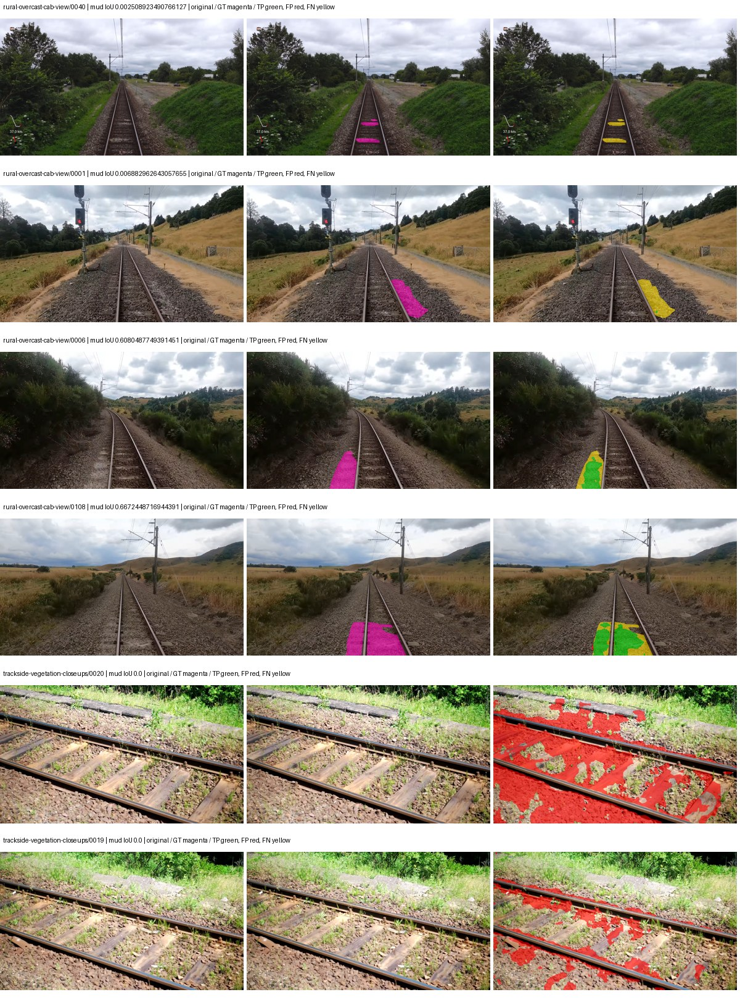
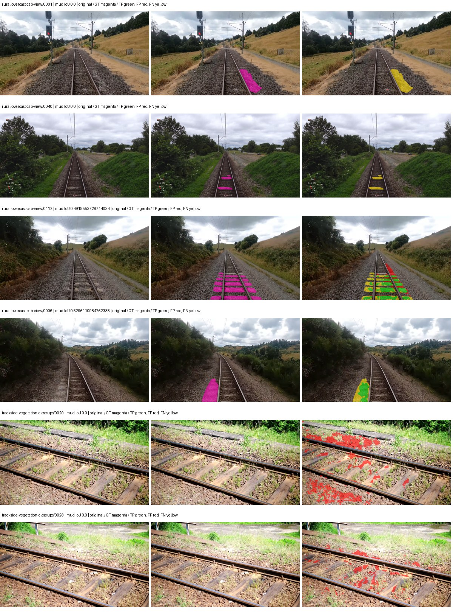
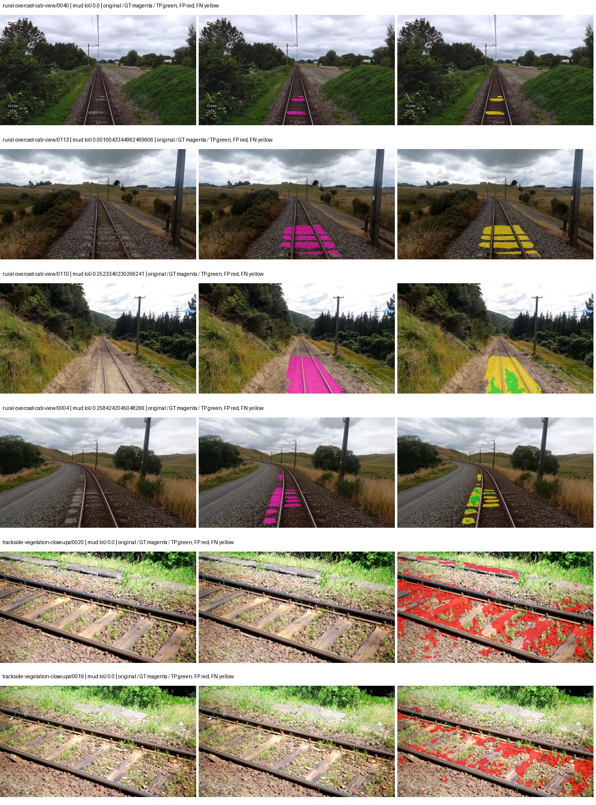
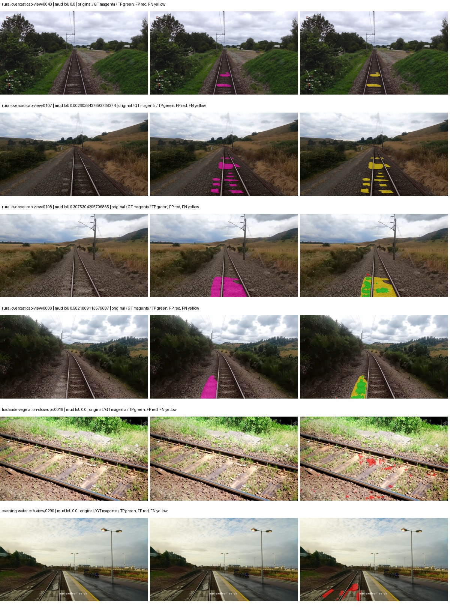

# segformer_b2 — rad_9_24_2026-fixed-grouped

[RAD 9/24: Scene-grouped split](../../README.md) · [Full model records](record.json)

Primary result: the **final checkpoint** after the full step budget (no early stopping). The checkpoint with the best **mud-pumping validation IoU, pixels pooled over all validation images**, is kept as secondary evidence. A job is complete only after full statistics and isolated profiling are verified.

Study metrics of the final checkpoint, counting each class only on the validation images that contain it: mud-pumping IoU is the mean per-image IoU over the images with mud-pumping, precision and recall sum pixels over those images, and mIoU averages each class over the images that contain it, then over the classes present.

| Initialization path | Seed | Mud-pumping IoU, train-camera images with mud (%, n=17) | Mud-pumping IoU, all images with mud (%, n=18) | Mud precision, all images with mud (%) | Mud recall, all images with mud (%) | mIoU (each class over images that contain it) (%) |
| --- | --- | --- | --- | --- | --- | --- |
| rtis_only | 0 | 21.47 | 20.48 | 46.11 | 23.68 | 39.46 |
| cityscapes_to_rtis | 0 | 17.03 | 16.59 | 62.04 | 18.32 | 38.23 |
| railsem19_to_rtis | 0 | 15.08 | 14.37 | 31.64 | 17.63 | 46.35 |
| cityscapes_to_railsem19_to_rtis | 0 | 16.47 | 16.38 | 78.01 | 17.58 | 41.85 |

Per-class IoU: IoU (%) of every class, each averaged only over the validation images that contain the class (n = those images); — = no image contains it. mIoU averages the classes with at least one such image.

| Initialization path | Seed | mIoU (each class over images that contain it) | person (n=0) | truck (n=0) | rail-track (n=37) | vegetation-overgrowth (n=13) | car (n=3) | on-rails (n=0) | traffic-sign (n=9) | road (n=11) | sidewalk (n=12) | construction (n=12) | tram-track (n=2) | pole (n=21) | traffic-light (n=3) | mud-pumping (n=18) | fence (n=7) | terrain (n=35) | sky (n=28) | rail-embedded (n=3) | rail-raised (n=37) | trackbed (n=37) | standing-water (n=9) |
| --- | --- | --- | --- | --- | --- | --- | --- | --- | --- | --- | --- | --- | --- | --- | --- | --- | --- | --- | --- | --- | --- | --- | --- |
| rtis_only | 0 | 39.46 | — | — | 56.71 | 44.07 | 19.11 | — | 38.10 | 6.11 | 17.92 | 43.01 | 11.22 | 67.74 | 32.34 | 20.48 | 19.80 | 80.95 | 96.88 | 16.19 | 72.55 | 63.00 | 4.16 |
| cityscapes_to_rtis | 0 | 38.23 | — | — | 58.26 | 42.79 | 33.34 | — | 30.62 | 5.51 | 13.04 | 28.78 | 10.14 | 68.49 | 42.38 | 16.59 | 17.13 | 83.45 | 96.78 | 8.96 | 72.12 | 55.35 | 4.38 |
| railsem19_to_rtis | 0 | 46.35 | — | — | 58.27 | 40.30 | 36.02 | — | 37.66 | 12.57 | 15.47 | 54.60 | 44.46 | 72.44 | 47.34 | 14.37 | 37.49 | 86.10 | 96.84 | 34.47 | 73.51 | 63.79 | 8.63 |
| cityscapes_to_railsem19_to_rtis | 0 | 41.85 | — | — | 57.64 | 44.20 | 37.06 | — | 31.27 | 16.32 | 12.40 | 43.01 | 13.06 | 70.66 | 48.49 | 16.38 | 22.05 | 86.03 | 96.77 | 17.68 | 72.58 | 62.82 | 4.86 |

Everything below is the campaign's own record, with pixels pooled over all validation images: its evaluation is the checkpoint that scored best on that pooled mud IoU (secondary evidence here); the diagnostics also cover the final checkpoint (`final-auto-val`).

| Model | Initialization path | Seed | Status | Steps | Best step | Best-checkpoint mud IoU, pixels pooled (%) | Best-checkpoint mud precision, pixels pooled (%) | Best-checkpoint mud recall, pixels pooled (%) | Final mud IoU (trainer val, pixels pooled, %) | Best-checkpoint mIoU, pixels pooled (%) | Best-checkpoint fixed GT-class mIoU, pixels pooled (%) |
| --- | --- | --- | --- | --- | --- | --- | --- | --- | --- | --- | --- |
| segformer_b2 | rtis_only | 0 | completed | 4000 | 2074 | 8.49 | 12.07 | 22.21 | 7.24 | 34.95 | 40.78 |
| segformer_b2 | cityscapes_to_rtis | 0 | completed | 4000 | 3629 | 16.81 | 33.57 | 25.19 | 12.82 | 38.62 | 45.05 |
| segformer_b2 | railsem19_to_rtis | 0 | completed | 4000 | 2333 | 6.09 | 9.81 | 13.81 | 3.74 | 45.17 | 52.70 |
| segformer_b2 | cityscapes_to_railsem19_to_rtis | 0 | completed | 4000 | 2592 | 15.82 | 58.21 | 17.85 | 14.88 | 42.82 | 47.58 |

Training: 217 images. Validation: 37 images. Test: 60 held out. Seeds: [0]. Seed variation measures optimization variability, not independent-recording uncertainty. Historical source checkpoints stay fixed across adaptation seeds.

Training code: `fce0ea0ac50b334d4252812c396e0e593def375d`. Split SHA-256: `12d7b367c72cda61d57686ff2ac28223530d0af49debd9fb7a0fbc68b908bc93`.

## rtis_only — seed 0

Status: **completed**. Started: 2026-10-11T11:41:41.907183+00:00. Finished: 2026-10-11T12:49:13.790911+00:00.

Recipe pretrained initializer: `nvidia/mit-b2`.

`rtis_only` uses the recipe initializer, which may include pretrained segmentation components. Transfer paths load the exact historical source checkpoint below and reset the classifier; they do not reset all query/decoder features.

Source checkpoint: `Recipe pretrained initialization`.

Config SHA-256: `29ea580120fe70edb3b0cd23a8d9cce2950d197b91fc6f9f5ac5b7251e5cec59`. Weights used for validation: `raw`.

### Mud-pumping and aggregate quality

| Metric | Selected checkpoint | Final training validation |
| --- | --- | --- |
| Mud IoU | 8.49 | 7.24 |
| Mud precision | 12.07 | 9.45 |
| Mud recall | 22.21 | 23.66 |
| Mud Dice/F1 | 15.64 | 13.51 |
| mIoU | 34.95 | 36.05 |
| Mean accuracy | 48.47 | 51.37 |
| Mean precision | 55.19 | 55.64 |
| Mean Dice | 44.90 | 46.38 |
| Mean specificity | 99.02 | 99.04 |
| Pixel accuracy | 84.45 | 84.07 |
| Frequency-weighted IoU | 75.37 | 75.80 |
| Fixed GT-present class mIoU | 40.78 | 42.06 |
| Boundary F1 | 43.03 | 43.98 |

The selected checkpoint has independent evaluation evidence. Final values are the trainer's final validation record, not a new independent evaluation. mIoU averages classes with nonzero union, so false positives on absent classes can change its denominator. The fixed GT-class mean is supplementary and excludes absent classes; their false positives remain in the confusion matrix.

### Resource usage and timing

| Measurement | Value |
| --- | --- |
| Peak training VRAM, retained training invocation (GiB) | 11.73 |
| Peak evaluation VRAM (GiB) | 7.46 |
| Retained training invocation wall time (seconds) | 3814.60 |
| Retained training invocation GPU-hours (one GPU) | 1.06 |
| Evaluation wall time (seconds) | 22.47 |
| Full evaluation pipeline images/second | 1.65 |
| Best full-state checkpoint (MiB) | 418.15 |
| Final full-state checkpoint (MiB) | 418.13 |
| Verified periodic checkpoints removed (GiB) | 3.27 |

VRAM uses the recorded allocator high-water mark; it is not total device usage including CUDA context. Resumed jobs' retained training invocation times and peaks are **not whole-campaign totals**. Earlier invocation resource records are not reconstructed here. Evaluation throughput includes loader, sliding-window inference and metrics; it is not model-only latency/FPS. Missing measurements are shown as —, never inferred from another dataset's run.

### Standardized inference performance

Dedicated model-only profiling waits for an idle worker-locked L40S: BF16, batch 1, 1024x1024, 20 warmup and 100 CUDA-event-timed public forwards. It excludes loading, preprocessing, tiling and metrics.

| Status | Parameters | Weight MiB | FPS | p50 ms | p95 ms | Peak reserved GiB |
| --- | --- | --- | --- | --- | --- | --- |
| complete | 27362773 | 104.38 | 53.59 | 18.50 | 19.14 | 2.25 |

```json
{
  "schema_version": 1,
  "model_id": "segformer_b2",
  "measured_at": "2026-10-11T12:49:08+00:00",
  "status": "complete",
  "benchmark_scope": "rtis_selected_checkpoint_model_only",
  "applies_to": [
    "segformer_b2--rtis_only--seed-0"
  ],
  "source": {
    "campaign_git_sha": "fce0ea0ac50b334d4252812c396e0e593def375d",
    "git_dirty": false,
    "config_hash": "21a7865f98c1",
    "resolved_config": "/data/izadia1/projects/segmentary-runs/rad_9_24_2026/fgall-seed0-20261007/configs/segformer_b2--rtis_only--seed-0.yaml",
    "config_sha256": "29ea580120fe70edb3b0cd23a8d9cce2950d197b91fc6f9f5ac5b7251e5cec59",
    "checkpoint_sha256": "39be7b6e68eaaa68af579615d3347b13fa7530407babcb6288224cc960f2778f",
    "checkpoint_global_step": 2074,
    "checkpoint_bytes": 438463346,
    "checkpoint_kind": "resume checkpoint with optimizer and EMA state",
    "weights": "raw",
    "measured_checkpoint_job_id": "segformer_b2--rtis_only--seed-0",
    "result_sha256": "5d622448a72523111d18485c7ef3ee1ad57d22b2e38e13da551ad20f23996353",
    "result_git_sha": "fce0ea0ac50b334d4252812c396e0e593def375d",
    "result_stage": "eval:rad_9_24_2026-fixed-grouped:val",
    "result_seed": 0
  },
  "hardware": {
    "gpu_name": "NVIDIA L40S",
    "gpu_uuid": "GPU-2f8008a1-9b67-11f6-987b-b393a672322c",
    "logical_device": "cuda:0",
    "physical_visibility_token": "3",
    "compute_capability": [
      8,
      9
    ],
    "total_memory_bytes": 47677177856
  },
  "model": {
    "parameter_count": 27362773,
    "trainable_parameter_count": 27362773,
    "resident_parameter_bytes": 109451092,
    "parameter_dtype_counts": {
      "float32": 27362773
    }
  },
  "contract": {
    "backend": "pytorch",
    "precision": "bf16_autocast",
    "batch_size": 1,
    "input_shape_nchw": [
      1,
      3,
      1024,
      1024
    ],
    "warmup_iterations": 20,
    "measured_iterations": 100,
    "timing": "per-forward CUDA events with end-event synchronization",
    "includes_preprocessing": false,
    "includes_data_loader": false,
    "includes_sliding_window": false,
    "input_resident_on_gpu": true,
    "model_only": true,
    "entrypoint": "public model(image) dense-logits forward"
  },
  "measurements": {
    "latency": {
      "p50_ms": 18.50163173675537,
      "p95_ms": 19.14485788345337,
      "mean_ms": 18.659829139709473,
      "minimum_ms": 18.335744857788086,
      "maximum_ms": 23.11065673828125,
      "fps": 53.59105876655255,
      "raw_ms": [
        18.967552185058594,
        18.63475227355957,
        18.671615600585938,
        18.678783416748047,
        18.6112003326416,
        18.64192008972168,
        18.706432342529297,
        18.727872848510742,
        18.646015167236328,
        18.63372802734375,
        19.39561653137207,
        18.662399291992188,
        18.63884735107422,
        19.342336654663086,
        18.40947151184082,
        18.42790412902832,
        21.214208602905273,
        20.746240615844727,
        18.41152000427246,
        18.40332794189453,
        18.44428825378418,
        18.397184371948242,
        18.364416122436523,
        18.374656677246094,
        18.562047958374023,
        18.380800247192383,
        18.43302345275879,
        18.352127075195312,
        19.02899169921875,
        18.66649627685547,
        18.59071922302246,
        18.767871856689453,
        18.372608184814453,
        18.83545684814453,
        23.11065673828125,
        18.78937530517578,
        18.727935791015625,
        18.6112003326416,
        18.594816207885742,
        18.681856155395508,
        18.63167953491211,
        18.622432708740234,
        18.784255981445312,
        18.735103607177734,
        18.64192008972168,
        18.658432006835938,
        18.59270477294922,
        18.61427116394043,
        18.499584197998047,
        18.877471923828125,
        18.480127334594727,
        18.503679275512695,
        19.094528198242188,
        18.566144943237305,
        18.42892837524414,
        18.352127075195312,
        18.38387107849121,
        18.47091293334961,
        18.503679275512695,
        18.399328231811523,
        18.39206314086914,
        18.4453125,
        18.44940757751465,
        18.44326400756836,
        18.455551147460938,
        18.390016555786133,
        18.399232864379883,
        18.345056533813477,
        18.372608184814453,
        18.473920822143555,
        18.335744857788086,
        18.42176055908203,
        18.63065528869629,
        18.39411163330078,
        18.459487915039062,
        19.134464263916016,
        18.811904907226562,
        18.562047958374023,
        18.66748809814453,
        18.408447265625,
        18.4135684967041,
        18.39206314086914,
        18.377727508544922,
        18.43507194519043,
        18.41766357421875,
        18.38387107849121,
        18.46988868713379,
        18.386943817138672,
        18.493440628051758,
        18.41766357421875,
        18.364416122436523,
        18.407455444335938,
        18.475040435791016,
        18.509824752807617,
        18.40025520324707,
        18.357215881347656,
        18.45248031616211,
        18.845792770385742,
        18.671552658081055,
        18.8189754486084
      ],
      "percentile_method": "numpy linear interpolation"
    },
    "peak_reserved_bytes": 2420113408,
    "memory_kind": "pytorch_cuda_allocator_peak_reserved_excluding_context",
    "process_total_bytes": 2956984320,
    "process_total_kind": "nvidia-smi used_memory of this PID on the benchmark GPU after the timed loop, including the CUDA context; null when the driver could not attribute memory to this PID",
    "benchmark_wall_clock_s": 5.669919513165951
  },
  "started_at": "2026-10-11T12:49:02+00:00",
  "finished_at": "2026-10-11T12:49:08+00:00",
  "environment": {
    "hostname": "hdrfs-app-001",
    "python": "3.11.15",
    "platform": "Linux-5.15.0-139-generic-x86_64-with-glibc2.35",
    "torch": "2.11.0+cu128",
    "torch_cuda": "12.8",
    "cudnn": 91900,
    "driver_version": "570.133.20",
    "cuda_available": true,
    "gpu_count": 1,
    "gpu_names": [
      "NVIDIA L40S"
    ],
    "cuda_visible_devices": "3",
    "packages": {
      "segmentary": "0.1.0",
      "torch": "2.11.0+cu128",
      "torchvision": "0.26.0+cu128",
      "transformers": "5.15.0",
      "timm": "1.0.28",
      "segmentation-models-pytorch": "0.5.0",
      "albumentations": "2.0.8",
      "lightning": "2.6.5",
      "numpy": "2.4.4"
    }
  }
}
```

### Per-class validation results

| Class | GT pixels | IoU (%) | Precision (%) | Recall (%) | Dice (%) | Boundary F1 (%) |
| --- | --- | --- | --- | --- | --- | --- |
| car | 29664 | 19.69 | 45.14 | 25.88 | 32.90 | 31.10 |
| construction | 311585 | 54.82 | 67.52 | 74.45 | 70.82 | 64.48 |
| fence | 265137 | 12.36 | 63.08 | 13.33 | 22.00 | 35.22 |
| mud-pumping | 1226250 | 8.49 | 12.07 | 22.21 | 15.64 | 10.08 |
| on-rails | 0 | 0.00 | 0.00 | — | 0.00 | 0.00 |
| person | 0 | 0.00 | 0.00 | — | 0.00 | 0.00 |
| pole | 628038 | 70.45 | 81.32 | 84.06 | 82.67 | 88.89 |
| rail-embedded | 16799 | 30.09 | 89.96 | 31.14 | 46.26 | 46.84 |
| rail-raised | 2969797 | 72.33 | 85.60 | 82.35 | 83.94 | 91.42 |
| rail-track | 6323197 | 32.20 | 83.39 | 34.41 | 48.71 | 44.90 |
| road | 1048831 | 2.77 | 19.70 | 3.13 | 5.40 | 13.82 |
| sidewalk | 1297367 | 48.81 | 82.30 | 54.53 | 65.60 | 23.77 |
| sky | 19121606 | 98.44 | 99.50 | 98.93 | 99.22 | 95.32 |
| standing-water | 95802 | 4.33 | 10.92 | 6.69 | 8.29 | 14.69 |
| terrain | 39239306 | 86.73 | 88.74 | 97.46 | 92.90 | 60.67 |
| trackbed | 10643081 | 56.37 | 65.92 | 79.55 | 72.10 | 55.31 |
| traffic-light | 19510 | 30.38 | 91.96 | 31.21 | 46.60 | 65.26 |
| traffic-sign | 13285 | 46.07 | 72.71 | 55.71 | 63.08 | 62.58 |
| tram-track | 56179 | 13.06 | 23.69 | 22.55 | 23.11 | 31.52 |
| truck | 0 | 0.00 | 0.00 | — | 0.00 | 0.00 |
| vegetation-overgrowth | 5901821 | 46.63 | 75.56 | 54.91 | 63.60 | 67.78 |

### Full-run accounting

| Measurement | Value |
| --- | --- |
| Full GPU-reserved wall seconds, all recorded worker attempts | 4059.59 |
| Full reserved GPU-hours | 1.13 |
| Whole-run timing complete | True |

| Phase | Wall seconds including failed attempts |
| --- | --- |
| training | 3821.64 |
| diagnostics | 181.70 |
| performance | 13.91 |

GPU-reserved time includes model loading, training, validation, collection, profiling, checkpoint I/O and orchestration while the worker owns one GPU. It is not GPU kernel-active time. Phase timings and sampled device memory/power/utilization are retained separately; sampled device memory is not the allocator high-water mark.

### Train/validation and raw/EMA diagnostics

| Checkpoint / weights / split | Images | Mud IoU (%) | Mud precision (%) | Mud recall (%) |
| --- | --- | --- | --- | --- |
| best-auto-train / raw | 217 | 96.42 | 98.20 | 98.15 |
| best-auto-val / raw | 37 | 8.49 | 12.07 | 22.21 |
| best-alternate-val / ema | 37 | 5.29 | 6.61 | 20.88 |
| final-auto-val / raw | 37 | 7.24 | 9.45 | 23.68 |

Train uses the evaluation transform without augmentation. Compare mud train/validation metrics for the same selected weights. Alternate EMA on running-stat BatchNorm is explicitly uncalibrated and is diagnostic only. Score-threshold curves use uncalibrated normalized scores and are pixel-level diagnostics, not event detection rates or a selected deployment operating point.

### Downloadable evidence

- best-auto-train: [per-image.csv](rtis_only--seed-0/best-auto-train/per-image.csv) · [per-image-confusion.json.gz](rtis_only--seed-0/best-auto-train/per-image-confusion.json.gz) · [groups.json](rtis_only--seed-0/best-auto-train/groups.json) · [mud-score-curves.json](rtis_only--seed-0/best-auto-train/mud-score-curves.json)
- best-auto-val: [per-image.csv](rtis_only--seed-0/best-auto-val/per-image.csv) · [per-image-confusion.json.gz](rtis_only--seed-0/best-auto-val/per-image-confusion.json.gz) · [groups.json](rtis_only--seed-0/best-auto-val/groups.json) · [mud-score-curves.json](rtis_only--seed-0/best-auto-val/mud-score-curves.json) · [examples.jpg](rtis_only--seed-0/best-auto-val/examples.jpg)
- best-alternate-val: [per-image.csv](rtis_only--seed-0/best-alternate-val/per-image.csv) · [per-image-confusion.json.gz](rtis_only--seed-0/best-alternate-val/per-image-confusion.json.gz) · [groups.json](rtis_only--seed-0/best-alternate-val/groups.json) · [mud-score-curves.json](rtis_only--seed-0/best-alternate-val/mud-score-curves.json)
- final-auto-val: [per-image.csv](rtis_only--seed-0/final-auto-val/per-image.csv) · [per-image-confusion.json.gz](rtis_only--seed-0/final-auto-val/per-image-confusion.json.gz) · [groups.json](rtis_only--seed-0/final-auto-val/groups.json) · [mud-score-curves.json](rtis_only--seed-0/final-auto-val/mud-score-curves.json)
- resources: [telemetry.csv](rtis_only--seed-0/resources/telemetry.csv)



Examples are two lowest and two highest mud-IoU positive images, plus up to two negative images with the most false-positive mud pixels. They are targeted diagnostic examples, not random samples. Green: true positive; red: false positive; yellow: false negative. Full predictions remain on HDRFS.

### Validation tracking

| Logged step | Overall mIoU (%) | Mud IoU (%) |
| --- | --- | --- |
| 258 | 22.61 | 0.13 |
| 518 | 31.20 | 0.33 |
| 777 | 34.21 | 3.20 |
| 1036 | 36.12 | 5.29 |
| 1295 | 35.29 | 5.90 |
| 1555 | 33.17 | 2.04 |
| 1814 | 36.50 | 7.27 |
| 2073 | 34.95 | 8.50 |
| 2332 | 36.03 | 3.86 |
| 2592 | 36.71 | 5.48 |
| 2851 | 35.67 | 5.70 |
| 3110 | 36.53 | 5.97 |
| 3369 | 35.81 | 6.69 |
| 3629 | 35.93 | 7.05 |
| 3888 | 35.92 | 6.81 |
| 4000 | 36.05 | 7.24 |

All retained scalar curves, including training loss and per-class IoU, are in record.json. Observed best mud on a curve is not necessarily a retained checkpoint: the pilot saved its selection-metric-best and final checkpoints. Step logging and checkpoint global_step may differ by one.

### Stopping and checkpoint provenance

```json
{
  "stopping": {
    "actual_steps": 4000,
    "maximum_steps": 4000,
    "min_delta": 0.0,
    "monitor": "val_iou/mud-pumping",
    "patience": null,
    "reason": "budget_complete"
  },
  "checkpoints": {
    "best": {
      "path": "/data/izadia1/projects/segmentary-runs/rad_9_24_2026/fgall-seed0-20261007/future-runs/segformer_b2--rtis_only--seed-0_seed0/rtis/best.ckpt",
      "sha256": "39be7b6e68eaaa68af579615d3347b13fa7530407babcb6288224cc960f2778f",
      "global_step": 2074,
      "bytes": 438463346
    },
    "final": {
      "path": "/data/izadia1/projects/segmentary-runs/rad_9_24_2026/fgall-seed0-20261007/future-runs/segformer_b2--rtis_only--seed-0_seed0/rtis/last.ckpt",
      "sha256": "f347a0e1245ce215abc756d4a7734bb9efe78573cfcae91bdce2974a382d7a35",
      "global_step": 4000,
      "bytes": 438445234
    }
  },
  "cleanup_error": null
}
```

### Resolved training, initialization and evaluation settings

The optimizer block is the base configuration. Stage LR scales are applied at runtime, and stage warmup is capped at min(base warmup, floor(stage budget / 10), stage budget - 1): 400 steps for this 4,000-step pilot. Model-internal native input grids may differ from augmentation crops (EoMT uses its 640 grid).

```json
{
  "name": "segformer_b2--rtis_only--seed-0",
  "model": {
    "arch": "segformer_b2",
    "checkpoint": "nvidia/mit-b2",
    "tuning": "full",
    "head": "unified_head",
    "lora_r": 16,
    "lora_alpha": 32,
    "lora_dropout": 0.05,
    "lora_targets": [],
    "drop_path": null,
    "revision": null,
    "subfolder": null,
    "local_files_only": false,
    "trust_remote_code": false,
    "backbone_path": null,
    "head_paths": [],
    "classifier_path": null,
    "inactive_parameter_paths": [],
    "smp_arch": null,
    "encoder_name": null,
    "encoder_weights": null,
    "native": null,
    "batch_norm_momentum": null
  },
  "space": "paul-test-rtis",
  "taxonomy_root": "/data/izadia1/projects/segmentary-rad-fgall-fce0ea0a/taxonomy",
  "output_root": "/data/izadia1/projects/segmentary-runs/rad_9_24_2026/fgall-seed0-20261007/future-runs",
  "optim": {
    "backbone_lr": 6e-05,
    "head_lr_mult": 10.0,
    "weight_decay": 0.05,
    "llrd": 1.0,
    "warmup_iters": 1500,
    "warmup_ratio": 1e-06,
    "poly_power": 0.9,
    "min_lr_ratio": 0.0,
    "betas": [
      0.9,
      0.999
    ],
    "grad_clip": 1.0
  },
  "train": {
    "iters": 4000,
    "batch_size": 2,
    "accum": 8,
    "num_workers": 2,
    "precision": "bf16-mixed",
    "ema_decay": 0.9998,
    "val_every": 250,
    "ckpt_every": 500,
    "selection_metric": "val_iou/mud-pumping",
    "early_stopping_patience": null,
    "early_stopping_min_delta": 0.0,
    "seed": 0,
    "devices": 1
  },
  "eval": {
    "sliding_window": true,
    "window": [
      1024,
      1024
    ],
    "stride": [
      768,
      768
    ],
    "batch_size": 1,
    "num_workers": 2,
    "tta_scales": [],
    "tta_flip": false,
    "threshold": 0.5,
    "boundary_tolerance_frac": 0.0075,
    "save_confusion": true
  },
  "loss": {
    "task": "multiclass",
    "activation": "auto",
    "terms": [],
    "aux": "none",
    "aux_weight": 0.0,
    "ce_weight": 1.0,
    "label_smoothing": 0.0,
    "class_weights": null,
    "query": null
  },
  "aug": {
    "crop": [
      1024,
      1024
    ],
    "scale_min": 0.5,
    "scale_max": 2.0,
    "hflip_p": 0.5,
    "color_jitter_p": 0.5,
    "brightness": 0.25,
    "contrast": 0.25,
    "saturation": 0.25,
    "hue": 0.05
  },
  "stages": [
    {
      "name": "rtis",
      "data": [
        {
          "name": "rad_9_24_2026-fixed-grouped",
          "root": "/data/izadia1/datasets/rad_9_24_2026-fixed-grouped",
          "variant": null,
          "split_file": "splits.json",
          "train_split": "train",
          "val_split": "val",
          "limit": null,
          "loader": "folder",
          "mapping": "paul-test-rtis",
          "loader_options": {
            "require_groups": true
          }
        }
      ],
      "iters": null,
      "lr_scale": 1.0,
      "head_group_lr_scale": 1.0,
      "init_from": "pretrained",
      "reset_head": false,
      "freeze": null,
      "sample_weights": null
    }
  ]
}
```

### Hardware and software provenance

```json
{
  "training": {
    "cuda_available": true,
    "cuda_visible_devices": "3",
    "cudnn": 91900,
    "driver_version": "570.133.20",
    "gpu_count": 1,
    "gpu_names": [
      "NVIDIA L40S"
    ],
    "hostname": "hdrfs-app-001",
    "input_normalization": {
      "channel_order": "rgb",
      "mean": [
        0.485,
        0.456,
        0.406
      ],
      "source": "imagenet",
      "std": [
        0.229,
        0.224,
        0.225
      ]
    },
    "model_origins": [
      {
        "hf_commit": "3bb39e8739149c3777d0325349b2a6c32c6413db",
        "hf_name_or_path": "nvidia/mit-b2",
        "module": "model",
        "timm_pretrained": {}
      },
      {
        "hf_commit": "3bb39e8739149c3777d0325349b2a6c32c6413db",
        "hf_name_or_path": "nvidia/mit-b2",
        "module": "model.segformer",
        "timm_pretrained": {}
      },
      {
        "hf_commit": "3bb39e8739149c3777d0325349b2a6c32c6413db",
        "hf_name_or_path": "nvidia/mit-b2",
        "module": "model.segformer.stages.0.blocks.0.attention",
        "timm_pretrained": {}
      },
      {
        "hf_commit": "3bb39e8739149c3777d0325349b2a6c32c6413db",
        "hf_name_or_path": "nvidia/mit-b2",
        "module": "model.segformer.stages.0.blocks.1.attention",
        "timm_pretrained": {}
      },
      {
        "hf_commit": "3bb39e8739149c3777d0325349b2a6c32c6413db",
        "hf_name_or_path": "nvidia/mit-b2",
        "module": "model.segformer.stages.0.blocks.2.attention",
        "timm_pretrained": {}
      },
      {
        "hf_commit": "3bb39e8739149c3777d0325349b2a6c32c6413db",
        "hf_name_or_path": "nvidia/mit-b2",
        "module": "model.segformer.stages.1.blocks.0.attention",
        "timm_pretrained": {}
      },
      {
        "hf_commit": "3bb39e8739149c3777d0325349b2a6c32c6413db",
        "hf_name_or_path": "nvidia/mit-b2",
        "module": "model.segformer.stages.1.blocks.1.attention",
        "timm_pretrained": {}
      },
      {
        "hf_commit": "3bb39e8739149c3777d0325349b2a6c32c6413db",
        "hf_name_or_path": "nvidia/mit-b2",
        "module": "model.segformer.stages.1.blocks.2.attention",
        "timm_pretrained": {}
      },
      {
        "hf_commit": "3bb39e8739149c3777d0325349b2a6c32c6413db",
        "hf_name_or_path": "nvidia/mit-b2",
        "module": "model.segformer.stages.1.blocks.3.attention",
        "timm_pretrained": {}
      },
      {
        "hf_commit": "3bb39e8739149c3777d0325349b2a6c32c6413db",
        "hf_name_or_path": "nvidia/mit-b2",
        "module": "model.segformer.stages.2.blocks.0.attention",
        "timm_pretrained": {}
      },
      {
        "hf_commit": "3bb39e8739149c3777d0325349b2a6c32c6413db",
        "hf_name_or_path": "nvidia/mit-b2",
        "module": "model.segformer.stages.2.blocks.1.attention",
        "timm_pretrained": {}
      },
      {
        "hf_commit": "3bb39e8739149c3777d0325349b2a6c32c6413db",
        "hf_name_or_path": "nvidia/mit-b2",
        "module": "model.segformer.stages.2.blocks.2.attention",
        "timm_pretrained": {}
      },
      {
        "hf_commit": "3bb39e8739149c3777d0325349b2a6c32c6413db",
        "hf_name_or_path": "nvidia/mit-b2",
        "module": "model.segformer.stages.2.blocks.3.attention",
        "timm_pretrained": {}
      },
      {
        "hf_commit": "3bb39e8739149c3777d0325349b2a6c32c6413db",
        "hf_name_or_path": "nvidia/mit-b2",
        "module": "model.segformer.stages.2.blocks.4.attention",
        "timm_pretrained": {}
      },
      {
        "hf_commit": "3bb39e8739149c3777d0325349b2a6c32c6413db",
        "hf_name_or_path": "nvidia/mit-b2",
        "module": "model.segformer.stages.2.blocks.5.attention",
        "timm_pretrained": {}
      },
      {
        "hf_commit": "3bb39e8739149c3777d0325349b2a6c32c6413db",
        "hf_name_or_path": "nvidia/mit-b2",
        "module": "model.segformer.stages.3.blocks.0.attention",
        "timm_pretrained": {}
      },
      {
        "hf_commit": "3bb39e8739149c3777d0325349b2a6c32c6413db",
        "hf_name_or_path": "nvidia/mit-b2",
        "module": "model.segformer.stages.3.blocks.1.attention",
        "timm_pretrained": {}
      },
      {
        "hf_commit": "3bb39e8739149c3777d0325349b2a6c32c6413db",
        "hf_name_or_path": "nvidia/mit-b2",
        "module": "model.segformer.stages.3.blocks.2.attention",
        "timm_pretrained": {}
      },
      {
        "hf_commit": "3bb39e8739149c3777d0325349b2a6c32c6413db",
        "hf_name_or_path": "nvidia/mit-b2",
        "module": "model.decode_head",
        "timm_pretrained": {}
      }
    ],
    "model_parameter_count": 27362773,
    "packages": {
      "albumentations": "2.0.8",
      "lightning": "2.6.5",
      "numpy": "2.4.4",
      "segmentary": "0.1.0",
      "segmentation-models-pytorch": "0.5.0",
      "timm": "1.0.28",
      "torch": "2.11.0+cu128",
      "torchvision": "0.26.0+cu128",
      "transformers": "5.15.0"
    },
    "platform": "Linux-5.15.0-139-generic-x86_64-with-glibc2.35",
    "python": "3.11.15",
    "torch": "2.11.0+cu128",
    "torch_cuda": "12.8",
    "trainable_parameter_count": 27362773,
    "training_stop": {
      "actual_steps": 4000,
      "maximum_steps": 4000,
      "min_delta": 0.0,
      "monitor": "val_iou/mud-pumping",
      "patience": null,
      "reason": "budget_complete"
    },
    "validation_weights": "raw"
  },
  "evaluation": {
    "cuda_available": true,
    "cuda_visible_devices": "3",
    "cudnn": 91900,
    "driver_version": "570.133.20",
    "gpu_count": 1,
    "gpu_names": [
      "NVIDIA L40S"
    ],
    "hostname": "hdrfs-app-001",
    "input_normalization": {
      "channel_order": "rgb",
      "mean": [
        0.485,
        0.456,
        0.406
      ],
      "source": "imagenet",
      "std": [
        0.229,
        0.224,
        0.225
      ]
    },
    "packages": {
      "albumentations": "2.0.8",
      "lightning": "2.6.5",
      "numpy": "2.4.4",
      "segmentary": "0.1.0",
      "segmentation-models-pytorch": "0.5.0",
      "timm": "1.0.28",
      "torch": "2.11.0+cu128",
      "torchvision": "0.26.0+cu128",
      "transformers": "5.15.0"
    },
    "platform": "Linux-5.15.0-139-generic-x86_64-with-glibc2.35",
    "python": "3.11.15",
    "torch": "2.11.0+cu128",
    "torch_cuda": "12.8"
  }
}
```

## cityscapes_to_rtis — seed 0

Status: **completed**. Started: 2026-10-11T11:41:50.202386+00:00. Finished: 2026-10-11T12:49:47.290410+00:00.

Recipe pretrained initializer: `nvidia/mit-b2`.

`rtis_only` uses the recipe initializer, which may include pretrained segmentation components. Transfer paths load the exact historical source checkpoint below and reset the classifier; they do not reset all query/decoder features.

Source checkpoint: `{'name': 'segformer_b2--cityscapes--seed-0', 'model': 'segformer_b2', 'protocol': 'cityscapes', 'config': '/data/izadia1/projects/segmentary-runs/all-model-city-rail-seed0-rail20-b9eb3e1/accepted/segformer_b2--cityscapes--seed-0/resolved-config.yaml', 'checkpoint': '/data/izadia1/projects/segmentary-runs/all-model-city-rail-seed0-a7c0b67/jobs/segformer_b2--cityscapes--seed-0/attempt-001/train/segformer_b2--cityscapes_seed0/cityscapes/last.ckpt', 'recorded_sha256': 'd0f4f619c4d1200c143ff218ddb7e8693decd082345af09049cc50b8f8c42977', 'exists': True}`.

Config SHA-256: `a77fca3f2146f315c201d9ee281816cf964e1bb139598d9d96de9889eadeefe2`. Weights used for validation: `raw`.

### Mud-pumping and aggregate quality

| Metric | Selected checkpoint | Final training validation |
| --- | --- | --- |
| Mud IoU | 16.81 | 12.82 |
| Mud precision | 33.57 | 29.99 |
| Mud recall | 25.19 | 18.30 |
| Mud Dice/F1 | 28.78 | 22.73 |
| mIoU | 38.62 | 38.46 |
| Mean accuracy | 53.23 | 53.24 |
| Mean precision | 55.62 | 54.79 |
| Mean Dice | 47.94 | 47.77 |
| Mean specificity | 99.11 | 99.11 |
| Pixel accuracy | 85.30 | 85.32 |
| Frequency-weighted IoU | 76.93 | 77.03 |
| Fixed GT-present class mIoU | 45.05 | 44.87 |
| Boundary F1 | 45.45 | 45.23 |

The selected checkpoint has independent evaluation evidence. Final values are the trainer's final validation record, not a new independent evaluation. mIoU averages classes with nonzero union, so false positives on absent classes can change its denominator. The fixed GT-class mean is supplementary and excludes absent classes; their false positives remain in the confusion matrix.

### Resource usage and timing

| Measurement | Value |
| --- | --- |
| Peak training VRAM, retained training invocation (GiB) | 11.73 |
| Peak evaluation VRAM (GiB) | 7.46 |
| Retained training invocation wall time (seconds) | 3837.13 |
| Retained training invocation GPU-hours (one GPU) | 1.07 |
| Evaluation wall time (seconds) | 22.28 |
| Full evaluation pipeline images/second | 1.66 |
| Best full-state checkpoint (MiB) | 418.15 |
| Final full-state checkpoint (MiB) | 418.13 |
| Verified periodic checkpoints removed (GiB) | 3.27 |

VRAM uses the recorded allocator high-water mark; it is not total device usage including CUDA context. Resumed jobs' retained training invocation times and peaks are **not whole-campaign totals**. Earlier invocation resource records are not reconstructed here. Evaluation throughput includes loader, sliding-window inference and metrics; it is not model-only latency/FPS. Missing measurements are shown as —, never inferred from another dataset's run.

### Standardized inference performance

Dedicated model-only profiling waits for an idle worker-locked L40S: BF16, batch 1, 1024x1024, 20 warmup and 100 CUDA-event-timed public forwards. It excludes loading, preprocessing, tiling and metrics.

| Status | Parameters | Weight MiB | FPS | p50 ms | p95 ms | Peak reserved GiB |
| --- | --- | --- | --- | --- | --- | --- |
| complete | 27362773 | 104.38 | 51.90 | 18.96 | 20.44 | 2.25 |

```json
{
  "schema_version": 1,
  "model_id": "segformer_b2",
  "measured_at": "2026-10-11T12:49:42+00:00",
  "status": "complete",
  "benchmark_scope": "rtis_selected_checkpoint_model_only",
  "applies_to": [
    "segformer_b2--cityscapes_to_rtis--seed-0"
  ],
  "source": {
    "campaign_git_sha": "fce0ea0ac50b334d4252812c396e0e593def375d",
    "git_dirty": false,
    "config_hash": "590551f7b441",
    "resolved_config": "/data/izadia1/projects/segmentary-runs/rad_9_24_2026/fgall-seed0-20261007/configs/segformer_b2--cityscapes_to_rtis--seed-0.yaml",
    "config_sha256": "a77fca3f2146f315c201d9ee281816cf964e1bb139598d9d96de9889eadeefe2",
    "checkpoint_sha256": "3dd57b2079bebd4a3367ef0e81a8014b426749cf897b26fd3fa74f7a6f8de244",
    "checkpoint_global_step": 3629,
    "checkpoint_bytes": 438463410,
    "checkpoint_kind": "resume checkpoint with optimizer and EMA state",
    "weights": "raw",
    "measured_checkpoint_job_id": "segformer_b2--cityscapes_to_rtis--seed-0",
    "result_sha256": "c5f7f9d1fdd99cbd3e14b7049baa5e57b999a727f3e8f4dafca8c8d74a7fb72b",
    "result_git_sha": "fce0ea0ac50b334d4252812c396e0e593def375d",
    "result_stage": "eval:rad_9_24_2026-fixed-grouped:val",
    "result_seed": 0
  },
  "hardware": {
    "gpu_name": "NVIDIA L40S",
    "gpu_uuid": "GPU-fc5dde96-210d-0afa-ac74-7f88477d622b",
    "logical_device": "cuda:0",
    "physical_visibility_token": "4",
    "compute_capability": [
      8,
      9
    ],
    "total_memory_bytes": 47677177856
  },
  "model": {
    "parameter_count": 27362773,
    "trainable_parameter_count": 27362773,
    "resident_parameter_bytes": 109451092,
    "parameter_dtype_counts": {
      "float32": 27362773
    }
  },
  "contract": {
    "backend": "pytorch",
    "precision": "bf16_autocast",
    "batch_size": 1,
    "input_shape_nchw": [
      1,
      3,
      1024,
      1024
    ],
    "warmup_iterations": 20,
    "measured_iterations": 100,
    "timing": "per-forward CUDA events with end-event synchronization",
    "includes_preprocessing": false,
    "includes_data_loader": false,
    "includes_sliding_window": false,
    "input_resident_on_gpu": true,
    "model_only": true,
    "entrypoint": "public model(image) dense-logits forward"
  },
  "measurements": {
    "latency": {
      "p50_ms": 18.960383415222168,
      "p95_ms": 20.435118293762205,
      "mean_ms": 19.266781692504882,
      "minimum_ms": 18.571264266967773,
      "maximum_ms": 24.94976043701172,
      "fps": 51.902804316769604,
      "raw_ms": [
        19.298303604125977,
        18.663423538208008,
        18.793472290039062,
        19.24198341369629,
        18.743295669555664,
        18.757631301879883,
        19.518463134765625,
        19.128223419189453,
        18.738176345825195,
        18.924480438232422,
        18.766847610473633,
        18.719839096069336,
        18.727935791015625,
        18.79961585998535,
        18.571264266967773,
        18.709503173828125,
        19.117055892944336,
        19.21023941040039,
        20.575231552124023,
        18.898944854736328,
        18.769920349121094,
        18.937856674194336,
        18.924543380737305,
        18.838687896728516,
        18.74732780456543,
        18.945152282714844,
        18.78118324279785,
        18.746368408203125,
        19.01875114440918,
        18.8590087890625,
        19.112960815429688,
        19.066879272460938,
        18.732927322387695,
        18.81395149230957,
        19.117055892944336,
        19.03411293029785,
        19.86457633972168,
        18.955263137817383,
        18.76166343688965,
        18.724863052368164,
        18.7903995513916,
        18.701311111450195,
        18.71455955505371,
        18.871295928955078,
        18.662399291992188,
        19.970048904418945,
        18.763776779174805,
        18.737152099609375,
        18.692096710205078,
        18.722816467285156,
        18.891775131225586,
        18.839487075805664,
        18.84262466430664,
        18.809856414794922,
        19.086336135864258,
        19.523584365844727,
        19.116031646728516,
        18.723840713500977,
        18.764799118041992,
        18.8272647857666,
        19.191808700561523,
        20.282367706298828,
        19.580928802490234,
        18.896928787231445,
        19.551231384277344,
        19.283967971801758,
        19.173376083374023,
        19.116031646728516,
        19.532800674438477,
        19.050495147705078,
        20.28339195251465,
        19.40265655517578,
        19.145727157592773,
        19.805280685424805,
        19.8287353515625,
        24.247295379638672,
        24.94976043701172,
        24.51241683959961,
        19.519487380981445,
        18.65830421447754,
        19.303424835205078,
        19.393535614013672,
        18.909183502197266,
        19.109888076782227,
        19.752960205078125,
        18.886655807495117,
        18.756511688232422,
        19.184640884399414,
        19.176448822021484,
        19.305471420288086,
        20.427743911743164,
        19.300352096557617,
        19.601408004760742,
        19.02796745300293,
        18.81395149230957,
        18.690048217773438,
        19.171327590942383,
        19.346431732177734,
        18.965503692626953,
        20.833280563354492
      ],
      "percentile_method": "numpy linear interpolation"
    },
    "peak_reserved_bytes": 2420113408,
    "memory_kind": "pytorch_cuda_allocator_peak_reserved_excluding_context",
    "process_total_bytes": 2956984320,
    "process_total_kind": "nvidia-smi used_memory of this PID on the benchmark GPU after the timed loop, including the CUDA context; null when the driver could not attribute memory to this PID",
    "benchmark_wall_clock_s": 5.795039467513561
  },
  "started_at": "2026-10-11T12:49:36+00:00",
  "finished_at": "2026-10-11T12:49:42+00:00",
  "environment": {
    "hostname": "hdrfs-app-001",
    "python": "3.11.15",
    "platform": "Linux-5.15.0-139-generic-x86_64-with-glibc2.35",
    "torch": "2.11.0+cu128",
    "torch_cuda": "12.8",
    "cudnn": 91900,
    "driver_version": "570.133.20",
    "cuda_available": true,
    "gpu_count": 1,
    "gpu_names": [
      "NVIDIA L40S"
    ],
    "cuda_visible_devices": "4",
    "packages": {
      "segmentary": "0.1.0",
      "torch": "2.11.0+cu128",
      "torchvision": "0.26.0+cu128",
      "transformers": "5.15.0",
      "timm": "1.0.28",
      "segmentation-models-pytorch": "0.5.0",
      "albumentations": "2.0.8",
      "lightning": "2.6.5",
      "numpy": "2.4.4"
    }
  }
}
```

### Per-class validation results

| Class | GT pixels | IoU (%) | Precision (%) | Recall (%) | Dice (%) | Boundary F1 (%) |
| --- | --- | --- | --- | --- | --- | --- |
| car | 29664 | 64.47 | 71.63 | 86.56 | 78.39 | 55.58 |
| construction | 311585 | 60.46 | 76.44 | 74.30 | 75.36 | 69.91 |
| fence | 265137 | 17.95 | 69.35 | 19.49 | 30.43 | 42.39 |
| mud-pumping | 1226250 | 16.81 | 33.57 | 25.19 | 28.78 | 23.33 |
| on-rails | 0 | 0.00 | 0.00 | — | 0.00 | 0.00 |
| person | 0 | 0.00 | 0.00 | — | 0.00 | 0.00 |
| pole | 628038 | 72.97 | 85.62 | 83.16 | 84.37 | 91.08 |
| rail-embedded | 16799 | 10.85 | 90.96 | 10.96 | 19.57 | 31.21 |
| rail-raised | 2969797 | 72.85 | 85.68 | 82.95 | 84.29 | 90.58 |
| rail-track | 6323197 | 47.27 | 62.12 | 66.40 | 64.19 | 57.30 |
| road | 1048831 | 1.90 | 4.69 | 3.10 | 3.73 | 6.29 |
| sidewalk | 1297367 | 17.82 | 43.39 | 23.22 | 30.25 | 26.85 |
| sky | 19121606 | 98.56 | 99.31 | 99.23 | 99.27 | 96.02 |
| standing-water | 95802 | 1.00 | 1.72 | 2.31 | 1.97 | 4.50 |
| terrain | 39239306 | 88.02 | 91.16 | 96.23 | 93.63 | 62.25 |
| trackbed | 10643081 | 56.22 | 75.40 | 68.85 | 71.98 | 54.07 |
| traffic-light | 19510 | 69.67 | 93.58 | 73.17 | 82.13 | 89.71 |
| traffic-sign | 13285 | 50.30 | 78.43 | 58.38 | 66.94 | 67.62 |
| tram-track | 56179 | 14.67 | 38.43 | 19.17 | 25.58 | 19.34 |
| truck | 0 | 0.00 | 0.00 | — | 0.00 | 0.00 |
| vegetation-overgrowth | 5901821 | 49.20 | 66.46 | 65.45 | 65.95 | 66.46 |

### Full-run accounting

| Measurement | Value |
| --- | --- |
| Full GPU-reserved wall seconds, all recorded worker attempts | 4086.06 |
| Full reserved GPU-hours | 1.14 |
| Whole-run timing complete | True |

| Phase | Wall seconds including failed attempts |
| --- | --- |
| training | 3844.58 |
| diagnostics | 183.45 |
| performance | 14.16 |

GPU-reserved time includes model loading, training, validation, collection, profiling, checkpoint I/O and orchestration while the worker owns one GPU. It is not GPU kernel-active time. Phase timings and sampled device memory/power/utilization are retained separately; sampled device memory is not the allocator high-water mark.

### Train/validation and raw/EMA diagnostics

| Checkpoint / weights / split | Images | Mud IoU (%) | Mud precision (%) | Mud recall (%) |
| --- | --- | --- | --- | --- |
| best-auto-train / raw | 217 | 94.99 | 97.33 | 97.54 |
| best-auto-val / raw | 37 | 16.81 | 33.57 | 25.19 |
| best-alternate-val / ema | 37 | 12.59 | 23.30 | 21.50 |
| final-auto-val / raw | 37 | 12.85 | 30.07 | 18.32 |

Train uses the evaluation transform without augmentation. Compare mud train/validation metrics for the same selected weights. Alternate EMA on running-stat BatchNorm is explicitly uncalibrated and is diagnostic only. Score-threshold curves use uncalibrated normalized scores and are pixel-level diagnostics, not event detection rates or a selected deployment operating point.

### Downloadable evidence

- best-auto-train: [per-image.csv](cityscapes_to_rtis--seed-0/best-auto-train/per-image.csv) · [per-image-confusion.json.gz](cityscapes_to_rtis--seed-0/best-auto-train/per-image-confusion.json.gz) · [groups.json](cityscapes_to_rtis--seed-0/best-auto-train/groups.json) · [mud-score-curves.json](cityscapes_to_rtis--seed-0/best-auto-train/mud-score-curves.json)
- best-auto-val: [per-image.csv](cityscapes_to_rtis--seed-0/best-auto-val/per-image.csv) · [per-image-confusion.json.gz](cityscapes_to_rtis--seed-0/best-auto-val/per-image-confusion.json.gz) · [groups.json](cityscapes_to_rtis--seed-0/best-auto-val/groups.json) · [mud-score-curves.json](cityscapes_to_rtis--seed-0/best-auto-val/mud-score-curves.json) · [examples.jpg](cityscapes_to_rtis--seed-0/best-auto-val/examples.jpg)
- best-alternate-val: [per-image.csv](cityscapes_to_rtis--seed-0/best-alternate-val/per-image.csv) · [per-image-confusion.json.gz](cityscapes_to_rtis--seed-0/best-alternate-val/per-image-confusion.json.gz) · [groups.json](cityscapes_to_rtis--seed-0/best-alternate-val/groups.json) · [mud-score-curves.json](cityscapes_to_rtis--seed-0/best-alternate-val/mud-score-curves.json)
- final-auto-val: [per-image.csv](cityscapes_to_rtis--seed-0/final-auto-val/per-image.csv) · [per-image-confusion.json.gz](cityscapes_to_rtis--seed-0/final-auto-val/per-image-confusion.json.gz) · [groups.json](cityscapes_to_rtis--seed-0/final-auto-val/groups.json) · [mud-score-curves.json](cityscapes_to_rtis--seed-0/final-auto-val/mud-score-curves.json)
- resources: [telemetry.csv](cityscapes_to_rtis--seed-0/resources/telemetry.csv)



Examples are two lowest and two highest mud-IoU positive images, plus up to two negative images with the most false-positive mud pixels. They are targeted diagnostic examples, not random samples. Green: true positive; red: false positive; yellow: false negative. Full predictions remain on HDRFS.

### Validation tracking

| Logged step | Overall mIoU (%) | Mud IoU (%) |
| --- | --- | --- |
| 258 | 22.93 | 0.59 |
| 518 | 26.48 | 1.41 |
| 777 | 31.37 | 6.28 |
| 1036 | 37.68 | 6.72 |
| 1295 | 37.33 | 5.88 |
| 1555 | 37.81 | 12.91 |
| 1814 | 38.09 | 10.71 |
| 2073 | 38.48 | 10.98 |
| 2332 | 39.35 | 10.87 |
| 2592 | 40.76 | 15.88 |
| 2851 | 40.14 | 13.38 |
| 3110 | 40.25 | 12.94 |
| 3369 | 37.97 | 13.44 |
| 3629 | 38.64 | 16.78 |
| 3888 | 38.75 | 16.64 |
| 4000 | 38.46 | 12.82 |

All retained scalar curves, including training loss and per-class IoU, are in record.json. Observed best mud on a curve is not necessarily a retained checkpoint: the pilot saved its selection-metric-best and final checkpoints. Step logging and checkpoint global_step may differ by one.

### Stopping and checkpoint provenance

```json
{
  "stopping": {
    "actual_steps": 4000,
    "maximum_steps": 4000,
    "min_delta": 0.0,
    "monitor": "val_iou/mud-pumping",
    "patience": null,
    "reason": "budget_complete"
  },
  "checkpoints": {
    "best": {
      "path": "/data/izadia1/projects/segmentary-runs/rad_9_24_2026/fgall-seed0-20261007/future-runs/segformer_b2--cityscapes_to_rtis--seed-0_seed0/rtis/best.ckpt",
      "sha256": "3dd57b2079bebd4a3367ef0e81a8014b426749cf897b26fd3fa74f7a6f8de244",
      "global_step": 3629,
      "bytes": 438463410
    },
    "final": {
      "path": "/data/izadia1/projects/segmentary-runs/rad_9_24_2026/fgall-seed0-20261007/future-runs/segformer_b2--cityscapes_to_rtis--seed-0_seed0/rtis/last.ckpt",
      "sha256": "9e57acb6f0fe209ca586791a88d4e86894858fe1e0bd099afc61296e925d9289",
      "global_step": 4000,
      "bytes": 438445234
    }
  },
  "cleanup_error": null
}
```

### Resolved training, initialization and evaluation settings

The optimizer block is the base configuration. Stage LR scales are applied at runtime, and stage warmup is capped at min(base warmup, floor(stage budget / 10), stage budget - 1): 400 steps for this 4,000-step pilot. Model-internal native input grids may differ from augmentation crops (EoMT uses its 640 grid).

```json
{
  "name": "segformer_b2--cityscapes_to_rtis--seed-0",
  "model": {
    "arch": "segformer_b2",
    "checkpoint": "nvidia/mit-b2",
    "tuning": "full",
    "head": "unified_head",
    "lora_r": 16,
    "lora_alpha": 32,
    "lora_dropout": 0.05,
    "lora_targets": [],
    "drop_path": null,
    "revision": null,
    "subfolder": null,
    "local_files_only": false,
    "trust_remote_code": false,
    "backbone_path": null,
    "head_paths": [],
    "classifier_path": null,
    "inactive_parameter_paths": [],
    "smp_arch": null,
    "encoder_name": null,
    "encoder_weights": null,
    "native": null,
    "batch_norm_momentum": null
  },
  "space": "paul-test-rtis",
  "taxonomy_root": "/data/izadia1/projects/segmentary-rad-fgall-fce0ea0a/taxonomy",
  "output_root": "/data/izadia1/projects/segmentary-runs/rad_9_24_2026/fgall-seed0-20261007/future-runs",
  "optim": {
    "backbone_lr": 6e-05,
    "head_lr_mult": 10.0,
    "weight_decay": 0.05,
    "llrd": 1.0,
    "warmup_iters": 1500,
    "warmup_ratio": 1e-06,
    "poly_power": 0.9,
    "min_lr_ratio": 0.0,
    "betas": [
      0.9,
      0.999
    ],
    "grad_clip": 1.0
  },
  "train": {
    "iters": 4000,
    "batch_size": 2,
    "accum": 8,
    "num_workers": 2,
    "precision": "bf16-mixed",
    "ema_decay": 0.9998,
    "val_every": 250,
    "ckpt_every": 500,
    "selection_metric": "val_iou/mud-pumping",
    "early_stopping_patience": null,
    "early_stopping_min_delta": 0.0,
    "seed": 0,
    "devices": 1
  },
  "eval": {
    "sliding_window": true,
    "window": [
      1024,
      1024
    ],
    "stride": [
      768,
      768
    ],
    "batch_size": 1,
    "num_workers": 2,
    "tta_scales": [],
    "tta_flip": false,
    "threshold": 0.5,
    "boundary_tolerance_frac": 0.0075,
    "save_confusion": true
  },
  "loss": {
    "task": "multiclass",
    "activation": "auto",
    "terms": [],
    "aux": "none",
    "aux_weight": 0.0,
    "ce_weight": 1.0,
    "label_smoothing": 0.0,
    "class_weights": null,
    "query": null
  },
  "aug": {
    "crop": [
      1024,
      1024
    ],
    "scale_min": 0.5,
    "scale_max": 2.0,
    "hflip_p": 0.5,
    "color_jitter_p": 0.5,
    "brightness": 0.25,
    "contrast": 0.25,
    "saturation": 0.25,
    "hue": 0.05
  },
  "stages": [
    {
      "name": "rtis",
      "data": [
        {
          "name": "rad_9_24_2026-fixed-grouped",
          "root": "/data/izadia1/datasets/rad_9_24_2026-fixed-grouped",
          "variant": null,
          "split_file": "splits.json",
          "train_split": "train",
          "val_split": "val",
          "limit": null,
          "loader": "folder",
          "mapping": "paul-test-rtis",
          "loader_options": {
            "require_groups": true
          }
        }
      ],
      "iters": null,
      "lr_scale": 0.1,
      "head_group_lr_scale": 1.0,
      "init_from": "/data/izadia1/projects/segmentary-runs/all-model-city-rail-seed0-a7c0b67/jobs/segformer_b2--cityscapes--seed-0/attempt-001/train/segformer_b2--cityscapes_seed0/cityscapes/last.ckpt",
      "reset_head": true,
      "freeze": null,
      "sample_weights": null
    }
  ]
}
```

### Hardware and software provenance

```json
{
  "training": {
    "cuda_available": true,
    "cuda_visible_devices": "4",
    "cudnn": 91900,
    "driver_version": "570.133.20",
    "gpu_count": 1,
    "gpu_names": [
      "NVIDIA L40S"
    ],
    "hostname": "hdrfs-app-001",
    "input_normalization": {
      "channel_order": "rgb",
      "mean": [
        0.485,
        0.456,
        0.406
      ],
      "source": "imagenet",
      "std": [
        0.229,
        0.224,
        0.225
      ]
    },
    "model_origins": [
      {
        "hf_commit": "3bb39e8739149c3777d0325349b2a6c32c6413db",
        "hf_name_or_path": "nvidia/mit-b2",
        "module": "model",
        "timm_pretrained": {}
      },
      {
        "hf_commit": "3bb39e8739149c3777d0325349b2a6c32c6413db",
        "hf_name_or_path": "nvidia/mit-b2",
        "module": "model.segformer",
        "timm_pretrained": {}
      },
      {
        "hf_commit": "3bb39e8739149c3777d0325349b2a6c32c6413db",
        "hf_name_or_path": "nvidia/mit-b2",
        "module": "model.segformer.stages.0.blocks.0.attention",
        "timm_pretrained": {}
      },
      {
        "hf_commit": "3bb39e8739149c3777d0325349b2a6c32c6413db",
        "hf_name_or_path": "nvidia/mit-b2",
        "module": "model.segformer.stages.0.blocks.1.attention",
        "timm_pretrained": {}
      },
      {
        "hf_commit": "3bb39e8739149c3777d0325349b2a6c32c6413db",
        "hf_name_or_path": "nvidia/mit-b2",
        "module": "model.segformer.stages.0.blocks.2.attention",
        "timm_pretrained": {}
      },
      {
        "hf_commit": "3bb39e8739149c3777d0325349b2a6c32c6413db",
        "hf_name_or_path": "nvidia/mit-b2",
        "module": "model.segformer.stages.1.blocks.0.attention",
        "timm_pretrained": {}
      },
      {
        "hf_commit": "3bb39e8739149c3777d0325349b2a6c32c6413db",
        "hf_name_or_path": "nvidia/mit-b2",
        "module": "model.segformer.stages.1.blocks.1.attention",
        "timm_pretrained": {}
      },
      {
        "hf_commit": "3bb39e8739149c3777d0325349b2a6c32c6413db",
        "hf_name_or_path": "nvidia/mit-b2",
        "module": "model.segformer.stages.1.blocks.2.attention",
        "timm_pretrained": {}
      },
      {
        "hf_commit": "3bb39e8739149c3777d0325349b2a6c32c6413db",
        "hf_name_or_path": "nvidia/mit-b2",
        "module": "model.segformer.stages.1.blocks.3.attention",
        "timm_pretrained": {}
      },
      {
        "hf_commit": "3bb39e8739149c3777d0325349b2a6c32c6413db",
        "hf_name_or_path": "nvidia/mit-b2",
        "module": "model.segformer.stages.2.blocks.0.attention",
        "timm_pretrained": {}
      },
      {
        "hf_commit": "3bb39e8739149c3777d0325349b2a6c32c6413db",
        "hf_name_or_path": "nvidia/mit-b2",
        "module": "model.segformer.stages.2.blocks.1.attention",
        "timm_pretrained": {}
      },
      {
        "hf_commit": "3bb39e8739149c3777d0325349b2a6c32c6413db",
        "hf_name_or_path": "nvidia/mit-b2",
        "module": "model.segformer.stages.2.blocks.2.attention",
        "timm_pretrained": {}
      },
      {
        "hf_commit": "3bb39e8739149c3777d0325349b2a6c32c6413db",
        "hf_name_or_path": "nvidia/mit-b2",
        "module": "model.segformer.stages.2.blocks.3.attention",
        "timm_pretrained": {}
      },
      {
        "hf_commit": "3bb39e8739149c3777d0325349b2a6c32c6413db",
        "hf_name_or_path": "nvidia/mit-b2",
        "module": "model.segformer.stages.2.blocks.4.attention",
        "timm_pretrained": {}
      },
      {
        "hf_commit": "3bb39e8739149c3777d0325349b2a6c32c6413db",
        "hf_name_or_path": "nvidia/mit-b2",
        "module": "model.segformer.stages.2.blocks.5.attention",
        "timm_pretrained": {}
      },
      {
        "hf_commit": "3bb39e8739149c3777d0325349b2a6c32c6413db",
        "hf_name_or_path": "nvidia/mit-b2",
        "module": "model.segformer.stages.3.blocks.0.attention",
        "timm_pretrained": {}
      },
      {
        "hf_commit": "3bb39e8739149c3777d0325349b2a6c32c6413db",
        "hf_name_or_path": "nvidia/mit-b2",
        "module": "model.segformer.stages.3.blocks.1.attention",
        "timm_pretrained": {}
      },
      {
        "hf_commit": "3bb39e8739149c3777d0325349b2a6c32c6413db",
        "hf_name_or_path": "nvidia/mit-b2",
        "module": "model.segformer.stages.3.blocks.2.attention",
        "timm_pretrained": {}
      },
      {
        "hf_commit": "3bb39e8739149c3777d0325349b2a6c32c6413db",
        "hf_name_or_path": "nvidia/mit-b2",
        "module": "model.decode_head",
        "timm_pretrained": {}
      }
    ],
    "model_parameter_count": 27362773,
    "packages": {
      "albumentations": "2.0.8",
      "lightning": "2.6.5",
      "numpy": "2.4.4",
      "segmentary": "0.1.0",
      "segmentation-models-pytorch": "0.5.0",
      "timm": "1.0.28",
      "torch": "2.11.0+cu128",
      "torchvision": "0.26.0+cu128",
      "transformers": "5.15.0"
    },
    "platform": "Linux-5.15.0-139-generic-x86_64-with-glibc2.35",
    "python": "3.11.15",
    "torch": "2.11.0+cu128",
    "torch_cuda": "12.8",
    "trainable_parameter_count": 27362773,
    "training_stop": {
      "actual_steps": 4000,
      "maximum_steps": 4000,
      "min_delta": 0.0,
      "monitor": "val_iou/mud-pumping",
      "patience": null,
      "reason": "budget_complete"
    },
    "validation_weights": "raw"
  },
  "evaluation": {
    "cuda_available": true,
    "cuda_visible_devices": "4",
    "cudnn": 91900,
    "driver_version": "570.133.20",
    "gpu_count": 1,
    "gpu_names": [
      "NVIDIA L40S"
    ],
    "hostname": "hdrfs-app-001",
    "input_normalization": {
      "channel_order": "rgb",
      "mean": [
        0.485,
        0.456,
        0.406
      ],
      "source": "imagenet",
      "std": [
        0.229,
        0.224,
        0.225
      ]
    },
    "packages": {
      "albumentations": "2.0.8",
      "lightning": "2.6.5",
      "numpy": "2.4.4",
      "segmentary": "0.1.0",
      "segmentation-models-pytorch": "0.5.0",
      "timm": "1.0.28",
      "torch": "2.11.0+cu128",
      "torchvision": "0.26.0+cu128",
      "transformers": "5.15.0"
    },
    "platform": "Linux-5.15.0-139-generic-x86_64-with-glibc2.35",
    "python": "3.11.15",
    "torch": "2.11.0+cu128",
    "torch_cuda": "12.8"
  }
}
```

## railsem19_to_rtis — seed 0

Status: **completed**. Started: 2026-10-11T11:41:58.807986+00:00. Finished: 2026-10-11T12:50:07.736106+00:00.

Recipe pretrained initializer: `nvidia/mit-b2`.

`rtis_only` uses the recipe initializer, which may include pretrained segmentation components. Transfer paths load the exact historical source checkpoint below and reset the classifier; they do not reset all query/decoder features.

Source checkpoint: `{'name': 'segformer_b2--railsem19--seed-0', 'model': 'segformer_b2', 'protocol': 'railsem19', 'config': '/data/izadia1/projects/segmentary-runs/all-model-city-rail-seed0-rail20-b9eb3e1/accepted/segformer_b2--railsem19--seed-0/resolved-config.yaml', 'checkpoint': '/data/izadia1/projects/segmentary-runs/all-model-city-rail-seed0-a7c0b67/jobs/segformer_b2--railsem19--seed-0/attempt-001/train/segformer_b2--railsem19_seed0/railsem19/last.ckpt', 'recorded_sha256': 'a017480f6fc66e45651f83f3103f582591fa2f5f82b7dc048429508393ccfc20', 'exists': True}`.

Config SHA-256: `bf623d7f7b6cc7e5eafa6cc2d6b7551e2d9e4ff3df84b05559c0069b9f711c00`. Weights used for validation: `raw`.

### Mud-pumping and aggregate quality

| Metric | Selected checkpoint | Final training validation |
| --- | --- | --- |
| Mud IoU | 6.09 | 3.74 |
| Mud precision | 9.81 | 4.53 |
| Mud recall | 13.81 | 17.61 |
| Mud Dice/F1 | 11.47 | 7.20 |
| mIoU | 45.17 | 47.66 |
| Mean accuracy | 63.27 | 62.68 |
| Mean precision | 58.74 | 62.50 |
| Mean Dice | 55.15 | 57.98 |
| Mean specificity | 99.06 | 99.04 |
| Pixel accuracy | 85.35 | 84.25 |
| Frequency-weighted IoU | 76.58 | 76.84 |
| Fixed GT-present class mIoU | 52.70 | 52.96 |
| Boundary F1 | 50.29 | 53.57 |

The selected checkpoint has independent evaluation evidence. Final values are the trainer's final validation record, not a new independent evaluation. mIoU averages classes with nonzero union, so false positives on absent classes can change its denominator. The fixed GT-class mean is supplementary and excludes absent classes; their false positives remain in the confusion matrix.

### Resource usage and timing

| Measurement | Value |
| --- | --- |
| Peak training VRAM, retained training invocation (GiB) | 11.73 |
| Peak evaluation VRAM (GiB) | 7.46 |
| Retained training invocation wall time (seconds) | 3851.76 |
| Retained training invocation GPU-hours (one GPU) | 1.07 |
| Evaluation wall time (seconds) | 22.28 |
| Full evaluation pipeline images/second | 1.66 |
| Best full-state checkpoint (MiB) | 418.15 |
| Final full-state checkpoint (MiB) | 418.13 |
| Verified periodic checkpoints removed (GiB) | 3.27 |

VRAM uses the recorded allocator high-water mark; it is not total device usage including CUDA context. Resumed jobs' retained training invocation times and peaks are **not whole-campaign totals**. Earlier invocation resource records are not reconstructed here. Evaluation throughput includes loader, sliding-window inference and metrics; it is not model-only latency/FPS. Missing measurements are shown as —, never inferred from another dataset's run.

### Standardized inference performance

Dedicated model-only profiling waits for an idle worker-locked L40S: BF16, batch 1, 1024x1024, 20 warmup and 100 CUDA-event-timed public forwards. It excludes loading, preprocessing, tiling and metrics.

| Status | Parameters | Weight MiB | FPS | p50 ms | p95 ms | Peak reserved GiB |
| --- | --- | --- | --- | --- | --- | --- |
| complete | 27362773 | 104.38 | 53.24 | 18.74 | 19.07 | 2.25 |

```json
{
  "schema_version": 1,
  "model_id": "segformer_b2",
  "measured_at": "2026-10-11T12:50:02+00:00",
  "status": "complete",
  "benchmark_scope": "rtis_selected_checkpoint_model_only",
  "applies_to": [
    "segformer_b2--railsem19_to_rtis--seed-0"
  ],
  "source": {
    "campaign_git_sha": "fce0ea0ac50b334d4252812c396e0e593def375d",
    "git_dirty": false,
    "config_hash": "e12e67e3aa3b",
    "resolved_config": "/data/izadia1/projects/segmentary-runs/rad_9_24_2026/fgall-seed0-20261007/configs/segformer_b2--railsem19_to_rtis--seed-0.yaml",
    "config_sha256": "bf623d7f7b6cc7e5eafa6cc2d6b7551e2d9e4ff3df84b05559c0069b9f711c00",
    "checkpoint_sha256": "ade809a8f6bbdcfe72965f31dee4be5c9226406f53d36fdc1273b3086cd41dd5",
    "checkpoint_global_step": 2333,
    "checkpoint_bytes": 438463410,
    "checkpoint_kind": "resume checkpoint with optimizer and EMA state",
    "weights": "raw",
    "measured_checkpoint_job_id": "segformer_b2--railsem19_to_rtis--seed-0",
    "result_sha256": "194f524608b48c099299ac681afb762b4ab8e591e32b79f48c1f805df47d125a",
    "result_git_sha": "fce0ea0ac50b334d4252812c396e0e593def375d",
    "result_stage": "eval:rad_9_24_2026-fixed-grouped:val",
    "result_seed": 0
  },
  "hardware": {
    "gpu_name": "NVIDIA L40S",
    "gpu_uuid": "GPU-804aea8b-5f62-423e-72c6-49e1ed15c4e4",
    "logical_device": "cuda:0",
    "physical_visibility_token": "6",
    "compute_capability": [
      8,
      9
    ],
    "total_memory_bytes": 47677177856
  },
  "model": {
    "parameter_count": 27362773,
    "trainable_parameter_count": 27362773,
    "resident_parameter_bytes": 109451092,
    "parameter_dtype_counts": {
      "float32": 27362773
    }
  },
  "contract": {
    "backend": "pytorch",
    "precision": "bf16_autocast",
    "batch_size": 1,
    "input_shape_nchw": [
      1,
      3,
      1024,
      1024
    ],
    "warmup_iterations": 20,
    "measured_iterations": 100,
    "timing": "per-forward CUDA events with end-event synchronization",
    "includes_preprocessing": false,
    "includes_data_loader": false,
    "includes_sliding_window": false,
    "input_resident_on_gpu": true,
    "model_only": true,
    "entrypoint": "public model(image) dense-logits forward"
  },
  "measurements": {
    "latency": {
      "p50_ms": 18.744319915771484,
      "p95_ms": 19.070310401916505,
      "mean_ms": 18.7820237159729,
      "minimum_ms": 18.66035270690918,
      "maximum_ms": 19.42835235595703,
      "fps": 53.24239896202263,
      "raw_ms": [
        19.0699520111084,
        18.729984283447266,
        18.749439239501953,
        18.68390464782715,
        18.698240280151367,
        18.681856155395508,
        18.80678367614746,
        18.757631301879883,
        18.734079360961914,
        18.717695236206055,
        18.750463485717773,
        18.704383850097656,
        19.42835235595703,
        18.779136657714844,
        18.766847610473633,
        19.112960815429688,
        18.764799118041992,
        18.714624404907227,
        18.763776779174805,
        18.71571159362793,
        18.763776779174805,
        18.70537567138672,
        18.699264526367188,
        18.706432342529297,
        18.779136657714844,
        19.159040451049805,
        18.750463485717773,
        18.884607315063477,
        18.756607055664062,
        18.743295669555664,
        18.66854476928711,
        18.716672897338867,
        18.740224838256836,
        18.751487731933594,
        18.67571258544922,
        18.747392654418945,
        18.737152099609375,
        18.747392654418945,
        18.663423538208008,
        18.686975479125977,
        18.735103607177734,
        18.762752532958984,
        18.877439498901367,
        18.745344161987305,
        18.690048217773438,
        18.83852767944336,
        18.909183502197266,
        18.72483253479004,
        18.768896102905273,
        18.742271423339844,
        18.734079360961914,
        19.077119827270508,
        18.732032775878906,
        18.785280227661133,
        18.802688598632812,
        19.04025650024414,
        18.740224838256836,
        18.743295669555664,
        19.03206443786621,
        18.692096710205078,
        18.700288772583008,
        18.744319915771484,
        18.775039672851562,
        18.67571258544922,
        18.704383850097656,
        18.717695236206055,
        18.724863052368164,
        19.145727157592773,
        18.8272647857666,
        18.738176345825195,
        18.742271423339844,
        18.744319915771484,
        18.83955192565918,
        18.700288772583008,
        18.809856414794922,
        18.782207489013672,
        19.068927764892578,
        18.801631927490234,
        18.743295669555664,
        18.775039672851562,
        18.728960037231445,
        18.81292724609375,
        18.761728286743164,
        18.742271423339844,
        18.774015426635742,
        18.729984283447266,
        18.755584716796875,
        18.737152099609375,
        18.8723201751709,
        18.747392654418945,
        18.701311111450195,
        18.725887298583984,
        18.777088165283203,
        18.930688858032227,
        18.692096710205078,
        18.66035270690918,
        18.691072463989258,
        18.73308753967285,
        18.766847610473633,
        18.713600158691406
      ],
      "percentile_method": "numpy linear interpolation"
    },
    "peak_reserved_bytes": 2420113408,
    "memory_kind": "pytorch_cuda_allocator_peak_reserved_excluding_context",
    "process_total_bytes": 2956984320,
    "process_total_kind": "nvidia-smi used_memory of this PID on the benchmark GPU after the timed loop, including the CUDA context; null when the driver could not attribute memory to this PID",
    "benchmark_wall_clock_s": 5.628203548491001
  },
  "started_at": "2026-10-11T12:49:56+00:00",
  "finished_at": "2026-10-11T12:50:02+00:00",
  "environment": {
    "hostname": "hdrfs-app-001",
    "python": "3.11.15",
    "platform": "Linux-5.15.0-139-generic-x86_64-with-glibc2.35",
    "torch": "2.11.0+cu128",
    "torch_cuda": "12.8",
    "cudnn": 91900,
    "driver_version": "570.133.20",
    "cuda_available": true,
    "gpu_count": 1,
    "gpu_names": [
      "NVIDIA L40S"
    ],
    "cuda_visible_devices": "6",
    "packages": {
      "segmentary": "0.1.0",
      "torch": "2.11.0+cu128",
      "torchvision": "0.26.0+cu128",
      "transformers": "5.15.0",
      "timm": "1.0.28",
      "segmentation-models-pytorch": "0.5.0",
      "albumentations": "2.0.8",
      "lightning": "2.6.5",
      "numpy": "2.4.4"
    }
  }
}
```

### Per-class validation results

| Class | GT pixels | IoU (%) | Precision (%) | Recall (%) | Dice (%) | Boundary F1 (%) |
| --- | --- | --- | --- | --- | --- | --- |
| car | 29664 | 66.38 | 73.85 | 86.78 | 79.79 | 60.74 |
| construction | 311585 | 64.33 | 73.70 | 83.49 | 78.29 | 70.26 |
| fence | 265137 | 39.18 | 71.50 | 46.43 | 56.30 | 52.35 |
| mud-pumping | 1226250 | 6.09 | 9.81 | 13.81 | 11.47 | 6.46 |
| on-rails | 0 | 0.00 | 0.00 | — | 0.00 | 0.00 |
| person | 0 | 0.00 | 0.00 | — | 0.00 | 0.00 |
| pole | 628038 | 76.38 | 88.96 | 84.38 | 86.61 | 93.44 |
| rail-embedded | 16799 | 53.15 | 69.98 | 68.85 | 69.41 | 83.26 |
| rail-raised | 2969797 | 76.38 | 83.13 | 90.38 | 86.61 | 91.96 |
| rail-track | 6323197 | 36.16 | 79.02 | 40.00 | 53.11 | 47.41 |
| road | 1048831 | 6.44 | 23.22 | 8.18 | 12.10 | 23.37 |
| sidewalk | 1297367 | 46.03 | 82.69 | 50.94 | 63.04 | 14.44 |
| sky | 19121606 | 98.83 | 99.38 | 99.44 | 99.41 | 97.48 |
| standing-water | 95802 | 2.15 | 3.08 | 6.64 | 4.20 | 9.91 |
| terrain | 39239306 | 87.60 | 88.96 | 98.28 | 93.39 | 68.66 |
| trackbed | 10643081 | 57.58 | 68.73 | 78.02 | 73.08 | 53.98 |
| traffic-light | 19510 | 75.20 | 95.52 | 77.95 | 85.85 | 92.37 |
| traffic-sign | 13285 | 52.53 | 80.83 | 60.01 | 68.88 | 74.16 |
| tram-track | 56179 | 57.50 | 60.17 | 92.85 | 73.02 | 43.67 |
| truck | 0 | 0.00 | 0.00 | — | 0.00 | 0.00 |
| vegetation-overgrowth | 5901821 | 46.62 | 80.92 | 52.38 | 63.59 | 72.20 |

### Full-run accounting

| Measurement | Value |
| --- | --- |
| Full GPU-reserved wall seconds, all recorded worker attempts | 4097.23 |
| Full reserved GPU-hours | 1.14 |
| Whole-run timing complete | True |

| Phase | Wall seconds including failed attempts |
| --- | --- |
| training | 3859.02 |
| diagnostics | 181.69 |
| performance | 13.82 |

GPU-reserved time includes model loading, training, validation, collection, profiling, checkpoint I/O and orchestration while the worker owns one GPU. It is not GPU kernel-active time. Phase timings and sampled device memory/power/utilization are retained separately; sampled device memory is not the allocator high-water mark.

### Train/validation and raw/EMA diagnostics

| Checkpoint / weights / split | Images | Mud IoU (%) | Mud precision (%) | Mud recall (%) |
| --- | --- | --- | --- | --- |
| best-auto-train / raw | 217 | 94.61 | 98.37 | 96.12 |
| best-auto-val / raw | 37 | 6.09 | 9.81 | 13.81 |
| best-alternate-val / ema | 37 | 4.48 | 5.56 | 18.87 |
| final-auto-val / raw | 37 | 3.74 | 4.53 | 17.63 |

Train uses the evaluation transform without augmentation. Compare mud train/validation metrics for the same selected weights. Alternate EMA on running-stat BatchNorm is explicitly uncalibrated and is diagnostic only. Score-threshold curves use uncalibrated normalized scores and are pixel-level diagnostics, not event detection rates or a selected deployment operating point.

### Downloadable evidence

- best-auto-train: [per-image.csv](railsem19_to_rtis--seed-0/best-auto-train/per-image.csv) · [per-image-confusion.json.gz](railsem19_to_rtis--seed-0/best-auto-train/per-image-confusion.json.gz) · [groups.json](railsem19_to_rtis--seed-0/best-auto-train/groups.json) · [mud-score-curves.json](railsem19_to_rtis--seed-0/best-auto-train/mud-score-curves.json)
- best-auto-val: [per-image.csv](railsem19_to_rtis--seed-0/best-auto-val/per-image.csv) · [per-image-confusion.json.gz](railsem19_to_rtis--seed-0/best-auto-val/per-image-confusion.json.gz) · [groups.json](railsem19_to_rtis--seed-0/best-auto-val/groups.json) · [mud-score-curves.json](railsem19_to_rtis--seed-0/best-auto-val/mud-score-curves.json) · [examples.jpg](railsem19_to_rtis--seed-0/best-auto-val/examples.jpg)
- best-alternate-val: [per-image.csv](railsem19_to_rtis--seed-0/best-alternate-val/per-image.csv) · [per-image-confusion.json.gz](railsem19_to_rtis--seed-0/best-alternate-val/per-image-confusion.json.gz) · [groups.json](railsem19_to_rtis--seed-0/best-alternate-val/groups.json) · [mud-score-curves.json](railsem19_to_rtis--seed-0/best-alternate-val/mud-score-curves.json)
- final-auto-val: [per-image.csv](railsem19_to_rtis--seed-0/final-auto-val/per-image.csv) · [per-image-confusion.json.gz](railsem19_to_rtis--seed-0/final-auto-val/per-image-confusion.json.gz) · [groups.json](railsem19_to_rtis--seed-0/final-auto-val/groups.json) · [mud-score-curves.json](railsem19_to_rtis--seed-0/final-auto-val/mud-score-curves.json)
- resources: [telemetry.csv](railsem19_to_rtis--seed-0/resources/telemetry.csv)



Examples are two lowest and two highest mud-IoU positive images, plus up to two negative images with the most false-positive mud pixels. They are targeted diagnostic examples, not random samples. Green: true positive; red: false positive; yellow: false negative. Full predictions remain on HDRFS.

### Validation tracking

| Logged step | Overall mIoU (%) | Mud IoU (%) |
| --- | --- | --- |
| 258 | 31.70 | 0.15 |
| 518 | 38.26 | 0.83 |
| 777 | 44.40 | 1.85 |
| 1036 | 45.13 | 2.20 |
| 1295 | 46.87 | 2.72 |
| 1555 | 45.71 | 3.92 |
| 1814 | 46.25 | 4.42 |
| 2073 | 47.47 | 1.87 |
| 2332 | 45.18 | 6.09 |
| 2592 | 46.38 | 5.62 |
| 2851 | 45.53 | 4.99 |
| 3110 | 47.74 | 4.06 |
| 3369 | 47.98 | 3.49 |
| 3629 | 47.91 | 3.94 |
| 3888 | 45.40 | 4.90 |
| 4000 | 47.66 | 3.74 |

All retained scalar curves, including training loss and per-class IoU, are in record.json. Observed best mud on a curve is not necessarily a retained checkpoint: the pilot saved its selection-metric-best and final checkpoints. Step logging and checkpoint global_step may differ by one.

### Stopping and checkpoint provenance

```json
{
  "stopping": {
    "actual_steps": 4000,
    "maximum_steps": 4000,
    "min_delta": 0.0,
    "monitor": "val_iou/mud-pumping",
    "patience": null,
    "reason": "budget_complete"
  },
  "checkpoints": {
    "best": {
      "path": "/data/izadia1/projects/segmentary-runs/rad_9_24_2026/fgall-seed0-20261007/future-runs/segformer_b2--railsem19_to_rtis--seed-0_seed0/rtis/best.ckpt",
      "sha256": "ade809a8f6bbdcfe72965f31dee4be5c9226406f53d36fdc1273b3086cd41dd5",
      "global_step": 2333,
      "bytes": 438463410
    },
    "final": {
      "path": "/data/izadia1/projects/segmentary-runs/rad_9_24_2026/fgall-seed0-20261007/future-runs/segformer_b2--railsem19_to_rtis--seed-0_seed0/rtis/last.ckpt",
      "sha256": "1e3358b234f93243e7d5b90da9e3b41c939ae839d98028854263f3a0b68044fd",
      "global_step": 4000,
      "bytes": 438445234
    }
  },
  "cleanup_error": null
}
```

### Resolved training, initialization and evaluation settings

The optimizer block is the base configuration. Stage LR scales are applied at runtime, and stage warmup is capped at min(base warmup, floor(stage budget / 10), stage budget - 1): 400 steps for this 4,000-step pilot. Model-internal native input grids may differ from augmentation crops (EoMT uses its 640 grid).

```json
{
  "name": "segformer_b2--railsem19_to_rtis--seed-0",
  "model": {
    "arch": "segformer_b2",
    "checkpoint": "nvidia/mit-b2",
    "tuning": "full",
    "head": "unified_head",
    "lora_r": 16,
    "lora_alpha": 32,
    "lora_dropout": 0.05,
    "lora_targets": [],
    "drop_path": null,
    "revision": null,
    "subfolder": null,
    "local_files_only": false,
    "trust_remote_code": false,
    "backbone_path": null,
    "head_paths": [],
    "classifier_path": null,
    "inactive_parameter_paths": [],
    "smp_arch": null,
    "encoder_name": null,
    "encoder_weights": null,
    "native": null,
    "batch_norm_momentum": null
  },
  "space": "paul-test-rtis",
  "taxonomy_root": "/data/izadia1/projects/segmentary-rad-fgall-fce0ea0a/taxonomy",
  "output_root": "/data/izadia1/projects/segmentary-runs/rad_9_24_2026/fgall-seed0-20261007/future-runs",
  "optim": {
    "backbone_lr": 6e-05,
    "head_lr_mult": 10.0,
    "weight_decay": 0.05,
    "llrd": 1.0,
    "warmup_iters": 1500,
    "warmup_ratio": 1e-06,
    "poly_power": 0.9,
    "min_lr_ratio": 0.0,
    "betas": [
      0.9,
      0.999
    ],
    "grad_clip": 1.0
  },
  "train": {
    "iters": 4000,
    "batch_size": 2,
    "accum": 8,
    "num_workers": 2,
    "precision": "bf16-mixed",
    "ema_decay": 0.9998,
    "val_every": 250,
    "ckpt_every": 500,
    "selection_metric": "val_iou/mud-pumping",
    "early_stopping_patience": null,
    "early_stopping_min_delta": 0.0,
    "seed": 0,
    "devices": 1
  },
  "eval": {
    "sliding_window": true,
    "window": [
      1024,
      1024
    ],
    "stride": [
      768,
      768
    ],
    "batch_size": 1,
    "num_workers": 2,
    "tta_scales": [],
    "tta_flip": false,
    "threshold": 0.5,
    "boundary_tolerance_frac": 0.0075,
    "save_confusion": true
  },
  "loss": {
    "task": "multiclass",
    "activation": "auto",
    "terms": [],
    "aux": "none",
    "aux_weight": 0.0,
    "ce_weight": 1.0,
    "label_smoothing": 0.0,
    "class_weights": null,
    "query": null
  },
  "aug": {
    "crop": [
      1024,
      1024
    ],
    "scale_min": 0.5,
    "scale_max": 2.0,
    "hflip_p": 0.5,
    "color_jitter_p": 0.5,
    "brightness": 0.25,
    "contrast": 0.25,
    "saturation": 0.25,
    "hue": 0.05
  },
  "stages": [
    {
      "name": "rtis",
      "data": [
        {
          "name": "rad_9_24_2026-fixed-grouped",
          "root": "/data/izadia1/datasets/rad_9_24_2026-fixed-grouped",
          "variant": null,
          "split_file": "splits.json",
          "train_split": "train",
          "val_split": "val",
          "limit": null,
          "loader": "folder",
          "mapping": "paul-test-rtis",
          "loader_options": {
            "require_groups": true
          }
        }
      ],
      "iters": null,
      "lr_scale": 0.1,
      "head_group_lr_scale": 1.0,
      "init_from": "/data/izadia1/projects/segmentary-runs/all-model-city-rail-seed0-a7c0b67/jobs/segformer_b2--railsem19--seed-0/attempt-001/train/segformer_b2--railsem19_seed0/railsem19/last.ckpt",
      "reset_head": true,
      "freeze": null,
      "sample_weights": null
    }
  ]
}
```

### Hardware and software provenance

```json
{
  "training": {
    "cuda_available": true,
    "cuda_visible_devices": "6",
    "cudnn": 91900,
    "driver_version": "570.133.20",
    "gpu_count": 1,
    "gpu_names": [
      "NVIDIA L40S"
    ],
    "hostname": "hdrfs-app-001",
    "input_normalization": {
      "channel_order": "rgb",
      "mean": [
        0.485,
        0.456,
        0.406
      ],
      "source": "imagenet",
      "std": [
        0.229,
        0.224,
        0.225
      ]
    },
    "model_origins": [
      {
        "hf_commit": "3bb39e8739149c3777d0325349b2a6c32c6413db",
        "hf_name_or_path": "nvidia/mit-b2",
        "module": "model",
        "timm_pretrained": {}
      },
      {
        "hf_commit": "3bb39e8739149c3777d0325349b2a6c32c6413db",
        "hf_name_or_path": "nvidia/mit-b2",
        "module": "model.segformer",
        "timm_pretrained": {}
      },
      {
        "hf_commit": "3bb39e8739149c3777d0325349b2a6c32c6413db",
        "hf_name_or_path": "nvidia/mit-b2",
        "module": "model.segformer.stages.0.blocks.0.attention",
        "timm_pretrained": {}
      },
      {
        "hf_commit": "3bb39e8739149c3777d0325349b2a6c32c6413db",
        "hf_name_or_path": "nvidia/mit-b2",
        "module": "model.segformer.stages.0.blocks.1.attention",
        "timm_pretrained": {}
      },
      {
        "hf_commit": "3bb39e8739149c3777d0325349b2a6c32c6413db",
        "hf_name_or_path": "nvidia/mit-b2",
        "module": "model.segformer.stages.0.blocks.2.attention",
        "timm_pretrained": {}
      },
      {
        "hf_commit": "3bb39e8739149c3777d0325349b2a6c32c6413db",
        "hf_name_or_path": "nvidia/mit-b2",
        "module": "model.segformer.stages.1.blocks.0.attention",
        "timm_pretrained": {}
      },
      {
        "hf_commit": "3bb39e8739149c3777d0325349b2a6c32c6413db",
        "hf_name_or_path": "nvidia/mit-b2",
        "module": "model.segformer.stages.1.blocks.1.attention",
        "timm_pretrained": {}
      },
      {
        "hf_commit": "3bb39e8739149c3777d0325349b2a6c32c6413db",
        "hf_name_or_path": "nvidia/mit-b2",
        "module": "model.segformer.stages.1.blocks.2.attention",
        "timm_pretrained": {}
      },
      {
        "hf_commit": "3bb39e8739149c3777d0325349b2a6c32c6413db",
        "hf_name_or_path": "nvidia/mit-b2",
        "module": "model.segformer.stages.1.blocks.3.attention",
        "timm_pretrained": {}
      },
      {
        "hf_commit": "3bb39e8739149c3777d0325349b2a6c32c6413db",
        "hf_name_or_path": "nvidia/mit-b2",
        "module": "model.segformer.stages.2.blocks.0.attention",
        "timm_pretrained": {}
      },
      {
        "hf_commit": "3bb39e8739149c3777d0325349b2a6c32c6413db",
        "hf_name_or_path": "nvidia/mit-b2",
        "module": "model.segformer.stages.2.blocks.1.attention",
        "timm_pretrained": {}
      },
      {
        "hf_commit": "3bb39e8739149c3777d0325349b2a6c32c6413db",
        "hf_name_or_path": "nvidia/mit-b2",
        "module": "model.segformer.stages.2.blocks.2.attention",
        "timm_pretrained": {}
      },
      {
        "hf_commit": "3bb39e8739149c3777d0325349b2a6c32c6413db",
        "hf_name_or_path": "nvidia/mit-b2",
        "module": "model.segformer.stages.2.blocks.3.attention",
        "timm_pretrained": {}
      },
      {
        "hf_commit": "3bb39e8739149c3777d0325349b2a6c32c6413db",
        "hf_name_or_path": "nvidia/mit-b2",
        "module": "model.segformer.stages.2.blocks.4.attention",
        "timm_pretrained": {}
      },
      {
        "hf_commit": "3bb39e8739149c3777d0325349b2a6c32c6413db",
        "hf_name_or_path": "nvidia/mit-b2",
        "module": "model.segformer.stages.2.blocks.5.attention",
        "timm_pretrained": {}
      },
      {
        "hf_commit": "3bb39e8739149c3777d0325349b2a6c32c6413db",
        "hf_name_or_path": "nvidia/mit-b2",
        "module": "model.segformer.stages.3.blocks.0.attention",
        "timm_pretrained": {}
      },
      {
        "hf_commit": "3bb39e8739149c3777d0325349b2a6c32c6413db",
        "hf_name_or_path": "nvidia/mit-b2",
        "module": "model.segformer.stages.3.blocks.1.attention",
        "timm_pretrained": {}
      },
      {
        "hf_commit": "3bb39e8739149c3777d0325349b2a6c32c6413db",
        "hf_name_or_path": "nvidia/mit-b2",
        "module": "model.segformer.stages.3.blocks.2.attention",
        "timm_pretrained": {}
      },
      {
        "hf_commit": "3bb39e8739149c3777d0325349b2a6c32c6413db",
        "hf_name_or_path": "nvidia/mit-b2",
        "module": "model.decode_head",
        "timm_pretrained": {}
      }
    ],
    "model_parameter_count": 27362773,
    "packages": {
      "albumentations": "2.0.8",
      "lightning": "2.6.5",
      "numpy": "2.4.4",
      "segmentary": "0.1.0",
      "segmentation-models-pytorch": "0.5.0",
      "timm": "1.0.28",
      "torch": "2.11.0+cu128",
      "torchvision": "0.26.0+cu128",
      "transformers": "5.15.0"
    },
    "platform": "Linux-5.15.0-139-generic-x86_64-with-glibc2.35",
    "python": "3.11.15",
    "torch": "2.11.0+cu128",
    "torch_cuda": "12.8",
    "trainable_parameter_count": 27362773,
    "training_stop": {
      "actual_steps": 4000,
      "maximum_steps": 4000,
      "min_delta": 0.0,
      "monitor": "val_iou/mud-pumping",
      "patience": null,
      "reason": "budget_complete"
    },
    "validation_weights": "raw"
  },
  "evaluation": {
    "cuda_available": true,
    "cuda_visible_devices": "6",
    "cudnn": 91900,
    "driver_version": "570.133.20",
    "gpu_count": 1,
    "gpu_names": [
      "NVIDIA L40S"
    ],
    "hostname": "hdrfs-app-001",
    "input_normalization": {
      "channel_order": "rgb",
      "mean": [
        0.485,
        0.456,
        0.406
      ],
      "source": "imagenet",
      "std": [
        0.229,
        0.224,
        0.225
      ]
    },
    "packages": {
      "albumentations": "2.0.8",
      "lightning": "2.6.5",
      "numpy": "2.4.4",
      "segmentary": "0.1.0",
      "segmentation-models-pytorch": "0.5.0",
      "timm": "1.0.28",
      "torch": "2.11.0+cu128",
      "torchvision": "0.26.0+cu128",
      "transformers": "5.15.0"
    },
    "platform": "Linux-5.15.0-139-generic-x86_64-with-glibc2.35",
    "python": "3.11.15",
    "torch": "2.11.0+cu128",
    "torch_cuda": "12.8"
  }
}
```

## cityscapes_to_railsem19_to_rtis — seed 0

Status: **completed**. Started: 2026-10-11T11:46:29.469191+00:00. Finished: 2026-10-11T12:54:14.984776+00:00.

Recipe pretrained initializer: `nvidia/mit-b2`.

`rtis_only` uses the recipe initializer, which may include pretrained segmentation components. Transfer paths load the exact historical source checkpoint below and reset the classifier; they do not reset all query/decoder features.

Source checkpoint: `{'name': 'segformer_b2--cityscapes_to_railsem19--seed-0', 'model': 'segformer_b2', 'protocol': 'cityscapes_to_railsem19', 'config': '/data/izadia1/projects/segmentary-runs/all-model-city-rail-seed0-rail20-b9eb3e1/jobs/segformer_b2--cityscapes_to_railsem19--seed-0/attempt-001/resolved-config.yaml', 'checkpoint': '/data/izadia1/projects/segmentary-runs/all-model-city-rail-seed0-rail20-b9eb3e1/jobs/segformer_b2--cityscapes_to_railsem19--seed-0/attempt-001/train/segformer_b2--cityscapes_to_railsem19_seed0/railsem19/last.ckpt', 'recorded_sha256': '2917e287b856d7b272db0d1edd93bd31e4d79e045ff37648653c6cdcf0929bd7', 'exists': True}`.

Config SHA-256: `e1155e18ec76bd32aab770c21ae984de223dd09ac2c852ab9d06f658b177d55d`. Weights used for validation: `raw`.

### Mud-pumping and aggregate quality

| Metric | Selected checkpoint | Final training validation |
| --- | --- | --- |
| Mud IoU | 15.82 | 14.88 |
| Mud precision | 58.21 | 49.12 |
| Mud recall | 17.85 | 17.60 |
| Mud Dice/F1 | 27.32 | 25.91 |
| mIoU | 42.82 | 42.44 |
| Mean accuracy | 56.65 | 56.08 |
| Mean precision | 59.30 | 57.84 |
| Mean Dice | 52.75 | 52.42 |
| Mean specificity | 99.14 | 99.12 |
| Pixel accuracy | 86.02 | 85.69 |
| Frequency-weighted IoU | 77.94 | 77.52 |
| Fixed GT-present class mIoU | 47.58 | 47.16 |
| Boundary F1 | 50.21 | 49.14 |

The selected checkpoint has independent evaluation evidence. Final values are the trainer's final validation record, not a new independent evaluation. mIoU averages classes with nonzero union, so false positives on absent classes can change its denominator. The fixed GT-class mean is supplementary and excludes absent classes; their false positives remain in the confusion matrix.

### Resource usage and timing

| Measurement | Value |
| --- | --- |
| Peak training VRAM, retained training invocation (GiB) | 11.73 |
| Peak evaluation VRAM (GiB) | 7.46 |
| Retained training invocation wall time (seconds) | 3827.80 |
| Retained training invocation GPU-hours (one GPU) | 1.06 |
| Evaluation wall time (seconds) | 22.04 |
| Full evaluation pipeline images/second | 1.68 |
| Best full-state checkpoint (MiB) | 418.15 |
| Final full-state checkpoint (MiB) | 418.13 |
| Verified periodic checkpoints removed (GiB) | 3.27 |

VRAM uses the recorded allocator high-water mark; it is not total device usage including CUDA context. Resumed jobs' retained training invocation times and peaks are **not whole-campaign totals**. Earlier invocation resource records are not reconstructed here. Evaluation throughput includes loader, sliding-window inference and metrics; it is not model-only latency/FPS. Missing measurements are shown as —, never inferred from another dataset's run.

### Standardized inference performance

Dedicated model-only profiling waits for an idle worker-locked L40S: BF16, batch 1, 1024x1024, 20 warmup and 100 CUDA-event-timed public forwards. It excludes loading, preprocessing, tiling and metrics.

| Status | Parameters | Weight MiB | FPS | p50 ms | p95 ms | Peak reserved GiB |
| --- | --- | --- | --- | --- | --- | --- |
| complete | 27362773 | 104.38 | 53.04 | 18.67 | 19.59 | 2.25 |

```json
{
  "schema_version": 1,
  "model_id": "segformer_b2",
  "measured_at": "2026-10-11T12:54:09+00:00",
  "status": "complete",
  "benchmark_scope": "rtis_selected_checkpoint_model_only",
  "applies_to": [
    "segformer_b2--cityscapes_to_railsem19_to_rtis--seed-0"
  ],
  "source": {
    "campaign_git_sha": "fce0ea0ac50b334d4252812c396e0e593def375d",
    "git_dirty": false,
    "config_hash": "9c7c90124590",
    "resolved_config": "/data/izadia1/projects/segmentary-runs/rad_9_24_2026/fgall-seed0-20261007/configs/segformer_b2--cityscapes_to_railsem19_to_rtis--seed-0.yaml",
    "config_sha256": "e1155e18ec76bd32aab770c21ae984de223dd09ac2c852ab9d06f658b177d55d",
    "checkpoint_sha256": "5ff241a438057b43219aaf8f20e5e471adf33b3c00f7c80a3f34061391c53558",
    "checkpoint_global_step": 2592,
    "checkpoint_bytes": 438463474,
    "checkpoint_kind": "resume checkpoint with optimizer and EMA state",
    "weights": "raw",
    "measured_checkpoint_job_id": "segformer_b2--cityscapes_to_railsem19_to_rtis--seed-0",
    "result_sha256": "91f7d68c8a75af68617db629562f966ef5c46469e578b87348c171a4434b5287",
    "result_git_sha": "fce0ea0ac50b334d4252812c396e0e593def375d",
    "result_stage": "eval:rad_9_24_2026-fixed-grouped:val",
    "result_seed": 0
  },
  "hardware": {
    "gpu_name": "NVIDIA L40S",
    "gpu_uuid": "GPU-931d0911-fc78-1638-e3d7-1ba868cbd286",
    "logical_device": "cuda:0",
    "physical_visibility_token": "2",
    "compute_capability": [
      8,
      9
    ],
    "total_memory_bytes": 47677177856
  },
  "model": {
    "parameter_count": 27362773,
    "trainable_parameter_count": 27362773,
    "resident_parameter_bytes": 109451092,
    "parameter_dtype_counts": {
      "float32": 27362773
    }
  },
  "contract": {
    "backend": "pytorch",
    "precision": "bf16_autocast",
    "batch_size": 1,
    "input_shape_nchw": [
      1,
      3,
      1024,
      1024
    ],
    "warmup_iterations": 20,
    "measured_iterations": 100,
    "timing": "per-forward CUDA events with end-event synchronization",
    "includes_preprocessing": false,
    "includes_data_loader": false,
    "includes_sliding_window": false,
    "input_resident_on_gpu": true,
    "model_only": true,
    "entrypoint": "public model(image) dense-logits forward"
  },
  "measurements": {
    "latency": {
      "p50_ms": 18.669568061828613,
      "p95_ms": 19.594704151153564,
      "mean_ms": 18.85541793823242,
      "minimum_ms": 18.509824752807617,
      "maximum_ms": 20.073471069335938,
      "fps": 53.03515431351631,
      "raw_ms": [
        19.403776168823242,
        18.544639587402344,
        18.519039154052734,
        18.569215774536133,
        19.565568923950195,
        18.629535675048828,
        18.5743350982666,
        18.596864700317383,
        18.529279708862305,
        18.509824752807617,
        19.05459213256836,
        18.525184631347656,
        18.704320907592773,
        19.65772819519043,
        18.884607315063477,
        18.951168060302734,
        18.699264526367188,
        19.42937660217285,
        19.125247955322266,
        18.604032516479492,
        18.57027244567871,
        18.558975219726562,
        18.597888946533203,
        18.67673683166504,
        19.04332733154297,
        18.60812759399414,
        18.535423278808594,
        19.788799285888672,
        18.579456329345703,
        18.553855895996094,
        19.430400848388672,
        18.61939239501953,
        18.524160385131836,
        18.535423278808594,
        19.272703170776367,
        18.532352447509766,
        18.542591094970703,
        18.686975479125977,
        19.4150390625,
        19.01158332824707,
        18.619327545166016,
        18.535295486450195,
        18.539520263671875,
        18.662399291992188,
        18.572288513183594,
        19.47648048400879,
        19.08121681213379,
        19.05254364013672,
        18.559999465942383,
        19.167232513427734,
        19.0248966217041,
        18.562047958374023,
        18.6296329498291,
        19.139583587646484,
        19.00441551208496,
        18.834367752075195,
        19.327999114990234,
        18.752511978149414,
        18.689023971557617,
        18.566144943237305,
        18.62860870361328,
        18.581600189208984,
        19.943424224853516,
        18.522111892700195,
        18.708480834960938,
        18.65113639831543,
        18.593727111816406,
        18.84262466430664,
        19.04128074645996,
        18.65727996826172,
        19.0248966217041,
        18.63270378112793,
        19.394559860229492,
        19.394559860229492,
        18.57734489440918,
        18.701311111450195,
        19.594240188598633,
        18.734079360961914,
        18.561023712158203,
        18.59891128540039,
        19.042240142822266,
        18.527231216430664,
        19.603519439697266,
        20.073471069335938,
        18.657344818115234,
        18.538496017456055,
        18.970624923706055,
        18.562047958374023,
        18.904064178466797,
        18.63577651977539,
        18.732032775878906,
        18.60198402404785,
        19.27168083190918,
        18.961408615112305,
        18.921344757080078,
        19.177471160888672,
        19.292095184326172,
        18.546688079833984,
        18.60198402404785,
        18.578367233276367
      ],
      "percentile_method": "numpy linear interpolation"
    },
    "peak_reserved_bytes": 2420113408,
    "memory_kind": "pytorch_cuda_allocator_peak_reserved_excluding_context",
    "process_total_bytes": 2956984320,
    "process_total_kind": "nvidia-smi used_memory of this PID on the benchmark GPU after the timed loop, including the CUDA context; null when the driver could not attribute memory to this PID",
    "benchmark_wall_clock_s": 5.671162612736225
  },
  "started_at": "2026-10-11T12:54:03+00:00",
  "finished_at": "2026-10-11T12:54:09+00:00",
  "environment": {
    "hostname": "hdrfs-app-001",
    "python": "3.11.15",
    "platform": "Linux-5.15.0-139-generic-x86_64-with-glibc2.35",
    "torch": "2.11.0+cu128",
    "torch_cuda": "12.8",
    "cudnn": 91900,
    "driver_version": "570.133.20",
    "cuda_available": true,
    "gpu_count": 1,
    "gpu_names": [
      "NVIDIA L40S"
    ],
    "cuda_visible_devices": "2",
    "packages": {
      "segmentary": "0.1.0",
      "torch": "2.11.0+cu128",
      "torchvision": "0.26.0+cu128",
      "transformers": "5.15.0",
      "timm": "1.0.28",
      "segmentation-models-pytorch": "0.5.0",
      "albumentations": "2.0.8",
      "lightning": "2.6.5",
      "numpy": "2.4.4"
    }
  }
}
```

### Per-class validation results

| Class | GT pixels | IoU (%) | Precision (%) | Recall (%) | Dice (%) | Boundary F1 (%) |
| --- | --- | --- | --- | --- | --- | --- |
| car | 29664 | 71.62 | 75.81 | 92.84 | 83.47 | 62.24 |
| construction | 311585 | 63.50 | 73.81 | 81.96 | 77.67 | 68.78 |
| fence | 265137 | 15.58 | 31.84 | 23.38 | 26.96 | 31.99 |
| mud-pumping | 1226250 | 15.82 | 58.21 | 17.85 | 27.32 | 24.34 |
| on-rails | 0 | — | — | — | — | — |
| person | 0 | 0.00 | 0.00 | — | 0.00 | 0.00 |
| pole | 628038 | 76.07 | 87.77 | 85.09 | 86.41 | 92.83 |
| rail-embedded | 16799 | 15.87 | 94.79 | 16.01 | 27.40 | 52.60 |
| rail-raised | 2969797 | 74.92 | 86.63 | 84.72 | 85.66 | 91.57 |
| rail-track | 6323197 | 39.69 | 69.25 | 48.19 | 56.83 | 49.39 |
| road | 1048831 | 18.61 | 38.00 | 26.73 | 31.38 | 28.77 |
| sidewalk | 1297367 | 20.95 | 30.76 | 39.66 | 34.65 | 10.67 |
| sky | 19121606 | 98.79 | 99.29 | 99.49 | 99.39 | 97.33 |
| standing-water | 95802 | 0.31 | 0.37 | 1.94 | 0.62 | 1.46 |
| terrain | 39239306 | 89.13 | 90.93 | 97.83 | 94.25 | 66.25 |
| trackbed | 10643081 | 61.79 | 77.99 | 74.84 | 76.38 | 54.22 |
| traffic-light | 19510 | 79.28 | 92.80 | 84.47 | 88.44 | 96.88 |
| traffic-sign | 13285 | 51.44 | 77.33 | 60.57 | 67.93 | 77.30 |
| tram-track | 56179 | 13.62 | 33.44 | 18.68 | 23.97 | 29.11 |
| truck | 0 | 0.00 | 0.00 | — | 0.00 | 0.00 |
| vegetation-overgrowth | 5901821 | 49.46 | 66.93 | 65.45 | 66.18 | 68.42 |

### Full-run accounting

| Measurement | Value |
| --- | --- |
| Full GPU-reserved wall seconds, all recorded worker attempts | 4073.85 |
| Full reserved GPU-hours | 1.13 |
| Whole-run timing complete | True |

| Phase | Wall seconds including failed attempts |
| --- | --- |
| training | 3835.38 |
| diagnostics | 181.83 |
| performance | 14.07 |

GPU-reserved time includes model loading, training, validation, collection, profiling, checkpoint I/O and orchestration while the worker owns one GPU. It is not GPU kernel-active time. Phase timings and sampled device memory/power/utilization are retained separately; sampled device memory is not the allocator high-water mark.

### Train/validation and raw/EMA diagnostics

| Checkpoint / weights / split | Images | Mud IoU (%) | Mud precision (%) | Mud recall (%) |
| --- | --- | --- | --- | --- |
| best-auto-train / raw | 217 | 94.35 | 97.79 | 96.41 |
| best-auto-val / raw | 37 | 15.82 | 58.21 | 17.85 |
| best-alternate-val / ema | 37 | 8.37 | 44.99 | 9.33 |
| final-auto-val / raw | 37 | 14.87 | 49.12 | 17.58 |

Train uses the evaluation transform without augmentation. Compare mud train/validation metrics for the same selected weights. Alternate EMA on running-stat BatchNorm is explicitly uncalibrated and is diagnostic only. Score-threshold curves use uncalibrated normalized scores and are pixel-level diagnostics, not event detection rates or a selected deployment operating point.

### Downloadable evidence

- best-auto-train: [per-image.csv](cityscapes_to_railsem19_to_rtis--seed-0/best-auto-train/per-image.csv) · [per-image-confusion.json.gz](cityscapes_to_railsem19_to_rtis--seed-0/best-auto-train/per-image-confusion.json.gz) · [groups.json](cityscapes_to_railsem19_to_rtis--seed-0/best-auto-train/groups.json) · [mud-score-curves.json](cityscapes_to_railsem19_to_rtis--seed-0/best-auto-train/mud-score-curves.json)
- best-auto-val: [per-image.csv](cityscapes_to_railsem19_to_rtis--seed-0/best-auto-val/per-image.csv) · [per-image-confusion.json.gz](cityscapes_to_railsem19_to_rtis--seed-0/best-auto-val/per-image-confusion.json.gz) · [groups.json](cityscapes_to_railsem19_to_rtis--seed-0/best-auto-val/groups.json) · [mud-score-curves.json](cityscapes_to_railsem19_to_rtis--seed-0/best-auto-val/mud-score-curves.json) · [examples.jpg](cityscapes_to_railsem19_to_rtis--seed-0/best-auto-val/examples.jpg)
- best-alternate-val: [per-image.csv](cityscapes_to_railsem19_to_rtis--seed-0/best-alternate-val/per-image.csv) · [per-image-confusion.json.gz](cityscapes_to_railsem19_to_rtis--seed-0/best-alternate-val/per-image-confusion.json.gz) · [groups.json](cityscapes_to_railsem19_to_rtis--seed-0/best-alternate-val/groups.json) · [mud-score-curves.json](cityscapes_to_railsem19_to_rtis--seed-0/best-alternate-val/mud-score-curves.json)
- final-auto-val: [per-image.csv](cityscapes_to_railsem19_to_rtis--seed-0/final-auto-val/per-image.csv) · [per-image-confusion.json.gz](cityscapes_to_railsem19_to_rtis--seed-0/final-auto-val/per-image-confusion.json.gz) · [groups.json](cityscapes_to_railsem19_to_rtis--seed-0/final-auto-val/groups.json) · [mud-score-curves.json](cityscapes_to_railsem19_to_rtis--seed-0/final-auto-val/mud-score-curves.json)
- resources: [telemetry.csv](cityscapes_to_railsem19_to_rtis--seed-0/resources/telemetry.csv)



Examples are two lowest and two highest mud-IoU positive images, plus up to two negative images with the most false-positive mud pixels. They are targeted diagnostic examples, not random samples. Green: true positive; red: false positive; yellow: false negative. Full predictions remain on HDRFS.

### Validation tracking

| Logged step | Overall mIoU (%) | Mud IoU (%) |
| --- | --- | --- |
| 258 | 26.98 | 0.02 |
| 518 | 35.65 | 1.43 |
| 777 | 41.09 | 2.07 |
| 1036 | 41.92 | 4.96 |
| 1295 | 41.33 | 8.24 |
| 1555 | 40.57 | 11.55 |
| 1814 | 42.50 | 11.75 |
| 2073 | 40.89 | 8.02 |
| 2332 | 43.47 | 12.91 |
| 2592 | 42.83 | 15.81 |
| 2851 | 41.97 | 14.95 |
| 3110 | 42.25 | 14.00 |
| 3369 | 41.88 | 12.07 |
| 3629 | 42.60 | 15.10 |
| 3888 | 42.46 | 15.26 |
| 4000 | 42.44 | 14.88 |

All retained scalar curves, including training loss and per-class IoU, are in record.json. Observed best mud on a curve is not necessarily a retained checkpoint: the pilot saved its selection-metric-best and final checkpoints. Step logging and checkpoint global_step may differ by one.

### Stopping and checkpoint provenance

```json
{
  "stopping": {
    "actual_steps": 4000,
    "maximum_steps": 4000,
    "min_delta": 0.0,
    "monitor": "val_iou/mud-pumping",
    "patience": null,
    "reason": "budget_complete"
  },
  "checkpoints": {
    "best": {
      "path": "/data/izadia1/projects/segmentary-runs/rad_9_24_2026/fgall-seed0-20261007/future-runs/segformer_b2--cityscapes_to_railsem19_to_rtis--seed-0_seed0/rtis/best.ckpt",
      "sha256": "5ff241a438057b43219aaf8f20e5e471adf33b3c00f7c80a3f34061391c53558",
      "global_step": 2592,
      "bytes": 438463474
    },
    "final": {
      "path": "/data/izadia1/projects/segmentary-runs/rad_9_24_2026/fgall-seed0-20261007/future-runs/segformer_b2--cityscapes_to_railsem19_to_rtis--seed-0_seed0/rtis/last.ckpt",
      "sha256": "f4551cf3efa7945ea82709ec52a1e779c55247597181b2b1cb245b6509aa3dc0",
      "global_step": 4000,
      "bytes": 438445362
    }
  },
  "cleanup_error": null
}
```

### Resolved training, initialization and evaluation settings

The optimizer block is the base configuration. Stage LR scales are applied at runtime, and stage warmup is capped at min(base warmup, floor(stage budget / 10), stage budget - 1): 400 steps for this 4,000-step pilot. Model-internal native input grids may differ from augmentation crops (EoMT uses its 640 grid).

```json
{
  "name": "segformer_b2--cityscapes_to_railsem19_to_rtis--seed-0",
  "model": {
    "arch": "segformer_b2",
    "checkpoint": "nvidia/mit-b2",
    "tuning": "full",
    "head": "unified_head",
    "lora_r": 16,
    "lora_alpha": 32,
    "lora_dropout": 0.05,
    "lora_targets": [],
    "drop_path": null,
    "revision": null,
    "subfolder": null,
    "local_files_only": false,
    "trust_remote_code": false,
    "backbone_path": null,
    "head_paths": [],
    "classifier_path": null,
    "inactive_parameter_paths": [],
    "smp_arch": null,
    "encoder_name": null,
    "encoder_weights": null,
    "native": null,
    "batch_norm_momentum": null
  },
  "space": "paul-test-rtis",
  "taxonomy_root": "/data/izadia1/projects/segmentary-rad-fgall-fce0ea0a/taxonomy",
  "output_root": "/data/izadia1/projects/segmentary-runs/rad_9_24_2026/fgall-seed0-20261007/future-runs",
  "optim": {
    "backbone_lr": 6e-05,
    "head_lr_mult": 10.0,
    "weight_decay": 0.05,
    "llrd": 1.0,
    "warmup_iters": 1500,
    "warmup_ratio": 1e-06,
    "poly_power": 0.9,
    "min_lr_ratio": 0.0,
    "betas": [
      0.9,
      0.999
    ],
    "grad_clip": 1.0
  },
  "train": {
    "iters": 4000,
    "batch_size": 2,
    "accum": 8,
    "num_workers": 2,
    "precision": "bf16-mixed",
    "ema_decay": 0.9998,
    "val_every": 250,
    "ckpt_every": 500,
    "selection_metric": "val_iou/mud-pumping",
    "early_stopping_patience": null,
    "early_stopping_min_delta": 0.0,
    "seed": 0,
    "devices": 1
  },
  "eval": {
    "sliding_window": true,
    "window": [
      1024,
      1024
    ],
    "stride": [
      768,
      768
    ],
    "batch_size": 1,
    "num_workers": 2,
    "tta_scales": [],
    "tta_flip": false,
    "threshold": 0.5,
    "boundary_tolerance_frac": 0.0075,
    "save_confusion": true
  },
  "loss": {
    "task": "multiclass",
    "activation": "auto",
    "terms": [],
    "aux": "none",
    "aux_weight": 0.0,
    "ce_weight": 1.0,
    "label_smoothing": 0.0,
    "class_weights": null,
    "query": null
  },
  "aug": {
    "crop": [
      1024,
      1024
    ],
    "scale_min": 0.5,
    "scale_max": 2.0,
    "hflip_p": 0.5,
    "color_jitter_p": 0.5,
    "brightness": 0.25,
    "contrast": 0.25,
    "saturation": 0.25,
    "hue": 0.05
  },
  "stages": [
    {
      "name": "rtis",
      "data": [
        {
          "name": "rad_9_24_2026-fixed-grouped",
          "root": "/data/izadia1/datasets/rad_9_24_2026-fixed-grouped",
          "variant": null,
          "split_file": "splits.json",
          "train_split": "train",
          "val_split": "val",
          "limit": null,
          "loader": "folder",
          "mapping": "paul-test-rtis",
          "loader_options": {
            "require_groups": true
          }
        }
      ],
      "iters": null,
      "lr_scale": 0.1,
      "head_group_lr_scale": 1.0,
      "init_from": "/data/izadia1/projects/segmentary-runs/all-model-city-rail-seed0-rail20-b9eb3e1/jobs/segformer_b2--cityscapes_to_railsem19--seed-0/attempt-001/train/segformer_b2--cityscapes_to_railsem19_seed0/railsem19/last.ckpt",
      "reset_head": true,
      "freeze": null,
      "sample_weights": null
    }
  ]
}
```

### Hardware and software provenance

```json
{
  "training": {
    "cuda_available": true,
    "cuda_visible_devices": "2",
    "cudnn": 91900,
    "driver_version": "570.133.20",
    "gpu_count": 1,
    "gpu_names": [
      "NVIDIA L40S"
    ],
    "hostname": "hdrfs-app-001",
    "input_normalization": {
      "channel_order": "rgb",
      "mean": [
        0.485,
        0.456,
        0.406
      ],
      "source": "imagenet",
      "std": [
        0.229,
        0.224,
        0.225
      ]
    },
    "model_origins": [
      {
        "hf_commit": "3bb39e8739149c3777d0325349b2a6c32c6413db",
        "hf_name_or_path": "nvidia/mit-b2",
        "module": "model",
        "timm_pretrained": {}
      },
      {
        "hf_commit": "3bb39e8739149c3777d0325349b2a6c32c6413db",
        "hf_name_or_path": "nvidia/mit-b2",
        "module": "model.segformer",
        "timm_pretrained": {}
      },
      {
        "hf_commit": "3bb39e8739149c3777d0325349b2a6c32c6413db",
        "hf_name_or_path": "nvidia/mit-b2",
        "module": "model.segformer.stages.0.blocks.0.attention",
        "timm_pretrained": {}
      },
      {
        "hf_commit": "3bb39e8739149c3777d0325349b2a6c32c6413db",
        "hf_name_or_path": "nvidia/mit-b2",
        "module": "model.segformer.stages.0.blocks.1.attention",
        "timm_pretrained": {}
      },
      {
        "hf_commit": "3bb39e8739149c3777d0325349b2a6c32c6413db",
        "hf_name_or_path": "nvidia/mit-b2",
        "module": "model.segformer.stages.0.blocks.2.attention",
        "timm_pretrained": {}
      },
      {
        "hf_commit": "3bb39e8739149c3777d0325349b2a6c32c6413db",
        "hf_name_or_path": "nvidia/mit-b2",
        "module": "model.segformer.stages.1.blocks.0.attention",
        "timm_pretrained": {}
      },
      {
        "hf_commit": "3bb39e8739149c3777d0325349b2a6c32c6413db",
        "hf_name_or_path": "nvidia/mit-b2",
        "module": "model.segformer.stages.1.blocks.1.attention",
        "timm_pretrained": {}
      },
      {
        "hf_commit": "3bb39e8739149c3777d0325349b2a6c32c6413db",
        "hf_name_or_path": "nvidia/mit-b2",
        "module": "model.segformer.stages.1.blocks.2.attention",
        "timm_pretrained": {}
      },
      {
        "hf_commit": "3bb39e8739149c3777d0325349b2a6c32c6413db",
        "hf_name_or_path": "nvidia/mit-b2",
        "module": "model.segformer.stages.1.blocks.3.attention",
        "timm_pretrained": {}
      },
      {
        "hf_commit": "3bb39e8739149c3777d0325349b2a6c32c6413db",
        "hf_name_or_path": "nvidia/mit-b2",
        "module": "model.segformer.stages.2.blocks.0.attention",
        "timm_pretrained": {}
      },
      {
        "hf_commit": "3bb39e8739149c3777d0325349b2a6c32c6413db",
        "hf_name_or_path": "nvidia/mit-b2",
        "module": "model.segformer.stages.2.blocks.1.attention",
        "timm_pretrained": {}
      },
      {
        "hf_commit": "3bb39e8739149c3777d0325349b2a6c32c6413db",
        "hf_name_or_path": "nvidia/mit-b2",
        "module": "model.segformer.stages.2.blocks.2.attention",
        "timm_pretrained": {}
      },
      {
        "hf_commit": "3bb39e8739149c3777d0325349b2a6c32c6413db",
        "hf_name_or_path": "nvidia/mit-b2",
        "module": "model.segformer.stages.2.blocks.3.attention",
        "timm_pretrained": {}
      },
      {
        "hf_commit": "3bb39e8739149c3777d0325349b2a6c32c6413db",
        "hf_name_or_path": "nvidia/mit-b2",
        "module": "model.segformer.stages.2.blocks.4.attention",
        "timm_pretrained": {}
      },
      {
        "hf_commit": "3bb39e8739149c3777d0325349b2a6c32c6413db",
        "hf_name_or_path": "nvidia/mit-b2",
        "module": "model.segformer.stages.2.blocks.5.attention",
        "timm_pretrained": {}
      },
      {
        "hf_commit": "3bb39e8739149c3777d0325349b2a6c32c6413db",
        "hf_name_or_path": "nvidia/mit-b2",
        "module": "model.segformer.stages.3.blocks.0.attention",
        "timm_pretrained": {}
      },
      {
        "hf_commit": "3bb39e8739149c3777d0325349b2a6c32c6413db",
        "hf_name_or_path": "nvidia/mit-b2",
        "module": "model.segformer.stages.3.blocks.1.attention",
        "timm_pretrained": {}
      },
      {
        "hf_commit": "3bb39e8739149c3777d0325349b2a6c32c6413db",
        "hf_name_or_path": "nvidia/mit-b2",
        "module": "model.segformer.stages.3.blocks.2.attention",
        "timm_pretrained": {}
      },
      {
        "hf_commit": "3bb39e8739149c3777d0325349b2a6c32c6413db",
        "hf_name_or_path": "nvidia/mit-b2",
        "module": "model.decode_head",
        "timm_pretrained": {}
      }
    ],
    "model_parameter_count": 27362773,
    "packages": {
      "albumentations": "2.0.8",
      "lightning": "2.6.5",
      "numpy": "2.4.4",
      "segmentary": "0.1.0",
      "segmentation-models-pytorch": "0.5.0",
      "timm": "1.0.28",
      "torch": "2.11.0+cu128",
      "torchvision": "0.26.0+cu128",
      "transformers": "5.15.0"
    },
    "platform": "Linux-5.15.0-139-generic-x86_64-with-glibc2.35",
    "python": "3.11.15",
    "torch": "2.11.0+cu128",
    "torch_cuda": "12.8",
    "trainable_parameter_count": 27362773,
    "training_stop": {
      "actual_steps": 4000,
      "maximum_steps": 4000,
      "min_delta": 0.0,
      "monitor": "val_iou/mud-pumping",
      "patience": null,
      "reason": "budget_complete"
    },
    "validation_weights": "raw"
  },
  "evaluation": {
    "cuda_available": true,
    "cuda_visible_devices": "2",
    "cudnn": 91900,
    "driver_version": "570.133.20",
    "gpu_count": 1,
    "gpu_names": [
      "NVIDIA L40S"
    ],
    "hostname": "hdrfs-app-001",
    "input_normalization": {
      "channel_order": "rgb",
      "mean": [
        0.485,
        0.456,
        0.406
      ],
      "source": "imagenet",
      "std": [
        0.229,
        0.224,
        0.225
      ]
    },
    "packages": {
      "albumentations": "2.0.8",
      "lightning": "2.6.5",
      "numpy": "2.4.4",
      "segmentary": "0.1.0",
      "segmentation-models-pytorch": "0.5.0",
      "timm": "1.0.28",
      "torch": "2.11.0+cu128",
      "torchvision": "0.26.0+cu128",
      "transformers": "5.15.0"
    },
    "platform": "Linux-5.15.0-139-generic-x86_64-with-glibc2.35",
    "python": "3.11.15",
    "torch": "2.11.0+cu128",
    "torch_cuda": "12.8"
  }
}
```
