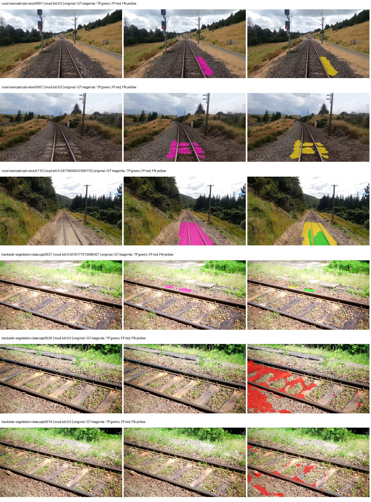
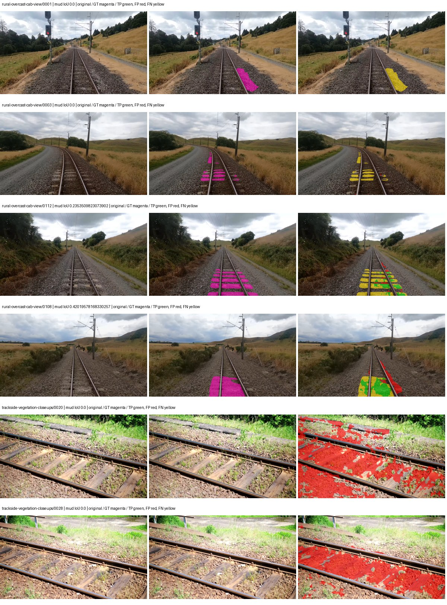
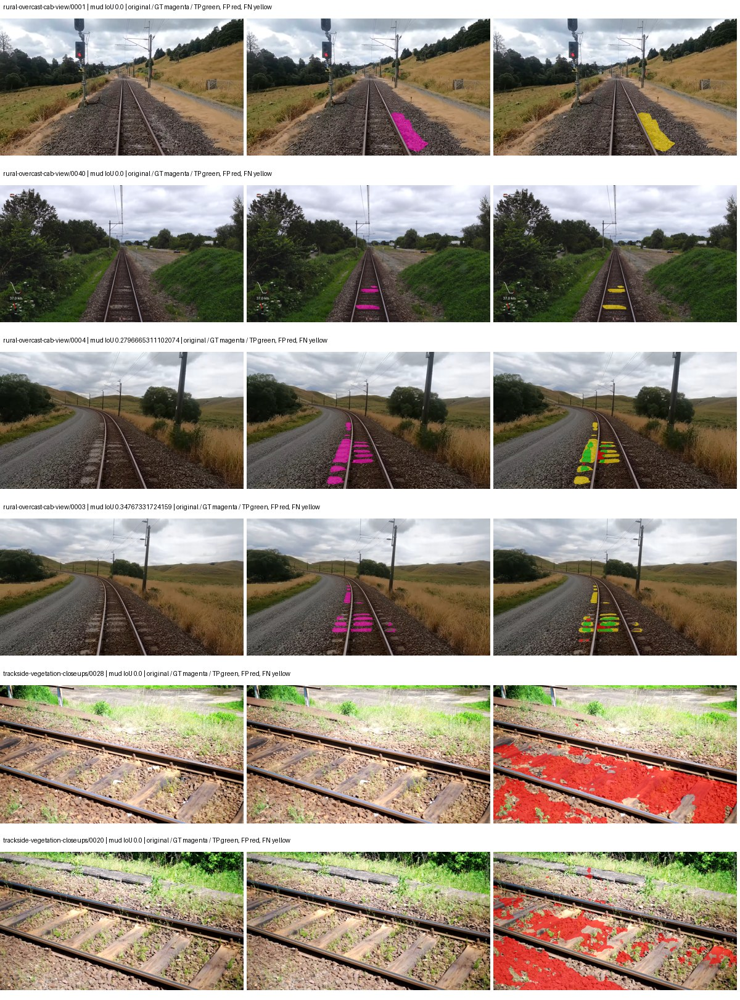
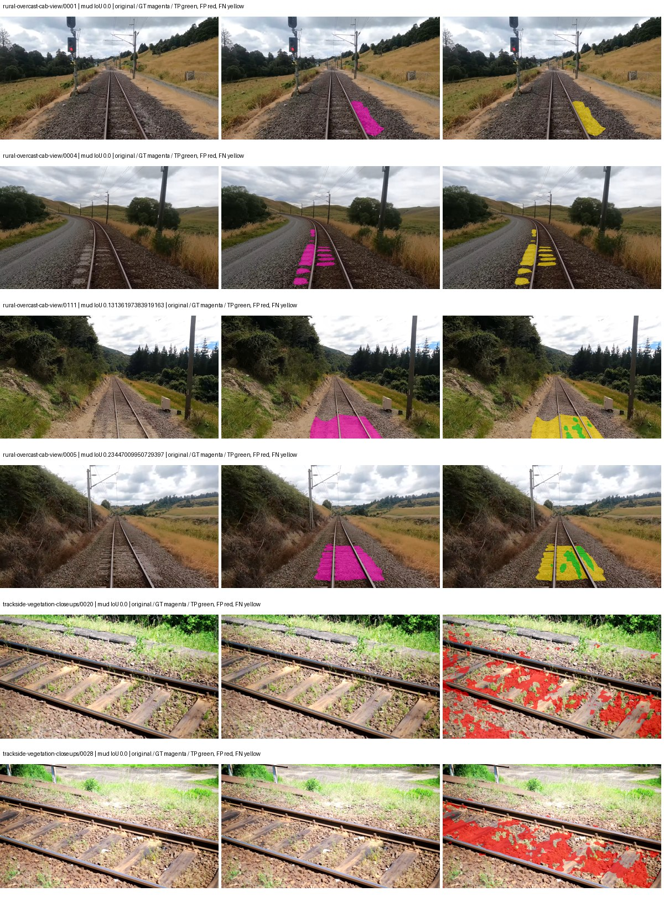

# smp_deeplabv3_resnet50 — rad_9_24_2026-fixed-grouped

[RAD 9/24: Scene-grouped split](../../README.md) · [Full model records](record.json)

Primary result: the **final checkpoint** after the full step budget (no early stopping). The checkpoint with the best **mud-pumping validation IoU, pixels pooled over all validation images**, is kept as secondary evidence. A job is complete only after full statistics and isolated profiling are verified.

Study metrics of the final checkpoint, counting each class only on the validation images that contain it: mud-pumping IoU is the mean per-image IoU over the images with mud-pumping, precision and recall sum pixels over those images, and mIoU averages each class over the images that contain it, then over the classes present.

| Initialization path | Seed | Mud-pumping IoU, train-camera images with mud (%, n=17) | Mud-pumping IoU, all images with mud (%, n=18) | Mud precision, all images with mud (%) | Mud recall, all images with mud (%) | mIoU (each class over images that contain it) (%) |
| --- | --- | --- | --- | --- | --- | --- |
| rtis_only | 0 | 1.14 | 1.64 | 22.07 | 2.58 | 34.57 |
| cityscapes_to_rtis | 0 | 1.05 | 1.17 | 7.71 | 2.60 | 34.63 |
| railsem19_to_rtis | 0 | 3.38 | 3.28 | 7.20 | 3.46 | 40.90 |
| cityscapes_to_railsem19_to_rtis | 0 | 1.41 | 1.58 | 14.74 | 3.18 | 39.85 |

Per-class IoU: IoU (%) of every class, each averaged only over the validation images that contain the class (n = those images); — = no image contains it. mIoU averages the classes with at least one such image.

| Initialization path | Seed | mIoU (each class over images that contain it) | person (n=0) | truck (n=0) | rail-track (n=37) | vegetation-overgrowth (n=13) | car (n=3) | on-rails (n=0) | traffic-sign (n=9) | road (n=11) | sidewalk (n=12) | construction (n=12) | tram-track (n=2) | pole (n=21) | traffic-light (n=3) | mud-pumping (n=18) | fence (n=7) | terrain (n=35) | sky (n=28) | rail-embedded (n=3) | rail-raised (n=37) | trackbed (n=37) | standing-water (n=9) |
| --- | --- | --- | --- | --- | --- | --- | --- | --- | --- | --- | --- | --- | --- | --- | --- | --- | --- | --- | --- | --- | --- | --- | --- |
| rtis_only | 0 | 34.57 | — | — | 57.51 | 37.14 | 19.94 | — | 16.14 | 4.31 | 15.16 | 39.23 | 3.52 | 60.73 | 39.49 | 1.64 | 11.28 | 85.34 | 96.22 | 0.16 | 70.10 | 64.25 | 0.08 |
| cityscapes_to_rtis | 0 | 34.63 | — | — | 53.45 | 24.90 | 23.82 | — | 30.47 | 5.85 | 5.63 | 29.83 | 5.29 | 65.49 | 49.90 | 1.17 | 19.67 | 79.99 | 93.18 | 0.94 | 69.07 | 59.54 | 5.10 |
| railsem19_to_rtis | 0 | 40.90 | — | — | 58.61 | 23.56 | 28.41 | — | 34.98 | 15.74 | 14.68 | 47.94 | 29.32 | 66.86 | 48.17 | 3.28 | 29.46 | 82.27 | 96.10 | 24.13 | 68.39 | 63.79 | 0.46 |
| cityscapes_to_railsem19_to_rtis | 0 | 39.85 | — | — | 57.35 | 31.62 | 30.95 | — | 35.16 | 10.63 | 12.98 | 46.56 | 32.18 | 66.15 | 46.06 | 1.58 | 26.15 | 83.67 | 96.42 | 5.16 | 71.08 | 60.94 | 2.73 |

Everything below is the campaign's own record, with pixels pooled over all validation images: its evaluation is the checkpoint that scored best on that pooled mud IoU (secondary evidence here); the diagnostics also cover the final checkpoint (`final-auto-val`).

| Model | Initialization path | Seed | Status | Steps | Best step | Best-checkpoint mud IoU, pixels pooled (%) | Best-checkpoint mud precision, pixels pooled (%) | Best-checkpoint mud recall, pixels pooled (%) | Final mud IoU (trainer val, pixels pooled, %) | Best-checkpoint mIoU, pixels pooled (%) | Best-checkpoint fixed GT-class mIoU, pixels pooled (%) |
| --- | --- | --- | --- | --- | --- | --- | --- | --- | --- | --- | --- |
| smp_deeplabv3_resnet50 | rtis_only | 0 | completed | 4000 | 777 | 5.60 | 16.73 | 7.77 | 1.13 | 25.29 | 29.51 |
| smp_deeplabv3_resnet50 | cityscapes_to_rtis | 0 | completed | 4000 | 259 | 3.71 | 4.78 | 14.21 | 0.82 | 22.96 | 24.24 |
| smp_deeplabv3_resnet50 | railsem19_to_rtis | 0 | completed | 4000 | 3111 | 2.66 | 3.80 | 8.11 | 1.14 | 39.91 | 46.56 |
| smp_deeplabv3_resnet50 | cityscapes_to_railsem19_to_rtis | 0 | completed | 4000 | 3111 | 1.97 | 3.09 | 5.18 | 1.43 | 36.21 | 42.25 |

Training: 217 images. Validation: 37 images. Test: 60 held out. Seeds: [0]. Seed variation measures optimization variability, not independent-recording uncertainty. Historical source checkpoints stay fixed across adaptation seeds.

Training code: `fce0ea0ac50b334d4252812c396e0e593def375d`. Split SHA-256: `12d7b367c72cda61d57686ff2ac28223530d0af49debd9fb7a0fbc68b908bc93`.

## rtis_only — seed 0

Status: **completed**. Started: 2026-10-11T12:49:21.804861+00:00. Finished: 2026-10-11T14:15:50.600776+00:00.

Recipe pretrained initializer: `{"arch": "smp", "backbone_path": null, "batch_norm_momentum": null, "checkpoint": null, "classifier_path": null, "drop_path": null, "encoder_name": "resnet50", "encoder_weights": "imagenet", "head": "unified_head", "head_paths": [], "inactive_parameter_paths": [], "local_files_only": false, "lora_alpha": 32, "lora_dropout": 0.05, "lora_r": 16, "lora_targets": [], "native": null, "revision": null, "smp_arch": "DeepLabV3", "subfolder": null, "trust_remote_code": false, "tuning": "full"}`.

`rtis_only` uses the recipe initializer, which may include pretrained segmentation components. Transfer paths load the exact historical source checkpoint below and reset the classifier; they do not reset all query/decoder features.

Source checkpoint: `Recipe pretrained initialization`.

Config SHA-256: `b26dd2d3bb8837183ccc191037a7082a6e47c94a0c9a6ac071820be9f942dd60`. Weights used for validation: `raw`.

### Mud-pumping and aggregate quality

| Metric | Selected checkpoint | Final training validation |
| --- | --- | --- |
| Mud IoU | 5.60 | 1.13 |
| Mud precision | 16.73 | 1.96 |
| Mud recall | 7.77 | 2.59 |
| Mud Dice/F1 | 10.61 | 2.23 |
| mIoU | 25.29 | 31.85 |
| Mean accuracy | 35.93 | 43.31 |
| Mean precision | 42.40 | 56.99 |
| Mean Dice | 31.92 | 39.88 |
| Mean specificity | 98.95 | 99.05 |
| Pixel accuracy | 83.41 | 84.59 |
| Frequency-weighted IoU | 73.91 | 75.98 |
| Fixed GT-present class mIoU | 29.51 | 37.15 |
| Boundary F1 | 28.64 | 39.44 |

The selected checkpoint has independent evaluation evidence. Final values are the trainer's final validation record, not a new independent evaluation. mIoU averages classes with nonzero union, so false positives on absent classes can change its denominator. The fixed GT-class mean is supplementary and excludes absent classes; their false positives remain in the confusion matrix.

### Resource usage and timing

| Measurement | Value |
| --- | --- |
| Peak training VRAM, retained training invocation (GiB) | 10.77 |
| Peak evaluation VRAM (GiB) | 6.97 |
| Retained training invocation wall time (seconds) | 5041.18 |
| Retained training invocation GPU-hours (one GPU) | 1.40 |
| Evaluation wall time (seconds) | 11.87 |
| Full evaluation pipeline images/second | 3.12 |
| Best full-state checkpoint (MiB) | 605.67 |
| Final full-state checkpoint (MiB) | 605.66 |
| Verified periodic checkpoints removed (GiB) | 4.73 |

VRAM uses the recorded allocator high-water mark; it is not total device usage including CUDA context. Resumed jobs' retained training invocation times and peaks are **not whole-campaign totals**. Earlier invocation resource records are not reconstructed here. Evaluation throughput includes loader, sliding-window inference and metrics; it is not model-only latency/FPS. Missing measurements are shown as —, never inferred from another dataset's run.

### Standardized inference performance

Dedicated model-only profiling waits for an idle worker-locked L40S: BF16, batch 1, 1024x1024, 20 warmup and 100 CUDA-event-timed public forwards. It excludes loading, preprocessing, tiling and metrics.

| Status | Parameters | Weight MiB | FPS | p50 ms | p95 ms | Peak reserved GiB |
| --- | --- | --- | --- | --- | --- | --- |
| complete | 39638869 | 151.21 | 78.72 | 12.68 | 12.82 | 0.84 |

```json
{
  "schema_version": 1,
  "model_id": "smp_deeplabv3_resnet50",
  "measured_at": "2026-10-11T14:15:43+00:00",
  "status": "complete",
  "benchmark_scope": "rtis_selected_checkpoint_model_only",
  "applies_to": [
    "smp_deeplabv3_resnet50--rtis_only--seed-0"
  ],
  "source": {
    "campaign_git_sha": "fce0ea0ac50b334d4252812c396e0e593def375d",
    "git_dirty": false,
    "config_hash": "1d2e352b79d9",
    "resolved_config": "/data/izadia1/projects/segmentary-runs/rad_9_24_2026/fgall-seed0-20261007/configs/smp_deeplabv3_resnet50--rtis_only--seed-0.yaml",
    "config_sha256": "b26dd2d3bb8837183ccc191037a7082a6e47c94a0c9a6ac071820be9f942dd60",
    "checkpoint_sha256": "c3bfa276f319ca8bd4afed4917d39aa621b0bce26e1c62cd0adc79d9591257c9",
    "checkpoint_global_step": 777,
    "checkpoint_bytes": 635088671,
    "checkpoint_kind": "resume checkpoint with optimizer and EMA state",
    "weights": "raw",
    "measured_checkpoint_job_id": "smp_deeplabv3_resnet50--rtis_only--seed-0",
    "result_sha256": "b71c10f56f289dc98b8afdbd8e026736ec3904ade862b03eb9b80c9f97192a3b",
    "result_git_sha": "fce0ea0ac50b334d4252812c396e0e593def375d",
    "result_stage": "eval:rad_9_24_2026-fixed-grouped:val",
    "result_seed": 0
  },
  "hardware": {
    "gpu_name": "NVIDIA L40S",
    "gpu_uuid": "GPU-2f8008a1-9b67-11f6-987b-b393a672322c",
    "logical_device": "cuda:0",
    "physical_visibility_token": "3",
    "compute_capability": [
      8,
      9
    ],
    "total_memory_bytes": 47677177856
  },
  "model": {
    "parameter_count": 39638869,
    "trainable_parameter_count": 39638869,
    "resident_parameter_bytes": 158555476,
    "parameter_dtype_counts": {
      "float32": 39638869
    }
  },
  "contract": {
    "backend": "pytorch",
    "precision": "bf16_autocast",
    "batch_size": 1,
    "input_shape_nchw": [
      1,
      3,
      1024,
      1024
    ],
    "warmup_iterations": 20,
    "measured_iterations": 100,
    "timing": "per-forward CUDA events with end-event synchronization",
    "includes_preprocessing": false,
    "includes_data_loader": false,
    "includes_sliding_window": false,
    "input_resident_on_gpu": true,
    "model_only": true,
    "entrypoint": "public model(image) dense-logits forward"
  },
  "measurements": {
    "latency": {
      "p50_ms": 12.677120208740234,
      "p95_ms": 12.820065689086913,
      "mean_ms": 12.703908500671387,
      "minimum_ms": 12.633088111877441,
      "maximum_ms": 14.09331226348877,
      "fps": 78.7159321831664,
      "raw_ms": [
        12.751872062683105,
        12.687359809875488,
        12.642304420471191,
        12.642304420471191,
        12.668928146362305,
        12.67404842376709,
        12.653568267822266,
        12.679167747497559,
        12.652544021606445,
        12.690431594848633,
        12.65459156036377,
        12.653568267822266,
        12.699647903442383,
        14.09331226348877,
        12.729344367980957,
        12.831647872924805,
        12.67199993133545,
        12.678144454956055,
        12.695551872253418,
        12.683263778686523,
        12.742655754089355,
        12.8788480758667,
        12.705792427062988,
        12.687359809875488,
        12.716032028198242,
        12.686335563659668,
        12.73855972290039,
        12.66483211517334,
        12.679167747497559,
        12.684288024902344,
        12.678144454956055,
        12.65664005279541,
        12.720128059387207,
        12.696576118469238,
        12.6494722366333,
        12.650495529174805,
        12.650495529174805,
        12.66585636138916,
        12.683263778686523,
        12.644351959228516,
        12.706815719604492,
        12.679167747497559,
        12.652544021606445,
        12.675071716308594,
        12.667903900146484,
        12.701696395874023,
        13.07852840423584,
        12.75391960144043,
        12.831744194030762,
        12.684288024902344,
        12.725248336791992,
        12.701696395874023,
        12.759039878845215,
        12.819456100463867,
        12.703743934631348,
        12.682239532470703,
        12.667903900146484,
        12.690431594848633,
        12.66585636138916,
        12.78054428100586,
        12.67302417755127,
        12.686335563659668,
        12.66483211517334,
        12.652544021606445,
        12.685312271118164,
        12.699647903442383,
        12.703743934631348,
        12.67302417755127,
        12.735487937927246,
        12.697600364685059,
        12.698623657226562,
        12.692480087280273,
        12.686335563659668,
        12.676095962524414,
        12.645376205444336,
        12.683263778686523,
        12.668928146362305,
        12.661760330200195,
        12.6494722366333,
        12.678144454956055,
        12.63923168182373,
        12.668928146362305,
        12.633088111877441,
        12.668928146362305,
        12.668928146362305,
        12.635135650634766,
        12.645376205444336,
        12.645376205444336,
        12.659711837768555,
        12.66380786895752,
        12.643327713012695,
        12.652544021606445,
        12.670016288757324,
        12.67404842376709,
        12.676095962524414,
        12.668928146362305,
        12.634112358093262,
        12.670975685119629,
        12.65561580657959,
        12.663904190063477
      ],
      "percentile_method": "numpy linear interpolation"
    },
    "peak_reserved_bytes": 899678208,
    "memory_kind": "pytorch_cuda_allocator_peak_reserved_excluding_context",
    "process_total_bytes": 1428160512,
    "process_total_kind": "nvidia-smi used_memory of this PID on the benchmark GPU after the timed loop, including the CUDA context; null when the driver could not attribute memory to this PID",
    "benchmark_wall_clock_s": 12.142729617655277
  },
  "started_at": "2026-10-11T14:15:31+00:00",
  "finished_at": "2026-10-11T14:15:43+00:00",
  "environment": {
    "hostname": "hdrfs-app-001",
    "python": "3.11.15",
    "platform": "Linux-5.15.0-139-generic-x86_64-with-glibc2.35",
    "torch": "2.11.0+cu128",
    "torch_cuda": "12.8",
    "cudnn": 91900,
    "driver_version": "570.133.20",
    "cuda_available": true,
    "gpu_count": 1,
    "gpu_names": [
      "NVIDIA L40S"
    ],
    "cuda_visible_devices": "3",
    "packages": {
      "segmentary": "0.1.0",
      "torch": "2.11.0+cu128",
      "torchvision": "0.26.0+cu128",
      "transformers": "5.15.0",
      "timm": "1.0.28",
      "segmentation-models-pytorch": "0.5.0",
      "albumentations": "2.0.8",
      "lightning": "2.6.5",
      "numpy": "2.4.4"
    }
  }
}
```

### Per-class validation results

| Class | GT pixels | IoU (%) | Precision (%) | Recall (%) | Dice (%) | Boundary F1 (%) |
| --- | --- | --- | --- | --- | --- | --- |
| car | 29664 | 0.00 | 0.00 | 0.00 | 0.00 | 0.00 |
| construction | 311585 | 30.80 | 38.16 | 61.51 | 47.10 | 35.69 |
| fence | 265137 | 4.65 | 60.25 | 4.80 | 8.89 | 20.53 |
| mud-pumping | 1226250 | 5.60 | 16.73 | 7.77 | 10.61 | 7.09 |
| on-rails | 0 | 0.00 | 0.00 | — | 0.00 | 0.00 |
| person | 0 | 0.00 | 0.00 | — | 0.00 | 0.00 |
| pole | 628038 | 58.98 | 79.44 | 69.60 | 74.20 | 81.01 |
| rail-embedded | 16799 | 0.00 | 0.00 | 0.00 | 0.00 | 0.00 |
| rail-raised | 2969797 | 72.60 | 84.62 | 83.63 | 84.12 | 92.73 |
| rail-track | 6323197 | 34.91 | 68.14 | 41.72 | 51.75 | 46.46 |
| road | 1048831 | 0.17 | 0.40 | 0.29 | 0.34 | 2.03 |
| sidewalk | 1297367 | 27.70 | 49.24 | 38.78 | 43.39 | 24.28 |
| sky | 19121606 | 96.05 | 99.22 | 96.79 | 97.99 | 89.02 |
| standing-water | 95802 | 0.22 | 0.28 | 1.01 | 0.43 | 1.86 |
| terrain | 39239306 | 86.38 | 88.18 | 97.68 | 92.69 | 58.60 |
| trackbed | 10643081 | 55.50 | 65.62 | 78.27 | 71.39 | 54.23 |
| traffic-light | 19510 | 3.37 | 100.00 | 3.37 | 6.52 | 17.45 |
| traffic-sign | 13285 | 0.00 | 0.00 | 0.00 | 0.00 | 0.00 |
| tram-track | 56179 | 12.12 | 63.88 | 13.01 | 21.62 | 9.19 |
| truck | 0 | 0.00 | 0.00 | — | 0.00 | 0.00 |
| vegetation-overgrowth | 5901821 | 42.13 | 76.16 | 48.53 | 59.29 | 61.26 |

### Full-run accounting

| Measurement | Value |
| --- | --- |
| Full GPU-reserved wall seconds, all recorded worker attempts | 5196.46 |
| Full reserved GPU-hours | 1.44 |
| Whole-run timing complete | True |

| Phase | Wall seconds including failed attempts |
| --- | --- |
| training | 5047.90 |
| diagnostics | 94.03 |
| performance | 20.68 |

GPU-reserved time includes model loading, training, validation, collection, profiling, checkpoint I/O and orchestration while the worker owns one GPU. It is not GPU kernel-active time. Phase timings and sampled device memory/power/utilization are retained separately; sampled device memory is not the allocator high-water mark.

### Train/validation and raw/EMA diagnostics

| Checkpoint / weights / split | Images | Mud IoU (%) | Mud precision (%) | Mud recall (%) |
| --- | --- | --- | --- | --- |
| best-auto-train / raw | 217 | 88.18 | 92.54 | 94.93 |
| best-auto-val / raw | 37 | 5.60 | 16.73 | 7.77 |
| best-alternate-val / ema | 37 | 1.11 | 1.28 | 7.45 |
| final-auto-val / raw | 37 | 1.13 | 1.96 | 2.58 |

Train uses the evaluation transform without augmentation. Compare mud train/validation metrics for the same selected weights. Alternate EMA on running-stat BatchNorm is explicitly uncalibrated and is diagnostic only. Score-threshold curves use uncalibrated normalized scores and are pixel-level diagnostics, not event detection rates or a selected deployment operating point.

### Downloadable evidence

- best-auto-train: [per-image.csv](rtis_only--seed-0/best-auto-train/per-image.csv) · [per-image-confusion.json.gz](rtis_only--seed-0/best-auto-train/per-image-confusion.json.gz) · [groups.json](rtis_only--seed-0/best-auto-train/groups.json) · [mud-score-curves.json](rtis_only--seed-0/best-auto-train/mud-score-curves.json)
- best-auto-val: [per-image.csv](rtis_only--seed-0/best-auto-val/per-image.csv) · [per-image-confusion.json.gz](rtis_only--seed-0/best-auto-val/per-image-confusion.json.gz) · [groups.json](rtis_only--seed-0/best-auto-val/groups.json) · [mud-score-curves.json](rtis_only--seed-0/best-auto-val/mud-score-curves.json) · [examples.jpg](rtis_only--seed-0/best-auto-val/examples.jpg)
- best-alternate-val: [per-image.csv](rtis_only--seed-0/best-alternate-val/per-image.csv) · [per-image-confusion.json.gz](rtis_only--seed-0/best-alternate-val/per-image-confusion.json.gz) · [groups.json](rtis_only--seed-0/best-alternate-val/groups.json) · [mud-score-curves.json](rtis_only--seed-0/best-alternate-val/mud-score-curves.json)
- final-auto-val: [per-image.csv](rtis_only--seed-0/final-auto-val/per-image.csv) · [per-image-confusion.json.gz](rtis_only--seed-0/final-auto-val/per-image-confusion.json.gz) · [groups.json](rtis_only--seed-0/final-auto-val/groups.json) · [mud-score-curves.json](rtis_only--seed-0/final-auto-val/mud-score-curves.json)
- resources: [telemetry.csv](rtis_only--seed-0/resources/telemetry.csv)



Examples are two lowest and two highest mud-IoU positive images, plus up to two negative images with the most false-positive mud pixels. They are targeted diagnostic examples, not random samples. Green: true positive; red: false positive; yellow: false negative. Full predictions remain on HDRFS.

### Validation tracking

| Logged step | Overall mIoU (%) | Mud IoU (%) |
| --- | --- | --- |
| 258 | 23.62 | 0.32 |
| 518 | 23.59 | 0.01 |
| 777 | 25.30 | 5.61 |
| 1036 | 26.78 | 1.34 |
| 1295 | 26.67 | 1.85 |
| 1555 | 27.16 | 0.50 |
| 1814 | 30.45 | 0.48 |
| 2073 | 27.89 | 1.36 |
| 2332 | 31.01 | 0.70 |
| 2592 | 30.76 | 0.74 |
| 2851 | 31.41 | 0.66 |
| 3110 | 31.66 | 1.66 |
| 3369 | 30.21 | 1.71 |
| 3629 | 31.76 | 1.33 |
| 3888 | 31.22 | 1.35 |
| 4000 | 31.85 | 1.13 |

All retained scalar curves, including training loss and per-class IoU, are in record.json. Observed best mud on a curve is not necessarily a retained checkpoint: the pilot saved its selection-metric-best and final checkpoints. Step logging and checkpoint global_step may differ by one.

### Stopping and checkpoint provenance

```json
{
  "stopping": {
    "actual_steps": 4000,
    "maximum_steps": 4000,
    "min_delta": 0.0,
    "monitor": "val_iou/mud-pumping",
    "patience": null,
    "reason": "budget_complete"
  },
  "checkpoints": {
    "best": {
      "path": "/data/izadia1/projects/segmentary-runs/rad_9_24_2026/fgall-seed0-20261007/future-runs/smp_deeplabv3_resnet50--rtis_only--seed-0_seed0/rtis/best.ckpt",
      "sha256": "c3bfa276f319ca8bd4afed4917d39aa621b0bce26e1c62cd0adc79d9591257c9",
      "global_step": 777,
      "bytes": 635088671
    },
    "final": {
      "path": "/data/izadia1/projects/segmentary-runs/rad_9_24_2026/fgall-seed0-20261007/future-runs/smp_deeplabv3_resnet50--rtis_only--seed-0_seed0/rtis/last.ckpt",
      "sha256": "984f52c2866ea1a60bf8fc44aeb27ce24a02de11b5f853435d1005a527c3f7a8",
      "global_step": 4000,
      "bytes": 635076895
    }
  },
  "cleanup_error": null
}
```

### Resolved training, initialization and evaluation settings

The optimizer block is the base configuration. Stage LR scales are applied at runtime, and stage warmup is capped at min(base warmup, floor(stage budget / 10), stage budget - 1): 400 steps for this 4,000-step pilot. Model-internal native input grids may differ from augmentation crops (EoMT uses its 640 grid).

```json
{
  "name": "smp_deeplabv3_resnet50--rtis_only--seed-0",
  "model": {
    "arch": "smp",
    "checkpoint": null,
    "tuning": "full",
    "head": "unified_head",
    "lora_r": 16,
    "lora_alpha": 32,
    "lora_dropout": 0.05,
    "lora_targets": [],
    "drop_path": null,
    "revision": null,
    "subfolder": null,
    "local_files_only": false,
    "trust_remote_code": false,
    "backbone_path": null,
    "head_paths": [],
    "classifier_path": null,
    "inactive_parameter_paths": [],
    "smp_arch": "DeepLabV3",
    "encoder_name": "resnet50",
    "encoder_weights": "imagenet",
    "native": null,
    "batch_norm_momentum": null
  },
  "space": "paul-test-rtis",
  "taxonomy_root": "/data/izadia1/projects/segmentary-rad-fgall-fce0ea0a/taxonomy",
  "output_root": "/data/izadia1/projects/segmentary-runs/rad_9_24_2026/fgall-seed0-20261007/future-runs",
  "optim": {
    "backbone_lr": 0.0001,
    "head_lr_mult": 10.0,
    "weight_decay": 0.05,
    "llrd": 1.0,
    "warmup_iters": 1500,
    "warmup_ratio": 1e-06,
    "poly_power": 0.9,
    "min_lr_ratio": 0.0,
    "betas": [
      0.9,
      0.999
    ],
    "grad_clip": 1.0
  },
  "train": {
    "iters": 4000,
    "batch_size": 2,
    "accum": 8,
    "num_workers": 2,
    "precision": "bf16-mixed",
    "ema_decay": 0.9998,
    "val_every": 250,
    "ckpt_every": 500,
    "selection_metric": "val_iou/mud-pumping",
    "early_stopping_patience": null,
    "early_stopping_min_delta": 0.0,
    "seed": 0,
    "devices": 1
  },
  "eval": {
    "sliding_window": true,
    "window": [
      1024,
      1024
    ],
    "stride": [
      768,
      768
    ],
    "batch_size": 1,
    "num_workers": 2,
    "tta_scales": [],
    "tta_flip": false,
    "threshold": 0.5,
    "boundary_tolerance_frac": 0.0075,
    "save_confusion": true
  },
  "loss": {
    "task": "multiclass",
    "activation": "auto",
    "terms": [],
    "aux": "none",
    "aux_weight": 0.0,
    "ce_weight": 1.0,
    "label_smoothing": 0.0,
    "class_weights": null,
    "query": null
  },
  "aug": {
    "crop": [
      1024,
      1024
    ],
    "scale_min": 0.5,
    "scale_max": 2.0,
    "hflip_p": 0.5,
    "color_jitter_p": 0.5,
    "brightness": 0.25,
    "contrast": 0.25,
    "saturation": 0.25,
    "hue": 0.05
  },
  "stages": [
    {
      "name": "rtis",
      "data": [
        {
          "name": "rad_9_24_2026-fixed-grouped",
          "root": "/data/izadia1/datasets/rad_9_24_2026-fixed-grouped",
          "variant": null,
          "split_file": "splits.json",
          "train_split": "train",
          "val_split": "val",
          "limit": null,
          "loader": "folder",
          "mapping": "paul-test-rtis",
          "loader_options": {
            "require_groups": true
          }
        }
      ],
      "iters": null,
      "lr_scale": 1.0,
      "head_group_lr_scale": 1.0,
      "init_from": "pretrained",
      "reset_head": false,
      "freeze": null,
      "sample_weights": null
    }
  ]
}
```

### Hardware and software provenance

```json
{
  "training": {
    "cuda_available": true,
    "cuda_visible_devices": "3",
    "cudnn": 91900,
    "driver_version": "570.133.20",
    "gpu_count": 1,
    "gpu_names": [
      "NVIDIA L40S"
    ],
    "hostname": "hdrfs-app-001",
    "input_normalization": {
      "channel_order": "rgb",
      "mean": [
        0.485,
        0.456,
        0.406
      ],
      "source": "smp_encoder_settings",
      "std": [
        0.229,
        0.224,
        0.225
      ]
    },
    "model_origins": [
      {
        "hf_commit": null,
        "hf_name_or_path": null,
        "module": "model",
        "timm_pretrained": {}
      }
    ],
    "model_parameter_count": 39638869,
    "packages": {
      "albumentations": "2.0.8",
      "lightning": "2.6.5",
      "numpy": "2.4.4",
      "segmentary": "0.1.0",
      "segmentation-models-pytorch": "0.5.0",
      "timm": "1.0.28",
      "torch": "2.11.0+cu128",
      "torchvision": "0.26.0+cu128",
      "transformers": "5.15.0"
    },
    "platform": "Linux-5.15.0-139-generic-x86_64-with-glibc2.35",
    "python": "3.11.15",
    "torch": "2.11.0+cu128",
    "torch_cuda": "12.8",
    "trainable_parameter_count": 39638869,
    "training_stop": {
      "actual_steps": 4000,
      "maximum_steps": 4000,
      "min_delta": 0.0,
      "monitor": "val_iou/mud-pumping",
      "patience": null,
      "reason": "budget_complete"
    },
    "validation_weights": "raw"
  },
  "evaluation": {
    "cuda_available": true,
    "cuda_visible_devices": "3",
    "cudnn": 91900,
    "driver_version": "570.133.20",
    "gpu_count": 1,
    "gpu_names": [
      "NVIDIA L40S"
    ],
    "hostname": "hdrfs-app-001",
    "input_normalization": {
      "channel_order": "rgb",
      "mean": [
        0.485,
        0.456,
        0.406
      ],
      "source": "smp_encoder_settings",
      "std": [
        0.229,
        0.224,
        0.225
      ]
    },
    "packages": {
      "albumentations": "2.0.8",
      "lightning": "2.6.5",
      "numpy": "2.4.4",
      "segmentary": "0.1.0",
      "segmentation-models-pytorch": "0.5.0",
      "timm": "1.0.28",
      "torch": "2.11.0+cu128",
      "torchvision": "0.26.0+cu128",
      "transformers": "5.15.0"
    },
    "platform": "Linux-5.15.0-139-generic-x86_64-with-glibc2.35",
    "python": "3.11.15",
    "torch": "2.11.0+cu128",
    "torch_cuda": "12.8"
  }
}
```

## cityscapes_to_rtis — seed 0

Status: **completed**. Started: 2026-10-11T12:49:55.973801+00:00. Finished: 2026-10-11T14:16:33.239622+00:00.

Recipe pretrained initializer: `{"arch": "smp", "backbone_path": null, "batch_norm_momentum": null, "checkpoint": null, "classifier_path": null, "drop_path": null, "encoder_name": "resnet50", "encoder_weights": "imagenet", "head": "unified_head", "head_paths": [], "inactive_parameter_paths": [], "local_files_only": false, "lora_alpha": 32, "lora_dropout": 0.05, "lora_r": 16, "lora_targets": [], "native": null, "revision": null, "smp_arch": "DeepLabV3", "subfolder": null, "trust_remote_code": false, "tuning": "full"}`.

`rtis_only` uses the recipe initializer, which may include pretrained segmentation components. Transfer paths load the exact historical source checkpoint below and reset the classifier; they do not reset all query/decoder features.

Source checkpoint: `{'name': 'smp_deeplabv3_resnet50--cityscapes--seed-0', 'model': 'smp_deeplabv3_resnet50', 'protocol': 'cityscapes', 'config': '/data/izadia1/projects/segmentary-runs/all-model-city-rail-seed0-rail20-b9eb3e1/jobs/smp_deeplabv3_resnet50--cityscapes--seed-0/attempt-001/resolved-config.yaml', 'checkpoint': '/data/izadia1/projects/segmentary-runs/all-model-city-rail-seed0-rail20-b9eb3e1/jobs/smp_deeplabv3_resnet50--cityscapes--seed-0/attempt-001/train/smp_deeplabv3_resnet50--cityscapes_seed0/cityscapes/last.ckpt', 'recorded_sha256': 'f8d278fd853bb1003957b26e29428cc8c6c4a6596aad963f2db4b2f152f86384', 'exists': True}`.

Config SHA-256: `fb8c897e59339eebc9b2800c2c5a5f228d991bee54667d1a228db062cbca2e0e`. Weights used for validation: `raw`.

### Mud-pumping and aggregate quality

| Metric | Selected checkpoint | Final training validation |
| --- | --- | --- |
| Mud IoU | 3.71 | 0.82 |
| Mud precision | 4.78 | 1.19 |
| Mud recall | 14.21 | 2.60 |
| Mud Dice/F1 | 7.15 | 1.63 |
| mIoU | 22.96 | 31.66 |
| Mean accuracy | 32.49 | 46.51 |
| Mean precision | 37.03 | 55.04 |
| Mean Dice | 29.05 | 40.21 |
| Mean specificity | 98.51 | 98.77 |
| Pixel accuracy | 77.64 | 80.28 |
| Frequency-weighted IoU | 66.13 | 71.28 |
| Fixed GT-present class mIoU | 24.24 | 36.94 |
| Boundary F1 | 24.07 | 37.89 |

The selected checkpoint has independent evaluation evidence. Final values are the trainer's final validation record, not a new independent evaluation. mIoU averages classes with nonzero union, so false positives on absent classes can change its denominator. The fixed GT-class mean is supplementary and excludes absent classes; their false positives remain in the confusion matrix.

### Resource usage and timing

| Measurement | Value |
| --- | --- |
| Peak training VRAM, retained training invocation (GiB) | 10.77 |
| Peak evaluation VRAM (GiB) | 6.97 |
| Retained training invocation wall time (seconds) | 5046.08 |
| Retained training invocation GPU-hours (one GPU) | 1.40 |
| Evaluation wall time (seconds) | 12.57 |
| Full evaluation pipeline images/second | 2.94 |
| Best full-state checkpoint (MiB) | 605.67 |
| Final full-state checkpoint (MiB) | 605.66 |
| Verified periodic checkpoints removed (GiB) | 4.73 |

VRAM uses the recorded allocator high-water mark; it is not total device usage including CUDA context. Resumed jobs' retained training invocation times and peaks are **not whole-campaign totals**. Earlier invocation resource records are not reconstructed here. Evaluation throughput includes loader, sliding-window inference and metrics; it is not model-only latency/FPS. Missing measurements are shown as —, never inferred from another dataset's run.

### Standardized inference performance

Dedicated model-only profiling waits for an idle worker-locked L40S: BF16, batch 1, 1024x1024, 20 warmup and 100 CUDA-event-timed public forwards. It excludes loading, preprocessing, tiling and metrics.

| Status | Parameters | Weight MiB | FPS | p50 ms | p95 ms | Peak reserved GiB |
| --- | --- | --- | --- | --- | --- | --- |
| complete | 39638869 | 151.21 | 78.37 | 12.76 | 12.79 | 0.84 |

```json
{
  "schema_version": 1,
  "model_id": "smp_deeplabv3_resnet50",
  "measured_at": "2026-10-11T14:16:26+00:00",
  "status": "complete",
  "benchmark_scope": "rtis_selected_checkpoint_model_only",
  "applies_to": [
    "smp_deeplabv3_resnet50--cityscapes_to_rtis--seed-0"
  ],
  "source": {
    "campaign_git_sha": "fce0ea0ac50b334d4252812c396e0e593def375d",
    "git_dirty": false,
    "config_hash": "ed35f48a0468",
    "resolved_config": "/data/izadia1/projects/segmentary-runs/rad_9_24_2026/fgall-seed0-20261007/configs/smp_deeplabv3_resnet50--cityscapes_to_rtis--seed-0.yaml",
    "config_sha256": "fb8c897e59339eebc9b2800c2c5a5f228d991bee54667d1a228db062cbca2e0e",
    "checkpoint_sha256": "052f3831abfbe32cfde65f3b8dc3a0cdf2011e05235cc371e6182fc7dc3265ce",
    "checkpoint_global_step": 259,
    "checkpoint_bytes": 635088415,
    "checkpoint_kind": "resume checkpoint with optimizer and EMA state",
    "weights": "raw",
    "measured_checkpoint_job_id": "smp_deeplabv3_resnet50--cityscapes_to_rtis--seed-0",
    "result_sha256": "5e27fb461608b097da48cbe81f8acf0ec5ffa333e6f8058a89c99b94d5a6314c",
    "result_git_sha": "fce0ea0ac50b334d4252812c396e0e593def375d",
    "result_stage": "eval:rad_9_24_2026-fixed-grouped:val",
    "result_seed": 0
  },
  "hardware": {
    "gpu_name": "NVIDIA L40S",
    "gpu_uuid": "GPU-fc5dde96-210d-0afa-ac74-7f88477d622b",
    "logical_device": "cuda:0",
    "physical_visibility_token": "4",
    "compute_capability": [
      8,
      9
    ],
    "total_memory_bytes": 47677177856
  },
  "model": {
    "parameter_count": 39638869,
    "trainable_parameter_count": 39638869,
    "resident_parameter_bytes": 158555476,
    "parameter_dtype_counts": {
      "float32": 39638869
    }
  },
  "contract": {
    "backend": "pytorch",
    "precision": "bf16_autocast",
    "batch_size": 1,
    "input_shape_nchw": [
      1,
      3,
      1024,
      1024
    ],
    "warmup_iterations": 20,
    "measured_iterations": 100,
    "timing": "per-forward CUDA events with end-event synchronization",
    "includes_preprocessing": false,
    "includes_data_loader": false,
    "includes_sliding_window": false,
    "input_resident_on_gpu": true,
    "model_only": true,
    "entrypoint": "public model(image) dense-logits forward"
  },
  "measurements": {
    "latency": {
      "p50_ms": 12.758015632629395,
      "p95_ms": 12.792012929916382,
      "mean_ms": 12.759498205184936,
      "minimum_ms": 12.715007781982422,
      "maximum_ms": 12.823552131652832,
      "fps": 78.37298802186758,
      "raw_ms": [
        12.795904159545898,
        12.75699234008789,
        12.77235221862793,
        12.741632461547852,
        12.752896308898926,
        12.743680000305176,
        12.770303726196289,
        12.767231941223145,
        12.741727828979492,
        12.77132797241211,
        12.729215621948242,
        12.779520034790039,
        12.781567573547363,
        12.766207695007324,
        12.789759635925293,
        12.823552131652832,
        12.776448249816895,
        12.797951698303223,
        12.797951698303223,
        12.758015632629395,
        12.761088371276855,
        12.76313591003418,
        12.729344367980957,
        12.75494384765625,
        12.740703582763672,
        12.752896308898926,
        12.748800277709961,
        12.75487995147705,
        12.780608177185059,
        12.776448249816895,
        12.759039878845215,
        12.750847816467285,
        12.75391960144043,
        12.76518440246582,
        12.76416015625,
        12.73027229309082,
        12.75391960144043,
        12.752896308898926,
        12.743680000305176,
        12.740608215332031,
        12.730367660522461,
        12.739583969116211,
        12.76313591003418,
        12.76416015625,
        12.751872062683105,
        12.783616065979004,
        12.75494384765625,
        12.75391960144043,
        12.759967803955078,
        12.725248336791992,
        12.740608215332031,
        12.771295547485352,
        12.728320121765137,
        12.782591819763184,
        12.75596809387207,
        12.743680000305176,
        12.788864135742188,
        12.76211166381836,
        12.777471542358398,
        12.774399757385254,
        12.764127731323242,
        12.783616065979004,
        12.766207695007324,
        12.76211166381836,
        12.80303955078125,
        12.766336441040039,
        12.751775741577148,
        12.758015632629395,
        12.767231941223145,
        12.740608215332031,
        12.783616065979004,
        12.744704246520996,
        12.75596809387207,
        12.76313591003418,
        12.737536430358887,
        12.75391960144043,
        12.766207695007324,
        12.731391906738281,
        12.76416015625,
        12.741632461547852,
        12.743680000305176,
        12.765151977539062,
        12.75596809387207,
        12.76313591003418,
        12.791808128356934,
        12.75391960144043,
        12.775327682495117,
        12.749823570251465,
        12.768256187438965,
        12.76518440246582,
        12.736512184143066,
        12.774399757385254,
        12.757887840270996,
        12.750911712646484,
        12.739583969116211,
        12.74675178527832,
        12.744704246520996,
        12.760064125061035,
        12.742655754089355,
        12.715007781982422
      ],
      "percentile_method": "numpy linear interpolation"
    },
    "peak_reserved_bytes": 899678208,
    "memory_kind": "pytorch_cuda_allocator_peak_reserved_excluding_context",
    "process_total_bytes": 1428160512,
    "process_total_kind": "nvidia-smi used_memory of this PID on the benchmark GPU after the timed loop, including the CUDA context; null when the driver could not attribute memory to this PID",
    "benchmark_wall_clock_s": 12.2251580581069
  },
  "started_at": "2026-10-11T14:16:13+00:00",
  "finished_at": "2026-10-11T14:16:26+00:00",
  "environment": {
    "hostname": "hdrfs-app-001",
    "python": "3.11.15",
    "platform": "Linux-5.15.0-139-generic-x86_64-with-glibc2.35",
    "torch": "2.11.0+cu128",
    "torch_cuda": "12.8",
    "cudnn": 91900,
    "driver_version": "570.133.20",
    "cuda_available": true,
    "gpu_count": 1,
    "gpu_names": [
      "NVIDIA L40S"
    ],
    "cuda_visible_devices": "4",
    "packages": {
      "segmentary": "0.1.0",
      "torch": "2.11.0+cu128",
      "torchvision": "0.26.0+cu128",
      "transformers": "5.15.0",
      "timm": "1.0.28",
      "segmentation-models-pytorch": "0.5.0",
      "albumentations": "2.0.8",
      "lightning": "2.6.5",
      "numpy": "2.4.4"
    }
  }
}
```

### Per-class validation results

| Class | GT pixels | IoU (%) | Precision (%) | Recall (%) | Dice (%) | Boundary F1 (%) |
| --- | --- | --- | --- | --- | --- | --- |
| car | 29664 | 0.00 | 0.00 | 0.00 | 0.00 | 0.00 |
| construction | 311585 | 10.93 | 11.56 | 66.48 | 19.70 | 12.23 |
| fence | 265137 | 24.78 | 49.48 | 33.18 | 39.72 | 36.50 |
| mud-pumping | 1226250 | 3.71 | 4.78 | 14.21 | 7.15 | 8.83 |
| on-rails | 0 | 0.00 | 0.00 | — | 0.00 | 0.00 |
| person | 0 | — | — | — | — | — |
| pole | 628038 | 62.10 | 78.40 | 74.92 | 76.62 | 86.01 |
| rail-embedded | 16799 | 0.00 | 0.00 | 0.00 | 0.00 | 0.00 |
| rail-raised | 2969797 | 58.74 | 77.72 | 70.64 | 74.01 | 82.04 |
| rail-track | 6323197 | 26.86 | 66.82 | 30.99 | 42.35 | 37.76 |
| road | 1048831 | 0.06 | 1.48 | 0.06 | 0.11 | 2.90 |
| sidewalk | 1297367 | 18.60 | 66.50 | 20.53 | 31.37 | 7.94 |
| sky | 19121606 | 92.93 | 99.36 | 93.49 | 96.33 | 73.59 |
| standing-water | 95802 | 1.91 | 2.30 | 10.16 | 3.75 | 7.36 |
| terrain | 39239306 | 78.95 | 80.29 | 97.92 | 88.24 | 46.92 |
| trackbed | 10643081 | 56.46 | 72.30 | 72.05 | 72.17 | 52.69 |
| traffic-light | 19510 | 0.00 | 0.00 | 0.00 | 0.00 | 0.00 |
| traffic-sign | 13285 | 0.00 | 0.00 | 0.00 | 0.00 | 0.00 |
| tram-track | 56179 | 0.00 | 0.00 | 0.00 | 0.00 | 0.00 |
| truck | 0 | — | — | — | — | — |
| vegetation-overgrowth | 5901821 | 0.23 | 92.55 | 0.23 | 0.46 | 2.54 |

### Full-run accounting

| Measurement | Value |
| --- | --- |
| Full GPU-reserved wall seconds, all recorded worker attempts | 5205.56 |
| Full reserved GPU-hours | 1.45 |
| Whole-run timing complete | True |

| Phase | Wall seconds including failed attempts |
| --- | --- |
| training | 5053.47 |
| diagnostics | 95.84 |
| performance | 20.59 |

GPU-reserved time includes model loading, training, validation, collection, profiling, checkpoint I/O and orchestration while the worker owns one GPU. It is not GPU kernel-active time. Phase timings and sampled device memory/power/utilization are retained separately; sampled device memory is not the allocator high-water mark.

### Train/validation and raw/EMA diagnostics

| Checkpoint / weights / split | Images | Mud IoU (%) | Mud precision (%) | Mud recall (%) |
| --- | --- | --- | --- | --- |
| best-auto-train / raw | 217 | 82.71 | 90.06 | 91.02 |
| best-auto-val / raw | 37 | 3.71 | 4.78 | 14.21 |
| best-alternate-val / ema | 37 | 1.56 | 1.97 | 6.96 |
| final-auto-val / raw | 37 | 0.82 | 1.18 | 2.60 |

Train uses the evaluation transform without augmentation. Compare mud train/validation metrics for the same selected weights. Alternate EMA on running-stat BatchNorm is explicitly uncalibrated and is diagnostic only. Score-threshold curves use uncalibrated normalized scores and are pixel-level diagnostics, not event detection rates or a selected deployment operating point.

### Downloadable evidence

- best-auto-train: [per-image.csv](cityscapes_to_rtis--seed-0/best-auto-train/per-image.csv) · [per-image-confusion.json.gz](cityscapes_to_rtis--seed-0/best-auto-train/per-image-confusion.json.gz) · [groups.json](cityscapes_to_rtis--seed-0/best-auto-train/groups.json) · [mud-score-curves.json](cityscapes_to_rtis--seed-0/best-auto-train/mud-score-curves.json)
- best-auto-val: [per-image.csv](cityscapes_to_rtis--seed-0/best-auto-val/per-image.csv) · [per-image-confusion.json.gz](cityscapes_to_rtis--seed-0/best-auto-val/per-image-confusion.json.gz) · [groups.json](cityscapes_to_rtis--seed-0/best-auto-val/groups.json) · [mud-score-curves.json](cityscapes_to_rtis--seed-0/best-auto-val/mud-score-curves.json) · [examples.jpg](cityscapes_to_rtis--seed-0/best-auto-val/examples.jpg)
- best-alternate-val: [per-image.csv](cityscapes_to_rtis--seed-0/best-alternate-val/per-image.csv) · [per-image-confusion.json.gz](cityscapes_to_rtis--seed-0/best-alternate-val/per-image-confusion.json.gz) · [groups.json](cityscapes_to_rtis--seed-0/best-alternate-val/groups.json) · [mud-score-curves.json](cityscapes_to_rtis--seed-0/best-alternate-val/mud-score-curves.json)
- final-auto-val: [per-image.csv](cityscapes_to_rtis--seed-0/final-auto-val/per-image.csv) · [per-image-confusion.json.gz](cityscapes_to_rtis--seed-0/final-auto-val/per-image-confusion.json.gz) · [groups.json](cityscapes_to_rtis--seed-0/final-auto-val/groups.json) · [mud-score-curves.json](cityscapes_to_rtis--seed-0/final-auto-val/mud-score-curves.json)
- resources: [telemetry.csv](cityscapes_to_rtis--seed-0/resources/telemetry.csv)



Examples are two lowest and two highest mud-IoU positive images, plus up to two negative images with the most false-positive mud pixels. They are targeted diagnostic examples, not random samples. Green: true positive; red: false positive; yellow: false negative. Full predictions remain on HDRFS.

### Validation tracking

| Logged step | Overall mIoU (%) | Mud IoU (%) |
| --- | --- | --- |
| 258 | 22.96 | 3.71 |
| 518 | 20.91 | 2.39 |
| 777 | 26.60 | 0.81 |
| 1036 | 28.93 | 0.46 |
| 1295 | 30.73 | 0.56 |
| 1555 | 31.56 | 1.36 |
| 1814 | 33.39 | 0.41 |
| 2073 | 30.47 | 1.20 |
| 2332 | 32.25 | 0.89 |
| 2592 | 30.63 | 0.46 |
| 2851 | 32.99 | 0.58 |
| 3110 | 31.53 | 1.01 |
| 3369 | 32.37 | 1.01 |
| 3629 | 32.75 | 0.67 |
| 3888 | 32.86 | 1.08 |
| 4000 | 31.66 | 0.82 |

All retained scalar curves, including training loss and per-class IoU, are in record.json. Observed best mud on a curve is not necessarily a retained checkpoint: the pilot saved its selection-metric-best and final checkpoints. Step logging and checkpoint global_step may differ by one.

### Stopping and checkpoint provenance

```json
{
  "stopping": {
    "actual_steps": 4000,
    "maximum_steps": 4000,
    "min_delta": 0.0,
    "monitor": "val_iou/mud-pumping",
    "patience": null,
    "reason": "budget_complete"
  },
  "checkpoints": {
    "best": {
      "path": "/data/izadia1/projects/segmentary-runs/rad_9_24_2026/fgall-seed0-20261007/future-runs/smp_deeplabv3_resnet50--cityscapes_to_rtis--seed-0_seed0/rtis/best.ckpt",
      "sha256": "052f3831abfbe32cfde65f3b8dc3a0cdf2011e05235cc371e6182fc7dc3265ce",
      "global_step": 259,
      "bytes": 635088415
    },
    "final": {
      "path": "/data/izadia1/projects/segmentary-runs/rad_9_24_2026/fgall-seed0-20261007/future-runs/smp_deeplabv3_resnet50--cityscapes_to_rtis--seed-0_seed0/rtis/last.ckpt",
      "sha256": "d12dad513a462bb4efd5a97807cd0c4c2b8a0225c671511a5bf3d266dd9b6d67",
      "global_step": 4000,
      "bytes": 635076959
    }
  },
  "cleanup_error": null
}
```

### Resolved training, initialization and evaluation settings

The optimizer block is the base configuration. Stage LR scales are applied at runtime, and stage warmup is capped at min(base warmup, floor(stage budget / 10), stage budget - 1): 400 steps for this 4,000-step pilot. Model-internal native input grids may differ from augmentation crops (EoMT uses its 640 grid).

```json
{
  "name": "smp_deeplabv3_resnet50--cityscapes_to_rtis--seed-0",
  "model": {
    "arch": "smp",
    "checkpoint": null,
    "tuning": "full",
    "head": "unified_head",
    "lora_r": 16,
    "lora_alpha": 32,
    "lora_dropout": 0.05,
    "lora_targets": [],
    "drop_path": null,
    "revision": null,
    "subfolder": null,
    "local_files_only": false,
    "trust_remote_code": false,
    "backbone_path": null,
    "head_paths": [],
    "classifier_path": null,
    "inactive_parameter_paths": [],
    "smp_arch": "DeepLabV3",
    "encoder_name": "resnet50",
    "encoder_weights": "imagenet",
    "native": null,
    "batch_norm_momentum": null
  },
  "space": "paul-test-rtis",
  "taxonomy_root": "/data/izadia1/projects/segmentary-rad-fgall-fce0ea0a/taxonomy",
  "output_root": "/data/izadia1/projects/segmentary-runs/rad_9_24_2026/fgall-seed0-20261007/future-runs",
  "optim": {
    "backbone_lr": 0.0001,
    "head_lr_mult": 10.0,
    "weight_decay": 0.05,
    "llrd": 1.0,
    "warmup_iters": 1500,
    "warmup_ratio": 1e-06,
    "poly_power": 0.9,
    "min_lr_ratio": 0.0,
    "betas": [
      0.9,
      0.999
    ],
    "grad_clip": 1.0
  },
  "train": {
    "iters": 4000,
    "batch_size": 2,
    "accum": 8,
    "num_workers": 2,
    "precision": "bf16-mixed",
    "ema_decay": 0.9998,
    "val_every": 250,
    "ckpt_every": 500,
    "selection_metric": "val_iou/mud-pumping",
    "early_stopping_patience": null,
    "early_stopping_min_delta": 0.0,
    "seed": 0,
    "devices": 1
  },
  "eval": {
    "sliding_window": true,
    "window": [
      1024,
      1024
    ],
    "stride": [
      768,
      768
    ],
    "batch_size": 1,
    "num_workers": 2,
    "tta_scales": [],
    "tta_flip": false,
    "threshold": 0.5,
    "boundary_tolerance_frac": 0.0075,
    "save_confusion": true
  },
  "loss": {
    "task": "multiclass",
    "activation": "auto",
    "terms": [],
    "aux": "none",
    "aux_weight": 0.0,
    "ce_weight": 1.0,
    "label_smoothing": 0.0,
    "class_weights": null,
    "query": null
  },
  "aug": {
    "crop": [
      1024,
      1024
    ],
    "scale_min": 0.5,
    "scale_max": 2.0,
    "hflip_p": 0.5,
    "color_jitter_p": 0.5,
    "brightness": 0.25,
    "contrast": 0.25,
    "saturation": 0.25,
    "hue": 0.05
  },
  "stages": [
    {
      "name": "rtis",
      "data": [
        {
          "name": "rad_9_24_2026-fixed-grouped",
          "root": "/data/izadia1/datasets/rad_9_24_2026-fixed-grouped",
          "variant": null,
          "split_file": "splits.json",
          "train_split": "train",
          "val_split": "val",
          "limit": null,
          "loader": "folder",
          "mapping": "paul-test-rtis",
          "loader_options": {
            "require_groups": true
          }
        }
      ],
      "iters": null,
      "lr_scale": 0.1,
      "head_group_lr_scale": 1.0,
      "init_from": "/data/izadia1/projects/segmentary-runs/all-model-city-rail-seed0-rail20-b9eb3e1/jobs/smp_deeplabv3_resnet50--cityscapes--seed-0/attempt-001/train/smp_deeplabv3_resnet50--cityscapes_seed0/cityscapes/last.ckpt",
      "reset_head": true,
      "freeze": null,
      "sample_weights": null
    }
  ]
}
```

### Hardware and software provenance

```json
{
  "training": {
    "cuda_available": true,
    "cuda_visible_devices": "4",
    "cudnn": 91900,
    "driver_version": "570.133.20",
    "gpu_count": 1,
    "gpu_names": [
      "NVIDIA L40S"
    ],
    "hostname": "hdrfs-app-001",
    "input_normalization": {
      "channel_order": "rgb",
      "mean": [
        0.485,
        0.456,
        0.406
      ],
      "source": "smp_encoder_settings",
      "std": [
        0.229,
        0.224,
        0.225
      ]
    },
    "model_origins": [
      {
        "hf_commit": null,
        "hf_name_or_path": null,
        "module": "model",
        "timm_pretrained": {}
      }
    ],
    "model_parameter_count": 39638869,
    "packages": {
      "albumentations": "2.0.8",
      "lightning": "2.6.5",
      "numpy": "2.4.4",
      "segmentary": "0.1.0",
      "segmentation-models-pytorch": "0.5.0",
      "timm": "1.0.28",
      "torch": "2.11.0+cu128",
      "torchvision": "0.26.0+cu128",
      "transformers": "5.15.0"
    },
    "platform": "Linux-5.15.0-139-generic-x86_64-with-glibc2.35",
    "python": "3.11.15",
    "torch": "2.11.0+cu128",
    "torch_cuda": "12.8",
    "trainable_parameter_count": 39638869,
    "training_stop": {
      "actual_steps": 4000,
      "maximum_steps": 4000,
      "min_delta": 0.0,
      "monitor": "val_iou/mud-pumping",
      "patience": null,
      "reason": "budget_complete"
    },
    "validation_weights": "raw"
  },
  "evaluation": {
    "cuda_available": true,
    "cuda_visible_devices": "4",
    "cudnn": 91900,
    "driver_version": "570.133.20",
    "gpu_count": 1,
    "gpu_names": [
      "NVIDIA L40S"
    ],
    "hostname": "hdrfs-app-001",
    "input_normalization": {
      "channel_order": "rgb",
      "mean": [
        0.485,
        0.456,
        0.406
      ],
      "source": "smp_encoder_settings",
      "std": [
        0.229,
        0.224,
        0.225
      ]
    },
    "packages": {
      "albumentations": "2.0.8",
      "lightning": "2.6.5",
      "numpy": "2.4.4",
      "segmentary": "0.1.0",
      "segmentation-models-pytorch": "0.5.0",
      "timm": "1.0.28",
      "torch": "2.11.0+cu128",
      "torchvision": "0.26.0+cu128",
      "transformers": "5.15.0"
    },
    "platform": "Linux-5.15.0-139-generic-x86_64-with-glibc2.35",
    "python": "3.11.15",
    "torch": "2.11.0+cu128",
    "torch_cuda": "12.8"
  }
}
```

## railsem19_to_rtis — seed 0

Status: **completed**. Started: 2026-10-11T12:50:16.777770+00:00. Finished: 2026-10-11T14:18:09.787949+00:00.

Recipe pretrained initializer: `{"arch": "smp", "backbone_path": null, "batch_norm_momentum": null, "checkpoint": null, "classifier_path": null, "drop_path": null, "encoder_name": "resnet50", "encoder_weights": "imagenet", "head": "unified_head", "head_paths": [], "inactive_parameter_paths": [], "local_files_only": false, "lora_alpha": 32, "lora_dropout": 0.05, "lora_r": 16, "lora_targets": [], "native": null, "revision": null, "smp_arch": "DeepLabV3", "subfolder": null, "trust_remote_code": false, "tuning": "full"}`.

`rtis_only` uses the recipe initializer, which may include pretrained segmentation components. Transfer paths load the exact historical source checkpoint below and reset the classifier; they do not reset all query/decoder features.

Source checkpoint: `{'name': 'smp_deeplabv3_resnet50--railsem19--seed-0', 'model': 'smp_deeplabv3_resnet50', 'protocol': 'railsem19', 'config': '/data/izadia1/projects/segmentary-runs/all-model-city-rail-seed0-rail20-b9eb3e1/accepted/smp_deeplabv3_resnet50--railsem19--seed-0/resolved-config.yaml', 'checkpoint': '/data/izadia1/projects/segmentary-runs/all-model-city-rail-seed0-a7c0b67/jobs/smp_deeplabv3_resnet50--railsem19--seed-0/attempt-001/train/smp_deeplabv3_resnet50--railsem19_seed0/railsem19/last.ckpt', 'recorded_sha256': 'cefa227df6e071d44dd577150d70444288975834c436c3298cf1db587e8a968f', 'exists': True}`.

Config SHA-256: `a626c4827e160adc42e80d9a7ef2c796d99ec2961a057c2b479c880ff797c31b`. Weights used for validation: `raw`.

### Mud-pumping and aggregate quality

| Metric | Selected checkpoint | Final training validation |
| --- | --- | --- |
| Mud IoU | 2.66 | 1.14 |
| Mud precision | 3.80 | 1.66 |
| Mud recall | 8.11 | 3.47 |
| Mud Dice/F1 | 5.18 | 2.25 |
| mIoU | 39.91 | 39.42 |
| Mean accuracy | 56.17 | 55.22 |
| Mean precision | 59.52 | 59.45 |
| Mean Dice | 50.13 | 49.58 |
| Mean specificity | 98.97 | 98.89 |
| Pixel accuracy | 83.80 | 83.22 |
| Frequency-weighted IoU | 74.85 | 73.57 |
| Fixed GT-present class mIoU | 46.56 | 45.99 |
| Boundary F1 | 47.60 | 47.16 |

The selected checkpoint has independent evaluation evidence. Final values are the trainer's final validation record, not a new independent evaluation. mIoU averages classes with nonzero union, so false positives on absent classes can change its denominator. The fixed GT-class mean is supplementary and excludes absent classes; their false positives remain in the confusion matrix.

### Resource usage and timing

| Measurement | Value |
| --- | --- |
| Peak training VRAM, retained training invocation (GiB) | 10.77 |
| Peak evaluation VRAM (GiB) | 6.97 |
| Retained training invocation wall time (seconds) | 5119.67 |
| Retained training invocation GPU-hours (one GPU) | 1.42 |
| Evaluation wall time (seconds) | 12.20 |
| Full evaluation pipeline images/second | 3.03 |
| Best full-state checkpoint (MiB) | 605.67 |
| Final full-state checkpoint (MiB) | 605.66 |
| Verified periodic checkpoints removed (GiB) | 4.73 |

VRAM uses the recorded allocator high-water mark; it is not total device usage including CUDA context. Resumed jobs' retained training invocation times and peaks are **not whole-campaign totals**. Earlier invocation resource records are not reconstructed here. Evaluation throughput includes loader, sliding-window inference and metrics; it is not model-only latency/FPS. Missing measurements are shown as —, never inferred from another dataset's run.

### Standardized inference performance

Dedicated model-only profiling waits for an idle worker-locked L40S: BF16, batch 1, 1024x1024, 20 warmup and 100 CUDA-event-timed public forwards. It excludes loading, preprocessing, tiling and metrics.

| Status | Parameters | Weight MiB | FPS | p50 ms | p95 ms | Peak reserved GiB |
| --- | --- | --- | --- | --- | --- | --- |
| complete | 39638869 | 151.21 | 77.74 | 12.85 | 12.92 | 0.67 |

```json
{
  "schema_version": 1,
  "model_id": "smp_deeplabv3_resnet50",
  "measured_at": "2026-10-11T14:18:02+00:00",
  "status": "complete",
  "benchmark_scope": "rtis_selected_checkpoint_model_only",
  "applies_to": [
    "smp_deeplabv3_resnet50--railsem19_to_rtis--seed-0"
  ],
  "source": {
    "campaign_git_sha": "fce0ea0ac50b334d4252812c396e0e593def375d",
    "git_dirty": false,
    "config_hash": "ac26bdd8c995",
    "resolved_config": "/data/izadia1/projects/segmentary-runs/rad_9_24_2026/fgall-seed0-20261007/configs/smp_deeplabv3_resnet50--railsem19_to_rtis--seed-0.yaml",
    "config_sha256": "a626c4827e160adc42e80d9a7ef2c796d99ec2961a057c2b479c880ff797c31b",
    "checkpoint_sha256": "e42f275ea3b95b73af1c20526831fbe7b5bdbc0781ca3f079bbad3b53f845476",
    "checkpoint_global_step": 3111,
    "checkpoint_bytes": 635088735,
    "checkpoint_kind": "resume checkpoint with optimizer and EMA state",
    "weights": "raw",
    "measured_checkpoint_job_id": "smp_deeplabv3_resnet50--railsem19_to_rtis--seed-0",
    "result_sha256": "eb0b1fa0f114e5a132340215beb282915bf9a35b5dae585cfbf3f38ee79e3e38",
    "result_git_sha": "fce0ea0ac50b334d4252812c396e0e593def375d",
    "result_stage": "eval:rad_9_24_2026-fixed-grouped:val",
    "result_seed": 0
  },
  "hardware": {
    "gpu_name": "NVIDIA L40S",
    "gpu_uuid": "GPU-804aea8b-5f62-423e-72c6-49e1ed15c4e4",
    "logical_device": "cuda:0",
    "physical_visibility_token": "6",
    "compute_capability": [
      8,
      9
    ],
    "total_memory_bytes": 47677177856
  },
  "model": {
    "parameter_count": 39638869,
    "trainable_parameter_count": 39638869,
    "resident_parameter_bytes": 158555476,
    "parameter_dtype_counts": {
      "float32": 39638869
    }
  },
  "contract": {
    "backend": "pytorch",
    "precision": "bf16_autocast",
    "batch_size": 1,
    "input_shape_nchw": [
      1,
      3,
      1024,
      1024
    ],
    "warmup_iterations": 20,
    "measured_iterations": 100,
    "timing": "per-forward CUDA events with end-event synchronization",
    "includes_preprocessing": false,
    "includes_data_loader": false,
    "includes_sliding_window": false,
    "input_resident_on_gpu": true,
    "model_only": true,
    "entrypoint": "public model(image) dense-logits forward"
  },
  "measurements": {
    "latency": {
      "p50_ms": 12.85478401184082,
      "p95_ms": 12.920781183242799,
      "mean_ms": 12.864010219573975,
      "minimum_ms": 12.815360069274902,
      "maximum_ms": 13.111295700073242,
      "fps": 77.73625665178596,
      "raw_ms": [
        12.939264297485352,
        12.821503639221191,
        12.844032287597656,
        12.841983795166016,
        12.830719947814941,
        12.840959548950195,
        12.86143970489502,
        12.841983795166016,
        12.858367919921875,
        12.850175857543945,
        12.834815979003906,
        12.85632038116455,
        12.903424263000488,
        12.833791732788086,
        12.86348819732666,
        12.86246395111084,
        12.85324764251709,
        12.824576377868652,
        12.840959548950195,
        12.848128318786621,
        12.966912269592285,
        12.912639617919922,
        12.86246395111084,
        12.912639617919922,
        12.815360069274902,
        12.836864471435547,
        12.875776290893555,
        12.848159790039062,
        12.849151611328125,
        12.834815979003906,
        12.85529613494873,
        12.835840225219727,
        12.857343673706055,
        12.991488456726074,
        12.86246395111084,
        12.85427188873291,
        12.857343673706055,
        12.8471040725708,
        12.859392166137695,
        12.859392166137695,
        12.881919860839844,
        12.838879585266113,
        12.858367919921875,
        12.85427188873291,
        12.844032287597656,
        12.8471040725708,
        12.83788776397705,
        12.860416412353516,
        12.875776290893555,
        12.83788776397705,
        12.86143970489502,
        12.841983795166016,
        12.83788776397705,
        12.87065601348877,
        12.866559982299805,
        12.85529613494873,
        12.8471040725708,
        12.866559982299805,
        12.86143970489502,
        12.83788776397705,
        12.87168025970459,
        12.836864471435547,
        12.919808387756348,
        12.8471040725708,
        12.852224349975586,
        12.881919860839844,
        12.816384315490723,
        12.834815979003906,
        12.851200103759766,
        12.834815979003906,
        12.866559982299805,
        13.111295700073242,
        12.85427188873291,
        12.84505558013916,
        12.866559982299805,
        12.916735649108887,
        13.06009578704834,
        12.897279739379883,
        12.859392166137695,
        12.83788776397705,
        12.852224349975586,
        12.889087677001953,
        12.84505558013916,
        12.851200103759766,
        12.857343673706055,
        12.867584228515625,
        12.891136169433594,
        12.867584228515625,
        12.858367919921875,
        12.86451244354248,
        12.85324764251709,
        12.852224349975586,
        12.86963176727295,
        12.873727798461914,
        12.83788776397705,
        12.886015892028809,
        12.86348819732666,
        12.85427188873291,
        12.848128318786621,
        12.826623916625977
      ],
      "percentile_method": "numpy linear interpolation"
    },
    "peak_reserved_bytes": 717225984,
    "memory_kind": "pytorch_cuda_allocator_peak_reserved_excluding_context",
    "process_total_bytes": 1245708288,
    "process_total_kind": "nvidia-smi used_memory of this PID on the benchmark GPU after the timed loop, including the CUDA context; null when the driver could not attribute memory to this PID",
    "benchmark_wall_clock_s": 12.473333276808262
  },
  "started_at": "2026-10-11T14:17:49+00:00",
  "finished_at": "2026-10-11T14:18:02+00:00",
  "environment": {
    "hostname": "hdrfs-app-001",
    "python": "3.11.15",
    "platform": "Linux-5.15.0-139-generic-x86_64-with-glibc2.35",
    "torch": "2.11.0+cu128",
    "torch_cuda": "12.8",
    "cudnn": 91900,
    "driver_version": "570.133.20",
    "cuda_available": true,
    "gpu_count": 1,
    "gpu_names": [
      "NVIDIA L40S"
    ],
    "cuda_visible_devices": "6",
    "packages": {
      "segmentary": "0.1.0",
      "torch": "2.11.0+cu128",
      "torchvision": "0.26.0+cu128",
      "transformers": "5.15.0",
      "timm": "1.0.28",
      "segmentation-models-pytorch": "0.5.0",
      "albumentations": "2.0.8",
      "lightning": "2.6.5",
      "numpy": "2.4.4"
    }
  }
}
```

### Per-class validation results

| Class | GT pixels | IoU (%) | Precision (%) | Recall (%) | Dice (%) | Boundary F1 (%) |
| --- | --- | --- | --- | --- | --- | --- |
| car | 29664 | 61.08 | 78.60 | 73.26 | 75.83 | 59.07 |
| construction | 311585 | 20.02 | 21.07 | 80.05 | 33.36 | 21.89 |
| fence | 265137 | 35.73 | 82.82 | 38.59 | 52.65 | 59.24 |
| mud-pumping | 1226250 | 2.66 | 3.80 | 8.11 | 5.18 | 10.11 |
| on-rails | 0 | 0.00 | 0.00 | — | 0.00 | 0.00 |
| person | 0 | 0.00 | 0.00 | — | 0.00 | 0.00 |
| pole | 628038 | 72.81 | 86.72 | 81.95 | 84.27 | 93.52 |
| rail-embedded | 16799 | 30.37 | 91.87 | 31.20 | 46.59 | 85.40 |
| rail-raised | 2969797 | 68.64 | 76.35 | 87.17 | 81.40 | 89.47 |
| rail-track | 6323197 | 40.56 | 79.12 | 45.42 | 57.71 | 54.42 |
| road | 1048831 | 16.25 | 48.24 | 19.68 | 27.96 | 22.55 |
| sidewalk | 1297367 | 48.86 | 91.46 | 51.20 | 65.65 | 17.61 |
| sky | 19121606 | 98.21 | 99.40 | 98.79 | 99.09 | 94.14 |
| standing-water | 95802 | 0.56 | 2.03 | 0.76 | 1.11 | 2.44 |
| terrain | 39239306 | 86.35 | 87.53 | 98.47 | 92.67 | 58.18 |
| trackbed | 10643081 | 59.04 | 73.10 | 75.43 | 74.25 | 57.44 |
| traffic-light | 19510 | 82.07 | 89.72 | 90.59 | 90.15 | 85.12 |
| traffic-sign | 13285 | 40.24 | 85.56 | 43.17 | 57.38 | 73.81 |
| tram-track | 56179 | 45.81 | 70.93 | 56.39 | 62.83 | 57.71 |
| truck | 0 | 0.00 | 0.00 | — | 0.00 | 0.00 |
| vegetation-overgrowth | 5901821 | 28.81 | 81.54 | 30.82 | 44.73 | 57.59 |

### Full-run accounting

| Measurement | Value |
| --- | --- |
| Full GPU-reserved wall seconds, all recorded worker attempts | 5281.71 |
| Full reserved GPU-hours | 1.47 |
| Whole-run timing complete | True |

| Phase | Wall seconds including failed attempts |
| --- | --- |
| training | 5127.14 |
| diagnostics | 96.35 |
| performance | 21.31 |

GPU-reserved time includes model loading, training, validation, collection, profiling, checkpoint I/O and orchestration while the worker owns one GPU. It is not GPU kernel-active time. Phase timings and sampled device memory/power/utilization are retained separately; sampled device memory is not the allocator high-water mark.

### Train/validation and raw/EMA diagnostics

| Checkpoint / weights / split | Images | Mud IoU (%) | Mud precision (%) | Mud recall (%) |
| --- | --- | --- | --- | --- |
| best-auto-train / raw | 217 | 94.91 | 97.57 | 97.20 |
| best-auto-val / raw | 37 | 2.66 | 3.80 | 8.11 |
| best-alternate-val / ema | 37 | 1.10 | 1.52 | 3.83 |
| final-auto-val / raw | 37 | 1.14 | 1.66 | 3.46 |

Train uses the evaluation transform without augmentation. Compare mud train/validation metrics for the same selected weights. Alternate EMA on running-stat BatchNorm is explicitly uncalibrated and is diagnostic only. Score-threshold curves use uncalibrated normalized scores and are pixel-level diagnostics, not event detection rates or a selected deployment operating point.

### Downloadable evidence

- best-auto-train: [per-image.csv](railsem19_to_rtis--seed-0/best-auto-train/per-image.csv) · [per-image-confusion.json.gz](railsem19_to_rtis--seed-0/best-auto-train/per-image-confusion.json.gz) · [groups.json](railsem19_to_rtis--seed-0/best-auto-train/groups.json) · [mud-score-curves.json](railsem19_to_rtis--seed-0/best-auto-train/mud-score-curves.json)
- best-auto-val: [per-image.csv](railsem19_to_rtis--seed-0/best-auto-val/per-image.csv) · [per-image-confusion.json.gz](railsem19_to_rtis--seed-0/best-auto-val/per-image-confusion.json.gz) · [groups.json](railsem19_to_rtis--seed-0/best-auto-val/groups.json) · [mud-score-curves.json](railsem19_to_rtis--seed-0/best-auto-val/mud-score-curves.json) · [examples.jpg](railsem19_to_rtis--seed-0/best-auto-val/examples.jpg)
- best-alternate-val: [per-image.csv](railsem19_to_rtis--seed-0/best-alternate-val/per-image.csv) · [per-image-confusion.json.gz](railsem19_to_rtis--seed-0/best-alternate-val/per-image-confusion.json.gz) · [groups.json](railsem19_to_rtis--seed-0/best-alternate-val/groups.json) · [mud-score-curves.json](railsem19_to_rtis--seed-0/best-alternate-val/mud-score-curves.json)
- final-auto-val: [per-image.csv](railsem19_to_rtis--seed-0/final-auto-val/per-image.csv) · [per-image-confusion.json.gz](railsem19_to_rtis--seed-0/final-auto-val/per-image-confusion.json.gz) · [groups.json](railsem19_to_rtis--seed-0/final-auto-val/groups.json) · [mud-score-curves.json](railsem19_to_rtis--seed-0/final-auto-val/mud-score-curves.json)
- resources: [telemetry.csv](railsem19_to_rtis--seed-0/resources/telemetry.csv)



Examples are two lowest and two highest mud-IoU positive images, plus up to two negative images with the most false-positive mud pixels. They are targeted diagnostic examples, not random samples. Green: true positive; red: false positive; yellow: false negative. Full predictions remain on HDRFS.

### Validation tracking

| Logged step | Overall mIoU (%) | Mud IoU (%) |
| --- | --- | --- |
| 258 | 27.86 | 0.25 |
| 518 | 34.68 | 0.76 |
| 777 | 42.77 | 1.05 |
| 1036 | 42.66 | 1.97 |
| 1295 | 41.82 | 1.21 |
| 1555 | 42.58 | 2.10 |
| 1814 | 42.17 | 0.98 |
| 2073 | 41.58 | 1.72 |
| 2332 | 40.97 | 1.75 |
| 2592 | 42.69 | 1.90 |
| 2851 | 41.38 | 1.22 |
| 3110 | 39.91 | 2.66 |
| 3369 | 42.18 | 1.46 |
| 3629 | 41.40 | 1.58 |
| 3888 | 41.79 | 2.32 |
| 4000 | 39.42 | 1.14 |

All retained scalar curves, including training loss and per-class IoU, are in record.json. Observed best mud on a curve is not necessarily a retained checkpoint: the pilot saved its selection-metric-best and final checkpoints. Step logging and checkpoint global_step may differ by one.

### Stopping and checkpoint provenance

```json
{
  "stopping": {
    "actual_steps": 4000,
    "maximum_steps": 4000,
    "min_delta": 0.0,
    "monitor": "val_iou/mud-pumping",
    "patience": null,
    "reason": "budget_complete"
  },
  "checkpoints": {
    "best": {
      "path": "/data/izadia1/projects/segmentary-runs/rad_9_24_2026/fgall-seed0-20261007/future-runs/smp_deeplabv3_resnet50--railsem19_to_rtis--seed-0_seed0/rtis/best.ckpt",
      "sha256": "e42f275ea3b95b73af1c20526831fbe7b5bdbc0781ca3f079bbad3b53f845476",
      "global_step": 3111,
      "bytes": 635088735
    },
    "final": {
      "path": "/data/izadia1/projects/segmentary-runs/rad_9_24_2026/fgall-seed0-20261007/future-runs/smp_deeplabv3_resnet50--railsem19_to_rtis--seed-0_seed0/rtis/last.ckpt",
      "sha256": "7ef9659472cf7f494f17ac38ef831f4e0a701a1da374432acb961d0cc173961e",
      "global_step": 4000,
      "bytes": 635076959
    }
  },
  "cleanup_error": null
}
```

### Resolved training, initialization and evaluation settings

The optimizer block is the base configuration. Stage LR scales are applied at runtime, and stage warmup is capped at min(base warmup, floor(stage budget / 10), stage budget - 1): 400 steps for this 4,000-step pilot. Model-internal native input grids may differ from augmentation crops (EoMT uses its 640 grid).

```json
{
  "name": "smp_deeplabv3_resnet50--railsem19_to_rtis--seed-0",
  "model": {
    "arch": "smp",
    "checkpoint": null,
    "tuning": "full",
    "head": "unified_head",
    "lora_r": 16,
    "lora_alpha": 32,
    "lora_dropout": 0.05,
    "lora_targets": [],
    "drop_path": null,
    "revision": null,
    "subfolder": null,
    "local_files_only": false,
    "trust_remote_code": false,
    "backbone_path": null,
    "head_paths": [],
    "classifier_path": null,
    "inactive_parameter_paths": [],
    "smp_arch": "DeepLabV3",
    "encoder_name": "resnet50",
    "encoder_weights": "imagenet",
    "native": null,
    "batch_norm_momentum": null
  },
  "space": "paul-test-rtis",
  "taxonomy_root": "/data/izadia1/projects/segmentary-rad-fgall-fce0ea0a/taxonomy",
  "output_root": "/data/izadia1/projects/segmentary-runs/rad_9_24_2026/fgall-seed0-20261007/future-runs",
  "optim": {
    "backbone_lr": 0.0001,
    "head_lr_mult": 10.0,
    "weight_decay": 0.05,
    "llrd": 1.0,
    "warmup_iters": 1500,
    "warmup_ratio": 1e-06,
    "poly_power": 0.9,
    "min_lr_ratio": 0.0,
    "betas": [
      0.9,
      0.999
    ],
    "grad_clip": 1.0
  },
  "train": {
    "iters": 4000,
    "batch_size": 2,
    "accum": 8,
    "num_workers": 2,
    "precision": "bf16-mixed",
    "ema_decay": 0.9998,
    "val_every": 250,
    "ckpt_every": 500,
    "selection_metric": "val_iou/mud-pumping",
    "early_stopping_patience": null,
    "early_stopping_min_delta": 0.0,
    "seed": 0,
    "devices": 1
  },
  "eval": {
    "sliding_window": true,
    "window": [
      1024,
      1024
    ],
    "stride": [
      768,
      768
    ],
    "batch_size": 1,
    "num_workers": 2,
    "tta_scales": [],
    "tta_flip": false,
    "threshold": 0.5,
    "boundary_tolerance_frac": 0.0075,
    "save_confusion": true
  },
  "loss": {
    "task": "multiclass",
    "activation": "auto",
    "terms": [],
    "aux": "none",
    "aux_weight": 0.0,
    "ce_weight": 1.0,
    "label_smoothing": 0.0,
    "class_weights": null,
    "query": null
  },
  "aug": {
    "crop": [
      1024,
      1024
    ],
    "scale_min": 0.5,
    "scale_max": 2.0,
    "hflip_p": 0.5,
    "color_jitter_p": 0.5,
    "brightness": 0.25,
    "contrast": 0.25,
    "saturation": 0.25,
    "hue": 0.05
  },
  "stages": [
    {
      "name": "rtis",
      "data": [
        {
          "name": "rad_9_24_2026-fixed-grouped",
          "root": "/data/izadia1/datasets/rad_9_24_2026-fixed-grouped",
          "variant": null,
          "split_file": "splits.json",
          "train_split": "train",
          "val_split": "val",
          "limit": null,
          "loader": "folder",
          "mapping": "paul-test-rtis",
          "loader_options": {
            "require_groups": true
          }
        }
      ],
      "iters": null,
      "lr_scale": 0.1,
      "head_group_lr_scale": 1.0,
      "init_from": "/data/izadia1/projects/segmentary-runs/all-model-city-rail-seed0-a7c0b67/jobs/smp_deeplabv3_resnet50--railsem19--seed-0/attempt-001/train/smp_deeplabv3_resnet50--railsem19_seed0/railsem19/last.ckpt",
      "reset_head": true,
      "freeze": null,
      "sample_weights": null
    }
  ]
}
```

### Hardware and software provenance

```json
{
  "training": {
    "cuda_available": true,
    "cuda_visible_devices": "6",
    "cudnn": 91900,
    "driver_version": "570.133.20",
    "gpu_count": 1,
    "gpu_names": [
      "NVIDIA L40S"
    ],
    "hostname": "hdrfs-app-001",
    "input_normalization": {
      "channel_order": "rgb",
      "mean": [
        0.485,
        0.456,
        0.406
      ],
      "source": "smp_encoder_settings",
      "std": [
        0.229,
        0.224,
        0.225
      ]
    },
    "model_origins": [
      {
        "hf_commit": null,
        "hf_name_or_path": null,
        "module": "model",
        "timm_pretrained": {}
      }
    ],
    "model_parameter_count": 39638869,
    "packages": {
      "albumentations": "2.0.8",
      "lightning": "2.6.5",
      "numpy": "2.4.4",
      "segmentary": "0.1.0",
      "segmentation-models-pytorch": "0.5.0",
      "timm": "1.0.28",
      "torch": "2.11.0+cu128",
      "torchvision": "0.26.0+cu128",
      "transformers": "5.15.0"
    },
    "platform": "Linux-5.15.0-139-generic-x86_64-with-glibc2.35",
    "python": "3.11.15",
    "torch": "2.11.0+cu128",
    "torch_cuda": "12.8",
    "trainable_parameter_count": 39638869,
    "training_stop": {
      "actual_steps": 4000,
      "maximum_steps": 4000,
      "min_delta": 0.0,
      "monitor": "val_iou/mud-pumping",
      "patience": null,
      "reason": "budget_complete"
    },
    "validation_weights": "raw"
  },
  "evaluation": {
    "cuda_available": true,
    "cuda_visible_devices": "6",
    "cudnn": 91900,
    "driver_version": "570.133.20",
    "gpu_count": 1,
    "gpu_names": [
      "NVIDIA L40S"
    ],
    "hostname": "hdrfs-app-001",
    "input_normalization": {
      "channel_order": "rgb",
      "mean": [
        0.485,
        0.456,
        0.406
      ],
      "source": "smp_encoder_settings",
      "std": [
        0.229,
        0.224,
        0.225
      ]
    },
    "packages": {
      "albumentations": "2.0.8",
      "lightning": "2.6.5",
      "numpy": "2.4.4",
      "segmentary": "0.1.0",
      "segmentation-models-pytorch": "0.5.0",
      "timm": "1.0.28",
      "torch": "2.11.0+cu128",
      "torchvision": "0.26.0+cu128",
      "transformers": "5.15.0"
    },
    "platform": "Linux-5.15.0-139-generic-x86_64-with-glibc2.35",
    "python": "3.11.15",
    "torch": "2.11.0+cu128",
    "torch_cuda": "12.8"
  }
}
```

## cityscapes_to_railsem19_to_rtis — seed 0

Status: **completed**. Started: 2026-10-11T12:54:23.899517+00:00. Finished: 2026-10-11T14:21:17.533481+00:00.

Recipe pretrained initializer: `{"arch": "smp", "backbone_path": null, "batch_norm_momentum": null, "checkpoint": null, "classifier_path": null, "drop_path": null, "encoder_name": "resnet50", "encoder_weights": "imagenet", "head": "unified_head", "head_paths": [], "inactive_parameter_paths": [], "local_files_only": false, "lora_alpha": 32, "lora_dropout": 0.05, "lora_r": 16, "lora_targets": [], "native": null, "revision": null, "smp_arch": "DeepLabV3", "subfolder": null, "trust_remote_code": false, "tuning": "full"}`.

`rtis_only` uses the recipe initializer, which may include pretrained segmentation components. Transfer paths load the exact historical source checkpoint below and reset the classifier; they do not reset all query/decoder features.

Source checkpoint: `{'name': 'smp_deeplabv3_resnet50--cityscapes_to_railsem19--seed-0', 'model': 'smp_deeplabv3_resnet50', 'protocol': 'cityscapes_to_railsem19', 'config': '/data/izadia1/projects/segmentary-runs/all-model-city-rail-seed0-rail20-b9eb3e1/jobs/smp_deeplabv3_resnet50--cityscapes_to_railsem19--seed-0/attempt-001/resolved-config.yaml', 'checkpoint': '/data/izadia1/projects/segmentary-runs/all-model-city-rail-seed0-rail20-b9eb3e1/jobs/smp_deeplabv3_resnet50--cityscapes_to_railsem19--seed-0/attempt-001/train/smp_deeplabv3_resnet50--cityscapes_to_railsem19_seed0/railsem19/last.ckpt', 'recorded_sha256': '4d5dea8ee48ecd010f2905a02d589c010a164530cc3ac079fa47649a2678888e', 'exists': True}`.

Config SHA-256: `64e7559bdaf619f3dbb76914f85d8165744763159c7101099bc594a08709bb37`. Weights used for validation: `raw`.

### Mud-pumping and aggregate quality

| Metric | Selected checkpoint | Final training validation |
| --- | --- | --- |
| Mud IoU | 1.97 | 1.43 |
| Mud precision | 3.09 | 2.55 |
| Mud recall | 5.18 | 3.18 |
| Mud Dice/F1 | 3.87 | 2.83 |
| mIoU | 36.21 | 35.43 |
| Mean accuracy | 52.51 | 50.74 |
| Mean precision | 53.69 | 53.64 |
| Mean Dice | 46.19 | 45.02 |
| Mean specificity | 98.93 | 98.95 |
| Pixel accuracy | 82.52 | 83.21 |
| Frequency-weighted IoU | 73.71 | 74.17 |
| Fixed GT-present class mIoU | 42.25 | 41.34 |
| Boundary F1 | 41.65 | 41.95 |

The selected checkpoint has independent evaluation evidence. Final values are the trainer's final validation record, not a new independent evaluation. mIoU averages classes with nonzero union, so false positives on absent classes can change its denominator. The fixed GT-class mean is supplementary and excludes absent classes; their false positives remain in the confusion matrix.

### Resource usage and timing

| Measurement | Value |
| --- | --- |
| Peak training VRAM, retained training invocation (GiB) | 10.77 |
| Peak evaluation VRAM (GiB) | 6.97 |
| Retained training invocation wall time (seconds) | 5059.43 |
| Retained training invocation GPU-hours (one GPU) | 1.41 |
| Evaluation wall time (seconds) | 12.58 |
| Full evaluation pipeline images/second | 2.94 |
| Best full-state checkpoint (MiB) | 605.67 |
| Final full-state checkpoint (MiB) | 605.66 |
| Verified periodic checkpoints removed (GiB) | 4.73 |

VRAM uses the recorded allocator high-water mark; it is not total device usage including CUDA context. Resumed jobs' retained training invocation times and peaks are **not whole-campaign totals**. Earlier invocation resource records are not reconstructed here. Evaluation throughput includes loader, sliding-window inference and metrics; it is not model-only latency/FPS. Missing measurements are shown as —, never inferred from another dataset's run.

### Standardized inference performance

Dedicated model-only profiling waits for an idle worker-locked L40S: BF16, batch 1, 1024x1024, 20 warmup and 100 CUDA-event-timed public forwards. It excludes loading, preprocessing, tiling and metrics.

| Status | Parameters | Weight MiB | FPS | p50 ms | p95 ms | Peak reserved GiB |
| --- | --- | --- | --- | --- | --- | --- |
| complete | 39638869 | 151.21 | 78.95 | 12.66 | 12.70 | 0.84 |

```json
{
  "schema_version": 1,
  "model_id": "smp_deeplabv3_resnet50",
  "measured_at": "2026-10-11T14:21:10+00:00",
  "status": "complete",
  "benchmark_scope": "rtis_selected_checkpoint_model_only",
  "applies_to": [
    "smp_deeplabv3_resnet50--cityscapes_to_railsem19_to_rtis--seed-0"
  ],
  "source": {
    "campaign_git_sha": "fce0ea0ac50b334d4252812c396e0e593def375d",
    "git_dirty": false,
    "config_hash": "87de5d4bdc87",
    "resolved_config": "/data/izadia1/projects/segmentary-runs/rad_9_24_2026/fgall-seed0-20261007/configs/smp_deeplabv3_resnet50--cityscapes_to_railsem19_to_rtis--seed-0.yaml",
    "config_sha256": "64e7559bdaf619f3dbb76914f85d8165744763159c7101099bc594a08709bb37",
    "checkpoint_sha256": "2aba55c2f8206a1656ae0ba4c2ff75d196c805af32c2e626a81a70d4474ad823",
    "checkpoint_global_step": 3111,
    "checkpoint_bytes": 635088799,
    "checkpoint_kind": "resume checkpoint with optimizer and EMA state",
    "weights": "raw",
    "measured_checkpoint_job_id": "smp_deeplabv3_resnet50--cityscapes_to_railsem19_to_rtis--seed-0",
    "result_sha256": "ebdc613c441ce0379c33fda3e87864fb709bc22b9ea8229e414d98eafd2e8015",
    "result_git_sha": "fce0ea0ac50b334d4252812c396e0e593def375d",
    "result_stage": "eval:rad_9_24_2026-fixed-grouped:val",
    "result_seed": 0
  },
  "hardware": {
    "gpu_name": "NVIDIA L40S",
    "gpu_uuid": "GPU-931d0911-fc78-1638-e3d7-1ba868cbd286",
    "logical_device": "cuda:0",
    "physical_visibility_token": "2",
    "compute_capability": [
      8,
      9
    ],
    "total_memory_bytes": 47677177856
  },
  "model": {
    "parameter_count": 39638869,
    "trainable_parameter_count": 39638869,
    "resident_parameter_bytes": 158555476,
    "parameter_dtype_counts": {
      "float32": 39638869
    }
  },
  "contract": {
    "backend": "pytorch",
    "precision": "bf16_autocast",
    "batch_size": 1,
    "input_shape_nchw": [
      1,
      3,
      1024,
      1024
    ],
    "warmup_iterations": 20,
    "measured_iterations": 100,
    "timing": "per-forward CUDA events with end-event synchronization",
    "includes_preprocessing": false,
    "includes_data_loader": false,
    "includes_sliding_window": false,
    "input_resident_on_gpu": true,
    "model_only": true,
    "entrypoint": "public model(image) dense-logits forward"
  },
  "measurements": {
    "latency": {
      "p50_ms": 12.663711547851562,
      "p95_ms": 12.703641319274903,
      "mean_ms": 12.666710710525512,
      "minimum_ms": 12.615679740905762,
      "maximum_ms": 12.812288284301758,
      "fps": 78.94709391042154,
      "raw_ms": [
        12.726271629333496,
        12.66585636138916,
        12.63923168182373,
        12.685312271118164,
        12.653568267822266,
        12.670975685119629,
        12.682239532470703,
        12.676095962524414,
        12.695551872253418,
        12.698623657226562,
        12.668928146362305,
        12.651519775390625,
        12.652544021606445,
        12.66380786895752,
        12.6494722366333,
        12.687359809875488,
        12.644288063049316,
        12.691455841064453,
        12.616703987121582,
        12.670975685119629,
        12.690431594848633,
        12.65561580657959,
        12.663711547851562,
        12.667903900146484,
        12.679167747497559,
        12.66380786895752,
        12.689408302307129,
        12.670975685119629,
        12.652544021606445,
        12.695551872253418,
        12.702719688415527,
        12.646400451660156,
        12.673952102661133,
        12.701696395874023,
        12.660736083984375,
        12.676095962524414,
        12.642304420471191,
        12.675071716308594,
        12.6494722366333,
        12.721152305603027,
        12.694527626037598,
        12.677120208740234,
        12.721152305603027,
        12.670975685119629,
        12.675071716308594,
        12.788736343383789,
        12.652544021606445,
        12.631135940551758,
        12.676095962524414,
        12.665887832641602,
        12.684288024902344,
        12.653440475463867,
        12.694527626037598,
        12.668928146362305,
        12.632063865661621,
        12.66483211517334,
        12.65561580657959,
        12.642304420471191,
        12.650495529174805,
        12.701696395874023,
        12.660639762878418,
        12.66380786895752,
        12.64742374420166,
        12.645376205444336,
        12.662816047668457,
        12.702719688415527,
        12.63923168182373,
        12.64742374420166,
        12.6494722366333,
        12.643327713012695,
        12.65766429901123,
        12.677120208740234,
        12.675007820129395,
        12.634112358093262,
        12.637184143066406,
        12.812288284301758,
        12.644351959228516,
        12.6494722366333,
        12.627967834472656,
        12.642304420471191,
        12.64742374420166,
        12.629952430725098,
        12.65459156036377,
        12.628992080688477,
        12.64844799041748,
        12.683263778686523,
        12.653568267822266,
        12.64025592803955,
        12.615679740905762,
        12.6812162399292,
        12.66483211517334,
        12.630016326904297,
        12.65766429901123,
        12.663711547851562,
        12.642304420471191,
        12.65664005279541,
        12.661760330200195,
        12.6812162399292,
        12.6627836227417,
        12.676095962524414
      ],
      "percentile_method": "numpy linear interpolation"
    },
    "peak_reserved_bytes": 899678208,
    "memory_kind": "pytorch_cuda_allocator_peak_reserved_excluding_context",
    "process_total_bytes": 1428160512,
    "process_total_kind": "nvidia-smi used_memory of this PID on the benchmark GPU after the timed loop, including the CUDA context; null when the driver could not attribute memory to this PID",
    "benchmark_wall_clock_s": 12.469301082193851
  },
  "started_at": "2026-10-11T14:20:57+00:00",
  "finished_at": "2026-10-11T14:21:10+00:00",
  "environment": {
    "hostname": "hdrfs-app-001",
    "python": "3.11.15",
    "platform": "Linux-5.15.0-139-generic-x86_64-with-glibc2.35",
    "torch": "2.11.0+cu128",
    "torch_cuda": "12.8",
    "cudnn": 91900,
    "driver_version": "570.133.20",
    "cuda_available": true,
    "gpu_count": 1,
    "gpu_names": [
      "NVIDIA L40S"
    ],
    "cuda_visible_devices": "2",
    "packages": {
      "segmentary": "0.1.0",
      "torch": "2.11.0+cu128",
      "torchvision": "0.26.0+cu128",
      "transformers": "5.15.0",
      "timm": "1.0.28",
      "segmentation-models-pytorch": "0.5.0",
      "albumentations": "2.0.8",
      "lightning": "2.6.5",
      "numpy": "2.4.4"
    }
  }
}
```

### Per-class validation results

| Class | GT pixels | IoU (%) | Precision (%) | Recall (%) | Dice (%) | Boundary F1 (%) |
| --- | --- | --- | --- | --- | --- | --- |
| car | 29664 | 67.75 | 85.99 | 76.16 | 80.78 | 57.44 |
| construction | 311585 | 29.75 | 32.58 | 77.39 | 45.85 | 32.52 |
| fence | 265137 | 32.10 | 55.36 | 43.31 | 48.60 | 43.96 |
| mud-pumping | 1226250 | 1.97 | 3.09 | 5.18 | 3.87 | 2.70 |
| on-rails | 0 | 0.00 | 0.00 | — | 0.00 | 0.00 |
| person | 0 | 0.00 | 0.00 | — | 0.00 | 0.00 |
| pole | 628038 | 62.55 | 73.81 | 80.39 | 76.96 | 85.09 |
| rail-embedded | 16799 | 6.87 | 80.04 | 6.99 | 12.86 | 41.75 |
| rail-raised | 2969797 | 74.10 | 86.14 | 84.13 | 85.13 | 90.75 |
| rail-track | 6323197 | 32.72 | 53.36 | 45.83 | 49.31 | 45.94 |
| road | 1048831 | 8.95 | 21.22 | 13.39 | 16.42 | 12.20 |
| sidewalk | 1297367 | 28.21 | 46.63 | 41.66 | 44.01 | 11.75 |
| sky | 19121606 | 95.49 | 99.49 | 95.96 | 97.69 | 82.09 |
| standing-water | 95802 | 2.52 | 3.18 | 10.91 | 4.92 | 10.50 |
| terrain | 39239306 | 86.77 | 88.82 | 97.41 | 92.92 | 56.80 |
| trackbed | 10643081 | 57.10 | 71.92 | 73.48 | 72.69 | 53.97 |
| traffic-light | 19510 | 61.68 | 81.91 | 71.40 | 76.30 | 76.67 |
| traffic-sign | 13285 | 48.38 | 87.52 | 51.96 | 65.21 | 70.73 |
| tram-track | 56179 | 29.86 | 74.17 | 33.33 | 45.99 | 32.25 |
| truck | 0 | 0.00 | 0.00 | — | 0.00 | 0.00 |
| vegetation-overgrowth | 5901821 | 33.68 | 82.35 | 36.30 | 50.39 | 67.63 |

### Full-run accounting

| Measurement | Value |
| --- | --- |
| Full GPU-reserved wall seconds, all recorded worker attempts | 5222.11 |
| Full reserved GPU-hours | 1.45 |
| Whole-run timing complete | True |

| Phase | Wall seconds including failed attempts |
| --- | --- |
| training | 5067.35 |
| diagnostics | 96.84 |
| performance | 21.50 |

GPU-reserved time includes model loading, training, validation, collection, profiling, checkpoint I/O and orchestration while the worker owns one GPU. It is not GPU kernel-active time. Phase timings and sampled device memory/power/utilization are retained separately; sampled device memory is not the allocator high-water mark.

### Train/validation and raw/EMA diagnostics

| Checkpoint / weights / split | Images | Mud IoU (%) | Mud precision (%) | Mud recall (%) |
| --- | --- | --- | --- | --- |
| best-auto-train / raw | 217 | 94.34 | 97.87 | 96.32 |
| best-auto-val / raw | 37 | 1.97 | 3.09 | 5.18 |
| best-alternate-val / ema | 37 | 0.81 | 1.30 | 2.13 |
| final-auto-val / raw | 37 | 1.43 | 2.55 | 3.18 |

Train uses the evaluation transform without augmentation. Compare mud train/validation metrics for the same selected weights. Alternate EMA on running-stat BatchNorm is explicitly uncalibrated and is diagnostic only. Score-threshold curves use uncalibrated normalized scores and are pixel-level diagnostics, not event detection rates or a selected deployment operating point.

### Downloadable evidence

- best-auto-train: [per-image.csv](cityscapes_to_railsem19_to_rtis--seed-0/best-auto-train/per-image.csv) · [per-image-confusion.json.gz](cityscapes_to_railsem19_to_rtis--seed-0/best-auto-train/per-image-confusion.json.gz) · [groups.json](cityscapes_to_railsem19_to_rtis--seed-0/best-auto-train/groups.json) · [mud-score-curves.json](cityscapes_to_railsem19_to_rtis--seed-0/best-auto-train/mud-score-curves.json)
- best-auto-val: [per-image.csv](cityscapes_to_railsem19_to_rtis--seed-0/best-auto-val/per-image.csv) · [per-image-confusion.json.gz](cityscapes_to_railsem19_to_rtis--seed-0/best-auto-val/per-image-confusion.json.gz) · [groups.json](cityscapes_to_railsem19_to_rtis--seed-0/best-auto-val/groups.json) · [mud-score-curves.json](cityscapes_to_railsem19_to_rtis--seed-0/best-auto-val/mud-score-curves.json) · [examples.jpg](cityscapes_to_railsem19_to_rtis--seed-0/best-auto-val/examples.jpg)
- best-alternate-val: [per-image.csv](cityscapes_to_railsem19_to_rtis--seed-0/best-alternate-val/per-image.csv) · [per-image-confusion.json.gz](cityscapes_to_railsem19_to_rtis--seed-0/best-alternate-val/per-image-confusion.json.gz) · [groups.json](cityscapes_to_railsem19_to_rtis--seed-0/best-alternate-val/groups.json) · [mud-score-curves.json](cityscapes_to_railsem19_to_rtis--seed-0/best-alternate-val/mud-score-curves.json)
- final-auto-val: [per-image.csv](cityscapes_to_railsem19_to_rtis--seed-0/final-auto-val/per-image.csv) · [per-image-confusion.json.gz](cityscapes_to_railsem19_to_rtis--seed-0/final-auto-val/per-image-confusion.json.gz) · [groups.json](cityscapes_to_railsem19_to_rtis--seed-0/final-auto-val/groups.json) · [mud-score-curves.json](cityscapes_to_railsem19_to_rtis--seed-0/final-auto-val/mud-score-curves.json)
- resources: [telemetry.csv](cityscapes_to_railsem19_to_rtis--seed-0/resources/telemetry.csv)



Examples are two lowest and two highest mud-IoU positive images, plus up to two negative images with the most false-positive mud pixels. They are targeted diagnostic examples, not random samples. Green: true positive; red: false positive; yellow: false negative. Full predictions remain on HDRFS.

### Validation tracking

| Logged step | Overall mIoU (%) | Mud IoU (%) |
| --- | --- | --- |
| 258 | 26.95 | 1.62 |
| 518 | 34.01 | 0.34 |
| 777 | 37.22 | 0.47 |
| 1036 | 36.04 | 0.72 |
| 1295 | 33.37 | 0.52 |
| 1555 | 35.49 | 1.92 |
| 1814 | 37.51 | 0.49 |
| 2073 | 35.13 | 1.63 |
| 2332 | 37.43 | 1.42 |
| 2592 | 39.10 | 0.42 |
| 2851 | 36.26 | 0.42 |
| 3110 | 36.20 | 1.98 |
| 3369 | 35.93 | 1.51 |
| 3629 | 36.46 | 1.28 |
| 3888 | 37.09 | 1.40 |
| 4000 | 35.43 | 1.43 |

All retained scalar curves, including training loss and per-class IoU, are in record.json. Observed best mud on a curve is not necessarily a retained checkpoint: the pilot saved its selection-metric-best and final checkpoints. Step logging and checkpoint global_step may differ by one.

### Stopping and checkpoint provenance

```json
{
  "stopping": {
    "actual_steps": 4000,
    "maximum_steps": 4000,
    "min_delta": 0.0,
    "monitor": "val_iou/mud-pumping",
    "patience": null,
    "reason": "budget_complete"
  },
  "checkpoints": {
    "best": {
      "path": "/data/izadia1/projects/segmentary-runs/rad_9_24_2026/fgall-seed0-20261007/future-runs/smp_deeplabv3_resnet50--cityscapes_to_railsem19_to_rtis--seed-0_seed0/rtis/best.ckpt",
      "sha256": "2aba55c2f8206a1656ae0ba4c2ff75d196c805af32c2e626a81a70d4474ad823",
      "global_step": 3111,
      "bytes": 635088799
    },
    "final": {
      "path": "/data/izadia1/projects/segmentary-runs/rad_9_24_2026/fgall-seed0-20261007/future-runs/smp_deeplabv3_resnet50--cityscapes_to_railsem19_to_rtis--seed-0_seed0/rtis/last.ckpt",
      "sha256": "1588d83d0734a857dd4f0d5cd39622b3173b439b1be424e8941d061f7df19f11",
      "global_step": 4000,
      "bytes": 635077023
    }
  },
  "cleanup_error": null
}
```

### Resolved training, initialization and evaluation settings

The optimizer block is the base configuration. Stage LR scales are applied at runtime, and stage warmup is capped at min(base warmup, floor(stage budget / 10), stage budget - 1): 400 steps for this 4,000-step pilot. Model-internal native input grids may differ from augmentation crops (EoMT uses its 640 grid).

```json
{
  "name": "smp_deeplabv3_resnet50--cityscapes_to_railsem19_to_rtis--seed-0",
  "model": {
    "arch": "smp",
    "checkpoint": null,
    "tuning": "full",
    "head": "unified_head",
    "lora_r": 16,
    "lora_alpha": 32,
    "lora_dropout": 0.05,
    "lora_targets": [],
    "drop_path": null,
    "revision": null,
    "subfolder": null,
    "local_files_only": false,
    "trust_remote_code": false,
    "backbone_path": null,
    "head_paths": [],
    "classifier_path": null,
    "inactive_parameter_paths": [],
    "smp_arch": "DeepLabV3",
    "encoder_name": "resnet50",
    "encoder_weights": "imagenet",
    "native": null,
    "batch_norm_momentum": null
  },
  "space": "paul-test-rtis",
  "taxonomy_root": "/data/izadia1/projects/segmentary-rad-fgall-fce0ea0a/taxonomy",
  "output_root": "/data/izadia1/projects/segmentary-runs/rad_9_24_2026/fgall-seed0-20261007/future-runs",
  "optim": {
    "backbone_lr": 0.0001,
    "head_lr_mult": 10.0,
    "weight_decay": 0.05,
    "llrd": 1.0,
    "warmup_iters": 1500,
    "warmup_ratio": 1e-06,
    "poly_power": 0.9,
    "min_lr_ratio": 0.0,
    "betas": [
      0.9,
      0.999
    ],
    "grad_clip": 1.0
  },
  "train": {
    "iters": 4000,
    "batch_size": 2,
    "accum": 8,
    "num_workers": 2,
    "precision": "bf16-mixed",
    "ema_decay": 0.9998,
    "val_every": 250,
    "ckpt_every": 500,
    "selection_metric": "val_iou/mud-pumping",
    "early_stopping_patience": null,
    "early_stopping_min_delta": 0.0,
    "seed": 0,
    "devices": 1
  },
  "eval": {
    "sliding_window": true,
    "window": [
      1024,
      1024
    ],
    "stride": [
      768,
      768
    ],
    "batch_size": 1,
    "num_workers": 2,
    "tta_scales": [],
    "tta_flip": false,
    "threshold": 0.5,
    "boundary_tolerance_frac": 0.0075,
    "save_confusion": true
  },
  "loss": {
    "task": "multiclass",
    "activation": "auto",
    "terms": [],
    "aux": "none",
    "aux_weight": 0.0,
    "ce_weight": 1.0,
    "label_smoothing": 0.0,
    "class_weights": null,
    "query": null
  },
  "aug": {
    "crop": [
      1024,
      1024
    ],
    "scale_min": 0.5,
    "scale_max": 2.0,
    "hflip_p": 0.5,
    "color_jitter_p": 0.5,
    "brightness": 0.25,
    "contrast": 0.25,
    "saturation": 0.25,
    "hue": 0.05
  },
  "stages": [
    {
      "name": "rtis",
      "data": [
        {
          "name": "rad_9_24_2026-fixed-grouped",
          "root": "/data/izadia1/datasets/rad_9_24_2026-fixed-grouped",
          "variant": null,
          "split_file": "splits.json",
          "train_split": "train",
          "val_split": "val",
          "limit": null,
          "loader": "folder",
          "mapping": "paul-test-rtis",
          "loader_options": {
            "require_groups": true
          }
        }
      ],
      "iters": null,
      "lr_scale": 0.1,
      "head_group_lr_scale": 1.0,
      "init_from": "/data/izadia1/projects/segmentary-runs/all-model-city-rail-seed0-rail20-b9eb3e1/jobs/smp_deeplabv3_resnet50--cityscapes_to_railsem19--seed-0/attempt-001/train/smp_deeplabv3_resnet50--cityscapes_to_railsem19_seed0/railsem19/last.ckpt",
      "reset_head": true,
      "freeze": null,
      "sample_weights": null
    }
  ]
}
```

### Hardware and software provenance

```json
{
  "training": {
    "cuda_available": true,
    "cuda_visible_devices": "2",
    "cudnn": 91900,
    "driver_version": "570.133.20",
    "gpu_count": 1,
    "gpu_names": [
      "NVIDIA L40S"
    ],
    "hostname": "hdrfs-app-001",
    "input_normalization": {
      "channel_order": "rgb",
      "mean": [
        0.485,
        0.456,
        0.406
      ],
      "source": "smp_encoder_settings",
      "std": [
        0.229,
        0.224,
        0.225
      ]
    },
    "model_origins": [
      {
        "hf_commit": null,
        "hf_name_or_path": null,
        "module": "model",
        "timm_pretrained": {}
      }
    ],
    "model_parameter_count": 39638869,
    "packages": {
      "albumentations": "2.0.8",
      "lightning": "2.6.5",
      "numpy": "2.4.4",
      "segmentary": "0.1.0",
      "segmentation-models-pytorch": "0.5.0",
      "timm": "1.0.28",
      "torch": "2.11.0+cu128",
      "torchvision": "0.26.0+cu128",
      "transformers": "5.15.0"
    },
    "platform": "Linux-5.15.0-139-generic-x86_64-with-glibc2.35",
    "python": "3.11.15",
    "torch": "2.11.0+cu128",
    "torch_cuda": "12.8",
    "trainable_parameter_count": 39638869,
    "training_stop": {
      "actual_steps": 4000,
      "maximum_steps": 4000,
      "min_delta": 0.0,
      "monitor": "val_iou/mud-pumping",
      "patience": null,
      "reason": "budget_complete"
    },
    "validation_weights": "raw"
  },
  "evaluation": {
    "cuda_available": true,
    "cuda_visible_devices": "2",
    "cudnn": 91900,
    "driver_version": "570.133.20",
    "gpu_count": 1,
    "gpu_names": [
      "NVIDIA L40S"
    ],
    "hostname": "hdrfs-app-001",
    "input_normalization": {
      "channel_order": "rgb",
      "mean": [
        0.485,
        0.456,
        0.406
      ],
      "source": "smp_encoder_settings",
      "std": [
        0.229,
        0.224,
        0.225
      ]
    },
    "packages": {
      "albumentations": "2.0.8",
      "lightning": "2.6.5",
      "numpy": "2.4.4",
      "segmentary": "0.1.0",
      "segmentation-models-pytorch": "0.5.0",
      "timm": "1.0.28",
      "torch": "2.11.0+cu128",
      "torchvision": "0.26.0+cu128",
      "transformers": "5.15.0"
    },
    "platform": "Linux-5.15.0-139-generic-x86_64-with-glibc2.35",
    "python": "3.11.15",
    "torch": "2.11.0+cu128",
    "torch_cuda": "12.8"
  }
}
```
