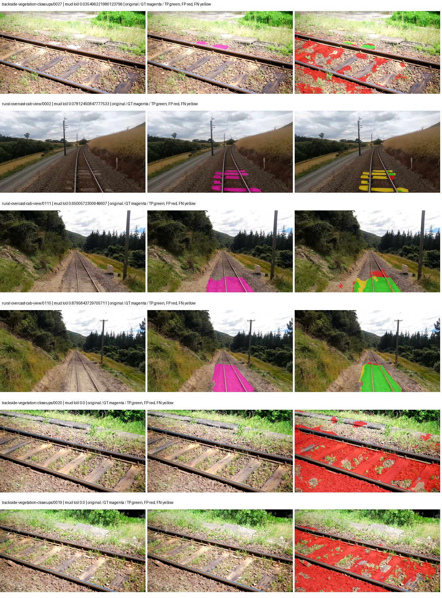
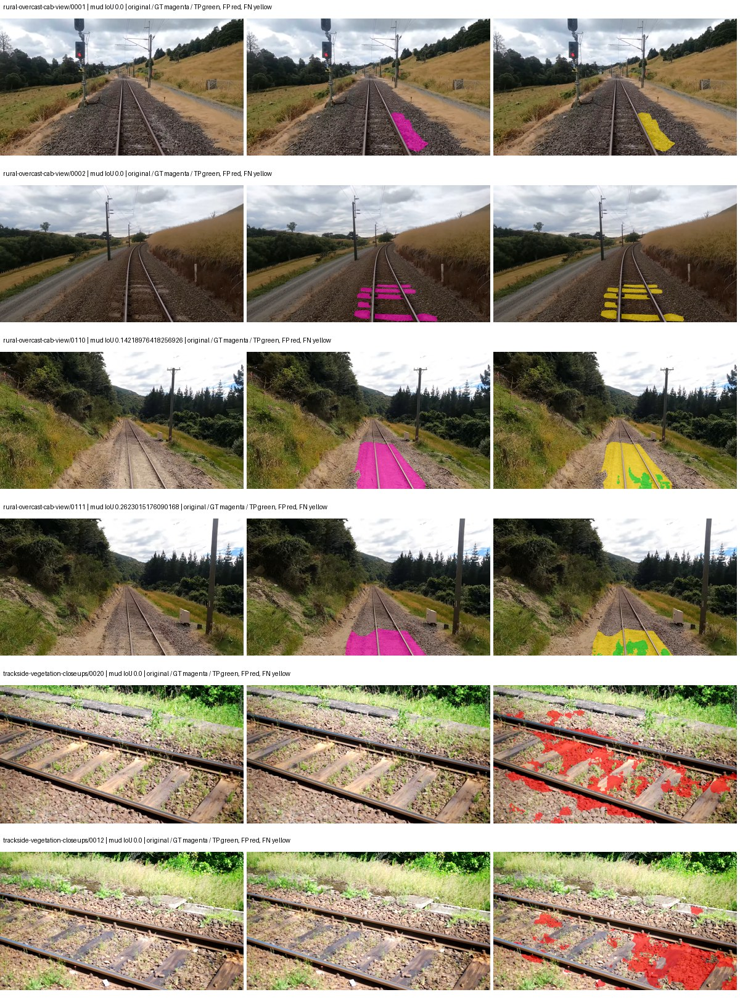
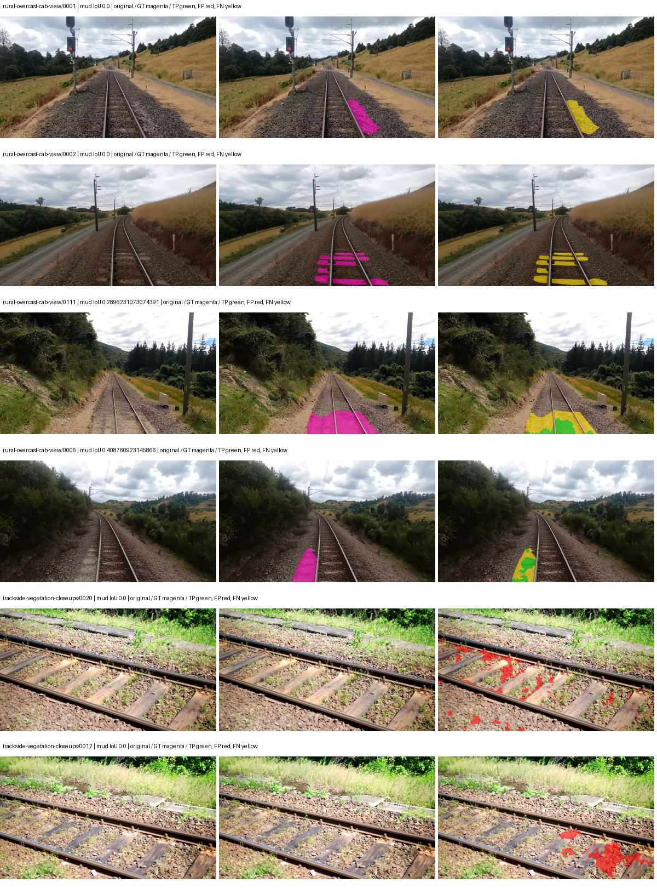
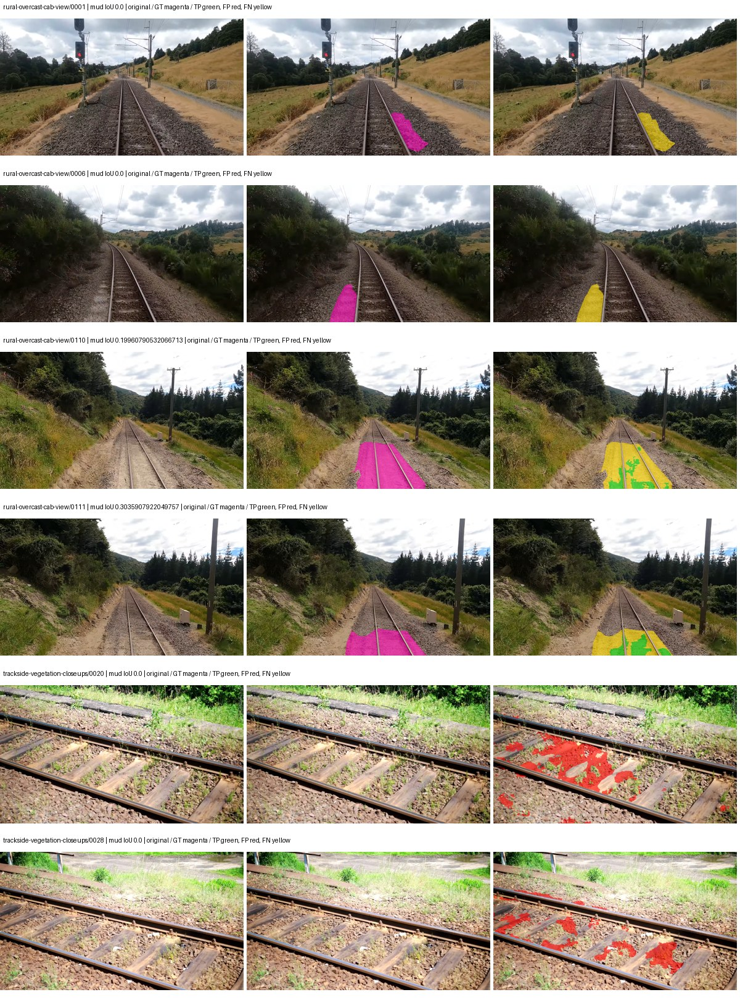

# smp_deeplabv3plus_resnet101 — rad_9_24_2026-fixed-grouped

[RAD 9/24: Scene-grouped split](../../README.md) · [Full model records](record.json)

Primary result: the **final checkpoint** after the full step budget (no early stopping). The checkpoint with the best **mud-pumping validation IoU, pixels pooled over all validation images**, is kept as secondary evidence. A job is complete only after full statistics and isolated profiling are verified.

Study metrics of the final checkpoint, counting each class only on the validation images that contain it: mud-pumping IoU is the mean per-image IoU over the images with mud-pumping, precision and recall sum pixels over those images, and mIoU averages each class over the images that contain it, then over the classes present.

| Initialization path | Seed | Mud-pumping IoU, train-camera images with mud (%, n=17) | Mud-pumping IoU, all images with mud (%, n=18) | Mud precision, all images with mud (%) | Mud recall, all images with mud (%) | mIoU (each class over images that contain it) (%) |
| --- | --- | --- | --- | --- | --- | --- |
| rtis_only | 0 | 5.60 | 5.86 | 54.89 | 7.47 | 35.78 |
| cityscapes_to_rtis | 0 | 1.63 | 1.79 | 18.73 | 2.76 | 35.37 |
| railsem19_to_rtis | 0 | 1.98 | 2.17 | 49.40 | 2.62 | 44.92 |
| cityscapes_to_railsem19_to_rtis | 0 | 2.02 | 2.48 | 31.28 | 3.65 | 41.93 |

Per-class IoU: IoU (%) of every class, each averaged only over the validation images that contain the class (n = those images); — = no image contains it. mIoU averages the classes with at least one such image.

| Initialization path | Seed | mIoU (each class over images that contain it) | person (n=0) | truck (n=0) | rail-track (n=37) | vegetation-overgrowth (n=13) | car (n=3) | on-rails (n=0) | traffic-sign (n=9) | road (n=11) | sidewalk (n=12) | construction (n=12) | tram-track (n=2) | pole (n=21) | traffic-light (n=3) | mud-pumping (n=18) | fence (n=7) | terrain (n=35) | sky (n=28) | rail-embedded (n=3) | rail-raised (n=37) | trackbed (n=37) | standing-water (n=9) |
| --- | --- | --- | --- | --- | --- | --- | --- | --- | --- | --- | --- | --- | --- | --- | --- | --- | --- | --- | --- | --- | --- | --- | --- |
| rtis_only | 0 | 35.78 | — | — | 57.24 | 19.78 | 5.21 | — | 11.13 | 11.32 | 14.14 | 44.77 | 14.59 | 66.50 | 51.19 | 5.86 | 12.95 | 84.65 | 95.89 | 8.83 | 72.50 | 66.27 | 1.25 |
| cityscapes_to_rtis | 0 | 35.37 | — | — | 53.39 | 27.15 | 21.99 | — | 15.88 | 7.10 | 7.24 | 43.02 | 1.65 | 69.62 | 56.18 | 1.79 | 22.93 | 79.71 | 94.81 | 0.09 | 69.87 | 62.69 | 1.49 |
| railsem19_to_rtis | 0 | 44.92 | — | — | 61.14 | 42.28 | 27.34 | — | 34.58 | 10.37 | 16.27 | 56.04 | 47.90 | 72.54 | 49.06 | 2.17 | 22.84 | 85.75 | 96.68 | 41.89 | 74.00 | 64.53 | 3.10 |
| cityscapes_to_railsem19_to_rtis | 0 | 41.93 | — | — | 56.59 | 29.10 | 32.26 | — | 36.29 | 23.54 | 16.42 | 57.85 | 23.98 | 71.39 | 52.78 | 2.48 | 22.86 | 84.31 | 96.58 | 12.21 | 72.50 | 63.55 | 0.00 |

Everything below is the campaign's own record, with pixels pooled over all validation images: its evaluation is the checkpoint that scored best on that pooled mud IoU (secondary evidence here); the diagnostics also cover the final checkpoint (`final-auto-val`).

| Model | Initialization path | Seed | Status | Steps | Best step | Best-checkpoint mud IoU, pixels pooled (%) | Best-checkpoint mud precision, pixels pooled (%) | Best-checkpoint mud recall, pixels pooled (%) | Final mud IoU (trainer val, pixels pooled, %) | Best-checkpoint mIoU, pixels pooled (%) | Best-checkpoint fixed GT-class mIoU, pixels pooled (%) |
| --- | --- | --- | --- | --- | --- | --- | --- | --- | --- | --- | --- |
| smp_deeplabv3plus_resnet101 | rtis_only | 0 | completed | 4000 | 1296 | 10.92 | 12.20 | 51.12 | 2.38 | 26.85 | 31.33 |
| smp_deeplabv3plus_resnet101 | cityscapes_to_rtis | 0 | completed | 4000 | 3370 | 2.18 | 3.93 | 4.69 | 1.38 | 31.52 | 36.77 |
| smp_deeplabv3plus_resnet101 | railsem19_to_rtis | 0 | completed | 4000 | 2333 | 5.52 | 16.76 | 7.60 | 2.04 | 46.28 | 51.42 |
| smp_deeplabv3plus_resnet101 | cityscapes_to_railsem19_to_rtis | 0 | completed | 4000 | 1296 | 4.81 | 11.48 | 7.64 | 2.19 | 38.09 | 42.32 |

Training: 217 images. Validation: 37 images. Test: 60 held out. Seeds: [0]. Seed variation measures optimization variability, not independent-recording uncertainty. Historical source checkpoints stay fixed across adaptation seeds.

Training code: `fce0ea0ac50b334d4252812c396e0e593def375d`. Split SHA-256: `12d7b367c72cda61d57686ff2ac28223530d0af49debd9fb7a0fbc68b908bc93`.

## rtis_only — seed 0

Status: **completed**. Started: 2026-10-11T14:06:55.839540+00:00. Finished: 2026-10-11T14:57:22.611703+00:00.

Recipe pretrained initializer: `{"arch": "smp", "backbone_path": null, "batch_norm_momentum": null, "checkpoint": null, "classifier_path": null, "drop_path": null, "encoder_name": "resnet101", "encoder_weights": "imagenet", "head": "unified_head", "head_paths": [], "inactive_parameter_paths": [], "local_files_only": false, "lora_alpha": 32, "lora_dropout": 0.05, "lora_r": 16, "lora_targets": [], "native": null, "revision": null, "smp_arch": "DeepLabV3Plus", "subfolder": null, "trust_remote_code": false, "tuning": "full"}`.

`rtis_only` uses the recipe initializer, which may include pretrained segmentation components. Transfer paths load the exact historical source checkpoint below and reset the classifier; they do not reset all query/decoder features.

Source checkpoint: `Recipe pretrained initialization`.

Config SHA-256: `33486e451a24b83aec1a57aecdc63baf133836320ac47436c7e5040c8aaf88d8`. Weights used for validation: `raw`.

### Mud-pumping and aggregate quality

| Metric | Selected checkpoint | Final training validation |
| --- | --- | --- |
| Mud IoU | 10.92 | 2.38 |
| Mud precision | 12.20 | 3.38 |
| Mud recall | 51.12 | 7.46 |
| Mud Dice/F1 | 19.70 | 4.65 |
| mIoU | 26.85 | 33.27 |
| Mean accuracy | 38.86 | 46.68 |
| Mean precision | 48.09 | 54.31 |
| Mean Dice | 34.24 | 42.12 |
| Mean specificity | 98.94 | 98.97 |
| Pixel accuracy | 81.50 | 83.54 |
| Frequency-weighted IoU | 74.09 | 74.52 |
| Fixed GT-present class mIoU | 31.33 | 38.82 |
| Boundary F1 | 32.35 | 40.43 |

The selected checkpoint has independent evaluation evidence. Final values are the trainer's final validation record, not a new independent evaluation. mIoU averages classes with nonzero union, so false positives on absent classes can change its denominator. The fixed GT-class mean is supplementary and excludes absent classes; their false positives remain in the confusion matrix.

### Resource usage and timing

| Measurement | Value |
| --- | --- |
| Peak training VRAM, retained training invocation (GiB) | 10.08 |
| Peak evaluation VRAM (GiB) | 7.19 |
| Retained training invocation wall time (seconds) | 2876.17 |
| Retained training invocation GPU-hours (one GPU) | 0.80 |
| Evaluation wall time (seconds) | 12.21 |
| Full evaluation pipeline images/second | 3.03 |
| Best full-state checkpoint (MiB) | 698.52 |
| Final full-state checkpoint (MiB) | 698.50 |
| Verified periodic checkpoints removed (GiB) | 5.46 |

VRAM uses the recorded allocator high-water mark; it is not total device usage including CUDA context. Resumed jobs' retained training invocation times and peaks are **not whole-campaign totals**. Earlier invocation resource records are not reconstructed here. Evaluation throughput includes loader, sliding-window inference and metrics; it is not model-only latency/FPS. Missing measurements are shown as —, never inferred from another dataset's run.

### Standardized inference performance

Dedicated model-only profiling waits for an idle worker-locked L40S: BF16, batch 1, 1024x1024, 20 warmup and 100 CUDA-event-timed public forwards. It excludes loading, preprocessing, tiling and metrics.

| Status | Parameters | Weight MiB | FPS | p50 ms | p95 ms | Peak reserved GiB |
| --- | --- | --- | --- | --- | --- | --- |
| complete | 45674853 | 174.24 | 107.20 | 9.08 | 10.85 | 0.66 |

```json
{
  "schema_version": 1,
  "model_id": "smp_deeplabv3plus_resnet101",
  "measured_at": "2026-10-11T14:57:14+00:00",
  "status": "complete",
  "benchmark_scope": "rtis_selected_checkpoint_model_only",
  "applies_to": [
    "smp_deeplabv3plus_resnet101--rtis_only--seed-0"
  ],
  "source": {
    "campaign_git_sha": "fce0ea0ac50b334d4252812c396e0e593def375d",
    "git_dirty": false,
    "config_hash": "3808a076e731",
    "resolved_config": "/data/izadia1/projects/segmentary-runs/rad_9_24_2026/fgall-seed0-20261007/configs/smp_deeplabv3plus_resnet101--rtis_only--seed-0.yaml",
    "config_sha256": "33486e451a24b83aec1a57aecdc63baf133836320ac47436c7e5040c8aaf88d8",
    "checkpoint_sha256": "4de49678edfc0fc9c5f6a3ef574d3360773566952f7d1ee9f8b40915c5287ae1",
    "checkpoint_global_step": 1296,
    "checkpoint_bytes": 732453741,
    "checkpoint_kind": "resume checkpoint with optimizer and EMA state",
    "weights": "raw",
    "measured_checkpoint_job_id": "smp_deeplabv3plus_resnet101--rtis_only--seed-0",
    "result_sha256": "ac8e061301fd7ff61f06765561cf64f1863d5a4038c6ee55a13a35dd0a311d8b",
    "result_git_sha": "fce0ea0ac50b334d4252812c396e0e593def375d",
    "result_stage": "eval:rad_9_24_2026-fixed-grouped:val",
    "result_seed": 0
  },
  "hardware": {
    "gpu_name": "NVIDIA L40S",
    "gpu_uuid": "GPU-1c9b612f-e0b5-fbbc-150f-8c2ef13453c9",
    "logical_device": "cuda:0",
    "physical_visibility_token": "5",
    "compute_capability": [
      8,
      9
    ],
    "total_memory_bytes": 47677177856
  },
  "model": {
    "parameter_count": 45674853,
    "trainable_parameter_count": 45674853,
    "resident_parameter_bytes": 182699412,
    "parameter_dtype_counts": {
      "float32": 45674853
    }
  },
  "contract": {
    "backend": "pytorch",
    "precision": "bf16_autocast",
    "batch_size": 1,
    "input_shape_nchw": [
      1,
      3,
      1024,
      1024
    ],
    "warmup_iterations": 20,
    "measured_iterations": 100,
    "timing": "per-forward CUDA events with end-event synchronization",
    "includes_preprocessing": false,
    "includes_data_loader": false,
    "includes_sliding_window": false,
    "input_resident_on_gpu": true,
    "model_only": true,
    "entrypoint": "public model(image) dense-logits forward"
  },
  "measurements": {
    "latency": {
      "p50_ms": 9.08185625076294,
      "p95_ms": 10.85199337005615,
      "mean_ms": 9.328475198745728,
      "minimum_ms": 8.398847579956055,
      "maximum_ms": 13.87622356414795,
      "fps": 107.19865558890656,
      "raw_ms": [
        9.13100814819336,
        9.434111595153809,
        9.048064231872559,
        9.414655685424805,
        8.761343955993652,
        8.640512466430664,
        8.737792015075684,
        8.716287612915039,
        8.955904006958008,
        9.572352409362793,
        9.034751892089844,
        9.083904266357422,
        9.108480453491211,
        8.782848358154297,
        9.02246379852295,
        9.186304092407227,
        12.97817611694336,
        8.99891185760498,
        9.035776138305664,
        8.93337631225586,
        9.32044792175293,
        11.85689640045166,
        12.866527557373047,
        12.667903900146484,
        13.87622356414795,
        8.89139175415039,
        9.893856048583984,
        9.025535583496094,
        9.598976135253906,
        9.43718433380127,
        8.460288047790527,
        9.11359977722168,
        8.398847579956055,
        8.830975532531738,
        8.436736106872559,
        8.763392448425293,
        10.799103736877441,
        9.198592185974121,
        9.332736015319824,
        10.10483169555664,
        9.079808235168457,
        9.447423934936523,
        8.884223937988281,
        8.866815567016602,
        8.90777587890625,
        9.452544212341309,
        8.819711685180664,
        9.593855857849121,
        8.673279762268066,
        8.50432014465332,
        8.500224113464355,
        8.612863540649414,
        8.61184024810791,
        9.980928421020508,
        9.678848266601562,
        9.988096237182617,
        9.12384033203125,
        8.893440246582031,
        9.446399688720703,
        8.934399604797363,
        9.306112289428711,
        9.326592445373535,
        9.224191665649414,
        9.517056465148926,
        9.05724811553955,
        8.525823593139648,
        8.489983558654785,
        8.777728080749512,
        8.977408409118652,
        9.82528018951416,
        9.029631614685059,
        9.059328079223633,
        8.694784164428711,
        9.01734447479248,
        9.033727645874023,
        8.743935585021973,
        8.715264320373535,
        9.566207885742188,
        9.704447746276855,
        9.13203239440918,
        10.071040153503418,
        8.622079849243164,
        8.89958381652832,
        9.251839637756348,
        9.622528076171875,
        9.134079933166504,
        9.064448356628418,
        10.001407623291016,
        10.530816078186035,
        9.302016258239746,
        8.828927993774414,
        8.948736190795898,
        9.232383728027344,
        9.192447662353516,
        8.99788761138916,
        8.729599952697754,
        9.210880279541016,
        9.1146240234375,
        9.470975875854492,
        9.4453763961792
      ],
      "percentile_method": "numpy linear interpolation"
    },
    "peak_reserved_bytes": 704643072,
    "memory_kind": "pytorch_cuda_allocator_peak_reserved_excluding_context",
    "process_total_bytes": 1233125376,
    "process_total_kind": "nvidia-smi used_memory of this PID on the benchmark GPU after the timed loop, including the CUDA context; null when the driver could not attribute memory to this PID",
    "benchmark_wall_clock_s": 12.063563488423824
  },
  "started_at": "2026-10-11T14:57:01+00:00",
  "finished_at": "2026-10-11T14:57:14+00:00",
  "environment": {
    "hostname": "hdrfs-app-001",
    "python": "3.11.15",
    "platform": "Linux-5.15.0-139-generic-x86_64-with-glibc2.35",
    "torch": "2.11.0+cu128",
    "torch_cuda": "12.8",
    "cudnn": 91900,
    "driver_version": "570.133.20",
    "cuda_available": true,
    "gpu_count": 1,
    "gpu_names": [
      "NVIDIA L40S"
    ],
    "cuda_visible_devices": "5",
    "packages": {
      "segmentary": "0.1.0",
      "torch": "2.11.0+cu128",
      "torchvision": "0.26.0+cu128",
      "transformers": "5.15.0",
      "timm": "1.0.28",
      "segmentation-models-pytorch": "0.5.0",
      "albumentations": "2.0.8",
      "lightning": "2.6.5",
      "numpy": "2.4.4"
    }
  }
}
```

### Per-class validation results

| Class | GT pixels | IoU (%) | Precision (%) | Recall (%) | Dice (%) | Boundary F1 (%) |
| --- | --- | --- | --- | --- | --- | --- |
| car | 29664 | 0.00 | 0.00 | 0.00 | 0.00 | 0.00 |
| construction | 311585 | 38.50 | 48.27 | 65.54 | 55.59 | 39.19 |
| fence | 265137 | 11.62 | 55.15 | 12.83 | 20.82 | 28.82 |
| mud-pumping | 1226250 | 10.92 | 12.20 | 51.12 | 19.70 | 15.35 |
| on-rails | 0 | 0.00 | 0.00 | — | 0.00 | 0.00 |
| person | 0 | 0.00 | 0.00 | — | 0.00 | 0.00 |
| pole | 628038 | 65.16 | 82.80 | 75.37 | 78.91 | 86.35 |
| rail-embedded | 16799 | 1.34 | 94.54 | 1.34 | 2.64 | 10.44 |
| rail-raised | 2969797 | 71.84 | 84.22 | 83.02 | 83.62 | 90.89 |
| rail-track | 6323197 | 35.28 | 73.59 | 40.39 | 52.16 | 45.62 |
| road | 1048831 | 8.67 | 20.34 | 13.13 | 15.96 | 9.95 |
| sidewalk | 1297367 | 24.30 | 55.95 | 30.05 | 39.10 | 34.02 |
| sky | 19121606 | 96.34 | 98.90 | 97.38 | 98.13 | 82.09 |
| standing-water | 95802 | 0.08 | 0.09 | 1.86 | 0.17 | 1.10 |
| terrain | 39239306 | 87.13 | 91.34 | 94.97 | 93.12 | 59.67 |
| trackbed | 10643081 | 60.60 | 74.12 | 76.87 | 75.47 | 58.64 |
| traffic-light | 19510 | 24.35 | 99.64 | 24.37 | 39.16 | 38.57 |
| traffic-sign | 13285 | 0.81 | 45.99 | 0.82 | 1.61 | 17.90 |
| tram-track | 56179 | 0.45 | 1.02 | 0.81 | 0.90 | 7.22 |
| truck | 0 | 0.00 | 0.00 | — | 0.00 | 0.00 |
| vegetation-overgrowth | 5901821 | 26.54 | 71.67 | 29.65 | 41.95 | 53.54 |

### Full-run accounting

| Measurement | Value |
| --- | --- |
| Full GPU-reserved wall seconds, all recorded worker attempts | 3034.46 |
| Full reserved GPU-hours | 0.84 |
| Whole-run timing complete | True |

| Phase | Wall seconds including failed attempts |
| --- | --- |
| training | 2883.15 |
| diagnostics | 93.15 |
| performance | 21.88 |

GPU-reserved time includes model loading, training, validation, collection, profiling, checkpoint I/O and orchestration while the worker owns one GPU. It is not GPU kernel-active time. Phase timings and sampled device memory/power/utilization are retained separately; sampled device memory is not the allocator high-water mark.

### Train/validation and raw/EMA diagnostics

| Checkpoint / weights / split | Images | Mud IoU (%) | Mud precision (%) | Mud recall (%) |
| --- | --- | --- | --- | --- |
| best-auto-train / raw | 217 | 87.99 | 90.55 | 96.89 |
| best-auto-val / raw | 37 | 10.92 | 12.20 | 51.12 |
| best-alternate-val / ema | 37 | 0.91 | 1.14 | 4.26 |
| final-auto-val / raw | 37 | 2.38 | 3.38 | 7.47 |

Train uses the evaluation transform without augmentation. Compare mud train/validation metrics for the same selected weights. Alternate EMA on running-stat BatchNorm is explicitly uncalibrated and is diagnostic only. Score-threshold curves use uncalibrated normalized scores and are pixel-level diagnostics, not event detection rates or a selected deployment operating point.

### Downloadable evidence

- best-auto-train: [per-image.csv](rtis_only--seed-0/best-auto-train/per-image.csv) · [per-image-confusion.json.gz](rtis_only--seed-0/best-auto-train/per-image-confusion.json.gz) · [groups.json](rtis_only--seed-0/best-auto-train/groups.json) · [mud-score-curves.json](rtis_only--seed-0/best-auto-train/mud-score-curves.json)
- best-auto-val: [per-image.csv](rtis_only--seed-0/best-auto-val/per-image.csv) · [per-image-confusion.json.gz](rtis_only--seed-0/best-auto-val/per-image-confusion.json.gz) · [groups.json](rtis_only--seed-0/best-auto-val/groups.json) · [mud-score-curves.json](rtis_only--seed-0/best-auto-val/mud-score-curves.json) · [examples.jpg](rtis_only--seed-0/best-auto-val/examples.jpg)
- best-alternate-val: [per-image.csv](rtis_only--seed-0/best-alternate-val/per-image.csv) · [per-image-confusion.json.gz](rtis_only--seed-0/best-alternate-val/per-image-confusion.json.gz) · [groups.json](rtis_only--seed-0/best-alternate-val/groups.json) · [mud-score-curves.json](rtis_only--seed-0/best-alternate-val/mud-score-curves.json)
- final-auto-val: [per-image.csv](rtis_only--seed-0/final-auto-val/per-image.csv) · [per-image-confusion.json.gz](rtis_only--seed-0/final-auto-val/per-image-confusion.json.gz) · [groups.json](rtis_only--seed-0/final-auto-val/groups.json) · [mud-score-curves.json](rtis_only--seed-0/final-auto-val/mud-score-curves.json)
- resources: [telemetry.csv](rtis_only--seed-0/resources/telemetry.csv)



Examples are two lowest and two highest mud-IoU positive images, plus up to two negative images with the most false-positive mud pixels. They are targeted diagnostic examples, not random samples. Green: true positive; red: false positive; yellow: false negative. Full predictions remain on HDRFS.

### Validation tracking

| Logged step | Overall mIoU (%) | Mud IoU (%) |
| --- | --- | --- |
| 258 | 24.87 | 0.65 |
| 518 | 21.57 | 0.95 |
| 777 | 23.55 | 1.88 |
| 1036 | 26.02 | 0.33 |
| 1295 | 26.86 | 10.94 |
| 1555 | 26.44 | 2.94 |
| 1814 | 29.14 | 0.72 |
| 2073 | 33.10 | 1.43 |
| 2332 | 28.61 | 2.38 |
| 2592 | 30.94 | 3.03 |
| 2851 | 32.42 | 3.63 |
| 3110 | 30.03 | 1.59 |
| 3369 | 32.35 | 2.92 |
| 3629 | 33.33 | 1.21 |
| 3888 | 32.80 | 1.61 |
| 4000 | 33.27 | 2.38 |

All retained scalar curves, including training loss and per-class IoU, are in record.json. Observed best mud on a curve is not necessarily a retained checkpoint: the pilot saved its selection-metric-best and final checkpoints. Step logging and checkpoint global_step may differ by one.

### Stopping and checkpoint provenance

```json
{
  "stopping": {
    "actual_steps": 4000,
    "maximum_steps": 4000,
    "min_delta": 0.0,
    "monitor": "val_iou/mud-pumping",
    "patience": null,
    "reason": "budget_complete"
  },
  "checkpoints": {
    "best": {
      "path": "/data/izadia1/projects/segmentary-runs/rad_9_24_2026/fgall-seed0-20261007/future-runs/smp_deeplabv3plus_resnet101--rtis_only--seed-0_seed0/rtis/best.ckpt",
      "sha256": "4de49678edfc0fc9c5f6a3ef574d3360773566952f7d1ee9f8b40915c5287ae1",
      "global_step": 1296,
      "bytes": 732453741
    },
    "final": {
      "path": "/data/izadia1/projects/segmentary-runs/rad_9_24_2026/fgall-seed0-20261007/future-runs/smp_deeplabv3plus_resnet101--rtis_only--seed-0_seed0/rtis/last.ckpt",
      "sha256": "7e26d418ec74ab6634eab88241e450c28f0615a462773b9ac7386b5c1dad6dee",
      "global_step": 4000,
      "bytes": 732431405
    }
  },
  "cleanup_error": null
}
```

### Resolved training, initialization and evaluation settings

The optimizer block is the base configuration. Stage LR scales are applied at runtime, and stage warmup is capped at min(base warmup, floor(stage budget / 10), stage budget - 1): 400 steps for this 4,000-step pilot. Model-internal native input grids may differ from augmentation crops (EoMT uses its 640 grid).

```json
{
  "name": "smp_deeplabv3plus_resnet101--rtis_only--seed-0",
  "model": {
    "arch": "smp",
    "checkpoint": null,
    "tuning": "full",
    "head": "unified_head",
    "lora_r": 16,
    "lora_alpha": 32,
    "lora_dropout": 0.05,
    "lora_targets": [],
    "drop_path": null,
    "revision": null,
    "subfolder": null,
    "local_files_only": false,
    "trust_remote_code": false,
    "backbone_path": null,
    "head_paths": [],
    "classifier_path": null,
    "inactive_parameter_paths": [],
    "smp_arch": "DeepLabV3Plus",
    "encoder_name": "resnet101",
    "encoder_weights": "imagenet",
    "native": null,
    "batch_norm_momentum": null
  },
  "space": "paul-test-rtis",
  "taxonomy_root": "/data/izadia1/projects/segmentary-rad-fgall-fce0ea0a/taxonomy",
  "output_root": "/data/izadia1/projects/segmentary-runs/rad_9_24_2026/fgall-seed0-20261007/future-runs",
  "optim": {
    "backbone_lr": 0.0001,
    "head_lr_mult": 10.0,
    "weight_decay": 0.05,
    "llrd": 1.0,
    "warmup_iters": 1500,
    "warmup_ratio": 1e-06,
    "poly_power": 0.9,
    "min_lr_ratio": 0.0,
    "betas": [
      0.9,
      0.999
    ],
    "grad_clip": 1.0
  },
  "train": {
    "iters": 4000,
    "batch_size": 2,
    "accum": 8,
    "num_workers": 2,
    "precision": "bf16-mixed",
    "ema_decay": 0.9998,
    "val_every": 250,
    "ckpt_every": 500,
    "selection_metric": "val_iou/mud-pumping",
    "early_stopping_patience": null,
    "early_stopping_min_delta": 0.0,
    "seed": 0,
    "devices": 1
  },
  "eval": {
    "sliding_window": true,
    "window": [
      1024,
      1024
    ],
    "stride": [
      768,
      768
    ],
    "batch_size": 1,
    "num_workers": 2,
    "tta_scales": [],
    "tta_flip": false,
    "threshold": 0.5,
    "boundary_tolerance_frac": 0.0075,
    "save_confusion": true
  },
  "loss": {
    "task": "multiclass",
    "activation": "auto",
    "terms": [],
    "aux": "none",
    "aux_weight": 0.0,
    "ce_weight": 1.0,
    "label_smoothing": 0.0,
    "class_weights": null,
    "query": null
  },
  "aug": {
    "crop": [
      1024,
      1024
    ],
    "scale_min": 0.5,
    "scale_max": 2.0,
    "hflip_p": 0.5,
    "color_jitter_p": 0.5,
    "brightness": 0.25,
    "contrast": 0.25,
    "saturation": 0.25,
    "hue": 0.05
  },
  "stages": [
    {
      "name": "rtis",
      "data": [
        {
          "name": "rad_9_24_2026-fixed-grouped",
          "root": "/data/izadia1/datasets/rad_9_24_2026-fixed-grouped",
          "variant": null,
          "split_file": "splits.json",
          "train_split": "train",
          "val_split": "val",
          "limit": null,
          "loader": "folder",
          "mapping": "paul-test-rtis",
          "loader_options": {
            "require_groups": true
          }
        }
      ],
      "iters": null,
      "lr_scale": 1.0,
      "head_group_lr_scale": 1.0,
      "init_from": "pretrained",
      "reset_head": false,
      "freeze": null,
      "sample_weights": null
    }
  ]
}
```

### Hardware and software provenance

```json
{
  "training": {
    "cuda_available": true,
    "cuda_visible_devices": "5",
    "cudnn": 91900,
    "driver_version": "570.133.20",
    "gpu_count": 1,
    "gpu_names": [
      "NVIDIA L40S"
    ],
    "hostname": "hdrfs-app-001",
    "input_normalization": {
      "channel_order": "rgb",
      "mean": [
        0.485,
        0.456,
        0.406
      ],
      "source": "smp_encoder_settings",
      "std": [
        0.229,
        0.224,
        0.225
      ]
    },
    "model_origins": [
      {
        "hf_commit": null,
        "hf_name_or_path": null,
        "module": "model",
        "timm_pretrained": {}
      }
    ],
    "model_parameter_count": 45674853,
    "packages": {
      "albumentations": "2.0.8",
      "lightning": "2.6.5",
      "numpy": "2.4.4",
      "segmentary": "0.1.0",
      "segmentation-models-pytorch": "0.5.0",
      "timm": "1.0.28",
      "torch": "2.11.0+cu128",
      "torchvision": "0.26.0+cu128",
      "transformers": "5.15.0"
    },
    "platform": "Linux-5.15.0-139-generic-x86_64-with-glibc2.35",
    "python": "3.11.15",
    "torch": "2.11.0+cu128",
    "torch_cuda": "12.8",
    "trainable_parameter_count": 45674853,
    "training_stop": {
      "actual_steps": 4000,
      "maximum_steps": 4000,
      "min_delta": 0.0,
      "monitor": "val_iou/mud-pumping",
      "patience": null,
      "reason": "budget_complete"
    },
    "validation_weights": "raw"
  },
  "evaluation": {
    "cuda_available": true,
    "cuda_visible_devices": "5",
    "cudnn": 91900,
    "driver_version": "570.133.20",
    "gpu_count": 1,
    "gpu_names": [
      "NVIDIA L40S"
    ],
    "hostname": "hdrfs-app-001",
    "input_normalization": {
      "channel_order": "rgb",
      "mean": [
        0.485,
        0.456,
        0.406
      ],
      "source": "smp_encoder_settings",
      "std": [
        0.229,
        0.224,
        0.225
      ]
    },
    "packages": {
      "albumentations": "2.0.8",
      "lightning": "2.6.5",
      "numpy": "2.4.4",
      "segmentary": "0.1.0",
      "segmentation-models-pytorch": "0.5.0",
      "timm": "1.0.28",
      "torch": "2.11.0+cu128",
      "torchvision": "0.26.0+cu128",
      "transformers": "5.15.0"
    },
    "platform": "Linux-5.15.0-139-generic-x86_64-with-glibc2.35",
    "python": "3.11.15",
    "torch": "2.11.0+cu128",
    "torch_cuda": "12.8"
  }
}
```

## cityscapes_to_rtis — seed 0

Status: **completed**. Started: 2026-10-11T14:11:57.510961+00:00. Finished: 2026-10-11T15:02:11.624033+00:00.

Recipe pretrained initializer: `{"arch": "smp", "backbone_path": null, "batch_norm_momentum": null, "checkpoint": null, "classifier_path": null, "drop_path": null, "encoder_name": "resnet101", "encoder_weights": "imagenet", "head": "unified_head", "head_paths": [], "inactive_parameter_paths": [], "local_files_only": false, "lora_alpha": 32, "lora_dropout": 0.05, "lora_r": 16, "lora_targets": [], "native": null, "revision": null, "smp_arch": "DeepLabV3Plus", "subfolder": null, "trust_remote_code": false, "tuning": "full"}`.

`rtis_only` uses the recipe initializer, which may include pretrained segmentation components. Transfer paths load the exact historical source checkpoint below and reset the classifier; they do not reset all query/decoder features.

Source checkpoint: `{'name': 'smp_deeplabv3plus_resnet101--cityscapes--seed-0', 'model': 'smp_deeplabv3plus_resnet101', 'protocol': 'cityscapes', 'config': '/data/izadia1/projects/segmentary-runs/all-model-city-rail-seed0-rail20-b9eb3e1/accepted/smp_deeplabv3plus_resnet101--cityscapes--seed-0/resolved-config.yaml', 'checkpoint': '/data/izadia1/projects/segmentary-runs/current-main-fill-v2/jobs/smp_deeplabv3plus_resnet101--cityscapes--seed-0/train/smp_deeplabv3plus_resnet101--cityscapes_seed0/cityscapes/last.ckpt', 'recorded_sha256': '01074c9ac3f2b84d122c8a23d07d26a31d2ff58d5d23740b077bdc998d70363b', 'exists': True}`.

Config SHA-256: `0f031adccfd7addd879dc19ee84c8947b2665b147d8bf5bd6680924a02f8e3d0`. Weights used for validation: `raw`.

### Mud-pumping and aggregate quality

| Metric | Selected checkpoint | Final training validation |
| --- | --- | --- |
| Mud IoU | 2.18 | 1.38 |
| Mud precision | 3.93 | 2.67 |
| Mud recall | 4.69 | 2.78 |
| Mud Dice/F1 | 4.28 | 2.72 |
| mIoU | 31.52 | 30.63 |
| Mean accuracy | 46.28 | 46.45 |
| Mean precision | 42.34 | 45.95 |
| Mean Dice | 39.20 | 38.18 |
| Mean specificity | 98.86 | 98.80 |
| Pixel accuracy | 81.87 | 80.07 |
| Frequency-weighted IoU | 72.28 | 71.02 |
| Fixed GT-present class mIoU | 36.77 | 35.74 |
| Boundary F1 | 35.66 | 36.73 |

The selected checkpoint has independent evaluation evidence. Final values are the trainer's final validation record, not a new independent evaluation. mIoU averages classes with nonzero union, so false positives on absent classes can change its denominator. The fixed GT-class mean is supplementary and excludes absent classes; their false positives remain in the confusion matrix.

### Resource usage and timing

| Measurement | Value |
| --- | --- |
| Peak training VRAM, retained training invocation (GiB) | 10.08 |
| Peak evaluation VRAM (GiB) | 7.19 |
| Retained training invocation wall time (seconds) | 2867.47 |
| Retained training invocation GPU-hours (one GPU) | 0.80 |
| Evaluation wall time (seconds) | 11.28 |
| Full evaluation pipeline images/second | 3.28 |
| Best full-state checkpoint (MiB) | 698.52 |
| Final full-state checkpoint (MiB) | 698.50 |
| Verified periodic checkpoints removed (GiB) | 5.46 |

VRAM uses the recorded allocator high-water mark; it is not total device usage including CUDA context. Resumed jobs' retained training invocation times and peaks are **not whole-campaign totals**. Earlier invocation resource records are not reconstructed here. Evaluation throughput includes loader, sliding-window inference and metrics; it is not model-only latency/FPS. Missing measurements are shown as —, never inferred from another dataset's run.

### Standardized inference performance

Dedicated model-only profiling waits for an idle worker-locked L40S: BF16, batch 1, 1024x1024, 20 warmup and 100 CUDA-event-timed public forwards. It excludes loading, preprocessing, tiling and metrics.

| Status | Parameters | Weight MiB | FPS | p50 ms | p95 ms | Peak reserved GiB |
| --- | --- | --- | --- | --- | --- | --- |
| complete | 45674853 | 174.24 | 116.71 | 8.37 | 9.46 | 0.66 |

```json
{
  "schema_version": 1,
  "model_id": "smp_deeplabv3plus_resnet101",
  "measured_at": "2026-10-11T15:02:03+00:00",
  "status": "complete",
  "benchmark_scope": "rtis_selected_checkpoint_model_only",
  "applies_to": [
    "smp_deeplabv3plus_resnet101--cityscapes_to_rtis--seed-0"
  ],
  "source": {
    "campaign_git_sha": "fce0ea0ac50b334d4252812c396e0e593def375d",
    "git_dirty": false,
    "config_hash": "99b8a0fbd23e",
    "resolved_config": "/data/izadia1/projects/segmentary-runs/rad_9_24_2026/fgall-seed0-20261007/configs/smp_deeplabv3plus_resnet101--cityscapes_to_rtis--seed-0.yaml",
    "config_sha256": "0f031adccfd7addd879dc19ee84c8947b2665b147d8bf5bd6680924a02f8e3d0",
    "checkpoint_sha256": "0d17d77afe2e0795c8fe6536766143b496049bcd93a5be8134d75b7448383067",
    "checkpoint_global_step": 3370,
    "checkpoint_bytes": 732453805,
    "checkpoint_kind": "resume checkpoint with optimizer and EMA state",
    "weights": "raw",
    "measured_checkpoint_job_id": "smp_deeplabv3plus_resnet101--cityscapes_to_rtis--seed-0",
    "result_sha256": "99a4fb3591941b057d4ae9fd565cdcb0ef1b76d9964a9210fce4e08b8ff09331",
    "result_git_sha": "fce0ea0ac50b334d4252812c396e0e593def375d",
    "result_stage": "eval:rad_9_24_2026-fixed-grouped:val",
    "result_seed": 0
  },
  "hardware": {
    "gpu_name": "NVIDIA L40S",
    "gpu_uuid": "GPU-c76642eb-64c1-b0ac-b051-d2efd47b32c4",
    "logical_device": "cuda:0",
    "physical_visibility_token": "9",
    "compute_capability": [
      8,
      9
    ],
    "total_memory_bytes": 47677177856
  },
  "model": {
    "parameter_count": 45674853,
    "trainable_parameter_count": 45674853,
    "resident_parameter_bytes": 182699412,
    "parameter_dtype_counts": {
      "float32": 45674853
    }
  },
  "contract": {
    "backend": "pytorch",
    "precision": "bf16_autocast",
    "batch_size": 1,
    "input_shape_nchw": [
      1,
      3,
      1024,
      1024
    ],
    "warmup_iterations": 20,
    "measured_iterations": 100,
    "timing": "per-forward CUDA events with end-event synchronization",
    "includes_preprocessing": false,
    "includes_data_loader": false,
    "includes_sliding_window": false,
    "input_resident_on_gpu": true,
    "model_only": true,
    "entrypoint": "public model(image) dense-logits forward"
  },
  "measurements": {
    "latency": {
      "p50_ms": 8.373248100280762,
      "p95_ms": 9.461555480957031,
      "mean_ms": 8.568545598983764,
      "minimum_ms": 8.147968292236328,
      "maximum_ms": 10.04032039642334,
      "fps": 116.70592032778593,
      "raw_ms": [
        9.160703659057617,
        9.477120399475098,
        8.60979175567627,
        8.621055603027344,
        8.193023681640625,
        8.642560005187988,
        8.374272346496582,
        8.258560180664062,
        9.153535842895508,
        8.324095726013184,
        8.356863975524902,
        8.390656471252441,
        8.582143783569336,
        8.51148796081543,
        8.6179838180542,
        8.147968292236328,
        8.255488395690918,
        8.383487701416016,
        8.299519538879395,
        8.668160438537598,
        9.397248268127441,
        8.39577579498291,
        8.18892765045166,
        9.193471908569336,
        8.183808326721191,
        8.848383903503418,
        9.100288391113281,
        8.369152069091797,
        8.514559745788574,
        8.70809555053711,
        8.257535934448242,
        8.671232223510742,
        8.836095809936523,
        8.21452808380127,
        8.236031532287598,
        8.263680458068848,
        8.372223854064941,
        8.51251220703125,
        8.583200454711914,
        8.794112205505371,
        9.08902359008789,
        8.780799865722656,
        8.220671653747559,
        8.175616264343262,
        8.31283187866211,
        8.237055778503418,
        8.216575622558594,
        8.18995189666748,
        8.386560440063477,
        9.268223762512207,
        8.376319885253906,
        8.18995189666748,
        8.274944305419922,
        8.377344131469727,
        8.307711601257324,
        8.365056037902832,
        8.625151634216309,
        9.652223587036133,
        9.690112113952637,
        8.226816177368164,
        8.29849624633789,
        8.31488037109375,
        8.262656211853027,
        8.252415657043457,
        8.239104270935059,
        9.09823989868164,
        10.04032039642334,
        8.960000038146973,
        8.226816177368164,
        8.209407806396484,
        8.28825569152832,
        8.268799781799316,
        9.500672340393066,
        8.346624374389648,
        8.343551635742188,
        8.771583557128906,
        9.336832046508789,
        9.184255599975586,
        8.230912208557129,
        8.285183906555176,
        8.217599868774414,
        8.242112159729004,
        8.230912208557129,
        8.775679588317871,
        9.056256294250488,
        8.90982437133789,
        8.590368270874023,
        8.186880111694336,
        8.247296333312988,
        8.230912208557129,
        8.344575881958008,
        8.316927909851074,
        8.493056297302246,
        9.317376136779785,
        8.346624374389648,
        9.460736274719238,
        8.272895812988281,
        8.19814395904541,
        8.68454360961914,
        8.640543937683105
      ],
      "percentile_method": "numpy linear interpolation"
    },
    "peak_reserved_bytes": 704643072,
    "memory_kind": "pytorch_cuda_allocator_peak_reserved_excluding_context",
    "process_total_bytes": 1233125376,
    "process_total_kind": "nvidia-smi used_memory of this PID on the benchmark GPU after the timed loop, including the CUDA context; null when the driver could not attribute memory to this PID",
    "benchmark_wall_clock_s": 11.62696037441492
  },
  "started_at": "2026-10-11T15:01:51+00:00",
  "finished_at": "2026-10-11T15:02:03+00:00",
  "environment": {
    "hostname": "hdrfs-app-001",
    "python": "3.11.15",
    "platform": "Linux-5.15.0-139-generic-x86_64-with-glibc2.35",
    "torch": "2.11.0+cu128",
    "torch_cuda": "12.8",
    "cudnn": 91900,
    "driver_version": "570.133.20",
    "cuda_available": true,
    "gpu_count": 1,
    "gpu_names": [
      "NVIDIA L40S"
    ],
    "cuda_visible_devices": "9",
    "packages": {
      "segmentary": "0.1.0",
      "torch": "2.11.0+cu128",
      "torchvision": "0.26.0+cu128",
      "transformers": "5.15.0",
      "timm": "1.0.28",
      "segmentation-models-pytorch": "0.5.0",
      "albumentations": "2.0.8",
      "lightning": "2.6.5",
      "numpy": "2.4.4"
    }
  }
}
```

### Per-class validation results

| Class | GT pixels | IoU (%) | Precision (%) | Recall (%) | Dice (%) | Boundary F1 (%) |
| --- | --- | --- | --- | --- | --- | --- |
| car | 29664 | 45.81 | 75.90 | 53.60 | 62.83 | 45.29 |
| construction | 311585 | 24.40 | 26.69 | 73.93 | 39.22 | 26.25 |
| fence | 265137 | 15.31 | 20.55 | 37.48 | 26.55 | 21.17 |
| mud-pumping | 1226250 | 2.18 | 3.93 | 4.69 | 4.28 | 2.48 |
| on-rails | 0 | 0.00 | 0.00 | — | 0.00 | 0.00 |
| person | 0 | 0.00 | 0.00 | — | 0.00 | 0.00 |
| pole | 628038 | 72.20 | 86.47 | 81.39 | 83.85 | 92.37 |
| rail-embedded | 16799 | 0.00 | 0.00 | 0.00 | 0.00 | 0.00 |
| rail-raised | 2969797 | 70.22 | 79.94 | 85.25 | 82.51 | 88.36 |
| rail-track | 6323197 | 33.73 | 69.02 | 39.75 | 50.45 | 42.76 |
| road | 1048831 | 2.50 | 7.96 | 3.51 | 4.87 | 8.85 |
| sidewalk | 1297367 | 14.39 | 26.20 | 24.20 | 25.16 | 10.34 |
| sky | 19121606 | 97.57 | 99.47 | 98.08 | 98.77 | 90.73 |
| standing-water | 95802 | 0.61 | 0.77 | 2.98 | 1.22 | 4.67 |
| terrain | 39239306 | 83.91 | 86.97 | 95.97 | 91.25 | 50.35 |
| trackbed | 10643081 | 59.28 | 68.66 | 81.27 | 74.43 | 52.62 |
| traffic-light | 19510 | 85.66 | 97.30 | 87.74 | 92.28 | 96.88 |
| traffic-sign | 13285 | 27.70 | 57.75 | 34.75 | 43.39 | 45.07 |
| tram-track | 56179 | 0.52 | 2.67 | 0.65 | 1.04 | 11.43 |
| truck | 0 | 0.00 | 0.00 | — | 0.00 | 0.00 |
| vegetation-overgrowth | 5901821 | 25.86 | 78.87 | 27.78 | 41.09 | 59.21 |

### Full-run accounting

| Measurement | Value |
| --- | --- |
| Full GPU-reserved wall seconds, all recorded worker attempts | 3022.70 |
| Full reserved GPU-hours | 0.84 |
| Whole-run timing complete | True |

| Phase | Wall seconds including failed attempts |
| --- | --- |
| training | 2874.82 |
| diagnostics | 92.04 |
| performance | 20.49 |

GPU-reserved time includes model loading, training, validation, collection, profiling, checkpoint I/O and orchestration while the worker owns one GPU. It is not GPU kernel-active time. Phase timings and sampled device memory/power/utilization are retained separately; sampled device memory is not the allocator high-water mark.

### Train/validation and raw/EMA diagnostics

| Checkpoint / weights / split | Images | Mud IoU (%) | Mud precision (%) | Mud recall (%) |
| --- | --- | --- | --- | --- |
| best-auto-train / raw | 217 | 94.63 | 97.34 | 97.14 |
| best-auto-val / raw | 37 | 2.18 | 3.93 | 4.69 |
| best-alternate-val / ema | 37 | 1.19 | 2.74 | 2.05 |
| final-auto-val / raw | 37 | 1.37 | 2.65 | 2.76 |

Train uses the evaluation transform without augmentation. Compare mud train/validation metrics for the same selected weights. Alternate EMA on running-stat BatchNorm is explicitly uncalibrated and is diagnostic only. Score-threshold curves use uncalibrated normalized scores and are pixel-level diagnostics, not event detection rates or a selected deployment operating point.

### Downloadable evidence

- best-auto-train: [per-image.csv](cityscapes_to_rtis--seed-0/best-auto-train/per-image.csv) · [per-image-confusion.json.gz](cityscapes_to_rtis--seed-0/best-auto-train/per-image-confusion.json.gz) · [groups.json](cityscapes_to_rtis--seed-0/best-auto-train/groups.json) · [mud-score-curves.json](cityscapes_to_rtis--seed-0/best-auto-train/mud-score-curves.json)
- best-auto-val: [per-image.csv](cityscapes_to_rtis--seed-0/best-auto-val/per-image.csv) · [per-image-confusion.json.gz](cityscapes_to_rtis--seed-0/best-auto-val/per-image-confusion.json.gz) · [groups.json](cityscapes_to_rtis--seed-0/best-auto-val/groups.json) · [mud-score-curves.json](cityscapes_to_rtis--seed-0/best-auto-val/mud-score-curves.json) · [examples.jpg](cityscapes_to_rtis--seed-0/best-auto-val/examples.jpg)
- best-alternate-val: [per-image.csv](cityscapes_to_rtis--seed-0/best-alternate-val/per-image.csv) · [per-image-confusion.json.gz](cityscapes_to_rtis--seed-0/best-alternate-val/per-image-confusion.json.gz) · [groups.json](cityscapes_to_rtis--seed-0/best-alternate-val/groups.json) · [mud-score-curves.json](cityscapes_to_rtis--seed-0/best-alternate-val/mud-score-curves.json)
- final-auto-val: [per-image.csv](cityscapes_to_rtis--seed-0/final-auto-val/per-image.csv) · [per-image-confusion.json.gz](cityscapes_to_rtis--seed-0/final-auto-val/per-image-confusion.json.gz) · [groups.json](cityscapes_to_rtis--seed-0/final-auto-val/groups.json) · [mud-score-curves.json](cityscapes_to_rtis--seed-0/final-auto-val/mud-score-curves.json)
- resources: [telemetry.csv](cityscapes_to_rtis--seed-0/resources/telemetry.csv)



Examples are two lowest and two highest mud-IoU positive images, plus up to two negative images with the most false-positive mud pixels. They are targeted diagnostic examples, not random samples. Green: true positive; red: false positive; yellow: false negative. Full predictions remain on HDRFS.

### Validation tracking

| Logged step | Overall mIoU (%) | Mud IoU (%) |
| --- | --- | --- |
| 258 | 22.34 | 1.36 |
| 518 | 21.41 | 0.94 |
| 777 | 23.95 | 1.56 |
| 1036 | 28.28 | 0.38 |
| 1295 | 28.66 | 1.26 |
| 1555 | 30.05 | 1.49 |
| 1814 | 31.24 | 1.38 |
| 2073 | 29.92 | 1.28 |
| 2332 | 31.03 | 1.70 |
| 2592 | 30.79 | 1.98 |
| 2851 | 31.04 | 1.97 |
| 3110 | 29.53 | 0.68 |
| 3369 | 31.51 | 2.18 |
| 3629 | 30.92 | 0.77 |
| 3888 | 30.19 | 0.77 |
| 4000 | 30.63 | 1.38 |

All retained scalar curves, including training loss and per-class IoU, are in record.json. Observed best mud on a curve is not necessarily a retained checkpoint: the pilot saved its selection-metric-best and final checkpoints. Step logging and checkpoint global_step may differ by one.

### Stopping and checkpoint provenance

```json
{
  "stopping": {
    "actual_steps": 4000,
    "maximum_steps": 4000,
    "min_delta": 0.0,
    "monitor": "val_iou/mud-pumping",
    "patience": null,
    "reason": "budget_complete"
  },
  "checkpoints": {
    "best": {
      "path": "/data/izadia1/projects/segmentary-runs/rad_9_24_2026/fgall-seed0-20261007/future-runs/smp_deeplabv3plus_resnet101--cityscapes_to_rtis--seed-0_seed0/rtis/best.ckpt",
      "sha256": "0d17d77afe2e0795c8fe6536766143b496049bcd93a5be8134d75b7448383067",
      "global_step": 3370,
      "bytes": 732453805
    },
    "final": {
      "path": "/data/izadia1/projects/segmentary-runs/rad_9_24_2026/fgall-seed0-20261007/future-runs/smp_deeplabv3plus_resnet101--cityscapes_to_rtis--seed-0_seed0/rtis/last.ckpt",
      "sha256": "b4cadade200923dddc933f84e9b1702aa29561206b01b2b5a439b39832765707",
      "global_step": 4000,
      "bytes": 732431405
    }
  },
  "cleanup_error": null
}
```

### Resolved training, initialization and evaluation settings

The optimizer block is the base configuration. Stage LR scales are applied at runtime, and stage warmup is capped at min(base warmup, floor(stage budget / 10), stage budget - 1): 400 steps for this 4,000-step pilot. Model-internal native input grids may differ from augmentation crops (EoMT uses its 640 grid).

```json
{
  "name": "smp_deeplabv3plus_resnet101--cityscapes_to_rtis--seed-0",
  "model": {
    "arch": "smp",
    "checkpoint": null,
    "tuning": "full",
    "head": "unified_head",
    "lora_r": 16,
    "lora_alpha": 32,
    "lora_dropout": 0.05,
    "lora_targets": [],
    "drop_path": null,
    "revision": null,
    "subfolder": null,
    "local_files_only": false,
    "trust_remote_code": false,
    "backbone_path": null,
    "head_paths": [],
    "classifier_path": null,
    "inactive_parameter_paths": [],
    "smp_arch": "DeepLabV3Plus",
    "encoder_name": "resnet101",
    "encoder_weights": "imagenet",
    "native": null,
    "batch_norm_momentum": null
  },
  "space": "paul-test-rtis",
  "taxonomy_root": "/data/izadia1/projects/segmentary-rad-fgall-fce0ea0a/taxonomy",
  "output_root": "/data/izadia1/projects/segmentary-runs/rad_9_24_2026/fgall-seed0-20261007/future-runs",
  "optim": {
    "backbone_lr": 0.0001,
    "head_lr_mult": 10.0,
    "weight_decay": 0.05,
    "llrd": 1.0,
    "warmup_iters": 1500,
    "warmup_ratio": 1e-06,
    "poly_power": 0.9,
    "min_lr_ratio": 0.0,
    "betas": [
      0.9,
      0.999
    ],
    "grad_clip": 1.0
  },
  "train": {
    "iters": 4000,
    "batch_size": 2,
    "accum": 8,
    "num_workers": 2,
    "precision": "bf16-mixed",
    "ema_decay": 0.9998,
    "val_every": 250,
    "ckpt_every": 500,
    "selection_metric": "val_iou/mud-pumping",
    "early_stopping_patience": null,
    "early_stopping_min_delta": 0.0,
    "seed": 0,
    "devices": 1
  },
  "eval": {
    "sliding_window": true,
    "window": [
      1024,
      1024
    ],
    "stride": [
      768,
      768
    ],
    "batch_size": 1,
    "num_workers": 2,
    "tta_scales": [],
    "tta_flip": false,
    "threshold": 0.5,
    "boundary_tolerance_frac": 0.0075,
    "save_confusion": true
  },
  "loss": {
    "task": "multiclass",
    "activation": "auto",
    "terms": [],
    "aux": "none",
    "aux_weight": 0.0,
    "ce_weight": 1.0,
    "label_smoothing": 0.0,
    "class_weights": null,
    "query": null
  },
  "aug": {
    "crop": [
      1024,
      1024
    ],
    "scale_min": 0.5,
    "scale_max": 2.0,
    "hflip_p": 0.5,
    "color_jitter_p": 0.5,
    "brightness": 0.25,
    "contrast": 0.25,
    "saturation": 0.25,
    "hue": 0.05
  },
  "stages": [
    {
      "name": "rtis",
      "data": [
        {
          "name": "rad_9_24_2026-fixed-grouped",
          "root": "/data/izadia1/datasets/rad_9_24_2026-fixed-grouped",
          "variant": null,
          "split_file": "splits.json",
          "train_split": "train",
          "val_split": "val",
          "limit": null,
          "loader": "folder",
          "mapping": "paul-test-rtis",
          "loader_options": {
            "require_groups": true
          }
        }
      ],
      "iters": null,
      "lr_scale": 0.1,
      "head_group_lr_scale": 1.0,
      "init_from": "/data/izadia1/projects/segmentary-runs/current-main-fill-v2/jobs/smp_deeplabv3plus_resnet101--cityscapes--seed-0/train/smp_deeplabv3plus_resnet101--cityscapes_seed0/cityscapes/last.ckpt",
      "reset_head": true,
      "freeze": null,
      "sample_weights": null
    }
  ]
}
```

### Hardware and software provenance

```json
{
  "training": {
    "cuda_available": true,
    "cuda_visible_devices": "9",
    "cudnn": 91900,
    "driver_version": "570.133.20",
    "gpu_count": 1,
    "gpu_names": [
      "NVIDIA L40S"
    ],
    "hostname": "hdrfs-app-001",
    "input_normalization": {
      "channel_order": "rgb",
      "mean": [
        0.485,
        0.456,
        0.406
      ],
      "source": "smp_encoder_settings",
      "std": [
        0.229,
        0.224,
        0.225
      ]
    },
    "model_origins": [
      {
        "hf_commit": null,
        "hf_name_or_path": null,
        "module": "model",
        "timm_pretrained": {}
      }
    ],
    "model_parameter_count": 45674853,
    "packages": {
      "albumentations": "2.0.8",
      "lightning": "2.6.5",
      "numpy": "2.4.4",
      "segmentary": "0.1.0",
      "segmentation-models-pytorch": "0.5.0",
      "timm": "1.0.28",
      "torch": "2.11.0+cu128",
      "torchvision": "0.26.0+cu128",
      "transformers": "5.15.0"
    },
    "platform": "Linux-5.15.0-139-generic-x86_64-with-glibc2.35",
    "python": "3.11.15",
    "torch": "2.11.0+cu128",
    "torch_cuda": "12.8",
    "trainable_parameter_count": 45674853,
    "training_stop": {
      "actual_steps": 4000,
      "maximum_steps": 4000,
      "min_delta": 0.0,
      "monitor": "val_iou/mud-pumping",
      "patience": null,
      "reason": "budget_complete"
    },
    "validation_weights": "raw"
  },
  "evaluation": {
    "cuda_available": true,
    "cuda_visible_devices": "9",
    "cudnn": 91900,
    "driver_version": "570.133.20",
    "gpu_count": 1,
    "gpu_names": [
      "NVIDIA L40S"
    ],
    "hostname": "hdrfs-app-001",
    "input_normalization": {
      "channel_order": "rgb",
      "mean": [
        0.485,
        0.456,
        0.406
      ],
      "source": "smp_encoder_settings",
      "std": [
        0.229,
        0.224,
        0.225
      ]
    },
    "packages": {
      "albumentations": "2.0.8",
      "lightning": "2.6.5",
      "numpy": "2.4.4",
      "segmentary": "0.1.0",
      "segmentation-models-pytorch": "0.5.0",
      "timm": "1.0.28",
      "torch": "2.11.0+cu128",
      "torchvision": "0.26.0+cu128",
      "transformers": "5.15.0"
    },
    "platform": "Linux-5.15.0-139-generic-x86_64-with-glibc2.35",
    "python": "3.11.15",
    "torch": "2.11.0+cu128",
    "torch_cuda": "12.8"
  }
}
```

## railsem19_to_rtis — seed 0

Status: **completed**. Started: 2026-10-11T14:12:57.212538+00:00. Finished: 2026-10-11T15:02:47.144725+00:00.

Recipe pretrained initializer: `{"arch": "smp", "backbone_path": null, "batch_norm_momentum": null, "checkpoint": null, "classifier_path": null, "drop_path": null, "encoder_name": "resnet101", "encoder_weights": "imagenet", "head": "unified_head", "head_paths": [], "inactive_parameter_paths": [], "local_files_only": false, "lora_alpha": 32, "lora_dropout": 0.05, "lora_r": 16, "lora_targets": [], "native": null, "revision": null, "smp_arch": "DeepLabV3Plus", "subfolder": null, "trust_remote_code": false, "tuning": "full"}`.

`rtis_only` uses the recipe initializer, which may include pretrained segmentation components. Transfer paths load the exact historical source checkpoint below and reset the classifier; they do not reset all query/decoder features.

Source checkpoint: `{'name': 'smp_deeplabv3plus_resnet101--railsem19--seed-0', 'model': 'smp_deeplabv3plus_resnet101', 'protocol': 'railsem19', 'config': '/data/izadia1/projects/segmentary-runs/all-model-city-rail-seed0-rail20-b9eb3e1/jobs/smp_deeplabv3plus_resnet101--railsem19--seed-0/attempt-001/resolved-config.yaml', 'checkpoint': '/data/izadia1/projects/segmentary-runs/all-model-city-rail-seed0-rail20-b9eb3e1/jobs/smp_deeplabv3plus_resnet101--railsem19--seed-0/attempt-001/train/smp_deeplabv3plus_resnet101--railsem19_seed0/railsem19/last.ckpt', 'recorded_sha256': '0984e2ea375e4355ac7def36d6d5d344a28807e3c0f9bd46a724214d69db0c31', 'exists': True}`.

Config SHA-256: `1d78fb295375d60b0a25f0f39c9aeab30cac56e41b4f488884c0a84a6dffa044`. Weights used for validation: `raw`.

### Mud-pumping and aggregate quality

| Metric | Selected checkpoint | Final training validation |
| --- | --- | --- |
| Mud IoU | 5.52 | 2.04 |
| Mud precision | 16.76 | 8.39 |
| Mud recall | 7.60 | 2.63 |
| Mud Dice/F1 | 10.46 | 4.00 |
| mIoU | 46.28 | 45.62 |
| Mean accuracy | 62.01 | 62.21 |
| Mean precision | 60.30 | 60.14 |
| Mean Dice | 56.51 | 55.17 |
| Mean specificity | 99.13 | 99.11 |
| Pixel accuracy | 86.10 | 86.37 |
| Frequency-weighted IoU | 77.47 | 77.28 |
| Fixed GT-present class mIoU | 51.42 | 53.23 |
| Boundary F1 | 53.25 | 51.41 |

The selected checkpoint has independent evaluation evidence. Final values are the trainer's final validation record, not a new independent evaluation. mIoU averages classes with nonzero union, so false positives on absent classes can change its denominator. The fixed GT-class mean is supplementary and excludes absent classes; their false positives remain in the confusion matrix.

### Resource usage and timing

| Measurement | Value |
| --- | --- |
| Peak training VRAM, retained training invocation (GiB) | 10.08 |
| Peak evaluation VRAM (GiB) | 7.19 |
| Retained training invocation wall time (seconds) | 2843.33 |
| Retained training invocation GPU-hours (one GPU) | 0.79 |
| Evaluation wall time (seconds) | 11.14 |
| Full evaluation pipeline images/second | 3.32 |
| Best full-state checkpoint (MiB) | 698.52 |
| Final full-state checkpoint (MiB) | 698.50 |
| Verified periodic checkpoints removed (GiB) | 5.46 |

VRAM uses the recorded allocator high-water mark; it is not total device usage including CUDA context. Resumed jobs' retained training invocation times and peaks are **not whole-campaign totals**. Earlier invocation resource records are not reconstructed here. Evaluation throughput includes loader, sliding-window inference and metrics; it is not model-only latency/FPS. Missing measurements are shown as —, never inferred from another dataset's run.

### Standardized inference performance

Dedicated model-only profiling waits for an idle worker-locked L40S: BF16, batch 1, 1024x1024, 20 warmup and 100 CUDA-event-timed public forwards. It excludes loading, preprocessing, tiling and metrics.

| Status | Parameters | Weight MiB | FPS | p50 ms | p95 ms | Peak reserved GiB |
| --- | --- | --- | --- | --- | --- | --- |
| complete | 45674853 | 174.24 | 117.47 | 8.39 | 9.02 | 0.66 |

```json
{
  "schema_version": 1,
  "model_id": "smp_deeplabv3plus_resnet101",
  "measured_at": "2026-10-11T15:02:39+00:00",
  "status": "complete",
  "benchmark_scope": "rtis_selected_checkpoint_model_only",
  "applies_to": [
    "smp_deeplabv3plus_resnet101--railsem19_to_rtis--seed-0"
  ],
  "source": {
    "campaign_git_sha": "fce0ea0ac50b334d4252812c396e0e593def375d",
    "git_dirty": false,
    "config_hash": "9ec429ad49c8",
    "resolved_config": "/data/izadia1/projects/segmentary-runs/rad_9_24_2026/fgall-seed0-20261007/configs/smp_deeplabv3plus_resnet101--railsem19_to_rtis--seed-0.yaml",
    "config_sha256": "1d78fb295375d60b0a25f0f39c9aeab30cac56e41b4f488884c0a84a6dffa044",
    "checkpoint_sha256": "5b0d3aea8f7a8270aedd924191dc06d4f272be159b5e5817330065c8501349f6",
    "checkpoint_global_step": 2333,
    "checkpoint_bytes": 732453805,
    "checkpoint_kind": "resume checkpoint with optimizer and EMA state",
    "weights": "raw",
    "measured_checkpoint_job_id": "smp_deeplabv3plus_resnet101--railsem19_to_rtis--seed-0",
    "result_sha256": "6eb0111c58dc77498387c0a2aa4901a42eee120e237a74c8e779eecf8b6dd4e3",
    "result_git_sha": "fce0ea0ac50b334d4252812c396e0e593def375d",
    "result_stage": "eval:rad_9_24_2026-fixed-grouped:val",
    "result_seed": 0
  },
  "hardware": {
    "gpu_name": "NVIDIA L40S",
    "gpu_uuid": "GPU-a5ad49e5-0536-5229-ba8a-f8a902808f53",
    "logical_device": "cuda:0",
    "physical_visibility_token": "7",
    "compute_capability": [
      8,
      9
    ],
    "total_memory_bytes": 47677177856
  },
  "model": {
    "parameter_count": 45674853,
    "trainable_parameter_count": 45674853,
    "resident_parameter_bytes": 182699412,
    "parameter_dtype_counts": {
      "float32": 45674853
    }
  },
  "contract": {
    "backend": "pytorch",
    "precision": "bf16_autocast",
    "batch_size": 1,
    "input_shape_nchw": [
      1,
      3,
      1024,
      1024
    ],
    "warmup_iterations": 20,
    "measured_iterations": 100,
    "timing": "per-forward CUDA events with end-event synchronization",
    "includes_preprocessing": false,
    "includes_data_loader": false,
    "includes_sliding_window": false,
    "input_resident_on_gpu": true,
    "model_only": true,
    "entrypoint": "public model(image) dense-logits forward"
  },
  "measurements": {
    "latency": {
      "p50_ms": 8.394240379333496,
      "p95_ms": 9.017241764068602,
      "mean_ms": 8.51310429573059,
      "minimum_ms": 8.23193645477295,
      "maximum_ms": 10.133503913879395,
      "fps": 117.46596367925508,
      "raw_ms": [
        8.358912467956543,
        8.61900806427002,
        8.299519538879395,
        8.758272171020508,
        8.873984336853027,
        8.608768463134766,
        8.68454360961914,
        8.466431617736816,
        8.756223678588867,
        8.261631965637207,
        8.245247840881348,
        8.41113567352295,
        8.50432014465332,
        8.330240249633789,
        8.407039642333984,
        9.012224197387695,
        8.262656211853027,
        8.269824028015137,
        8.581119537353516,
        8.638463973999023,
        8.696831703186035,
        8.781824111938477,
        8.271871566772461,
        8.347647666931152,
        8.732671737670898,
        8.353792190551758,
        8.465408325195312,
        8.336383819580078,
        8.367103576660156,
        8.805376052856445,
        8.30668830871582,
        8.41113567352295,
        8.49612808227539,
        8.329216003417969,
        8.341504096984863,
        8.745984077453613,
        8.867839813232422,
        8.786944389343262,
        8.266752243041992,
        8.2871675491333,
        8.484864234924316,
        8.425472259521484,
        8.282112121582031,
        9.244671821594238,
        8.613887786865234,
        8.3056640625,
        8.31488037109375,
        8.337408065795898,
        8.311807632446289,
        8.763392448425293,
        10.133503913879395,
        8.416255950927734,
        8.635392189025879,
        8.287232398986816,
        8.319999694824219,
        8.336383819580078,
        8.80128002166748,
        8.764415740966797,
        8.368127822875977,
        8.311807632446289,
        8.252415657043457,
        8.737792015075684,
        8.563712120056152,
        8.691712379455566,
        8.23193645477295,
        8.762335777282715,
        8.39782428741455,
        8.390656471252441,
        8.341504096984863,
        8.639488220214844,
        8.256511688232422,
        8.641535758972168,
        8.307680130004883,
        8.324095726013184,
        8.265727996826172,
        8.326144218444824,
        8.879103660583496,
        8.351743698120117,
        8.336383819580078,
        8.531968116760254,
        8.369119644165039,
        8.28927993774414,
        8.866815567016602,
        8.258560180664062,
        8.262656211853027,
        8.329216003417969,
        8.449024200439453,
        8.447999954223633,
        8.29644775390625,
        8.327168464660645,
        8.724479675292969,
        8.270848274230957,
        8.656895637512207,
        8.253439903259277,
        9.11257553100586,
        9.390080451965332,
        9.116671562194824,
        8.238080024719238,
        8.30463981628418,
        8.309760093688965
      ],
      "percentile_method": "numpy linear interpolation"
    },
    "peak_reserved_bytes": 704643072,
    "memory_kind": "pytorch_cuda_allocator_peak_reserved_excluding_context",
    "process_total_bytes": 1233125376,
    "process_total_kind": "nvidia-smi used_memory of this PID on the benchmark GPU after the timed loop, including the CUDA context; null when the driver could not attribute memory to this PID",
    "benchmark_wall_clock_s": 11.590401634573936
  },
  "started_at": "2026-10-11T15:02:27+00:00",
  "finished_at": "2026-10-11T15:02:39+00:00",
  "environment": {
    "hostname": "hdrfs-app-001",
    "python": "3.11.15",
    "platform": "Linux-5.15.0-139-generic-x86_64-with-glibc2.35",
    "torch": "2.11.0+cu128",
    "torch_cuda": "12.8",
    "cudnn": 91900,
    "driver_version": "570.133.20",
    "cuda_available": true,
    "gpu_count": 1,
    "gpu_names": [
      "NVIDIA L40S"
    ],
    "cuda_visible_devices": "7",
    "packages": {
      "segmentary": "0.1.0",
      "torch": "2.11.0+cu128",
      "torchvision": "0.26.0+cu128",
      "transformers": "5.15.0",
      "timm": "1.0.28",
      "segmentation-models-pytorch": "0.5.0",
      "albumentations": "2.0.8",
      "lightning": "2.6.5",
      "numpy": "2.4.4"
    }
  }
}
```

### Per-class validation results

| Class | GT pixels | IoU (%) | Precision (%) | Recall (%) | Dice (%) | Boundary F1 (%) |
| --- | --- | --- | --- | --- | --- | --- |
| car | 29664 | 46.04 | 74.95 | 54.41 | 63.05 | 50.41 |
| construction | 311585 | 38.35 | 40.81 | 86.44 | 55.44 | 47.60 |
| fence | 265137 | 27.82 | 61.75 | 33.61 | 43.53 | 48.22 |
| mud-pumping | 1226250 | 5.52 | 16.76 | 7.60 | 10.46 | 6.43 |
| on-rails | 0 | 0.00 | 0.00 | — | 0.00 | 0.00 |
| person | 0 | — | — | — | — | — |
| pole | 628038 | 76.02 | 89.11 | 83.81 | 86.38 | 93.16 |
| rail-embedded | 16799 | 69.60 | 81.63 | 82.52 | 82.07 | 98.08 |
| rail-raised | 2969797 | 73.27 | 81.78 | 87.56 | 84.57 | 90.73 |
| rail-track | 6323197 | 44.45 | 75.76 | 51.83 | 61.55 | 57.42 |
| road | 1048831 | 9.39 | 21.71 | 14.21 | 17.17 | 21.36 |
| sidewalk | 1297367 | 28.13 | 64.36 | 33.32 | 43.91 | 16.86 |
| sky | 19121606 | 98.67 | 99.32 | 99.34 | 99.33 | 95.90 |
| standing-water | 95802 | 2.50 | 5.60 | 4.32 | 4.88 | 9.33 |
| terrain | 39239306 | 88.45 | 90.51 | 97.49 | 93.87 | 70.09 |
| trackbed | 10643081 | 60.09 | 69.43 | 81.71 | 75.07 | 54.49 |
| traffic-light | 19510 | 83.09 | 92.18 | 89.39 | 90.76 | 93.24 |
| traffic-sign | 13285 | 50.23 | 85.36 | 54.96 | 66.87 | 69.61 |
| tram-track | 56179 | 75.59 | 77.10 | 97.48 | 86.10 | 70.37 |
| truck | 0 | 0.00 | 0.00 | — | 0.00 | 0.00 |
| vegetation-overgrowth | 5901821 | 48.42 | 77.87 | 56.15 | 65.25 | 71.71 |

### Full-run accounting

| Measurement | Value |
| --- | --- |
| Full GPU-reserved wall seconds, all recorded worker attempts | 2998.41 |
| Full reserved GPU-hours | 0.83 |
| Whole-run timing complete | True |

| Phase | Wall seconds including failed attempts |
| --- | --- |
| training | 2850.90 |
| diagnostics | 91.58 |
| performance | 20.26 |

GPU-reserved time includes model loading, training, validation, collection, profiling, checkpoint I/O and orchestration while the worker owns one GPU. It is not GPU kernel-active time. Phase timings and sampled device memory/power/utilization are retained separately; sampled device memory is not the allocator high-water mark.

### Train/validation and raw/EMA diagnostics

| Checkpoint / weights / split | Images | Mud IoU (%) | Mud precision (%) | Mud recall (%) |
| --- | --- | --- | --- | --- |
| best-auto-train / raw | 217 | 94.07 | 98.01 | 95.90 |
| best-auto-val / raw | 37 | 5.52 | 16.76 | 7.60 |
| best-alternate-val / ema | 37 | 3.21 | 8.40 | 4.95 |
| final-auto-val / raw | 37 | 2.04 | 8.37 | 2.62 |

Train uses the evaluation transform without augmentation. Compare mud train/validation metrics for the same selected weights. Alternate EMA on running-stat BatchNorm is explicitly uncalibrated and is diagnostic only. Score-threshold curves use uncalibrated normalized scores and are pixel-level diagnostics, not event detection rates or a selected deployment operating point.

### Downloadable evidence

- best-auto-train: [per-image.csv](railsem19_to_rtis--seed-0/best-auto-train/per-image.csv) · [per-image-confusion.json.gz](railsem19_to_rtis--seed-0/best-auto-train/per-image-confusion.json.gz) · [groups.json](railsem19_to_rtis--seed-0/best-auto-train/groups.json) · [mud-score-curves.json](railsem19_to_rtis--seed-0/best-auto-train/mud-score-curves.json)
- best-auto-val: [per-image.csv](railsem19_to_rtis--seed-0/best-auto-val/per-image.csv) · [per-image-confusion.json.gz](railsem19_to_rtis--seed-0/best-auto-val/per-image-confusion.json.gz) · [groups.json](railsem19_to_rtis--seed-0/best-auto-val/groups.json) · [mud-score-curves.json](railsem19_to_rtis--seed-0/best-auto-val/mud-score-curves.json) · [examples.jpg](railsem19_to_rtis--seed-0/best-auto-val/examples.jpg)
- best-alternate-val: [per-image.csv](railsem19_to_rtis--seed-0/best-alternate-val/per-image.csv) · [per-image-confusion.json.gz](railsem19_to_rtis--seed-0/best-alternate-val/per-image-confusion.json.gz) · [groups.json](railsem19_to_rtis--seed-0/best-alternate-val/groups.json) · [mud-score-curves.json](railsem19_to_rtis--seed-0/best-alternate-val/mud-score-curves.json)
- final-auto-val: [per-image.csv](railsem19_to_rtis--seed-0/final-auto-val/per-image.csv) · [per-image-confusion.json.gz](railsem19_to_rtis--seed-0/final-auto-val/per-image-confusion.json.gz) · [groups.json](railsem19_to_rtis--seed-0/final-auto-val/groups.json) · [mud-score-curves.json](railsem19_to_rtis--seed-0/final-auto-val/mud-score-curves.json)
- resources: [telemetry.csv](railsem19_to_rtis--seed-0/resources/telemetry.csv)



Examples are two lowest and two highest mud-IoU positive images, plus up to two negative images with the most false-positive mud pixels. They are targeted diagnostic examples, not random samples. Green: true positive; red: false positive; yellow: false negative. Full predictions remain on HDRFS.

### Validation tracking

| Logged step | Overall mIoU (%) | Mud IoU (%) |
| --- | --- | --- |
| 258 | 30.50 | 0.86 |
| 518 | 32.86 | 0.39 |
| 777 | 46.74 | 4.68 |
| 1036 | 43.56 | 1.85 |
| 1295 | 46.02 | 1.99 |
| 1555 | 45.35 | 1.45 |
| 1814 | 43.89 | 1.88 |
| 2073 | 44.97 | 1.94 |
| 2332 | 46.28 | 5.51 |
| 2592 | 44.54 | 4.33 |
| 2851 | 46.72 | 3.37 |
| 3110 | 45.23 | 1.32 |
| 3369 | 45.07 | 3.48 |
| 3629 | 45.34 | 3.34 |
| 3888 | 45.67 | 2.20 |
| 4000 | 45.62 | 2.04 |

All retained scalar curves, including training loss and per-class IoU, are in record.json. Observed best mud on a curve is not necessarily a retained checkpoint: the pilot saved its selection-metric-best and final checkpoints. Step logging and checkpoint global_step may differ by one.

### Stopping and checkpoint provenance

```json
{
  "stopping": {
    "actual_steps": 4000,
    "maximum_steps": 4000,
    "min_delta": 0.0,
    "monitor": "val_iou/mud-pumping",
    "patience": null,
    "reason": "budget_complete"
  },
  "checkpoints": {
    "best": {
      "path": "/data/izadia1/projects/segmentary-runs/rad_9_24_2026/fgall-seed0-20261007/future-runs/smp_deeplabv3plus_resnet101--railsem19_to_rtis--seed-0_seed0/rtis/best.ckpt",
      "sha256": "5b0d3aea8f7a8270aedd924191dc06d4f272be159b5e5817330065c8501349f6",
      "global_step": 2333,
      "bytes": 732453805
    },
    "final": {
      "path": "/data/izadia1/projects/segmentary-runs/rad_9_24_2026/fgall-seed0-20261007/future-runs/smp_deeplabv3plus_resnet101--railsem19_to_rtis--seed-0_seed0/rtis/last.ckpt",
      "sha256": "9bfad109c6560030483babe410bb19b6444b8c5647ae8e96d743c1e5a48620cf",
      "global_step": 4000,
      "bytes": 732431405
    }
  },
  "cleanup_error": null
}
```

### Resolved training, initialization and evaluation settings

The optimizer block is the base configuration. Stage LR scales are applied at runtime, and stage warmup is capped at min(base warmup, floor(stage budget / 10), stage budget - 1): 400 steps for this 4,000-step pilot. Model-internal native input grids may differ from augmentation crops (EoMT uses its 640 grid).

```json
{
  "name": "smp_deeplabv3plus_resnet101--railsem19_to_rtis--seed-0",
  "model": {
    "arch": "smp",
    "checkpoint": null,
    "tuning": "full",
    "head": "unified_head",
    "lora_r": 16,
    "lora_alpha": 32,
    "lora_dropout": 0.05,
    "lora_targets": [],
    "drop_path": null,
    "revision": null,
    "subfolder": null,
    "local_files_only": false,
    "trust_remote_code": false,
    "backbone_path": null,
    "head_paths": [],
    "classifier_path": null,
    "inactive_parameter_paths": [],
    "smp_arch": "DeepLabV3Plus",
    "encoder_name": "resnet101",
    "encoder_weights": "imagenet",
    "native": null,
    "batch_norm_momentum": null
  },
  "space": "paul-test-rtis",
  "taxonomy_root": "/data/izadia1/projects/segmentary-rad-fgall-fce0ea0a/taxonomy",
  "output_root": "/data/izadia1/projects/segmentary-runs/rad_9_24_2026/fgall-seed0-20261007/future-runs",
  "optim": {
    "backbone_lr": 0.0001,
    "head_lr_mult": 10.0,
    "weight_decay": 0.05,
    "llrd": 1.0,
    "warmup_iters": 1500,
    "warmup_ratio": 1e-06,
    "poly_power": 0.9,
    "min_lr_ratio": 0.0,
    "betas": [
      0.9,
      0.999
    ],
    "grad_clip": 1.0
  },
  "train": {
    "iters": 4000,
    "batch_size": 2,
    "accum": 8,
    "num_workers": 2,
    "precision": "bf16-mixed",
    "ema_decay": 0.9998,
    "val_every": 250,
    "ckpt_every": 500,
    "selection_metric": "val_iou/mud-pumping",
    "early_stopping_patience": null,
    "early_stopping_min_delta": 0.0,
    "seed": 0,
    "devices": 1
  },
  "eval": {
    "sliding_window": true,
    "window": [
      1024,
      1024
    ],
    "stride": [
      768,
      768
    ],
    "batch_size": 1,
    "num_workers": 2,
    "tta_scales": [],
    "tta_flip": false,
    "threshold": 0.5,
    "boundary_tolerance_frac": 0.0075,
    "save_confusion": true
  },
  "loss": {
    "task": "multiclass",
    "activation": "auto",
    "terms": [],
    "aux": "none",
    "aux_weight": 0.0,
    "ce_weight": 1.0,
    "label_smoothing": 0.0,
    "class_weights": null,
    "query": null
  },
  "aug": {
    "crop": [
      1024,
      1024
    ],
    "scale_min": 0.5,
    "scale_max": 2.0,
    "hflip_p": 0.5,
    "color_jitter_p": 0.5,
    "brightness": 0.25,
    "contrast": 0.25,
    "saturation": 0.25,
    "hue": 0.05
  },
  "stages": [
    {
      "name": "rtis",
      "data": [
        {
          "name": "rad_9_24_2026-fixed-grouped",
          "root": "/data/izadia1/datasets/rad_9_24_2026-fixed-grouped",
          "variant": null,
          "split_file": "splits.json",
          "train_split": "train",
          "val_split": "val",
          "limit": null,
          "loader": "folder",
          "mapping": "paul-test-rtis",
          "loader_options": {
            "require_groups": true
          }
        }
      ],
      "iters": null,
      "lr_scale": 0.1,
      "head_group_lr_scale": 1.0,
      "init_from": "/data/izadia1/projects/segmentary-runs/all-model-city-rail-seed0-rail20-b9eb3e1/jobs/smp_deeplabv3plus_resnet101--railsem19--seed-0/attempt-001/train/smp_deeplabv3plus_resnet101--railsem19_seed0/railsem19/last.ckpt",
      "reset_head": true,
      "freeze": null,
      "sample_weights": null
    }
  ]
}
```

### Hardware and software provenance

```json
{
  "training": {
    "cuda_available": true,
    "cuda_visible_devices": "7",
    "cudnn": 91900,
    "driver_version": "570.133.20",
    "gpu_count": 1,
    "gpu_names": [
      "NVIDIA L40S"
    ],
    "hostname": "hdrfs-app-001",
    "input_normalization": {
      "channel_order": "rgb",
      "mean": [
        0.485,
        0.456,
        0.406
      ],
      "source": "smp_encoder_settings",
      "std": [
        0.229,
        0.224,
        0.225
      ]
    },
    "model_origins": [
      {
        "hf_commit": null,
        "hf_name_or_path": null,
        "module": "model",
        "timm_pretrained": {}
      }
    ],
    "model_parameter_count": 45674853,
    "packages": {
      "albumentations": "2.0.8",
      "lightning": "2.6.5",
      "numpy": "2.4.4",
      "segmentary": "0.1.0",
      "segmentation-models-pytorch": "0.5.0",
      "timm": "1.0.28",
      "torch": "2.11.0+cu128",
      "torchvision": "0.26.0+cu128",
      "transformers": "5.15.0"
    },
    "platform": "Linux-5.15.0-139-generic-x86_64-with-glibc2.35",
    "python": "3.11.15",
    "torch": "2.11.0+cu128",
    "torch_cuda": "12.8",
    "trainable_parameter_count": 45674853,
    "training_stop": {
      "actual_steps": 4000,
      "maximum_steps": 4000,
      "min_delta": 0.0,
      "monitor": "val_iou/mud-pumping",
      "patience": null,
      "reason": "budget_complete"
    },
    "validation_weights": "raw"
  },
  "evaluation": {
    "cuda_available": true,
    "cuda_visible_devices": "7",
    "cudnn": 91900,
    "driver_version": "570.133.20",
    "gpu_count": 1,
    "gpu_names": [
      "NVIDIA L40S"
    ],
    "hostname": "hdrfs-app-001",
    "input_normalization": {
      "channel_order": "rgb",
      "mean": [
        0.485,
        0.456,
        0.406
      ],
      "source": "smp_encoder_settings",
      "std": [
        0.229,
        0.224,
        0.225
      ]
    },
    "packages": {
      "albumentations": "2.0.8",
      "lightning": "2.6.5",
      "numpy": "2.4.4",
      "segmentary": "0.1.0",
      "segmentation-models-pytorch": "0.5.0",
      "timm": "1.0.28",
      "torch": "2.11.0+cu128",
      "torchvision": "0.26.0+cu128",
      "transformers": "5.15.0"
    },
    "platform": "Linux-5.15.0-139-generic-x86_64-with-glibc2.35",
    "python": "3.11.15",
    "torch": "2.11.0+cu128",
    "torch_cuda": "12.8"
  }
}
```

## cityscapes_to_railsem19_to_rtis — seed 0

Status: **completed**. Started: 2026-10-11T14:13:20.107212+00:00. Finished: 2026-10-11T15:03:20.350555+00:00.

Recipe pretrained initializer: `{"arch": "smp", "backbone_path": null, "batch_norm_momentum": null, "checkpoint": null, "classifier_path": null, "drop_path": null, "encoder_name": "resnet101", "encoder_weights": "imagenet", "head": "unified_head", "head_paths": [], "inactive_parameter_paths": [], "local_files_only": false, "lora_alpha": 32, "lora_dropout": 0.05, "lora_r": 16, "lora_targets": [], "native": null, "revision": null, "smp_arch": "DeepLabV3Plus", "subfolder": null, "trust_remote_code": false, "tuning": "full"}`.

`rtis_only` uses the recipe initializer, which may include pretrained segmentation components. Transfer paths load the exact historical source checkpoint below and reset the classifier; they do not reset all query/decoder features.

Source checkpoint: `{'name': 'smp_deeplabv3plus_resnet101--cityscapes_to_railsem19--seed-0', 'model': 'smp_deeplabv3plus_resnet101', 'protocol': 'cityscapes_to_railsem19', 'config': '/data/izadia1/projects/segmentary-runs/all-model-city-rail-seed0-rail20-b9eb3e1/jobs/smp_deeplabv3plus_resnet101--cityscapes_to_railsem19--seed-0/attempt-001/resolved-config.yaml', 'checkpoint': '/data/izadia1/projects/segmentary-runs/all-model-city-rail-seed0-rail20-b9eb3e1/jobs/smp_deeplabv3plus_resnet101--cityscapes_to_railsem19--seed-0/attempt-001/train/smp_deeplabv3plus_resnet101--cityscapes_to_railsem19_seed0/railsem19/last.ckpt', 'recorded_sha256': 'd7620fd163c6aecb70b2243b119a888adc02a33dc123dc454a41395f235e9654', 'exists': True}`.

Config SHA-256: `5e874c575643e71342e6010a5e1a4f874733cca667f0d9b38762534320cb135b`. Weights used for validation: `raw`.

### Mud-pumping and aggregate quality

| Metric | Selected checkpoint | Final training validation |
| --- | --- | --- |
| Mud IoU | 4.81 | 2.19 |
| Mud precision | 11.48 | 5.22 |
| Mud recall | 7.64 | 3.65 |
| Mud Dice/F1 | 9.18 | 4.29 |
| mIoU | 38.09 | 39.83 |
| Mean accuracy | 50.92 | 56.42 |
| Mean precision | 58.34 | 57.55 |
| Mean Dice | 47.72 | 50.07 |
| Mean specificity | 98.90 | 98.96 |
| Pixel accuracy | 83.38 | 83.73 |
| Frequency-weighted IoU | 72.90 | 73.95 |
| Fixed GT-present class mIoU | 42.32 | 46.47 |
| Boundary F1 | 45.08 | 45.28 |

The selected checkpoint has independent evaluation evidence. Final values are the trainer's final validation record, not a new independent evaluation. mIoU averages classes with nonzero union, so false positives on absent classes can change its denominator. The fixed GT-class mean is supplementary and excludes absent classes; their false positives remain in the confusion matrix.

### Resource usage and timing

| Measurement | Value |
| --- | --- |
| Peak training VRAM, retained training invocation (GiB) | 10.08 |
| Peak evaluation VRAM (GiB) | 7.19 |
| Retained training invocation wall time (seconds) | 2852.90 |
| Retained training invocation GPU-hours (one GPU) | 0.79 |
| Evaluation wall time (seconds) | 11.62 |
| Full evaluation pipeline images/second | 3.18 |
| Best full-state checkpoint (MiB) | 698.52 |
| Final full-state checkpoint (MiB) | 698.50 |
| Verified periodic checkpoints removed (GiB) | 5.46 |

VRAM uses the recorded allocator high-water mark; it is not total device usage including CUDA context. Resumed jobs' retained training invocation times and peaks are **not whole-campaign totals**. Earlier invocation resource records are not reconstructed here. Evaluation throughput includes loader, sliding-window inference and metrics; it is not model-only latency/FPS. Missing measurements are shown as —, never inferred from another dataset's run.

### Standardized inference performance

Dedicated model-only profiling waits for an idle worker-locked L40S: BF16, batch 1, 1024x1024, 20 warmup and 100 CUDA-event-timed public forwards. It excludes loading, preprocessing, tiling and metrics.

| Status | Parameters | Weight MiB | FPS | p50 ms | p95 ms | Peak reserved GiB |
| --- | --- | --- | --- | --- | --- | --- |
| complete | 45674853 | 174.24 | 113.35 | 8.68 | 9.63 | 0.66 |

```json
{
  "schema_version": 1,
  "model_id": "smp_deeplabv3plus_resnet101",
  "measured_at": "2026-10-11T15:03:12+00:00",
  "status": "complete",
  "benchmark_scope": "rtis_selected_checkpoint_model_only",
  "applies_to": [
    "smp_deeplabv3plus_resnet101--cityscapes_to_railsem19_to_rtis--seed-0"
  ],
  "source": {
    "campaign_git_sha": "fce0ea0ac50b334d4252812c396e0e593def375d",
    "git_dirty": false,
    "config_hash": "6a0907408d74",
    "resolved_config": "/data/izadia1/projects/segmentary-runs/rad_9_24_2026/fgall-seed0-20261007/configs/smp_deeplabv3plus_resnet101--cityscapes_to_railsem19_to_rtis--seed-0.yaml",
    "config_sha256": "5e874c575643e71342e6010a5e1a4f874733cca667f0d9b38762534320cb135b",
    "checkpoint_sha256": "fe4e1ceea113de3cef7de07ea4bf25f369a80cb55ccc49509658478e8d24973d",
    "checkpoint_global_step": 1296,
    "checkpoint_bytes": 732453869,
    "checkpoint_kind": "resume checkpoint with optimizer and EMA state",
    "weights": "raw",
    "measured_checkpoint_job_id": "smp_deeplabv3plus_resnet101--cityscapes_to_railsem19_to_rtis--seed-0",
    "result_sha256": "fee1fdd3793e8193ce04bc82d276bba385cc5beb4cceb64f36a9438d3533401e",
    "result_git_sha": "fce0ea0ac50b334d4252812c396e0e593def375d",
    "result_stage": "eval:rad_9_24_2026-fixed-grouped:val",
    "result_seed": 0
  },
  "hardware": {
    "gpu_name": "NVIDIA L40S",
    "gpu_uuid": "GPU-e2e96741-aec9-e90b-5c46-d0d58be90a56",
    "logical_device": "cuda:0",
    "physical_visibility_token": "8",
    "compute_capability": [
      8,
      9
    ],
    "total_memory_bytes": 47677177856
  },
  "model": {
    "parameter_count": 45674853,
    "trainable_parameter_count": 45674853,
    "resident_parameter_bytes": 182699412,
    "parameter_dtype_counts": {
      "float32": 45674853
    }
  },
  "contract": {
    "backend": "pytorch",
    "precision": "bf16_autocast",
    "batch_size": 1,
    "input_shape_nchw": [
      1,
      3,
      1024,
      1024
    ],
    "warmup_iterations": 20,
    "measured_iterations": 100,
    "timing": "per-forward CUDA events with end-event synchronization",
    "includes_preprocessing": false,
    "includes_data_loader": false,
    "includes_sliding_window": false,
    "input_resident_on_gpu": true,
    "model_only": true,
    "entrypoint": "public model(image) dense-logits forward"
  },
  "measurements": {
    "latency": {
      "p50_ms": 8.682496070861816,
      "p95_ms": 9.634457302093505,
      "mean_ms": 8.82250846862793,
      "minimum_ms": 8.550399780273438,
      "maximum_ms": 10.516480445861816,
      "fps": 113.34644829822636,
      "raw_ms": [
        8.621055603027344,
        8.639488220214844,
        8.683520317077637,
        8.670207977294922,
        9.30303955078125,
        9.03270435333252,
        8.645631790161133,
        9.632767677307129,
        8.864768028259277,
        8.632320404052734,
        8.656895637512207,
        9.025471687316895,
        8.615936279296875,
        9.4136323928833,
        8.81868839263916,
        8.621055603027344,
        8.6179838180542,
        8.68454360961914,
        8.591391563415527,
        8.578047752380371,
        9.666560173034668,
        8.599552154541016,
        8.60159969329834,
        9.035776138305664,
        8.666111946105957,
        8.62112045288086,
        10.516480445861816,
        8.690688133239746,
        8.6364164352417,
        8.658944129943848,
        8.662015914916992,
        8.663040161132812,
        8.633343696594238,
        8.68454360961914,
        8.605695724487305,
        9.507840156555176,
        8.653823852539062,
        8.690688133239746,
        8.626175880432129,
        8.740863800048828,
        8.640512466430664,
        8.550399780273438,
        8.6179838180542,
        9.986047744750977,
        9.347071647644043,
        8.637439727783203,
        8.579071998596191,
        8.612863540649414,
        8.625151634216309,
        8.748031616210938,
        8.724479675292969,
        8.622079849243164,
        10.480640411376953,
        9.680864334106445,
        8.779775619506836,
        8.722432136535645,
        9.042943954467773,
        8.630271911621094,
        8.687616348266602,
        8.869888305664062,
        8.676351547241211,
        8.82483196258545,
        8.635392189025879,
        8.6046724319458,
        8.651776313781738,
        8.630271911621094,
        8.79923152923584,
        8.757247924804688,
        8.958975791931152,
        8.971263885498047,
        8.901632308959961,
        8.648703575134277,
        8.607744216918945,
        8.608768463134766,
        8.664064407348633,
        8.762368202209473,
        8.71116828918457,
        8.741951942443848,
        8.626175880432129,
        8.764415740966797,
        8.677375793457031,
        8.673279762268066,
        9.044992446899414,
        8.821760177612305,
        8.679424285888672,
        8.705023765563965,
        9.061375617980957,
        8.833984375,
        9.327615737915039,
        8.70195198059082,
        8.621055603027344,
        8.684608459472656,
        8.758272171020508,
        8.640512466430664,
        8.58521556854248,
        8.632320404052734,
        8.681471824645996,
        8.988736152648926,
        8.7193603515625,
        8.769503593444824
      ],
      "percentile_method": "numpy linear interpolation"
    },
    "peak_reserved_bytes": 704643072,
    "memory_kind": "pytorch_cuda_allocator_peak_reserved_excluding_context",
    "process_total_bytes": 1233125376,
    "process_total_kind": "nvidia-smi used_memory of this PID on the benchmark GPU after the timed loop, including the CUDA context; null when the driver could not attribute memory to this PID",
    "benchmark_wall_clock_s": 11.776591822504997
  },
  "started_at": "2026-10-11T15:03:00+00:00",
  "finished_at": "2026-10-11T15:03:12+00:00",
  "environment": {
    "hostname": "hdrfs-app-001",
    "python": "3.11.15",
    "platform": "Linux-5.15.0-139-generic-x86_64-with-glibc2.35",
    "torch": "2.11.0+cu128",
    "torch_cuda": "12.8",
    "cudnn": 91900,
    "driver_version": "570.133.20",
    "cuda_available": true,
    "gpu_count": 1,
    "gpu_names": [
      "NVIDIA L40S"
    ],
    "cuda_visible_devices": "8",
    "packages": {
      "segmentary": "0.1.0",
      "torch": "2.11.0+cu128",
      "torchvision": "0.26.0+cu128",
      "transformers": "5.15.0",
      "timm": "1.0.28",
      "segmentation-models-pytorch": "0.5.0",
      "albumentations": "2.0.8",
      "lightning": "2.6.5",
      "numpy": "2.4.4"
    }
  }
}
```

### Per-class validation results

| Class | GT pixels | IoU (%) | Precision (%) | Recall (%) | Dice (%) | Boundary F1 (%) |
| --- | --- | --- | --- | --- | --- | --- |
| car | 29664 | 54.23 | 77.97 | 64.05 | 70.32 | 58.84 |
| construction | 311585 | 41.55 | 45.40 | 83.03 | 58.71 | 38.35 |
| fence | 265137 | 26.31 | 48.50 | 36.51 | 41.66 | 35.88 |
| mud-pumping | 1226250 | 4.81 | 11.48 | 7.64 | 9.18 | 7.49 |
| on-rails | 0 | — | — | — | — | — |
| person | 0 | 0.00 | 0.00 | — | 0.00 | 0.00 |
| pole | 628038 | 75.27 | 87.59 | 84.25 | 85.89 | 92.34 |
| rail-embedded | 16799 | 7.15 | 78.14 | 7.30 | 13.35 | 36.82 |
| rail-raised | 2969797 | 73.68 | 87.87 | 82.01 | 84.84 | 93.37 |
| rail-track | 6323197 | 33.74 | 68.72 | 39.87 | 50.46 | 42.07 |
| road | 1048831 | 3.50 | 24.77 | 3.91 | 6.76 | 16.41 |
| sidewalk | 1297367 | 40.57 | 64.61 | 52.16 | 57.72 | 12.10 |
| sky | 19121606 | 98.71 | 99.34 | 99.36 | 99.35 | 96.61 |
| standing-water | 95802 | 0.65 | 2.28 | 0.90 | 1.29 | 8.70 |
| terrain | 39239306 | 85.10 | 86.00 | 98.78 | 91.95 | 55.68 |
| trackbed | 10643081 | 56.17 | 63.91 | 82.26 | 71.93 | 51.63 |
| traffic-light | 19510 | 82.46 | 94.33 | 86.76 | 90.39 | 88.78 |
| traffic-sign | 13285 | 40.73 | 72.25 | 48.28 | 57.88 | 64.26 |
| tram-track | 56179 | 18.26 | 67.99 | 19.98 | 30.89 | 48.45 |
| truck | 0 | 0.00 | 0.00 | — | 0.00 | 0.00 |
| vegetation-overgrowth | 5901821 | 18.97 | 85.65 | 19.59 | 31.88 | 53.88 |

### Full-run accounting

| Measurement | Value |
| --- | --- |
| Full GPU-reserved wall seconds, all recorded worker attempts | 3008.91 |
| Full reserved GPU-hours | 0.84 |
| Whole-run timing complete | True |

| Phase | Wall seconds including failed attempts |
| --- | --- |
| training | 2860.14 |
| diagnostics | 92.15 |
| performance | 20.86 |

GPU-reserved time includes model loading, training, validation, collection, profiling, checkpoint I/O and orchestration while the worker owns one GPU. It is not GPU kernel-active time. Phase timings and sampled device memory/power/utilization are retained separately; sampled device memory is not the allocator high-water mark.

### Train/validation and raw/EMA diagnostics

| Checkpoint / weights / split | Images | Mud IoU (%) | Mud precision (%) | Mud recall (%) |
| --- | --- | --- | --- | --- |
| best-auto-train / raw | 217 | 92.26 | 96.28 | 95.67 |
| best-auto-val / raw | 37 | 4.81 | 11.48 | 7.64 |
| best-alternate-val / ema | 37 | 2.28 | 6.65 | 3.35 |
| final-auto-val / raw | 37 | 2.19 | 5.21 | 3.65 |

Train uses the evaluation transform without augmentation. Compare mud train/validation metrics for the same selected weights. Alternate EMA on running-stat BatchNorm is explicitly uncalibrated and is diagnostic only. Score-threshold curves use uncalibrated normalized scores and are pixel-level diagnostics, not event detection rates or a selected deployment operating point.

### Downloadable evidence

- best-auto-train: [per-image.csv](cityscapes_to_railsem19_to_rtis--seed-0/best-auto-train/per-image.csv) · [per-image-confusion.json.gz](cityscapes_to_railsem19_to_rtis--seed-0/best-auto-train/per-image-confusion.json.gz) · [groups.json](cityscapes_to_railsem19_to_rtis--seed-0/best-auto-train/groups.json) · [mud-score-curves.json](cityscapes_to_railsem19_to_rtis--seed-0/best-auto-train/mud-score-curves.json)
- best-auto-val: [per-image.csv](cityscapes_to_railsem19_to_rtis--seed-0/best-auto-val/per-image.csv) · [per-image-confusion.json.gz](cityscapes_to_railsem19_to_rtis--seed-0/best-auto-val/per-image-confusion.json.gz) · [groups.json](cityscapes_to_railsem19_to_rtis--seed-0/best-auto-val/groups.json) · [mud-score-curves.json](cityscapes_to_railsem19_to_rtis--seed-0/best-auto-val/mud-score-curves.json) · [examples.jpg](cityscapes_to_railsem19_to_rtis--seed-0/best-auto-val/examples.jpg)
- best-alternate-val: [per-image.csv](cityscapes_to_railsem19_to_rtis--seed-0/best-alternate-val/per-image.csv) · [per-image-confusion.json.gz](cityscapes_to_railsem19_to_rtis--seed-0/best-alternate-val/per-image-confusion.json.gz) · [groups.json](cityscapes_to_railsem19_to_rtis--seed-0/best-alternate-val/groups.json) · [mud-score-curves.json](cityscapes_to_railsem19_to_rtis--seed-0/best-alternate-val/mud-score-curves.json)
- final-auto-val: [per-image.csv](cityscapes_to_railsem19_to_rtis--seed-0/final-auto-val/per-image.csv) · [per-image-confusion.json.gz](cityscapes_to_railsem19_to_rtis--seed-0/final-auto-val/per-image-confusion.json.gz) · [groups.json](cityscapes_to_railsem19_to_rtis--seed-0/final-auto-val/groups.json) · [mud-score-curves.json](cityscapes_to_railsem19_to_rtis--seed-0/final-auto-val/mud-score-curves.json)
- resources: [telemetry.csv](cityscapes_to_railsem19_to_rtis--seed-0/resources/telemetry.csv)



Examples are two lowest and two highest mud-IoU positive images, plus up to two negative images with the most false-positive mud pixels. They are targeted diagnostic examples, not random samples. Green: true positive; red: false positive; yellow: false negative. Full predictions remain on HDRFS.

### Validation tracking

| Logged step | Overall mIoU (%) | Mud IoU (%) |
| --- | --- | --- |
| 258 | 27.61 | 1.65 |
| 518 | 31.84 | 2.00 |
| 777 | 38.01 | 2.67 |
| 1036 | 37.00 | 2.48 |
| 1295 | 38.09 | 4.82 |
| 1555 | 37.53 | 1.87 |
| 1814 | 34.77 | 4.14 |
| 2073 | 37.05 | 2.08 |
| 2332 | 39.63 | 3.20 |
| 2592 | 35.88 | 3.25 |
| 2851 | 39.54 | 4.62 |
| 3110 | 36.13 | 1.75 |
| 3369 | 39.68 | 2.83 |
| 3629 | 38.39 | 1.25 |
| 3888 | 40.02 | 2.13 |
| 4000 | 39.83 | 2.19 |

All retained scalar curves, including training loss and per-class IoU, are in record.json. Observed best mud on a curve is not necessarily a retained checkpoint: the pilot saved its selection-metric-best and final checkpoints. Step logging and checkpoint global_step may differ by one.

### Stopping and checkpoint provenance

```json
{
  "stopping": {
    "actual_steps": 4000,
    "maximum_steps": 4000,
    "min_delta": 0.0,
    "monitor": "val_iou/mud-pumping",
    "patience": null,
    "reason": "budget_complete"
  },
  "checkpoints": {
    "best": {
      "path": "/data/izadia1/projects/segmentary-runs/rad_9_24_2026/fgall-seed0-20261007/future-runs/smp_deeplabv3plus_resnet101--cityscapes_to_railsem19_to_rtis--seed-0_seed0/rtis/best.ckpt",
      "sha256": "fe4e1ceea113de3cef7de07ea4bf25f369a80cb55ccc49509658478e8d24973d",
      "global_step": 1296,
      "bytes": 732453869
    },
    "final": {
      "path": "/data/izadia1/projects/segmentary-runs/rad_9_24_2026/fgall-seed0-20261007/future-runs/smp_deeplabv3plus_resnet101--cityscapes_to_railsem19_to_rtis--seed-0_seed0/rtis/last.ckpt",
      "sha256": "2761e1f0df9455f1b738bb7ef3ea0cf96e5501dd751c00d4000c6eb8b99787b0",
      "global_step": 4000,
      "bytes": 732431469
    }
  },
  "cleanup_error": null
}
```

### Resolved training, initialization and evaluation settings

The optimizer block is the base configuration. Stage LR scales are applied at runtime, and stage warmup is capped at min(base warmup, floor(stage budget / 10), stage budget - 1): 400 steps for this 4,000-step pilot. Model-internal native input grids may differ from augmentation crops (EoMT uses its 640 grid).

```json
{
  "name": "smp_deeplabv3plus_resnet101--cityscapes_to_railsem19_to_rtis--seed-0",
  "model": {
    "arch": "smp",
    "checkpoint": null,
    "tuning": "full",
    "head": "unified_head",
    "lora_r": 16,
    "lora_alpha": 32,
    "lora_dropout": 0.05,
    "lora_targets": [],
    "drop_path": null,
    "revision": null,
    "subfolder": null,
    "local_files_only": false,
    "trust_remote_code": false,
    "backbone_path": null,
    "head_paths": [],
    "classifier_path": null,
    "inactive_parameter_paths": [],
    "smp_arch": "DeepLabV3Plus",
    "encoder_name": "resnet101",
    "encoder_weights": "imagenet",
    "native": null,
    "batch_norm_momentum": null
  },
  "space": "paul-test-rtis",
  "taxonomy_root": "/data/izadia1/projects/segmentary-rad-fgall-fce0ea0a/taxonomy",
  "output_root": "/data/izadia1/projects/segmentary-runs/rad_9_24_2026/fgall-seed0-20261007/future-runs",
  "optim": {
    "backbone_lr": 0.0001,
    "head_lr_mult": 10.0,
    "weight_decay": 0.05,
    "llrd": 1.0,
    "warmup_iters": 1500,
    "warmup_ratio": 1e-06,
    "poly_power": 0.9,
    "min_lr_ratio": 0.0,
    "betas": [
      0.9,
      0.999
    ],
    "grad_clip": 1.0
  },
  "train": {
    "iters": 4000,
    "batch_size": 2,
    "accum": 8,
    "num_workers": 2,
    "precision": "bf16-mixed",
    "ema_decay": 0.9998,
    "val_every": 250,
    "ckpt_every": 500,
    "selection_metric": "val_iou/mud-pumping",
    "early_stopping_patience": null,
    "early_stopping_min_delta": 0.0,
    "seed": 0,
    "devices": 1
  },
  "eval": {
    "sliding_window": true,
    "window": [
      1024,
      1024
    ],
    "stride": [
      768,
      768
    ],
    "batch_size": 1,
    "num_workers": 2,
    "tta_scales": [],
    "tta_flip": false,
    "threshold": 0.5,
    "boundary_tolerance_frac": 0.0075,
    "save_confusion": true
  },
  "loss": {
    "task": "multiclass",
    "activation": "auto",
    "terms": [],
    "aux": "none",
    "aux_weight": 0.0,
    "ce_weight": 1.0,
    "label_smoothing": 0.0,
    "class_weights": null,
    "query": null
  },
  "aug": {
    "crop": [
      1024,
      1024
    ],
    "scale_min": 0.5,
    "scale_max": 2.0,
    "hflip_p": 0.5,
    "color_jitter_p": 0.5,
    "brightness": 0.25,
    "contrast": 0.25,
    "saturation": 0.25,
    "hue": 0.05
  },
  "stages": [
    {
      "name": "rtis",
      "data": [
        {
          "name": "rad_9_24_2026-fixed-grouped",
          "root": "/data/izadia1/datasets/rad_9_24_2026-fixed-grouped",
          "variant": null,
          "split_file": "splits.json",
          "train_split": "train",
          "val_split": "val",
          "limit": null,
          "loader": "folder",
          "mapping": "paul-test-rtis",
          "loader_options": {
            "require_groups": true
          }
        }
      ],
      "iters": null,
      "lr_scale": 0.1,
      "head_group_lr_scale": 1.0,
      "init_from": "/data/izadia1/projects/segmentary-runs/all-model-city-rail-seed0-rail20-b9eb3e1/jobs/smp_deeplabv3plus_resnet101--cityscapes_to_railsem19--seed-0/attempt-001/train/smp_deeplabv3plus_resnet101--cityscapes_to_railsem19_seed0/railsem19/last.ckpt",
      "reset_head": true,
      "freeze": null,
      "sample_weights": null
    }
  ]
}
```

### Hardware and software provenance

```json
{
  "training": {
    "cuda_available": true,
    "cuda_visible_devices": "8",
    "cudnn": 91900,
    "driver_version": "570.133.20",
    "gpu_count": 1,
    "gpu_names": [
      "NVIDIA L40S"
    ],
    "hostname": "hdrfs-app-001",
    "input_normalization": {
      "channel_order": "rgb",
      "mean": [
        0.485,
        0.456,
        0.406
      ],
      "source": "smp_encoder_settings",
      "std": [
        0.229,
        0.224,
        0.225
      ]
    },
    "model_origins": [
      {
        "hf_commit": null,
        "hf_name_or_path": null,
        "module": "model",
        "timm_pretrained": {}
      }
    ],
    "model_parameter_count": 45674853,
    "packages": {
      "albumentations": "2.0.8",
      "lightning": "2.6.5",
      "numpy": "2.4.4",
      "segmentary": "0.1.0",
      "segmentation-models-pytorch": "0.5.0",
      "timm": "1.0.28",
      "torch": "2.11.0+cu128",
      "torchvision": "0.26.0+cu128",
      "transformers": "5.15.0"
    },
    "platform": "Linux-5.15.0-139-generic-x86_64-with-glibc2.35",
    "python": "3.11.15",
    "torch": "2.11.0+cu128",
    "torch_cuda": "12.8",
    "trainable_parameter_count": 45674853,
    "training_stop": {
      "actual_steps": 4000,
      "maximum_steps": 4000,
      "min_delta": 0.0,
      "monitor": "val_iou/mud-pumping",
      "patience": null,
      "reason": "budget_complete"
    },
    "validation_weights": "raw"
  },
  "evaluation": {
    "cuda_available": true,
    "cuda_visible_devices": "8",
    "cudnn": 91900,
    "driver_version": "570.133.20",
    "gpu_count": 1,
    "gpu_names": [
      "NVIDIA L40S"
    ],
    "hostname": "hdrfs-app-001",
    "input_normalization": {
      "channel_order": "rgb",
      "mean": [
        0.485,
        0.456,
        0.406
      ],
      "source": "smp_encoder_settings",
      "std": [
        0.229,
        0.224,
        0.225
      ]
    },
    "packages": {
      "albumentations": "2.0.8",
      "lightning": "2.6.5",
      "numpy": "2.4.4",
      "segmentary": "0.1.0",
      "segmentation-models-pytorch": "0.5.0",
      "timm": "1.0.28",
      "torch": "2.11.0+cu128",
      "torchvision": "0.26.0+cu128",
      "transformers": "5.15.0"
    },
    "platform": "Linux-5.15.0-139-generic-x86_64-with-glibc2.35",
    "python": "3.11.15",
    "torch": "2.11.0+cu128",
    "torch_cuda": "12.8"
  }
}
```
