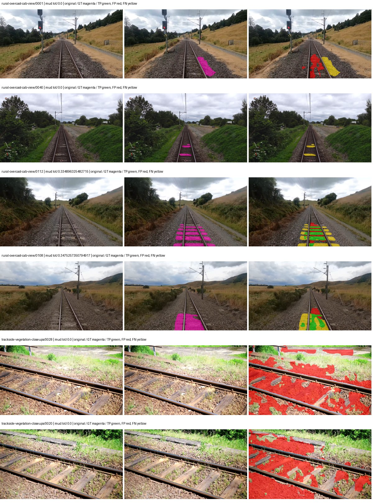
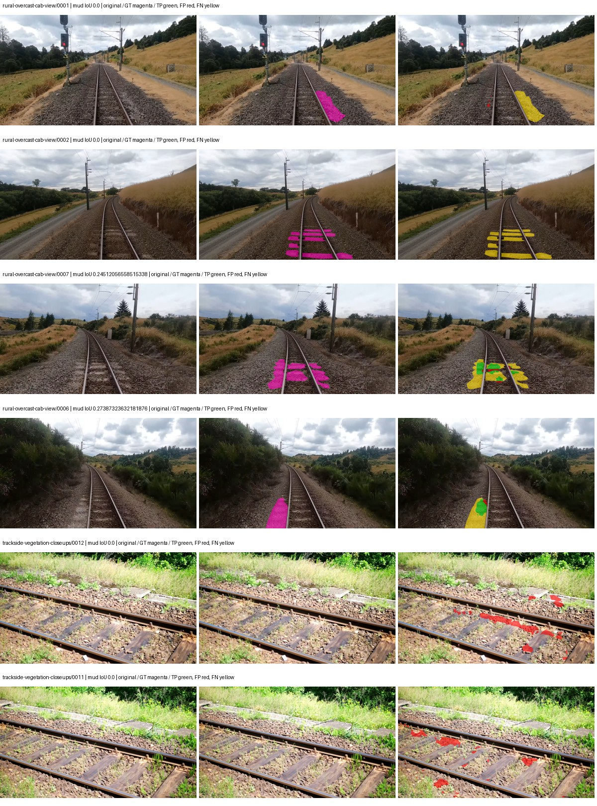
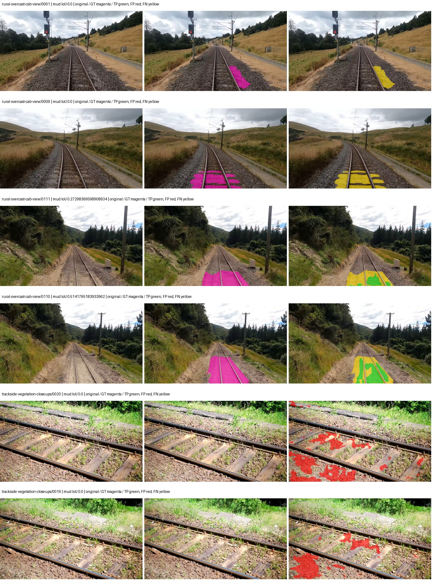
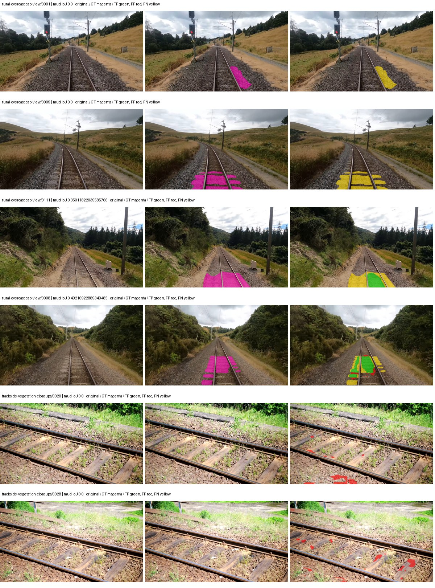

# smp_fpn_resnet50 — rad_9_24_2026-fixed-grouped

[RAD 9/24: Scene-grouped split](../../README.md) · [Full model records](record.json)

Primary result: the **final checkpoint** after the full step budget (no early stopping). The checkpoint with the best **mud-pumping validation IoU, pixels pooled over all validation images**, is kept as secondary evidence. A job is complete only after full statistics and isolated profiling are verified.

Study metrics of the final checkpoint, counting each class only on the validation images that contain it: mud-pumping IoU is the mean per-image IoU over the images with mud-pumping, precision and recall sum pixels over those images, and mIoU averages each class over the images that contain it, then over the classes present.

| Initialization path | Seed | Mud-pumping IoU, train-camera images with mud (%, n=17) | Mud-pumping IoU, all images with mud (%, n=18) | Mud precision, all images with mud (%) | Mud recall, all images with mud (%) | mIoU (each class over images that contain it) (%) |
| --- | --- | --- | --- | --- | --- | --- |
| rtis_only | 0 | 5.29 | 5.13 | 14.37 | 7.22 | 33.38 |
| cityscapes_to_rtis | 0 | 5.49 | 5.96 | 54.64 | 6.28 | 34.66 |
| railsem19_to_rtis | 0 | 10.82 | 10.72 | 56.38 | 12.37 | 44.54 |
| cityscapes_to_railsem19_to_rtis | 0 | 7.04 | 7.33 | 58.35 | 10.57 | 38.50 |

Per-class IoU: IoU (%) of every class, each averaged only over the validation images that contain the class (n = those images); — = no image contains it. mIoU averages the classes with at least one such image.

| Initialization path | Seed | mIoU (each class over images that contain it) | person (n=0) | truck (n=0) | rail-track (n=37) | vegetation-overgrowth (n=13) | car (n=3) | on-rails (n=0) | traffic-sign (n=9) | road (n=11) | sidewalk (n=12) | construction (n=12) | tram-track (n=2) | pole (n=21) | traffic-light (n=3) | mud-pumping (n=18) | fence (n=7) | terrain (n=35) | sky (n=28) | rail-embedded (n=3) | rail-raised (n=37) | trackbed (n=37) | standing-water (n=9) |
| --- | --- | --- | --- | --- | --- | --- | --- | --- | --- | --- | --- | --- | --- | --- | --- | --- | --- | --- | --- | --- | --- | --- | --- |
| rtis_only | 0 | 33.38 | — | — | 52.81 | 26.81 | 19.33 | — | 21.34 | 7.04 | 12.27 | 37.36 | 1.46 | 63.23 | 31.73 | 5.13 | 11.29 | 83.78 | 91.76 | 1.28 | 70.50 | 63.15 | 0.51 |
| cityscapes_to_rtis | 0 | 34.66 | — | — | 56.20 | 38.10 | 10.33 | — | 24.62 | 8.25 | 11.77 | 30.76 | 0.00 | 65.91 | 40.76 | 5.96 | 22.91 | 83.11 | 92.76 | 0.00 | 69.42 | 62.83 | 0.23 |
| railsem19_to_rtis | 0 | 44.54 | — | — | 60.84 | 35.43 | 29.86 | — | 40.17 | 26.66 | 11.48 | 49.34 | 41.37 | 70.80 | 43.74 | 10.72 | 26.28 | 85.72 | 94.66 | 34.00 | 73.15 | 64.95 | 2.46 |
| cityscapes_to_railsem19_to_rtis | 0 | 38.50 | — | — | 59.05 | 38.22 | 24.55 | — | 37.75 | 22.17 | 12.52 | 41.10 | 0.00 | 68.52 | 44.04 | 7.33 | 16.70 | 85.97 | 94.46 | 0.00 | 70.96 | 65.21 | 4.47 |

Everything below is the campaign's own record, with pixels pooled over all validation images: its evaluation is the checkpoint that scored best on that pooled mud IoU (secondary evidence here); the diagnostics also cover the final checkpoint (`final-auto-val`).

| Model | Initialization path | Seed | Status | Steps | Best step | Best-checkpoint mud IoU, pixels pooled (%) | Best-checkpoint mud precision, pixels pooled (%) | Best-checkpoint mud recall, pixels pooled (%) | Final mud IoU (trainer val, pixels pooled, %) | Best-checkpoint mIoU, pixels pooled (%) | Best-checkpoint fixed GT-class mIoU, pixels pooled (%) |
| --- | --- | --- | --- | --- | --- | --- | --- | --- | --- | --- | --- |
| smp_fpn_resnet50 | rtis_only | 0 | completed | 4000 | 259 | 5.16 | 6.18 | 23.74 | 1.87 | 20.27 | 21.39 |
| smp_fpn_resnet50 | cityscapes_to_rtis | 0 | completed | 4000 | 1296 | 8.26 | 29.39 | 10.31 | 5.40 | 28.69 | 31.88 |
| smp_fpn_resnet50 | railsem19_to_rtis | 0 | completed | 4000 | 777 | 9.43 | 17.68 | 16.81 | 8.30 | 43.62 | 48.47 |
| smp_fpn_resnet50 | cityscapes_to_railsem19_to_rtis | 0 | completed | 4000 | 777 | 16.02 | 51.69 | 18.84 | 8.90 | 35.43 | 41.34 |

Training: 217 images. Validation: 37 images. Test: 60 held out. Seeds: [0]. Seed variation measures optimization variability, not independent-recording uncertainty. Historical source checkpoints stay fixed across adaptation seeds.

Training code: `fce0ea0ac50b334d4252812c396e0e593def375d`. Split SHA-256: `12d7b367c72cda61d57686ff2ac28223530d0af49debd9fb7a0fbc68b908bc93`.

## rtis_only — seed 0

Status: **completed**. Started: 2026-10-11T14:15:58.553096+00:00. Finished: 2026-10-11T14:59:15.212041+00:00.

Recipe pretrained initializer: `{"arch": "smp", "backbone_path": null, "batch_norm_momentum": null, "checkpoint": null, "classifier_path": null, "drop_path": null, "encoder_name": "resnet50", "encoder_weights": "imagenet", "head": "unified_head", "head_paths": [], "inactive_parameter_paths": [], "local_files_only": false, "lora_alpha": 32, "lora_dropout": 0.05, "lora_r": 16, "lora_targets": [], "native": null, "revision": null, "smp_arch": "FPN", "subfolder": null, "trust_remote_code": false, "tuning": "full"}`.

`rtis_only` uses the recipe initializer, which may include pretrained segmentation components. Transfer paths load the exact historical source checkpoint below and reset the classifier; they do not reset all query/decoder features.

Source checkpoint: `Recipe pretrained initialization`.

Config SHA-256: `9a85ddffb9eeec6e78560500b92331607961c047000d3d16e6f0f54ae69f0339`. Weights used for validation: `raw`.

### Mud-pumping and aggregate quality

| Metric | Selected checkpoint | Final training validation |
| --- | --- | --- |
| Mud IoU | 5.16 | 1.87 |
| Mud precision | 6.18 | 2.46 |
| Mud recall | 23.74 | 7.23 |
| Mud Dice/F1 | 9.81 | 3.68 |
| mIoU | 20.27 | 29.73 |
| Mean accuracy | 30.25 | 42.30 |
| Mean precision | 34.59 | 46.53 |
| Mean Dice | 26.48 | 38.37 |
| Mean specificity | 98.42 | 98.87 |
| Pixel accuracy | 75.75 | 81.72 |
| Frequency-weighted IoU | 64.01 | 72.72 |
| Fixed GT-present class mIoU | 21.39 | 34.69 |
| Boundary F1 | 22.85 | 37.79 |

The selected checkpoint has independent evaluation evidence. Final values are the trainer's final validation record, not a new independent evaluation. mIoU averages classes with nonzero union, so false positives on absent classes can change its denominator. The fixed GT-class mean is supplementary and excludes absent classes; their false positives remain in the confusion matrix.

### Resource usage and timing

| Measurement | Value |
| --- | --- |
| Peak training VRAM, retained training invocation (GiB) | 8.69 |
| Peak evaluation VRAM (GiB) | 7.01 |
| Retained training invocation wall time (seconds) | 2456.96 |
| Retained training invocation GPU-hours (one GPU) | 0.68 |
| Evaluation wall time (seconds) | 11.59 |
| Full evaluation pipeline images/second | 3.19 |
| Best full-state checkpoint (MiB) | 399.34 |
| Final full-state checkpoint (MiB) | 399.33 |
| Verified periodic checkpoints removed (GiB) | 3.12 |

VRAM uses the recorded allocator high-water mark; it is not total device usage including CUDA context. Resumed jobs' retained training invocation times and peaks are **not whole-campaign totals**. Earlier invocation resource records are not reconstructed here. Evaluation throughput includes loader, sliding-window inference and metrics; it is not model-only latency/FPS. Missing measurements are shown as —, never inferred from another dataset's run.

### Standardized inference performance

Dedicated model-only profiling waits for an idle worker-locked L40S: BF16, batch 1, 1024x1024, 20 warmup and 100 CUDA-event-timed public forwards. It excludes loading, preprocessing, tiling and metrics.

| Status | Parameters | Weight MiB | FPS | p50 ms | p95 ms | Peak reserved GiB |
| --- | --- | --- | --- | --- | --- | --- |
| complete | 26118613 | 99.63 | 159.85 | 6.21 | 6.51 | 0.74 |

```json
{
  "schema_version": 1,
  "model_id": "smp_fpn_resnet50",
  "measured_at": "2026-10-11T14:59:09+00:00",
  "status": "complete",
  "benchmark_scope": "rtis_selected_checkpoint_model_only",
  "applies_to": [
    "smp_fpn_resnet50--rtis_only--seed-0"
  ],
  "source": {
    "campaign_git_sha": "fce0ea0ac50b334d4252812c396e0e593def375d",
    "git_dirty": false,
    "config_hash": "0961674b1741",
    "resolved_config": "/data/izadia1/projects/segmentary-runs/rad_9_24_2026/fgall-seed0-20261007/configs/smp_fpn_resnet50--rtis_only--seed-0.yaml",
    "config_sha256": "9a85ddffb9eeec6e78560500b92331607961c047000d3d16e6f0f54ae69f0339",
    "checkpoint_sha256": "7a69d3328003a0366153f4aace6909cb8773d7a1e0e28426afb5592b1b2dfc3b",
    "checkpoint_global_step": 259,
    "checkpoint_bytes": 418736929,
    "checkpoint_kind": "resume checkpoint with optimizer and EMA state",
    "weights": "raw",
    "measured_checkpoint_job_id": "smp_fpn_resnet50--rtis_only--seed-0",
    "result_sha256": "7cac63f934ca546d20307f20469f6c71cd60c6465e85bb222ff3b941cd44ef8e",
    "result_git_sha": "fce0ea0ac50b334d4252812c396e0e593def375d",
    "result_stage": "eval:rad_9_24_2026-fixed-grouped:val",
    "result_seed": 0
  },
  "hardware": {
    "gpu_name": "NVIDIA L40S",
    "gpu_uuid": "GPU-2f8008a1-9b67-11f6-987b-b393a672322c",
    "logical_device": "cuda:0",
    "physical_visibility_token": "3",
    "compute_capability": [
      8,
      9
    ],
    "total_memory_bytes": 47677177856
  },
  "model": {
    "parameter_count": 26118613,
    "trainable_parameter_count": 26118613,
    "resident_parameter_bytes": 104474452,
    "parameter_dtype_counts": {
      "float32": 26118613
    }
  },
  "contract": {
    "backend": "pytorch",
    "precision": "bf16_autocast",
    "batch_size": 1,
    "input_shape_nchw": [
      1,
      3,
      1024,
      1024
    ],
    "warmup_iterations": 20,
    "measured_iterations": 100,
    "timing": "per-forward CUDA events with end-event synchronization",
    "includes_preprocessing": false,
    "includes_data_loader": false,
    "includes_sliding_window": false,
    "input_resident_on_gpu": true,
    "model_only": true,
    "entrypoint": "public model(image) dense-logits forward"
  },
  "measurements": {
    "latency": {
      "p50_ms": 6.206463813781738,
      "p95_ms": 6.511564755439758,
      "mean_ms": 6.255711359977722,
      "minimum_ms": 6.187935829162598,
      "maximum_ms": 6.921216011047363,
      "fps": 159.85392267260252,
      "raw_ms": [
        6.253568172454834,
        6.200319766998291,
        6.207488059997559,
        6.195199966430664,
        6.204415798187256,
        6.196224212646484,
        6.198272228240967,
        6.417407989501953,
        6.187935829162598,
        6.193151950836182,
        6.189055919647217,
        6.205440044403076,
        6.607872009277344,
        6.199264049530029,
        6.213632106781006,
        6.205440044403076,
        6.3006720542907715,
        6.200319766998291,
        6.209536075592041,
        6.211584091186523,
        6.266880035400391,
        6.205440044403076,
        6.199295997619629,
        6.204415798187256,
        6.213632106781006,
        6.219776153564453,
        6.209536075592041,
        6.506495952606201,
        6.22489595413208,
        6.343679904937744,
        6.200319766998291,
        6.205408096313477,
        6.205440044403076,
        6.1951680183410645,
        6.193151950836182,
        6.203392028808594,
        6.202367782592773,
        6.473728179931641,
        6.195199966430664,
        6.200191974639893,
        6.208511829376221,
        6.211584091186523,
        6.208511829376221,
        6.200319766998291,
        6.203360080718994,
        6.204415798187256,
        6.201344013214111,
        6.327295780181885,
        6.204415798187256,
        6.206463813781738,
        6.203392028808594,
        6.205440044403076,
        6.203392028808594,
        6.219776153564453,
        6.201344013214111,
        6.683648109436035,
        6.207488059997559,
        6.211584091186523,
        6.1972479820251465,
        6.203392028808594,
        6.211584091186523,
        6.215680122375488,
        6.207488059997559,
        6.249472141265869,
        6.198272228240967,
        6.1993279457092285,
        6.203296184539795,
        6.326272010803223,
        6.216671943664551,
        6.209536075592041,
        6.203392028808594,
        6.206463813781738,
        6.203392028808594,
        6.203392028808594,
        6.209536075592041,
        6.204415798187256,
        6.204415798187256,
        6.4633917808532715,
        6.921216011047363,
        6.201344013214111,
        6.210559844970703,
        6.209536075592041,
        6.748095989227295,
        6.213632106781006,
        6.473728179931641,
        6.20739221572876,
        6.206463813781738,
        6.201344013214111,
        6.201344013214111,
        6.207488059997559,
        6.214655876159668,
        6.37337589263916,
        6.9027838706970215,
        6.223872184753418,
        6.193151950836182,
        6.219776153564453,
        6.2218241691589355,
        6.206463813781738,
        6.293504238128662,
        6.205440044403076
      ],
      "percentile_method": "numpy linear interpolation"
    },
    "peak_reserved_bytes": 792723456,
    "memory_kind": "pytorch_cuda_allocator_peak_reserved_excluding_context",
    "process_total_bytes": 1321205760,
    "process_total_kind": "nvidia-smi used_memory of this PID on the benchmark GPU after the timed loop, including the CUDA context; null when the driver could not attribute memory to this PID",
    "benchmark_wall_clock_s": 12.665783174335957
  },
  "started_at": "2026-10-11T14:58:56+00:00",
  "finished_at": "2026-10-11T14:59:09+00:00",
  "environment": {
    "hostname": "hdrfs-app-001",
    "python": "3.11.15",
    "platform": "Linux-5.15.0-139-generic-x86_64-with-glibc2.35",
    "torch": "2.11.0+cu128",
    "torch_cuda": "12.8",
    "cudnn": 91900,
    "driver_version": "570.133.20",
    "cuda_available": true,
    "gpu_count": 1,
    "gpu_names": [
      "NVIDIA L40S"
    ],
    "cuda_visible_devices": "3",
    "packages": {
      "segmentary": "0.1.0",
      "torch": "2.11.0+cu128",
      "torchvision": "0.26.0+cu128",
      "transformers": "5.15.0",
      "timm": "1.0.28",
      "segmentation-models-pytorch": "0.5.0",
      "albumentations": "2.0.8",
      "lightning": "2.6.5",
      "numpy": "2.4.4"
    }
  }
}
```

### Per-class validation results

| Class | GT pixels | IoU (%) | Precision (%) | Recall (%) | Dice (%) | Boundary F1 (%) |
| --- | --- | --- | --- | --- | --- | --- |
| car | 29664 | 0.00 | 0.00 | 0.00 | 0.00 | 0.00 |
| construction | 311585 | 11.32 | 11.95 | 68.39 | 20.34 | 19.94 |
| fence | 265137 | 3.33 | 12.13 | 4.38 | 6.44 | 9.99 |
| mud-pumping | 1226250 | 5.16 | 6.18 | 23.74 | 9.81 | 10.47 |
| on-rails | 0 | 0.00 | 0.00 | — | 0.00 | 0.00 |
| person | 0 | — | — | — | — | — |
| pole | 628038 | 39.44 | 72.87 | 46.23 | 56.57 | 67.70 |
| rail-embedded | 16799 | 0.00 | 0.00 | 0.00 | 0.00 | 0.00 |
| rail-raised | 2969797 | 57.23 | 58.48 | 96.38 | 72.79 | 80.37 |
| rail-track | 6323197 | 19.58 | 87.03 | 20.17 | 32.74 | 31.40 |
| road | 1048831 | 3.87 | 15.68 | 4.89 | 7.46 | 8.23 |
| sidewalk | 1297367 | 22.08 | 65.19 | 25.03 | 36.17 | 13.35 |
| sky | 19121606 | 91.35 | 98.94 | 92.25 | 95.48 | 74.61 |
| standing-water | 95802 | 0.06 | 0.08 | 0.21 | 0.12 | 0.75 |
| terrain | 39239306 | 78.31 | 80.38 | 96.81 | 87.83 | 41.70 |
| trackbed | 10643081 | 45.14 | 67.56 | 57.63 | 62.20 | 46.11 |
| traffic-light | 19510 | 0.00 | 0.00 | 0.00 | 0.00 | 0.00 |
| traffic-sign | 13285 | 0.00 | 0.00 | 0.00 | 0.00 | 0.00 |
| tram-track | 56179 | 0.00 | 0.00 | 0.00 | 0.00 | 0.00 |
| truck | 0 | — | — | — | — | — |
| vegetation-overgrowth | 5901821 | 8.25 | 80.75 | 8.42 | 15.24 | 29.55 |

### Full-run accounting

| Measurement | Value |
| --- | --- |
| Full GPU-reserved wall seconds, all recorded worker attempts | 2604.31 |
| Full reserved GPU-hours | 0.72 |
| Whole-run timing complete | True |

| Phase | Wall seconds including failed attempts |
| --- | --- |
| training | 2464.19 |
| diagnostics | 87.64 |
| performance | 21.07 |

GPU-reserved time includes model loading, training, validation, collection, profiling, checkpoint I/O and orchestration while the worker owns one GPU. It is not GPU kernel-active time. Phase timings and sampled device memory/power/utilization are retained separately; sampled device memory is not the allocator high-water mark.

### Train/validation and raw/EMA diagnostics

| Checkpoint / weights / split | Images | Mud IoU (%) | Mud precision (%) | Mud recall (%) |
| --- | --- | --- | --- | --- |
| best-auto-train / raw | 217 | 82.38 | 88.00 | 92.81 |
| best-auto-val / raw | 37 | 5.16 | 6.18 | 23.74 |
| best-alternate-val / ema | 37 | 0.22 | 0.27 | 1.05 |
| final-auto-val / raw | 37 | 1.87 | 2.46 | 7.22 |

Train uses the evaluation transform without augmentation. Compare mud train/validation metrics for the same selected weights. Alternate EMA on running-stat BatchNorm is explicitly uncalibrated and is diagnostic only. Score-threshold curves use uncalibrated normalized scores and are pixel-level diagnostics, not event detection rates or a selected deployment operating point.

### Downloadable evidence

- best-auto-train: [per-image.csv](rtis_only--seed-0/best-auto-train/per-image.csv) · [per-image-confusion.json.gz](rtis_only--seed-0/best-auto-train/per-image-confusion.json.gz) · [groups.json](rtis_only--seed-0/best-auto-train/groups.json) · [mud-score-curves.json](rtis_only--seed-0/best-auto-train/mud-score-curves.json)
- best-auto-val: [per-image.csv](rtis_only--seed-0/best-auto-val/per-image.csv) · [per-image-confusion.json.gz](rtis_only--seed-0/best-auto-val/per-image-confusion.json.gz) · [groups.json](rtis_only--seed-0/best-auto-val/groups.json) · [mud-score-curves.json](rtis_only--seed-0/best-auto-val/mud-score-curves.json) · [examples.jpg](rtis_only--seed-0/best-auto-val/examples.jpg)
- best-alternate-val: [per-image.csv](rtis_only--seed-0/best-alternate-val/per-image.csv) · [per-image-confusion.json.gz](rtis_only--seed-0/best-alternate-val/per-image-confusion.json.gz) · [groups.json](rtis_only--seed-0/best-alternate-val/groups.json) · [mud-score-curves.json](rtis_only--seed-0/best-alternate-val/mud-score-curves.json)
- final-auto-val: [per-image.csv](rtis_only--seed-0/final-auto-val/per-image.csv) · [per-image-confusion.json.gz](rtis_only--seed-0/final-auto-val/per-image-confusion.json.gz) · [groups.json](rtis_only--seed-0/final-auto-val/groups.json) · [mud-score-curves.json](rtis_only--seed-0/final-auto-val/mud-score-curves.json)
- resources: [telemetry.csv](rtis_only--seed-0/resources/telemetry.csv)



Examples are two lowest and two highest mud-IoU positive images, plus up to two negative images with the most false-positive mud pixels. They are targeted diagnostic examples, not random samples. Green: true positive; red: false positive; yellow: false negative. Full predictions remain on HDRFS.

### Validation tracking

| Logged step | Overall mIoU (%) | Mud IoU (%) |
| --- | --- | --- |
| 258 | 20.26 | 5.16 |
| 518 | 21.40 | 2.47 |
| 777 | 27.87 | 1.00 |
| 1036 | 24.44 | 0.29 |
| 1295 | 26.38 | 5.11 |
| 1555 | 24.15 | 0.91 |
| 1814 | 26.47 | 0.42 |
| 2073 | 27.75 | 1.26 |
| 2332 | 29.01 | 0.48 |
| 2592 | 28.79 | 2.60 |
| 2851 | 29.09 | 2.08 |
| 3110 | 30.89 | 0.84 |
| 3369 | 28.18 | 1.16 |
| 3629 | 29.12 | 1.52 |
| 3888 | 29.80 | 1.96 |
| 4000 | 29.73 | 1.87 |

All retained scalar curves, including training loss and per-class IoU, are in record.json. Observed best mud on a curve is not necessarily a retained checkpoint: the pilot saved its selection-metric-best and final checkpoints. Step logging and checkpoint global_step may differ by one.

### Stopping and checkpoint provenance

```json
{
  "stopping": {
    "actual_steps": 4000,
    "maximum_steps": 4000,
    "min_delta": 0.0,
    "monitor": "val_iou/mud-pumping",
    "patience": null,
    "reason": "budget_complete"
  },
  "checkpoints": {
    "best": {
      "path": "/data/izadia1/projects/segmentary-runs/rad_9_24_2026/fgall-seed0-20261007/future-runs/smp_fpn_resnet50--rtis_only--seed-0_seed0/rtis/best.ckpt",
      "sha256": "7a69d3328003a0366153f4aace6909cb8773d7a1e0e28426afb5592b1b2dfc3b",
      "global_step": 259,
      "bytes": 418736929
    },
    "final": {
      "path": "/data/izadia1/projects/segmentary-runs/rad_9_24_2026/fgall-seed0-20261007/future-runs/smp_fpn_resnet50--rtis_only--seed-0_seed0/rtis/last.ckpt",
      "sha256": "ad6117d9e534729a7b280b15d05629e0b33d714c926d1c1b9e9180d6a19984af",
      "global_step": 4000,
      "bytes": 418725409
    }
  },
  "cleanup_error": null
}
```

### Resolved training, initialization and evaluation settings

The optimizer block is the base configuration. Stage LR scales are applied at runtime, and stage warmup is capped at min(base warmup, floor(stage budget / 10), stage budget - 1): 400 steps for this 4,000-step pilot. Model-internal native input grids may differ from augmentation crops (EoMT uses its 640 grid).

```json
{
  "name": "smp_fpn_resnet50--rtis_only--seed-0",
  "model": {
    "arch": "smp",
    "checkpoint": null,
    "tuning": "full",
    "head": "unified_head",
    "lora_r": 16,
    "lora_alpha": 32,
    "lora_dropout": 0.05,
    "lora_targets": [],
    "drop_path": null,
    "revision": null,
    "subfolder": null,
    "local_files_only": false,
    "trust_remote_code": false,
    "backbone_path": null,
    "head_paths": [],
    "classifier_path": null,
    "inactive_parameter_paths": [],
    "smp_arch": "FPN",
    "encoder_name": "resnet50",
    "encoder_weights": "imagenet",
    "native": null,
    "batch_norm_momentum": null
  },
  "space": "paul-test-rtis",
  "taxonomy_root": "/data/izadia1/projects/segmentary-rad-fgall-fce0ea0a/taxonomy",
  "output_root": "/data/izadia1/projects/segmentary-runs/rad_9_24_2026/fgall-seed0-20261007/future-runs",
  "optim": {
    "backbone_lr": 0.0001,
    "head_lr_mult": 10.0,
    "weight_decay": 0.05,
    "llrd": 1.0,
    "warmup_iters": 1500,
    "warmup_ratio": 1e-06,
    "poly_power": 0.9,
    "min_lr_ratio": 0.0,
    "betas": [
      0.9,
      0.999
    ],
    "grad_clip": 1.0
  },
  "train": {
    "iters": 4000,
    "batch_size": 2,
    "accum": 8,
    "num_workers": 2,
    "precision": "bf16-mixed",
    "ema_decay": 0.9998,
    "val_every": 250,
    "ckpt_every": 500,
    "selection_metric": "val_iou/mud-pumping",
    "early_stopping_patience": null,
    "early_stopping_min_delta": 0.0,
    "seed": 0,
    "devices": 1
  },
  "eval": {
    "sliding_window": true,
    "window": [
      1024,
      1024
    ],
    "stride": [
      768,
      768
    ],
    "batch_size": 1,
    "num_workers": 2,
    "tta_scales": [],
    "tta_flip": false,
    "threshold": 0.5,
    "boundary_tolerance_frac": 0.0075,
    "save_confusion": true
  },
  "loss": {
    "task": "multiclass",
    "activation": "auto",
    "terms": [],
    "aux": "none",
    "aux_weight": 0.0,
    "ce_weight": 1.0,
    "label_smoothing": 0.0,
    "class_weights": null,
    "query": null
  },
  "aug": {
    "crop": [
      1024,
      1024
    ],
    "scale_min": 0.5,
    "scale_max": 2.0,
    "hflip_p": 0.5,
    "color_jitter_p": 0.5,
    "brightness": 0.25,
    "contrast": 0.25,
    "saturation": 0.25,
    "hue": 0.05
  },
  "stages": [
    {
      "name": "rtis",
      "data": [
        {
          "name": "rad_9_24_2026-fixed-grouped",
          "root": "/data/izadia1/datasets/rad_9_24_2026-fixed-grouped",
          "variant": null,
          "split_file": "splits.json",
          "train_split": "train",
          "val_split": "val",
          "limit": null,
          "loader": "folder",
          "mapping": "paul-test-rtis",
          "loader_options": {
            "require_groups": true
          }
        }
      ],
      "iters": null,
      "lr_scale": 1.0,
      "head_group_lr_scale": 1.0,
      "init_from": "pretrained",
      "reset_head": false,
      "freeze": null,
      "sample_weights": null
    }
  ]
}
```

### Hardware and software provenance

```json
{
  "training": {
    "cuda_available": true,
    "cuda_visible_devices": "3",
    "cudnn": 91900,
    "driver_version": "570.133.20",
    "gpu_count": 1,
    "gpu_names": [
      "NVIDIA L40S"
    ],
    "hostname": "hdrfs-app-001",
    "input_normalization": {
      "channel_order": "rgb",
      "mean": [
        0.485,
        0.456,
        0.406
      ],
      "source": "smp_encoder_settings",
      "std": [
        0.229,
        0.224,
        0.225
      ]
    },
    "model_origins": [
      {
        "hf_commit": null,
        "hf_name_or_path": null,
        "module": "model",
        "timm_pretrained": {}
      }
    ],
    "model_parameter_count": 26118613,
    "packages": {
      "albumentations": "2.0.8",
      "lightning": "2.6.5",
      "numpy": "2.4.4",
      "segmentary": "0.1.0",
      "segmentation-models-pytorch": "0.5.0",
      "timm": "1.0.28",
      "torch": "2.11.0+cu128",
      "torchvision": "0.26.0+cu128",
      "transformers": "5.15.0"
    },
    "platform": "Linux-5.15.0-139-generic-x86_64-with-glibc2.35",
    "python": "3.11.15",
    "torch": "2.11.0+cu128",
    "torch_cuda": "12.8",
    "trainable_parameter_count": 26118613,
    "training_stop": {
      "actual_steps": 4000,
      "maximum_steps": 4000,
      "min_delta": 0.0,
      "monitor": "val_iou/mud-pumping",
      "patience": null,
      "reason": "budget_complete"
    },
    "validation_weights": "raw"
  },
  "evaluation": {
    "cuda_available": true,
    "cuda_visible_devices": "3",
    "cudnn": 91900,
    "driver_version": "570.133.20",
    "gpu_count": 1,
    "gpu_names": [
      "NVIDIA L40S"
    ],
    "hostname": "hdrfs-app-001",
    "input_normalization": {
      "channel_order": "rgb",
      "mean": [
        0.485,
        0.456,
        0.406
      ],
      "source": "smp_encoder_settings",
      "std": [
        0.229,
        0.224,
        0.225
      ]
    },
    "packages": {
      "albumentations": "2.0.8",
      "lightning": "2.6.5",
      "numpy": "2.4.4",
      "segmentary": "0.1.0",
      "segmentation-models-pytorch": "0.5.0",
      "timm": "1.0.28",
      "torch": "2.11.0+cu128",
      "torchvision": "0.26.0+cu128",
      "transformers": "5.15.0"
    },
    "platform": "Linux-5.15.0-139-generic-x86_64-with-glibc2.35",
    "python": "3.11.15",
    "torch": "2.11.0+cu128",
    "torch_cuda": "12.8"
  }
}
```

## cityscapes_to_rtis — seed 0

Status: **completed**. Started: 2026-10-11T14:16:41.456072+00:00. Finished: 2026-10-11T14:59:16.434557+00:00.

Recipe pretrained initializer: `{"arch": "smp", "backbone_path": null, "batch_norm_momentum": null, "checkpoint": null, "classifier_path": null, "drop_path": null, "encoder_name": "resnet50", "encoder_weights": "imagenet", "head": "unified_head", "head_paths": [], "inactive_parameter_paths": [], "local_files_only": false, "lora_alpha": 32, "lora_dropout": 0.05, "lora_r": 16, "lora_targets": [], "native": null, "revision": null, "smp_arch": "FPN", "subfolder": null, "trust_remote_code": false, "tuning": "full"}`.

`rtis_only` uses the recipe initializer, which may include pretrained segmentation components. Transfer paths load the exact historical source checkpoint below and reset the classifier; they do not reset all query/decoder features.

Source checkpoint: `{'name': 'smp_fpn_resnet50--cityscapes--seed-0', 'model': 'smp_fpn_resnet50', 'protocol': 'cityscapes', 'config': '/data/izadia1/projects/segmentary-runs/all-model-city-rail-seed0-rail20-b9eb3e1/accepted/smp_fpn_resnet50--cityscapes--seed-0/resolved-config.yaml', 'checkpoint': '/data/izadia1/projects/segmentary-runs/current-main-fill-v2/jobs/smp_fpn_resnet50--cityscapes--seed-0/train/smp_fpn_resnet50--cityscapes_seed0/cityscapes/last.ckpt', 'recorded_sha256': '556c5d27ea6d8d034aa1d6c86a7defd74bcdd36b3e3962cc39034d22d32628d6', 'exists': True}`.

Config SHA-256: `5f79822a1799215d987e04439950711ee2ebb2ee7c6271bfe2d8c1f5ae58070a`. Weights used for validation: `raw`.

### Mud-pumping and aggregate quality

| Metric | Selected checkpoint | Final training validation |
| --- | --- | --- |
| Mud IoU | 8.26 | 5.40 |
| Mud precision | 29.39 | 27.86 |
| Mud recall | 10.31 | 6.28 |
| Mud Dice/F1 | 15.26 | 10.24 |
| mIoU | 28.69 | 31.87 |
| Mean accuracy | 40.40 | 46.77 |
| Mean precision | 45.73 | 43.67 |
| Mean Dice | 37.38 | 40.31 |
| Mean specificity | 98.66 | 99.00 |
| Pixel accuracy | 80.25 | 83.82 |
| Frequency-weighted IoU | 69.01 | 74.68 |
| Fixed GT-present class mIoU | 31.88 | 37.19 |
| Boundary F1 | 34.15 | 37.73 |

The selected checkpoint has independent evaluation evidence. Final values are the trainer's final validation record, not a new independent evaluation. mIoU averages classes with nonzero union, so false positives on absent classes can change its denominator. The fixed GT-class mean is supplementary and excludes absent classes; their false positives remain in the confusion matrix.

### Resource usage and timing

| Measurement | Value |
| --- | --- |
| Peak training VRAM, retained training invocation (GiB) | 8.69 |
| Peak evaluation VRAM (GiB) | 7.01 |
| Retained training invocation wall time (seconds) | 2415.13 |
| Retained training invocation GPU-hours (one GPU) | 0.67 |
| Evaluation wall time (seconds) | 11.50 |
| Full evaluation pipeline images/second | 3.22 |
| Best full-state checkpoint (MiB) | 399.34 |
| Final full-state checkpoint (MiB) | 399.33 |
| Verified periodic checkpoints removed (GiB) | 3.12 |

VRAM uses the recorded allocator high-water mark; it is not total device usage including CUDA context. Resumed jobs' retained training invocation times and peaks are **not whole-campaign totals**. Earlier invocation resource records are not reconstructed here. Evaluation throughput includes loader, sliding-window inference and metrics; it is not model-only latency/FPS. Missing measurements are shown as —, never inferred from another dataset's run.

### Standardized inference performance

Dedicated model-only profiling waits for an idle worker-locked L40S: BF16, batch 1, 1024x1024, 20 warmup and 100 CUDA-event-timed public forwards. It excludes loading, preprocessing, tiling and metrics.

| Status | Parameters | Weight MiB | FPS | p50 ms | p95 ms | Peak reserved GiB |
| --- | --- | --- | --- | --- | --- | --- |
| complete | 26118613 | 99.63 | 152.95 | 6.25 | 7.43 | 0.74 |

```json
{
  "schema_version": 1,
  "model_id": "smp_fpn_resnet50",
  "measured_at": "2026-10-11T14:59:11+00:00",
  "status": "complete",
  "benchmark_scope": "rtis_selected_checkpoint_model_only",
  "applies_to": [
    "smp_fpn_resnet50--cityscapes_to_rtis--seed-0"
  ],
  "source": {
    "campaign_git_sha": "fce0ea0ac50b334d4252812c396e0e593def375d",
    "git_dirty": false,
    "config_hash": "53d0a01d26dd",
    "resolved_config": "/data/izadia1/projects/segmentary-runs/rad_9_24_2026/fgall-seed0-20261007/configs/smp_fpn_resnet50--cityscapes_to_rtis--seed-0.yaml",
    "config_sha256": "5f79822a1799215d987e04439950711ee2ebb2ee7c6271bfe2d8c1f5ae58070a",
    "checkpoint_sha256": "f6337e8fd32c6c3e14aeff175ea26ec36aeded570fbb21442b3a5b7993bbfcd3",
    "checkpoint_global_step": 1296,
    "checkpoint_bytes": 418737249,
    "checkpoint_kind": "resume checkpoint with optimizer and EMA state",
    "weights": "raw",
    "measured_checkpoint_job_id": "smp_fpn_resnet50--cityscapes_to_rtis--seed-0",
    "result_sha256": "3603578e53a288cac3be73e709b270494b608253c19ea9f59c941204f88c7b88",
    "result_git_sha": "fce0ea0ac50b334d4252812c396e0e593def375d",
    "result_stage": "eval:rad_9_24_2026-fixed-grouped:val",
    "result_seed": 0
  },
  "hardware": {
    "gpu_name": "NVIDIA L40S",
    "gpu_uuid": "GPU-fc5dde96-210d-0afa-ac74-7f88477d622b",
    "logical_device": "cuda:0",
    "physical_visibility_token": "4",
    "compute_capability": [
      8,
      9
    ],
    "total_memory_bytes": 47677177856
  },
  "model": {
    "parameter_count": 26118613,
    "trainable_parameter_count": 26118613,
    "resident_parameter_bytes": 104474452,
    "parameter_dtype_counts": {
      "float32": 26118613
    }
  },
  "contract": {
    "backend": "pytorch",
    "precision": "bf16_autocast",
    "batch_size": 1,
    "input_shape_nchw": [
      1,
      3,
      1024,
      1024
    ],
    "warmup_iterations": 20,
    "measured_iterations": 100,
    "timing": "per-forward CUDA events with end-event synchronization",
    "includes_preprocessing": false,
    "includes_data_loader": false,
    "includes_sliding_window": false,
    "input_resident_on_gpu": true,
    "model_only": true,
    "entrypoint": "public model(image) dense-logits forward"
  },
  "measurements": {
    "latency": {
      "p50_ms": 6.245887994766235,
      "p95_ms": 7.429785823822019,
      "mean_ms": 6.537909455299378,
      "minimum_ms": 6.228928089141846,
      "maximum_ms": 10.83289623260498,
      "fps": 152.9540913402278,
      "raw_ms": [
        7.117824077606201,
        6.254591941833496,
        6.375391960144043,
        6.237184047698975,
        6.230016231536865,
        10.486783981323242,
        8.259584426879883,
        6.243328094482422,
        6.249472141265869,
        6.243328094482422,
        6.798336029052734,
        6.242303848266602,
        6.5985918045043945,
        6.388735771179199,
        6.257696151733398,
        6.2412800788879395,
        10.83289623260498,
        7.04204797744751,
        6.255616188049316,
        6.243328094482422,
        6.58841609954834,
        6.484992027282715,
        6.251520156860352,
        9.667584419250488,
        9.794560432434082,
        6.239232063293457,
        6.228928089141846,
        6.770559787750244,
        6.2412800788879395,
        6.235136032104492,
        6.244351863861084,
        6.243328094482422,
        6.43884801864624,
        6.449151992797852,
        6.240255832672119,
        6.380447864532471,
        6.243328094482422,
        6.2412800788879395,
        6.246399879455566,
        6.816768169403076,
        6.53004789352417,
        6.540287971496582,
        6.231040000915527,
        6.2412800788879395,
        6.238207817077637,
        6.231040000915527,
        6.234111785888672,
        6.244351863861084,
        6.239232063293457,
        6.247424125671387,
        6.236159801483154,
        6.244319915771484,
        6.543360233306885,
        6.23308801651001,
        6.228991985321045,
        6.23308801651001,
        6.231008052825928,
        6.619135856628418,
        6.414336204528809,
        6.240255832672119,
        6.240255832672119,
        6.23308801651001,
        6.246431827545166,
        6.2412800788879395,
        6.248447895050049,
        6.242271900177002,
        6.319104194641113,
        6.245376110076904,
        6.6211838722229,
        6.246463775634766,
        6.697984218597412,
        7.142528057098389,
        6.237184047698975,
        6.3600640296936035,
        6.687744140625,
        6.235136032104492,
        6.234111785888672,
        6.244351863861084,
        6.499328136444092,
        6.268928050994873,
        6.236159801483154,
        6.250495910644531,
        6.238207817077637,
        6.228991985321045,
        6.246399879455566,
        6.2412800788879395,
        6.236159801483154,
        6.251520156860352,
        6.415359973907471,
        7.386112213134766,
        6.790143966674805,
        6.437888145446777,
        6.235136032104492,
        6.23308801651001,
        6.231040000915527,
        6.245376110076904,
        6.23308801651001,
        6.73689603805542,
        6.339583873748779,
        6.2412800788879395
      ],
      "percentile_method": "numpy linear interpolation"
    },
    "peak_reserved_bytes": 792723456,
    "memory_kind": "pytorch_cuda_allocator_peak_reserved_excluding_context",
    "process_total_bytes": 1321205760,
    "process_total_kind": "nvidia-smi used_memory of this PID on the benchmark GPU after the timed loop, including the CUDA context; null when the driver could not attribute memory to this PID",
    "benchmark_wall_clock_s": 12.759023703634739
  },
  "started_at": "2026-10-11T14:58:58+00:00",
  "finished_at": "2026-10-11T14:59:11+00:00",
  "environment": {
    "hostname": "hdrfs-app-001",
    "python": "3.11.15",
    "platform": "Linux-5.15.0-139-generic-x86_64-with-glibc2.35",
    "torch": "2.11.0+cu128",
    "torch_cuda": "12.8",
    "cudnn": 91900,
    "driver_version": "570.133.20",
    "cuda_available": true,
    "gpu_count": 1,
    "gpu_names": [
      "NVIDIA L40S"
    ],
    "cuda_visible_devices": "4",
    "packages": {
      "segmentary": "0.1.0",
      "torch": "2.11.0+cu128",
      "torchvision": "0.26.0+cu128",
      "transformers": "5.15.0",
      "timm": "1.0.28",
      "segmentation-models-pytorch": "0.5.0",
      "albumentations": "2.0.8",
      "lightning": "2.6.5",
      "numpy": "2.4.4"
    }
  }
}
```

### Per-class validation results

| Class | GT pixels | IoU (%) | Precision (%) | Recall (%) | Dice (%) | Boundary F1 (%) |
| --- | --- | --- | --- | --- | --- | --- |
| car | 29664 | 22.41 | 68.07 | 25.04 | 36.62 | 49.34 |
| construction | 311585 | 34.40 | 39.48 | 72.76 | 51.19 | 31.40 |
| fence | 265137 | 17.84 | 24.99 | 38.42 | 30.28 | 26.63 |
| mud-pumping | 1226250 | 8.26 | 29.39 | 10.31 | 15.26 | 16.89 |
| on-rails | 0 | 0.00 | 0.00 | — | 0.00 | 0.00 |
| person | 0 | — | — | — | — | — |
| pole | 628038 | 67.45 | 84.00 | 77.39 | 80.56 | 89.64 |
| rail-embedded | 16799 | 0.00 | 0.00 | 0.00 | 0.00 | 0.00 |
| rail-raised | 2969797 | 64.94 | 72.13 | 86.70 | 78.74 | 82.11 |
| rail-track | 6323197 | 35.96 | 64.86 | 44.67 | 52.90 | 43.78 |
| road | 1048831 | 6.08 | 9.50 | 14.48 | 11.47 | 11.44 |
| sidewalk | 1297367 | 9.55 | 30.64 | 12.18 | 17.43 | 11.84 |
| sky | 19121606 | 94.47 | 99.34 | 95.07 | 97.16 | 86.17 |
| standing-water | 95802 | 0.00 | 0.00 | 0.00 | 0.00 | 0.15 |
| terrain | 39239306 | 80.30 | 81.38 | 98.37 | 89.07 | 52.20 |
| trackbed | 10643081 | 59.96 | 78.77 | 71.51 | 74.97 | 56.95 |
| traffic-light | 19510 | 36.88 | 75.05 | 42.03 | 53.88 | 46.28 |
| traffic-sign | 13285 | 26.54 | 73.11 | 29.41 | 41.95 | 43.30 |
| tram-track | 56179 | 0.00 | 0.00 | 0.00 | 0.00 | 0.00 |
| truck | 0 | 0.00 | 0.00 | — | 0.00 | 0.00 |
| vegetation-overgrowth | 5901821 | 8.78 | 83.81 | 8.94 | 16.15 | 34.89 |

### Full-run accounting

| Measurement | Value |
| --- | --- |
| Full GPU-reserved wall seconds, all recorded worker attempts | 2562.91 |
| Full reserved GPU-hours | 0.71 |
| Whole-run timing complete | True |

| Phase | Wall seconds including failed attempts |
| --- | --- |
| training | 2422.33 |
| diagnostics | 88.11 |
| performance | 20.63 |

GPU-reserved time includes model loading, training, validation, collection, profiling, checkpoint I/O and orchestration while the worker owns one GPU. It is not GPU kernel-active time. Phase timings and sampled device memory/power/utilization are retained separately; sampled device memory is not the allocator high-water mark.

### Train/validation and raw/EMA diagnostics

| Checkpoint / weights / split | Images | Mud IoU (%) | Mud precision (%) | Mud recall (%) |
| --- | --- | --- | --- | --- |
| best-auto-train / raw | 217 | 89.59 | 95.07 | 93.96 |
| best-auto-val / raw | 37 | 8.26 | 29.39 | 10.31 |
| best-alternate-val / ema | 37 | 4.02 | 16.11 | 5.09 |
| final-auto-val / raw | 37 | 5.41 | 27.88 | 6.28 |

Train uses the evaluation transform without augmentation. Compare mud train/validation metrics for the same selected weights. Alternate EMA on running-stat BatchNorm is explicitly uncalibrated and is diagnostic only. Score-threshold curves use uncalibrated normalized scores and are pixel-level diagnostics, not event detection rates or a selected deployment operating point.

### Downloadable evidence

- best-auto-train: [per-image.csv](cityscapes_to_rtis--seed-0/best-auto-train/per-image.csv) · [per-image-confusion.json.gz](cityscapes_to_rtis--seed-0/best-auto-train/per-image-confusion.json.gz) · [groups.json](cityscapes_to_rtis--seed-0/best-auto-train/groups.json) · [mud-score-curves.json](cityscapes_to_rtis--seed-0/best-auto-train/mud-score-curves.json)
- best-auto-val: [per-image.csv](cityscapes_to_rtis--seed-0/best-auto-val/per-image.csv) · [per-image-confusion.json.gz](cityscapes_to_rtis--seed-0/best-auto-val/per-image-confusion.json.gz) · [groups.json](cityscapes_to_rtis--seed-0/best-auto-val/groups.json) · [mud-score-curves.json](cityscapes_to_rtis--seed-0/best-auto-val/mud-score-curves.json) · [examples.jpg](cityscapes_to_rtis--seed-0/best-auto-val/examples.jpg)
- best-alternate-val: [per-image.csv](cityscapes_to_rtis--seed-0/best-alternate-val/per-image.csv) · [per-image-confusion.json.gz](cityscapes_to_rtis--seed-0/best-alternate-val/per-image-confusion.json.gz) · [groups.json](cityscapes_to_rtis--seed-0/best-alternate-val/groups.json) · [mud-score-curves.json](cityscapes_to_rtis--seed-0/best-alternate-val/mud-score-curves.json)
- final-auto-val: [per-image.csv](cityscapes_to_rtis--seed-0/final-auto-val/per-image.csv) · [per-image-confusion.json.gz](cityscapes_to_rtis--seed-0/final-auto-val/per-image-confusion.json.gz) · [groups.json](cityscapes_to_rtis--seed-0/final-auto-val/groups.json) · [mud-score-curves.json](cityscapes_to_rtis--seed-0/final-auto-val/mud-score-curves.json)
- resources: [telemetry.csv](cityscapes_to_rtis--seed-0/resources/telemetry.csv)



Examples are two lowest and two highest mud-IoU positive images, plus up to two negative images with the most false-positive mud pixels. They are targeted diagnostic examples, not random samples. Green: true positive; red: false positive; yellow: false negative. Full predictions remain on HDRFS.

### Validation tracking

| Logged step | Overall mIoU (%) | Mud IoU (%) |
| --- | --- | --- |
| 258 | 20.27 | 0.71 |
| 518 | 22.08 | 0.62 |
| 777 | 23.38 | 1.41 |
| 1036 | 27.52 | 2.00 |
| 1295 | 28.72 | 8.27 |
| 1555 | 30.59 | 4.40 |
| 1814 | 30.88 | 1.89 |
| 2073 | 30.43 | 4.17 |
| 2332 | 30.40 | 5.10 |
| 2592 | 31.98 | 3.49 |
| 2851 | 31.46 | 4.15 |
| 3110 | 31.24 | 5.27 |
| 3369 | 31.52 | 5.70 |
| 3629 | 31.80 | 6.36 |
| 3888 | 32.48 | 7.39 |
| 4000 | 31.87 | 5.40 |

All retained scalar curves, including training loss and per-class IoU, are in record.json. Observed best mud on a curve is not necessarily a retained checkpoint: the pilot saved its selection-metric-best and final checkpoints. Step logging and checkpoint global_step may differ by one.

### Stopping and checkpoint provenance

```json
{
  "stopping": {
    "actual_steps": 4000,
    "maximum_steps": 4000,
    "min_delta": 0.0,
    "monitor": "val_iou/mud-pumping",
    "patience": null,
    "reason": "budget_complete"
  },
  "checkpoints": {
    "best": {
      "path": "/data/izadia1/projects/segmentary-runs/rad_9_24_2026/fgall-seed0-20261007/future-runs/smp_fpn_resnet50--cityscapes_to_rtis--seed-0_seed0/rtis/best.ckpt",
      "sha256": "f6337e8fd32c6c3e14aeff175ea26ec36aeded570fbb21442b3a5b7993bbfcd3",
      "global_step": 1296,
      "bytes": 418737249
    },
    "final": {
      "path": "/data/izadia1/projects/segmentary-runs/rad_9_24_2026/fgall-seed0-20261007/future-runs/smp_fpn_resnet50--cityscapes_to_rtis--seed-0_seed0/rtis/last.ckpt",
      "sha256": "20fe28790500ea4e4f45215944621fecf518af4661f93bda5c2bf2b92de2d1ae",
      "global_step": 4000,
      "bytes": 418725473
    }
  },
  "cleanup_error": null
}
```

### Resolved training, initialization and evaluation settings

The optimizer block is the base configuration. Stage LR scales are applied at runtime, and stage warmup is capped at min(base warmup, floor(stage budget / 10), stage budget - 1): 400 steps for this 4,000-step pilot. Model-internal native input grids may differ from augmentation crops (EoMT uses its 640 grid).

```json
{
  "name": "smp_fpn_resnet50--cityscapes_to_rtis--seed-0",
  "model": {
    "arch": "smp",
    "checkpoint": null,
    "tuning": "full",
    "head": "unified_head",
    "lora_r": 16,
    "lora_alpha": 32,
    "lora_dropout": 0.05,
    "lora_targets": [],
    "drop_path": null,
    "revision": null,
    "subfolder": null,
    "local_files_only": false,
    "trust_remote_code": false,
    "backbone_path": null,
    "head_paths": [],
    "classifier_path": null,
    "inactive_parameter_paths": [],
    "smp_arch": "FPN",
    "encoder_name": "resnet50",
    "encoder_weights": "imagenet",
    "native": null,
    "batch_norm_momentum": null
  },
  "space": "paul-test-rtis",
  "taxonomy_root": "/data/izadia1/projects/segmentary-rad-fgall-fce0ea0a/taxonomy",
  "output_root": "/data/izadia1/projects/segmentary-runs/rad_9_24_2026/fgall-seed0-20261007/future-runs",
  "optim": {
    "backbone_lr": 0.0001,
    "head_lr_mult": 10.0,
    "weight_decay": 0.05,
    "llrd": 1.0,
    "warmup_iters": 1500,
    "warmup_ratio": 1e-06,
    "poly_power": 0.9,
    "min_lr_ratio": 0.0,
    "betas": [
      0.9,
      0.999
    ],
    "grad_clip": 1.0
  },
  "train": {
    "iters": 4000,
    "batch_size": 2,
    "accum": 8,
    "num_workers": 2,
    "precision": "bf16-mixed",
    "ema_decay": 0.9998,
    "val_every": 250,
    "ckpt_every": 500,
    "selection_metric": "val_iou/mud-pumping",
    "early_stopping_patience": null,
    "early_stopping_min_delta": 0.0,
    "seed": 0,
    "devices": 1
  },
  "eval": {
    "sliding_window": true,
    "window": [
      1024,
      1024
    ],
    "stride": [
      768,
      768
    ],
    "batch_size": 1,
    "num_workers": 2,
    "tta_scales": [],
    "tta_flip": false,
    "threshold": 0.5,
    "boundary_tolerance_frac": 0.0075,
    "save_confusion": true
  },
  "loss": {
    "task": "multiclass",
    "activation": "auto",
    "terms": [],
    "aux": "none",
    "aux_weight": 0.0,
    "ce_weight": 1.0,
    "label_smoothing": 0.0,
    "class_weights": null,
    "query": null
  },
  "aug": {
    "crop": [
      1024,
      1024
    ],
    "scale_min": 0.5,
    "scale_max": 2.0,
    "hflip_p": 0.5,
    "color_jitter_p": 0.5,
    "brightness": 0.25,
    "contrast": 0.25,
    "saturation": 0.25,
    "hue": 0.05
  },
  "stages": [
    {
      "name": "rtis",
      "data": [
        {
          "name": "rad_9_24_2026-fixed-grouped",
          "root": "/data/izadia1/datasets/rad_9_24_2026-fixed-grouped",
          "variant": null,
          "split_file": "splits.json",
          "train_split": "train",
          "val_split": "val",
          "limit": null,
          "loader": "folder",
          "mapping": "paul-test-rtis",
          "loader_options": {
            "require_groups": true
          }
        }
      ],
      "iters": null,
      "lr_scale": 0.1,
      "head_group_lr_scale": 1.0,
      "init_from": "/data/izadia1/projects/segmentary-runs/current-main-fill-v2/jobs/smp_fpn_resnet50--cityscapes--seed-0/train/smp_fpn_resnet50--cityscapes_seed0/cityscapes/last.ckpt",
      "reset_head": true,
      "freeze": null,
      "sample_weights": null
    }
  ]
}
```

### Hardware and software provenance

```json
{
  "training": {
    "cuda_available": true,
    "cuda_visible_devices": "4",
    "cudnn": 91900,
    "driver_version": "570.133.20",
    "gpu_count": 1,
    "gpu_names": [
      "NVIDIA L40S"
    ],
    "hostname": "hdrfs-app-001",
    "input_normalization": {
      "channel_order": "rgb",
      "mean": [
        0.485,
        0.456,
        0.406
      ],
      "source": "smp_encoder_settings",
      "std": [
        0.229,
        0.224,
        0.225
      ]
    },
    "model_origins": [
      {
        "hf_commit": null,
        "hf_name_or_path": null,
        "module": "model",
        "timm_pretrained": {}
      }
    ],
    "model_parameter_count": 26118613,
    "packages": {
      "albumentations": "2.0.8",
      "lightning": "2.6.5",
      "numpy": "2.4.4",
      "segmentary": "0.1.0",
      "segmentation-models-pytorch": "0.5.0",
      "timm": "1.0.28",
      "torch": "2.11.0+cu128",
      "torchvision": "0.26.0+cu128",
      "transformers": "5.15.0"
    },
    "platform": "Linux-5.15.0-139-generic-x86_64-with-glibc2.35",
    "python": "3.11.15",
    "torch": "2.11.0+cu128",
    "torch_cuda": "12.8",
    "trainable_parameter_count": 26118613,
    "training_stop": {
      "actual_steps": 4000,
      "maximum_steps": 4000,
      "min_delta": 0.0,
      "monitor": "val_iou/mud-pumping",
      "patience": null,
      "reason": "budget_complete"
    },
    "validation_weights": "raw"
  },
  "evaluation": {
    "cuda_available": true,
    "cuda_visible_devices": "4",
    "cudnn": 91900,
    "driver_version": "570.133.20",
    "gpu_count": 1,
    "gpu_names": [
      "NVIDIA L40S"
    ],
    "hostname": "hdrfs-app-001",
    "input_normalization": {
      "channel_order": "rgb",
      "mean": [
        0.485,
        0.456,
        0.406
      ],
      "source": "smp_encoder_settings",
      "std": [
        0.229,
        0.224,
        0.225
      ]
    },
    "packages": {
      "albumentations": "2.0.8",
      "lightning": "2.6.5",
      "numpy": "2.4.4",
      "segmentary": "0.1.0",
      "segmentation-models-pytorch": "0.5.0",
      "timm": "1.0.28",
      "torch": "2.11.0+cu128",
      "torchvision": "0.26.0+cu128",
      "transformers": "5.15.0"
    },
    "platform": "Linux-5.15.0-139-generic-x86_64-with-glibc2.35",
    "python": "3.11.15",
    "torch": "2.11.0+cu128",
    "torch_cuda": "12.8"
  }
}
```

## railsem19_to_rtis — seed 0

Status: **completed**. Started: 2026-10-11T14:18:18.337189+00:00. Finished: 2026-10-11T15:00:16.964615+00:00.

Recipe pretrained initializer: `{"arch": "smp", "backbone_path": null, "batch_norm_momentum": null, "checkpoint": null, "classifier_path": null, "drop_path": null, "encoder_name": "resnet50", "encoder_weights": "imagenet", "head": "unified_head", "head_paths": [], "inactive_parameter_paths": [], "local_files_only": false, "lora_alpha": 32, "lora_dropout": 0.05, "lora_r": 16, "lora_targets": [], "native": null, "revision": null, "smp_arch": "FPN", "subfolder": null, "trust_remote_code": false, "tuning": "full"}`.

`rtis_only` uses the recipe initializer, which may include pretrained segmentation components. Transfer paths load the exact historical source checkpoint below and reset the classifier; they do not reset all query/decoder features.

Source checkpoint: `{'name': 'smp_fpn_resnet50--railsem19--seed-0', 'model': 'smp_fpn_resnet50', 'protocol': 'railsem19', 'config': '/data/izadia1/projects/segmentary-runs/all-model-city-rail-seed0-rail20-b9eb3e1/jobs/smp_fpn_resnet50--railsem19--seed-0/attempt-001/resolved-config.yaml', 'checkpoint': '/data/izadia1/projects/segmentary-runs/all-model-city-rail-seed0-rail20-b9eb3e1/jobs/smp_fpn_resnet50--railsem19--seed-0/attempt-001/train/smp_fpn_resnet50--railsem19_seed0/railsem19/last.ckpt', 'recorded_sha256': '3937cfdc1cbd07489ea1eaf7771f305d8a2c6ccc6a141373c1d8f2142f0a9248', 'exists': True}`.

Config SHA-256: `a7b3ce1128fc934425fdf521890f534cf1efa1cf5a5849aef4d38ad92d532bc9`. Weights used for validation: `raw`.

### Mud-pumping and aggregate quality

| Metric | Selected checkpoint | Final training validation |
| --- | --- | --- |
| Mud IoU | 9.43 | 8.30 |
| Mud precision | 17.68 | 20.12 |
| Mud recall | 16.81 | 12.38 |
| Mud Dice/F1 | 17.23 | 15.32 |
| mIoU | 43.62 | 43.56 |
| Mean accuracy | 58.56 | 61.56 |
| Mean precision | 62.01 | 58.93 |
| Mean Dice | 55.00 | 54.51 |
| Mean specificity | 99.08 | 99.07 |
| Pixel accuracy | 85.11 | 85.04 |
| Frequency-weighted IoU | 76.11 | 75.93 |
| Fixed GT-present class mIoU | 48.47 | 50.82 |
| Boundary F1 | 51.51 | 49.66 |

The selected checkpoint has independent evaluation evidence. Final values are the trainer's final validation record, not a new independent evaluation. mIoU averages classes with nonzero union, so false positives on absent classes can change its denominator. The fixed GT-class mean is supplementary and excludes absent classes; their false positives remain in the confusion matrix.

### Resource usage and timing

| Measurement | Value |
| --- | --- |
| Peak training VRAM, retained training invocation (GiB) | 8.69 |
| Peak evaluation VRAM (GiB) | 7.01 |
| Retained training invocation wall time (seconds) | 2380.35 |
| Retained training invocation GPU-hours (one GPU) | 0.66 |
| Evaluation wall time (seconds) | 11.53 |
| Full evaluation pipeline images/second | 3.21 |
| Best full-state checkpoint (MiB) | 399.34 |
| Final full-state checkpoint (MiB) | 399.33 |
| Verified periodic checkpoints removed (GiB) | 3.12 |

VRAM uses the recorded allocator high-water mark; it is not total device usage including CUDA context. Resumed jobs' retained training invocation times and peaks are **not whole-campaign totals**. Earlier invocation resource records are not reconstructed here. Evaluation throughput includes loader, sliding-window inference and metrics; it is not model-only latency/FPS. Missing measurements are shown as —, never inferred from another dataset's run.

### Standardized inference performance

Dedicated model-only profiling waits for an idle worker-locked L40S: BF16, batch 1, 1024x1024, 20 warmup and 100 CUDA-event-timed public forwards. It excludes loading, preprocessing, tiling and metrics.

| Status | Parameters | Weight MiB | FPS | p50 ms | p95 ms | Peak reserved GiB |
| --- | --- | --- | --- | --- | --- | --- |
| complete | 26118613 | 99.63 | 157.33 | 6.33 | 6.47 | 0.73 |

```json
{
  "schema_version": 1,
  "model_id": "smp_fpn_resnet50",
  "measured_at": "2026-10-11T15:00:11+00:00",
  "status": "complete",
  "benchmark_scope": "rtis_selected_checkpoint_model_only",
  "applies_to": [
    "smp_fpn_resnet50--railsem19_to_rtis--seed-0"
  ],
  "source": {
    "campaign_git_sha": "fce0ea0ac50b334d4252812c396e0e593def375d",
    "git_dirty": false,
    "config_hash": "a232560adce8",
    "resolved_config": "/data/izadia1/projects/segmentary-runs/rad_9_24_2026/fgall-seed0-20261007/configs/smp_fpn_resnet50--railsem19_to_rtis--seed-0.yaml",
    "config_sha256": "a7b3ce1128fc934425fdf521890f534cf1efa1cf5a5849aef4d38ad92d532bc9",
    "checkpoint_sha256": "498bfb4801f5bb15c3c233e0ce9447d49ebd8eca5ba78f7636c2231136bc7dce",
    "checkpoint_global_step": 777,
    "checkpoint_bytes": 418737249,
    "checkpoint_kind": "resume checkpoint with optimizer and EMA state",
    "weights": "raw",
    "measured_checkpoint_job_id": "smp_fpn_resnet50--railsem19_to_rtis--seed-0",
    "result_sha256": "f628a81d96fe71624943127764ec03c1c3c59544cd4b144d8411d1a0fb3dae00",
    "result_git_sha": "fce0ea0ac50b334d4252812c396e0e593def375d",
    "result_stage": "eval:rad_9_24_2026-fixed-grouped:val",
    "result_seed": 0
  },
  "hardware": {
    "gpu_name": "NVIDIA L40S",
    "gpu_uuid": "GPU-804aea8b-5f62-423e-72c6-49e1ed15c4e4",
    "logical_device": "cuda:0",
    "physical_visibility_token": "6",
    "compute_capability": [
      8,
      9
    ],
    "total_memory_bytes": 47677177856
  },
  "model": {
    "parameter_count": 26118613,
    "trainable_parameter_count": 26118613,
    "resident_parameter_bytes": 104474452,
    "parameter_dtype_counts": {
      "float32": 26118613
    }
  },
  "contract": {
    "backend": "pytorch",
    "precision": "bf16_autocast",
    "batch_size": 1,
    "input_shape_nchw": [
      1,
      3,
      1024,
      1024
    ],
    "warmup_iterations": 20,
    "measured_iterations": 100,
    "timing": "per-forward CUDA events with end-event synchronization",
    "includes_preprocessing": false,
    "includes_data_loader": false,
    "includes_sliding_window": false,
    "input_resident_on_gpu": true,
    "model_only": true,
    "entrypoint": "public model(image) dense-logits forward"
  },
  "measurements": {
    "latency": {
      "p50_ms": 6.334464073181152,
      "p95_ms": 6.467430472373962,
      "mean_ms": 6.3561103677749635,
      "minimum_ms": 6.315008163452148,
      "maximum_ms": 6.8239359855651855,
      "fps": 157.32892321535672,
      "raw_ms": [
        6.398975849151611,
        6.328320026397705,
        6.33241605758667,
        6.334464073181152,
        6.3354878425598145,
        6.326272010803223,
        6.32422399520874,
        6.339583873748779,
        6.32422399520874,
        6.325247764587402,
        6.581247806549072,
        6.350848197937012,
        6.336512088775635,
        6.341631889343262,
        6.325247764587402,
        6.8239359855651855,
        6.329343795776367,
        6.348800182342529,
        6.333439826965332,
        6.339583873748779,
        6.347775936126709,
        6.322175979614258,
        6.325247764587402,
        6.338560104370117,
        6.334464073181152,
        6.325247764587402,
        6.334464073181152,
        6.461440086364746,
        6.338560104370117,
        6.336512088775635,
        6.3303680419921875,
        6.333439826965332,
        6.649856090545654,
        6.3651838302612305,
        6.32422399520874,
        6.38259220123291,
        6.620160102844238,
        6.327295780181885,
        6.333439826965332,
        6.327295780181885,
        6.345727920532227,
        6.333439826965332,
        6.334464073181152,
        6.3447041511535645,
        6.33139181137085,
        6.3303680419921875,
        6.325247764587402,
        6.345727920532227,
        6.3927998542785645,
        6.355967998504639,
        6.334464073181152,
        6.338560104370117,
        6.33139181137085,
        6.342656135559082,
        6.337535858154297,
        6.342656135559082,
        6.338560104370117,
        6.347775936126709,
        6.325247764587402,
        6.343679904937744,
        6.33139181137085,
        6.633471965789795,
        6.355967998504639,
        6.459392070770264,
        6.33139181137085,
        6.3282880783081055,
        6.32422399520874,
        6.321152210235596,
        6.325247764587402,
        6.353919982910156,
        6.3744001388549805,
        6.348800182342529,
        6.333439826965332,
        6.333439826965332,
        6.333439826965332,
        6.33241605758667,
        6.323200225830078,
        6.353919982910156,
        6.342656135559082,
        6.341631889343262,
        6.336512088775635,
        6.329343795776367,
        6.341631889343262,
        6.328320026397705,
        6.33139181137085,
        6.322175979614258,
        6.334464073181152,
        6.334464073181152,
        6.347743988037109,
        6.329343795776367,
        6.33241605758667,
        6.337535858154297,
        6.328320026397705,
        6.345727920532227,
        6.33241605758667,
        6.333439826965332,
        6.334464073181152,
        6.325247764587402,
        6.315008163452148,
        6.348800182342529
      ],
      "percentile_method": "numpy linear interpolation"
    },
    "peak_reserved_bytes": 782237696,
    "memory_kind": "pytorch_cuda_allocator_peak_reserved_excluding_context",
    "process_total_bytes": 1310720000,
    "process_total_kind": "nvidia-smi used_memory of this PID on the benchmark GPU after the timed loop, including the CUDA context; null when the driver could not attribute memory to this PID",
    "benchmark_wall_clock_s": 12.633434541523457
  },
  "started_at": "2026-10-11T14:59:59+00:00",
  "finished_at": "2026-10-11T15:00:11+00:00",
  "environment": {
    "hostname": "hdrfs-app-001",
    "python": "3.11.15",
    "platform": "Linux-5.15.0-139-generic-x86_64-with-glibc2.35",
    "torch": "2.11.0+cu128",
    "torch_cuda": "12.8",
    "cudnn": 91900,
    "driver_version": "570.133.20",
    "cuda_available": true,
    "gpu_count": 1,
    "gpu_names": [
      "NVIDIA L40S"
    ],
    "cuda_visible_devices": "6",
    "packages": {
      "segmentary": "0.1.0",
      "torch": "2.11.0+cu128",
      "torchvision": "0.26.0+cu128",
      "transformers": "5.15.0",
      "timm": "1.0.28",
      "segmentation-models-pytorch": "0.5.0",
      "albumentations": "2.0.8",
      "lightning": "2.6.5",
      "numpy": "2.4.4"
    }
  }
}
```

### Per-class validation results

| Class | GT pixels | IoU (%) | Precision (%) | Recall (%) | Dice (%) | Boundary F1 (%) |
| --- | --- | --- | --- | --- | --- | --- |
| car | 29664 | 53.87 | 78.61 | 63.12 | 70.02 | 58.32 |
| construction | 311585 | 45.02 | 49.97 | 81.96 | 62.09 | 53.03 |
| fence | 265137 | 27.15 | 62.80 | 32.35 | 42.71 | 42.67 |
| mud-pumping | 1226250 | 9.43 | 17.68 | 16.81 | 17.23 | 14.40 |
| on-rails | 0 | — | — | — | — | — |
| person | 0 | 0.00 | 0.00 | — | 0.00 | 0.00 |
| pole | 628038 | 63.15 | 89.49 | 68.21 | 77.41 | 90.35 |
| rail-embedded | 16799 | 26.72 | 86.79 | 27.85 | 42.17 | 77.28 |
| rail-raised | 2969797 | 73.01 | 77.88 | 92.12 | 84.40 | 89.97 |
| rail-track | 6323197 | 43.51 | 67.88 | 54.80 | 60.64 | 53.29 |
| road | 1048831 | 24.82 | 49.44 | 33.26 | 39.77 | 31.27 |
| sidewalk | 1297367 | 46.13 | 78.92 | 52.62 | 63.14 | 18.63 |
| sky | 19121606 | 97.82 | 99.33 | 98.46 | 98.90 | 93.66 |
| standing-water | 95802 | 1.73 | 2.56 | 5.05 | 3.40 | 12.76 |
| terrain | 39239306 | 88.45 | 90.46 | 97.55 | 93.87 | 66.25 |
| trackbed | 10643081 | 58.58 | 67.18 | 82.07 | 73.88 | 58.31 |
| traffic-light | 19510 | 79.36 | 96.00 | 82.08 | 88.49 | 85.35 |
| traffic-sign | 13285 | 48.97 | 74.13 | 59.06 | 65.74 | 68.12 |
| tram-track | 56179 | 56.28 | 67.92 | 76.66 | 72.02 | 63.36 |
| truck | 0 | 0.00 | 0.00 | — | 0.00 | 0.00 |
| vegetation-overgrowth | 5901821 | 28.38 | 83.18 | 30.11 | 44.22 | 53.11 |

### Full-run accounting

| Measurement | Value |
| --- | --- |
| Full GPU-reserved wall seconds, all recorded worker attempts | 2526.84 |
| Full reserved GPU-hours | 0.70 |
| Whole-run timing complete | True |

| Phase | Wall seconds including failed attempts |
| --- | --- |
| training | 2387.15 |
| diagnostics | 87.67 |
| performance | 20.71 |

GPU-reserved time includes model loading, training, validation, collection, profiling, checkpoint I/O and orchestration while the worker owns one GPU. It is not GPU kernel-active time. Phase timings and sampled device memory/power/utilization are retained separately; sampled device memory is not the allocator high-water mark.

### Train/validation and raw/EMA diagnostics

| Checkpoint / weights / split | Images | Mud IoU (%) | Mud precision (%) | Mud recall (%) |
| --- | --- | --- | --- | --- |
| best-auto-train / raw | 217 | 89.88 | 95.35 | 94.00 |
| best-auto-val / raw | 37 | 9.43 | 17.68 | 16.81 |
| best-alternate-val / ema | 37 | 4.85 | 11.80 | 7.61 |
| final-auto-val / raw | 37 | 8.30 | 20.11 | 12.37 |

Train uses the evaluation transform without augmentation. Compare mud train/validation metrics for the same selected weights. Alternate EMA on running-stat BatchNorm is explicitly uncalibrated and is diagnostic only. Score-threshold curves use uncalibrated normalized scores and are pixel-level diagnostics, not event detection rates or a selected deployment operating point.

### Downloadable evidence

- best-auto-train: [per-image.csv](railsem19_to_rtis--seed-0/best-auto-train/per-image.csv) · [per-image-confusion.json.gz](railsem19_to_rtis--seed-0/best-auto-train/per-image-confusion.json.gz) · [groups.json](railsem19_to_rtis--seed-0/best-auto-train/groups.json) · [mud-score-curves.json](railsem19_to_rtis--seed-0/best-auto-train/mud-score-curves.json)
- best-auto-val: [per-image.csv](railsem19_to_rtis--seed-0/best-auto-val/per-image.csv) · [per-image-confusion.json.gz](railsem19_to_rtis--seed-0/best-auto-val/per-image-confusion.json.gz) · [groups.json](railsem19_to_rtis--seed-0/best-auto-val/groups.json) · [mud-score-curves.json](railsem19_to_rtis--seed-0/best-auto-val/mud-score-curves.json) · [examples.jpg](railsem19_to_rtis--seed-0/best-auto-val/examples.jpg)
- best-alternate-val: [per-image.csv](railsem19_to_rtis--seed-0/best-alternate-val/per-image.csv) · [per-image-confusion.json.gz](railsem19_to_rtis--seed-0/best-alternate-val/per-image-confusion.json.gz) · [groups.json](railsem19_to_rtis--seed-0/best-alternate-val/groups.json) · [mud-score-curves.json](railsem19_to_rtis--seed-0/best-alternate-val/mud-score-curves.json)
- final-auto-val: [per-image.csv](railsem19_to_rtis--seed-0/final-auto-val/per-image.csv) · [per-image-confusion.json.gz](railsem19_to_rtis--seed-0/final-auto-val/per-image-confusion.json.gz) · [groups.json](railsem19_to_rtis--seed-0/final-auto-val/groups.json) · [mud-score-curves.json](railsem19_to_rtis--seed-0/final-auto-val/mud-score-curves.json)
- resources: [telemetry.csv](railsem19_to_rtis--seed-0/resources/telemetry.csv)



Examples are two lowest and two highest mud-IoU positive images, plus up to two negative images with the most false-positive mud pixels. They are targeted diagnostic examples, not random samples. Green: true positive; red: false positive; yellow: false negative. Full predictions remain on HDRFS.

### Validation tracking

| Logged step | Overall mIoU (%) | Mud IoU (%) |
| --- | --- | --- |
| 258 | 27.39 | 0.76 |
| 518 | 34.89 | 1.66 |
| 777 | 41.55 | 9.42 |
| 1036 | 43.41 | 0.88 |
| 1295 | 40.07 | 6.31 |
| 1555 | 42.10 | 8.15 |
| 1814 | 41.92 | 4.28 |
| 2073 | 42.51 | 8.02 |
| 2332 | 43.46 | 4.11 |
| 2592 | 41.37 | 3.21 |
| 2851 | 42.16 | 7.57 |
| 3110 | 44.12 | 6.61 |
| 3369 | 43.47 | 5.10 |
| 3629 | 41.55 | 7.04 |
| 3888 | 42.94 | 8.02 |
| 4000 | 43.56 | 8.30 |

All retained scalar curves, including training loss and per-class IoU, are in record.json. Observed best mud on a curve is not necessarily a retained checkpoint: the pilot saved its selection-metric-best and final checkpoints. Step logging and checkpoint global_step may differ by one.

### Stopping and checkpoint provenance

```json
{
  "stopping": {
    "actual_steps": 4000,
    "maximum_steps": 4000,
    "min_delta": 0.0,
    "monitor": "val_iou/mud-pumping",
    "patience": null,
    "reason": "budget_complete"
  },
  "checkpoints": {
    "best": {
      "path": "/data/izadia1/projects/segmentary-runs/rad_9_24_2026/fgall-seed0-20261007/future-runs/smp_fpn_resnet50--railsem19_to_rtis--seed-0_seed0/rtis/best.ckpt",
      "sha256": "498bfb4801f5bb15c3c233e0ce9447d49ebd8eca5ba78f7636c2231136bc7dce",
      "global_step": 777,
      "bytes": 418737249
    },
    "final": {
      "path": "/data/izadia1/projects/segmentary-runs/rad_9_24_2026/fgall-seed0-20261007/future-runs/smp_fpn_resnet50--railsem19_to_rtis--seed-0_seed0/rtis/last.ckpt",
      "sha256": "0cc6a40c1577a63717a71bf187e29d3ceb1dad1ee69ff752273e29641662d37f",
      "global_step": 4000,
      "bytes": 418725473
    }
  },
  "cleanup_error": null
}
```

### Resolved training, initialization and evaluation settings

The optimizer block is the base configuration. Stage LR scales are applied at runtime, and stage warmup is capped at min(base warmup, floor(stage budget / 10), stage budget - 1): 400 steps for this 4,000-step pilot. Model-internal native input grids may differ from augmentation crops (EoMT uses its 640 grid).

```json
{
  "name": "smp_fpn_resnet50--railsem19_to_rtis--seed-0",
  "model": {
    "arch": "smp",
    "checkpoint": null,
    "tuning": "full",
    "head": "unified_head",
    "lora_r": 16,
    "lora_alpha": 32,
    "lora_dropout": 0.05,
    "lora_targets": [],
    "drop_path": null,
    "revision": null,
    "subfolder": null,
    "local_files_only": false,
    "trust_remote_code": false,
    "backbone_path": null,
    "head_paths": [],
    "classifier_path": null,
    "inactive_parameter_paths": [],
    "smp_arch": "FPN",
    "encoder_name": "resnet50",
    "encoder_weights": "imagenet",
    "native": null,
    "batch_norm_momentum": null
  },
  "space": "paul-test-rtis",
  "taxonomy_root": "/data/izadia1/projects/segmentary-rad-fgall-fce0ea0a/taxonomy",
  "output_root": "/data/izadia1/projects/segmentary-runs/rad_9_24_2026/fgall-seed0-20261007/future-runs",
  "optim": {
    "backbone_lr": 0.0001,
    "head_lr_mult": 10.0,
    "weight_decay": 0.05,
    "llrd": 1.0,
    "warmup_iters": 1500,
    "warmup_ratio": 1e-06,
    "poly_power": 0.9,
    "min_lr_ratio": 0.0,
    "betas": [
      0.9,
      0.999
    ],
    "grad_clip": 1.0
  },
  "train": {
    "iters": 4000,
    "batch_size": 2,
    "accum": 8,
    "num_workers": 2,
    "precision": "bf16-mixed",
    "ema_decay": 0.9998,
    "val_every": 250,
    "ckpt_every": 500,
    "selection_metric": "val_iou/mud-pumping",
    "early_stopping_patience": null,
    "early_stopping_min_delta": 0.0,
    "seed": 0,
    "devices": 1
  },
  "eval": {
    "sliding_window": true,
    "window": [
      1024,
      1024
    ],
    "stride": [
      768,
      768
    ],
    "batch_size": 1,
    "num_workers": 2,
    "tta_scales": [],
    "tta_flip": false,
    "threshold": 0.5,
    "boundary_tolerance_frac": 0.0075,
    "save_confusion": true
  },
  "loss": {
    "task": "multiclass",
    "activation": "auto",
    "terms": [],
    "aux": "none",
    "aux_weight": 0.0,
    "ce_weight": 1.0,
    "label_smoothing": 0.0,
    "class_weights": null,
    "query": null
  },
  "aug": {
    "crop": [
      1024,
      1024
    ],
    "scale_min": 0.5,
    "scale_max": 2.0,
    "hflip_p": 0.5,
    "color_jitter_p": 0.5,
    "brightness": 0.25,
    "contrast": 0.25,
    "saturation": 0.25,
    "hue": 0.05
  },
  "stages": [
    {
      "name": "rtis",
      "data": [
        {
          "name": "rad_9_24_2026-fixed-grouped",
          "root": "/data/izadia1/datasets/rad_9_24_2026-fixed-grouped",
          "variant": null,
          "split_file": "splits.json",
          "train_split": "train",
          "val_split": "val",
          "limit": null,
          "loader": "folder",
          "mapping": "paul-test-rtis",
          "loader_options": {
            "require_groups": true
          }
        }
      ],
      "iters": null,
      "lr_scale": 0.1,
      "head_group_lr_scale": 1.0,
      "init_from": "/data/izadia1/projects/segmentary-runs/all-model-city-rail-seed0-rail20-b9eb3e1/jobs/smp_fpn_resnet50--railsem19--seed-0/attempt-001/train/smp_fpn_resnet50--railsem19_seed0/railsem19/last.ckpt",
      "reset_head": true,
      "freeze": null,
      "sample_weights": null
    }
  ]
}
```

### Hardware and software provenance

```json
{
  "training": {
    "cuda_available": true,
    "cuda_visible_devices": "6",
    "cudnn": 91900,
    "driver_version": "570.133.20",
    "gpu_count": 1,
    "gpu_names": [
      "NVIDIA L40S"
    ],
    "hostname": "hdrfs-app-001",
    "input_normalization": {
      "channel_order": "rgb",
      "mean": [
        0.485,
        0.456,
        0.406
      ],
      "source": "smp_encoder_settings",
      "std": [
        0.229,
        0.224,
        0.225
      ]
    },
    "model_origins": [
      {
        "hf_commit": null,
        "hf_name_or_path": null,
        "module": "model",
        "timm_pretrained": {}
      }
    ],
    "model_parameter_count": 26118613,
    "packages": {
      "albumentations": "2.0.8",
      "lightning": "2.6.5",
      "numpy": "2.4.4",
      "segmentary": "0.1.0",
      "segmentation-models-pytorch": "0.5.0",
      "timm": "1.0.28",
      "torch": "2.11.0+cu128",
      "torchvision": "0.26.0+cu128",
      "transformers": "5.15.0"
    },
    "platform": "Linux-5.15.0-139-generic-x86_64-with-glibc2.35",
    "python": "3.11.15",
    "torch": "2.11.0+cu128",
    "torch_cuda": "12.8",
    "trainable_parameter_count": 26118613,
    "training_stop": {
      "actual_steps": 4000,
      "maximum_steps": 4000,
      "min_delta": 0.0,
      "monitor": "val_iou/mud-pumping",
      "patience": null,
      "reason": "budget_complete"
    },
    "validation_weights": "raw"
  },
  "evaluation": {
    "cuda_available": true,
    "cuda_visible_devices": "6",
    "cudnn": 91900,
    "driver_version": "570.133.20",
    "gpu_count": 1,
    "gpu_names": [
      "NVIDIA L40S"
    ],
    "hostname": "hdrfs-app-001",
    "input_normalization": {
      "channel_order": "rgb",
      "mean": [
        0.485,
        0.456,
        0.406
      ],
      "source": "smp_encoder_settings",
      "std": [
        0.229,
        0.224,
        0.225
      ]
    },
    "packages": {
      "albumentations": "2.0.8",
      "lightning": "2.6.5",
      "numpy": "2.4.4",
      "segmentary": "0.1.0",
      "segmentation-models-pytorch": "0.5.0",
      "timm": "1.0.28",
      "torch": "2.11.0+cu128",
      "torchvision": "0.26.0+cu128",
      "transformers": "5.15.0"
    },
    "platform": "Linux-5.15.0-139-generic-x86_64-with-glibc2.35",
    "python": "3.11.15",
    "torch": "2.11.0+cu128",
    "torch_cuda": "12.8"
  }
}
```

## cityscapes_to_railsem19_to_rtis — seed 0

Status: **completed**. Started: 2026-10-11T14:21:26.374228+00:00. Finished: 2026-10-11T15:03:41.855251+00:00.

Recipe pretrained initializer: `{"arch": "smp", "backbone_path": null, "batch_norm_momentum": null, "checkpoint": null, "classifier_path": null, "drop_path": null, "encoder_name": "resnet50", "encoder_weights": "imagenet", "head": "unified_head", "head_paths": [], "inactive_parameter_paths": [], "local_files_only": false, "lora_alpha": 32, "lora_dropout": 0.05, "lora_r": 16, "lora_targets": [], "native": null, "revision": null, "smp_arch": "FPN", "subfolder": null, "trust_remote_code": false, "tuning": "full"}`.

`rtis_only` uses the recipe initializer, which may include pretrained segmentation components. Transfer paths load the exact historical source checkpoint below and reset the classifier; they do not reset all query/decoder features.

Source checkpoint: `{'name': 'smp_fpn_resnet50--cityscapes_to_railsem19--seed-0', 'model': 'smp_fpn_resnet50', 'protocol': 'cityscapes_to_railsem19', 'config': '/data/izadia1/projects/segmentary-runs/all-model-city-rail-seed0-rail20-b9eb3e1/jobs/smp_fpn_resnet50--cityscapes_to_railsem19--seed-0/attempt-001/resolved-config.yaml', 'checkpoint': '/data/izadia1/projects/segmentary-runs/all-model-city-rail-seed0-rail20-b9eb3e1/jobs/smp_fpn_resnet50--cityscapes_to_railsem19--seed-0/attempt-001/train/smp_fpn_resnet50--cityscapes_to_railsem19_seed0/railsem19/last.ckpt', 'recorded_sha256': '985c7a6172c91f8abb1b11d51bfe5522f1ab8168e096f824699e7bcb49c5aa4f', 'exists': True}`.

Config SHA-256: `d58312120bb16f330b4762ed8eb8c9cc58ebea38858362d1dbb02d42e39871ca`. Weights used for validation: `raw`.

### Mud-pumping and aggregate quality

| Metric | Selected checkpoint | Final training validation |
| --- | --- | --- |
| Mud IoU | 16.02 | 8.90 |
| Mud precision | 51.69 | 35.89 |
| Mud recall | 18.84 | 10.58 |
| Mud Dice/F1 | 27.62 | 16.34 |
| mIoU | 35.43 | 37.40 |
| Mean accuracy | 50.27 | 52.27 |
| Mean precision | 59.52 | 51.85 |
| Mean Dice | 45.99 | 46.85 |
| Mean specificity | 98.89 | 99.11 |
| Pixel accuracy | 83.67 | 85.90 |
| Frequency-weighted IoU | 73.05 | 76.88 |
| Fixed GT-present class mIoU | 41.34 | 43.64 |
| Boundary F1 | 41.19 | 41.96 |

The selected checkpoint has independent evaluation evidence. Final values are the trainer's final validation record, not a new independent evaluation. mIoU averages classes with nonzero union, so false positives on absent classes can change its denominator. The fixed GT-class mean is supplementary and excludes absent classes; their false positives remain in the confusion matrix.

### Resource usage and timing

| Measurement | Value |
| --- | --- |
| Peak training VRAM, retained training invocation (GiB) | 8.69 |
| Peak evaluation VRAM (GiB) | 7.01 |
| Retained training invocation wall time (seconds) | 2396.57 |
| Retained training invocation GPU-hours (one GPU) | 0.67 |
| Evaluation wall time (seconds) | 11.22 |
| Full evaluation pipeline images/second | 3.30 |
| Best full-state checkpoint (MiB) | 399.34 |
| Final full-state checkpoint (MiB) | 399.33 |
| Verified periodic checkpoints removed (GiB) | 3.12 |

VRAM uses the recorded allocator high-water mark; it is not total device usage including CUDA context. Resumed jobs' retained training invocation times and peaks are **not whole-campaign totals**. Earlier invocation resource records are not reconstructed here. Evaluation throughput includes loader, sliding-window inference and metrics; it is not model-only latency/FPS. Missing measurements are shown as —, never inferred from another dataset's run.

### Standardized inference performance

Dedicated model-only profiling waits for an idle worker-locked L40S: BF16, batch 1, 1024x1024, 20 warmup and 100 CUDA-event-timed public forwards. It excludes loading, preprocessing, tiling and metrics.

| Status | Parameters | Weight MiB | FPS | p50 ms | p95 ms | Peak reserved GiB |
| --- | --- | --- | --- | --- | --- | --- |
| complete | 26118613 | 99.63 | 158.71 | 6.22 | 6.68 | 0.74 |

```json
{
  "schema_version": 1,
  "model_id": "smp_fpn_resnet50",
  "measured_at": "2026-10-11T15:03:36+00:00",
  "status": "complete",
  "benchmark_scope": "rtis_selected_checkpoint_model_only",
  "applies_to": [
    "smp_fpn_resnet50--cityscapes_to_railsem19_to_rtis--seed-0"
  ],
  "source": {
    "campaign_git_sha": "fce0ea0ac50b334d4252812c396e0e593def375d",
    "git_dirty": false,
    "config_hash": "70f64593efb4",
    "resolved_config": "/data/izadia1/projects/segmentary-runs/rad_9_24_2026/fgall-seed0-20261007/configs/smp_fpn_resnet50--cityscapes_to_railsem19_to_rtis--seed-0.yaml",
    "config_sha256": "d58312120bb16f330b4762ed8eb8c9cc58ebea38858362d1dbb02d42e39871ca",
    "checkpoint_sha256": "e565c52fc93314936a8d6a4babf7851fe4a5afd5195bc0dde9bb34d37728ff29",
    "checkpoint_global_step": 777,
    "checkpoint_bytes": 418737313,
    "checkpoint_kind": "resume checkpoint with optimizer and EMA state",
    "weights": "raw",
    "measured_checkpoint_job_id": "smp_fpn_resnet50--cityscapes_to_railsem19_to_rtis--seed-0",
    "result_sha256": "3d6150ddfce8cee3dc670a5e850ef9ddbfc748c2683db8a8cff71101cf47c6b8",
    "result_git_sha": "fce0ea0ac50b334d4252812c396e0e593def375d",
    "result_stage": "eval:rad_9_24_2026-fixed-grouped:val",
    "result_seed": 0
  },
  "hardware": {
    "gpu_name": "NVIDIA L40S",
    "gpu_uuid": "GPU-931d0911-fc78-1638-e3d7-1ba868cbd286",
    "logical_device": "cuda:0",
    "physical_visibility_token": "2",
    "compute_capability": [
      8,
      9
    ],
    "total_memory_bytes": 47677177856
  },
  "model": {
    "parameter_count": 26118613,
    "trainable_parameter_count": 26118613,
    "resident_parameter_bytes": 104474452,
    "parameter_dtype_counts": {
      "float32": 26118613
    }
  },
  "contract": {
    "backend": "pytorch",
    "precision": "bf16_autocast",
    "batch_size": 1,
    "input_shape_nchw": [
      1,
      3,
      1024,
      1024
    ],
    "warmup_iterations": 20,
    "measured_iterations": 100,
    "timing": "per-forward CUDA events with end-event synchronization",
    "includes_preprocessing": false,
    "includes_data_loader": false,
    "includes_sliding_window": false,
    "input_resident_on_gpu": true,
    "model_only": true,
    "entrypoint": "public model(image) dense-logits forward"
  },
  "measurements": {
    "latency": {
      "p50_ms": 6.220288038253784,
      "p95_ms": 6.680876874923706,
      "mean_ms": 6.300843515396118,
      "minimum_ms": 6.205440044403076,
      "maximum_ms": 7.0911359786987305,
      "fps": 158.70890898282093,
      "raw_ms": [
        6.333312034606934,
        6.21670389175415,
        6.338560104370117,
        6.217728137969971,
        6.208511829376221,
        6.215680122375488,
        6.2259202003479,
        6.213632106781006,
        6.215680122375488,
        6.207488059997559,
        6.205440044403076,
        6.214687824249268,
        6.227968215942383,
        6.207488059997559,
        6.217631816864014,
        6.228896141052246,
        6.215680122375488,
        6.210559844970703,
        6.210559844970703,
        6.21670389175415,
        6.210559844970703,
        6.440959930419922,
        6.23308801651001,
        6.21670389175415,
        6.214655876159668,
        6.230016231536865,
        6.209504127502441,
        6.211552143096924,
        6.222847938537598,
        6.208511829376221,
        6.664192199707031,
        6.659071922302246,
        6.217728137969971,
        6.231008052825928,
        6.211584091186523,
        6.210559844970703,
        6.222847938537598,
        6.529024124145508,
        6.214655876159668,
        6.7317118644714355,
        6.5965118408203125,
        6.219776153564453,
        6.25875186920166,
        6.234111785888672,
        6.211487770080566,
        6.390687942504883,
        6.234111785888672,
        6.2269439697265625,
        6.23199987411499,
        6.206463813781738,
        6.214655876159668,
        6.218751907348633,
        6.8239359855651855,
        6.296576023101807,
        6.205440044403076,
        6.217728137969971,
        6.230016231536865,
        6.211584091186523,
        6.325247764587402,
        6.231040000915527,
        6.227968215942383,
        6.217855930328369,
        6.213632106781006,
        6.936575889587402,
        6.213632106781006,
        6.28326416015625,
        6.2391037940979,
        6.452223777770996,
        6.227968215942383,
        6.216576099395752,
        6.533120155334473,
        6.218751907348633,
        6.2126078605651855,
        6.220799922943115,
        6.502399921417236,
        6.218751907348633,
        6.218751907348633,
        6.67955207824707,
        6.520832061767578,
        6.318079948425293,
        6.213632106781006,
        6.215680122375488,
        7.0911359786987305,
        6.453248023986816,
        6.211520195007324,
        6.217728137969971,
        6.246399879455566,
        6.22489595413208,
        6.2197442054748535,
        6.358016014099121,
        6.21670389175415,
        6.462399959564209,
        6.706048011779785,
        6.219711780548096,
        6.222847938537598,
        6.21670389175415,
        6.215680122375488,
        6.416384220123291,
        6.228991985321045,
        6.228991985321045
      ],
      "percentile_method": "numpy linear interpolation"
    },
    "peak_reserved_bytes": 792723456,
    "memory_kind": "pytorch_cuda_allocator_peak_reserved_excluding_context",
    "process_total_bytes": 1321205760,
    "process_total_kind": "nvidia-smi used_memory of this PID on the benchmark GPU after the timed loop, including the CUDA context; null when the driver could not attribute memory to this PID",
    "benchmark_wall_clock_s": 12.668551221489906
  },
  "started_at": "2026-10-11T15:03:23+00:00",
  "finished_at": "2026-10-11T15:03:36+00:00",
  "environment": {
    "hostname": "hdrfs-app-001",
    "python": "3.11.15",
    "platform": "Linux-5.15.0-139-generic-x86_64-with-glibc2.35",
    "torch": "2.11.0+cu128",
    "torch_cuda": "12.8",
    "cudnn": 91900,
    "driver_version": "570.133.20",
    "cuda_available": true,
    "gpu_count": 1,
    "gpu_names": [
      "NVIDIA L40S"
    ],
    "cuda_visible_devices": "2",
    "packages": {
      "segmentary": "0.1.0",
      "torch": "2.11.0+cu128",
      "torchvision": "0.26.0+cu128",
      "transformers": "5.15.0",
      "timm": "1.0.28",
      "segmentation-models-pytorch": "0.5.0",
      "albumentations": "2.0.8",
      "lightning": "2.6.5",
      "numpy": "2.4.4"
    }
  }
}
```

### Per-class validation results

| Class | GT pixels | IoU (%) | Precision (%) | Recall (%) | Dice (%) | Boundary F1 (%) |
| --- | --- | --- | --- | --- | --- | --- |
| car | 29664 | 43.23 | 79.95 | 48.49 | 60.37 | 53.90 |
| construction | 311585 | 37.51 | 40.87 | 82.04 | 54.56 | 37.44 |
| fence | 265137 | 21.09 | 37.52 | 32.50 | 34.83 | 32.44 |
| mud-pumping | 1226250 | 16.02 | 51.69 | 18.84 | 27.62 | 24.27 |
| on-rails | 0 | 0.00 | 0.00 | — | 0.00 | 0.00 |
| person | 0 | 0.00 | 0.00 | — | 0.00 | 0.00 |
| pole | 628038 | 63.27 | 84.55 | 71.54 | 77.50 | 91.17 |
| rail-embedded | 16799 | 0.64 | 100.00 | 0.64 | 1.27 | 10.39 |
| rail-raised | 2969797 | 72.96 | 84.01 | 84.73 | 84.37 | 90.28 |
| rail-track | 6323197 | 40.26 | 74.73 | 46.61 | 57.41 | 49.14 |
| road | 1048831 | 23.69 | 38.82 | 37.81 | 38.31 | 27.27 |
| sidewalk | 1297367 | 38.51 | 70.92 | 45.74 | 55.61 | 19.29 |
| sky | 19121606 | 96.45 | 99.39 | 97.02 | 98.19 | 91.84 |
| standing-water | 95802 | 0.43 | 0.59 | 1.61 | 0.86 | 0.94 |
| terrain | 39239306 | 83.35 | 84.61 | 98.24 | 90.92 | 57.24 |
| trackbed | 10643081 | 60.12 | 70.28 | 80.62 | 75.10 | 57.16 |
| traffic-light | 19510 | 52.14 | 85.12 | 57.37 | 68.54 | 69.41 |
| traffic-sign | 13285 | 47.52 | 86.33 | 51.39 | 64.43 | 67.22 |
| tram-track | 56179 | 23.95 | 81.20 | 25.36 | 38.65 | 28.51 |
| truck | 0 | 0.00 | 0.00 | — | 0.00 | 0.00 |
| vegetation-overgrowth | 5901821 | 22.87 | 79.32 | 24.32 | 37.23 | 57.03 |

### Full-run accounting

| Measurement | Value |
| --- | --- |
| Full GPU-reserved wall seconds, all recorded worker attempts | 2544.00 |
| Full reserved GPU-hours | 0.71 |
| Whole-run timing complete | True |

| Phase | Wall seconds including failed attempts |
| --- | --- |
| training | 2404.04 |
| diagnostics | 87.02 |
| performance | 20.79 |

GPU-reserved time includes model loading, training, validation, collection, profiling, checkpoint I/O and orchestration while the worker owns one GPU. It is not GPU kernel-active time. Phase timings and sampled device memory/power/utilization are retained separately; sampled device memory is not the allocator high-water mark.

### Train/validation and raw/EMA diagnostics

| Checkpoint / weights / split | Images | Mud IoU (%) | Mud precision (%) | Mud recall (%) |
| --- | --- | --- | --- | --- |
| best-auto-train / raw | 217 | 88.50 | 96.05 | 91.84 |
| best-auto-val / raw | 37 | 16.02 | 51.69 | 18.84 |
| best-alternate-val / ema | 37 | 11.67 | 42.42 | 13.86 |
| final-auto-val / raw | 37 | 8.88 | 35.82 | 10.57 |

Train uses the evaluation transform without augmentation. Compare mud train/validation metrics for the same selected weights. Alternate EMA on running-stat BatchNorm is explicitly uncalibrated and is diagnostic only. Score-threshold curves use uncalibrated normalized scores and are pixel-level diagnostics, not event detection rates or a selected deployment operating point.

### Downloadable evidence

- best-auto-train: [per-image.csv](cityscapes_to_railsem19_to_rtis--seed-0/best-auto-train/per-image.csv) · [per-image-confusion.json.gz](cityscapes_to_railsem19_to_rtis--seed-0/best-auto-train/per-image-confusion.json.gz) · [groups.json](cityscapes_to_railsem19_to_rtis--seed-0/best-auto-train/groups.json) · [mud-score-curves.json](cityscapes_to_railsem19_to_rtis--seed-0/best-auto-train/mud-score-curves.json)
- best-auto-val: [per-image.csv](cityscapes_to_railsem19_to_rtis--seed-0/best-auto-val/per-image.csv) · [per-image-confusion.json.gz](cityscapes_to_railsem19_to_rtis--seed-0/best-auto-val/per-image-confusion.json.gz) · [groups.json](cityscapes_to_railsem19_to_rtis--seed-0/best-auto-val/groups.json) · [mud-score-curves.json](cityscapes_to_railsem19_to_rtis--seed-0/best-auto-val/mud-score-curves.json) · [examples.jpg](cityscapes_to_railsem19_to_rtis--seed-0/best-auto-val/examples.jpg)
- best-alternate-val: [per-image.csv](cityscapes_to_railsem19_to_rtis--seed-0/best-alternate-val/per-image.csv) · [per-image-confusion.json.gz](cityscapes_to_railsem19_to_rtis--seed-0/best-alternate-val/per-image-confusion.json.gz) · [groups.json](cityscapes_to_railsem19_to_rtis--seed-0/best-alternate-val/groups.json) · [mud-score-curves.json](cityscapes_to_railsem19_to_rtis--seed-0/best-alternate-val/mud-score-curves.json)
- final-auto-val: [per-image.csv](cityscapes_to_railsem19_to_rtis--seed-0/final-auto-val/per-image.csv) · [per-image-confusion.json.gz](cityscapes_to_railsem19_to_rtis--seed-0/final-auto-val/per-image-confusion.json.gz) · [groups.json](cityscapes_to_railsem19_to_rtis--seed-0/final-auto-val/groups.json) · [mud-score-curves.json](cityscapes_to_railsem19_to_rtis--seed-0/final-auto-val/mud-score-curves.json)
- resources: [telemetry.csv](cityscapes_to_railsem19_to_rtis--seed-0/resources/telemetry.csv)



Examples are two lowest and two highest mud-IoU positive images, plus up to two negative images with the most false-positive mud pixels. They are targeted diagnostic examples, not random samples. Green: true positive; red: false positive; yellow: false negative. Full predictions remain on HDRFS.

### Validation tracking

| Logged step | Overall mIoU (%) | Mud IoU (%) |
| --- | --- | --- |
| 258 | 24.66 | 1.81 |
| 518 | 29.32 | 1.74 |
| 777 | 35.44 | 16.03 |
| 1036 | 35.47 | 5.92 |
| 1295 | 36.02 | 11.30 |
| 1555 | 39.97 | 8.46 |
| 1814 | 37.03 | 3.49 |
| 2073 | 37.44 | 12.90 |
| 2332 | 35.74 | 7.48 |
| 2592 | 37.08 | 5.96 |
| 2851 | 36.56 | 6.79 |
| 3110 | 36.46 | 8.45 |
| 3369 | 36.98 | 7.80 |
| 3629 | 36.70 | 9.29 |
| 3888 | 36.42 | 9.32 |
| 4000 | 37.40 | 8.90 |

All retained scalar curves, including training loss and per-class IoU, are in record.json. Observed best mud on a curve is not necessarily a retained checkpoint: the pilot saved its selection-metric-best and final checkpoints. Step logging and checkpoint global_step may differ by one.

### Stopping and checkpoint provenance

```json
{
  "stopping": {
    "actual_steps": 4000,
    "maximum_steps": 4000,
    "min_delta": 0.0,
    "monitor": "val_iou/mud-pumping",
    "patience": null,
    "reason": "budget_complete"
  },
  "checkpoints": {
    "best": {
      "path": "/data/izadia1/projects/segmentary-runs/rad_9_24_2026/fgall-seed0-20261007/future-runs/smp_fpn_resnet50--cityscapes_to_railsem19_to_rtis--seed-0_seed0/rtis/best.ckpt",
      "sha256": "e565c52fc93314936a8d6a4babf7851fe4a5afd5195bc0dde9bb34d37728ff29",
      "global_step": 777,
      "bytes": 418737313
    },
    "final": {
      "path": "/data/izadia1/projects/segmentary-runs/rad_9_24_2026/fgall-seed0-20261007/future-runs/smp_fpn_resnet50--cityscapes_to_railsem19_to_rtis--seed-0_seed0/rtis/last.ckpt",
      "sha256": "6e65b46c66df5260f717e736ebfb8d2e6b6d8142a6715f30243e5a3f2f88a5b4",
      "global_step": 4000,
      "bytes": 418725537
    }
  },
  "cleanup_error": null
}
```

### Resolved training, initialization and evaluation settings

The optimizer block is the base configuration. Stage LR scales are applied at runtime, and stage warmup is capped at min(base warmup, floor(stage budget / 10), stage budget - 1): 400 steps for this 4,000-step pilot. Model-internal native input grids may differ from augmentation crops (EoMT uses its 640 grid).

```json
{
  "name": "smp_fpn_resnet50--cityscapes_to_railsem19_to_rtis--seed-0",
  "model": {
    "arch": "smp",
    "checkpoint": null,
    "tuning": "full",
    "head": "unified_head",
    "lora_r": 16,
    "lora_alpha": 32,
    "lora_dropout": 0.05,
    "lora_targets": [],
    "drop_path": null,
    "revision": null,
    "subfolder": null,
    "local_files_only": false,
    "trust_remote_code": false,
    "backbone_path": null,
    "head_paths": [],
    "classifier_path": null,
    "inactive_parameter_paths": [],
    "smp_arch": "FPN",
    "encoder_name": "resnet50",
    "encoder_weights": "imagenet",
    "native": null,
    "batch_norm_momentum": null
  },
  "space": "paul-test-rtis",
  "taxonomy_root": "/data/izadia1/projects/segmentary-rad-fgall-fce0ea0a/taxonomy",
  "output_root": "/data/izadia1/projects/segmentary-runs/rad_9_24_2026/fgall-seed0-20261007/future-runs",
  "optim": {
    "backbone_lr": 0.0001,
    "head_lr_mult": 10.0,
    "weight_decay": 0.05,
    "llrd": 1.0,
    "warmup_iters": 1500,
    "warmup_ratio": 1e-06,
    "poly_power": 0.9,
    "min_lr_ratio": 0.0,
    "betas": [
      0.9,
      0.999
    ],
    "grad_clip": 1.0
  },
  "train": {
    "iters": 4000,
    "batch_size": 2,
    "accum": 8,
    "num_workers": 2,
    "precision": "bf16-mixed",
    "ema_decay": 0.9998,
    "val_every": 250,
    "ckpt_every": 500,
    "selection_metric": "val_iou/mud-pumping",
    "early_stopping_patience": null,
    "early_stopping_min_delta": 0.0,
    "seed": 0,
    "devices": 1
  },
  "eval": {
    "sliding_window": true,
    "window": [
      1024,
      1024
    ],
    "stride": [
      768,
      768
    ],
    "batch_size": 1,
    "num_workers": 2,
    "tta_scales": [],
    "tta_flip": false,
    "threshold": 0.5,
    "boundary_tolerance_frac": 0.0075,
    "save_confusion": true
  },
  "loss": {
    "task": "multiclass",
    "activation": "auto",
    "terms": [],
    "aux": "none",
    "aux_weight": 0.0,
    "ce_weight": 1.0,
    "label_smoothing": 0.0,
    "class_weights": null,
    "query": null
  },
  "aug": {
    "crop": [
      1024,
      1024
    ],
    "scale_min": 0.5,
    "scale_max": 2.0,
    "hflip_p": 0.5,
    "color_jitter_p": 0.5,
    "brightness": 0.25,
    "contrast": 0.25,
    "saturation": 0.25,
    "hue": 0.05
  },
  "stages": [
    {
      "name": "rtis",
      "data": [
        {
          "name": "rad_9_24_2026-fixed-grouped",
          "root": "/data/izadia1/datasets/rad_9_24_2026-fixed-grouped",
          "variant": null,
          "split_file": "splits.json",
          "train_split": "train",
          "val_split": "val",
          "limit": null,
          "loader": "folder",
          "mapping": "paul-test-rtis",
          "loader_options": {
            "require_groups": true
          }
        }
      ],
      "iters": null,
      "lr_scale": 0.1,
      "head_group_lr_scale": 1.0,
      "init_from": "/data/izadia1/projects/segmentary-runs/all-model-city-rail-seed0-rail20-b9eb3e1/jobs/smp_fpn_resnet50--cityscapes_to_railsem19--seed-0/attempt-001/train/smp_fpn_resnet50--cityscapes_to_railsem19_seed0/railsem19/last.ckpt",
      "reset_head": true,
      "freeze": null,
      "sample_weights": null
    }
  ]
}
```

### Hardware and software provenance

```json
{
  "training": {
    "cuda_available": true,
    "cuda_visible_devices": "2",
    "cudnn": 91900,
    "driver_version": "570.133.20",
    "gpu_count": 1,
    "gpu_names": [
      "NVIDIA L40S"
    ],
    "hostname": "hdrfs-app-001",
    "input_normalization": {
      "channel_order": "rgb",
      "mean": [
        0.485,
        0.456,
        0.406
      ],
      "source": "smp_encoder_settings",
      "std": [
        0.229,
        0.224,
        0.225
      ]
    },
    "model_origins": [
      {
        "hf_commit": null,
        "hf_name_or_path": null,
        "module": "model",
        "timm_pretrained": {}
      }
    ],
    "model_parameter_count": 26118613,
    "packages": {
      "albumentations": "2.0.8",
      "lightning": "2.6.5",
      "numpy": "2.4.4",
      "segmentary": "0.1.0",
      "segmentation-models-pytorch": "0.5.0",
      "timm": "1.0.28",
      "torch": "2.11.0+cu128",
      "torchvision": "0.26.0+cu128",
      "transformers": "5.15.0"
    },
    "platform": "Linux-5.15.0-139-generic-x86_64-with-glibc2.35",
    "python": "3.11.15",
    "torch": "2.11.0+cu128",
    "torch_cuda": "12.8",
    "trainable_parameter_count": 26118613,
    "training_stop": {
      "actual_steps": 4000,
      "maximum_steps": 4000,
      "min_delta": 0.0,
      "monitor": "val_iou/mud-pumping",
      "patience": null,
      "reason": "budget_complete"
    },
    "validation_weights": "raw"
  },
  "evaluation": {
    "cuda_available": true,
    "cuda_visible_devices": "2",
    "cudnn": 91900,
    "driver_version": "570.133.20",
    "gpu_count": 1,
    "gpu_names": [
      "NVIDIA L40S"
    ],
    "hostname": "hdrfs-app-001",
    "input_normalization": {
      "channel_order": "rgb",
      "mean": [
        0.485,
        0.456,
        0.406
      ],
      "source": "smp_encoder_settings",
      "std": [
        0.229,
        0.224,
        0.225
      ]
    },
    "packages": {
      "albumentations": "2.0.8",
      "lightning": "2.6.5",
      "numpy": "2.4.4",
      "segmentary": "0.1.0",
      "segmentation-models-pytorch": "0.5.0",
      "timm": "1.0.28",
      "torch": "2.11.0+cu128",
      "torchvision": "0.26.0+cu128",
      "transformers": "5.15.0"
    },
    "platform": "Linux-5.15.0-139-generic-x86_64-with-glibc2.35",
    "python": "3.11.15",
    "torch": "2.11.0+cu128",
    "torch_cuda": "12.8"
  }
}
```
