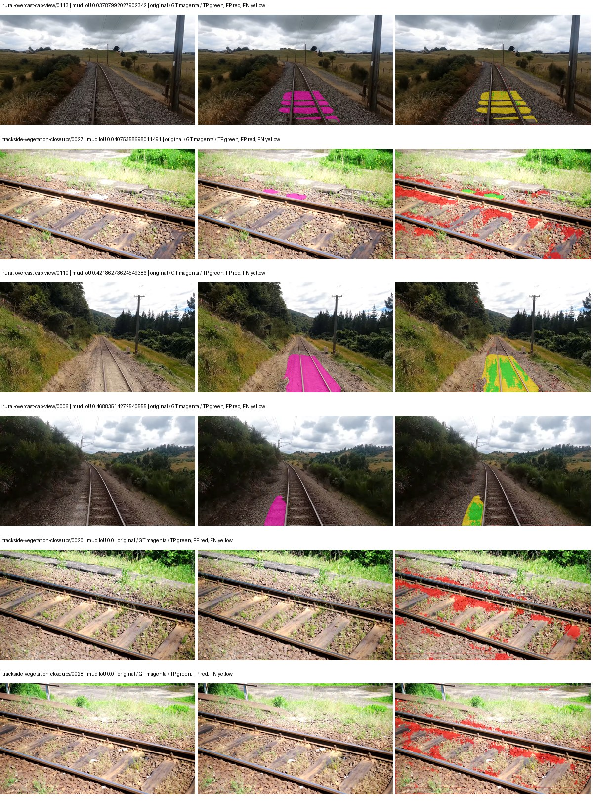
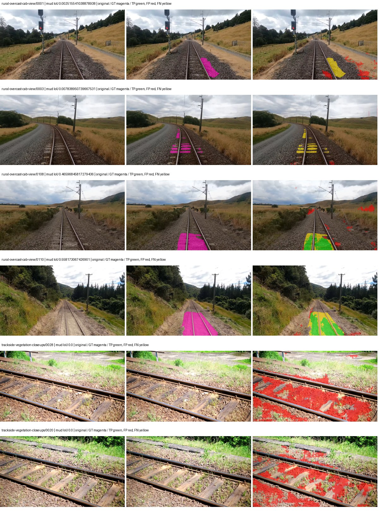
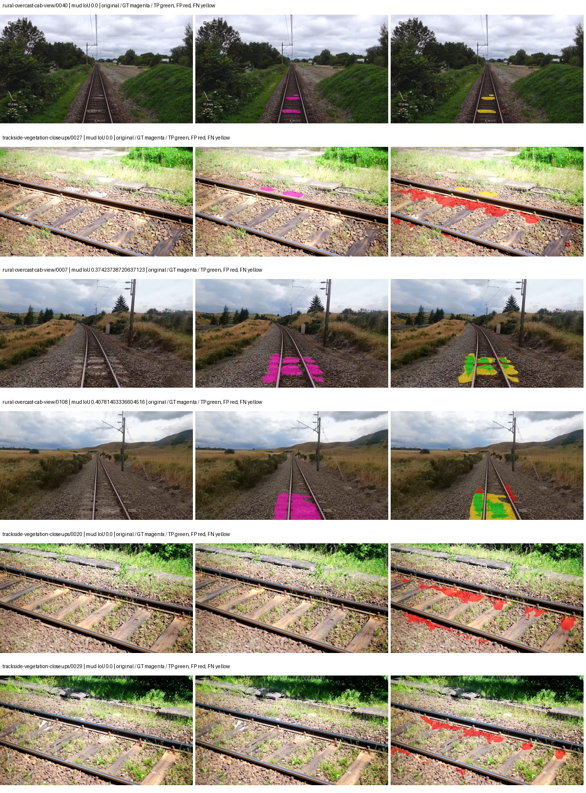
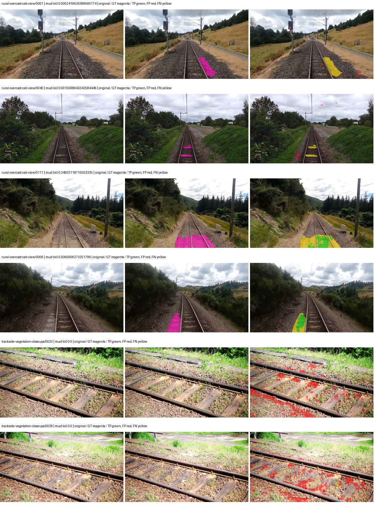

# smp_linknet_mobilenet_v2 — rad_9_24_2026-fixed-grouped

[RAD 9/24: Scene-grouped split](../../README.md) · [Full model records](record.json)

Primary result: the **final checkpoint** after the full step budget (no early stopping). The checkpoint with the best **mud-pumping validation IoU, pixels pooled over all validation images**, is kept as secondary evidence. A job is complete only after full statistics and isolated profiling are verified.

Study metrics of the final checkpoint, counting each class only on the validation images that contain it: mud-pumping IoU is the mean per-image IoU over the images with mud-pumping, precision and recall sum pixels over those images, and mIoU averages each class over the images that contain it, then over the classes present.

| Initialization path | Seed | Mud-pumping IoU, train-camera images with mud (%, n=17) | Mud-pumping IoU, all images with mud (%, n=18) | Mud precision, all images with mud (%) | Mud recall, all images with mud (%) | mIoU (each class over images that contain it) (%) |
| --- | --- | --- | --- | --- | --- | --- |
| rtis_only | 0 | 12.18 | 11.62 | 21.40 | 16.71 | 18.89 |
| cityscapes_to_rtis | 0 | 6.13 | 5.96 | 25.86 | 8.92 | 24.85 |
| railsem19_to_rtis | 0 | 12.64 | 11.95 | 41.27 | 15.25 | 26.94 |
| cityscapes_to_railsem19_to_rtis | 0 | 12.29 | 11.65 | 48.57 | 14.10 | 26.18 |

Per-class IoU: IoU (%) of every class, each averaged only over the validation images that contain the class (n = those images); — = no image contains it. mIoU averages the classes with at least one such image.

| Initialization path | Seed | mIoU (each class over images that contain it) | person (n=0) | truck (n=0) | rail-track (n=37) | vegetation-overgrowth (n=13) | car (n=3) | on-rails (n=0) | traffic-sign (n=9) | road (n=11) | sidewalk (n=12) | construction (n=12) | tram-track (n=2) | pole (n=21) | traffic-light (n=3) | mud-pumping (n=18) | fence (n=7) | terrain (n=35) | sky (n=28) | rail-embedded (n=3) | rail-raised (n=37) | trackbed (n=37) | standing-water (n=9) |
| --- | --- | --- | --- | --- | --- | --- | --- | --- | --- | --- | --- | --- | --- | --- | --- | --- | --- | --- | --- | --- | --- | --- | --- |
| rtis_only | 0 | 18.89 | — | — | 47.16 | 0.00 | 0.00 | — | 0.00 | 0.00 | 0.10 | 6.54 | 0.00 | 0.00 | 0.00 | 11.62 | 0.00 | 72.80 | 78.68 | 0.00 | 66.12 | 56.82 | 0.25 |
| cityscapes_to_rtis | 0 | 24.85 | — | — | 45.14 | 0.00 | 0.00 | — | 0.00 | 1.31 | 12.60 | 33.49 | 0.00 | 52.36 | 0.00 | 5.96 | 10.96 | 76.05 | 86.52 | 0.00 | 68.94 | 53.46 | 0.55 |
| railsem19_to_rtis | 0 | 26.94 | — | — | 55.06 | 14.03 | 0.00 | — | 0.00 | 14.65 | 8.04 | 29.14 | 5.35 | 55.34 | 0.00 | 11.95 | 10.31 | 74.99 | 71.93 | 0.00 | 67.95 | 65.48 | 0.71 |
| cityscapes_to_railsem19_to_rtis | 0 | 26.18 | — | — | 49.99 | 0.00 | 0.00 | — | 0.00 | 10.21 | 7.89 | 40.47 | 0.00 | 56.36 | 0.00 | 11.65 | 4.55 | 75.58 | 83.52 | 0.00 | 67.22 | 58.17 | 5.60 |

Everything below is the campaign's own record, with pixels pooled over all validation images: its evaluation is the checkpoint that scored best on that pooled mud IoU (secondary evidence here); the diagnostics also cover the final checkpoint (`final-auto-val`).

| Model | Initialization path | Seed | Status | Steps | Best step | Best-checkpoint mud IoU, pixels pooled (%) | Best-checkpoint mud precision, pixels pooled (%) | Best-checkpoint mud recall, pixels pooled (%) | Final mud IoU (trainer val, pixels pooled, %) | Best-checkpoint mIoU, pixels pooled (%) | Best-checkpoint fixed GT-class mIoU, pixels pooled (%) |
| --- | --- | --- | --- | --- | --- | --- | --- | --- | --- | --- | --- |
| smp_linknet_mobilenet_v2 | rtis_only | 0 | completed | 4000 | 3629 | 9.67 | 14.94 | 21.51 | 3.37 | 18.01 | 18.01 |
| smp_linknet_mobilenet_v2 | cityscapes_to_rtis | 0 | completed | 4000 | 2333 | 7.82 | 9.31 | 32.80 | 3.36 | 22.27 | 23.51 |
| smp_linknet_mobilenet_v2 | railsem19_to_rtis | 0 | completed | 4000 | 1037 | 11.64 | 23.31 | 18.85 | 5.98 | 24.81 | 26.18 |
| smp_linknet_mobilenet_v2 | cityscapes_to_railsem19_to_rtis | 0 | completed | 4000 | 3629 | 9.66 | 14.53 | 22.38 | 7.24 | 23.31 | 24.61 |

Training: 217 images. Validation: 37 images. Test: 60 held out. Seeds: [0]. Seed variation measures optimization variability, not independent-recording uncertainty. Historical source checkpoints stay fixed across adaptation seeds.

Training code: `fce0ea0ac50b334d4252812c396e0e593def375d`. Split SHA-256: `12d7b367c72cda61d57686ff2ac28223530d0af49debd9fb7a0fbc68b908bc93`.

## rtis_only — seed 0

Status: **completed**. Started: 2026-10-11T14:57:30.793710+00:00. Finished: 2026-10-11T15:38:26.754130+00:00.

Recipe pretrained initializer: `{"arch": "smp", "backbone_path": null, "batch_norm_momentum": null, "checkpoint": null, "classifier_path": null, "drop_path": null, "encoder_name": "mobilenet_v2", "encoder_weights": "imagenet", "head": "unified_head", "head_paths": [], "inactive_parameter_paths": [], "local_files_only": false, "lora_alpha": 32, "lora_dropout": 0.05, "lora_r": 16, "lora_targets": [], "native": null, "revision": null, "smp_arch": "Linknet", "subfolder": null, "trust_remote_code": false, "tuning": "full"}`.

`rtis_only` uses the recipe initializer, which may include pretrained segmentation components. Transfer paths load the exact historical source checkpoint below and reset the classifier; they do not reset all query/decoder features.

Source checkpoint: `Recipe pretrained initialization`.

Config SHA-256: `62625417bf36b405ab590da5dd16798cdf4aeac43599e1e37679afb9bd88207e`. Weights used for validation: `raw`.

### Mud-pumping and aggregate quality

| Metric | Selected checkpoint | Final training validation |
| --- | --- | --- |
| Mud IoU | 9.67 | 3.37 |
| Mud precision | 14.94 | 4.06 |
| Mud recall | 21.51 | 16.73 |
| Mud Dice/F1 | 17.63 | 6.53 |
| mIoU | 18.01 | 17.65 |
| Mean accuracy | 24.09 | 24.76 |
| Mean precision | 26.79 | 26.75 |
| Mean Dice | 21.88 | 21.38 |
| Mean specificity | 98.24 | 98.29 |
| Pixel accuracy | 70.03 | 69.89 |
| Frequency-weighted IoU | 61.36 | 61.43 |
| Fixed GT-present class mIoU | 18.01 | 17.65 |
| Boundary F1 | 16.06 | 15.87 |

The selected checkpoint has independent evaluation evidence. Final values are the trainer's final validation record, not a new independent evaluation. mIoU averages classes with nonzero union, so false positives on absent classes can change its denominator. The fixed GT-class mean is supplementary and excludes absent classes; their false positives remain in the confusion matrix.

### Resource usage and timing

| Measurement | Value |
| --- | --- |
| Peak training VRAM, retained training invocation (GiB) | 8.04 |
| Peak evaluation VRAM (GiB) | 6.12 |
| Retained training invocation wall time (seconds) | 2337.98 |
| Retained training invocation GPU-hours (one GPU) | 0.65 |
| Evaluation wall time (seconds) | 9.98 |
| Full evaluation pipeline images/second | 3.71 |
| Best full-state checkpoint (MiB) | 66.65 |
| Final full-state checkpoint (MiB) | 66.64 |
| Verified periodic checkpoints removed (GiB) | 0.52 |

VRAM uses the recorded allocator high-water mark; it is not total device usage including CUDA context. Resumed jobs' retained training invocation times and peaks are **not whole-campaign totals**. Earlier invocation resource records are not reconstructed here. Evaluation throughput includes loader, sliding-window inference and metrics; it is not model-only latency/FPS. Missing measurements are shown as —, never inferred from another dataset's run.

### Standardized inference performance

Dedicated model-only profiling waits for an idle worker-locked L40S: BF16, batch 1, 1024x1024, 20 warmup and 100 CUDA-event-timed public forwards. It excludes loading, preprocessing, tiling and metrics.

| Status | Parameters | Weight MiB | FPS | p50 ms | p95 ms | Peak reserved GiB |
| --- | --- | --- | --- | --- | --- | --- |
| complete | 4320519 | 16.48 | 179.91 | 5.45 | 6.01 | 0.32 |

```json
{
  "schema_version": 1,
  "model_id": "smp_linknet_mobilenet_v2",
  "measured_at": "2026-10-11T15:38:24+00:00",
  "status": "complete",
  "benchmark_scope": "rtis_selected_checkpoint_model_only",
  "applies_to": [
    "smp_linknet_mobilenet_v2--rtis_only--seed-0"
  ],
  "source": {
    "campaign_git_sha": "fce0ea0ac50b334d4252812c396e0e593def375d",
    "git_dirty": false,
    "config_hash": "62198189e2ba",
    "resolved_config": "/data/izadia1/projects/segmentary-runs/rad_9_24_2026/fgall-seed0-20261007/configs/smp_linknet_mobilenet_v2--rtis_only--seed-0.yaml",
    "config_sha256": "62625417bf36b405ab590da5dd16798cdf4aeac43599e1e37679afb9bd88207e",
    "checkpoint_sha256": "d1b452540413582c3e63d0d142d55188a492cf0d905535b535a449a3d91883f0",
    "checkpoint_global_step": 3629,
    "checkpoint_bytes": 69890035,
    "checkpoint_kind": "resume checkpoint with optimizer and EMA state",
    "weights": "raw",
    "measured_checkpoint_job_id": "smp_linknet_mobilenet_v2--rtis_only--seed-0",
    "result_sha256": "09a6af10de66fdfe17de62c038521e457c34032ad6843b31291236740949b6c1",
    "result_git_sha": "fce0ea0ac50b334d4252812c396e0e593def375d",
    "result_stage": "eval:rad_9_24_2026-fixed-grouped:val",
    "result_seed": 0
  },
  "hardware": {
    "gpu_name": "NVIDIA L40S",
    "gpu_uuid": "GPU-1c9b612f-e0b5-fbbc-150f-8c2ef13453c9",
    "logical_device": "cuda:0",
    "physical_visibility_token": "5",
    "compute_capability": [
      8,
      9
    ],
    "total_memory_bytes": 47677177856
  },
  "model": {
    "parameter_count": 4320519,
    "trainable_parameter_count": 4320519,
    "resident_parameter_bytes": 17282076,
    "parameter_dtype_counts": {
      "float32": 4320519
    }
  },
  "contract": {
    "backend": "pytorch",
    "precision": "bf16_autocast",
    "batch_size": 1,
    "input_shape_nchw": [
      1,
      3,
      1024,
      1024
    ],
    "warmup_iterations": 20,
    "measured_iterations": 100,
    "timing": "per-forward CUDA events with end-event synchronization",
    "includes_preprocessing": false,
    "includes_data_loader": false,
    "includes_sliding_window": false,
    "input_resident_on_gpu": true,
    "model_only": true,
    "entrypoint": "public model(image) dense-logits forward"
  },
  "measurements": {
    "latency": {
      "p50_ms": 5.454335927963257,
      "p95_ms": 6.013952016830444,
      "mean_ms": 5.558415350914001,
      "minimum_ms": 5.36678409576416,
      "maximum_ms": 6.516736030578613,
      "fps": 179.90739030244734,
      "raw_ms": [
        5.4231038093566895,
        5.36678409576416,
        5.370880126953125,
        5.392384052276611,
        5.370880126953125,
        6.108160018920898,
        5.428224086761475,
        5.7333760261535645,
        5.944320201873779,
        6.350848197937012,
        6.238207817077637,
        5.695487976074219,
        5.814271926879883,
        5.628928184509277,
        5.446656227111816,
        5.425151824951172,
        5.409791946411133,
        5.899263858795166,
        5.472256183624268,
        5.47430419921875,
        5.446656227111816,
        5.406720161437988,
        5.468160152435303,
        5.437439918518066,
        5.7190399169921875,
        5.683199882507324,
        5.791744232177734,
        6.012928009033203,
        5.917695999145508,
        5.8081278800964355,
        5.784575939178467,
        5.427199840545654,
        5.420032024383545,
        5.4231038093566895,
        5.395455837249756,
        5.429247856140137,
        5.41593599319458,
        5.405695915222168,
        5.463039875030518,
        6.516736030578613,
        5.641215801239014,
        5.500927925109863,
        5.483520030975342,
        5.732351779937744,
        5.623807907104492,
        5.3831682205200195,
        5.7333760261535645,
        5.46611213684082,
        5.445631980895996,
        5.398528099060059,
        5.422080039978027,
        5.457920074462891,
        5.4527997970581055,
        5.5121917724609375,
        5.451776027679443,
        5.773312091827393,
        5.863423824310303,
        5.810175895690918,
        5.524479866027832,
        5.463039875030518,
        5.701632022857666,
        5.4344000816345215,
        5.435391902923584,
        5.439487934112549,
        5.428224086761475,
        5.459968090057373,
        5.378047943115234,
        5.401599884033203,
        5.435391902923584,
        5.485568046569824,
        5.426176071166992,
        5.435391902923584,
        5.501952171325684,
        5.766111850738525,
        5.4476799964904785,
        5.433343887329102,
        5.4231038093566895,
        5.7630720138549805,
        5.413887977600098,
        5.496831893920898,
        5.7333760261535645,
        5.437439918518066,
        5.448703765869141,
        5.406720161437988,
        5.402624130249023,
        5.420032024383545,
        5.421055793762207,
        5.475327968597412,
        5.5070719718933105,
        5.426176071166992,
        5.392384052276611,
        5.421055793762207,
        5.400576114654541,
        6.033408164978027,
        5.455872058868408,
        5.439487934112549,
        5.484543800354004,
        5.468160152435303,
        5.378047943115234,
        5.476352214813232
      ],
      "percentile_method": "numpy linear interpolation"
    },
    "peak_reserved_bytes": 339738624,
    "memory_kind": "pytorch_cuda_allocator_peak_reserved_excluding_context",
    "process_total_bytes": 870318080,
    "process_total_kind": "nvidia-smi used_memory of this PID on the benchmark GPU after the timed loop, including the CUDA context; null when the driver could not attribute memory to this PID",
    "benchmark_wall_clock_s": 13.120250158011913
  },
  "started_at": "2026-10-11T15:38:11+00:00",
  "finished_at": "2026-10-11T15:38:24+00:00",
  "environment": {
    "hostname": "hdrfs-app-001",
    "python": "3.11.15",
    "platform": "Linux-5.15.0-139-generic-x86_64-with-glibc2.35",
    "torch": "2.11.0+cu128",
    "torch_cuda": "12.8",
    "cudnn": 91900,
    "driver_version": "570.133.20",
    "cuda_available": true,
    "gpu_count": 1,
    "gpu_names": [
      "NVIDIA L40S"
    ],
    "cuda_visible_devices": "5",
    "packages": {
      "segmentary": "0.1.0",
      "torch": "2.11.0+cu128",
      "torchvision": "0.26.0+cu128",
      "transformers": "5.15.0",
      "timm": "1.0.28",
      "segmentation-models-pytorch": "0.5.0",
      "albumentations": "2.0.8",
      "lightning": "2.6.5",
      "numpy": "2.4.4"
    }
  }
}
```

### Per-class validation results

| Class | GT pixels | IoU (%) | Precision (%) | Recall (%) | Dice (%) | Boundary F1 (%) |
| --- | --- | --- | --- | --- | --- | --- |
| car | 29664 | 0.00 | 0.00 | 0.00 | 0.00 | 0.00 |
| construction | 311585 | 1.28 | 1.29 | 55.80 | 2.53 | 3.80 |
| fence | 265137 | 0.00 | 0.00 | 0.00 | 0.00 | 0.00 |
| mud-pumping | 1226250 | 9.67 | 14.94 | 21.51 | 17.63 | 16.42 |
| on-rails | 0 | — | — | — | — | — |
| person | 0 | — | — | — | — | — |
| pole | 628038 | 0.00 | 33.33 | 0.00 | 0.00 | 0.52 |
| rail-embedded | 16799 | 0.00 | 0.00 | 0.00 | 0.00 | 0.00 |
| rail-raised | 2969797 | 74.48 | 86.85 | 83.95 | 85.37 | 88.72 |
| rail-track | 6323197 | 24.60 | 84.62 | 25.75 | 39.48 | 39.60 |
| road | 1048831 | 0.00 | 0.00 | 0.00 | 0.00 | 0.00 |
| sidewalk | 1297367 | 0.00 | 6.92 | 0.00 | 0.00 | 0.56 |
| sky | 19121606 | 84.14 | 98.69 | 85.09 | 91.39 | 52.34 |
| standing-water | 95802 | 0.27 | 0.29 | 3.12 | 0.53 | 2.61 |
| terrain | 39239306 | 73.25 | 82.59 | 86.63 | 84.56 | 36.99 |
| trackbed | 10643081 | 56.57 | 72.67 | 71.86 | 72.26 | 47.41 |
| traffic-light | 19510 | 0.00 | 0.00 | 0.00 | 0.00 | 0.00 |
| traffic-sign | 13285 | 0.00 | 0.00 | 0.00 | 0.00 | 0.00 |
| tram-track | 56179 | 0.00 | 0.00 | 0.00 | 0.00 | 0.00 |
| truck | 0 | — | — | — | — | — |
| vegetation-overgrowth | 5901821 | 0.00 | 0.00 | 0.00 | 0.00 | 0.08 |

### Full-run accounting

| Measurement | Value |
| --- | --- |
| Full GPU-reserved wall seconds, all recorded worker attempts | 2463.72 |
| Full reserved GPU-hours | 0.68 |
| Whole-run timing complete | True |

| Phase | Wall seconds including failed attempts |
| --- | --- |
| training | 2344.92 |
| diagnostics | 71.66 |
| performance | 20.61 |

GPU-reserved time includes model loading, training, validation, collection, profiling, checkpoint I/O and orchestration while the worker owns one GPU. It is not GPU kernel-active time. Phase timings and sampled device memory/power/utilization are retained separately; sampled device memory is not the allocator high-water mark.

### Train/validation and raw/EMA diagnostics

| Checkpoint / weights / split | Images | Mud IoU (%) | Mud precision (%) | Mud recall (%) |
| --- | --- | --- | --- | --- |
| best-auto-train / raw | 217 | 46.34 | 87.06 | 49.77 |
| best-auto-val / raw | 37 | 9.67 | 14.94 | 21.51 |
| best-alternate-val / ema | 37 | 0.06 | 0.33 | 0.07 |
| final-auto-val / raw | 37 | 3.37 | 4.05 | 16.71 |

Train uses the evaluation transform without augmentation. Compare mud train/validation metrics for the same selected weights. Alternate EMA on running-stat BatchNorm is explicitly uncalibrated and is diagnostic only. Score-threshold curves use uncalibrated normalized scores and are pixel-level diagnostics, not event detection rates or a selected deployment operating point.

### Downloadable evidence

- best-auto-train: [per-image.csv](rtis_only--seed-0/best-auto-train/per-image.csv) · [per-image-confusion.json.gz](rtis_only--seed-0/best-auto-train/per-image-confusion.json.gz) · [groups.json](rtis_only--seed-0/best-auto-train/groups.json) · [mud-score-curves.json](rtis_only--seed-0/best-auto-train/mud-score-curves.json)
- best-auto-val: [per-image.csv](rtis_only--seed-0/best-auto-val/per-image.csv) · [per-image-confusion.json.gz](rtis_only--seed-0/best-auto-val/per-image-confusion.json.gz) · [groups.json](rtis_only--seed-0/best-auto-val/groups.json) · [mud-score-curves.json](rtis_only--seed-0/best-auto-val/mud-score-curves.json) · [examples.jpg](rtis_only--seed-0/best-auto-val/examples.jpg)
- best-alternate-val: [per-image.csv](rtis_only--seed-0/best-alternate-val/per-image.csv) · [per-image-confusion.json.gz](rtis_only--seed-0/best-alternate-val/per-image-confusion.json.gz) · [groups.json](rtis_only--seed-0/best-alternate-val/groups.json) · [mud-score-curves.json](rtis_only--seed-0/best-alternate-val/mud-score-curves.json)
- final-auto-val: [per-image.csv](rtis_only--seed-0/final-auto-val/per-image.csv) · [per-image-confusion.json.gz](rtis_only--seed-0/final-auto-val/per-image-confusion.json.gz) · [groups.json](rtis_only--seed-0/final-auto-val/groups.json) · [mud-score-curves.json](rtis_only--seed-0/final-auto-val/mud-score-curves.json)
- resources: [telemetry.csv](rtis_only--seed-0/resources/telemetry.csv)



Examples are two lowest and two highest mud-IoU positive images, plus up to two negative images with the most false-positive mud pixels. They are targeted diagnostic examples, not random samples. Green: true positive; red: false positive; yellow: false negative. Full predictions remain on HDRFS.

### Validation tracking

| Logged step | Overall mIoU (%) | Mud IoU (%) |
| --- | --- | --- |
| 258 | 8.05 | 1.32 |
| 518 | 12.51 | 4.64 |
| 777 | 13.98 | 4.95 |
| 1036 | 16.49 | 2.47 |
| 1295 | 17.67 | 2.57 |
| 1555 | 17.68 | 4.10 |
| 1814 | 18.29 | 3.34 |
| 2073 | 17.47 | 4.07 |
| 2332 | 17.73 | 4.06 |
| 2592 | 17.58 | 5.01 |
| 2851 | 17.80 | 4.63 |
| 3110 | 14.47 | 4.84 |
| 3369 | 17.90 | 6.12 |
| 3629 | 18.01 | 9.67 |
| 3888 | 17.75 | 8.74 |
| 4000 | 17.65 | 3.37 |

All retained scalar curves, including training loss and per-class IoU, are in record.json. Observed best mud on a curve is not necessarily a retained checkpoint: the pilot saved its selection-metric-best and final checkpoints. Step logging and checkpoint global_step may differ by one.

### Stopping and checkpoint provenance

```json
{
  "stopping": {
    "actual_steps": 4000,
    "maximum_steps": 4000,
    "min_delta": 0.0,
    "monitor": "val_iou/mud-pumping",
    "patience": null,
    "reason": "budget_complete"
  },
  "checkpoints": {
    "best": {
      "path": "/data/izadia1/projects/segmentary-runs/rad_9_24_2026/fgall-seed0-20261007/future-runs/smp_linknet_mobilenet_v2--rtis_only--seed-0_seed0/rtis/best.ckpt",
      "sha256": "d1b452540413582c3e63d0d142d55188a492cf0d905535b535a449a3d91883f0",
      "global_step": 3629,
      "bytes": 69890035
    },
    "final": {
      "path": "/data/izadia1/projects/segmentary-runs/rad_9_24_2026/fgall-seed0-20261007/future-runs/smp_linknet_mobilenet_v2--rtis_only--seed-0_seed0/rtis/last.ckpt",
      "sha256": "8f528135a882f8970fd9d83588fe0b9786f59d96f6653556bae1e39c31a43868",
      "global_step": 4000,
      "bytes": 69876659
    }
  },
  "cleanup_error": null
}
```

### Resolved training, initialization and evaluation settings

The optimizer block is the base configuration. Stage LR scales are applied at runtime, and stage warmup is capped at min(base warmup, floor(stage budget / 10), stage budget - 1): 400 steps for this 4,000-step pilot. Model-internal native input grids may differ from augmentation crops (EoMT uses its 640 grid).

```json
{
  "name": "smp_linknet_mobilenet_v2--rtis_only--seed-0",
  "model": {
    "arch": "smp",
    "checkpoint": null,
    "tuning": "full",
    "head": "unified_head",
    "lora_r": 16,
    "lora_alpha": 32,
    "lora_dropout": 0.05,
    "lora_targets": [],
    "drop_path": null,
    "revision": null,
    "subfolder": null,
    "local_files_only": false,
    "trust_remote_code": false,
    "backbone_path": null,
    "head_paths": [],
    "classifier_path": null,
    "inactive_parameter_paths": [],
    "smp_arch": "Linknet",
    "encoder_name": "mobilenet_v2",
    "encoder_weights": "imagenet",
    "native": null,
    "batch_norm_momentum": null
  },
  "space": "paul-test-rtis",
  "taxonomy_root": "/data/izadia1/projects/segmentary-rad-fgall-fce0ea0a/taxonomy",
  "output_root": "/data/izadia1/projects/segmentary-runs/rad_9_24_2026/fgall-seed0-20261007/future-runs",
  "optim": {
    "backbone_lr": 0.0001,
    "head_lr_mult": 10.0,
    "weight_decay": 0.05,
    "llrd": 1.0,
    "warmup_iters": 1500,
    "warmup_ratio": 1e-06,
    "poly_power": 0.9,
    "min_lr_ratio": 0.0,
    "betas": [
      0.9,
      0.999
    ],
    "grad_clip": 1.0
  },
  "train": {
    "iters": 4000,
    "batch_size": 2,
    "accum": 8,
    "num_workers": 2,
    "precision": "bf16-mixed",
    "ema_decay": 0.9998,
    "val_every": 250,
    "ckpt_every": 500,
    "selection_metric": "val_iou/mud-pumping",
    "early_stopping_patience": null,
    "early_stopping_min_delta": 0.0,
    "seed": 0,
    "devices": 1
  },
  "eval": {
    "sliding_window": true,
    "window": [
      1024,
      1024
    ],
    "stride": [
      768,
      768
    ],
    "batch_size": 1,
    "num_workers": 2,
    "tta_scales": [],
    "tta_flip": false,
    "threshold": 0.5,
    "boundary_tolerance_frac": 0.0075,
    "save_confusion": true
  },
  "loss": {
    "task": "multiclass",
    "activation": "auto",
    "terms": [],
    "aux": "none",
    "aux_weight": 0.0,
    "ce_weight": 1.0,
    "label_smoothing": 0.0,
    "class_weights": null,
    "query": null
  },
  "aug": {
    "crop": [
      1024,
      1024
    ],
    "scale_min": 0.5,
    "scale_max": 2.0,
    "hflip_p": 0.5,
    "color_jitter_p": 0.5,
    "brightness": 0.25,
    "contrast": 0.25,
    "saturation": 0.25,
    "hue": 0.05
  },
  "stages": [
    {
      "name": "rtis",
      "data": [
        {
          "name": "rad_9_24_2026-fixed-grouped",
          "root": "/data/izadia1/datasets/rad_9_24_2026-fixed-grouped",
          "variant": null,
          "split_file": "splits.json",
          "train_split": "train",
          "val_split": "val",
          "limit": null,
          "loader": "folder",
          "mapping": "paul-test-rtis",
          "loader_options": {
            "require_groups": true
          }
        }
      ],
      "iters": null,
      "lr_scale": 1.0,
      "head_group_lr_scale": 1.0,
      "init_from": "pretrained",
      "reset_head": false,
      "freeze": null,
      "sample_weights": null
    }
  ]
}
```

### Hardware and software provenance

```json
{
  "training": {
    "cuda_available": true,
    "cuda_visible_devices": "5",
    "cudnn": 91900,
    "driver_version": "570.133.20",
    "gpu_count": 1,
    "gpu_names": [
      "NVIDIA L40S"
    ],
    "hostname": "hdrfs-app-001",
    "input_normalization": {
      "channel_order": "rgb",
      "mean": [
        0.485,
        0.456,
        0.406
      ],
      "source": "smp_encoder_settings",
      "std": [
        0.229,
        0.224,
        0.225
      ]
    },
    "model_origins": [
      {
        "hf_commit": null,
        "hf_name_or_path": null,
        "module": "model",
        "timm_pretrained": {}
      }
    ],
    "model_parameter_count": 4320519,
    "packages": {
      "albumentations": "2.0.8",
      "lightning": "2.6.5",
      "numpy": "2.4.4",
      "segmentary": "0.1.0",
      "segmentation-models-pytorch": "0.5.0",
      "timm": "1.0.28",
      "torch": "2.11.0+cu128",
      "torchvision": "0.26.0+cu128",
      "transformers": "5.15.0"
    },
    "platform": "Linux-5.15.0-139-generic-x86_64-with-glibc2.35",
    "python": "3.11.15",
    "torch": "2.11.0+cu128",
    "torch_cuda": "12.8",
    "trainable_parameter_count": 4320519,
    "training_stop": {
      "actual_steps": 4000,
      "maximum_steps": 4000,
      "min_delta": 0.0,
      "monitor": "val_iou/mud-pumping",
      "patience": null,
      "reason": "budget_complete"
    },
    "validation_weights": "raw"
  },
  "evaluation": {
    "cuda_available": true,
    "cuda_visible_devices": "5",
    "cudnn": 91900,
    "driver_version": "570.133.20",
    "gpu_count": 1,
    "gpu_names": [
      "NVIDIA L40S"
    ],
    "hostname": "hdrfs-app-001",
    "input_normalization": {
      "channel_order": "rgb",
      "mean": [
        0.485,
        0.456,
        0.406
      ],
      "source": "smp_encoder_settings",
      "std": [
        0.229,
        0.224,
        0.225
      ]
    },
    "packages": {
      "albumentations": "2.0.8",
      "lightning": "2.6.5",
      "numpy": "2.4.4",
      "segmentary": "0.1.0",
      "segmentation-models-pytorch": "0.5.0",
      "timm": "1.0.28",
      "torch": "2.11.0+cu128",
      "torchvision": "0.26.0+cu128",
      "transformers": "5.15.0"
    },
    "platform": "Linux-5.15.0-139-generic-x86_64-with-glibc2.35",
    "python": "3.11.15",
    "torch": "2.11.0+cu128",
    "torch_cuda": "12.8"
  }
}
```

## cityscapes_to_rtis — seed 0

Status: **completed**. Started: 2026-10-11T14:59:23.386383+00:00. Finished: 2026-10-11T15:41:05.891205+00:00.

Recipe pretrained initializer: `{"arch": "smp", "backbone_path": null, "batch_norm_momentum": null, "checkpoint": null, "classifier_path": null, "drop_path": null, "encoder_name": "mobilenet_v2", "encoder_weights": "imagenet", "head": "unified_head", "head_paths": [], "inactive_parameter_paths": [], "local_files_only": false, "lora_alpha": 32, "lora_dropout": 0.05, "lora_r": 16, "lora_targets": [], "native": null, "revision": null, "smp_arch": "Linknet", "subfolder": null, "trust_remote_code": false, "tuning": "full"}`.

`rtis_only` uses the recipe initializer, which may include pretrained segmentation components. Transfer paths load the exact historical source checkpoint below and reset the classifier; they do not reset all query/decoder features.

Source checkpoint: `{'name': 'smp_linknet_mobilenet_v2--cityscapes--seed-0', 'model': 'smp_linknet_mobilenet_v2', 'protocol': 'cityscapes', 'config': '/data/izadia1/projects/segmentary-runs/all-model-city-rail-seed0-rail20-b9eb3e1/jobs/smp_linknet_mobilenet_v2--cityscapes--seed-0/attempt-001/resolved-config.yaml', 'checkpoint': '/data/izadia1/projects/segmentary-runs/all-model-city-rail-seed0-rail20-b9eb3e1/jobs/smp_linknet_mobilenet_v2--cityscapes--seed-0/attempt-001/train/smp_linknet_mobilenet_v2--cityscapes_seed0/cityscapes/last.ckpt', 'recorded_sha256': 'e2ada95ae11d248b4c71f1670b6ce01e63a2e8d93ede09db6b859f72121d3db3', 'exists': True}`.

Config SHA-256: `812115b49bc265986d0046f8bd17bbc5e5e454d718e6dc34e9f46b674fd9bfcf`. Weights used for validation: `raw`.

### Mud-pumping and aggregate quality

| Metric | Selected checkpoint | Final training validation |
| --- | --- | --- |
| Mud IoU | 7.82 | 3.36 |
| Mud precision | 9.31 | 5.12 |
| Mud recall | 32.80 | 8.91 |
| Mud Dice/F1 | 14.50 | 6.51 |
| mIoU | 22.27 | 22.88 |
| Mean accuracy | 32.31 | 30.99 |
| Mean precision | 31.18 | 37.81 |
| Mean Dice | 28.42 | 29.05 |
| Mean specificity | 98.47 | 98.42 |
| Pixel accuracy | 76.04 | 75.76 |
| Frequency-weighted IoU | 64.62 | 64.34 |
| Fixed GT-present class mIoU | 23.51 | 24.15 |
| Boundary F1 | 21.76 | 22.48 |

The selected checkpoint has independent evaluation evidence. Final values are the trainer's final validation record, not a new independent evaluation. mIoU averages classes with nonzero union, so false positives on absent classes can change its denominator. The fixed GT-class mean is supplementary and excludes absent classes; their false positives remain in the confusion matrix.

### Resource usage and timing

| Measurement | Value |
| --- | --- |
| Peak training VRAM, retained training invocation (GiB) | 8.04 |
| Peak evaluation VRAM (GiB) | 6.12 |
| Retained training invocation wall time (seconds) | 2390.36 |
| Retained training invocation GPU-hours (one GPU) | 0.66 |
| Evaluation wall time (seconds) | 9.40 |
| Full evaluation pipeline images/second | 3.94 |
| Best full-state checkpoint (MiB) | 66.65 |
| Final full-state checkpoint (MiB) | 66.64 |
| Verified periodic checkpoints removed (GiB) | 0.52 |

VRAM uses the recorded allocator high-water mark; it is not total device usage including CUDA context. Resumed jobs' retained training invocation times and peaks are **not whole-campaign totals**. Earlier invocation resource records are not reconstructed here. Evaluation throughput includes loader, sliding-window inference and metrics; it is not model-only latency/FPS. Missing measurements are shown as —, never inferred from another dataset's run.

### Standardized inference performance

Dedicated model-only profiling waits for an idle worker-locked L40S: BF16, batch 1, 1024x1024, 20 warmup and 100 CUDA-event-timed public forwards. It excludes loading, preprocessing, tiling and metrics.

| Status | Parameters | Weight MiB | FPS | p50 ms | p95 ms | Peak reserved GiB |
| --- | --- | --- | --- | --- | --- | --- |
| complete | 4320519 | 16.48 | 183.03 | 5.36 | 5.99 | 0.32 |

```json
{
  "schema_version": 1,
  "model_id": "smp_linknet_mobilenet_v2",
  "measured_at": "2026-10-11T15:41:03+00:00",
  "status": "complete",
  "benchmark_scope": "rtis_selected_checkpoint_model_only",
  "applies_to": [
    "smp_linknet_mobilenet_v2--cityscapes_to_rtis--seed-0"
  ],
  "source": {
    "campaign_git_sha": "fce0ea0ac50b334d4252812c396e0e593def375d",
    "git_dirty": false,
    "config_hash": "aec901c2e114",
    "resolved_config": "/data/izadia1/projects/segmentary-runs/rad_9_24_2026/fgall-seed0-20261007/configs/smp_linknet_mobilenet_v2--cityscapes_to_rtis--seed-0.yaml",
    "config_sha256": "812115b49bc265986d0046f8bd17bbc5e5e454d718e6dc34e9f46b674fd9bfcf",
    "checkpoint_sha256": "6e07bf4c390491e9a67cd34072e17865b978ba2c0f676526f094f0e83465f9cf",
    "checkpoint_global_step": 2333,
    "checkpoint_bytes": 69890099,
    "checkpoint_kind": "resume checkpoint with optimizer and EMA state",
    "weights": "raw",
    "measured_checkpoint_job_id": "smp_linknet_mobilenet_v2--cityscapes_to_rtis--seed-0",
    "result_sha256": "34c143bf83a80c4f327d8171206038082975bd6191144721b905bcc58c0c0745",
    "result_git_sha": "fce0ea0ac50b334d4252812c396e0e593def375d",
    "result_stage": "eval:rad_9_24_2026-fixed-grouped:val",
    "result_seed": 0
  },
  "hardware": {
    "gpu_name": "NVIDIA L40S",
    "gpu_uuid": "GPU-2f8008a1-9b67-11f6-987b-b393a672322c",
    "logical_device": "cuda:0",
    "physical_visibility_token": "3",
    "compute_capability": [
      8,
      9
    ],
    "total_memory_bytes": 47677177856
  },
  "model": {
    "parameter_count": 4320519,
    "trainable_parameter_count": 4320519,
    "resident_parameter_bytes": 17282076,
    "parameter_dtype_counts": {
      "float32": 4320519
    }
  },
  "contract": {
    "backend": "pytorch",
    "precision": "bf16_autocast",
    "batch_size": 1,
    "input_shape_nchw": [
      1,
      3,
      1024,
      1024
    ],
    "warmup_iterations": 20,
    "measured_iterations": 100,
    "timing": "per-forward CUDA events with end-event synchronization",
    "includes_preprocessing": false,
    "includes_data_loader": false,
    "includes_sliding_window": false,
    "input_resident_on_gpu": true,
    "model_only": true,
    "entrypoint": "public model(image) dense-logits forward"
  },
  "measurements": {
    "latency": {
      "p50_ms": 5.364223957061768,
      "p95_ms": 5.989216017723083,
      "mean_ms": 5.463442258834839,
      "minimum_ms": 5.3145599365234375,
      "maximum_ms": 6.328320026397705,
      "fps": 183.03478880607133,
      "raw_ms": [
        5.42412805557251,
        5.346303939819336,
        5.341184139251709,
        5.315584182739258,
        5.339231967926025,
        5.356544017791748,
        5.359615802764893,
        5.334015846252441,
        5.363711833953857,
        5.391359806060791,
        5.352447986602783,
        5.3882880210876465,
        5.735424041748047,
        5.327871799468994,
        5.738495826721191,
        5.3831682205200195,
        5.356544017791748,
        5.3534722328186035,
        5.323775768280029,
        5.342207908630371,
        5.773312091827393,
        5.361663818359375,
        5.335040092468262,
        5.346303939819336,
        5.385216236114502,
        5.351424217224121,
        5.364736080169678,
        5.777408123016357,
        5.349376201629639,
        5.337088108062744,
        5.4128642082214355,
        5.35756778717041,
        5.382143974304199,
        5.385216236114502,
        5.351424217224121,
        5.382080078125,
        5.35756778717041,
        5.80291223526001,
        5.390336036682129,
        5.371903896331787,
        5.362688064575195,
        5.795839786529541,
        5.396480083465576,
        5.644288063049316,
        5.406816005706787,
        5.4128642082214355,
        5.343103885650635,
        5.352447986602783,
        5.340159893035889,
        5.454847812652588,
        5.367807865142822,
        5.356544017791748,
        5.344160079956055,
        5.3831682205200195,
        5.370751857757568,
        5.435423851013184,
        5.351424217224121,
        5.334943771362305,
        6.328320026397705,
        5.354623794555664,
        5.32480001449585,
        5.379072189331055,
        5.396480083465576,
        5.74886417388916,
        5.375999927520752,
        5.345280170440674,
        5.361663818359375,
        5.527552127838135,
        5.362688064575195,
        5.349376201629639,
        5.368832111358643,
        5.838784217834473,
        6.202367782592773,
        5.438464164733887,
        5.408768177032471,
        5.349376201629639,
        5.351424217224121,
        5.355391979217529,
        5.349279880523682,
        5.320703983306885,
        5.3288960456848145,
        5.35756778717041,
        5.850111961364746,
        6.127615928649902,
        5.3882880210876465,
        5.459072113037109,
        5.375936031341553,
        5.3585920333862305,
        6.102911949157715,
        5.844992160797119,
        5.33900785446167,
        5.383264064788818,
        5.4128642082214355,
        5.360544204711914,
        5.339136123657227,
        5.3145599365234375,
        5.327871799468994,
        5.773183822631836,
        5.983232021331787,
        6.17574405670166
      ],
      "percentile_method": "numpy linear interpolation"
    },
    "peak_reserved_bytes": 339738624,
    "memory_kind": "pytorch_cuda_allocator_peak_reserved_excluding_context",
    "process_total_bytes": 870318080,
    "process_total_kind": "nvidia-smi used_memory of this PID on the benchmark GPU after the timed loop, including the CUDA context; null when the driver could not attribute memory to this PID",
    "benchmark_wall_clock_s": 12.744663827121258
  },
  "started_at": "2026-10-11T15:40:51+00:00",
  "finished_at": "2026-10-11T15:41:03+00:00",
  "environment": {
    "hostname": "hdrfs-app-001",
    "python": "3.11.15",
    "platform": "Linux-5.15.0-139-generic-x86_64-with-glibc2.35",
    "torch": "2.11.0+cu128",
    "torch_cuda": "12.8",
    "cudnn": 91900,
    "driver_version": "570.133.20",
    "cuda_available": true,
    "gpu_count": 1,
    "gpu_names": [
      "NVIDIA L40S"
    ],
    "cuda_visible_devices": "3",
    "packages": {
      "segmentary": "0.1.0",
      "torch": "2.11.0+cu128",
      "torchvision": "0.26.0+cu128",
      "transformers": "5.15.0",
      "timm": "1.0.28",
      "segmentation-models-pytorch": "0.5.0",
      "albumentations": "2.0.8",
      "lightning": "2.6.5",
      "numpy": "2.4.4"
    }
  }
}
```

### Per-class validation results

| Class | GT pixels | IoU (%) | Precision (%) | Recall (%) | Dice (%) | Boundary F1 (%) |
| --- | --- | --- | --- | --- | --- | --- |
| car | 29664 | 0.00 | 0.00 | 0.00 | 0.00 | 0.00 |
| construction | 311585 | 13.12 | 13.95 | 68.81 | 23.20 | 12.67 |
| fence | 265137 | 12.61 | 57.93 | 13.88 | 22.39 | 31.65 |
| mud-pumping | 1226250 | 7.82 | 9.31 | 32.80 | 14.50 | 10.68 |
| on-rails | 0 | 0.00 | 0.00 | — | 0.00 | 0.00 |
| person | 0 | — | — | — | — | — |
| pole | 628038 | 49.48 | 78.45 | 57.27 | 66.20 | 77.03 |
| rail-embedded | 16799 | 0.00 | 0.00 | 0.00 | 0.00 | 0.00 |
| rail-raised | 2969797 | 70.15 | 82.79 | 82.13 | 82.46 | 85.26 |
| rail-track | 6323197 | 26.66 | 59.43 | 32.60 | 42.10 | 46.49 |
| road | 1048831 | 0.00 | 0.00 | 0.00 | 0.00 | 0.00 |
| sidewalk | 1297367 | 22.90 | 44.87 | 31.86 | 37.26 | 14.93 |
| sky | 19121606 | 89.63 | 98.45 | 90.91 | 94.53 | 57.01 |
| standing-water | 95802 | 0.37 | 0.42 | 3.63 | 0.75 | 1.03 |
| terrain | 39239306 | 77.20 | 81.75 | 93.28 | 87.13 | 31.33 |
| trackbed | 10643081 | 53.21 | 65.17 | 74.34 | 69.46 | 45.35 |
| traffic-light | 19510 | 0.00 | 0.00 | 0.00 | 0.00 | 0.00 |
| traffic-sign | 13285 | 0.00 | 0.00 | 0.00 | 0.00 | 0.00 |
| tram-track | 56179 | 0.00 | 0.00 | 0.00 | 0.00 | 0.00 |
| truck | 0 | — | — | — | — | — |
| vegetation-overgrowth | 5901821 | 0.00 | 0.00 | 0.00 | 0.00 | 0.00 |

### Full-run accounting

| Measurement | Value |
| --- | --- |
| Full GPU-reserved wall seconds, all recorded worker attempts | 2510.34 |
| Full reserved GPU-hours | 0.70 |
| Whole-run timing complete | True |

| Phase | Wall seconds including failed attempts |
| --- | --- |
| training | 2396.91 |
| diagnostics | 67.92 |
| performance | 20.21 |

GPU-reserved time includes model loading, training, validation, collection, profiling, checkpoint I/O and orchestration while the worker owns one GPU. It is not GPU kernel-active time. Phase timings and sampled device memory/power/utilization are retained separately; sampled device memory is not the allocator high-water mark.

### Train/validation and raw/EMA diagnostics

| Checkpoint / weights / split | Images | Mud IoU (%) | Mud precision (%) | Mud recall (%) |
| --- | --- | --- | --- | --- |
| best-auto-train / raw | 217 | 72.77 | 85.98 | 82.56 |
| best-auto-val / raw | 37 | 7.82 | 9.31 | 32.80 |
| best-alternate-val / ema | 37 | 3.05 | 5.32 | 6.69 |
| final-auto-val / raw | 37 | 3.37 | 5.13 | 8.92 |

Train uses the evaluation transform without augmentation. Compare mud train/validation metrics for the same selected weights. Alternate EMA on running-stat BatchNorm is explicitly uncalibrated and is diagnostic only. Score-threshold curves use uncalibrated normalized scores and are pixel-level diagnostics, not event detection rates or a selected deployment operating point.

### Downloadable evidence

- best-auto-train: [per-image.csv](cityscapes_to_rtis--seed-0/best-auto-train/per-image.csv) · [per-image-confusion.json.gz](cityscapes_to_rtis--seed-0/best-auto-train/per-image-confusion.json.gz) · [groups.json](cityscapes_to_rtis--seed-0/best-auto-train/groups.json) · [mud-score-curves.json](cityscapes_to_rtis--seed-0/best-auto-train/mud-score-curves.json)
- best-auto-val: [per-image.csv](cityscapes_to_rtis--seed-0/best-auto-val/per-image.csv) · [per-image-confusion.json.gz](cityscapes_to_rtis--seed-0/best-auto-val/per-image-confusion.json.gz) · [groups.json](cityscapes_to_rtis--seed-0/best-auto-val/groups.json) · [mud-score-curves.json](cityscapes_to_rtis--seed-0/best-auto-val/mud-score-curves.json) · [examples.jpg](cityscapes_to_rtis--seed-0/best-auto-val/examples.jpg)
- best-alternate-val: [per-image.csv](cityscapes_to_rtis--seed-0/best-alternate-val/per-image.csv) · [per-image-confusion.json.gz](cityscapes_to_rtis--seed-0/best-alternate-val/per-image-confusion.json.gz) · [groups.json](cityscapes_to_rtis--seed-0/best-alternate-val/groups.json) · [mud-score-curves.json](cityscapes_to_rtis--seed-0/best-alternate-val/mud-score-curves.json)
- final-auto-val: [per-image.csv](cityscapes_to_rtis--seed-0/final-auto-val/per-image.csv) · [per-image-confusion.json.gz](cityscapes_to_rtis--seed-0/final-auto-val/per-image-confusion.json.gz) · [groups.json](cityscapes_to_rtis--seed-0/final-auto-val/groups.json) · [mud-score-curves.json](cityscapes_to_rtis--seed-0/final-auto-val/mud-score-curves.json)
- resources: [telemetry.csv](cityscapes_to_rtis--seed-0/resources/telemetry.csv)



Examples are two lowest and two highest mud-IoU positive images, plus up to two negative images with the most false-positive mud pixels. They are targeted diagnostic examples, not random samples. Green: true positive; red: false positive; yellow: false negative. Full predictions remain on HDRFS.

### Validation tracking

| Logged step | Overall mIoU (%) | Mud IoU (%) |
| --- | --- | --- |
| 258 | 15.69 | 3.96 |
| 518 | 17.24 | 4.44 |
| 777 | 17.91 | 2.25 |
| 1036 | 21.62 | 4.84 |
| 1295 | 20.92 | 3.28 |
| 1555 | 21.21 | 6.37 |
| 1814 | 21.59 | 5.84 |
| 2073 | 21.80 | 5.86 |
| 2332 | 22.27 | 7.82 |
| 2592 | 22.54 | 4.19 |
| 2851 | 22.08 | 2.87 |
| 3110 | 22.90 | 4.33 |
| 3369 | 23.42 | 6.49 |
| 3629 | 22.23 | 4.80 |
| 3888 | 23.86 | 5.01 |
| 4000 | 22.88 | 3.36 |

All retained scalar curves, including training loss and per-class IoU, are in record.json. Observed best mud on a curve is not necessarily a retained checkpoint: the pilot saved its selection-metric-best and final checkpoints. Step logging and checkpoint global_step may differ by one.

### Stopping and checkpoint provenance

```json
{
  "stopping": {
    "actual_steps": 4000,
    "maximum_steps": 4000,
    "min_delta": 0.0,
    "monitor": "val_iou/mud-pumping",
    "patience": null,
    "reason": "budget_complete"
  },
  "checkpoints": {
    "best": {
      "path": "/data/izadia1/projects/segmentary-runs/rad_9_24_2026/fgall-seed0-20261007/future-runs/smp_linknet_mobilenet_v2--cityscapes_to_rtis--seed-0_seed0/rtis/best.ckpt",
      "sha256": "6e07bf4c390491e9a67cd34072e17865b978ba2c0f676526f094f0e83465f9cf",
      "global_step": 2333,
      "bytes": 69890099
    },
    "final": {
      "path": "/data/izadia1/projects/segmentary-runs/rad_9_24_2026/fgall-seed0-20261007/future-runs/smp_linknet_mobilenet_v2--cityscapes_to_rtis--seed-0_seed0/rtis/last.ckpt",
      "sha256": "7a430fe816ae7fc6b0e6aafa3727fabc802130f653915963b02d7548f17d6acd",
      "global_step": 4000,
      "bytes": 69876659
    }
  },
  "cleanup_error": null
}
```

### Resolved training, initialization and evaluation settings

The optimizer block is the base configuration. Stage LR scales are applied at runtime, and stage warmup is capped at min(base warmup, floor(stage budget / 10), stage budget - 1): 400 steps for this 4,000-step pilot. Model-internal native input grids may differ from augmentation crops (EoMT uses its 640 grid).

```json
{
  "name": "smp_linknet_mobilenet_v2--cityscapes_to_rtis--seed-0",
  "model": {
    "arch": "smp",
    "checkpoint": null,
    "tuning": "full",
    "head": "unified_head",
    "lora_r": 16,
    "lora_alpha": 32,
    "lora_dropout": 0.05,
    "lora_targets": [],
    "drop_path": null,
    "revision": null,
    "subfolder": null,
    "local_files_only": false,
    "trust_remote_code": false,
    "backbone_path": null,
    "head_paths": [],
    "classifier_path": null,
    "inactive_parameter_paths": [],
    "smp_arch": "Linknet",
    "encoder_name": "mobilenet_v2",
    "encoder_weights": "imagenet",
    "native": null,
    "batch_norm_momentum": null
  },
  "space": "paul-test-rtis",
  "taxonomy_root": "/data/izadia1/projects/segmentary-rad-fgall-fce0ea0a/taxonomy",
  "output_root": "/data/izadia1/projects/segmentary-runs/rad_9_24_2026/fgall-seed0-20261007/future-runs",
  "optim": {
    "backbone_lr": 0.0001,
    "head_lr_mult": 10.0,
    "weight_decay": 0.05,
    "llrd": 1.0,
    "warmup_iters": 1500,
    "warmup_ratio": 1e-06,
    "poly_power": 0.9,
    "min_lr_ratio": 0.0,
    "betas": [
      0.9,
      0.999
    ],
    "grad_clip": 1.0
  },
  "train": {
    "iters": 4000,
    "batch_size": 2,
    "accum": 8,
    "num_workers": 2,
    "precision": "bf16-mixed",
    "ema_decay": 0.9998,
    "val_every": 250,
    "ckpt_every": 500,
    "selection_metric": "val_iou/mud-pumping",
    "early_stopping_patience": null,
    "early_stopping_min_delta": 0.0,
    "seed": 0,
    "devices": 1
  },
  "eval": {
    "sliding_window": true,
    "window": [
      1024,
      1024
    ],
    "stride": [
      768,
      768
    ],
    "batch_size": 1,
    "num_workers": 2,
    "tta_scales": [],
    "tta_flip": false,
    "threshold": 0.5,
    "boundary_tolerance_frac": 0.0075,
    "save_confusion": true
  },
  "loss": {
    "task": "multiclass",
    "activation": "auto",
    "terms": [],
    "aux": "none",
    "aux_weight": 0.0,
    "ce_weight": 1.0,
    "label_smoothing": 0.0,
    "class_weights": null,
    "query": null
  },
  "aug": {
    "crop": [
      1024,
      1024
    ],
    "scale_min": 0.5,
    "scale_max": 2.0,
    "hflip_p": 0.5,
    "color_jitter_p": 0.5,
    "brightness": 0.25,
    "contrast": 0.25,
    "saturation": 0.25,
    "hue": 0.05
  },
  "stages": [
    {
      "name": "rtis",
      "data": [
        {
          "name": "rad_9_24_2026-fixed-grouped",
          "root": "/data/izadia1/datasets/rad_9_24_2026-fixed-grouped",
          "variant": null,
          "split_file": "splits.json",
          "train_split": "train",
          "val_split": "val",
          "limit": null,
          "loader": "folder",
          "mapping": "paul-test-rtis",
          "loader_options": {
            "require_groups": true
          }
        }
      ],
      "iters": null,
      "lr_scale": 0.1,
      "head_group_lr_scale": 1.0,
      "init_from": "/data/izadia1/projects/segmentary-runs/all-model-city-rail-seed0-rail20-b9eb3e1/jobs/smp_linknet_mobilenet_v2--cityscapes--seed-0/attempt-001/train/smp_linknet_mobilenet_v2--cityscapes_seed0/cityscapes/last.ckpt",
      "reset_head": true,
      "freeze": null,
      "sample_weights": null
    }
  ]
}
```

### Hardware and software provenance

```json
{
  "training": {
    "cuda_available": true,
    "cuda_visible_devices": "3",
    "cudnn": 91900,
    "driver_version": "570.133.20",
    "gpu_count": 1,
    "gpu_names": [
      "NVIDIA L40S"
    ],
    "hostname": "hdrfs-app-001",
    "input_normalization": {
      "channel_order": "rgb",
      "mean": [
        0.485,
        0.456,
        0.406
      ],
      "source": "smp_encoder_settings",
      "std": [
        0.229,
        0.224,
        0.225
      ]
    },
    "model_origins": [
      {
        "hf_commit": null,
        "hf_name_or_path": null,
        "module": "model",
        "timm_pretrained": {}
      }
    ],
    "model_parameter_count": 4320519,
    "packages": {
      "albumentations": "2.0.8",
      "lightning": "2.6.5",
      "numpy": "2.4.4",
      "segmentary": "0.1.0",
      "segmentation-models-pytorch": "0.5.0",
      "timm": "1.0.28",
      "torch": "2.11.0+cu128",
      "torchvision": "0.26.0+cu128",
      "transformers": "5.15.0"
    },
    "platform": "Linux-5.15.0-139-generic-x86_64-with-glibc2.35",
    "python": "3.11.15",
    "torch": "2.11.0+cu128",
    "torch_cuda": "12.8",
    "trainable_parameter_count": 4320519,
    "training_stop": {
      "actual_steps": 4000,
      "maximum_steps": 4000,
      "min_delta": 0.0,
      "monitor": "val_iou/mud-pumping",
      "patience": null,
      "reason": "budget_complete"
    },
    "validation_weights": "raw"
  },
  "evaluation": {
    "cuda_available": true,
    "cuda_visible_devices": "3",
    "cudnn": 91900,
    "driver_version": "570.133.20",
    "gpu_count": 1,
    "gpu_names": [
      "NVIDIA L40S"
    ],
    "hostname": "hdrfs-app-001",
    "input_normalization": {
      "channel_order": "rgb",
      "mean": [
        0.485,
        0.456,
        0.406
      ],
      "source": "smp_encoder_settings",
      "std": [
        0.229,
        0.224,
        0.225
      ]
    },
    "packages": {
      "albumentations": "2.0.8",
      "lightning": "2.6.5",
      "numpy": "2.4.4",
      "segmentary": "0.1.0",
      "segmentation-models-pytorch": "0.5.0",
      "timm": "1.0.28",
      "torch": "2.11.0+cu128",
      "torchvision": "0.26.0+cu128",
      "transformers": "5.15.0"
    },
    "platform": "Linux-5.15.0-139-generic-x86_64-with-glibc2.35",
    "python": "3.11.15",
    "torch": "2.11.0+cu128",
    "torch_cuda": "12.8"
  }
}
```

## railsem19_to_rtis — seed 0

Status: **completed**. Started: 2026-10-11T14:59:24.613021+00:00. Finished: 2026-10-11T15:40:49.074255+00:00.

Recipe pretrained initializer: `{"arch": "smp", "backbone_path": null, "batch_norm_momentum": null, "checkpoint": null, "classifier_path": null, "drop_path": null, "encoder_name": "mobilenet_v2", "encoder_weights": "imagenet", "head": "unified_head", "head_paths": [], "inactive_parameter_paths": [], "local_files_only": false, "lora_alpha": 32, "lora_dropout": 0.05, "lora_r": 16, "lora_targets": [], "native": null, "revision": null, "smp_arch": "Linknet", "subfolder": null, "trust_remote_code": false, "tuning": "full"}`.

`rtis_only` uses the recipe initializer, which may include pretrained segmentation components. Transfer paths load the exact historical source checkpoint below and reset the classifier; they do not reset all query/decoder features.

Source checkpoint: `{'name': 'smp_linknet_mobilenet_v2--railsem19--seed-0', 'model': 'smp_linknet_mobilenet_v2', 'protocol': 'railsem19', 'config': '/data/izadia1/projects/segmentary-runs/all-model-city-rail-seed0-rail20-b9eb3e1/jobs/smp_linknet_mobilenet_v2--railsem19--seed-0/attempt-001/resolved-config.yaml', 'checkpoint': '/data/izadia1/projects/segmentary-runs/all-model-city-rail-seed0-rail20-b9eb3e1/jobs/smp_linknet_mobilenet_v2--railsem19--seed-0/attempt-001/train/smp_linknet_mobilenet_v2--railsem19_seed0/railsem19/last.ckpt', 'recorded_sha256': 'fccf4aa72f1f3a7bafb70eff9caef9a6554d82613783fa2a2b339ff804e30a6f', 'exists': True}`.

Config SHA-256: `4ccd2c875bc2e444a4610f18bfaaef3728a396426c415beecb70ede5d7f478c0`. Weights used for validation: `raw`.

### Mud-pumping and aggregate quality

| Metric | Selected checkpoint | Final training validation |
| --- | --- | --- |
| Mud IoU | 11.64 | 5.98 |
| Mud precision | 23.31 | 8.96 |
| Mud recall | 18.85 | 15.25 |
| Mud Dice/F1 | 20.85 | 11.29 |
| mIoU | 24.81 | 22.67 |
| Mean accuracy | 33.22 | 33.95 |
| Mean precision | 36.23 | 36.65 |
| Mean Dice | 31.08 | 29.87 |
| Mean specificity | 98.56 | 98.38 |
| Pixel accuracy | 80.47 | 76.17 |
| Frequency-weighted IoU | 67.41 | 62.82 |
| Fixed GT-present class mIoU | 26.18 | 25.19 |
| Boundary F1 | 23.72 | 23.66 |

The selected checkpoint has independent evaluation evidence. Final values are the trainer's final validation record, not a new independent evaluation. mIoU averages classes with nonzero union, so false positives on absent classes can change its denominator. The fixed GT-class mean is supplementary and excludes absent classes; their false positives remain in the confusion matrix.

### Resource usage and timing

| Measurement | Value |
| --- | --- |
| Peak training VRAM, retained training invocation (GiB) | 8.04 |
| Peak evaluation VRAM (GiB) | 6.12 |
| Retained training invocation wall time (seconds) | 2370.02 |
| Retained training invocation GPU-hours (one GPU) | 0.66 |
| Evaluation wall time (seconds) | 9.67 |
| Full evaluation pipeline images/second | 3.83 |
| Best full-state checkpoint (MiB) | 66.65 |
| Final full-state checkpoint (MiB) | 66.64 |
| Verified periodic checkpoints removed (GiB) | 0.52 |

VRAM uses the recorded allocator high-water mark; it is not total device usage including CUDA context. Resumed jobs' retained training invocation times and peaks are **not whole-campaign totals**. Earlier invocation resource records are not reconstructed here. Evaluation throughput includes loader, sliding-window inference and metrics; it is not model-only latency/FPS. Missing measurements are shown as —, never inferred from another dataset's run.

### Standardized inference performance

Dedicated model-only profiling waits for an idle worker-locked L40S: BF16, batch 1, 1024x1024, 20 warmup and 100 CUDA-event-timed public forwards. It excludes loading, preprocessing, tiling and metrics.

| Status | Parameters | Weight MiB | FPS | p50 ms | p95 ms | Peak reserved GiB |
| --- | --- | --- | --- | --- | --- | --- |
| complete | 4320519 | 16.48 | 169.69 | 5.75 | 6.57 | 0.32 |

```json
{
  "schema_version": 1,
  "model_id": "smp_linknet_mobilenet_v2",
  "measured_at": "2026-10-11T15:40:46+00:00",
  "status": "complete",
  "benchmark_scope": "rtis_selected_checkpoint_model_only",
  "applies_to": [
    "smp_linknet_mobilenet_v2--railsem19_to_rtis--seed-0"
  ],
  "source": {
    "campaign_git_sha": "fce0ea0ac50b334d4252812c396e0e593def375d",
    "git_dirty": false,
    "config_hash": "3199ffa2d37b",
    "resolved_config": "/data/izadia1/projects/segmentary-runs/rad_9_24_2026/fgall-seed0-20261007/configs/smp_linknet_mobilenet_v2--railsem19_to_rtis--seed-0.yaml",
    "config_sha256": "4ccd2c875bc2e444a4610f18bfaaef3728a396426c415beecb70ede5d7f478c0",
    "checkpoint_sha256": "788cc74ae011ce7157e5f1e11d1794e3dba74a1feca340aa9007dbf0b0ccab2d",
    "checkpoint_global_step": 1037,
    "checkpoint_bytes": 69890035,
    "checkpoint_kind": "resume checkpoint with optimizer and EMA state",
    "weights": "raw",
    "measured_checkpoint_job_id": "smp_linknet_mobilenet_v2--railsem19_to_rtis--seed-0",
    "result_sha256": "390b6810d81170dd2edeb5b3c5e240d1676c47c647f4ad713a4d4330b5f59d22",
    "result_git_sha": "fce0ea0ac50b334d4252812c396e0e593def375d",
    "result_stage": "eval:rad_9_24_2026-fixed-grouped:val",
    "result_seed": 0
  },
  "hardware": {
    "gpu_name": "NVIDIA L40S",
    "gpu_uuid": "GPU-fc5dde96-210d-0afa-ac74-7f88477d622b",
    "logical_device": "cuda:0",
    "physical_visibility_token": "4",
    "compute_capability": [
      8,
      9
    ],
    "total_memory_bytes": 47677177856
  },
  "model": {
    "parameter_count": 4320519,
    "trainable_parameter_count": 4320519,
    "resident_parameter_bytes": 17282076,
    "parameter_dtype_counts": {
      "float32": 4320519
    }
  },
  "contract": {
    "backend": "pytorch",
    "precision": "bf16_autocast",
    "batch_size": 1,
    "input_shape_nchw": [
      1,
      3,
      1024,
      1024
    ],
    "warmup_iterations": 20,
    "measured_iterations": 100,
    "timing": "per-forward CUDA events with end-event synchronization",
    "includes_preprocessing": false,
    "includes_data_loader": false,
    "includes_sliding_window": false,
    "input_resident_on_gpu": true,
    "model_only": true,
    "entrypoint": "public model(image) dense-logits forward"
  },
  "measurements": {
    "latency": {
      "p50_ms": 5.750272035598755,
      "p95_ms": 6.56552951335907,
      "mean_ms": 5.893168034553528,
      "minimum_ms": 5.47430419921875,
      "maximum_ms": 7.254015922546387,
      "fps": 169.6880174019611,
      "raw_ms": [
        7.254015922546387,
        5.872608184814453,
        6.038527965545654,
        6.065152168273926,
        5.597184181213379,
        5.540832042694092,
        5.47430419921875,
        5.494783878326416,
        5.606368064880371,
        5.537792205810547,
        5.864448070526123,
        6.2259202003479,
        5.695487976074219,
        6.400000095367432,
        6.558591842651367,
        5.926976203918457,
        5.567488193511963,
        6.056863784790039,
        6.299647808074951,
        5.527552127838135,
        5.592063903808594,
        6.063104152679443,
        5.595104217529297,
        7.227392196655273,
        5.841919898986816,
        5.789696216583252,
        5.6299519538879395,
        5.575776100158691,
        5.701632022857666,
        5.6145920753479,
        5.600255966186523,
        6.476799964904785,
        5.6453118324279785,
        6.294528007507324,
        6.67033576965332,
        5.850111961364746,
        6.078464031219482,
        5.749760150909424,
        5.76204776763916,
        5.650432109832764,
        5.559296131134033,
        5.5562238693237305,
        6.25984001159668,
        5.67193603515625,
        5.611519813537598,
        6.32422399520874,
        6.001664161682129,
        6.041567802429199,
        5.750783920288086,
        5.9269118309021,
        5.976064205169678,
        5.5859198570251465,
        5.664768218994141,
        5.592063903808594,
        6.135807991027832,
        6.563839912414551,
        5.908480167388916,
        6.101888179779053,
        6.660096168518066,
        5.693439960479736,
        5.6545281410217285,
        5.544960021972656,
        5.552127838134766,
        5.529600143432617,
        5.587967872619629,
        5.525504112243652,
        5.904384136199951,
        5.567488193511963,
        5.5316162109375,
        5.544960021972656,
        5.939199924468994,
        6.376448154449463,
        6.560768127441406,
        5.746687889099121,
        6.597631931304932,
        6.562816143035889,
        6.006720066070557,
        5.865471839904785,
        6.196224212646484,
        5.593088150024414,
        5.601280212402344,
        6.207488059997559,
        5.531551837921143,
        5.527552127838135,
        5.602303981781006,
        5.634047985076904,
        5.933055877685547,
        6.217728137969971,
        5.666912078857422,
        5.7282562255859375,
        6.473728179931641,
        5.956607818603516,
        6.082560062408447,
        5.744703769683838,
        5.627903938293457,
        5.537792205810547,
        5.77945613861084,
        6.098976135253906,
        5.739424228668213,
        5.637119770050049
      ],
      "percentile_method": "numpy linear interpolation"
    },
    "peak_reserved_bytes": 339738624,
    "memory_kind": "pytorch_cuda_allocator_peak_reserved_excluding_context",
    "process_total_bytes": 870318080,
    "process_total_kind": "nvidia-smi used_memory of this PID on the benchmark GPU after the timed loop, including the CUDA context; null when the driver could not attribute memory to this PID",
    "benchmark_wall_clock_s": 12.899980708956718
  },
  "started_at": "2026-10-11T15:40:33+00:00",
  "finished_at": "2026-10-11T15:40:46+00:00",
  "environment": {
    "hostname": "hdrfs-app-001",
    "python": "3.11.15",
    "platform": "Linux-5.15.0-139-generic-x86_64-with-glibc2.35",
    "torch": "2.11.0+cu128",
    "torch_cuda": "12.8",
    "cudnn": 91900,
    "driver_version": "570.133.20",
    "cuda_available": true,
    "gpu_count": 1,
    "gpu_names": [
      "NVIDIA L40S"
    ],
    "cuda_visible_devices": "4",
    "packages": {
      "segmentary": "0.1.0",
      "torch": "2.11.0+cu128",
      "torchvision": "0.26.0+cu128",
      "transformers": "5.15.0",
      "timm": "1.0.28",
      "segmentation-models-pytorch": "0.5.0",
      "albumentations": "2.0.8",
      "lightning": "2.6.5",
      "numpy": "2.4.4"
    }
  }
}
```

### Per-class validation results

| Class | GT pixels | IoU (%) | Precision (%) | Recall (%) | Dice (%) | Boundary F1 (%) |
| --- | --- | --- | --- | --- | --- | --- |
| car | 29664 | 0.00 | 0.00 | 0.00 | 0.00 | 0.00 |
| construction | 311585 | 27.57 | 31.26 | 70.04 | 43.22 | 19.32 |
| fence | 265137 | 6.72 | 20.80 | 9.02 | 12.59 | 11.55 |
| mud-pumping | 1226250 | 11.64 | 23.31 | 18.85 | 20.85 | 18.38 |
| on-rails | 0 | 0.00 | 0.00 | — | 0.00 | 0.00 |
| person | 0 | — | — | — | — | — |
| pole | 628038 | 57.57 | 79.77 | 67.42 | 73.08 | 83.48 |
| rail-embedded | 16799 | 0.00 | 0.00 | 0.00 | 0.00 | 0.00 |
| rail-raised | 2969797 | 71.16 | 78.98 | 87.79 | 83.15 | 88.17 |
| rail-track | 6323197 | 33.90 | 73.75 | 38.55 | 50.63 | 39.08 |
| road | 1048831 | 0.00 | 0.00 | 0.00 | 0.00 | 0.00 |
| sidewalk | 1297367 | 26.04 | 59.89 | 31.55 | 41.33 | 16.63 |
| sky | 19121606 | 93.31 | 99.36 | 93.87 | 96.54 | 56.64 |
| standing-water | 95802 | 0.00 | 0.00 | 0.00 | 0.00 | 0.00 |
| terrain | 39239306 | 76.66 | 77.22 | 99.06 | 86.79 | 37.22 |
| trackbed | 10643081 | 64.82 | 77.50 | 79.86 | 78.66 | 57.27 |
| traffic-light | 19510 | 0.00 | 0.00 | 0.00 | 0.00 | 0.00 |
| traffic-sign | 13285 | 0.00 | 0.00 | 0.00 | 0.00 | 0.00 |
| tram-track | 56179 | 0.00 | 0.00 | 0.00 | 0.00 | 0.00 |
| truck | 0 | — | — | — | — | — |
| vegetation-overgrowth | 5901821 | 1.92 | 66.45 | 1.94 | 3.77 | 22.96 |

### Full-run accounting

| Measurement | Value |
| --- | --- |
| Full GPU-reserved wall seconds, all recorded worker attempts | 2492.29 |
| Full reserved GPU-hours | 0.69 |
| Whole-run timing complete | True |

| Phase | Wall seconds including failed attempts |
| --- | --- |
| training | 2376.67 |
| diagnostics | 69.48 |
| performance | 20.64 |

GPU-reserved time includes model loading, training, validation, collection, profiling, checkpoint I/O and orchestration while the worker owns one GPU. It is not GPU kernel-active time. Phase timings and sampled device memory/power/utilization are retained separately; sampled device memory is not the allocator high-water mark.

### Train/validation and raw/EMA diagnostics

| Checkpoint / weights / split | Images | Mud IoU (%) | Mud precision (%) | Mud recall (%) |
| --- | --- | --- | --- | --- |
| best-auto-train / raw | 217 | 23.99 | 90.84 | 24.58 |
| best-auto-val / raw | 37 | 11.64 | 23.31 | 18.85 |
| best-alternate-val / ema | 37 | 6.14 | 37.64 | 6.84 |
| final-auto-val / raw | 37 | 5.98 | 8.96 | 15.25 |

Train uses the evaluation transform without augmentation. Compare mud train/validation metrics for the same selected weights. Alternate EMA on running-stat BatchNorm is explicitly uncalibrated and is diagnostic only. Score-threshold curves use uncalibrated normalized scores and are pixel-level diagnostics, not event detection rates or a selected deployment operating point.

### Downloadable evidence

- best-auto-train: [per-image.csv](railsem19_to_rtis--seed-0/best-auto-train/per-image.csv) · [per-image-confusion.json.gz](railsem19_to_rtis--seed-0/best-auto-train/per-image-confusion.json.gz) · [groups.json](railsem19_to_rtis--seed-0/best-auto-train/groups.json) · [mud-score-curves.json](railsem19_to_rtis--seed-0/best-auto-train/mud-score-curves.json)
- best-auto-val: [per-image.csv](railsem19_to_rtis--seed-0/best-auto-val/per-image.csv) · [per-image-confusion.json.gz](railsem19_to_rtis--seed-0/best-auto-val/per-image-confusion.json.gz) · [groups.json](railsem19_to_rtis--seed-0/best-auto-val/groups.json) · [mud-score-curves.json](railsem19_to_rtis--seed-0/best-auto-val/mud-score-curves.json) · [examples.jpg](railsem19_to_rtis--seed-0/best-auto-val/examples.jpg)
- best-alternate-val: [per-image.csv](railsem19_to_rtis--seed-0/best-alternate-val/per-image.csv) · [per-image-confusion.json.gz](railsem19_to_rtis--seed-0/best-alternate-val/per-image-confusion.json.gz) · [groups.json](railsem19_to_rtis--seed-0/best-alternate-val/groups.json) · [mud-score-curves.json](railsem19_to_rtis--seed-0/best-alternate-val/mud-score-curves.json)
- final-auto-val: [per-image.csv](railsem19_to_rtis--seed-0/final-auto-val/per-image.csv) · [per-image-confusion.json.gz](railsem19_to_rtis--seed-0/final-auto-val/per-image-confusion.json.gz) · [groups.json](railsem19_to_rtis--seed-0/final-auto-val/groups.json) · [mud-score-curves.json](railsem19_to_rtis--seed-0/final-auto-val/mud-score-curves.json)
- resources: [telemetry.csv](railsem19_to_rtis--seed-0/resources/telemetry.csv)



Examples are two lowest and two highest mud-IoU positive images, plus up to two negative images with the most false-positive mud pixels. They are targeted diagnostic examples, not random samples. Green: true positive; red: false positive; yellow: false negative. Full predictions remain on HDRFS.

### Validation tracking

| Logged step | Overall mIoU (%) | Mud IoU (%) |
| --- | --- | --- |
| 258 | 19.54 | 0.32 |
| 518 | 20.85 | 1.78 |
| 777 | 23.82 | 6.55 |
| 1036 | 24.80 | 11.63 |
| 1295 | 22.72 | 4.73 |
| 1555 | 25.37 | 4.52 |
| 1814 | 25.13 | 5.23 |
| 2073 | 24.61 | 11.10 |
| 2332 | 24.38 | 11.14 |
| 2592 | 25.88 | 7.31 |
| 2851 | 23.71 | 4.82 |
| 3110 | 24.75 | 4.45 |
| 3369 | 25.12 | 7.87 |
| 3629 | 22.70 | 7.47 |
| 3888 | 23.83 | 8.29 |
| 4000 | 22.67 | 5.98 |

All retained scalar curves, including training loss and per-class IoU, are in record.json. Observed best mud on a curve is not necessarily a retained checkpoint: the pilot saved its selection-metric-best and final checkpoints. Step logging and checkpoint global_step may differ by one.

### Stopping and checkpoint provenance

```json
{
  "stopping": {
    "actual_steps": 4000,
    "maximum_steps": 4000,
    "min_delta": 0.0,
    "monitor": "val_iou/mud-pumping",
    "patience": null,
    "reason": "budget_complete"
  },
  "checkpoints": {
    "best": {
      "path": "/data/izadia1/projects/segmentary-runs/rad_9_24_2026/fgall-seed0-20261007/future-runs/smp_linknet_mobilenet_v2--railsem19_to_rtis--seed-0_seed0/rtis/best.ckpt",
      "sha256": "788cc74ae011ce7157e5f1e11d1794e3dba74a1feca340aa9007dbf0b0ccab2d",
      "global_step": 1037,
      "bytes": 69890035
    },
    "final": {
      "path": "/data/izadia1/projects/segmentary-runs/rad_9_24_2026/fgall-seed0-20261007/future-runs/smp_linknet_mobilenet_v2--railsem19_to_rtis--seed-0_seed0/rtis/last.ckpt",
      "sha256": "3d06c9664ddaaf3859f24c97feb7c9705af01eeeacdf36db743ff10fe8db76e7",
      "global_step": 4000,
      "bytes": 69876659
    }
  },
  "cleanup_error": null
}
```

### Resolved training, initialization and evaluation settings

The optimizer block is the base configuration. Stage LR scales are applied at runtime, and stage warmup is capped at min(base warmup, floor(stage budget / 10), stage budget - 1): 400 steps for this 4,000-step pilot. Model-internal native input grids may differ from augmentation crops (EoMT uses its 640 grid).

```json
{
  "name": "smp_linknet_mobilenet_v2--railsem19_to_rtis--seed-0",
  "model": {
    "arch": "smp",
    "checkpoint": null,
    "tuning": "full",
    "head": "unified_head",
    "lora_r": 16,
    "lora_alpha": 32,
    "lora_dropout": 0.05,
    "lora_targets": [],
    "drop_path": null,
    "revision": null,
    "subfolder": null,
    "local_files_only": false,
    "trust_remote_code": false,
    "backbone_path": null,
    "head_paths": [],
    "classifier_path": null,
    "inactive_parameter_paths": [],
    "smp_arch": "Linknet",
    "encoder_name": "mobilenet_v2",
    "encoder_weights": "imagenet",
    "native": null,
    "batch_norm_momentum": null
  },
  "space": "paul-test-rtis",
  "taxonomy_root": "/data/izadia1/projects/segmentary-rad-fgall-fce0ea0a/taxonomy",
  "output_root": "/data/izadia1/projects/segmentary-runs/rad_9_24_2026/fgall-seed0-20261007/future-runs",
  "optim": {
    "backbone_lr": 0.0001,
    "head_lr_mult": 10.0,
    "weight_decay": 0.05,
    "llrd": 1.0,
    "warmup_iters": 1500,
    "warmup_ratio": 1e-06,
    "poly_power": 0.9,
    "min_lr_ratio": 0.0,
    "betas": [
      0.9,
      0.999
    ],
    "grad_clip": 1.0
  },
  "train": {
    "iters": 4000,
    "batch_size": 2,
    "accum": 8,
    "num_workers": 2,
    "precision": "bf16-mixed",
    "ema_decay": 0.9998,
    "val_every": 250,
    "ckpt_every": 500,
    "selection_metric": "val_iou/mud-pumping",
    "early_stopping_patience": null,
    "early_stopping_min_delta": 0.0,
    "seed": 0,
    "devices": 1
  },
  "eval": {
    "sliding_window": true,
    "window": [
      1024,
      1024
    ],
    "stride": [
      768,
      768
    ],
    "batch_size": 1,
    "num_workers": 2,
    "tta_scales": [],
    "tta_flip": false,
    "threshold": 0.5,
    "boundary_tolerance_frac": 0.0075,
    "save_confusion": true
  },
  "loss": {
    "task": "multiclass",
    "activation": "auto",
    "terms": [],
    "aux": "none",
    "aux_weight": 0.0,
    "ce_weight": 1.0,
    "label_smoothing": 0.0,
    "class_weights": null,
    "query": null
  },
  "aug": {
    "crop": [
      1024,
      1024
    ],
    "scale_min": 0.5,
    "scale_max": 2.0,
    "hflip_p": 0.5,
    "color_jitter_p": 0.5,
    "brightness": 0.25,
    "contrast": 0.25,
    "saturation": 0.25,
    "hue": 0.05
  },
  "stages": [
    {
      "name": "rtis",
      "data": [
        {
          "name": "rad_9_24_2026-fixed-grouped",
          "root": "/data/izadia1/datasets/rad_9_24_2026-fixed-grouped",
          "variant": null,
          "split_file": "splits.json",
          "train_split": "train",
          "val_split": "val",
          "limit": null,
          "loader": "folder",
          "mapping": "paul-test-rtis",
          "loader_options": {
            "require_groups": true
          }
        }
      ],
      "iters": null,
      "lr_scale": 0.1,
      "head_group_lr_scale": 1.0,
      "init_from": "/data/izadia1/projects/segmentary-runs/all-model-city-rail-seed0-rail20-b9eb3e1/jobs/smp_linknet_mobilenet_v2--railsem19--seed-0/attempt-001/train/smp_linknet_mobilenet_v2--railsem19_seed0/railsem19/last.ckpt",
      "reset_head": true,
      "freeze": null,
      "sample_weights": null
    }
  ]
}
```

### Hardware and software provenance

```json
{
  "training": {
    "cuda_available": true,
    "cuda_visible_devices": "4",
    "cudnn": 91900,
    "driver_version": "570.133.20",
    "gpu_count": 1,
    "gpu_names": [
      "NVIDIA L40S"
    ],
    "hostname": "hdrfs-app-001",
    "input_normalization": {
      "channel_order": "rgb",
      "mean": [
        0.485,
        0.456,
        0.406
      ],
      "source": "smp_encoder_settings",
      "std": [
        0.229,
        0.224,
        0.225
      ]
    },
    "model_origins": [
      {
        "hf_commit": null,
        "hf_name_or_path": null,
        "module": "model",
        "timm_pretrained": {}
      }
    ],
    "model_parameter_count": 4320519,
    "packages": {
      "albumentations": "2.0.8",
      "lightning": "2.6.5",
      "numpy": "2.4.4",
      "segmentary": "0.1.0",
      "segmentation-models-pytorch": "0.5.0",
      "timm": "1.0.28",
      "torch": "2.11.0+cu128",
      "torchvision": "0.26.0+cu128",
      "transformers": "5.15.0"
    },
    "platform": "Linux-5.15.0-139-generic-x86_64-with-glibc2.35",
    "python": "3.11.15",
    "torch": "2.11.0+cu128",
    "torch_cuda": "12.8",
    "trainable_parameter_count": 4320519,
    "training_stop": {
      "actual_steps": 4000,
      "maximum_steps": 4000,
      "min_delta": 0.0,
      "monitor": "val_iou/mud-pumping",
      "patience": null,
      "reason": "budget_complete"
    },
    "validation_weights": "raw"
  },
  "evaluation": {
    "cuda_available": true,
    "cuda_visible_devices": "4",
    "cudnn": 91900,
    "driver_version": "570.133.20",
    "gpu_count": 1,
    "gpu_names": [
      "NVIDIA L40S"
    ],
    "hostname": "hdrfs-app-001",
    "input_normalization": {
      "channel_order": "rgb",
      "mean": [
        0.485,
        0.456,
        0.406
      ],
      "source": "smp_encoder_settings",
      "std": [
        0.229,
        0.224,
        0.225
      ]
    },
    "packages": {
      "albumentations": "2.0.8",
      "lightning": "2.6.5",
      "numpy": "2.4.4",
      "segmentary": "0.1.0",
      "segmentation-models-pytorch": "0.5.0",
      "timm": "1.0.28",
      "torch": "2.11.0+cu128",
      "torchvision": "0.26.0+cu128",
      "transformers": "5.15.0"
    },
    "platform": "Linux-5.15.0-139-generic-x86_64-with-glibc2.35",
    "python": "3.11.15",
    "torch": "2.11.0+cu128",
    "torch_cuda": "12.8"
  }
}
```

## cityscapes_to_railsem19_to_rtis — seed 0

Status: **completed**. Started: 2026-10-11T15:00:25.285415+00:00. Finished: 2026-10-11T15:41:20.872978+00:00.

Recipe pretrained initializer: `{"arch": "smp", "backbone_path": null, "batch_norm_momentum": null, "checkpoint": null, "classifier_path": null, "drop_path": null, "encoder_name": "mobilenet_v2", "encoder_weights": "imagenet", "head": "unified_head", "head_paths": [], "inactive_parameter_paths": [], "local_files_only": false, "lora_alpha": 32, "lora_dropout": 0.05, "lora_r": 16, "lora_targets": [], "native": null, "revision": null, "smp_arch": "Linknet", "subfolder": null, "trust_remote_code": false, "tuning": "full"}`.

`rtis_only` uses the recipe initializer, which may include pretrained segmentation components. Transfer paths load the exact historical source checkpoint below and reset the classifier; they do not reset all query/decoder features.

Source checkpoint: `{'name': 'smp_linknet_mobilenet_v2--cityscapes_to_railsem19--seed-0', 'model': 'smp_linknet_mobilenet_v2', 'protocol': 'cityscapes_to_railsem19', 'config': '/data/izadia1/projects/segmentary-runs/all-model-city-rail-seed0-rail20-b9eb3e1/jobs/smp_linknet_mobilenet_v2--cityscapes_to_railsem19--seed-0/attempt-001/resolved-config.yaml', 'checkpoint': '/data/izadia1/projects/segmentary-runs/all-model-city-rail-seed0-rail20-b9eb3e1/jobs/smp_linknet_mobilenet_v2--cityscapes_to_railsem19--seed-0/attempt-001/train/smp_linknet_mobilenet_v2--cityscapes_to_railsem19_seed0/railsem19/last.ckpt', 'recorded_sha256': '8d558b4137b08b1e1f658a6645cdedce5f970a43078e60a9c55f0832b3ee2d5a', 'exists': True}`.

Config SHA-256: `4a7fa9d51e33eee95069cef4fbd238d133cdd621ae7c3930af28034b29e882a5`. Weights used for validation: `raw`.

### Mud-pumping and aggregate quality

| Metric | Selected checkpoint | Final training validation |
| --- | --- | --- |
| Mud IoU | 9.66 | 7.24 |
| Mud precision | 14.53 | 12.93 |
| Mud recall | 22.38 | 14.14 |
| Mud Dice/F1 | 17.62 | 13.51 |
| mIoU | 23.31 | 23.15 |
| Mean accuracy | 34.49 | 32.68 |
| Mean precision | 32.70 | 33.52 |
| Mean Dice | 30.30 | 29.60 |
| Mean specificity | 98.36 | 98.35 |
| Pixel accuracy | 75.06 | 75.37 |
| Frequency-weighted IoU | 63.57 | 63.51 |
| Fixed GT-present class mIoU | 24.61 | 24.44 |
| Boundary F1 | 22.15 | 23.52 |

The selected checkpoint has independent evaluation evidence. Final values are the trainer's final validation record, not a new independent evaluation. mIoU averages classes with nonzero union, so false positives on absent classes can change its denominator. The fixed GT-class mean is supplementary and excludes absent classes; their false positives remain in the confusion matrix.

### Resource usage and timing

| Measurement | Value |
| --- | --- |
| Peak training VRAM, retained training invocation (GiB) | 8.04 |
| Peak evaluation VRAM (GiB) | 6.12 |
| Retained training invocation wall time (seconds) | 2340.75 |
| Retained training invocation GPU-hours (one GPU) | 0.65 |
| Evaluation wall time (seconds) | 9.85 |
| Full evaluation pipeline images/second | 3.76 |
| Best full-state checkpoint (MiB) | 66.65 |
| Final full-state checkpoint (MiB) | 66.64 |
| Verified periodic checkpoints removed (GiB) | 0.52 |

VRAM uses the recorded allocator high-water mark; it is not total device usage including CUDA context. Resumed jobs' retained training invocation times and peaks are **not whole-campaign totals**. Earlier invocation resource records are not reconstructed here. Evaluation throughput includes loader, sliding-window inference and metrics; it is not model-only latency/FPS. Missing measurements are shown as —, never inferred from another dataset's run.

### Standardized inference performance

Dedicated model-only profiling waits for an idle worker-locked L40S: BF16, batch 1, 1024x1024, 20 warmup and 100 CUDA-event-timed public forwards. It excludes loading, preprocessing, tiling and metrics.

| Status | Parameters | Weight MiB | FPS | p50 ms | p95 ms | Peak reserved GiB |
| --- | --- | --- | --- | --- | --- | --- |
| complete | 4320519 | 16.48 | 178.59 | 5.50 | 6.08 | 0.32 |

```json
{
  "schema_version": 1,
  "model_id": "smp_linknet_mobilenet_v2",
  "measured_at": "2026-10-11T15:41:18+00:00",
  "status": "complete",
  "benchmark_scope": "rtis_selected_checkpoint_model_only",
  "applies_to": [
    "smp_linknet_mobilenet_v2--cityscapes_to_railsem19_to_rtis--seed-0"
  ],
  "source": {
    "campaign_git_sha": "fce0ea0ac50b334d4252812c396e0e593def375d",
    "git_dirty": false,
    "config_hash": "09cc112f8c33",
    "resolved_config": "/data/izadia1/projects/segmentary-runs/rad_9_24_2026/fgall-seed0-20261007/configs/smp_linknet_mobilenet_v2--cityscapes_to_railsem19_to_rtis--seed-0.yaml",
    "config_sha256": "4a7fa9d51e33eee95069cef4fbd238d133cdd621ae7c3930af28034b29e882a5",
    "checkpoint_sha256": "b10091cd0006723fcf5492dd4c28ee7d87d66cf4b37c736d4662a877b347980c",
    "checkpoint_global_step": 3629,
    "checkpoint_bytes": 69890163,
    "checkpoint_kind": "resume checkpoint with optimizer and EMA state",
    "weights": "raw",
    "measured_checkpoint_job_id": "smp_linknet_mobilenet_v2--cityscapes_to_railsem19_to_rtis--seed-0",
    "result_sha256": "13f0e77a6d86d8aceb898efde474933efa1653b2f22ac9ddc61814e17ff98619",
    "result_git_sha": "fce0ea0ac50b334d4252812c396e0e593def375d",
    "result_stage": "eval:rad_9_24_2026-fixed-grouped:val",
    "result_seed": 0
  },
  "hardware": {
    "gpu_name": "NVIDIA L40S",
    "gpu_uuid": "GPU-804aea8b-5f62-423e-72c6-49e1ed15c4e4",
    "logical_device": "cuda:0",
    "physical_visibility_token": "6",
    "compute_capability": [
      8,
      9
    ],
    "total_memory_bytes": 47677177856
  },
  "model": {
    "parameter_count": 4320519,
    "trainable_parameter_count": 4320519,
    "resident_parameter_bytes": 17282076,
    "parameter_dtype_counts": {
      "float32": 4320519
    }
  },
  "contract": {
    "backend": "pytorch",
    "precision": "bf16_autocast",
    "batch_size": 1,
    "input_shape_nchw": [
      1,
      3,
      1024,
      1024
    ],
    "warmup_iterations": 20,
    "measured_iterations": 100,
    "timing": "per-forward CUDA events with end-event synchronization",
    "includes_preprocessing": false,
    "includes_data_loader": false,
    "includes_sliding_window": false,
    "input_resident_on_gpu": true,
    "model_only": true,
    "entrypoint": "public model(image) dense-logits forward"
  },
  "measurements": {
    "latency": {
      "p50_ms": 5.500927925109863,
      "p95_ms": 6.084608054161071,
      "mean_ms": 5.5994979190826415,
      "minimum_ms": 5.443583965301514,
      "maximum_ms": 6.391808032989502,
      "fps": 178.5874402403258,
      "raw_ms": [
        5.63097620010376,
        5.485568046569824,
        5.490687847137451,
        5.47327995300293,
        5.490687847137451,
        5.490687847137451,
        5.5562238693237305,
        6.038527965545654,
        5.513216018676758,
        5.538815975189209,
        5.475327968597412,
        5.46611213684082,
        5.498879909515381,
        5.470208168029785,
        5.788671970367432,
        5.485599994659424,
        5.443583965301514,
        5.455872058868408,
        5.459968090057373,
        5.841919898986816,
        5.97708797454834,
        5.946368217468262,
        5.501952171325684,
        5.501952171325684,
        5.4773759841918945,
        5.4824957847595215,
        5.465087890625,
        5.496831893920898,
        5.499904155731201,
        5.481472015380859,
        5.524479866027832,
        5.499904155731201,
        5.814271926879883,
        6.37337589263916,
        5.505023956298828,
        5.603328227996826,
        5.494783878326416,
        5.463039875030518,
        5.4773759841918945,
        5.490687847137451,
        5.508096218109131,
        5.500927925109863,
        5.528575897216797,
        5.487616062164307,
        5.5121917724609375,
        5.518335819244385,
        5.478400230407715,
        5.495808124542236,
        6.312960147857666,
        5.77023983001709,
        5.484543800354004,
        5.4773759841918945,
        5.500927925109863,
        5.504000186920166,
        5.475327968597412,
        5.527552127838135,
        5.484511852264404,
        5.483520030975342,
        6.082560062408447,
        5.458943843841553,
        5.468160152435303,
        5.4620161056518555,
        5.561344146728516,
        5.77126407623291,
        6.1235198974609375,
        5.823488235473633,
        5.529600143432617,
        5.487616062164307,
        5.47430419921875,
        5.472256183624268,
        5.860352039337158,
        5.480447769165039,
        5.488639831542969,
        5.499904155731201,
        5.520383834838867,
        6.293504238128662,
        5.485568046569824,
        5.549056053161621,
        5.511168003082275,
        5.500927925109863,
        5.804031848907471,
        5.561344146728516,
        5.516287803649902,
        5.502975940704346,
        5.528575897216797,
        5.550079822540283,
        5.837823867797852,
        5.536767959594727,
        5.4824957847595215,
        5.5357441902160645,
        5.655551910400391,
        6.391808032989502,
        5.497856140136719,
        5.490687847137451,
        5.888000011444092,
        5.557248115539551,
        5.495776176452637,
        5.498879909515381,
        5.487616062164307,
        6.002687931060791
      ],
      "percentile_method": "numpy linear interpolation"
    },
    "peak_reserved_bytes": 339738624,
    "memory_kind": "pytorch_cuda_allocator_peak_reserved_excluding_context",
    "process_total_bytes": 870318080,
    "process_total_kind": "nvidia-smi used_memory of this PID on the benchmark GPU after the timed loop, including the CUDA context; null when the driver could not attribute memory to this PID",
    "benchmark_wall_clock_s": 13.080489128828049
  },
  "started_at": "2026-10-11T15:41:05+00:00",
  "finished_at": "2026-10-11T15:41:18+00:00",
  "environment": {
    "hostname": "hdrfs-app-001",
    "python": "3.11.15",
    "platform": "Linux-5.15.0-139-generic-x86_64-with-glibc2.35",
    "torch": "2.11.0+cu128",
    "torch_cuda": "12.8",
    "cudnn": 91900,
    "driver_version": "570.133.20",
    "cuda_available": true,
    "gpu_count": 1,
    "gpu_names": [
      "NVIDIA L40S"
    ],
    "cuda_visible_devices": "6",
    "packages": {
      "segmentary": "0.1.0",
      "torch": "2.11.0+cu128",
      "torchvision": "0.26.0+cu128",
      "transformers": "5.15.0",
      "timm": "1.0.28",
      "segmentation-models-pytorch": "0.5.0",
      "albumentations": "2.0.8",
      "lightning": "2.6.5",
      "numpy": "2.4.4"
    }
  }
}
```

### Per-class validation results

| Class | GT pixels | IoU (%) | Precision (%) | Recall (%) | Dice (%) | Boundary F1 (%) |
| --- | --- | --- | --- | --- | --- | --- |
| car | 29664 | 0.00 | 0.00 | 0.00 | 0.00 | 0.00 |
| construction | 311585 | 18.81 | 19.97 | 76.38 | 31.67 | 15.30 |
| fence | 265137 | 7.65 | 23.38 | 10.21 | 14.21 | 25.89 |
| mud-pumping | 1226250 | 9.66 | 14.53 | 22.38 | 17.62 | 11.94 |
| on-rails | 0 | 0.00 | 0.00 | — | 0.00 | 0.00 |
| person | 0 | — | — | — | — | — |
| pole | 628038 | 49.15 | 66.60 | 65.23 | 65.91 | 63.05 |
| rail-embedded | 16799 | 0.00 | 0.00 | 0.00 | 0.00 | 0.00 |
| rail-raised | 2969797 | 70.97 | 88.33 | 78.31 | 83.02 | 87.80 |
| rail-track | 6323197 | 29.96 | 72.33 | 33.83 | 46.10 | 39.85 |
| road | 1048831 | 15.15 | 28.05 | 24.78 | 26.31 | 18.40 |
| sidewalk | 1297367 | 24.58 | 51.78 | 31.88 | 39.46 | 15.62 |
| sky | 19121606 | 81.93 | 99.25 | 82.44 | 90.07 | 54.65 |
| standing-water | 95802 | 0.60 | 0.61 | 29.44 | 1.20 | 1.91 |
| terrain | 39239306 | 76.04 | 78.59 | 95.91 | 86.39 | 31.96 |
| trackbed | 10643081 | 58.40 | 77.94 | 69.97 | 73.74 | 54.52 |
| traffic-light | 19510 | 0.00 | 0.00 | 0.00 | 0.00 | 0.00 |
| traffic-sign | 13285 | 0.00 | 0.00 | 0.00 | 0.00 | 0.00 |
| tram-track | 56179 | 0.00 | 0.00 | 0.00 | 0.00 | 0.00 |
| truck | 0 | — | — | — | — | — |
| vegetation-overgrowth | 5901821 | 0.00 | 0.00 | 0.00 | 0.00 | 0.00 |

### Full-run accounting

| Measurement | Value |
| --- | --- |
| Full GPU-reserved wall seconds, all recorded worker attempts | 2463.62 |
| Full reserved GPU-hours | 0.68 |
| Whole-run timing complete | True |

| Phase | Wall seconds including failed attempts |
| --- | --- |
| training | 2347.39 |
| diagnostics | 69.97 |
| performance | 20.37 |

GPU-reserved time includes model loading, training, validation, collection, profiling, checkpoint I/O and orchestration while the worker owns one GPU. It is not GPU kernel-active time. Phase timings and sampled device memory/power/utilization are retained separately; sampled device memory is not the allocator high-water mark.

### Train/validation and raw/EMA diagnostics

| Checkpoint / weights / split | Images | Mud IoU (%) | Mud precision (%) | Mud recall (%) |
| --- | --- | --- | --- | --- |
| best-auto-train / raw | 217 | 48.64 | 93.48 | 50.35 |
| best-auto-val / raw | 37 | 9.66 | 14.53 | 22.38 |
| best-alternate-val / ema | 37 | 15.92 | 16.73 | 76.66 |
| final-auto-val / raw | 37 | 7.22 | 12.90 | 14.10 |

Train uses the evaluation transform without augmentation. Compare mud train/validation metrics for the same selected weights. Alternate EMA on running-stat BatchNorm is explicitly uncalibrated and is diagnostic only. Score-threshold curves use uncalibrated normalized scores and are pixel-level diagnostics, not event detection rates or a selected deployment operating point.

### Downloadable evidence

- best-auto-train: [per-image.csv](cityscapes_to_railsem19_to_rtis--seed-0/best-auto-train/per-image.csv) · [per-image-confusion.json.gz](cityscapes_to_railsem19_to_rtis--seed-0/best-auto-train/per-image-confusion.json.gz) · [groups.json](cityscapes_to_railsem19_to_rtis--seed-0/best-auto-train/groups.json) · [mud-score-curves.json](cityscapes_to_railsem19_to_rtis--seed-0/best-auto-train/mud-score-curves.json)
- best-auto-val: [per-image.csv](cityscapes_to_railsem19_to_rtis--seed-0/best-auto-val/per-image.csv) · [per-image-confusion.json.gz](cityscapes_to_railsem19_to_rtis--seed-0/best-auto-val/per-image-confusion.json.gz) · [groups.json](cityscapes_to_railsem19_to_rtis--seed-0/best-auto-val/groups.json) · [mud-score-curves.json](cityscapes_to_railsem19_to_rtis--seed-0/best-auto-val/mud-score-curves.json) · [examples.jpg](cityscapes_to_railsem19_to_rtis--seed-0/best-auto-val/examples.jpg)
- best-alternate-val: [per-image.csv](cityscapes_to_railsem19_to_rtis--seed-0/best-alternate-val/per-image.csv) · [per-image-confusion.json.gz](cityscapes_to_railsem19_to_rtis--seed-0/best-alternate-val/per-image-confusion.json.gz) · [groups.json](cityscapes_to_railsem19_to_rtis--seed-0/best-alternate-val/groups.json) · [mud-score-curves.json](cityscapes_to_railsem19_to_rtis--seed-0/best-alternate-val/mud-score-curves.json)
- final-auto-val: [per-image.csv](cityscapes_to_railsem19_to_rtis--seed-0/final-auto-val/per-image.csv) · [per-image-confusion.json.gz](cityscapes_to_railsem19_to_rtis--seed-0/final-auto-val/per-image-confusion.json.gz) · [groups.json](cityscapes_to_railsem19_to_rtis--seed-0/final-auto-val/groups.json) · [mud-score-curves.json](cityscapes_to_railsem19_to_rtis--seed-0/final-auto-val/mud-score-curves.json)
- resources: [telemetry.csv](cityscapes_to_railsem19_to_rtis--seed-0/resources/telemetry.csv)



Examples are two lowest and two highest mud-IoU positive images, plus up to two negative images with the most false-positive mud pixels. They are targeted diagnostic examples, not random samples. Green: true positive; red: false positive; yellow: false negative. Full predictions remain on HDRFS.

### Validation tracking

| Logged step | Overall mIoU (%) | Mud IoU (%) |
| --- | --- | --- |
| 258 | 18.30 | 1.72 |
| 518 | 21.04 | 5.87 |
| 777 | 23.21 | 5.18 |
| 1036 | 23.20 | 8.91 |
| 1295 | 23.54 | 3.65 |
| 1555 | 24.44 | 7.05 |
| 1814 | 23.65 | 5.63 |
| 2073 | 23.56 | 6.63 |
| 2332 | 22.46 | 5.57 |
| 2592 | 23.77 | 6.31 |
| 2851 | 22.68 | 4.13 |
| 3110 | 23.16 | 8.13 |
| 3369 | 23.85 | 6.05 |
| 3629 | 23.31 | 9.66 |
| 3888 | 23.15 | 6.82 |
| 4000 | 23.15 | 7.24 |

All retained scalar curves, including training loss and per-class IoU, are in record.json. Observed best mud on a curve is not necessarily a retained checkpoint: the pilot saved its selection-metric-best and final checkpoints. Step logging and checkpoint global_step may differ by one.

### Stopping and checkpoint provenance

```json
{
  "stopping": {
    "actual_steps": 4000,
    "maximum_steps": 4000,
    "min_delta": 0.0,
    "monitor": "val_iou/mud-pumping",
    "patience": null,
    "reason": "budget_complete"
  },
  "checkpoints": {
    "best": {
      "path": "/data/izadia1/projects/segmentary-runs/rad_9_24_2026/fgall-seed0-20261007/future-runs/smp_linknet_mobilenet_v2--cityscapes_to_railsem19_to_rtis--seed-0_seed0/rtis/best.ckpt",
      "sha256": "b10091cd0006723fcf5492dd4c28ee7d87d66cf4b37c736d4662a877b347980c",
      "global_step": 3629,
      "bytes": 69890163
    },
    "final": {
      "path": "/data/izadia1/projects/segmentary-runs/rad_9_24_2026/fgall-seed0-20261007/future-runs/smp_linknet_mobilenet_v2--cityscapes_to_railsem19_to_rtis--seed-0_seed0/rtis/last.ckpt",
      "sha256": "67d130040a5f991469dc236408008e936b04aa147ce5a7e046ed08028b96ed50",
      "global_step": 4000,
      "bytes": 69876723
    }
  },
  "cleanup_error": null
}
```

### Resolved training, initialization and evaluation settings

The optimizer block is the base configuration. Stage LR scales are applied at runtime, and stage warmup is capped at min(base warmup, floor(stage budget / 10), stage budget - 1): 400 steps for this 4,000-step pilot. Model-internal native input grids may differ from augmentation crops (EoMT uses its 640 grid).

```json
{
  "name": "smp_linknet_mobilenet_v2--cityscapes_to_railsem19_to_rtis--seed-0",
  "model": {
    "arch": "smp",
    "checkpoint": null,
    "tuning": "full",
    "head": "unified_head",
    "lora_r": 16,
    "lora_alpha": 32,
    "lora_dropout": 0.05,
    "lora_targets": [],
    "drop_path": null,
    "revision": null,
    "subfolder": null,
    "local_files_only": false,
    "trust_remote_code": false,
    "backbone_path": null,
    "head_paths": [],
    "classifier_path": null,
    "inactive_parameter_paths": [],
    "smp_arch": "Linknet",
    "encoder_name": "mobilenet_v2",
    "encoder_weights": "imagenet",
    "native": null,
    "batch_norm_momentum": null
  },
  "space": "paul-test-rtis",
  "taxonomy_root": "/data/izadia1/projects/segmentary-rad-fgall-fce0ea0a/taxonomy",
  "output_root": "/data/izadia1/projects/segmentary-runs/rad_9_24_2026/fgall-seed0-20261007/future-runs",
  "optim": {
    "backbone_lr": 0.0001,
    "head_lr_mult": 10.0,
    "weight_decay": 0.05,
    "llrd": 1.0,
    "warmup_iters": 1500,
    "warmup_ratio": 1e-06,
    "poly_power": 0.9,
    "min_lr_ratio": 0.0,
    "betas": [
      0.9,
      0.999
    ],
    "grad_clip": 1.0
  },
  "train": {
    "iters": 4000,
    "batch_size": 2,
    "accum": 8,
    "num_workers": 2,
    "precision": "bf16-mixed",
    "ema_decay": 0.9998,
    "val_every": 250,
    "ckpt_every": 500,
    "selection_metric": "val_iou/mud-pumping",
    "early_stopping_patience": null,
    "early_stopping_min_delta": 0.0,
    "seed": 0,
    "devices": 1
  },
  "eval": {
    "sliding_window": true,
    "window": [
      1024,
      1024
    ],
    "stride": [
      768,
      768
    ],
    "batch_size": 1,
    "num_workers": 2,
    "tta_scales": [],
    "tta_flip": false,
    "threshold": 0.5,
    "boundary_tolerance_frac": 0.0075,
    "save_confusion": true
  },
  "loss": {
    "task": "multiclass",
    "activation": "auto",
    "terms": [],
    "aux": "none",
    "aux_weight": 0.0,
    "ce_weight": 1.0,
    "label_smoothing": 0.0,
    "class_weights": null,
    "query": null
  },
  "aug": {
    "crop": [
      1024,
      1024
    ],
    "scale_min": 0.5,
    "scale_max": 2.0,
    "hflip_p": 0.5,
    "color_jitter_p": 0.5,
    "brightness": 0.25,
    "contrast": 0.25,
    "saturation": 0.25,
    "hue": 0.05
  },
  "stages": [
    {
      "name": "rtis",
      "data": [
        {
          "name": "rad_9_24_2026-fixed-grouped",
          "root": "/data/izadia1/datasets/rad_9_24_2026-fixed-grouped",
          "variant": null,
          "split_file": "splits.json",
          "train_split": "train",
          "val_split": "val",
          "limit": null,
          "loader": "folder",
          "mapping": "paul-test-rtis",
          "loader_options": {
            "require_groups": true
          }
        }
      ],
      "iters": null,
      "lr_scale": 0.1,
      "head_group_lr_scale": 1.0,
      "init_from": "/data/izadia1/projects/segmentary-runs/all-model-city-rail-seed0-rail20-b9eb3e1/jobs/smp_linknet_mobilenet_v2--cityscapes_to_railsem19--seed-0/attempt-001/train/smp_linknet_mobilenet_v2--cityscapes_to_railsem19_seed0/railsem19/last.ckpt",
      "reset_head": true,
      "freeze": null,
      "sample_weights": null
    }
  ]
}
```

### Hardware and software provenance

```json
{
  "training": {
    "cuda_available": true,
    "cuda_visible_devices": "6",
    "cudnn": 91900,
    "driver_version": "570.133.20",
    "gpu_count": 1,
    "gpu_names": [
      "NVIDIA L40S"
    ],
    "hostname": "hdrfs-app-001",
    "input_normalization": {
      "channel_order": "rgb",
      "mean": [
        0.485,
        0.456,
        0.406
      ],
      "source": "smp_encoder_settings",
      "std": [
        0.229,
        0.224,
        0.225
      ]
    },
    "model_origins": [
      {
        "hf_commit": null,
        "hf_name_or_path": null,
        "module": "model",
        "timm_pretrained": {}
      }
    ],
    "model_parameter_count": 4320519,
    "packages": {
      "albumentations": "2.0.8",
      "lightning": "2.6.5",
      "numpy": "2.4.4",
      "segmentary": "0.1.0",
      "segmentation-models-pytorch": "0.5.0",
      "timm": "1.0.28",
      "torch": "2.11.0+cu128",
      "torchvision": "0.26.0+cu128",
      "transformers": "5.15.0"
    },
    "platform": "Linux-5.15.0-139-generic-x86_64-with-glibc2.35",
    "python": "3.11.15",
    "torch": "2.11.0+cu128",
    "torch_cuda": "12.8",
    "trainable_parameter_count": 4320519,
    "training_stop": {
      "actual_steps": 4000,
      "maximum_steps": 4000,
      "min_delta": 0.0,
      "monitor": "val_iou/mud-pumping",
      "patience": null,
      "reason": "budget_complete"
    },
    "validation_weights": "raw"
  },
  "evaluation": {
    "cuda_available": true,
    "cuda_visible_devices": "6",
    "cudnn": 91900,
    "driver_version": "570.133.20",
    "gpu_count": 1,
    "gpu_names": [
      "NVIDIA L40S"
    ],
    "hostname": "hdrfs-app-001",
    "input_normalization": {
      "channel_order": "rgb",
      "mean": [
        0.485,
        0.456,
        0.406
      ],
      "source": "smp_encoder_settings",
      "std": [
        0.229,
        0.224,
        0.225
      ]
    },
    "packages": {
      "albumentations": "2.0.8",
      "lightning": "2.6.5",
      "numpy": "2.4.4",
      "segmentary": "0.1.0",
      "segmentation-models-pytorch": "0.5.0",
      "timm": "1.0.28",
      "torch": "2.11.0+cu128",
      "torchvision": "0.26.0+cu128",
      "transformers": "5.15.0"
    },
    "platform": "Linux-5.15.0-139-generic-x86_64-with-glibc2.35",
    "python": "3.11.15",
    "torch": "2.11.0+cu128",
    "torch_cuda": "12.8"
  }
}
```
