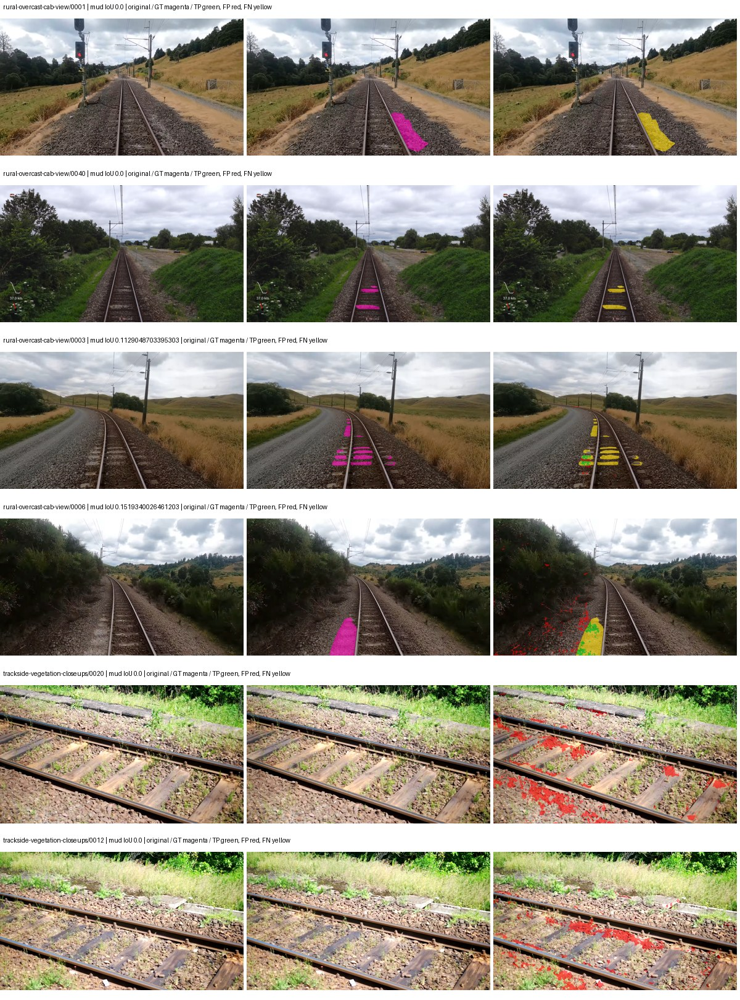
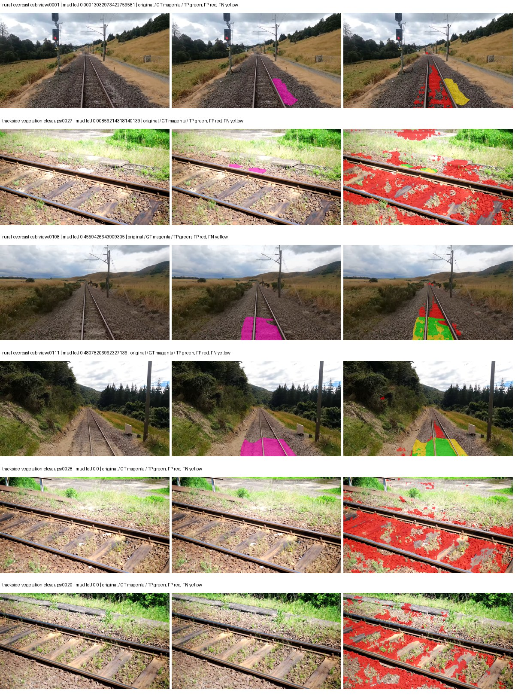
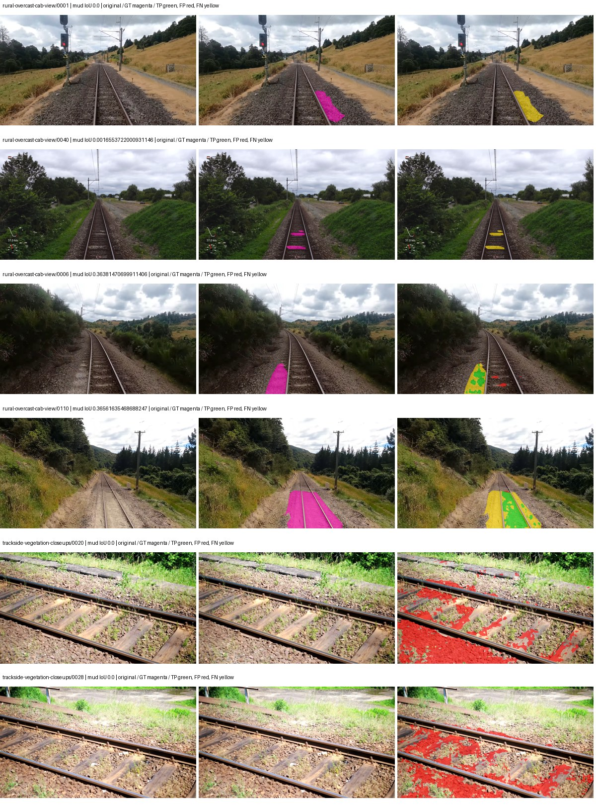
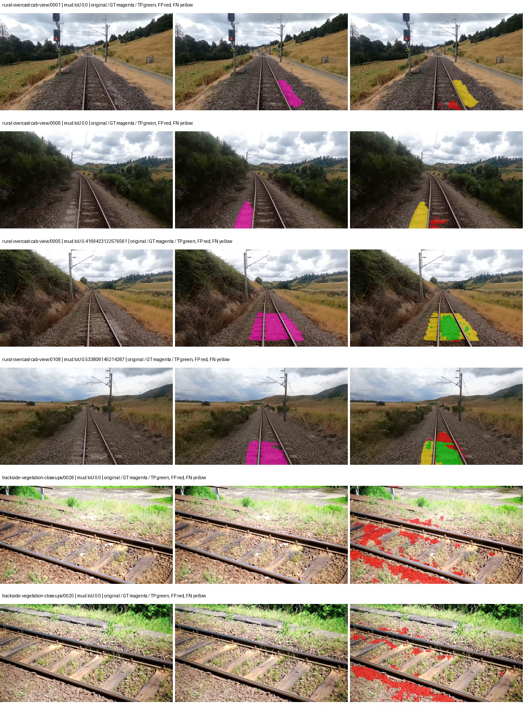

# smp_manet_efficientnet_b0 — rad_9_24_2026-fixed-grouped

[RAD 9/24: Scene-grouped split](../../README.md) · [Full model records](record.json)

Primary result: the **final checkpoint** after the full step budget (no early stopping). The checkpoint with the best **mud-pumping validation IoU, pixels pooled over all validation images**, is kept as secondary evidence. A job is complete only after full statistics and isolated profiling are verified.

Study metrics of the final checkpoint, counting each class only on the validation images that contain it: mud-pumping IoU is the mean per-image IoU over the images with mud-pumping, precision and recall sum pixels over those images, and mIoU averages each class over the images that contain it, then over the classes present.

| Initialization path | Seed | Mud-pumping IoU, train-camera images with mud (%, n=17) | Mud-pumping IoU, all images with mud (%, n=18) | Mud precision, all images with mud (%) | Mud recall, all images with mud (%) | mIoU (each class over images that contain it) (%) |
| --- | --- | --- | --- | --- | --- | --- |
| rtis_only | 0 | 0.58 | 0.89 | 9.75 | 1.25 | 24.59 |
| cityscapes_to_rtis | 0 | 2.09 | 2.06 | 5.04 | 3.77 | 28.48 |
| railsem19_to_rtis | 0 | 9.71 | 9.28 | 23.72 | 13.13 | 34.32 |
| cityscapes_to_railsem19_to_rtis | 0 | 11.14 | 10.63 | 24.14 | 16.60 | 32.57 |

Per-class IoU: IoU (%) of every class, each averaged only over the validation images that contain the class (n = those images); — = no image contains it. mIoU averages the classes with at least one such image.

| Initialization path | Seed | mIoU (each class over images that contain it) | person (n=0) | truck (n=0) | rail-track (n=37) | vegetation-overgrowth (n=13) | car (n=3) | on-rails (n=0) | traffic-sign (n=9) | road (n=11) | sidewalk (n=12) | construction (n=12) | tram-track (n=2) | pole (n=21) | traffic-light (n=3) | mud-pumping (n=18) | fence (n=7) | terrain (n=35) | sky (n=28) | rail-embedded (n=3) | rail-raised (n=37) | trackbed (n=37) | standing-water (n=9) |
| --- | --- | --- | --- | --- | --- | --- | --- | --- | --- | --- | --- | --- | --- | --- | --- | --- | --- | --- | --- | --- | --- | --- | --- |
| rtis_only | 0 | 24.59 | — | — | 53.25 | 11.30 | 0.00 | — | 0.00 | 13.91 | 6.59 | 22.31 | 0.33 | 41.70 | 0.00 | 0.89 | 1.56 | 73.31 | 90.33 | 0.00 | 68.22 | 57.92 | 0.97 |
| cityscapes_to_rtis | 0 | 28.48 | — | — | 50.73 | 18.22 | 0.00 | — | 0.00 | 13.19 | 6.97 | 30.60 | 12.00 | 63.85 | 0.16 | 2.06 | 8.12 | 78.01 | 93.49 | 2.17 | 69.64 | 54.86 | 8.47 |
| railsem19_to_rtis | 0 | 34.32 | — | — | 57.70 | 17.75 | 0.00 | — | 6.46 | 16.41 | 2.09 | 46.34 | 27.20 | 68.67 | 31.64 | 9.28 | 11.16 | 81.84 | 95.78 | 7.27 | 71.86 | 61.71 | 4.65 |
| cityscapes_to_railsem19_to_rtis | 0 | 32.57 | — | — | 54.28 | 23.24 | 0.00 | — | 5.67 | 15.21 | 0.80 | 41.90 | 11.41 | 67.65 | 34.08 | 10.63 | 5.73 | 80.11 | 95.57 | 1.29 | 72.11 | 57.60 | 9.03 |

Everything below is the campaign's own record, with pixels pooled over all validation images: its evaluation is the checkpoint that scored best on that pooled mud IoU (secondary evidence here); the diagnostics also cover the final checkpoint (`final-auto-val`).

| Model | Initialization path | Seed | Status | Steps | Best step | Best-checkpoint mud IoU, pixels pooled (%) | Best-checkpoint mud precision, pixels pooled (%) | Best-checkpoint mud recall, pixels pooled (%) | Final mud IoU (trainer val, pixels pooled, %) | Best-checkpoint mIoU, pixels pooled (%) | Best-checkpoint fixed GT-class mIoU, pixels pooled (%) |
| --- | --- | --- | --- | --- | --- | --- | --- | --- | --- | --- | --- |
| smp_manet_efficientnet_b0 | rtis_only | 0 | completed | 4000 | 3370 | 2.04 | 4.45 | 3.64 | 0.61 | 20.53 | 21.68 |
| smp_manet_efficientnet_b0 | cityscapes_to_rtis | 0 | completed | 4000 | 259 | 8.01 | 9.10 | 40.11 | 0.67 | 19.56 | 20.65 |
| smp_manet_efficientnet_b0 | railsem19_to_rtis | 0 | completed | 4000 | 3629 | 8.15 | 11.53 | 21.75 | 3.83 | 28.34 | 33.07 |
| smp_manet_efficientnet_b0 | cityscapes_to_railsem19_to_rtis | 0 | completed | 4000 | 518 | 13.48 | 21.63 | 26.36 | 3.80 | 21.88 | 23.10 |

Training: 217 images. Validation: 37 images. Test: 60 held out. Seeds: [0]. Seed variation measures optimization variability, not independent-recording uncertainty. Historical source checkpoints stay fixed across adaptation seeds.

Training code: `fce0ea0ac50b334d4252812c396e0e593def375d`. Split SHA-256: `12d7b367c72cda61d57686ff2ac28223530d0af49debd9fb7a0fbc68b908bc93`.

## rtis_only — seed 0

Status: **completed**. Started: 2026-10-11T15:02:19.791383+00:00. Finished: 2026-10-11T15:51:13.204469+00:00.

Recipe pretrained initializer: `{"arch": "smp", "backbone_path": null, "batch_norm_momentum": null, "checkpoint": null, "classifier_path": null, "drop_path": null, "encoder_name": "efficientnet-b0", "encoder_weights": "imagenet", "head": "unified_head", "head_paths": [], "inactive_parameter_paths": ["encoder._conv_head", "encoder._bn1"], "local_files_only": false, "lora_alpha": 32, "lora_dropout": 0.05, "lora_r": 16, "lora_targets": [], "native": null, "revision": null, "smp_arch": "MAnet", "subfolder": null, "trust_remote_code": false, "tuning": "full"}`.

`rtis_only` uses the recipe initializer, which may include pretrained segmentation components. Transfer paths load the exact historical source checkpoint below and reset the classifier; they do not reset all query/decoder features.

Source checkpoint: `Recipe pretrained initialization`.

Config SHA-256: `f207ecc587eea5c11baa97a2fe7a0a04e1c2a4435314977ced5d3241f473845f`. Weights used for validation: `raw`.

### Mud-pumping and aggregate quality

| Metric | Selected checkpoint | Final training validation |
| --- | --- | --- |
| Mud IoU | 2.04 | 0.61 |
| Mud precision | 4.45 | 1.18 |
| Mud recall | 3.64 | 1.25 |
| Mud Dice/F1 | 4.01 | 1.21 |
| mIoU | 20.53 | 21.89 |
| Mean accuracy | 29.49 | 30.61 |
| Mean precision | 33.04 | 34.15 |
| Mean Dice | 26.10 | 27.57 |
| Mean specificity | 98.25 | 98.49 |
| Pixel accuracy | 72.30 | 75.41 |
| Frequency-weighted IoU | 61.95 | 65.89 |
| Fixed GT-present class mIoU | 21.68 | 23.11 |
| Boundary F1 | 23.53 | 24.40 |

The selected checkpoint has independent evaluation evidence. Final values are the trainer's final validation record, not a new independent evaluation. mIoU averages classes with nonzero union, so false positives on absent classes can change its denominator. The fixed GT-class mean is supplementary and excludes absent classes; their false positives remain in the confusion matrix.

### Resource usage and timing

| Measurement | Value |
| --- | --- |
| Peak training VRAM, retained training invocation (GiB) | 8.80 |
| Peak evaluation VRAM (GiB) | 6.37 |
| Retained training invocation wall time (seconds) | 2802.44 |
| Retained training invocation GPU-hours (one GPU) | 0.78 |
| Evaluation wall time (seconds) | 10.57 |
| Full evaluation pipeline images/second | 3.50 |
| Best full-state checkpoint (MiB) | 136.59 |
| Final full-state checkpoint (MiB) | 136.57 |
| Verified periodic checkpoints removed (GiB) | 1.07 |

VRAM uses the recorded allocator high-water mark; it is not total device usage including CUDA context. Resumed jobs' retained training invocation times and peaks are **not whole-campaign totals**. Earlier invocation resource records are not reconstructed here. Evaluation throughput includes loader, sliding-window inference and metrics; it is not model-only latency/FPS. Missing measurements are shown as —, never inferred from another dataset's run.

### Standardized inference performance

Dedicated model-only profiling waits for an idle worker-locked L40S: BF16, batch 1, 1024x1024, 20 warmup and 100 CUDA-event-timed public forwards. It excludes loading, preprocessing, tiling and metrics.

| Status | Parameters | Weight MiB | FPS | p50 ms | p95 ms | Peak reserved GiB |
| --- | --- | --- | --- | --- | --- | --- |
| complete | 9095257 | 34.70 | 97.43 | 10.13 | 11.01 | 0.57 |

```json
{
  "schema_version": 1,
  "model_id": "smp_manet_efficientnet_b0",
  "measured_at": "2026-10-11T15:51:10+00:00",
  "status": "complete",
  "benchmark_scope": "rtis_selected_checkpoint_model_only",
  "applies_to": [
    "smp_manet_efficientnet_b0--rtis_only--seed-0"
  ],
  "source": {
    "campaign_git_sha": "fce0ea0ac50b334d4252812c396e0e593def375d",
    "git_dirty": false,
    "config_hash": "8b6d371b092f",
    "resolved_config": "/data/izadia1/projects/segmentary-runs/rad_9_24_2026/fgall-seed0-20261007/configs/smp_manet_efficientnet_b0--rtis_only--seed-0.yaml",
    "config_sha256": "f207ecc587eea5c11baa97a2fe7a0a04e1c2a4435314977ced5d3241f473845f",
    "checkpoint_sha256": "88bb52c28da29f3f4d9a7ddc13504af8da4382201dff74fd6df6d94ce7665996",
    "checkpoint_global_step": 3370,
    "checkpoint_bytes": 143226061,
    "checkpoint_kind": "resume checkpoint with optimizer and EMA state",
    "weights": "raw",
    "measured_checkpoint_job_id": "smp_manet_efficientnet_b0--rtis_only--seed-0",
    "result_sha256": "a2bb653b91b89b6455bd7ce90c970f5b3024dd7f0f23f480a883e03d84d4e40f",
    "result_git_sha": "fce0ea0ac50b334d4252812c396e0e593def375d",
    "result_stage": "eval:rad_9_24_2026-fixed-grouped:val",
    "result_seed": 0
  },
  "hardware": {
    "gpu_name": "NVIDIA L40S",
    "gpu_uuid": "GPU-c76642eb-64c1-b0ac-b051-d2efd47b32c4",
    "logical_device": "cuda:0",
    "physical_visibility_token": "9",
    "compute_capability": [
      8,
      9
    ],
    "total_memory_bytes": 47677177856
  },
  "model": {
    "parameter_count": 9095257,
    "trainable_parameter_count": 8683097,
    "resident_parameter_bytes": 36381028,
    "parameter_dtype_counts": {
      "float32": 9095257
    }
  },
  "contract": {
    "backend": "pytorch",
    "precision": "bf16_autocast",
    "batch_size": 1,
    "input_shape_nchw": [
      1,
      3,
      1024,
      1024
    ],
    "warmup_iterations": 20,
    "measured_iterations": 100,
    "timing": "per-forward CUDA events with end-event synchronization",
    "includes_preprocessing": false,
    "includes_data_loader": false,
    "includes_sliding_window": false,
    "input_resident_on_gpu": true,
    "model_only": true,
    "entrypoint": "public model(image) dense-logits forward"
  },
  "measurements": {
    "latency": {
      "p50_ms": 10.125311851501465,
      "p95_ms": 11.011686277389526,
      "mean_ms": 10.264063024520874,
      "minimum_ms": 9.953280448913574,
      "maximum_ms": 13.76255989074707,
      "fps": 97.42730511406616,
      "raw_ms": [
        10.24614429473877,
        10.283007621765137,
        10.365951538085938,
        10.80627155303955,
        10.232831954956055,
        10.073087692260742,
        10.019840240478516,
        10.21235179901123,
        10.145792007446289,
        13.76255989074707,
        10.368000030517578,
        10.077183723449707,
        10.085375785827637,
        10.060799598693848,
        10.038304328918457,
        9.978879928588867,
        9.953280448913574,
        10.12838363647461,
        10.214400291442871,
        10.288127899169922,
        10.012672424316406,
        10.171392440795898,
        10.125311851501465,
        10.361856460571289,
        10.01574420928955,
        10.577919960021973,
        10.12326431274414,
        10.049535751342773,
        11.404288291931152,
        10.125311851501465,
        10.010623931884766,
        10.22054386138916,
        10.21337604522705,
        10.0382719039917,
        10.314751625061035,
        10.224639892578125,
        10.610688209533691,
        10.492927551269531,
        10.416128158569336,
        10.025983810424805,
        10.098655700683594,
        10.12326431274414,
        10.40998363494873,
        10.896384239196777,
        10.126336097717285,
        9.984000205993652,
        9.975808143615723,
        10.350591659545898,
        10.085375785827637,
        10.141695976257324,
        10.067968368530273,
        9.992192268371582,
        11.005951881408691,
        10.184703826904297,
        10.098688125610352,
        10.000384330749512,
        10.21951961517334,
        11.12063980102539,
        10.21951961517334,
        10.03110408782959,
        10.060799598693848,
        10.455039978027344,
        10.051584243774414,
        9.974783897399902,
        10.001407623291016,
        11.268095970153809,
        10.037247657775879,
        10.00550365447998,
        10.142720222473145,
        10.6496000289917,
        10.092543601989746,
        10.056703567504883,
        11.448320388793945,
        10.068991661071777,
        10.117119789123535,
        10.012672424316406,
        10.036224365234375,
        9.988096237182617,
        10.308608055114746,
        10.868736267089844,
        10.051584243774414,
        10.063872337341309,
        10.162176132202148,
        9.995264053344727,
        10.297344207763672,
        9.996288299560547,
        10.04748821258545,
        10.116095542907715,
        10.02393627166748,
        10.048447608947754,
        9.981951713562012,
        10.02086353302002,
        10.262528419494629,
        10.157055854797363,
        10.846207618713379,
        10.170368194580078,
        10.002431869506836,
        10.2543363571167,
        10.129376411437988,
        10.125311851501465
      ],
      "percentile_method": "numpy linear interpolation"
    },
    "peak_reserved_bytes": 614465536,
    "memory_kind": "pytorch_cuda_allocator_peak_reserved_excluding_context",
    "process_total_bytes": 1151336448,
    "process_total_kind": "nvidia-smi used_memory of this PID on the benchmark GPU after the timed loop, including the CUDA context; null when the driver could not attribute memory to this PID",
    "benchmark_wall_clock_s": 21.000705420970917
  },
  "started_at": "2026-10-11T15:50:49+00:00",
  "finished_at": "2026-10-11T15:51:10+00:00",
  "environment": {
    "hostname": "hdrfs-app-001",
    "python": "3.11.15",
    "platform": "Linux-5.15.0-139-generic-x86_64-with-glibc2.35",
    "torch": "2.11.0+cu128",
    "torch_cuda": "12.8",
    "cudnn": 91900,
    "driver_version": "570.133.20",
    "cuda_available": true,
    "gpu_count": 1,
    "gpu_names": [
      "NVIDIA L40S"
    ],
    "cuda_visible_devices": "9",
    "packages": {
      "segmentary": "0.1.0",
      "torch": "2.11.0+cu128",
      "torchvision": "0.26.0+cu128",
      "transformers": "5.15.0",
      "timm": "1.0.28",
      "segmentation-models-pytorch": "0.5.0",
      "albumentations": "2.0.8",
      "lightning": "2.6.5",
      "numpy": "2.4.4"
    }
  }
}
```

### Per-class validation results

| Class | GT pixels | IoU (%) | Precision (%) | Recall (%) | Dice (%) | Boundary F1 (%) |
| --- | --- | --- | --- | --- | --- | --- |
| car | 29664 | 0.00 | 0.00 | 0.00 | 0.00 | 0.00 |
| construction | 311585 | 6.78 | 7.00 | 67.92 | 12.70 | 11.62 |
| fence | 265137 | 0.12 | 0.75 | 0.14 | 0.23 | 1.90 |
| mud-pumping | 1226250 | 2.04 | 4.45 | 3.64 | 4.01 | 7.35 |
| on-rails | 0 | 0.00 | 0.00 | — | 0.00 | 0.00 |
| person | 0 | — | — | — | — | — |
| pole | 628038 | 45.84 | 84.80 | 49.94 | 62.86 | 81.29 |
| rail-embedded | 16799 | 0.00 | 0.00 | 0.00 | 0.00 | 0.00 |
| rail-raised | 2969797 | 71.22 | 88.09 | 78.81 | 83.19 | 90.57 |
| rail-track | 6323197 | 29.31 | 56.37 | 37.90 | 45.33 | 41.37 |
| road | 1048831 | 5.20 | 14.58 | 7.47 | 9.88 | 7.46 |
| sidewalk | 1297367 | 13.62 | 42.96 | 16.62 | 23.97 | 15.81 |
| sky | 19121606 | 92.56 | 99.12 | 93.33 | 96.13 | 72.47 |
| standing-water | 95802 | 0.40 | 0.40 | 22.91 | 0.79 | 1.77 |
| terrain | 39239306 | 70.55 | 78.31 | 87.69 | 82.74 | 29.63 |
| trackbed | 10643081 | 47.39 | 70.25 | 59.28 | 64.30 | 48.03 |
| traffic-light | 19510 | 0.00 | 0.00 | 0.00 | 0.00 | 0.00 |
| traffic-sign | 13285 | 0.00 | 0.00 | 0.00 | 0.00 | 0.00 |
| tram-track | 56179 | 0.02 | 0.05 | 0.02 | 0.03 | 0.24 |
| truck | 0 | — | — | — | — | — |
| vegetation-overgrowth | 5901821 | 5.13 | 80.59 | 5.19 | 9.76 | 37.61 |

### Full-run accounting

| Measurement | Value |
| --- | --- |
| Full GPU-reserved wall seconds, all recorded worker attempts | 2941.29 |
| Full reserved GPU-hours | 0.82 |
| Whole-run timing complete | True |

| Phase | Wall seconds including failed attempts |
| --- | --- |
| training | 2809.14 |
| diagnostics | 76.73 |
| performance | 28.07 |

GPU-reserved time includes model loading, training, validation, collection, profiling, checkpoint I/O and orchestration while the worker owns one GPU. It is not GPU kernel-active time. Phase timings and sampled device memory/power/utilization are retained separately; sampled device memory is not the allocator high-water mark.

### Train/validation and raw/EMA diagnostics

| Checkpoint / weights / split | Images | Mud IoU (%) | Mud precision (%) | Mud recall (%) |
| --- | --- | --- | --- | --- |
| best-auto-train / raw | 217 | 87.20 | 92.86 | 93.47 |
| best-auto-val / raw | 37 | 2.04 | 4.45 | 3.64 |
| best-alternate-val / ema | 37 | 1.63 | 2.46 | 4.58 |
| final-auto-val / raw | 37 | 0.61 | 1.19 | 1.25 |

Train uses the evaluation transform without augmentation. Compare mud train/validation metrics for the same selected weights. Alternate EMA on running-stat BatchNorm is explicitly uncalibrated and is diagnostic only. Score-threshold curves use uncalibrated normalized scores and are pixel-level diagnostics, not event detection rates or a selected deployment operating point.

### Downloadable evidence

- best-auto-train: [per-image.csv](rtis_only--seed-0/best-auto-train/per-image.csv) · [per-image-confusion.json.gz](rtis_only--seed-0/best-auto-train/per-image-confusion.json.gz) · [groups.json](rtis_only--seed-0/best-auto-train/groups.json) · [mud-score-curves.json](rtis_only--seed-0/best-auto-train/mud-score-curves.json)
- best-auto-val: [per-image.csv](rtis_only--seed-0/best-auto-val/per-image.csv) · [per-image-confusion.json.gz](rtis_only--seed-0/best-auto-val/per-image-confusion.json.gz) · [groups.json](rtis_only--seed-0/best-auto-val/groups.json) · [mud-score-curves.json](rtis_only--seed-0/best-auto-val/mud-score-curves.json) · [examples.jpg](rtis_only--seed-0/best-auto-val/examples.jpg)
- best-alternate-val: [per-image.csv](rtis_only--seed-0/best-alternate-val/per-image.csv) · [per-image-confusion.json.gz](rtis_only--seed-0/best-alternate-val/per-image-confusion.json.gz) · [groups.json](rtis_only--seed-0/best-alternate-val/groups.json) · [mud-score-curves.json](rtis_only--seed-0/best-alternate-val/mud-score-curves.json)
- final-auto-val: [per-image.csv](rtis_only--seed-0/final-auto-val/per-image.csv) · [per-image-confusion.json.gz](rtis_only--seed-0/final-auto-val/per-image-confusion.json.gz) · [groups.json](rtis_only--seed-0/final-auto-val/groups.json) · [mud-score-curves.json](rtis_only--seed-0/final-auto-val/mud-score-curves.json)
- resources: [telemetry.csv](rtis_only--seed-0/resources/telemetry.csv)



Examples are two lowest and two highest mud-IoU positive images, plus up to two negative images with the most false-positive mud pixels. They are targeted diagnostic examples, not random samples. Green: true positive; red: false positive; yellow: false negative. Full predictions remain on HDRFS.

### Validation tracking

| Logged step | Overall mIoU (%) | Mud IoU (%) |
| --- | --- | --- |
| 258 | 15.44 | 0.54 |
| 518 | 17.61 | 0.68 |
| 777 | 19.15 | 0.57 |
| 1036 | 18.41 | 0.44 |
| 1295 | 18.61 | 1.24 |
| 1555 | 19.41 | 1.79 |
| 1814 | 20.64 | 1.45 |
| 2073 | 21.21 | 0.23 |
| 2332 | 20.42 | 0.58 |
| 2592 | 20.93 | 0.59 |
| 2851 | 21.03 | 0.91 |
| 3110 | 22.02 | 0.47 |
| 3369 | 20.53 | 2.03 |
| 3629 | 22.04 | 0.38 |
| 3888 | 21.29 | 0.54 |
| 4000 | 21.89 | 0.61 |

All retained scalar curves, including training loss and per-class IoU, are in record.json. Observed best mud on a curve is not necessarily a retained checkpoint: the pilot saved its selection-metric-best and final checkpoints. Step logging and checkpoint global_step may differ by one.

### Stopping and checkpoint provenance

```json
{
  "stopping": {
    "actual_steps": 4000,
    "maximum_steps": 4000,
    "min_delta": 0.0,
    "monitor": "val_iou/mud-pumping",
    "patience": null,
    "reason": "budget_complete"
  },
  "checkpoints": {
    "best": {
      "path": "/data/izadia1/projects/segmentary-runs/rad_9_24_2026/fgall-seed0-20261007/future-runs/smp_manet_efficientnet_b0--rtis_only--seed-0_seed0/rtis/best.ckpt",
      "sha256": "88bb52c28da29f3f4d9a7ddc13504af8da4382201dff74fd6df6d94ce7665996",
      "global_step": 3370,
      "bytes": 143226061
    },
    "final": {
      "path": "/data/izadia1/projects/segmentary-runs/rad_9_24_2026/fgall-seed0-20261007/future-runs/smp_manet_efficientnet_b0--rtis_only--seed-0_seed0/rtis/last.ckpt",
      "sha256": "6d7c2ef6f4936f9e16c92873d467b70e9a16cd5456fcb62f36e156a6e9628018",
      "global_step": 4000,
      "bytes": 143207949
    }
  },
  "cleanup_error": null
}
```

### Resolved training, initialization and evaluation settings

The optimizer block is the base configuration. Stage LR scales are applied at runtime, and stage warmup is capped at min(base warmup, floor(stage budget / 10), stage budget - 1): 400 steps for this 4,000-step pilot. Model-internal native input grids may differ from augmentation crops (EoMT uses its 640 grid).

```json
{
  "name": "smp_manet_efficientnet_b0--rtis_only--seed-0",
  "model": {
    "arch": "smp",
    "checkpoint": null,
    "tuning": "full",
    "head": "unified_head",
    "lora_r": 16,
    "lora_alpha": 32,
    "lora_dropout": 0.05,
    "lora_targets": [],
    "drop_path": null,
    "revision": null,
    "subfolder": null,
    "local_files_only": false,
    "trust_remote_code": false,
    "backbone_path": null,
    "head_paths": [],
    "classifier_path": null,
    "inactive_parameter_paths": [
      "encoder._conv_head",
      "encoder._bn1"
    ],
    "smp_arch": "MAnet",
    "encoder_name": "efficientnet-b0",
    "encoder_weights": "imagenet",
    "native": null,
    "batch_norm_momentum": null
  },
  "space": "paul-test-rtis",
  "taxonomy_root": "/data/izadia1/projects/segmentary-rad-fgall-fce0ea0a/taxonomy",
  "output_root": "/data/izadia1/projects/segmentary-runs/rad_9_24_2026/fgall-seed0-20261007/future-runs",
  "optim": {
    "backbone_lr": 0.0001,
    "head_lr_mult": 10.0,
    "weight_decay": 0.05,
    "llrd": 1.0,
    "warmup_iters": 1500,
    "warmup_ratio": 1e-06,
    "poly_power": 0.9,
    "min_lr_ratio": 0.0,
    "betas": [
      0.9,
      0.999
    ],
    "grad_clip": 1.0
  },
  "train": {
    "iters": 4000,
    "batch_size": 2,
    "accum": 8,
    "num_workers": 2,
    "precision": "bf16-mixed",
    "ema_decay": 0.9998,
    "val_every": 250,
    "ckpt_every": 500,
    "selection_metric": "val_iou/mud-pumping",
    "early_stopping_patience": null,
    "early_stopping_min_delta": 0.0,
    "seed": 0,
    "devices": 1
  },
  "eval": {
    "sliding_window": true,
    "window": [
      1024,
      1024
    ],
    "stride": [
      768,
      768
    ],
    "batch_size": 1,
    "num_workers": 2,
    "tta_scales": [],
    "tta_flip": false,
    "threshold": 0.5,
    "boundary_tolerance_frac": 0.0075,
    "save_confusion": true
  },
  "loss": {
    "task": "multiclass",
    "activation": "auto",
    "terms": [],
    "aux": "none",
    "aux_weight": 0.0,
    "ce_weight": 1.0,
    "label_smoothing": 0.0,
    "class_weights": null,
    "query": null
  },
  "aug": {
    "crop": [
      1024,
      1024
    ],
    "scale_min": 0.5,
    "scale_max": 2.0,
    "hflip_p": 0.5,
    "color_jitter_p": 0.5,
    "brightness": 0.25,
    "contrast": 0.25,
    "saturation": 0.25,
    "hue": 0.05
  },
  "stages": [
    {
      "name": "rtis",
      "data": [
        {
          "name": "rad_9_24_2026-fixed-grouped",
          "root": "/data/izadia1/datasets/rad_9_24_2026-fixed-grouped",
          "variant": null,
          "split_file": "splits.json",
          "train_split": "train",
          "val_split": "val",
          "limit": null,
          "loader": "folder",
          "mapping": "paul-test-rtis",
          "loader_options": {
            "require_groups": true
          }
        }
      ],
      "iters": null,
      "lr_scale": 1.0,
      "head_group_lr_scale": 1.0,
      "init_from": "pretrained",
      "reset_head": false,
      "freeze": null,
      "sample_weights": null
    }
  ]
}
```

### Hardware and software provenance

```json
{
  "training": {
    "cuda_available": true,
    "cuda_visible_devices": "9",
    "cudnn": 91900,
    "driver_version": "570.133.20",
    "gpu_count": 1,
    "gpu_names": [
      "NVIDIA L40S"
    ],
    "hostname": "hdrfs-app-001",
    "input_normalization": {
      "channel_order": "rgb",
      "mean": [
        0.485,
        0.456,
        0.406
      ],
      "source": "smp_encoder_settings",
      "std": [
        0.229,
        0.224,
        0.225
      ]
    },
    "model_origins": [
      {
        "hf_commit": null,
        "hf_name_or_path": null,
        "module": "model",
        "timm_pretrained": {}
      }
    ],
    "model_parameter_count": 9095257,
    "packages": {
      "albumentations": "2.0.8",
      "lightning": "2.6.5",
      "numpy": "2.4.4",
      "segmentary": "0.1.0",
      "segmentation-models-pytorch": "0.5.0",
      "timm": "1.0.28",
      "torch": "2.11.0+cu128",
      "torchvision": "0.26.0+cu128",
      "transformers": "5.15.0"
    },
    "platform": "Linux-5.15.0-139-generic-x86_64-with-glibc2.35",
    "python": "3.11.15",
    "torch": "2.11.0+cu128",
    "torch_cuda": "12.8",
    "trainable_parameter_count": 8683097,
    "training_stop": {
      "actual_steps": 4000,
      "maximum_steps": 4000,
      "min_delta": 0.0,
      "monitor": "val_iou/mud-pumping",
      "patience": null,
      "reason": "budget_complete"
    },
    "validation_weights": "raw"
  },
  "evaluation": {
    "cuda_available": true,
    "cuda_visible_devices": "9",
    "cudnn": 91900,
    "driver_version": "570.133.20",
    "gpu_count": 1,
    "gpu_names": [
      "NVIDIA L40S"
    ],
    "hostname": "hdrfs-app-001",
    "input_normalization": {
      "channel_order": "rgb",
      "mean": [
        0.485,
        0.456,
        0.406
      ],
      "source": "smp_encoder_settings",
      "std": [
        0.229,
        0.224,
        0.225
      ]
    },
    "packages": {
      "albumentations": "2.0.8",
      "lightning": "2.6.5",
      "numpy": "2.4.4",
      "segmentary": "0.1.0",
      "segmentation-models-pytorch": "0.5.0",
      "timm": "1.0.28",
      "torch": "2.11.0+cu128",
      "torchvision": "0.26.0+cu128",
      "transformers": "5.15.0"
    },
    "platform": "Linux-5.15.0-139-generic-x86_64-with-glibc2.35",
    "python": "3.11.15",
    "torch": "2.11.0+cu128",
    "torch_cuda": "12.8"
  }
}
```

## cityscapes_to_rtis — seed 0

Status: **completed**. Started: 2026-10-11T15:02:55.433187+00:00. Finished: 2026-10-11T15:51:26.508318+00:00.

Recipe pretrained initializer: `{"arch": "smp", "backbone_path": null, "batch_norm_momentum": null, "checkpoint": null, "classifier_path": null, "drop_path": null, "encoder_name": "efficientnet-b0", "encoder_weights": "imagenet", "head": "unified_head", "head_paths": [], "inactive_parameter_paths": ["encoder._conv_head", "encoder._bn1"], "local_files_only": false, "lora_alpha": 32, "lora_dropout": 0.05, "lora_r": 16, "lora_targets": [], "native": null, "revision": null, "smp_arch": "MAnet", "subfolder": null, "trust_remote_code": false, "tuning": "full"}`.

`rtis_only` uses the recipe initializer, which may include pretrained segmentation components. Transfer paths load the exact historical source checkpoint below and reset the classifier; they do not reset all query/decoder features.

Source checkpoint: `{'name': 'smp_manet_efficientnet_b0--cityscapes--seed-0', 'model': 'smp_manet_efficientnet_b0', 'protocol': 'cityscapes', 'config': '/data/izadia1/projects/segmentary-runs/all-model-city-rail-seed0-rail20-b9eb3e1/jobs/smp_manet_efficientnet_b0--cityscapes--seed-0/attempt-001/resolved-config.yaml', 'checkpoint': '/data/izadia1/projects/segmentary-runs/all-model-city-rail-seed0-rail20-b9eb3e1/jobs/smp_manet_efficientnet_b0--cityscapes--seed-0/attempt-001/train/smp_manet_efficientnet_b0--cityscapes_seed0/cityscapes/last.ckpt', 'recorded_sha256': '5678b197769804af694fe91c6646d8de6e5f94f320f7b4c55120998d0a784aba', 'exists': True}`.

Config SHA-256: `5443f80ce22bac493fa6019be5e0796aaeb2065ea1460b4cb8c9a5895fea6b77`. Weights used for validation: `raw`.

### Mud-pumping and aggregate quality

| Metric | Selected checkpoint | Final training validation |
| --- | --- | --- |
| Mud IoU | 8.01 | 0.67 |
| Mud precision | 9.10 | 0.81 |
| Mud recall | 40.11 | 3.79 |
| Mud Dice/F1 | 14.84 | 1.34 |
| mIoU | 19.56 | 23.78 |
| Mean accuracy | 28.58 | 35.21 |
| Mean precision | 25.55 | 43.13 |
| Mean Dice | 24.08 | 30.25 |
| Mean specificity | 98.42 | 98.68 |
| Pixel accuracy | 75.06 | 78.41 |
| Frequency-weighted IoU | 62.58 | 69.74 |
| Fixed GT-present class mIoU | 20.65 | 27.75 |
| Boundary F1 | 20.71 | 27.73 |

The selected checkpoint has independent evaluation evidence. Final values are the trainer's final validation record, not a new independent evaluation. mIoU averages classes with nonzero union, so false positives on absent classes can change its denominator. The fixed GT-class mean is supplementary and excludes absent classes; their false positives remain in the confusion matrix.

### Resource usage and timing

| Measurement | Value |
| --- | --- |
| Peak training VRAM, retained training invocation (GiB) | 8.80 |
| Peak evaluation VRAM (GiB) | 6.37 |
| Retained training invocation wall time (seconds) | 2776.56 |
| Retained training invocation GPU-hours (one GPU) | 0.77 |
| Evaluation wall time (seconds) | 10.56 |
| Full evaluation pipeline images/second | 3.51 |
| Best full-state checkpoint (MiB) | 136.59 |
| Final full-state checkpoint (MiB) | 136.57 |
| Verified periodic checkpoints removed (GiB) | 1.07 |

VRAM uses the recorded allocator high-water mark; it is not total device usage including CUDA context. Resumed jobs' retained training invocation times and peaks are **not whole-campaign totals**. Earlier invocation resource records are not reconstructed here. Evaluation throughput includes loader, sliding-window inference and metrics; it is not model-only latency/FPS. Missing measurements are shown as —, never inferred from another dataset's run.

### Standardized inference performance

Dedicated model-only profiling waits for an idle worker-locked L40S: BF16, batch 1, 1024x1024, 20 warmup and 100 CUDA-event-timed public forwards. It excludes loading, preprocessing, tiling and metrics.

| Status | Parameters | Weight MiB | FPS | p50 ms | p95 ms | Peak reserved GiB |
| --- | --- | --- | --- | --- | --- | --- |
| complete | 9095257 | 34.70 | 97.10 | 10.20 | 11.04 | 0.57 |

```json
{
  "schema_version": 1,
  "model_id": "smp_manet_efficientnet_b0",
  "measured_at": "2026-10-11T15:51:23+00:00",
  "status": "complete",
  "benchmark_scope": "rtis_selected_checkpoint_model_only",
  "applies_to": [
    "smp_manet_efficientnet_b0--cityscapes_to_rtis--seed-0"
  ],
  "source": {
    "campaign_git_sha": "fce0ea0ac50b334d4252812c396e0e593def375d",
    "git_dirty": false,
    "config_hash": "fce0b233a6df",
    "resolved_config": "/data/izadia1/projects/segmentary-runs/rad_9_24_2026/fgall-seed0-20261007/configs/smp_manet_efficientnet_b0--cityscapes_to_rtis--seed-0.yaml",
    "config_sha256": "5443f80ce22bac493fa6019be5e0796aaeb2065ea1460b4cb8c9a5895fea6b77",
    "checkpoint_sha256": "e4b943aaf4644583f9b38a2c4757400d87f4754010fac0e87556f7421e048fdf",
    "checkpoint_global_step": 259,
    "checkpoint_bytes": 143225741,
    "checkpoint_kind": "resume checkpoint with optimizer and EMA state",
    "weights": "raw",
    "measured_checkpoint_job_id": "smp_manet_efficientnet_b0--cityscapes_to_rtis--seed-0",
    "result_sha256": "a524c6c6a39a884aa8891cdb40e8785f6a16bbb68722055627a782976e9e7d92",
    "result_git_sha": "fce0ea0ac50b334d4252812c396e0e593def375d",
    "result_stage": "eval:rad_9_24_2026-fixed-grouped:val",
    "result_seed": 0
  },
  "hardware": {
    "gpu_name": "NVIDIA L40S",
    "gpu_uuid": "GPU-a5ad49e5-0536-5229-ba8a-f8a902808f53",
    "logical_device": "cuda:0",
    "physical_visibility_token": "7",
    "compute_capability": [
      8,
      9
    ],
    "total_memory_bytes": 47677177856
  },
  "model": {
    "parameter_count": 9095257,
    "trainable_parameter_count": 8683097,
    "resident_parameter_bytes": 36381028,
    "parameter_dtype_counts": {
      "float32": 9095257
    }
  },
  "contract": {
    "backend": "pytorch",
    "precision": "bf16_autocast",
    "batch_size": 1,
    "input_shape_nchw": [
      1,
      3,
      1024,
      1024
    ],
    "warmup_iterations": 20,
    "measured_iterations": 100,
    "timing": "per-forward CUDA events with end-event synchronization",
    "includes_preprocessing": false,
    "includes_data_loader": false,
    "includes_sliding_window": false,
    "input_resident_on_gpu": true,
    "model_only": true,
    "entrypoint": "public model(image) dense-logits forward"
  },
  "measurements": {
    "latency": {
      "p50_ms": 10.199039936065674,
      "p95_ms": 11.042816305160523,
      "mean_ms": 10.299044847488403,
      "minimum_ms": 9.844736099243164,
      "maximum_ms": 11.576319694519043,
      "fps": 97.0963827042531,
      "raw_ms": [
        11.035648345947266,
        10.281984329223633,
        9.920512199401855,
        10.448896408081055,
        9.885696411132812,
        9.866239547729492,
        10.355711936950684,
        10.531840324401855,
        11.179007530212402,
        10.923040390014648,
        10.02905559539795,
        9.878527641296387,
        9.92563247680664,
        10.774527549743652,
        9.929727554321289,
        10.118144035339355,
        10.795007705688477,
        10.62707233428955,
        10.263551712036133,
        10.110976219177246,
        9.90617561340332,
        10.317824363708496,
        9.928704261779785,
        9.844736099243164,
        10.087424278259277,
        11.313152313232422,
        10.751999855041504,
        9.903103828430176,
        10.242048263549805,
        9.928704261779785,
        10.907648086547852,
        10.024959564208984,
        10.362879753112793,
        11.011039733886719,
        10.516480445861816,
        10.01471996307373,
        10.079232215881348,
        9.921536445617676,
        9.908224105834961,
        9.919487953186035,
        10.951680183410645,
        10.516480445861816,
        11.027456283569336,
        10.548224449157715,
        10.23795223236084,
        9.92255973815918,
        9.853952407836914,
        9.93177604675293,
        10.116095542907715,
        10.560511589050293,
        11.576319694519043,
        10.044384002685547,
        9.918463706970215,
        10.011648178100586,
        10.057727813720703,
        10.550304412841797,
        9.979935646057129,
        10.417152404785156,
        10.577919960021973,
        10.29535961151123,
        10.360832214355469,
        9.967616081237793,
        10.014752388000488,
        10.941439628601074,
        10.347519874572754,
        9.991168022155762,
        9.988096237182617,
        10.41817569732666,
        10.04032039642334,
        10.04851245880127,
        9.992192268371582,
        11.188223838806152,
        10.607616424560547,
        10.174464225769043,
        10.813440322875977,
        10.266624450683594,
        10.21337604522705,
        10.22156810760498,
        10.33011245727539,
        10.505215644836426,
        10.252287864685059,
        11.206656455993652,
        10.2543363571167,
        10.267647743225098,
        10.184703826904297,
        10.037247657775879,
        10.771424293518066,
        10.392576217651367,
        9.910271644592285,
        10.677248001098633,
        10.173439979553223,
        9.991168022155762,
        9.937919616699219,
        9.93075180053711,
        10.03929615020752,
        9.947135925292969,
        10.366975784301758,
        10.000384330749512,
        10.109951972961426,
        10.155008316040039
      ],
      "percentile_method": "numpy linear interpolation"
    },
    "peak_reserved_bytes": 614465536,
    "memory_kind": "pytorch_cuda_allocator_peak_reserved_excluding_context",
    "process_total_bytes": 1151336448,
    "process_total_kind": "nvidia-smi used_memory of this PID on the benchmark GPU after the timed loop, including the CUDA context; null when the driver could not attribute memory to this PID",
    "benchmark_wall_clock_s": 21.146207191050053
  },
  "started_at": "2026-10-11T15:51:02+00:00",
  "finished_at": "2026-10-11T15:51:23+00:00",
  "environment": {
    "hostname": "hdrfs-app-001",
    "python": "3.11.15",
    "platform": "Linux-5.15.0-139-generic-x86_64-with-glibc2.35",
    "torch": "2.11.0+cu128",
    "torch_cuda": "12.8",
    "cudnn": 91900,
    "driver_version": "570.133.20",
    "cuda_available": true,
    "gpu_count": 1,
    "gpu_names": [
      "NVIDIA L40S"
    ],
    "cuda_visible_devices": "7",
    "packages": {
      "segmentary": "0.1.0",
      "torch": "2.11.0+cu128",
      "torchvision": "0.26.0+cu128",
      "transformers": "5.15.0",
      "timm": "1.0.28",
      "segmentation-models-pytorch": "0.5.0",
      "albumentations": "2.0.8",
      "lightning": "2.6.5",
      "numpy": "2.4.4"
    }
  }
}
```

### Per-class validation results

| Class | GT pixels | IoU (%) | Precision (%) | Recall (%) | Dice (%) | Boundary F1 (%) |
| --- | --- | --- | --- | --- | --- | --- |
| car | 29664 | 0.00 | 0.00 | 0.00 | 0.00 | 0.00 |
| construction | 311585 | 13.00 | 18.84 | 29.55 | 23.01 | 21.68 |
| fence | 265137 | 0.00 | 0.00 | 0.00 | 0.00 | 0.00 |
| mud-pumping | 1226250 | 8.01 | 9.10 | 40.11 | 14.84 | 12.76 |
| on-rails | 0 | 0.00 | 0.00 | — | 0.00 | 0.00 |
| person | 0 | — | — | — | — | — |
| pole | 628038 | 62.34 | 75.80 | 77.84 | 76.80 | 85.54 |
| rail-embedded | 16799 | 0.00 | 0.00 | 0.00 | 0.00 | 0.00 |
| rail-raised | 2969797 | 61.36 | 65.00 | 91.63 | 76.05 | 81.17 |
| rail-track | 6323197 | 10.94 | 81.44 | 11.22 | 19.72 | 39.33 |
| road | 1048831 | 0.00 | 0.00 | 0.00 | 0.00 | 0.00 |
| sidewalk | 1297367 | 0.00 | 0.00 | 0.00 | 0.00 | 0.00 |
| sky | 19121606 | 91.13 | 98.50 | 92.42 | 95.36 | 71.53 |
| standing-water | 95802 | 0.00 | 0.00 | 0.00 | 0.00 | 0.00 |
| terrain | 39239306 | 77.15 | 82.15 | 92.70 | 87.10 | 38.36 |
| trackbed | 10643081 | 47.70 | 54.63 | 79.00 | 64.59 | 43.03 |
| traffic-light | 19510 | 0.00 | 0.00 | 0.00 | 0.00 | 0.00 |
| traffic-sign | 13285 | 0.00 | 0.00 | 0.00 | 0.00 | 0.00 |
| tram-track | 56179 | 0.00 | 0.00 | 0.00 | 0.00 | 0.00 |
| truck | 0 | — | — | — | — | — |
| vegetation-overgrowth | 5901821 | 0.00 | 0.00 | 0.00 | 0.00 | 0.00 |

### Full-run accounting

| Measurement | Value |
| --- | --- |
| Full GPU-reserved wall seconds, all recorded worker attempts | 2919.03 |
| Full reserved GPU-hours | 0.81 |
| Whole-run timing complete | True |

| Phase | Wall seconds including failed attempts |
| --- | --- |
| training | 2783.71 |
| diagnostics | 77.76 |
| performance | 28.23 |

GPU-reserved time includes model loading, training, validation, collection, profiling, checkpoint I/O and orchestration while the worker owns one GPU. It is not GPU kernel-active time. Phase timings and sampled device memory/power/utilization are retained separately; sampled device memory is not the allocator high-water mark.

### Train/validation and raw/EMA diagnostics

| Checkpoint / weights / split | Images | Mud IoU (%) | Mud precision (%) | Mud recall (%) |
| --- | --- | --- | --- | --- |
| best-auto-train / raw | 217 | 64.35 | 74.10 | 83.03 |
| best-auto-val / raw | 37 | 8.01 | 9.10 | 40.11 |
| best-alternate-val / ema | 37 | 6.26 | 7.88 | 23.28 |
| final-auto-val / raw | 37 | 0.67 | 0.81 | 3.77 |

Train uses the evaluation transform without augmentation. Compare mud train/validation metrics for the same selected weights. Alternate EMA on running-stat BatchNorm is explicitly uncalibrated and is diagnostic only. Score-threshold curves use uncalibrated normalized scores and are pixel-level diagnostics, not event detection rates or a selected deployment operating point.

### Downloadable evidence

- best-auto-train: [per-image.csv](cityscapes_to_rtis--seed-0/best-auto-train/per-image.csv) · [per-image-confusion.json.gz](cityscapes_to_rtis--seed-0/best-auto-train/per-image-confusion.json.gz) · [groups.json](cityscapes_to_rtis--seed-0/best-auto-train/groups.json) · [mud-score-curves.json](cityscapes_to_rtis--seed-0/best-auto-train/mud-score-curves.json)
- best-auto-val: [per-image.csv](cityscapes_to_rtis--seed-0/best-auto-val/per-image.csv) · [per-image-confusion.json.gz](cityscapes_to_rtis--seed-0/best-auto-val/per-image-confusion.json.gz) · [groups.json](cityscapes_to_rtis--seed-0/best-auto-val/groups.json) · [mud-score-curves.json](cityscapes_to_rtis--seed-0/best-auto-val/mud-score-curves.json) · [examples.jpg](cityscapes_to_rtis--seed-0/best-auto-val/examples.jpg)
- best-alternate-val: [per-image.csv](cityscapes_to_rtis--seed-0/best-alternate-val/per-image.csv) · [per-image-confusion.json.gz](cityscapes_to_rtis--seed-0/best-alternate-val/per-image-confusion.json.gz) · [groups.json](cityscapes_to_rtis--seed-0/best-alternate-val/groups.json) · [mud-score-curves.json](cityscapes_to_rtis--seed-0/best-alternate-val/mud-score-curves.json)
- final-auto-val: [per-image.csv](cityscapes_to_rtis--seed-0/final-auto-val/per-image.csv) · [per-image-confusion.json.gz](cityscapes_to_rtis--seed-0/final-auto-val/per-image-confusion.json.gz) · [groups.json](cityscapes_to_rtis--seed-0/final-auto-val/groups.json) · [mud-score-curves.json](cityscapes_to_rtis--seed-0/final-auto-val/mud-score-curves.json)
- resources: [telemetry.csv](cityscapes_to_rtis--seed-0/resources/telemetry.csv)



Examples are two lowest and two highest mud-IoU positive images, plus up to two negative images with the most false-positive mud pixels. They are targeted diagnostic examples, not random samples. Green: true positive; red: false positive; yellow: false negative. Full predictions remain on HDRFS.

### Validation tracking

| Logged step | Overall mIoU (%) | Mud IoU (%) |
| --- | --- | --- |
| 258 | 19.56 | 8.02 |
| 518 | 21.66 | 4.09 |
| 777 | 21.53 | 0.25 |
| 1036 | 22.69 | 1.18 |
| 1295 | 21.75 | 2.78 |
| 1555 | 23.64 | 0.40 |
| 1814 | 22.48 | 0.25 |
| 2073 | 19.79 | 0.74 |
| 2332 | 21.08 | 1.38 |
| 2592 | 21.67 | 0.30 |
| 2851 | 22.65 | 1.34 |
| 3110 | 22.44 | 2.18 |
| 3369 | 23.05 | 0.52 |
| 3629 | 19.71 | 2.34 |
| 3888 | 22.60 | 1.06 |
| 4000 | 23.78 | 0.67 |

All retained scalar curves, including training loss and per-class IoU, are in record.json. Observed best mud on a curve is not necessarily a retained checkpoint: the pilot saved its selection-metric-best and final checkpoints. Step logging and checkpoint global_step may differ by one.

### Stopping and checkpoint provenance

```json
{
  "stopping": {
    "actual_steps": 4000,
    "maximum_steps": 4000,
    "min_delta": 0.0,
    "monitor": "val_iou/mud-pumping",
    "patience": null,
    "reason": "budget_complete"
  },
  "checkpoints": {
    "best": {
      "path": "/data/izadia1/projects/segmentary-runs/rad_9_24_2026/fgall-seed0-20261007/future-runs/smp_manet_efficientnet_b0--cityscapes_to_rtis--seed-0_seed0/rtis/best.ckpt",
      "sha256": "e4b943aaf4644583f9b38a2c4757400d87f4754010fac0e87556f7421e048fdf",
      "global_step": 259,
      "bytes": 143225741
    },
    "final": {
      "path": "/data/izadia1/projects/segmentary-runs/rad_9_24_2026/fgall-seed0-20261007/future-runs/smp_manet_efficientnet_b0--cityscapes_to_rtis--seed-0_seed0/rtis/last.ckpt",
      "sha256": "63d3931f9e920dd2c5e870cd9564d53f510f0e9bff6774d09d3a082576f98d3e",
      "global_step": 4000,
      "bytes": 143208013
    }
  },
  "cleanup_error": null
}
```

### Resolved training, initialization and evaluation settings

The optimizer block is the base configuration. Stage LR scales are applied at runtime, and stage warmup is capped at min(base warmup, floor(stage budget / 10), stage budget - 1): 400 steps for this 4,000-step pilot. Model-internal native input grids may differ from augmentation crops (EoMT uses its 640 grid).

```json
{
  "name": "smp_manet_efficientnet_b0--cityscapes_to_rtis--seed-0",
  "model": {
    "arch": "smp",
    "checkpoint": null,
    "tuning": "full",
    "head": "unified_head",
    "lora_r": 16,
    "lora_alpha": 32,
    "lora_dropout": 0.05,
    "lora_targets": [],
    "drop_path": null,
    "revision": null,
    "subfolder": null,
    "local_files_only": false,
    "trust_remote_code": false,
    "backbone_path": null,
    "head_paths": [],
    "classifier_path": null,
    "inactive_parameter_paths": [
      "encoder._conv_head",
      "encoder._bn1"
    ],
    "smp_arch": "MAnet",
    "encoder_name": "efficientnet-b0",
    "encoder_weights": "imagenet",
    "native": null,
    "batch_norm_momentum": null
  },
  "space": "paul-test-rtis",
  "taxonomy_root": "/data/izadia1/projects/segmentary-rad-fgall-fce0ea0a/taxonomy",
  "output_root": "/data/izadia1/projects/segmentary-runs/rad_9_24_2026/fgall-seed0-20261007/future-runs",
  "optim": {
    "backbone_lr": 0.0001,
    "head_lr_mult": 10.0,
    "weight_decay": 0.05,
    "llrd": 1.0,
    "warmup_iters": 1500,
    "warmup_ratio": 1e-06,
    "poly_power": 0.9,
    "min_lr_ratio": 0.0,
    "betas": [
      0.9,
      0.999
    ],
    "grad_clip": 1.0
  },
  "train": {
    "iters": 4000,
    "batch_size": 2,
    "accum": 8,
    "num_workers": 2,
    "precision": "bf16-mixed",
    "ema_decay": 0.9998,
    "val_every": 250,
    "ckpt_every": 500,
    "selection_metric": "val_iou/mud-pumping",
    "early_stopping_patience": null,
    "early_stopping_min_delta": 0.0,
    "seed": 0,
    "devices": 1
  },
  "eval": {
    "sliding_window": true,
    "window": [
      1024,
      1024
    ],
    "stride": [
      768,
      768
    ],
    "batch_size": 1,
    "num_workers": 2,
    "tta_scales": [],
    "tta_flip": false,
    "threshold": 0.5,
    "boundary_tolerance_frac": 0.0075,
    "save_confusion": true
  },
  "loss": {
    "task": "multiclass",
    "activation": "auto",
    "terms": [],
    "aux": "none",
    "aux_weight": 0.0,
    "ce_weight": 1.0,
    "label_smoothing": 0.0,
    "class_weights": null,
    "query": null
  },
  "aug": {
    "crop": [
      1024,
      1024
    ],
    "scale_min": 0.5,
    "scale_max": 2.0,
    "hflip_p": 0.5,
    "color_jitter_p": 0.5,
    "brightness": 0.25,
    "contrast": 0.25,
    "saturation": 0.25,
    "hue": 0.05
  },
  "stages": [
    {
      "name": "rtis",
      "data": [
        {
          "name": "rad_9_24_2026-fixed-grouped",
          "root": "/data/izadia1/datasets/rad_9_24_2026-fixed-grouped",
          "variant": null,
          "split_file": "splits.json",
          "train_split": "train",
          "val_split": "val",
          "limit": null,
          "loader": "folder",
          "mapping": "paul-test-rtis",
          "loader_options": {
            "require_groups": true
          }
        }
      ],
      "iters": null,
      "lr_scale": 0.1,
      "head_group_lr_scale": 1.0,
      "init_from": "/data/izadia1/projects/segmentary-runs/all-model-city-rail-seed0-rail20-b9eb3e1/jobs/smp_manet_efficientnet_b0--cityscapes--seed-0/attempt-001/train/smp_manet_efficientnet_b0--cityscapes_seed0/cityscapes/last.ckpt",
      "reset_head": true,
      "freeze": null,
      "sample_weights": null
    }
  ]
}
```

### Hardware and software provenance

```json
{
  "training": {
    "cuda_available": true,
    "cuda_visible_devices": "7",
    "cudnn": 91900,
    "driver_version": "570.133.20",
    "gpu_count": 1,
    "gpu_names": [
      "NVIDIA L40S"
    ],
    "hostname": "hdrfs-app-001",
    "input_normalization": {
      "channel_order": "rgb",
      "mean": [
        0.485,
        0.456,
        0.406
      ],
      "source": "smp_encoder_settings",
      "std": [
        0.229,
        0.224,
        0.225
      ]
    },
    "model_origins": [
      {
        "hf_commit": null,
        "hf_name_or_path": null,
        "module": "model",
        "timm_pretrained": {}
      }
    ],
    "model_parameter_count": 9095257,
    "packages": {
      "albumentations": "2.0.8",
      "lightning": "2.6.5",
      "numpy": "2.4.4",
      "segmentary": "0.1.0",
      "segmentation-models-pytorch": "0.5.0",
      "timm": "1.0.28",
      "torch": "2.11.0+cu128",
      "torchvision": "0.26.0+cu128",
      "transformers": "5.15.0"
    },
    "platform": "Linux-5.15.0-139-generic-x86_64-with-glibc2.35",
    "python": "3.11.15",
    "torch": "2.11.0+cu128",
    "torch_cuda": "12.8",
    "trainable_parameter_count": 8683097,
    "training_stop": {
      "actual_steps": 4000,
      "maximum_steps": 4000,
      "min_delta": 0.0,
      "monitor": "val_iou/mud-pumping",
      "patience": null,
      "reason": "budget_complete"
    },
    "validation_weights": "raw"
  },
  "evaluation": {
    "cuda_available": true,
    "cuda_visible_devices": "7",
    "cudnn": 91900,
    "driver_version": "570.133.20",
    "gpu_count": 1,
    "gpu_names": [
      "NVIDIA L40S"
    ],
    "hostname": "hdrfs-app-001",
    "input_normalization": {
      "channel_order": "rgb",
      "mean": [
        0.485,
        0.456,
        0.406
      ],
      "source": "smp_encoder_settings",
      "std": [
        0.229,
        0.224,
        0.225
      ]
    },
    "packages": {
      "albumentations": "2.0.8",
      "lightning": "2.6.5",
      "numpy": "2.4.4",
      "segmentary": "0.1.0",
      "segmentation-models-pytorch": "0.5.0",
      "timm": "1.0.28",
      "torch": "2.11.0+cu128",
      "torchvision": "0.26.0+cu128",
      "transformers": "5.15.0"
    },
    "platform": "Linux-5.15.0-139-generic-x86_64-with-glibc2.35",
    "python": "3.11.15",
    "torch": "2.11.0+cu128",
    "torch_cuda": "12.8"
  }
}
```

## railsem19_to_rtis — seed 0

Status: **completed**. Started: 2026-10-11T15:03:28.535617+00:00. Finished: 2026-10-11T15:51:44.548803+00:00.

Recipe pretrained initializer: `{"arch": "smp", "backbone_path": null, "batch_norm_momentum": null, "checkpoint": null, "classifier_path": null, "drop_path": null, "encoder_name": "efficientnet-b0", "encoder_weights": "imagenet", "head": "unified_head", "head_paths": [], "inactive_parameter_paths": ["encoder._conv_head", "encoder._bn1"], "local_files_only": false, "lora_alpha": 32, "lora_dropout": 0.05, "lora_r": 16, "lora_targets": [], "native": null, "revision": null, "smp_arch": "MAnet", "subfolder": null, "trust_remote_code": false, "tuning": "full"}`.

`rtis_only` uses the recipe initializer, which may include pretrained segmentation components. Transfer paths load the exact historical source checkpoint below and reset the classifier; they do not reset all query/decoder features.

Source checkpoint: `{'name': 'smp_manet_efficientnet_b0--railsem19--seed-0', 'model': 'smp_manet_efficientnet_b0', 'protocol': 'railsem19', 'config': '/data/izadia1/projects/segmentary-runs/all-model-city-rail-seed0-rail20-b9eb3e1/jobs/smp_manet_efficientnet_b0--railsem19--seed-0/attempt-001/resolved-config.yaml', 'checkpoint': '/data/izadia1/projects/segmentary-runs/all-model-city-rail-seed0-rail20-b9eb3e1/jobs/smp_manet_efficientnet_b0--railsem19--seed-0/attempt-001/train/smp_manet_efficientnet_b0--railsem19_seed0/railsem19/last.ckpt', 'recorded_sha256': 'fffec5c804295bfc66040c05f345ddb807fec17962c99753624a16e1a8aecf33', 'exists': True}`.

Config SHA-256: `da8121976ecc9b8b3fe904a27e5e22373954b939cdd23d5adffb7ac29f075d9d`. Weights used for validation: `raw`.

### Mud-pumping and aggregate quality

| Metric | Selected checkpoint | Final training validation |
| --- | --- | --- |
| Mud IoU | 8.15 | 3.83 |
| Mud precision | 11.53 | 5.12 |
| Mud recall | 21.75 | 13.12 |
| Mud Dice/F1 | 15.07 | 7.37 |
| mIoU | 28.34 | 29.46 |
| Mean accuracy | 40.64 | 43.73 |
| Mean precision | 53.16 | 50.41 |
| Mean Dice | 36.21 | 37.64 |
| Mean specificity | 98.52 | 98.82 |
| Pixel accuracy | 79.49 | 81.31 |
| Frequency-weighted IoU | 67.25 | 72.03 |
| Fixed GT-present class mIoU | 33.07 | 34.37 |
| Boundary F1 | 34.90 | 36.98 |

The selected checkpoint has independent evaluation evidence. Final values are the trainer's final validation record, not a new independent evaluation. mIoU averages classes with nonzero union, so false positives on absent classes can change its denominator. The fixed GT-class mean is supplementary and excludes absent classes; their false positives remain in the confusion matrix.

### Resource usage and timing

| Measurement | Value |
| --- | --- |
| Peak training VRAM, retained training invocation (GiB) | 8.80 |
| Peak evaluation VRAM (GiB) | 6.37 |
| Retained training invocation wall time (seconds) | 2764.84 |
| Retained training invocation GPU-hours (one GPU) | 0.77 |
| Evaluation wall time (seconds) | 10.79 |
| Full evaluation pipeline images/second | 3.43 |
| Best full-state checkpoint (MiB) | 136.59 |
| Final full-state checkpoint (MiB) | 136.57 |
| Verified periodic checkpoints removed (GiB) | 1.07 |

VRAM uses the recorded allocator high-water mark; it is not total device usage including CUDA context. Resumed jobs' retained training invocation times and peaks are **not whole-campaign totals**. Earlier invocation resource records are not reconstructed here. Evaluation throughput includes loader, sliding-window inference and metrics; it is not model-only latency/FPS. Missing measurements are shown as —, never inferred from another dataset's run.

### Standardized inference performance

Dedicated model-only profiling waits for an idle worker-locked L40S: BF16, batch 1, 1024x1024, 20 warmup and 100 CUDA-event-timed public forwards. It excludes loading, preprocessing, tiling and metrics.

| Status | Parameters | Weight MiB | FPS | p50 ms | p95 ms | Peak reserved GiB |
| --- | --- | --- | --- | --- | --- | --- |
| complete | 9095257 | 34.70 | 94.16 | 10.51 | 11.34 | 0.57 |

```json
{
  "schema_version": 1,
  "model_id": "smp_manet_efficientnet_b0",
  "measured_at": "2026-10-11T15:51:41+00:00",
  "status": "complete",
  "benchmark_scope": "rtis_selected_checkpoint_model_only",
  "applies_to": [
    "smp_manet_efficientnet_b0--railsem19_to_rtis--seed-0"
  ],
  "source": {
    "campaign_git_sha": "fce0ea0ac50b334d4252812c396e0e593def375d",
    "git_dirty": false,
    "config_hash": "696a105f8fc8",
    "resolved_config": "/data/izadia1/projects/segmentary-runs/rad_9_24_2026/fgall-seed0-20261007/configs/smp_manet_efficientnet_b0--railsem19_to_rtis--seed-0.yaml",
    "config_sha256": "da8121976ecc9b8b3fe904a27e5e22373954b939cdd23d5adffb7ac29f075d9d",
    "checkpoint_sha256": "36f96c201d18b3abd85ee118de9bd9a34a23a9cdcd9d807cb4c63c572703701e",
    "checkpoint_global_step": 3629,
    "checkpoint_bytes": 143226061,
    "checkpoint_kind": "resume checkpoint with optimizer and EMA state",
    "weights": "raw",
    "measured_checkpoint_job_id": "smp_manet_efficientnet_b0--railsem19_to_rtis--seed-0",
    "result_sha256": "c5082d731763f0f701208e23bbacc2b6ba790040966703b7a5cea2b33c4047e8",
    "result_git_sha": "fce0ea0ac50b334d4252812c396e0e593def375d",
    "result_stage": "eval:rad_9_24_2026-fixed-grouped:val",
    "result_seed": 0
  },
  "hardware": {
    "gpu_name": "NVIDIA L40S",
    "gpu_uuid": "GPU-e2e96741-aec9-e90b-5c46-d0d58be90a56",
    "logical_device": "cuda:0",
    "physical_visibility_token": "8",
    "compute_capability": [
      8,
      9
    ],
    "total_memory_bytes": 47677177856
  },
  "model": {
    "parameter_count": 9095257,
    "trainable_parameter_count": 8683097,
    "resident_parameter_bytes": 36381028,
    "parameter_dtype_counts": {
      "float32": 9095257
    }
  },
  "contract": {
    "backend": "pytorch",
    "precision": "bf16_autocast",
    "batch_size": 1,
    "input_shape_nchw": [
      1,
      3,
      1024,
      1024
    ],
    "warmup_iterations": 20,
    "measured_iterations": 100,
    "timing": "per-forward CUDA events with end-event synchronization",
    "includes_preprocessing": false,
    "includes_data_loader": false,
    "includes_sliding_window": false,
    "input_resident_on_gpu": true,
    "model_only": true,
    "entrypoint": "public model(image) dense-logits forward"
  },
  "measurements": {
    "latency": {
      "p50_ms": 10.507776260375977,
      "p95_ms": 11.343154954910277,
      "mean_ms": 10.620027513504029,
      "minimum_ms": 10.083328247070312,
      "maximum_ms": 13.108223915100098,
      "fps": 94.16171462158997,
      "raw_ms": [
        10.44480037689209,
        10.371071815490723,
        10.151935577392578,
        10.508288383483887,
        10.669055938720703,
        10.676223754882812,
        10.464256286621094,
        10.208255767822266,
        11.23840045928955,
        10.192895889282227,
        10.612735748291016,
        11.159551620483398,
        10.602496147155762,
        11.059200286865234,
        10.2543363571167,
        10.092543601989746,
        10.145792007446289,
        10.179583549499512,
        10.166272163391113,
        11.330559730529785,
        10.796031951904297,
        13.108223915100098,
        10.727423667907715,
        10.95366382598877,
        11.226112365722656,
        10.660863876342773,
        11.797439575195312,
        10.285056114196777,
        10.540032386779785,
        10.575872421264648,
        10.22054386138916,
        10.301440238952637,
        10.083328247070312,
        11.032575607299805,
        10.63321590423584,
        11.0448637008667,
        11.070464134216309,
        10.488832473754883,
        10.465279579162598,
        11.109375953674316,
        10.135552406311035,
        10.119168281555176,
        10.119168281555176,
        10.686464309692383,
        10.756095886230469,
        10.571776390075684,
        10.22054386138916,
        11.589632034301758,
        10.523648262023926,
        11.174912452697754,
        10.743807792663574,
        10.380288124084473,
        10.180607795715332,
        10.133503913879395,
        10.926079750061035,
        10.107904434204102,
        10.172415733337402,
        10.844160079956055,
        10.42636775970459,
        10.194944381713867,
        10.202112197875977,
        10.943488121032715,
        10.308608055114746,
        10.536959648132324,
        11.183103561401367,
        10.507264137268066,
        10.350591659545898,
        10.587136268615723,
        10.21132755279541,
        10.359840393066406,
        10.545151710510254,
        10.547200202941895,
        10.24614429473877,
        10.202112197875977,
        10.483712196350098,
        11.181119918823242,
        12.327936172485352,
        10.720255851745605,
        10.439680099487305,
        10.24512004852295,
        10.200063705444336,
        11.582464218139648,
        10.395648002624512,
        10.784768104553223,
        10.45299243927002,
        10.238975524902344,
        10.201087951660156,
        10.151935577392578,
        11.25171184539795,
        10.477567672729492,
        10.552319526672363,
        10.981375694274902,
        11.111488342285156,
        10.668031692504883,
        11.231231689453125,
        10.224639892578125,
        10.109984397888184,
        10.493951797485352,
        10.261504173278809,
        10.846207618713379
      ],
      "percentile_method": "numpy linear interpolation"
    },
    "peak_reserved_bytes": 614465536,
    "memory_kind": "pytorch_cuda_allocator_peak_reserved_excluding_context",
    "process_total_bytes": 1151336448,
    "process_total_kind": "nvidia-smi used_memory of this PID on the benchmark GPU after the timed loop, including the CUDA context; null when the driver could not attribute memory to this PID",
    "benchmark_wall_clock_s": 21.266738176345825
  },
  "started_at": "2026-10-11T15:51:20+00:00",
  "finished_at": "2026-10-11T15:51:41+00:00",
  "environment": {
    "hostname": "hdrfs-app-001",
    "python": "3.11.15",
    "platform": "Linux-5.15.0-139-generic-x86_64-with-glibc2.35",
    "torch": "2.11.0+cu128",
    "torch_cuda": "12.8",
    "cudnn": 91900,
    "driver_version": "570.133.20",
    "cuda_available": true,
    "gpu_count": 1,
    "gpu_names": [
      "NVIDIA L40S"
    ],
    "cuda_visible_devices": "8",
    "packages": {
      "segmentary": "0.1.0",
      "torch": "2.11.0+cu128",
      "torchvision": "0.26.0+cu128",
      "transformers": "5.15.0",
      "timm": "1.0.28",
      "segmentation-models-pytorch": "0.5.0",
      "albumentations": "2.0.8",
      "lightning": "2.6.5",
      "numpy": "2.4.4"
    }
  }
}
```

### Per-class validation results

| Class | GT pixels | IoU (%) | Precision (%) | Recall (%) | Dice (%) | Boundary F1 (%) |
| --- | --- | --- | --- | --- | --- | --- |
| car | 29664 | 0.00 | 0.00 | 0.00 | 0.00 | 0.00 |
| construction | 311585 | 22.80 | 25.24 | 70.21 | 37.13 | 27.25 |
| fence | 265137 | 7.32 | 52.13 | 7.85 | 13.64 | 28.20 |
| mud-pumping | 1226250 | 8.15 | 11.53 | 21.75 | 15.07 | 13.04 |
| on-rails | 0 | 0.00 | 0.00 | — | 0.00 | 0.00 |
| person | 0 | 0.00 | 0.00 | — | 0.00 | 0.00 |
| pole | 628038 | 70.02 | 86.48 | 78.62 | 82.36 | 88.85 |
| rail-embedded | 16799 | 18.16 | 94.80 | 18.34 | 30.73 | 35.25 |
| rail-raised | 2969797 | 74.84 | 82.93 | 88.46 | 85.61 | 90.39 |
| rail-track | 6323197 | 33.70 | 73.35 | 38.40 | 50.41 | 49.10 |
| road | 1048831 | 7.34 | 24.44 | 9.49 | 13.67 | 10.90 |
| sidewalk | 1297367 | 2.69 | 72.62 | 2.71 | 5.23 | 10.50 |
| sky | 19121606 | 97.43 | 99.62 | 97.79 | 98.70 | 90.54 |
| standing-water | 95802 | 0.21 | 0.27 | 0.87 | 0.41 | 1.15 |
| terrain | 39239306 | 76.74 | 77.27 | 99.11 | 86.84 | 39.26 |
| trackbed | 10643081 | 54.27 | 79.18 | 63.30 | 70.35 | 55.56 |
| traffic-light | 19510 | 56.17 | 78.64 | 66.28 | 71.93 | 68.15 |
| traffic-sign | 13285 | 14.15 | 96.43 | 14.23 | 24.80 | 53.50 |
| tram-track | 56179 | 45.50 | 89.11 | 48.17 | 62.54 | 42.79 |
| truck | 0 | 0.00 | 0.00 | — | 0.00 | 0.00 |
| vegetation-overgrowth | 5901821 | 5.76 | 72.40 | 5.89 | 10.90 | 28.58 |

### Full-run accounting

| Measurement | Value |
| --- | --- |
| Full GPU-reserved wall seconds, all recorded worker attempts | 2903.85 |
| Full reserved GPU-hours | 0.81 |
| Whole-run timing complete | True |

| Phase | Wall seconds including failed attempts |
| --- | --- |
| training | 2771.53 |
| diagnostics | 75.74 |
| performance | 28.65 |

GPU-reserved time includes model loading, training, validation, collection, profiling, checkpoint I/O and orchestration while the worker owns one GPU. It is not GPU kernel-active time. Phase timings and sampled device memory/power/utilization are retained separately; sampled device memory is not the allocator high-water mark.

### Train/validation and raw/EMA diagnostics

| Checkpoint / weights / split | Images | Mud IoU (%) | Mud precision (%) | Mud recall (%) |
| --- | --- | --- | --- | --- |
| best-auto-train / raw | 217 | 91.07 | 94.78 | 95.87 |
| best-auto-val / raw | 37 | 8.15 | 11.53 | 21.75 |
| best-alternate-val / ema | 37 | 1.15 | 2.74 | 1.95 |
| final-auto-val / raw | 37 | 3.82 | 5.12 | 13.13 |

Train uses the evaluation transform without augmentation. Compare mud train/validation metrics for the same selected weights. Alternate EMA on running-stat BatchNorm is explicitly uncalibrated and is diagnostic only. Score-threshold curves use uncalibrated normalized scores and are pixel-level diagnostics, not event detection rates or a selected deployment operating point.

### Downloadable evidence

- best-auto-train: [per-image.csv](railsem19_to_rtis--seed-0/best-auto-train/per-image.csv) · [per-image-confusion.json.gz](railsem19_to_rtis--seed-0/best-auto-train/per-image-confusion.json.gz) · [groups.json](railsem19_to_rtis--seed-0/best-auto-train/groups.json) · [mud-score-curves.json](railsem19_to_rtis--seed-0/best-auto-train/mud-score-curves.json)
- best-auto-val: [per-image.csv](railsem19_to_rtis--seed-0/best-auto-val/per-image.csv) · [per-image-confusion.json.gz](railsem19_to_rtis--seed-0/best-auto-val/per-image-confusion.json.gz) · [groups.json](railsem19_to_rtis--seed-0/best-auto-val/groups.json) · [mud-score-curves.json](railsem19_to_rtis--seed-0/best-auto-val/mud-score-curves.json) · [examples.jpg](railsem19_to_rtis--seed-0/best-auto-val/examples.jpg)
- best-alternate-val: [per-image.csv](railsem19_to_rtis--seed-0/best-alternate-val/per-image.csv) · [per-image-confusion.json.gz](railsem19_to_rtis--seed-0/best-alternate-val/per-image-confusion.json.gz) · [groups.json](railsem19_to_rtis--seed-0/best-alternate-val/groups.json) · [mud-score-curves.json](railsem19_to_rtis--seed-0/best-alternate-val/mud-score-curves.json)
- final-auto-val: [per-image.csv](railsem19_to_rtis--seed-0/final-auto-val/per-image.csv) · [per-image-confusion.json.gz](railsem19_to_rtis--seed-0/final-auto-val/per-image-confusion.json.gz) · [groups.json](railsem19_to_rtis--seed-0/final-auto-val/groups.json) · [mud-score-curves.json](railsem19_to_rtis--seed-0/final-auto-val/mud-score-curves.json)
- resources: [telemetry.csv](railsem19_to_rtis--seed-0/resources/telemetry.csv)



Examples are two lowest and two highest mud-IoU positive images, plus up to two negative images with the most false-positive mud pixels. They are targeted diagnostic examples, not random samples. Green: true positive; red: false positive; yellow: false negative. Full predictions remain on HDRFS.

### Validation tracking

| Logged step | Overall mIoU (%) | Mud IoU (%) |
| --- | --- | --- |
| 258 | 25.04 | 2.53 |
| 518 | 24.69 | 1.44 |
| 777 | 26.92 | 6.32 |
| 1036 | 29.05 | 6.26 |
| 1295 | 25.99 | 1.51 |
| 1555 | 23.99 | 0.81 |
| 1814 | 25.89 | 5.23 |
| 2073 | 26.08 | 3.04 |
| 2332 | 27.00 | 2.24 |
| 2592 | 26.85 | 1.84 |
| 2851 | 30.04 | 5.01 |
| 3110 | 28.30 | 4.06 |
| 3369 | 28.94 | 2.59 |
| 3629 | 28.34 | 8.15 |
| 3888 | 28.25 | 4.21 |
| 4000 | 29.46 | 3.83 |

All retained scalar curves, including training loss and per-class IoU, are in record.json. Observed best mud on a curve is not necessarily a retained checkpoint: the pilot saved its selection-metric-best and final checkpoints. Step logging and checkpoint global_step may differ by one.

### Stopping and checkpoint provenance

```json
{
  "stopping": {
    "actual_steps": 4000,
    "maximum_steps": 4000,
    "min_delta": 0.0,
    "monitor": "val_iou/mud-pumping",
    "patience": null,
    "reason": "budget_complete"
  },
  "checkpoints": {
    "best": {
      "path": "/data/izadia1/projects/segmentary-runs/rad_9_24_2026/fgall-seed0-20261007/future-runs/smp_manet_efficientnet_b0--railsem19_to_rtis--seed-0_seed0/rtis/best.ckpt",
      "sha256": "36f96c201d18b3abd85ee118de9bd9a34a23a9cdcd9d807cb4c63c572703701e",
      "global_step": 3629,
      "bytes": 143226061
    },
    "final": {
      "path": "/data/izadia1/projects/segmentary-runs/rad_9_24_2026/fgall-seed0-20261007/future-runs/smp_manet_efficientnet_b0--railsem19_to_rtis--seed-0_seed0/rtis/last.ckpt",
      "sha256": "be5fc3ee7be063783c947d3afff1eade5ac845be8b8719f4b8f38a5bd76a0866",
      "global_step": 4000,
      "bytes": 143208013
    }
  },
  "cleanup_error": null
}
```

### Resolved training, initialization and evaluation settings

The optimizer block is the base configuration. Stage LR scales are applied at runtime, and stage warmup is capped at min(base warmup, floor(stage budget / 10), stage budget - 1): 400 steps for this 4,000-step pilot. Model-internal native input grids may differ from augmentation crops (EoMT uses its 640 grid).

```json
{
  "name": "smp_manet_efficientnet_b0--railsem19_to_rtis--seed-0",
  "model": {
    "arch": "smp",
    "checkpoint": null,
    "tuning": "full",
    "head": "unified_head",
    "lora_r": 16,
    "lora_alpha": 32,
    "lora_dropout": 0.05,
    "lora_targets": [],
    "drop_path": null,
    "revision": null,
    "subfolder": null,
    "local_files_only": false,
    "trust_remote_code": false,
    "backbone_path": null,
    "head_paths": [],
    "classifier_path": null,
    "inactive_parameter_paths": [
      "encoder._conv_head",
      "encoder._bn1"
    ],
    "smp_arch": "MAnet",
    "encoder_name": "efficientnet-b0",
    "encoder_weights": "imagenet",
    "native": null,
    "batch_norm_momentum": null
  },
  "space": "paul-test-rtis",
  "taxonomy_root": "/data/izadia1/projects/segmentary-rad-fgall-fce0ea0a/taxonomy",
  "output_root": "/data/izadia1/projects/segmentary-runs/rad_9_24_2026/fgall-seed0-20261007/future-runs",
  "optim": {
    "backbone_lr": 0.0001,
    "head_lr_mult": 10.0,
    "weight_decay": 0.05,
    "llrd": 1.0,
    "warmup_iters": 1500,
    "warmup_ratio": 1e-06,
    "poly_power": 0.9,
    "min_lr_ratio": 0.0,
    "betas": [
      0.9,
      0.999
    ],
    "grad_clip": 1.0
  },
  "train": {
    "iters": 4000,
    "batch_size": 2,
    "accum": 8,
    "num_workers": 2,
    "precision": "bf16-mixed",
    "ema_decay": 0.9998,
    "val_every": 250,
    "ckpt_every": 500,
    "selection_metric": "val_iou/mud-pumping",
    "early_stopping_patience": null,
    "early_stopping_min_delta": 0.0,
    "seed": 0,
    "devices": 1
  },
  "eval": {
    "sliding_window": true,
    "window": [
      1024,
      1024
    ],
    "stride": [
      768,
      768
    ],
    "batch_size": 1,
    "num_workers": 2,
    "tta_scales": [],
    "tta_flip": false,
    "threshold": 0.5,
    "boundary_tolerance_frac": 0.0075,
    "save_confusion": true
  },
  "loss": {
    "task": "multiclass",
    "activation": "auto",
    "terms": [],
    "aux": "none",
    "aux_weight": 0.0,
    "ce_weight": 1.0,
    "label_smoothing": 0.0,
    "class_weights": null,
    "query": null
  },
  "aug": {
    "crop": [
      1024,
      1024
    ],
    "scale_min": 0.5,
    "scale_max": 2.0,
    "hflip_p": 0.5,
    "color_jitter_p": 0.5,
    "brightness": 0.25,
    "contrast": 0.25,
    "saturation": 0.25,
    "hue": 0.05
  },
  "stages": [
    {
      "name": "rtis",
      "data": [
        {
          "name": "rad_9_24_2026-fixed-grouped",
          "root": "/data/izadia1/datasets/rad_9_24_2026-fixed-grouped",
          "variant": null,
          "split_file": "splits.json",
          "train_split": "train",
          "val_split": "val",
          "limit": null,
          "loader": "folder",
          "mapping": "paul-test-rtis",
          "loader_options": {
            "require_groups": true
          }
        }
      ],
      "iters": null,
      "lr_scale": 0.1,
      "head_group_lr_scale": 1.0,
      "init_from": "/data/izadia1/projects/segmentary-runs/all-model-city-rail-seed0-rail20-b9eb3e1/jobs/smp_manet_efficientnet_b0--railsem19--seed-0/attempt-001/train/smp_manet_efficientnet_b0--railsem19_seed0/railsem19/last.ckpt",
      "reset_head": true,
      "freeze": null,
      "sample_weights": null
    }
  ]
}
```

### Hardware and software provenance

```json
{
  "training": {
    "cuda_available": true,
    "cuda_visible_devices": "8",
    "cudnn": 91900,
    "driver_version": "570.133.20",
    "gpu_count": 1,
    "gpu_names": [
      "NVIDIA L40S"
    ],
    "hostname": "hdrfs-app-001",
    "input_normalization": {
      "channel_order": "rgb",
      "mean": [
        0.485,
        0.456,
        0.406
      ],
      "source": "smp_encoder_settings",
      "std": [
        0.229,
        0.224,
        0.225
      ]
    },
    "model_origins": [
      {
        "hf_commit": null,
        "hf_name_or_path": null,
        "module": "model",
        "timm_pretrained": {}
      }
    ],
    "model_parameter_count": 9095257,
    "packages": {
      "albumentations": "2.0.8",
      "lightning": "2.6.5",
      "numpy": "2.4.4",
      "segmentary": "0.1.0",
      "segmentation-models-pytorch": "0.5.0",
      "timm": "1.0.28",
      "torch": "2.11.0+cu128",
      "torchvision": "0.26.0+cu128",
      "transformers": "5.15.0"
    },
    "platform": "Linux-5.15.0-139-generic-x86_64-with-glibc2.35",
    "python": "3.11.15",
    "torch": "2.11.0+cu128",
    "torch_cuda": "12.8",
    "trainable_parameter_count": 8683097,
    "training_stop": {
      "actual_steps": 4000,
      "maximum_steps": 4000,
      "min_delta": 0.0,
      "monitor": "val_iou/mud-pumping",
      "patience": null,
      "reason": "budget_complete"
    },
    "validation_weights": "raw"
  },
  "evaluation": {
    "cuda_available": true,
    "cuda_visible_devices": "8",
    "cudnn": 91900,
    "driver_version": "570.133.20",
    "gpu_count": 1,
    "gpu_names": [
      "NVIDIA L40S"
    ],
    "hostname": "hdrfs-app-001",
    "input_normalization": {
      "channel_order": "rgb",
      "mean": [
        0.485,
        0.456,
        0.406
      ],
      "source": "smp_encoder_settings",
      "std": [
        0.229,
        0.224,
        0.225
      ]
    },
    "packages": {
      "albumentations": "2.0.8",
      "lightning": "2.6.5",
      "numpy": "2.4.4",
      "segmentary": "0.1.0",
      "segmentation-models-pytorch": "0.5.0",
      "timm": "1.0.28",
      "torch": "2.11.0+cu128",
      "torchvision": "0.26.0+cu128",
      "transformers": "5.15.0"
    },
    "platform": "Linux-5.15.0-139-generic-x86_64-with-glibc2.35",
    "python": "3.11.15",
    "torch": "2.11.0+cu128",
    "torch_cuda": "12.8"
  }
}
```

## cityscapes_to_railsem19_to_rtis — seed 0

Status: **completed**. Started: 2026-10-11T15:03:50.220753+00:00. Finished: 2026-10-11T15:52:19.612292+00:00.

Recipe pretrained initializer: `{"arch": "smp", "backbone_path": null, "batch_norm_momentum": null, "checkpoint": null, "classifier_path": null, "drop_path": null, "encoder_name": "efficientnet-b0", "encoder_weights": "imagenet", "head": "unified_head", "head_paths": [], "inactive_parameter_paths": ["encoder._conv_head", "encoder._bn1"], "local_files_only": false, "lora_alpha": 32, "lora_dropout": 0.05, "lora_r": 16, "lora_targets": [], "native": null, "revision": null, "smp_arch": "MAnet", "subfolder": null, "trust_remote_code": false, "tuning": "full"}`.

`rtis_only` uses the recipe initializer, which may include pretrained segmentation components. Transfer paths load the exact historical source checkpoint below and reset the classifier; they do not reset all query/decoder features.

Source checkpoint: `{'name': 'smp_manet_efficientnet_b0--cityscapes_to_railsem19--seed-0', 'model': 'smp_manet_efficientnet_b0', 'protocol': 'cityscapes_to_railsem19', 'config': '/data/izadia1/projects/segmentary-runs/all-model-city-rail-seed0-rail20-b9eb3e1/jobs/smp_manet_efficientnet_b0--cityscapes_to_railsem19--seed-0/attempt-001/resolved-config.yaml', 'checkpoint': '/data/izadia1/projects/segmentary-runs/all-model-city-rail-seed0-rail20-b9eb3e1/jobs/smp_manet_efficientnet_b0--cityscapes_to_railsem19--seed-0/attempt-001/train/smp_manet_efficientnet_b0--cityscapes_to_railsem19_seed0/railsem19/last.ckpt', 'recorded_sha256': '287ffa33437f1bb7e439a2fc5836920bbf70a7cf9f9352291805531e32c0c2fa', 'exists': True}`.

Config SHA-256: `d01dfe601d9fe7d4ea18aca09b3118bf50e39b1c1b049a2a03dd57a6ec6e675e`. Weights used for validation: `raw`.

### Mud-pumping and aggregate quality

| Metric | Selected checkpoint | Final training validation |
| --- | --- | --- |
| Mud IoU | 13.48 | 3.80 |
| Mud precision | 21.63 | 4.69 |
| Mud recall | 26.36 | 16.56 |
| Mud Dice/F1 | 23.76 | 7.31 |
| mIoU | 21.88 | 27.06 |
| Mean accuracy | 30.01 | 41.66 |
| Mean precision | 34.13 | 49.53 |
| Mean Dice | 27.08 | 34.41 |
| Mean specificity | 98.22 | 98.74 |
| Pixel accuracy | 76.71 | 80.26 |
| Frequency-weighted IoU | 62.44 | 70.75 |
| Fixed GT-present class mIoU | 23.10 | 31.57 |
| Boundary F1 | 23.00 | 33.32 |

The selected checkpoint has independent evaluation evidence. Final values are the trainer's final validation record, not a new independent evaluation. mIoU averages classes with nonzero union, so false positives on absent classes can change its denominator. The fixed GT-class mean is supplementary and excludes absent classes; their false positives remain in the confusion matrix.

### Resource usage and timing

| Measurement | Value |
| --- | --- |
| Peak training VRAM, retained training invocation (GiB) | 8.80 |
| Peak evaluation VRAM (GiB) | 6.37 |
| Retained training invocation wall time (seconds) | 2779.62 |
| Retained training invocation GPU-hours (one GPU) | 0.77 |
| Evaluation wall time (seconds) | 10.22 |
| Full evaluation pipeline images/second | 3.62 |
| Best full-state checkpoint (MiB) | 136.59 |
| Final full-state checkpoint (MiB) | 136.57 |
| Verified periodic checkpoints removed (GiB) | 1.07 |

VRAM uses the recorded allocator high-water mark; it is not total device usage including CUDA context. Resumed jobs' retained training invocation times and peaks are **not whole-campaign totals**. Earlier invocation resource records are not reconstructed here. Evaluation throughput includes loader, sliding-window inference and metrics; it is not model-only latency/FPS. Missing measurements are shown as —, never inferred from another dataset's run.

### Standardized inference performance

Dedicated model-only profiling waits for an idle worker-locked L40S: BF16, batch 1, 1024x1024, 20 warmup and 100 CUDA-event-timed public forwards. It excludes loading, preprocessing, tiling and metrics.

| Status | Parameters | Weight MiB | FPS | p50 ms | p95 ms | Peak reserved GiB |
| --- | --- | --- | --- | --- | --- | --- |
| complete | 9095257 | 34.70 | 95.50 | 10.29 | 11.33 | 0.57 |

```json
{
  "schema_version": 1,
  "model_id": "smp_manet_efficientnet_b0",
  "measured_at": "2026-10-11T15:52:16+00:00",
  "status": "complete",
  "benchmark_scope": "rtis_selected_checkpoint_model_only",
  "applies_to": [
    "smp_manet_efficientnet_b0--cityscapes_to_railsem19_to_rtis--seed-0"
  ],
  "source": {
    "campaign_git_sha": "fce0ea0ac50b334d4252812c396e0e593def375d",
    "git_dirty": false,
    "config_hash": "e49a02a9280c",
    "resolved_config": "/data/izadia1/projects/segmentary-runs/rad_9_24_2026/fgall-seed0-20261007/configs/smp_manet_efficientnet_b0--cityscapes_to_railsem19_to_rtis--seed-0.yaml",
    "config_sha256": "d01dfe601d9fe7d4ea18aca09b3118bf50e39b1c1b049a2a03dd57a6ec6e675e",
    "checkpoint_sha256": "332e3583cd5662092a9de3255c77216fa1d3f90931c5cf6b7c55b0e8d465dc3d",
    "checkpoint_global_step": 518,
    "checkpoint_bytes": 143226125,
    "checkpoint_kind": "resume checkpoint with optimizer and EMA state",
    "weights": "raw",
    "measured_checkpoint_job_id": "smp_manet_efficientnet_b0--cityscapes_to_railsem19_to_rtis--seed-0",
    "result_sha256": "0e56ef588683ad6242ddfee4d99af45d1478a2d67f1e4413d76a85d9c89b6760",
    "result_git_sha": "fce0ea0ac50b334d4252812c396e0e593def375d",
    "result_stage": "eval:rad_9_24_2026-fixed-grouped:val",
    "result_seed": 0
  },
  "hardware": {
    "gpu_name": "NVIDIA L40S",
    "gpu_uuid": "GPU-931d0911-fc78-1638-e3d7-1ba868cbd286",
    "logical_device": "cuda:0",
    "physical_visibility_token": "2",
    "compute_capability": [
      8,
      9
    ],
    "total_memory_bytes": 47677177856
  },
  "model": {
    "parameter_count": 9095257,
    "trainable_parameter_count": 8683097,
    "resident_parameter_bytes": 36381028,
    "parameter_dtype_counts": {
      "float32": 9095257
    }
  },
  "contract": {
    "backend": "pytorch",
    "precision": "bf16_autocast",
    "batch_size": 1,
    "input_shape_nchw": [
      1,
      3,
      1024,
      1024
    ],
    "warmup_iterations": 20,
    "measured_iterations": 100,
    "timing": "per-forward CUDA events with end-event synchronization",
    "includes_preprocessing": false,
    "includes_data_loader": false,
    "includes_sliding_window": false,
    "input_resident_on_gpu": true,
    "model_only": true,
    "entrypoint": "public model(image) dense-logits forward"
  },
  "measurements": {
    "latency": {
      "p50_ms": 10.28870439529419,
      "p95_ms": 11.333734607696533,
      "mean_ms": 10.470701742172242,
      "minimum_ms": 10.072064399719238,
      "maximum_ms": 12.257280349731445,
      "fps": 95.50458265584604,
      "raw_ms": [
        10.980223655700684,
        11.479040145874023,
        10.494976043701172,
        10.216447830200195,
        10.161151885986328,
        10.14463996887207,
        10.431488037109375,
        12.257280349731445,
        11.125663757324219,
        10.276800155639648,
        10.145792007446289,
        10.182656288146973,
        10.271743774414062,
        10.352640151977539,
        10.979328155517578,
        10.770432472229004,
        10.463232040405273,
        10.359807968139648,
        10.719231605529785,
        11.175935745239258,
        10.290080070495605,
        10.089471817016602,
        11.14419174194336,
        10.2892484664917,
        10.62399959564209,
        10.271871566772461,
        10.546175956726074,
        11.332608222961426,
        10.499072074890137,
        10.331135749816895,
        10.639360427856445,
        11.355135917663574,
        10.990655899047852,
        10.28816032409668,
        10.100735664367676,
        11.479040145874023,
        10.354687690734863,
        10.447872161865234,
        10.656767845153809,
        10.14681625366211,
        10.472448348999023,
        10.93120002746582,
        11.077631950378418,
        11.544575691223145,
        10.288127899169922,
        10.118144035339355,
        10.496959686279297,
        10.152959823608398,
        10.582015991210938,
        10.144767761230469,
        10.857439994812012,
        10.145792007446289,
        11.288576126098633,
        11.271167755126953,
        10.119039535522461,
        10.13862419128418,
        10.126336097717285,
        11.25171184539795,
        10.722304344177246,
        10.200063705444336,
        10.105855941772461,
        10.087455749511719,
        10.072064399719238,
        10.116095542907715,
        10.333056449890137,
        10.13043212890625,
        10.501119613647461,
        10.203136444091797,
        10.107904434204102,
        10.13043212890625,
        10.125311851501465,
        10.62707233428955,
        10.21951961517334,
        10.181535720825195,
        10.142720222473145,
        10.50931167602539,
        10.12019157409668,
        10.578944206237793,
        10.207327842712402,
        10.664959907531738,
        10.290176391601562,
        10.15503978729248,
        10.12326431274414,
        10.115072250366211,
        10.279935836791992,
        10.288000106811523,
        10.147808074951172,
        10.164223670959473,
        10.187775611877441,
        10.504192352294922,
        10.205056190490723,
        10.145792007446289,
        10.11302375793457,
        10.896544456481934,
        10.324031829833984,
        10.11302375793457,
        10.152959823608398,
        10.132479667663574,
        10.12940788269043,
        10.64243221282959
      ],
      "percentile_method": "numpy linear interpolation"
    },
    "peak_reserved_bytes": 614465536,
    "memory_kind": "pytorch_cuda_allocator_peak_reserved_excluding_context",
    "process_total_bytes": 1151336448,
    "process_total_kind": "nvidia-smi used_memory of this PID on the benchmark GPU after the timed loop, including the CUDA context; null when the driver could not attribute memory to this PID",
    "benchmark_wall_clock_s": 21.20986021310091
  },
  "started_at": "2026-10-11T15:51:55+00:00",
  "finished_at": "2026-10-11T15:52:16+00:00",
  "environment": {
    "hostname": "hdrfs-app-001",
    "python": "3.11.15",
    "platform": "Linux-5.15.0-139-generic-x86_64-with-glibc2.35",
    "torch": "2.11.0+cu128",
    "torch_cuda": "12.8",
    "cudnn": 91900,
    "driver_version": "570.133.20",
    "cuda_available": true,
    "gpu_count": 1,
    "gpu_names": [
      "NVIDIA L40S"
    ],
    "cuda_visible_devices": "2",
    "packages": {
      "segmentary": "0.1.0",
      "torch": "2.11.0+cu128",
      "torchvision": "0.26.0+cu128",
      "transformers": "5.15.0",
      "timm": "1.0.28",
      "segmentation-models-pytorch": "0.5.0",
      "albumentations": "2.0.8",
      "lightning": "2.6.5",
      "numpy": "2.4.4"
    }
  }
}
```

### Per-class validation results

| Class | GT pixels | IoU (%) | Precision (%) | Recall (%) | Dice (%) | Boundary F1 (%) |
| --- | --- | --- | --- | --- | --- | --- |
| car | 29664 | 0.00 | 0.00 | 0.00 | 0.00 | 0.00 |
| construction | 311585 | 13.91 | 15.18 | 62.42 | 24.42 | 22.99 |
| fence | 265137 | 1.68 | 6.07 | 2.27 | 3.30 | 4.06 |
| mud-pumping | 1226250 | 13.48 | 21.63 | 26.36 | 23.76 | 14.64 |
| on-rails | 0 | 0.00 | 0.00 | — | 0.00 | 0.00 |
| person | 0 | — | — | — | — | — |
| pole | 628038 | 67.21 | 86.38 | 75.18 | 80.39 | 86.95 |
| rail-embedded | 16799 | 0.00 | 0.00 | 0.00 | 0.00 | 0.00 |
| rail-raised | 2969797 | 68.47 | 77.12 | 85.93 | 81.28 | 87.12 |
| rail-track | 6323197 | 29.76 | 81.99 | 31.84 | 45.87 | 40.94 |
| road | 1048831 | 0.25 | 5.83 | 0.26 | 0.50 | 2.15 |
| sidewalk | 1297367 | 2.46 | 99.62 | 2.46 | 4.81 | 0.78 |
| sky | 19121606 | 93.19 | 99.05 | 94.04 | 96.48 | 81.45 |
| standing-water | 95802 | 0.00 | 0.00 | 0.00 | 0.00 | 0.00 |
| terrain | 39239306 | 69.78 | 71.04 | 97.51 | 82.20 | 40.50 |
| trackbed | 10643081 | 55.58 | 84.50 | 61.89 | 71.45 | 55.49 |
| traffic-light | 19510 | 0.00 | 0.00 | 0.00 | 0.00 | 0.00 |
| traffic-sign | 13285 | 0.00 | 0.00 | 0.00 | 0.00 | 0.00 |
| tram-track | 56179 | 0.00 | 0.00 | 0.00 | 0.00 | 0.00 |
| truck | 0 | — | — | — | — | — |
| vegetation-overgrowth | 5901821 | 0.00 | 0.00 | 0.00 | 0.00 | 0.00 |

### Full-run accounting

| Measurement | Value |
| --- | --- |
| Full GPU-reserved wall seconds, all recorded worker attempts | 2917.35 |
| Full reserved GPU-hours | 0.81 |
| Whole-run timing complete | True |

| Phase | Wall seconds including failed attempts |
| --- | --- |
| training | 2786.54 |
| diagnostics | 74.76 |
| performance | 28.89 |

GPU-reserved time includes model loading, training, validation, collection, profiling, checkpoint I/O and orchestration while the worker owns one GPU. It is not GPU kernel-active time. Phase timings and sampled device memory/power/utilization are retained separately; sampled device memory is not the allocator high-water mark.

### Train/validation and raw/EMA diagnostics

| Checkpoint / weights / split | Images | Mud IoU (%) | Mud precision (%) | Mud recall (%) |
| --- | --- | --- | --- | --- |
| best-auto-train / raw | 217 | 70.27 | 88.23 | 77.54 |
| best-auto-val / raw | 37 | 13.48 | 21.63 | 26.36 |
| best-alternate-val / ema | 37 | 14.65 | 22.20 | 30.12 |
| final-auto-val / raw | 37 | 3.80 | 4.70 | 16.60 |

Train uses the evaluation transform without augmentation. Compare mud train/validation metrics for the same selected weights. Alternate EMA on running-stat BatchNorm is explicitly uncalibrated and is diagnostic only. Score-threshold curves use uncalibrated normalized scores and are pixel-level diagnostics, not event detection rates or a selected deployment operating point.

### Downloadable evidence

- best-auto-train: [per-image.csv](cityscapes_to_railsem19_to_rtis--seed-0/best-auto-train/per-image.csv) · [per-image-confusion.json.gz](cityscapes_to_railsem19_to_rtis--seed-0/best-auto-train/per-image-confusion.json.gz) · [groups.json](cityscapes_to_railsem19_to_rtis--seed-0/best-auto-train/groups.json) · [mud-score-curves.json](cityscapes_to_railsem19_to_rtis--seed-0/best-auto-train/mud-score-curves.json)
- best-auto-val: [per-image.csv](cityscapes_to_railsem19_to_rtis--seed-0/best-auto-val/per-image.csv) · [per-image-confusion.json.gz](cityscapes_to_railsem19_to_rtis--seed-0/best-auto-val/per-image-confusion.json.gz) · [groups.json](cityscapes_to_railsem19_to_rtis--seed-0/best-auto-val/groups.json) · [mud-score-curves.json](cityscapes_to_railsem19_to_rtis--seed-0/best-auto-val/mud-score-curves.json) · [examples.jpg](cityscapes_to_railsem19_to_rtis--seed-0/best-auto-val/examples.jpg)
- best-alternate-val: [per-image.csv](cityscapes_to_railsem19_to_rtis--seed-0/best-alternate-val/per-image.csv) · [per-image-confusion.json.gz](cityscapes_to_railsem19_to_rtis--seed-0/best-alternate-val/per-image-confusion.json.gz) · [groups.json](cityscapes_to_railsem19_to_rtis--seed-0/best-alternate-val/groups.json) · [mud-score-curves.json](cityscapes_to_railsem19_to_rtis--seed-0/best-alternate-val/mud-score-curves.json)
- final-auto-val: [per-image.csv](cityscapes_to_railsem19_to_rtis--seed-0/final-auto-val/per-image.csv) · [per-image-confusion.json.gz](cityscapes_to_railsem19_to_rtis--seed-0/final-auto-val/per-image-confusion.json.gz) · [groups.json](cityscapes_to_railsem19_to_rtis--seed-0/final-auto-val/groups.json) · [mud-score-curves.json](cityscapes_to_railsem19_to_rtis--seed-0/final-auto-val/mud-score-curves.json)
- resources: [telemetry.csv](cityscapes_to_railsem19_to_rtis--seed-0/resources/telemetry.csv)



Examples are two lowest and two highest mud-IoU positive images, plus up to two negative images with the most false-positive mud pixels. They are targeted diagnostic examples, not random samples. Green: true positive; red: false positive; yellow: false negative. Full predictions remain on HDRFS.

### Validation tracking

| Logged step | Overall mIoU (%) | Mud IoU (%) |
| --- | --- | --- |
| 258 | 22.47 | 7.98 |
| 518 | 21.88 | 13.47 |
| 777 | 20.99 | 6.42 |
| 1036 | 22.62 | 2.44 |
| 1295 | 23.94 | 4.50 |
| 1555 | 22.22 | 1.43 |
| 1814 | 25.21 | 7.56 |
| 2073 | 25.32 | 3.97 |
| 2332 | 23.28 | 3.28 |
| 2592 | 23.93 | 3.65 |
| 2851 | 25.02 | 2.54 |
| 3110 | 27.17 | 3.25 |
| 3369 | 27.69 | 2.92 |
| 3629 | 25.24 | 4.31 |
| 3888 | 26.31 | 4.17 |
| 4000 | 27.06 | 3.80 |

All retained scalar curves, including training loss and per-class IoU, are in record.json. Observed best mud on a curve is not necessarily a retained checkpoint: the pilot saved its selection-metric-best and final checkpoints. Step logging and checkpoint global_step may differ by one.

### Stopping and checkpoint provenance

```json
{
  "stopping": {
    "actual_steps": 4000,
    "maximum_steps": 4000,
    "min_delta": 0.0,
    "monitor": "val_iou/mud-pumping",
    "patience": null,
    "reason": "budget_complete"
  },
  "checkpoints": {
    "best": {
      "path": "/data/izadia1/projects/segmentary-runs/rad_9_24_2026/fgall-seed0-20261007/future-runs/smp_manet_efficientnet_b0--cityscapes_to_railsem19_to_rtis--seed-0_seed0/rtis/best.ckpt",
      "sha256": "332e3583cd5662092a9de3255c77216fa1d3f90931c5cf6b7c55b0e8d465dc3d",
      "global_step": 518,
      "bytes": 143226125
    },
    "final": {
      "path": "/data/izadia1/projects/segmentary-runs/rad_9_24_2026/fgall-seed0-20261007/future-runs/smp_manet_efficientnet_b0--cityscapes_to_railsem19_to_rtis--seed-0_seed0/rtis/last.ckpt",
      "sha256": "3a2e00e946165d4aee9ea90fe2a5ca8d63e39a2875e6d8b9af3fd39ee4b14eba",
      "global_step": 4000,
      "bytes": 143208077
    }
  },
  "cleanup_error": null
}
```

### Resolved training, initialization and evaluation settings

The optimizer block is the base configuration. Stage LR scales are applied at runtime, and stage warmup is capped at min(base warmup, floor(stage budget / 10), stage budget - 1): 400 steps for this 4,000-step pilot. Model-internal native input grids may differ from augmentation crops (EoMT uses its 640 grid).

```json
{
  "name": "smp_manet_efficientnet_b0--cityscapes_to_railsem19_to_rtis--seed-0",
  "model": {
    "arch": "smp",
    "checkpoint": null,
    "tuning": "full",
    "head": "unified_head",
    "lora_r": 16,
    "lora_alpha": 32,
    "lora_dropout": 0.05,
    "lora_targets": [],
    "drop_path": null,
    "revision": null,
    "subfolder": null,
    "local_files_only": false,
    "trust_remote_code": false,
    "backbone_path": null,
    "head_paths": [],
    "classifier_path": null,
    "inactive_parameter_paths": [
      "encoder._conv_head",
      "encoder._bn1"
    ],
    "smp_arch": "MAnet",
    "encoder_name": "efficientnet-b0",
    "encoder_weights": "imagenet",
    "native": null,
    "batch_norm_momentum": null
  },
  "space": "paul-test-rtis",
  "taxonomy_root": "/data/izadia1/projects/segmentary-rad-fgall-fce0ea0a/taxonomy",
  "output_root": "/data/izadia1/projects/segmentary-runs/rad_9_24_2026/fgall-seed0-20261007/future-runs",
  "optim": {
    "backbone_lr": 0.0001,
    "head_lr_mult": 10.0,
    "weight_decay": 0.05,
    "llrd": 1.0,
    "warmup_iters": 1500,
    "warmup_ratio": 1e-06,
    "poly_power": 0.9,
    "min_lr_ratio": 0.0,
    "betas": [
      0.9,
      0.999
    ],
    "grad_clip": 1.0
  },
  "train": {
    "iters": 4000,
    "batch_size": 2,
    "accum": 8,
    "num_workers": 2,
    "precision": "bf16-mixed",
    "ema_decay": 0.9998,
    "val_every": 250,
    "ckpt_every": 500,
    "selection_metric": "val_iou/mud-pumping",
    "early_stopping_patience": null,
    "early_stopping_min_delta": 0.0,
    "seed": 0,
    "devices": 1
  },
  "eval": {
    "sliding_window": true,
    "window": [
      1024,
      1024
    ],
    "stride": [
      768,
      768
    ],
    "batch_size": 1,
    "num_workers": 2,
    "tta_scales": [],
    "tta_flip": false,
    "threshold": 0.5,
    "boundary_tolerance_frac": 0.0075,
    "save_confusion": true
  },
  "loss": {
    "task": "multiclass",
    "activation": "auto",
    "terms": [],
    "aux": "none",
    "aux_weight": 0.0,
    "ce_weight": 1.0,
    "label_smoothing": 0.0,
    "class_weights": null,
    "query": null
  },
  "aug": {
    "crop": [
      1024,
      1024
    ],
    "scale_min": 0.5,
    "scale_max": 2.0,
    "hflip_p": 0.5,
    "color_jitter_p": 0.5,
    "brightness": 0.25,
    "contrast": 0.25,
    "saturation": 0.25,
    "hue": 0.05
  },
  "stages": [
    {
      "name": "rtis",
      "data": [
        {
          "name": "rad_9_24_2026-fixed-grouped",
          "root": "/data/izadia1/datasets/rad_9_24_2026-fixed-grouped",
          "variant": null,
          "split_file": "splits.json",
          "train_split": "train",
          "val_split": "val",
          "limit": null,
          "loader": "folder",
          "mapping": "paul-test-rtis",
          "loader_options": {
            "require_groups": true
          }
        }
      ],
      "iters": null,
      "lr_scale": 0.1,
      "head_group_lr_scale": 1.0,
      "init_from": "/data/izadia1/projects/segmentary-runs/all-model-city-rail-seed0-rail20-b9eb3e1/jobs/smp_manet_efficientnet_b0--cityscapes_to_railsem19--seed-0/attempt-001/train/smp_manet_efficientnet_b0--cityscapes_to_railsem19_seed0/railsem19/last.ckpt",
      "reset_head": true,
      "freeze": null,
      "sample_weights": null
    }
  ]
}
```

### Hardware and software provenance

```json
{
  "training": {
    "cuda_available": true,
    "cuda_visible_devices": "2",
    "cudnn": 91900,
    "driver_version": "570.133.20",
    "gpu_count": 1,
    "gpu_names": [
      "NVIDIA L40S"
    ],
    "hostname": "hdrfs-app-001",
    "input_normalization": {
      "channel_order": "rgb",
      "mean": [
        0.485,
        0.456,
        0.406
      ],
      "source": "smp_encoder_settings",
      "std": [
        0.229,
        0.224,
        0.225
      ]
    },
    "model_origins": [
      {
        "hf_commit": null,
        "hf_name_or_path": null,
        "module": "model",
        "timm_pretrained": {}
      }
    ],
    "model_parameter_count": 9095257,
    "packages": {
      "albumentations": "2.0.8",
      "lightning": "2.6.5",
      "numpy": "2.4.4",
      "segmentary": "0.1.0",
      "segmentation-models-pytorch": "0.5.0",
      "timm": "1.0.28",
      "torch": "2.11.0+cu128",
      "torchvision": "0.26.0+cu128",
      "transformers": "5.15.0"
    },
    "platform": "Linux-5.15.0-139-generic-x86_64-with-glibc2.35",
    "python": "3.11.15",
    "torch": "2.11.0+cu128",
    "torch_cuda": "12.8",
    "trainable_parameter_count": 8683097,
    "training_stop": {
      "actual_steps": 4000,
      "maximum_steps": 4000,
      "min_delta": 0.0,
      "monitor": "val_iou/mud-pumping",
      "patience": null,
      "reason": "budget_complete"
    },
    "validation_weights": "raw"
  },
  "evaluation": {
    "cuda_available": true,
    "cuda_visible_devices": "2",
    "cudnn": 91900,
    "driver_version": "570.133.20",
    "gpu_count": 1,
    "gpu_names": [
      "NVIDIA L40S"
    ],
    "hostname": "hdrfs-app-001",
    "input_normalization": {
      "channel_order": "rgb",
      "mean": [
        0.485,
        0.456,
        0.406
      ],
      "source": "smp_encoder_settings",
      "std": [
        0.229,
        0.224,
        0.225
      ]
    },
    "packages": {
      "albumentations": "2.0.8",
      "lightning": "2.6.5",
      "numpy": "2.4.4",
      "segmentary": "0.1.0",
      "segmentation-models-pytorch": "0.5.0",
      "timm": "1.0.28",
      "torch": "2.11.0+cu128",
      "torchvision": "0.26.0+cu128",
      "transformers": "5.15.0"
    },
    "platform": "Linux-5.15.0-139-generic-x86_64-with-glibc2.35",
    "python": "3.11.15",
    "torch": "2.11.0+cu128",
    "torch_cuda": "12.8"
  }
}
```
