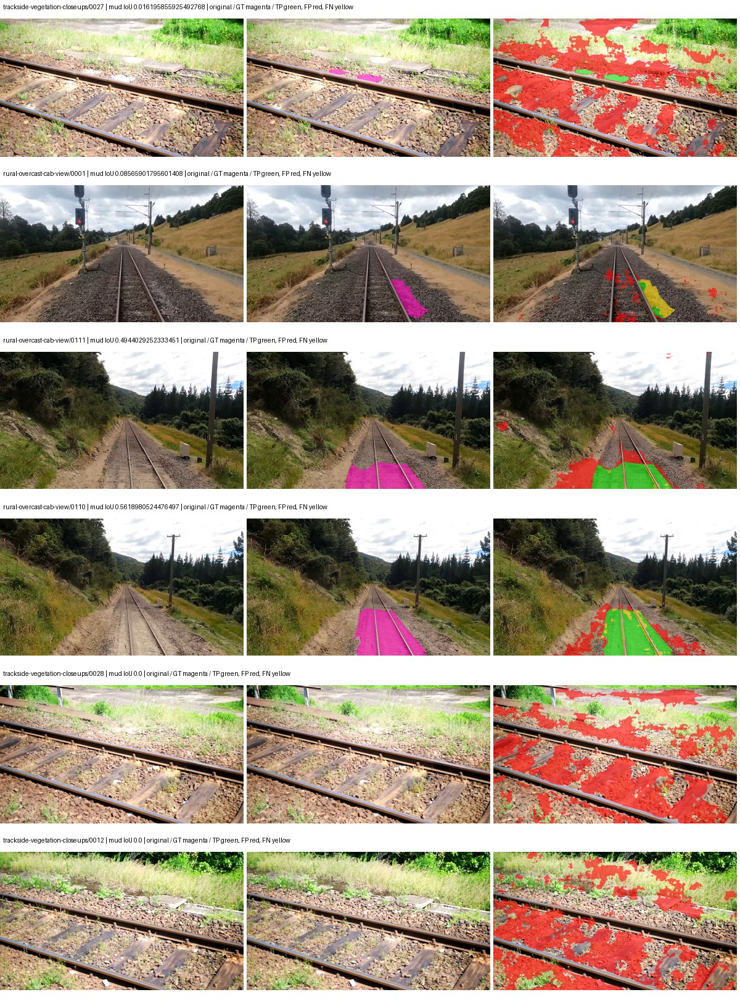
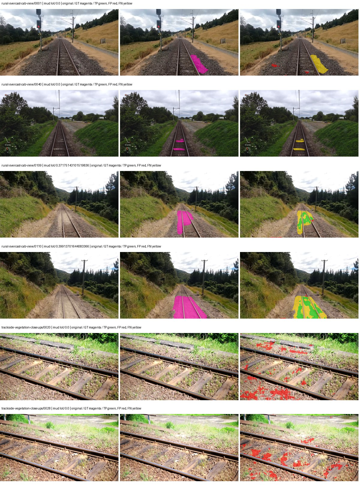
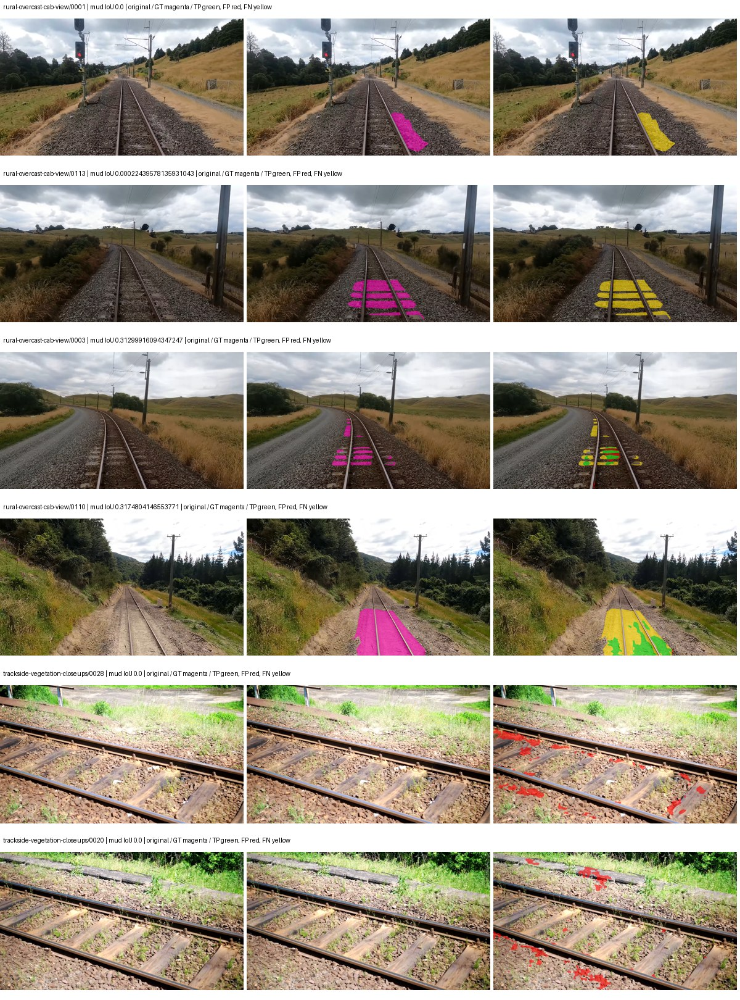
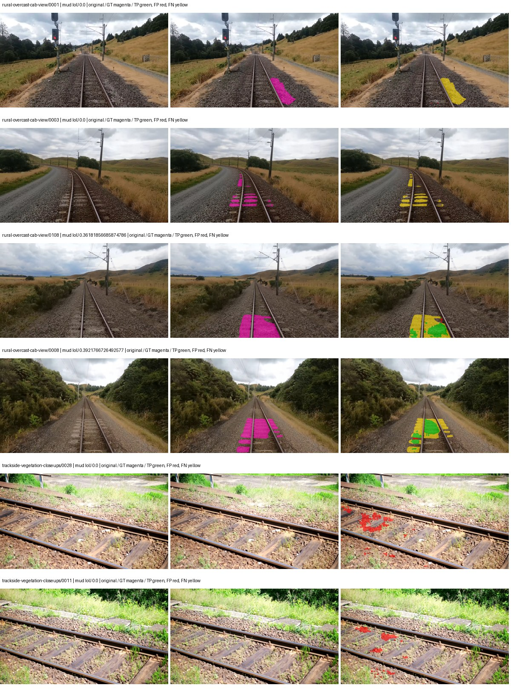

# smp_pan_resnext50 — rad_9_24_2026-fixed-grouped

[RAD 9/24: Scene-grouped split](../../README.md) · [Full model records](record.json)

Primary result: the **final checkpoint** after the full step budget (no early stopping). The checkpoint with the best **mud-pumping validation IoU, pixels pooled over all validation images**, is kept as secondary evidence. A job is complete only after full statistics and isolated profiling are verified.

Study metrics of the final checkpoint, counting each class only on the validation images that contain it: mud-pumping IoU is the mean per-image IoU over the images with mud-pumping, precision and recall sum pixels over those images, and mIoU averages each class over the images that contain it, then over the classes present.

| Initialization path | Seed | Mud-pumping IoU, train-camera images with mud (%, n=17) | Mud-pumping IoU, all images with mud (%, n=18) | Mud precision, all images with mud (%) | Mud recall, all images with mud (%) | mIoU (each class over images that contain it) (%) |
| --- | --- | --- | --- | --- | --- | --- |
| rtis_only | 0 | 6.48 | 6.53 | 50.41 | 9.11 | 33.31 |
| cityscapes_to_rtis | 0 | 3.01 | 3.05 | 20.42 | 4.63 | 30.81 |
| railsem19_to_rtis | 0 | 13.80 | 13.39 | 58.27 | 16.06 | 39.91 |
| cityscapes_to_railsem19_to_rtis | 0 | 7.89 | 7.51 | 40.18 | 10.43 | 36.47 |

Per-class IoU: IoU (%) of every class, each averaged only over the validation images that contain the class (n = those images); — = no image contains it. mIoU averages the classes with at least one such image.

| Initialization path | Seed | mIoU (each class over images that contain it) | person (n=0) | truck (n=0) | rail-track (n=37) | vegetation-overgrowth (n=13) | car (n=3) | on-rails (n=0) | traffic-sign (n=9) | road (n=11) | sidewalk (n=12) | construction (n=12) | tram-track (n=2) | pole (n=21) | traffic-light (n=3) | mud-pumping (n=18) | fence (n=7) | terrain (n=35) | sky (n=28) | rail-embedded (n=3) | rail-raised (n=37) | trackbed (n=37) | standing-water (n=9) |
| --- | --- | --- | --- | --- | --- | --- | --- | --- | --- | --- | --- | --- | --- | --- | --- | --- | --- | --- | --- | --- | --- | --- | --- |
| rtis_only | 0 | 33.31 | — | — | 51.76 | 23.17 | 22.82 | — | 21.81 | 6.86 | 6.79 | 40.48 | 2.74 | 60.36 | 39.65 | 6.53 | 16.09 | 81.42 | 87.47 | 2.26 | 67.37 | 60.22 | 1.77 |
| cityscapes_to_rtis | 0 | 30.81 | — | — | 46.83 | 24.23 | 19.25 | — | 21.80 | 6.99 | 5.24 | 29.32 | 2.84 | 57.65 | 32.92 | 3.05 | 20.91 | 75.40 | 81.01 | 1.27 | 67.24 | 56.44 | 2.18 |
| railsem19_to_rtis | 0 | 39.91 | — | — | 56.57 | 21.58 | 22.74 | — | 41.93 | 6.10 | 12.83 | 44.62 | 24.65 | 66.34 | 45.25 | 13.39 | 26.31 | 78.94 | 93.97 | 26.64 | 68.95 | 65.15 | 2.35 |
| cityscapes_to_railsem19_to_rtis | 0 | 36.47 | — | — | 54.12 | 27.48 | 29.39 | — | 27.84 | 12.05 | 9.62 | 37.90 | 16.69 | 61.33 | 35.84 | 7.51 | 25.72 | 79.70 | 86.09 | 11.76 | 68.51 | 62.59 | 2.34 |

Everything below is the campaign's own record, with pixels pooled over all validation images: its evaluation is the checkpoint that scored best on that pooled mud IoU (secondary evidence here); the diagnostics also cover the final checkpoint (`final-auto-val`).

| Model | Initialization path | Seed | Status | Steps | Best step | Best-checkpoint mud IoU, pixels pooled (%) | Best-checkpoint mud precision, pixels pooled (%) | Best-checkpoint mud recall, pixels pooled (%) | Final mud IoU (trainer val, pixels pooled, %) | Best-checkpoint mIoU, pixels pooled (%) | Best-checkpoint fixed GT-class mIoU, pixels pooled (%) |
| --- | --- | --- | --- | --- | --- | --- | --- | --- | --- | --- | --- |
| smp_pan_resnext50 | rtis_only | 0 | completed | 4000 | 518 | 10.97 | 11.70 | 63.59 | 4.80 | 22.65 | 26.43 |
| smp_pan_resnext50 | cityscapes_to_rtis | 0 | completed | 4000 | 2333 | 11.19 | 21.80 | 18.69 | 2.36 | 28.00 | 32.67 |
| smp_pan_resnext50 | railsem19_to_rtis | 0 | completed | 4000 | 1814 | 11.13 | 31.83 | 14.61 | 10.58 | 36.68 | 42.80 |
| smp_pan_resnext50 | cityscapes_to_railsem19_to_rtis | 0 | completed | 4000 | 1296 | 13.01 | 46.10 | 15.34 | 5.86 | 32.28 | 37.66 |

Training: 217 images. Validation: 37 images. Test: 60 held out. Seeds: [0]. Seed variation measures optimization variability, not independent-recording uncertainty. Historical source checkpoints stay fixed across adaptation seeds.

Training code: `fce0ea0ac50b334d4252812c396e0e593def375d`. Split SHA-256: `12d7b367c72cda61d57686ff2ac28223530d0af49debd9fb7a0fbc68b908bc93`.

## rtis_only — seed 0

Status: **completed**. Started: 2026-10-11T15:38:34.954489+00:00. Finished: 2026-10-11T16:21:13.981602+00:00.

Recipe pretrained initializer: `{"arch": "smp", "backbone_path": null, "batch_norm_momentum": null, "checkpoint": null, "classifier_path": null, "drop_path": null, "encoder_name": "resnext50_32x4d", "encoder_weights": "imagenet", "head": "unified_head", "head_paths": [], "inactive_parameter_paths": [], "local_files_only": false, "lora_alpha": 32, "lora_dropout": 0.05, "lora_r": 16, "lora_targets": [], "native": null, "revision": null, "smp_arch": "PAN", "subfolder": null, "trust_remote_code": false, "tuning": "full"}`.

`rtis_only` uses the recipe initializer, which may include pretrained segmentation components. Transfer paths load the exact historical source checkpoint below and reset the classifier; they do not reset all query/decoder features.

Source checkpoint: `Recipe pretrained initialization`.

Config SHA-256: `99d2b25b8829a438723a17344f3bc3684d010d5c1476513a66f147565312bb68`. Weights used for validation: `raw`.

### Mud-pumping and aggregate quality

| Metric | Selected checkpoint | Final training validation |
| --- | --- | --- |
| Mud IoU | 10.97 | 4.80 |
| Mud precision | 11.70 | 9.20 |
| Mud recall | 63.59 | 9.10 |
| Mud Dice/F1 | 19.77 | 9.15 |
| mIoU | 22.65 | 29.50 |
| Mean accuracy | 35.30 | 43.82 |
| Mean precision | 35.86 | 44.82 |
| Mean Dice | 29.28 | 38.59 |
| Mean specificity | 98.51 | 98.79 |
| Pixel accuracy | 76.93 | 80.73 |
| Frequency-weighted IoU | 65.55 | 70.62 |
| Fixed GT-present class mIoU | 26.43 | 34.42 |
| Boundary F1 | 24.77 | 36.09 |

The selected checkpoint has independent evaluation evidence. Final values are the trainer's final validation record, not a new independent evaluation. mIoU averages classes with nonzero union, so false positives on absent classes can change its denominator. The fixed GT-class mean is supplementary and excludes absent classes; their false positives remain in the confusion matrix.

### Resource usage and timing

| Measurement | Value |
| --- | --- |
| Peak training VRAM, retained training invocation (GiB) | 8.79 |
| Peak evaluation VRAM (GiB) | 6.71 |
| Retained training invocation wall time (seconds) | 2422.74 |
| Retained training invocation GPU-hours (one GPU) | 0.67 |
| Evaluation wall time (seconds) | 11.22 |
| Full evaluation pipeline images/second | 3.30 |
| Best full-state checkpoint (MiB) | 363.19 |
| Final full-state checkpoint (MiB) | 363.18 |
| Verified periodic checkpoints removed (GiB) | 2.84 |

VRAM uses the recorded allocator high-water mark; it is not total device usage including CUDA context. Resumed jobs' retained training invocation times and peaks are **not whole-campaign totals**. Earlier invocation resource records are not reconstructed here. Evaluation throughput includes loader, sliding-window inference and metrics; it is not model-only latency/FPS. Missing measurements are shown as —, never inferred from another dataset's run.

### Standardized inference performance

Dedicated model-only profiling waits for an idle worker-locked L40S: BF16, batch 1, 1024x1024, 20 warmup and 100 CUDA-event-timed public forwards. It excludes loading, preprocessing, tiling and metrics.

| Status | Parameters | Weight MiB | FPS | p50 ms | p95 ms | Peak reserved GiB |
| --- | --- | --- | --- | --- | --- | --- |
| complete | 23737468 | 90.55 | 183.15 | 5.43 | 5.78 | 0.40 |

```json
{
  "schema_version": 1,
  "model_id": "smp_pan_resnext50",
  "measured_at": "2026-10-11T16:21:09+00:00",
  "status": "complete",
  "benchmark_scope": "rtis_selected_checkpoint_model_only",
  "applies_to": [
    "smp_pan_resnext50--rtis_only--seed-0"
  ],
  "source": {
    "campaign_git_sha": "fce0ea0ac50b334d4252812c396e0e593def375d",
    "git_dirty": false,
    "config_hash": "25de6b1b81ee",
    "resolved_config": "/data/izadia1/projects/segmentary-runs/rad_9_24_2026/fgall-seed0-20261007/configs/smp_pan_resnext50--rtis_only--seed-0.yaml",
    "config_sha256": "99d2b25b8829a438723a17344f3bc3684d010d5c1476513a66f147565312bb68",
    "checkpoint_sha256": "7e313e9bcbb86e6e4972ce2f95e10e9c3f41843e93460fbf7e31649afe448ae2",
    "checkpoint_global_step": 518,
    "checkpoint_bytes": 380831750,
    "checkpoint_kind": "resume checkpoint with optimizer and EMA state",
    "weights": "raw",
    "measured_checkpoint_job_id": "smp_pan_resnext50--rtis_only--seed-0",
    "result_sha256": "72482566f7e2fabd4f84656c73c66742b086c731107dc8afe801ccd4b77fc266",
    "result_git_sha": "fce0ea0ac50b334d4252812c396e0e593def375d",
    "result_stage": "eval:rad_9_24_2026-fixed-grouped:val",
    "result_seed": 0
  },
  "hardware": {
    "gpu_name": "NVIDIA L40S",
    "gpu_uuid": "GPU-1c9b612f-e0b5-fbbc-150f-8c2ef13453c9",
    "logical_device": "cuda:0",
    "physical_visibility_token": "5",
    "compute_capability": [
      8,
      9
    ],
    "total_memory_bytes": 47677177856
  },
  "model": {
    "parameter_count": 23737468,
    "trainable_parameter_count": 23737468,
    "resident_parameter_bytes": 94949872,
    "parameter_dtype_counts": {
      "float32": 23737468
    }
  },
  "contract": {
    "backend": "pytorch",
    "precision": "bf16_autocast",
    "batch_size": 1,
    "input_shape_nchw": [
      1,
      3,
      1024,
      1024
    ],
    "warmup_iterations": 20,
    "measured_iterations": 100,
    "timing": "per-forward CUDA events with end-event synchronization",
    "includes_preprocessing": false,
    "includes_data_loader": false,
    "includes_sliding_window": false,
    "input_resident_on_gpu": true,
    "model_only": true,
    "entrypoint": "public model(image) dense-logits forward"
  },
  "measurements": {
    "latency": {
      "p50_ms": 5.4277119636535645,
      "p95_ms": 5.7842673540115355,
      "mean_ms": 5.460152969360352,
      "minimum_ms": 5.396480083465576,
      "maximum_ms": 5.964799880981445,
      "fps": 183.14505209130587,
      "raw_ms": [
        5.442560195922852,
        5.402624130249023,
        5.460991859436035,
        5.405695915222168,
        5.408768177032471,
        5.404672145843506,
        5.5808000564575195,
        5.411839962005615,
        5.396480083465576,
        5.586944103240967,
        5.422080039978027,
        5.409791946411133,
        5.42412805557251,
        5.409791946411133,
        5.406720161437988,
        5.591040134429932,
        5.898240089416504,
        5.437407970428467,
        5.847040176391602,
        5.409791946411133,
        5.413887977600098,
        5.410816192626953,
        5.414912223815918,
        5.411839962005615,
        5.430272102355957,
        5.4128642082214355,
        5.414912223815918,
        5.414912223815918,
        5.411839962005615,
        5.410816192626953,
        5.783552169799805,
        5.4231038093566895,
        5.797855854034424,
        5.422080039978027,
        5.4231038093566895,
        5.416959762573242,
        5.421055793762207,
        5.410816192626953,
        5.4036478996276855,
        5.421055793762207,
        5.410816192626953,
        5.41593599319458,
        5.419007778167725,
        5.814271926879883,
        5.4323201179504395,
        5.423136234283447,
        5.418975830078125,
        5.41593599319458,
        5.422111988067627,
        5.416959762573242,
        5.429247856140137,
        5.437439918518066,
        5.419040203094482,
        5.4323201179504395,
        5.428224086761475,
        5.436416149139404,
        5.429247856140137,
        5.435391902923584,
        5.431295871734619,
        5.420032024383545,
        5.454847812652588,
        5.443583965301514,
        5.426176071166992,
        5.435391902923584,
        5.42412805557251,
        5.430272102355957,
        5.426176071166992,
        5.425151824951172,
        5.427199840545654,
        5.427199840545654,
        5.964799880981445,
        5.438464164733887,
        5.41593599319458,
        5.428224086761475,
        5.434368133544922,
        5.4323201179504395,
        5.434368133544922,
        5.433343887329102,
        5.445631980895996,
        5.665791988372803,
        5.436416149139404,
        5.426239967346191,
        5.428224086761475,
        5.430272102355957,
        5.430272102355957,
        5.428224086761475,
        5.437439918518066,
        5.428224086761475,
        5.718016147613525,
        5.431295871734619,
        5.435391902923584,
        5.436416149139404,
        5.42412805557251,
        5.421055793762207,
        5.433343887329102,
        5.430272102355957,
        5.429247856140137,
        5.4231038093566895,
        5.429247856140137,
        5.429247856140137
      ],
      "percentile_method": "numpy linear interpolation"
    },
    "peak_reserved_bytes": 429916160,
    "memory_kind": "pytorch_cuda_allocator_peak_reserved_excluding_context",
    "process_total_bytes": 958398464,
    "process_total_kind": "nvidia-smi used_memory of this PID on the benchmark GPU after the timed loop, including the CUDA context; null when the driver could not attribute memory to this PID",
    "benchmark_wall_clock_s": 12.337178319692612
  },
  "started_at": "2026-10-11T16:20:56+00:00",
  "finished_at": "2026-10-11T16:21:09+00:00",
  "environment": {
    "hostname": "hdrfs-app-001",
    "python": "3.11.15",
    "platform": "Linux-5.15.0-139-generic-x86_64-with-glibc2.35",
    "torch": "2.11.0+cu128",
    "torch_cuda": "12.8",
    "cudnn": 91900,
    "driver_version": "570.133.20",
    "cuda_available": true,
    "gpu_count": 1,
    "gpu_names": [
      "NVIDIA L40S"
    ],
    "cuda_visible_devices": "5",
    "packages": {
      "segmentary": "0.1.0",
      "torch": "2.11.0+cu128",
      "torchvision": "0.26.0+cu128",
      "transformers": "5.15.0",
      "timm": "1.0.28",
      "segmentation-models-pytorch": "0.5.0",
      "albumentations": "2.0.8",
      "lightning": "2.6.5",
      "numpy": "2.4.4"
    }
  }
}
```

### Per-class validation results

| Class | GT pixels | IoU (%) | Precision (%) | Recall (%) | Dice (%) | Boundary F1 (%) |
| --- | --- | --- | --- | --- | --- | --- |
| car | 29664 | 0.00 | 0.00 | 0.00 | 0.00 | 0.00 |
| construction | 311585 | 32.41 | 41.17 | 60.38 | 48.95 | 34.41 |
| fence | 265137 | 2.80 | 11.14 | 3.61 | 5.45 | 10.51 |
| mud-pumping | 1226250 | 10.97 | 11.70 | 63.59 | 19.77 | 15.69 |
| on-rails | 0 | 0.00 | 0.00 | — | 0.00 | 0.00 |
| person | 0 | 0.00 | 0.00 | — | 0.00 | 0.00 |
| pole | 628038 | 52.33 | 77.72 | 61.57 | 68.71 | 80.24 |
| rail-embedded | 16799 | 0.00 | 0.00 | 0.00 | 0.00 | 0.00 |
| rail-raised | 2969797 | 70.04 | 76.24 | 89.59 | 82.38 | 85.56 |
| rail-track | 6323197 | 22.83 | 77.09 | 24.49 | 37.17 | 36.09 |
| road | 1048831 | 0.57 | 2.89 | 0.71 | 1.14 | 2.60 |
| sidewalk | 1297367 | 28.83 | 87.39 | 30.08 | 44.76 | 7.55 |
| sky | 19121606 | 85.45 | 99.53 | 85.80 | 92.16 | 65.81 |
| standing-water | 95802 | 0.30 | 0.35 | 2.21 | 0.60 | 2.76 |
| terrain | 39239306 | 79.84 | 81.74 | 97.17 | 88.79 | 39.43 |
| trackbed | 10643081 | 56.88 | 71.48 | 73.57 | 72.51 | 50.06 |
| traffic-light | 19510 | 27.71 | 50.84 | 37.84 | 43.39 | 47.38 |
| traffic-sign | 13285 | 0.02 | 0.28 | 0.02 | 0.04 | 1.54 |
| tram-track | 56179 | 0.04 | 0.43 | 0.04 | 0.08 | 5.66 |
| truck | 0 | 0.00 | 0.00 | — | 0.00 | 0.00 |
| vegetation-overgrowth | 5901821 | 4.67 | 62.97 | 4.80 | 8.92 | 34.78 |

### Full-run accounting

| Measurement | Value |
| --- | --- |
| Full GPU-reserved wall seconds, all recorded worker attempts | 2566.88 |
| Full reserved GPU-hours | 0.71 |
| Whole-run timing complete | True |

| Phase | Wall seconds including failed attempts |
| --- | --- |
| training | 2429.83 |
| diagnostics | 85.38 |
| performance | 20.46 |

GPU-reserved time includes model loading, training, validation, collection, profiling, checkpoint I/O and orchestration while the worker owns one GPU. It is not GPU kernel-active time. Phase timings and sampled device memory/power/utilization are retained separately; sampled device memory is not the allocator high-water mark.

### Train/validation and raw/EMA diagnostics

| Checkpoint / weights / split | Images | Mud IoU (%) | Mud precision (%) | Mud recall (%) |
| --- | --- | --- | --- | --- |
| best-auto-train / raw | 217 | 78.49 | 86.95 | 88.97 |
| best-auto-val / raw | 37 | 10.97 | 11.70 | 63.59 |
| best-alternate-val / ema | 37 | 0.04 | 0.95 | 0.04 |
| final-auto-val / raw | 37 | 4.80 | 9.21 | 9.11 |

Train uses the evaluation transform without augmentation. Compare mud train/validation metrics for the same selected weights. Alternate EMA on running-stat BatchNorm is explicitly uncalibrated and is diagnostic only. Score-threshold curves use uncalibrated normalized scores and are pixel-level diagnostics, not event detection rates or a selected deployment operating point.

### Downloadable evidence

- best-auto-train: [per-image.csv](rtis_only--seed-0/best-auto-train/per-image.csv) · [per-image-confusion.json.gz](rtis_only--seed-0/best-auto-train/per-image-confusion.json.gz) · [groups.json](rtis_only--seed-0/best-auto-train/groups.json) · [mud-score-curves.json](rtis_only--seed-0/best-auto-train/mud-score-curves.json)
- best-auto-val: [per-image.csv](rtis_only--seed-0/best-auto-val/per-image.csv) · [per-image-confusion.json.gz](rtis_only--seed-0/best-auto-val/per-image-confusion.json.gz) · [groups.json](rtis_only--seed-0/best-auto-val/groups.json) · [mud-score-curves.json](rtis_only--seed-0/best-auto-val/mud-score-curves.json) · [examples.jpg](rtis_only--seed-0/best-auto-val/examples.jpg)
- best-alternate-val: [per-image.csv](rtis_only--seed-0/best-alternate-val/per-image.csv) · [per-image-confusion.json.gz](rtis_only--seed-0/best-alternate-val/per-image-confusion.json.gz) · [groups.json](rtis_only--seed-0/best-alternate-val/groups.json) · [mud-score-curves.json](rtis_only--seed-0/best-alternate-val/mud-score-curves.json)
- final-auto-val: [per-image.csv](rtis_only--seed-0/final-auto-val/per-image.csv) · [per-image-confusion.json.gz](rtis_only--seed-0/final-auto-val/per-image-confusion.json.gz) · [groups.json](rtis_only--seed-0/final-auto-val/groups.json) · [mud-score-curves.json](rtis_only--seed-0/final-auto-val/mud-score-curves.json)
- resources: [telemetry.csv](rtis_only--seed-0/resources/telemetry.csv)



Examples are two lowest and two highest mud-IoU positive images, plus up to two negative images with the most false-positive mud pixels. They are targeted diagnostic examples, not random samples. Green: true positive; red: false positive; yellow: false negative. Full predictions remain on HDRFS.

### Validation tracking

| Logged step | Overall mIoU (%) | Mud IoU (%) |
| --- | --- | --- |
| 258 | 18.15 | 0.66 |
| 518 | 22.66 | 10.98 |
| 777 | 23.17 | 3.20 |
| 1036 | 26.60 | 1.47 |
| 1295 | 25.52 | 1.10 |
| 1555 | 27.51 | 0.57 |
| 1814 | 27.86 | 1.81 |
| 2073 | 26.94 | 1.12 |
| 2332 | 27.05 | 1.76 |
| 2592 | 28.39 | 5.36 |
| 2851 | 28.69 | 3.82 |
| 3110 | 27.77 | 2.97 |
| 3369 | 27.82 | 5.32 |
| 3629 | 29.39 | 8.16 |
| 3888 | 29.36 | 5.25 |
| 4000 | 29.50 | 4.80 |

All retained scalar curves, including training loss and per-class IoU, are in record.json. Observed best mud on a curve is not necessarily a retained checkpoint: the pilot saved its selection-metric-best and final checkpoints. Step logging and checkpoint global_step may differ by one.

### Stopping and checkpoint provenance

```json
{
  "stopping": {
    "actual_steps": 4000,
    "maximum_steps": 4000,
    "min_delta": 0.0,
    "monitor": "val_iou/mud-pumping",
    "patience": null,
    "reason": "budget_complete"
  },
  "checkpoints": {
    "best": {
      "path": "/data/izadia1/projects/segmentary-runs/rad_9_24_2026/fgall-seed0-20261007/future-runs/smp_pan_resnext50--rtis_only--seed-0_seed0/rtis/best.ckpt",
      "sha256": "7e313e9bcbb86e6e4972ce2f95e10e9c3f41843e93460fbf7e31649afe448ae2",
      "global_step": 518,
      "bytes": 380831750
    },
    "final": {
      "path": "/data/izadia1/projects/segmentary-runs/rad_9_24_2026/fgall-seed0-20261007/future-runs/smp_pan_resnext50--rtis_only--seed-0_seed0/rtis/last.ckpt",
      "sha256": "3fe19408bd75563dc197b226a781ab136a168b74e7712a9ea58d342758748adb",
      "global_step": 4000,
      "bytes": 380817926
    }
  },
  "cleanup_error": null
}
```

### Resolved training, initialization and evaluation settings

The optimizer block is the base configuration. Stage LR scales are applied at runtime, and stage warmup is capped at min(base warmup, floor(stage budget / 10), stage budget - 1): 400 steps for this 4,000-step pilot. Model-internal native input grids may differ from augmentation crops (EoMT uses its 640 grid).

```json
{
  "name": "smp_pan_resnext50--rtis_only--seed-0",
  "model": {
    "arch": "smp",
    "checkpoint": null,
    "tuning": "full",
    "head": "unified_head",
    "lora_r": 16,
    "lora_alpha": 32,
    "lora_dropout": 0.05,
    "lora_targets": [],
    "drop_path": null,
    "revision": null,
    "subfolder": null,
    "local_files_only": false,
    "trust_remote_code": false,
    "backbone_path": null,
    "head_paths": [],
    "classifier_path": null,
    "inactive_parameter_paths": [],
    "smp_arch": "PAN",
    "encoder_name": "resnext50_32x4d",
    "encoder_weights": "imagenet",
    "native": null,
    "batch_norm_momentum": null
  },
  "space": "paul-test-rtis",
  "taxonomy_root": "/data/izadia1/projects/segmentary-rad-fgall-fce0ea0a/taxonomy",
  "output_root": "/data/izadia1/projects/segmentary-runs/rad_9_24_2026/fgall-seed0-20261007/future-runs",
  "optim": {
    "backbone_lr": 0.0001,
    "head_lr_mult": 10.0,
    "weight_decay": 0.05,
    "llrd": 1.0,
    "warmup_iters": 1500,
    "warmup_ratio": 1e-06,
    "poly_power": 0.9,
    "min_lr_ratio": 0.0,
    "betas": [
      0.9,
      0.999
    ],
    "grad_clip": 1.0
  },
  "train": {
    "iters": 4000,
    "batch_size": 2,
    "accum": 8,
    "num_workers": 2,
    "precision": "bf16-mixed",
    "ema_decay": 0.9998,
    "val_every": 250,
    "ckpt_every": 500,
    "selection_metric": "val_iou/mud-pumping",
    "early_stopping_patience": null,
    "early_stopping_min_delta": 0.0,
    "seed": 0,
    "devices": 1
  },
  "eval": {
    "sliding_window": true,
    "window": [
      1024,
      1024
    ],
    "stride": [
      768,
      768
    ],
    "batch_size": 1,
    "num_workers": 2,
    "tta_scales": [],
    "tta_flip": false,
    "threshold": 0.5,
    "boundary_tolerance_frac": 0.0075,
    "save_confusion": true
  },
  "loss": {
    "task": "multiclass",
    "activation": "auto",
    "terms": [],
    "aux": "none",
    "aux_weight": 0.0,
    "ce_weight": 1.0,
    "label_smoothing": 0.0,
    "class_weights": null,
    "query": null
  },
  "aug": {
    "crop": [
      1024,
      1024
    ],
    "scale_min": 0.5,
    "scale_max": 2.0,
    "hflip_p": 0.5,
    "color_jitter_p": 0.5,
    "brightness": 0.25,
    "contrast": 0.25,
    "saturation": 0.25,
    "hue": 0.05
  },
  "stages": [
    {
      "name": "rtis",
      "data": [
        {
          "name": "rad_9_24_2026-fixed-grouped",
          "root": "/data/izadia1/datasets/rad_9_24_2026-fixed-grouped",
          "variant": null,
          "split_file": "splits.json",
          "train_split": "train",
          "val_split": "val",
          "limit": null,
          "loader": "folder",
          "mapping": "paul-test-rtis",
          "loader_options": {
            "require_groups": true
          }
        }
      ],
      "iters": null,
      "lr_scale": 1.0,
      "head_group_lr_scale": 1.0,
      "init_from": "pretrained",
      "reset_head": false,
      "freeze": null,
      "sample_weights": null
    }
  ]
}
```

### Hardware and software provenance

```json
{
  "training": {
    "cuda_available": true,
    "cuda_visible_devices": "5",
    "cudnn": 91900,
    "driver_version": "570.133.20",
    "gpu_count": 1,
    "gpu_names": [
      "NVIDIA L40S"
    ],
    "hostname": "hdrfs-app-001",
    "input_normalization": {
      "channel_order": "rgb",
      "mean": [
        0.485,
        0.456,
        0.406
      ],
      "source": "smp_encoder_settings",
      "std": [
        0.229,
        0.224,
        0.225
      ]
    },
    "model_origins": [
      {
        "hf_commit": null,
        "hf_name_or_path": null,
        "module": "model",
        "timm_pretrained": {}
      }
    ],
    "model_parameter_count": 23737468,
    "packages": {
      "albumentations": "2.0.8",
      "lightning": "2.6.5",
      "numpy": "2.4.4",
      "segmentary": "0.1.0",
      "segmentation-models-pytorch": "0.5.0",
      "timm": "1.0.28",
      "torch": "2.11.0+cu128",
      "torchvision": "0.26.0+cu128",
      "transformers": "5.15.0"
    },
    "platform": "Linux-5.15.0-139-generic-x86_64-with-glibc2.35",
    "python": "3.11.15",
    "torch": "2.11.0+cu128",
    "torch_cuda": "12.8",
    "trainable_parameter_count": 23737468,
    "training_stop": {
      "actual_steps": 4000,
      "maximum_steps": 4000,
      "min_delta": 0.0,
      "monitor": "val_iou/mud-pumping",
      "patience": null,
      "reason": "budget_complete"
    },
    "validation_weights": "raw"
  },
  "evaluation": {
    "cuda_available": true,
    "cuda_visible_devices": "5",
    "cudnn": 91900,
    "driver_version": "570.133.20",
    "gpu_count": 1,
    "gpu_names": [
      "NVIDIA L40S"
    ],
    "hostname": "hdrfs-app-001",
    "input_normalization": {
      "channel_order": "rgb",
      "mean": [
        0.485,
        0.456,
        0.406
      ],
      "source": "smp_encoder_settings",
      "std": [
        0.229,
        0.224,
        0.225
      ]
    },
    "packages": {
      "albumentations": "2.0.8",
      "lightning": "2.6.5",
      "numpy": "2.4.4",
      "segmentary": "0.1.0",
      "segmentation-models-pytorch": "0.5.0",
      "timm": "1.0.28",
      "torch": "2.11.0+cu128",
      "torchvision": "0.26.0+cu128",
      "transformers": "5.15.0"
    },
    "platform": "Linux-5.15.0-139-generic-x86_64-with-glibc2.35",
    "python": "3.11.15",
    "torch": "2.11.0+cu128",
    "torch_cuda": "12.8"
  }
}
```

## cityscapes_to_rtis — seed 0

Status: **completed**. Started: 2026-10-11T15:40:57.530913+00:00. Finished: 2026-10-11T16:24:31.022733+00:00.

Recipe pretrained initializer: `{"arch": "smp", "backbone_path": null, "batch_norm_momentum": null, "checkpoint": null, "classifier_path": null, "drop_path": null, "encoder_name": "resnext50_32x4d", "encoder_weights": "imagenet", "head": "unified_head", "head_paths": [], "inactive_parameter_paths": [], "local_files_only": false, "lora_alpha": 32, "lora_dropout": 0.05, "lora_r": 16, "lora_targets": [], "native": null, "revision": null, "smp_arch": "PAN", "subfolder": null, "trust_remote_code": false, "tuning": "full"}`.

`rtis_only` uses the recipe initializer, which may include pretrained segmentation components. Transfer paths load the exact historical source checkpoint below and reset the classifier; they do not reset all query/decoder features.

Source checkpoint: `{'name': 'smp_pan_resnext50--cityscapes--seed-0', 'model': 'smp_pan_resnext50', 'protocol': 'cityscapes', 'config': '/data/izadia1/projects/segmentary-runs/all-model-city-rail-seed0-rail20-b9eb3e1/accepted/smp_pan_resnext50--cityscapes--seed-0/resolved-config.yaml', 'checkpoint': '/data/izadia1/projects/segmentary-runs/current-main-fill-v2/jobs/smp_pan_resnext50--cityscapes--seed-0/train/smp_pan_resnext50--cityscapes_seed0/cityscapes/last.ckpt', 'recorded_sha256': 'a546b41da5f9cd1dcc82f834e0bd55dd9663f6e41762c35a0632d69d5aa7a87c', 'exists': True}`.

Config SHA-256: `8596d34d418f131262ba5d294b2b013473936bd7cefc585ca0edc8f9025217e2`. Weights used for validation: `raw`.

### Mud-pumping and aggregate quality

| Metric | Selected checkpoint | Final training validation |
| --- | --- | --- |
| Mud IoU | 11.19 | 2.36 |
| Mud precision | 21.80 | 4.56 |
| Mud recall | 18.69 | 4.65 |
| Mud Dice/F1 | 20.13 | 4.60 |
| mIoU | 28.00 | 27.05 |
| Mean accuracy | 43.27 | 42.52 |
| Mean precision | 48.71 | 45.98 |
| Mean Dice | 36.96 | 35.88 |
| Mean specificity | 98.53 | 98.46 |
| Pixel accuracy | 77.43 | 75.44 |
| Frequency-weighted IoU | 66.52 | 64.55 |
| Fixed GT-present class mIoU | 32.67 | 31.55 |
| Boundary F1 | 34.94 | 34.54 |

The selected checkpoint has independent evaluation evidence. Final values are the trainer's final validation record, not a new independent evaluation. mIoU averages classes with nonzero union, so false positives on absent classes can change its denominator. The fixed GT-class mean is supplementary and excludes absent classes; their false positives remain in the confusion matrix.

### Resource usage and timing

| Measurement | Value |
| --- | --- |
| Peak training VRAM, retained training invocation (GiB) | 8.79 |
| Peak evaluation VRAM (GiB) | 6.71 |
| Retained training invocation wall time (seconds) | 2475.13 |
| Retained training invocation GPU-hours (one GPU) | 0.69 |
| Evaluation wall time (seconds) | 12.03 |
| Full evaluation pipeline images/second | 3.07 |
| Best full-state checkpoint (MiB) | 363.19 |
| Final full-state checkpoint (MiB) | 363.18 |
| Verified periodic checkpoints removed (GiB) | 2.84 |

VRAM uses the recorded allocator high-water mark; it is not total device usage including CUDA context. Resumed jobs' retained training invocation times and peaks are **not whole-campaign totals**. Earlier invocation resource records are not reconstructed here. Evaluation throughput includes loader, sliding-window inference and metrics; it is not model-only latency/FPS. Missing measurements are shown as —, never inferred from another dataset's run.

### Standardized inference performance

Dedicated model-only profiling waits for an idle worker-locked L40S: BF16, batch 1, 1024x1024, 20 warmup and 100 CUDA-event-timed public forwards. It excludes loading, preprocessing, tiling and metrics.

| Status | Parameters | Weight MiB | FPS | p50 ms | p95 ms | Peak reserved GiB |
| --- | --- | --- | --- | --- | --- | --- |
| complete | 23737468 | 90.55 | 182.19 | 5.45 | 5.80 | 0.40 |

```json
{
  "schema_version": 1,
  "model_id": "smp_pan_resnext50",
  "measured_at": "2026-10-11T16:24:25+00:00",
  "status": "complete",
  "benchmark_scope": "rtis_selected_checkpoint_model_only",
  "applies_to": [
    "smp_pan_resnext50--cityscapes_to_rtis--seed-0"
  ],
  "source": {
    "campaign_git_sha": "fce0ea0ac50b334d4252812c396e0e593def375d",
    "git_dirty": false,
    "config_hash": "c2434d4aaa77",
    "resolved_config": "/data/izadia1/projects/segmentary-runs/rad_9_24_2026/fgall-seed0-20261007/configs/smp_pan_resnext50--cityscapes_to_rtis--seed-0.yaml",
    "config_sha256": "8596d34d418f131262ba5d294b2b013473936bd7cefc585ca0edc8f9025217e2",
    "checkpoint_sha256": "35f265c66acb1e35906d8bdf17e603ca8199c717005ff007e5c16490cb0b0037",
    "checkpoint_global_step": 2333,
    "checkpoint_bytes": 380831814,
    "checkpoint_kind": "resume checkpoint with optimizer and EMA state",
    "weights": "raw",
    "measured_checkpoint_job_id": "smp_pan_resnext50--cityscapes_to_rtis--seed-0",
    "result_sha256": "7d9a3c678f322128d81ea19ab2efcfd5dddecf0de3ca144b586391bc2cd9888b",
    "result_git_sha": "fce0ea0ac50b334d4252812c396e0e593def375d",
    "result_stage": "eval:rad_9_24_2026-fixed-grouped:val",
    "result_seed": 0
  },
  "hardware": {
    "gpu_name": "NVIDIA L40S",
    "gpu_uuid": "GPU-fc5dde96-210d-0afa-ac74-7f88477d622b",
    "logical_device": "cuda:0",
    "physical_visibility_token": "4",
    "compute_capability": [
      8,
      9
    ],
    "total_memory_bytes": 47677177856
  },
  "model": {
    "parameter_count": 23737468,
    "trainable_parameter_count": 23737468,
    "resident_parameter_bytes": 94949872,
    "parameter_dtype_counts": {
      "float32": 23737468
    }
  },
  "contract": {
    "backend": "pytorch",
    "precision": "bf16_autocast",
    "batch_size": 1,
    "input_shape_nchw": [
      1,
      3,
      1024,
      1024
    ],
    "warmup_iterations": 20,
    "measured_iterations": 100,
    "timing": "per-forward CUDA events with end-event synchronization",
    "includes_preprocessing": false,
    "includes_data_loader": false,
    "includes_sliding_window": false,
    "input_resident_on_gpu": true,
    "model_only": true,
    "entrypoint": "public model(image) dense-logits forward"
  },
  "measurements": {
    "latency": {
      "p50_ms": 5.454335927963257,
      "p95_ms": 5.801673650741577,
      "mean_ms": 5.488654699325561,
      "minimum_ms": 5.438496112823486,
      "maximum_ms": 6.159359931945801,
      "fps": 182.19400832828464,
      "raw_ms": [
        5.4824957847595215,
        5.800960063934326,
        5.4476799964904785,
        5.446623802185059,
        5.439487934112549,
        5.450751781463623,
        5.438496112823486,
        5.863423824310303,
        5.451648235321045,
        5.448703765869141,
        5.666816234588623,
        5.445631980895996,
        5.450751781463623,
        5.451776027679443,
        5.45689582824707,
        5.4508161544799805,
        5.6943359375,
        5.455872058868408,
        5.4476799964904785,
        5.4527997970581055,
        5.454847812652588,
        5.458943843841553,
        5.445631980895996,
        5.4527997970581055,
        5.442560195922852,
        5.460991859436035,
        5.444608211517334,
        5.679103851318359,
        6.159359931945801,
        5.4476799964904785,
        5.448575973510742,
        5.44163179397583,
        5.4620161056518555,
        5.457920074462891,
        5.4508161544799805,
        5.444608211517334,
        5.455872058868408,
        5.4476799964904785,
        5.4620161056518555,
        5.448703765869141,
        5.448703765869141,
        5.5316481590271,
        5.449728012084961,
        5.453824043273926,
        5.446656227111816,
        5.448703765869141,
        5.457920074462891,
        5.448703765869141,
        5.459968090057373,
        5.4476799964904785,
        5.445631980895996,
        5.450751781463623,
        5.4527997970581055,
        5.498879909515381,
        5.468160152435303,
        5.449728012084961,
        5.453824043273926,
        5.459968090057373,
        5.4496002197265625,
        5.460991859436035,
        5.459871768951416,
        5.4476799964904785,
        5.445631980895996,
        5.4476799964904785,
        5.4620161056518555,
        5.451776027679443,
        5.446656227111816,
        5.889023780822754,
        5.450751781463623,
        5.449728012084961,
        5.455743789672852,
        5.445631980895996,
        5.462912082672119,
        5.459968090057373,
        5.45689582824707,
        5.469183921813965,
        5.446656227111816,
        5.464064121246338,
        5.454847812652588,
        5.859327793121338,
        5.45689582824707,
        5.464064121246338,
        5.459968090057373,
        5.460991859436035,
        5.445631980895996,
        5.4620161056518555,
        5.449728012084961,
        5.476352214813232,
        5.815231800079346,
        5.458943843841553,
        5.47430419921875,
        5.445631980895996,
        5.464064121246338,
        5.459968090057373,
        5.463039875030518,
        5.457024097442627,
        5.4476799964904785,
        5.454847812652588,
        5.459968090057373,
        5.469183921813965
      ],
      "percentile_method": "numpy linear interpolation"
    },
    "peak_reserved_bytes": 429916160,
    "memory_kind": "pytorch_cuda_allocator_peak_reserved_excluding_context",
    "process_total_bytes": 958398464,
    "process_total_kind": "nvidia-smi used_memory of this PID on the benchmark GPU after the timed loop, including the CUDA context; null when the driver could not attribute memory to this PID",
    "benchmark_wall_clock_s": 12.525304965674877
  },
  "started_at": "2026-10-11T16:24:13+00:00",
  "finished_at": "2026-10-11T16:24:25+00:00",
  "environment": {
    "hostname": "hdrfs-app-001",
    "python": "3.11.15",
    "platform": "Linux-5.15.0-139-generic-x86_64-with-glibc2.35",
    "torch": "2.11.0+cu128",
    "torch_cuda": "12.8",
    "cudnn": 91900,
    "driver_version": "570.133.20",
    "cuda_available": true,
    "gpu_count": 1,
    "gpu_names": [
      "NVIDIA L40S"
    ],
    "cuda_visible_devices": "4",
    "packages": {
      "segmentary": "0.1.0",
      "torch": "2.11.0+cu128",
      "torchvision": "0.26.0+cu128",
      "transformers": "5.15.0",
      "timm": "1.0.28",
      "segmentation-models-pytorch": "0.5.0",
      "albumentations": "2.0.8",
      "lightning": "2.6.5",
      "numpy": "2.4.4"
    }
  }
}
```

### Per-class validation results

| Class | GT pixels | IoU (%) | Precision (%) | Recall (%) | Dice (%) | Boundary F1 (%) |
| --- | --- | --- | --- | --- | --- | --- |
| car | 29664 | 44.42 | 69.52 | 55.16 | 61.52 | 45.91 |
| construction | 311585 | 13.19 | 14.11 | 67.01 | 23.30 | 14.88 |
| fence | 265137 | 15.13 | 63.05 | 16.60 | 26.29 | 34.93 |
| mud-pumping | 1226250 | 11.19 | 21.80 | 18.69 | 20.13 | 13.43 |
| on-rails | 0 | 0.00 | 0.00 | — | 0.00 | 0.00 |
| person | 0 | 0.00 | 0.00 | — | 0.00 | 0.00 |
| pole | 628038 | 55.45 | 83.38 | 62.34 | 71.34 | 86.62 |
| rail-embedded | 16799 | 2.64 | 66.18 | 2.68 | 5.15 | 11.20 |
| rail-raised | 2969797 | 71.96 | 79.75 | 88.05 | 83.69 | 88.80 |
| rail-track | 6323197 | 32.62 | 62.31 | 40.63 | 49.19 | 42.35 |
| road | 1048831 | 2.10 | 3.95 | 4.31 | 4.12 | 2.77 |
| sidewalk | 1297367 | 10.10 | 31.50 | 12.95 | 18.35 | 12.84 |
| sky | 19121606 | 88.89 | 99.29 | 89.46 | 94.12 | 70.22 |
| standing-water | 95802 | 1.26 | 1.29 | 36.78 | 2.49 | 3.48 |
| terrain | 39239306 | 76.45 | 80.59 | 93.70 | 86.65 | 42.02 |
| trackbed | 10643081 | 61.56 | 77.37 | 75.07 | 76.21 | 57.31 |
| traffic-light | 19510 | 42.60 | 80.88 | 47.37 | 59.75 | 72.77 |
| traffic-sign | 13285 | 34.54 | 84.84 | 36.82 | 51.35 | 64.09 |
| tram-track | 56179 | 9.54 | 18.40 | 16.55 | 17.42 | 22.81 |
| truck | 0 | 0.00 | 0.00 | — | 0.00 | 0.00 |
| vegetation-overgrowth | 5901821 | 14.32 | 84.68 | 14.70 | 25.05 | 47.40 |

### Full-run accounting

| Measurement | Value |
| --- | --- |
| Full GPU-reserved wall seconds, all recorded worker attempts | 2621.65 |
| Full reserved GPU-hours | 0.73 |
| Whole-run timing complete | True |

| Phase | Wall seconds including failed attempts |
| --- | --- |
| training | 2482.30 |
| diagnostics | 86.01 |
| performance | 20.91 |

GPU-reserved time includes model loading, training, validation, collection, profiling, checkpoint I/O and orchestration while the worker owns one GPU. It is not GPU kernel-active time. Phase timings and sampled device memory/power/utilization are retained separately; sampled device memory is not the allocator high-water mark.

### Train/validation and raw/EMA diagnostics

| Checkpoint / weights / split | Images | Mud IoU (%) | Mud precision (%) | Mud recall (%) |
| --- | --- | --- | --- | --- |
| best-auto-train / raw | 217 | 87.66 | 93.94 | 92.92 |
| best-auto-val / raw | 37 | 11.19 | 21.80 | 18.69 |
| best-alternate-val / ema | 37 | 2.45 | 21.73 | 2.68 |
| final-auto-val / raw | 37 | 2.35 | 4.54 | 4.63 |

Train uses the evaluation transform without augmentation. Compare mud train/validation metrics for the same selected weights. Alternate EMA on running-stat BatchNorm is explicitly uncalibrated and is diagnostic only. Score-threshold curves use uncalibrated normalized scores and are pixel-level diagnostics, not event detection rates or a selected deployment operating point.

### Downloadable evidence

- best-auto-train: [per-image.csv](cityscapes_to_rtis--seed-0/best-auto-train/per-image.csv) · [per-image-confusion.json.gz](cityscapes_to_rtis--seed-0/best-auto-train/per-image-confusion.json.gz) · [groups.json](cityscapes_to_rtis--seed-0/best-auto-train/groups.json) · [mud-score-curves.json](cityscapes_to_rtis--seed-0/best-auto-train/mud-score-curves.json)
- best-auto-val: [per-image.csv](cityscapes_to_rtis--seed-0/best-auto-val/per-image.csv) · [per-image-confusion.json.gz](cityscapes_to_rtis--seed-0/best-auto-val/per-image-confusion.json.gz) · [groups.json](cityscapes_to_rtis--seed-0/best-auto-val/groups.json) · [mud-score-curves.json](cityscapes_to_rtis--seed-0/best-auto-val/mud-score-curves.json) · [examples.jpg](cityscapes_to_rtis--seed-0/best-auto-val/examples.jpg)
- best-alternate-val: [per-image.csv](cityscapes_to_rtis--seed-0/best-alternate-val/per-image.csv) · [per-image-confusion.json.gz](cityscapes_to_rtis--seed-0/best-alternate-val/per-image-confusion.json.gz) · [groups.json](cityscapes_to_rtis--seed-0/best-alternate-val/groups.json) · [mud-score-curves.json](cityscapes_to_rtis--seed-0/best-alternate-val/mud-score-curves.json)
- final-auto-val: [per-image.csv](cityscapes_to_rtis--seed-0/final-auto-val/per-image.csv) · [per-image-confusion.json.gz](cityscapes_to_rtis--seed-0/final-auto-val/per-image-confusion.json.gz) · [groups.json](cityscapes_to_rtis--seed-0/final-auto-val/groups.json) · [mud-score-curves.json](cityscapes_to_rtis--seed-0/final-auto-val/mud-score-curves.json)
- resources: [telemetry.csv](cityscapes_to_rtis--seed-0/resources/telemetry.csv)



Examples are two lowest and two highest mud-IoU positive images, plus up to two negative images with the most false-positive mud pixels. They are targeted diagnostic examples, not random samples. Green: true positive; red: false positive; yellow: false negative. Full predictions remain on HDRFS.

### Validation tracking

| Logged step | Overall mIoU (%) | Mud IoU (%) |
| --- | --- | --- |
| 258 | 21.81 | 3.34 |
| 518 | 21.17 | 1.25 |
| 777 | 21.61 | 4.50 |
| 1036 | 24.26 | 3.25 |
| 1295 | 24.24 | 10.56 |
| 1555 | 26.75 | 2.58 |
| 1814 | 28.52 | 6.05 |
| 2073 | 28.34 | 7.64 |
| 2332 | 28.01 | 11.21 |
| 2592 | 28.64 | 4.52 |
| 2851 | 26.42 | 4.85 |
| 3110 | 27.69 | 6.04 |
| 3369 | 28.09 | 8.15 |
| 3629 | 27.45 | 2.98 |
| 3888 | 27.90 | 4.63 |
| 4000 | 27.05 | 2.36 |

All retained scalar curves, including training loss and per-class IoU, are in record.json. Observed best mud on a curve is not necessarily a retained checkpoint: the pilot saved its selection-metric-best and final checkpoints. Step logging and checkpoint global_step may differ by one.

### Stopping and checkpoint provenance

```json
{
  "stopping": {
    "actual_steps": 4000,
    "maximum_steps": 4000,
    "min_delta": 0.0,
    "monitor": "val_iou/mud-pumping",
    "patience": null,
    "reason": "budget_complete"
  },
  "checkpoints": {
    "best": {
      "path": "/data/izadia1/projects/segmentary-runs/rad_9_24_2026/fgall-seed0-20261007/future-runs/smp_pan_resnext50--cityscapes_to_rtis--seed-0_seed0/rtis/best.ckpt",
      "sha256": "35f265c66acb1e35906d8bdf17e603ca8199c717005ff007e5c16490cb0b0037",
      "global_step": 2333,
      "bytes": 380831814
    },
    "final": {
      "path": "/data/izadia1/projects/segmentary-runs/rad_9_24_2026/fgall-seed0-20261007/future-runs/smp_pan_resnext50--cityscapes_to_rtis--seed-0_seed0/rtis/last.ckpt",
      "sha256": "5a78f0b4941c1e42dcf64fa26eaeb1ac7f9ed914cc35c0138481955ef9f71996",
      "global_step": 4000,
      "bytes": 380817990
    }
  },
  "cleanup_error": null
}
```

### Resolved training, initialization and evaluation settings

The optimizer block is the base configuration. Stage LR scales are applied at runtime, and stage warmup is capped at min(base warmup, floor(stage budget / 10), stage budget - 1): 400 steps for this 4,000-step pilot. Model-internal native input grids may differ from augmentation crops (EoMT uses its 640 grid).

```json
{
  "name": "smp_pan_resnext50--cityscapes_to_rtis--seed-0",
  "model": {
    "arch": "smp",
    "checkpoint": null,
    "tuning": "full",
    "head": "unified_head",
    "lora_r": 16,
    "lora_alpha": 32,
    "lora_dropout": 0.05,
    "lora_targets": [],
    "drop_path": null,
    "revision": null,
    "subfolder": null,
    "local_files_only": false,
    "trust_remote_code": false,
    "backbone_path": null,
    "head_paths": [],
    "classifier_path": null,
    "inactive_parameter_paths": [],
    "smp_arch": "PAN",
    "encoder_name": "resnext50_32x4d",
    "encoder_weights": "imagenet",
    "native": null,
    "batch_norm_momentum": null
  },
  "space": "paul-test-rtis",
  "taxonomy_root": "/data/izadia1/projects/segmentary-rad-fgall-fce0ea0a/taxonomy",
  "output_root": "/data/izadia1/projects/segmentary-runs/rad_9_24_2026/fgall-seed0-20261007/future-runs",
  "optim": {
    "backbone_lr": 0.0001,
    "head_lr_mult": 10.0,
    "weight_decay": 0.05,
    "llrd": 1.0,
    "warmup_iters": 1500,
    "warmup_ratio": 1e-06,
    "poly_power": 0.9,
    "min_lr_ratio": 0.0,
    "betas": [
      0.9,
      0.999
    ],
    "grad_clip": 1.0
  },
  "train": {
    "iters": 4000,
    "batch_size": 2,
    "accum": 8,
    "num_workers": 2,
    "precision": "bf16-mixed",
    "ema_decay": 0.9998,
    "val_every": 250,
    "ckpt_every": 500,
    "selection_metric": "val_iou/mud-pumping",
    "early_stopping_patience": null,
    "early_stopping_min_delta": 0.0,
    "seed": 0,
    "devices": 1
  },
  "eval": {
    "sliding_window": true,
    "window": [
      1024,
      1024
    ],
    "stride": [
      768,
      768
    ],
    "batch_size": 1,
    "num_workers": 2,
    "tta_scales": [],
    "tta_flip": false,
    "threshold": 0.5,
    "boundary_tolerance_frac": 0.0075,
    "save_confusion": true
  },
  "loss": {
    "task": "multiclass",
    "activation": "auto",
    "terms": [],
    "aux": "none",
    "aux_weight": 0.0,
    "ce_weight": 1.0,
    "label_smoothing": 0.0,
    "class_weights": null,
    "query": null
  },
  "aug": {
    "crop": [
      1024,
      1024
    ],
    "scale_min": 0.5,
    "scale_max": 2.0,
    "hflip_p": 0.5,
    "color_jitter_p": 0.5,
    "brightness": 0.25,
    "contrast": 0.25,
    "saturation": 0.25,
    "hue": 0.05
  },
  "stages": [
    {
      "name": "rtis",
      "data": [
        {
          "name": "rad_9_24_2026-fixed-grouped",
          "root": "/data/izadia1/datasets/rad_9_24_2026-fixed-grouped",
          "variant": null,
          "split_file": "splits.json",
          "train_split": "train",
          "val_split": "val",
          "limit": null,
          "loader": "folder",
          "mapping": "paul-test-rtis",
          "loader_options": {
            "require_groups": true
          }
        }
      ],
      "iters": null,
      "lr_scale": 0.1,
      "head_group_lr_scale": 1.0,
      "init_from": "/data/izadia1/projects/segmentary-runs/current-main-fill-v2/jobs/smp_pan_resnext50--cityscapes--seed-0/train/smp_pan_resnext50--cityscapes_seed0/cityscapes/last.ckpt",
      "reset_head": true,
      "freeze": null,
      "sample_weights": null
    }
  ]
}
```

### Hardware and software provenance

```json
{
  "training": {
    "cuda_available": true,
    "cuda_visible_devices": "4",
    "cudnn": 91900,
    "driver_version": "570.133.20",
    "gpu_count": 1,
    "gpu_names": [
      "NVIDIA L40S"
    ],
    "hostname": "hdrfs-app-001",
    "input_normalization": {
      "channel_order": "rgb",
      "mean": [
        0.485,
        0.456,
        0.406
      ],
      "source": "smp_encoder_settings",
      "std": [
        0.229,
        0.224,
        0.225
      ]
    },
    "model_origins": [
      {
        "hf_commit": null,
        "hf_name_or_path": null,
        "module": "model",
        "timm_pretrained": {}
      }
    ],
    "model_parameter_count": 23737468,
    "packages": {
      "albumentations": "2.0.8",
      "lightning": "2.6.5",
      "numpy": "2.4.4",
      "segmentary": "0.1.0",
      "segmentation-models-pytorch": "0.5.0",
      "timm": "1.0.28",
      "torch": "2.11.0+cu128",
      "torchvision": "0.26.0+cu128",
      "transformers": "5.15.0"
    },
    "platform": "Linux-5.15.0-139-generic-x86_64-with-glibc2.35",
    "python": "3.11.15",
    "torch": "2.11.0+cu128",
    "torch_cuda": "12.8",
    "trainable_parameter_count": 23737468,
    "training_stop": {
      "actual_steps": 4000,
      "maximum_steps": 4000,
      "min_delta": 0.0,
      "monitor": "val_iou/mud-pumping",
      "patience": null,
      "reason": "budget_complete"
    },
    "validation_weights": "raw"
  },
  "evaluation": {
    "cuda_available": true,
    "cuda_visible_devices": "4",
    "cudnn": 91900,
    "driver_version": "570.133.20",
    "gpu_count": 1,
    "gpu_names": [
      "NVIDIA L40S"
    ],
    "hostname": "hdrfs-app-001",
    "input_normalization": {
      "channel_order": "rgb",
      "mean": [
        0.485,
        0.456,
        0.406
      ],
      "source": "smp_encoder_settings",
      "std": [
        0.229,
        0.224,
        0.225
      ]
    },
    "packages": {
      "albumentations": "2.0.8",
      "lightning": "2.6.5",
      "numpy": "2.4.4",
      "segmentary": "0.1.0",
      "segmentation-models-pytorch": "0.5.0",
      "timm": "1.0.28",
      "torch": "2.11.0+cu128",
      "torchvision": "0.26.0+cu128",
      "transformers": "5.15.0"
    },
    "platform": "Linux-5.15.0-139-generic-x86_64-with-glibc2.35",
    "python": "3.11.15",
    "torch": "2.11.0+cu128",
    "torch_cuda": "12.8"
  }
}
```

## railsem19_to_rtis — seed 0

Status: **completed**. Started: 2026-10-11T15:41:14.482845+00:00. Finished: 2026-10-11T16:24:23.091809+00:00.

Recipe pretrained initializer: `{"arch": "smp", "backbone_path": null, "batch_norm_momentum": null, "checkpoint": null, "classifier_path": null, "drop_path": null, "encoder_name": "resnext50_32x4d", "encoder_weights": "imagenet", "head": "unified_head", "head_paths": [], "inactive_parameter_paths": [], "local_files_only": false, "lora_alpha": 32, "lora_dropout": 0.05, "lora_r": 16, "lora_targets": [], "native": null, "revision": null, "smp_arch": "PAN", "subfolder": null, "trust_remote_code": false, "tuning": "full"}`.

`rtis_only` uses the recipe initializer, which may include pretrained segmentation components. Transfer paths load the exact historical source checkpoint below and reset the classifier; they do not reset all query/decoder features.

Source checkpoint: `{'name': 'smp_pan_resnext50--railsem19--seed-0', 'model': 'smp_pan_resnext50', 'protocol': 'railsem19', 'config': '/data/izadia1/projects/segmentary-runs/all-model-city-rail-seed0-rail20-b9eb3e1/jobs/smp_pan_resnext50--railsem19--seed-0/attempt-001/resolved-config.yaml', 'checkpoint': '/data/izadia1/projects/segmentary-runs/all-model-city-rail-seed0-rail20-b9eb3e1/jobs/smp_pan_resnext50--railsem19--seed-0/attempt-001/train/smp_pan_resnext50--railsem19_seed0/railsem19/last.ckpt', 'recorded_sha256': '732fdf661a77f82d40a07fc1f5e8b010c444f9c6694027808d208f0f65cf9a4f', 'exists': True}`.

Config SHA-256: `6242bec5934e952a8d6c98cd5c8806c8c3c4f04748b0f999386ba2d5a54c2dd5`. Weights used for validation: `raw`.

### Mud-pumping and aggregate quality

| Metric | Selected checkpoint | Final training validation |
| --- | --- | --- |
| Mud IoU | 11.13 | 10.58 |
| Mud precision | 31.83 | 23.66 |
| Mud recall | 14.61 | 16.07 |
| Mud Dice/F1 | 20.02 | 19.14 |
| mIoU | 36.68 | 35.80 |
| Mean accuracy | 50.74 | 51.51 |
| Mean precision | 57.44 | 54.70 |
| Mean Dice | 46.65 | 45.93 |
| Mean specificity | 98.52 | 98.68 |
| Pixel accuracy | 80.25 | 81.30 |
| Frequency-weighted IoU | 67.21 | 69.43 |
| Fixed GT-present class mIoU | 42.80 | 41.77 |
| Boundary F1 | 44.68 | 44.21 |

The selected checkpoint has independent evaluation evidence. Final values are the trainer's final validation record, not a new independent evaluation. mIoU averages classes with nonzero union, so false positives on absent classes can change its denominator. The fixed GT-class mean is supplementary and excludes absent classes; their false positives remain in the confusion matrix.

### Resource usage and timing

| Measurement | Value |
| --- | --- |
| Peak training VRAM, retained training invocation (GiB) | 8.79 |
| Peak evaluation VRAM (GiB) | 6.71 |
| Retained training invocation wall time (seconds) | 2451.97 |
| Retained training invocation GPU-hours (one GPU) | 0.68 |
| Evaluation wall time (seconds) | 11.16 |
| Full evaluation pipeline images/second | 3.32 |
| Best full-state checkpoint (MiB) | 363.19 |
| Final full-state checkpoint (MiB) | 363.18 |
| Verified periodic checkpoints removed (GiB) | 2.84 |

VRAM uses the recorded allocator high-water mark; it is not total device usage including CUDA context. Resumed jobs' retained training invocation times and peaks are **not whole-campaign totals**. Earlier invocation resource records are not reconstructed here. Evaluation throughput includes loader, sliding-window inference and metrics; it is not model-only latency/FPS. Missing measurements are shown as —, never inferred from another dataset's run.

### Standardized inference performance

Dedicated model-only profiling waits for an idle worker-locked L40S: BF16, batch 1, 1024x1024, 20 warmup and 100 CUDA-event-timed public forwards. It excludes loading, preprocessing, tiling and metrics.

| Status | Parameters | Weight MiB | FPS | p50 ms | p95 ms | Peak reserved GiB |
| --- | --- | --- | --- | --- | --- | --- |
| complete | 23737468 | 90.55 | 183.77 | 5.42 | 5.62 | 0.40 |

```json
{
  "schema_version": 1,
  "model_id": "smp_pan_resnext50",
  "measured_at": "2026-10-11T16:24:18+00:00",
  "status": "complete",
  "benchmark_scope": "rtis_selected_checkpoint_model_only",
  "applies_to": [
    "smp_pan_resnext50--railsem19_to_rtis--seed-0"
  ],
  "source": {
    "campaign_git_sha": "fce0ea0ac50b334d4252812c396e0e593def375d",
    "git_dirty": false,
    "config_hash": "9617cdf20d5d",
    "resolved_config": "/data/izadia1/projects/segmentary-runs/rad_9_24_2026/fgall-seed0-20261007/configs/smp_pan_resnext50--railsem19_to_rtis--seed-0.yaml",
    "config_sha256": "6242bec5934e952a8d6c98cd5c8806c8c3c4f04748b0f999386ba2d5a54c2dd5",
    "checkpoint_sha256": "96dce7bc2283075fc9545da866b251d204f72bef93444bc0422b7b20d2e46e00",
    "checkpoint_global_step": 1814,
    "checkpoint_bytes": 380831814,
    "checkpoint_kind": "resume checkpoint with optimizer and EMA state",
    "weights": "raw",
    "measured_checkpoint_job_id": "smp_pan_resnext50--railsem19_to_rtis--seed-0",
    "result_sha256": "f97084cbfe1727b398bc76dccfe3cf315edea79d8dca3844595463afe29bd379",
    "result_git_sha": "fce0ea0ac50b334d4252812c396e0e593def375d",
    "result_stage": "eval:rad_9_24_2026-fixed-grouped:val",
    "result_seed": 0
  },
  "hardware": {
    "gpu_name": "NVIDIA L40S",
    "gpu_uuid": "GPU-2f8008a1-9b67-11f6-987b-b393a672322c",
    "logical_device": "cuda:0",
    "physical_visibility_token": "3",
    "compute_capability": [
      8,
      9
    ],
    "total_memory_bytes": 47677177856
  },
  "model": {
    "parameter_count": 23737468,
    "trainable_parameter_count": 23737468,
    "resident_parameter_bytes": 94949872,
    "parameter_dtype_counts": {
      "float32": 23737468
    }
  },
  "contract": {
    "backend": "pytorch",
    "precision": "bf16_autocast",
    "batch_size": 1,
    "input_shape_nchw": [
      1,
      3,
      1024,
      1024
    ],
    "warmup_iterations": 20,
    "measured_iterations": 100,
    "timing": "per-forward CUDA events with end-event synchronization",
    "includes_preprocessing": false,
    "includes_data_loader": false,
    "includes_sliding_window": false,
    "input_resident_on_gpu": true,
    "model_only": true,
    "entrypoint": "public model(image) dense-logits forward"
  },
  "measurements": {
    "latency": {
      "p50_ms": 5.4231038093566895,
      "p95_ms": 5.624063920974732,
      "mean_ms": 5.441705918312072,
      "minimum_ms": 5.404672145843506,
      "maximum_ms": 5.772287845611572,
      "fps": 183.7659026436665,
      "raw_ms": [
        5.4476799964904785,
        5.426176071166992,
        5.406720161437988,
        5.414912223815918,
        5.422976016998291,
        5.415872097015381,
        5.4179840087890625,
        5.41593599319458,
        5.413824081420898,
        5.42412805557251,
        5.408768177032471,
        5.416959762573242,
        5.404672145843506,
        5.426176071166992,
        5.421055793762207,
        5.425151824951172,
        5.420032024383545,
        5.4128642082214355,
        5.415872097015381,
        5.431295871734619,
        5.4128642082214355,
        5.4179840087890625,
        5.4179840087890625,
        5.4128642082214355,
        5.410816192626953,
        5.4231038093566895,
        5.416959762573242,
        5.421055793762207,
        5.41593599319458,
        5.4179840087890625,
        5.431295871734619,
        5.430272102355957,
        5.443583965301514,
        5.772287845611572,
        5.422080039978027,
        5.422080039978027,
        5.617663860321045,
        5.42412805557251,
        5.435391902923584,
        5.427199840545654,
        5.4211201667785645,
        5.426112174987793,
        5.42412805557251,
        5.4128642082214355,
        5.430272102355957,
        5.414912223815918,
        5.419007778167725,
        5.413887977600098,
        5.423136234283447,
        5.426176071166992,
        5.57260799407959,
        5.416959762573242,
        5.420032024383545,
        5.42303991317749,
        5.442560195922852,
        5.647424221038818,
        5.4231038093566895,
        5.426176071166992,
        5.422080039978027,
        5.4231038093566895,
        5.427135944366455,
        5.420000076293945,
        5.4231038093566895,
        5.4231038093566895,
        5.429247856140137,
        5.431295871734619,
        5.421055793762207,
        5.426176071166992,
        5.4231038093566895,
        5.421055793762207,
        5.414912223815918,
        5.42412805557251,
        5.428224086761475,
        5.4323201179504395,
        5.623807907104492,
        5.628928184509277,
        5.420032024383545,
        5.441535949707031,
        5.52345609664917,
        5.4179840087890625,
        5.429247856140137,
        5.422080039978027,
        5.425151824951172,
        5.413887977600098,
        5.687295913696289,
        5.428224086761475,
        5.42307186126709,
        5.431295871734619,
        5.413887977600098,
        5.646336078643799,
        5.4231038093566895,
        5.426176071166992,
        5.430272102355957,
        5.413887977600098,
        5.42412805557251,
        5.430272102355957,
        5.420032024383545,
        5.4231038093566895,
        5.4231038093566895,
        5.42412805557251
      ],
      "percentile_method": "numpy linear interpolation"
    },
    "peak_reserved_bytes": 429916160,
    "memory_kind": "pytorch_cuda_allocator_peak_reserved_excluding_context",
    "process_total_bytes": 958398464,
    "process_total_kind": "nvidia-smi used_memory of this PID on the benchmark GPU after the timed loop, including the CUDA context; null when the driver could not attribute memory to this PID",
    "benchmark_wall_clock_s": 12.568712912499905
  },
  "started_at": "2026-10-11T16:24:05+00:00",
  "finished_at": "2026-10-11T16:24:18+00:00",
  "environment": {
    "hostname": "hdrfs-app-001",
    "python": "3.11.15",
    "platform": "Linux-5.15.0-139-generic-x86_64-with-glibc2.35",
    "torch": "2.11.0+cu128",
    "torch_cuda": "12.8",
    "cudnn": 91900,
    "driver_version": "570.133.20",
    "cuda_available": true,
    "gpu_count": 1,
    "gpu_names": [
      "NVIDIA L40S"
    ],
    "cuda_visible_devices": "3",
    "packages": {
      "segmentary": "0.1.0",
      "torch": "2.11.0+cu128",
      "torchvision": "0.26.0+cu128",
      "transformers": "5.15.0",
      "timm": "1.0.28",
      "segmentation-models-pytorch": "0.5.0",
      "albumentations": "2.0.8",
      "lightning": "2.6.5",
      "numpy": "2.4.4"
    }
  }
}
```

### Per-class validation results

| Class | GT pixels | IoU (%) | Precision (%) | Recall (%) | Dice (%) | Boundary F1 (%) |
| --- | --- | --- | --- | --- | --- | --- |
| car | 29664 | 68.29 | 75.28 | 88.03 | 81.16 | 69.53 |
| construction | 311585 | 40.48 | 48.88 | 70.21 | 57.63 | 43.60 |
| fence | 265137 | 31.76 | 68.27 | 37.26 | 48.21 | 50.40 |
| mud-pumping | 1226250 | 11.13 | 31.83 | 14.61 | 20.02 | 17.29 |
| on-rails | 0 | 0.00 | 0.00 | — | 0.00 | 0.00 |
| person | 0 | 0.00 | 0.00 | — | 0.00 | 0.00 |
| pole | 628038 | 65.28 | 87.95 | 71.69 | 78.99 | 90.10 |
| rail-embedded | 16799 | 17.73 | 81.22 | 18.49 | 30.12 | 45.45 |
| rail-raised | 2969797 | 73.91 | 82.02 | 88.21 | 85.00 | 91.40 |
| rail-track | 6323197 | 33.88 | 66.68 | 40.78 | 50.61 | 42.75 |
| road | 1048831 | 1.23 | 4.66 | 1.64 | 2.42 | 8.26 |
| sidewalk | 1297367 | 12.74 | 61.50 | 13.84 | 22.59 | 25.17 |
| sky | 19121606 | 91.53 | 99.50 | 91.95 | 95.58 | 76.37 |
| standing-water | 95802 | 3.32 | 12.41 | 4.33 | 6.42 | 11.54 |
| terrain | 39239306 | 75.32 | 75.84 | 99.09 | 85.92 | 45.59 |
| trackbed | 10643081 | 62.04 | 81.38 | 72.30 | 76.57 | 61.28 |
| traffic-light | 19510 | 74.49 | 91.06 | 80.37 | 85.38 | 89.60 |
| traffic-sign | 13285 | 47.92 | 89.75 | 50.70 | 64.79 | 70.07 |
| tram-track | 56179 | 43.12 | 69.99 | 52.90 | 60.25 | 46.70 |
| truck | 0 | 0.00 | 0.00 | — | 0.00 | 0.00 |
| vegetation-overgrowth | 5901821 | 16.20 | 78.11 | 16.97 | 27.88 | 53.13 |

### Full-run accounting

| Measurement | Value |
| --- | --- |
| Full GPU-reserved wall seconds, all recorded worker attempts | 2596.91 |
| Full reserved GPU-hours | 0.72 |
| Whole-run timing complete | True |

| Phase | Wall seconds including failed attempts |
| --- | --- |
| training | 2459.16 |
| diagnostics | 85.13 |
| performance | 21.16 |

GPU-reserved time includes model loading, training, validation, collection, profiling, checkpoint I/O and orchestration while the worker owns one GPU. It is not GPU kernel-active time. Phase timings and sampled device memory/power/utilization are retained separately; sampled device memory is not the allocator high-water mark.

### Train/validation and raw/EMA diagnostics

| Checkpoint / weights / split | Images | Mud IoU (%) | Mud precision (%) | Mud recall (%) |
| --- | --- | --- | --- | --- |
| best-auto-train / raw | 217 | 80.71 | 96.12 | 83.43 |
| best-auto-val / raw | 37 | 11.13 | 31.83 | 14.61 |
| best-alternate-val / ema | 37 | 6.48 | 23.02 | 8.28 |
| final-auto-val / raw | 37 | 10.58 | 23.64 | 16.06 |

Train uses the evaluation transform without augmentation. Compare mud train/validation metrics for the same selected weights. Alternate EMA on running-stat BatchNorm is explicitly uncalibrated and is diagnostic only. Score-threshold curves use uncalibrated normalized scores and are pixel-level diagnostics, not event detection rates or a selected deployment operating point.

### Downloadable evidence

- best-auto-train: [per-image.csv](railsem19_to_rtis--seed-0/best-auto-train/per-image.csv) · [per-image-confusion.json.gz](railsem19_to_rtis--seed-0/best-auto-train/per-image-confusion.json.gz) · [groups.json](railsem19_to_rtis--seed-0/best-auto-train/groups.json) · [mud-score-curves.json](railsem19_to_rtis--seed-0/best-auto-train/mud-score-curves.json)
- best-auto-val: [per-image.csv](railsem19_to_rtis--seed-0/best-auto-val/per-image.csv) · [per-image-confusion.json.gz](railsem19_to_rtis--seed-0/best-auto-val/per-image-confusion.json.gz) · [groups.json](railsem19_to_rtis--seed-0/best-auto-val/groups.json) · [mud-score-curves.json](railsem19_to_rtis--seed-0/best-auto-val/mud-score-curves.json) · [examples.jpg](railsem19_to_rtis--seed-0/best-auto-val/examples.jpg)
- best-alternate-val: [per-image.csv](railsem19_to_rtis--seed-0/best-alternate-val/per-image.csv) · [per-image-confusion.json.gz](railsem19_to_rtis--seed-0/best-alternate-val/per-image-confusion.json.gz) · [groups.json](railsem19_to_rtis--seed-0/best-alternate-val/groups.json) · [mud-score-curves.json](railsem19_to_rtis--seed-0/best-alternate-val/mud-score-curves.json)
- final-auto-val: [per-image.csv](railsem19_to_rtis--seed-0/final-auto-val/per-image.csv) · [per-image-confusion.json.gz](railsem19_to_rtis--seed-0/final-auto-val/per-image-confusion.json.gz) · [groups.json](railsem19_to_rtis--seed-0/final-auto-val/groups.json) · [mud-score-curves.json](railsem19_to_rtis--seed-0/final-auto-val/mud-score-curves.json)
- resources: [telemetry.csv](railsem19_to_rtis--seed-0/resources/telemetry.csv)



Examples are two lowest and two highest mud-IoU positive images, plus up to two negative images with the most false-positive mud pixels. They are targeted diagnostic examples, not random samples. Green: true positive; red: false positive; yellow: false negative. Full predictions remain on HDRFS.

### Validation tracking

| Logged step | Overall mIoU (%) | Mud IoU (%) |
| --- | --- | --- |
| 258 | 26.75 | 4.34 |
| 518 | 30.32 | 5.11 |
| 777 | 33.78 | 5.10 |
| 1036 | 35.50 | 5.43 |
| 1295 | 32.51 | 5.66 |
| 1555 | 34.82 | 7.08 |
| 1814 | 36.68 | 11.12 |
| 2073 | 35.41 | 8.24 |
| 2332 | 35.91 | 9.45 |
| 2592 | 34.43 | 8.27 |
| 2851 | 35.78 | 9.58 |
| 3110 | 34.71 | 7.19 |
| 3369 | 34.25 | 9.71 |
| 3629 | 34.07 | 6.53 |
| 3888 | 35.25 | 8.97 |
| 4000 | 35.80 | 10.58 |

All retained scalar curves, including training loss and per-class IoU, are in record.json. Observed best mud on a curve is not necessarily a retained checkpoint: the pilot saved its selection-metric-best and final checkpoints. Step logging and checkpoint global_step may differ by one.

### Stopping and checkpoint provenance

```json
{
  "stopping": {
    "actual_steps": 4000,
    "maximum_steps": 4000,
    "min_delta": 0.0,
    "monitor": "val_iou/mud-pumping",
    "patience": null,
    "reason": "budget_complete"
  },
  "checkpoints": {
    "best": {
      "path": "/data/izadia1/projects/segmentary-runs/rad_9_24_2026/fgall-seed0-20261007/future-runs/smp_pan_resnext50--railsem19_to_rtis--seed-0_seed0/rtis/best.ckpt",
      "sha256": "96dce7bc2283075fc9545da866b251d204f72bef93444bc0422b7b20d2e46e00",
      "global_step": 1814,
      "bytes": 380831814
    },
    "final": {
      "path": "/data/izadia1/projects/segmentary-runs/rad_9_24_2026/fgall-seed0-20261007/future-runs/smp_pan_resnext50--railsem19_to_rtis--seed-0_seed0/rtis/last.ckpt",
      "sha256": "5fbba5bc50bb9937be9c2eff4647b23c10c2583567d48fb85a807bd467feb240",
      "global_step": 4000,
      "bytes": 380817990
    }
  },
  "cleanup_error": null
}
```

### Resolved training, initialization and evaluation settings

The optimizer block is the base configuration. Stage LR scales are applied at runtime, and stage warmup is capped at min(base warmup, floor(stage budget / 10), stage budget - 1): 400 steps for this 4,000-step pilot. Model-internal native input grids may differ from augmentation crops (EoMT uses its 640 grid).

```json
{
  "name": "smp_pan_resnext50--railsem19_to_rtis--seed-0",
  "model": {
    "arch": "smp",
    "checkpoint": null,
    "tuning": "full",
    "head": "unified_head",
    "lora_r": 16,
    "lora_alpha": 32,
    "lora_dropout": 0.05,
    "lora_targets": [],
    "drop_path": null,
    "revision": null,
    "subfolder": null,
    "local_files_only": false,
    "trust_remote_code": false,
    "backbone_path": null,
    "head_paths": [],
    "classifier_path": null,
    "inactive_parameter_paths": [],
    "smp_arch": "PAN",
    "encoder_name": "resnext50_32x4d",
    "encoder_weights": "imagenet",
    "native": null,
    "batch_norm_momentum": null
  },
  "space": "paul-test-rtis",
  "taxonomy_root": "/data/izadia1/projects/segmentary-rad-fgall-fce0ea0a/taxonomy",
  "output_root": "/data/izadia1/projects/segmentary-runs/rad_9_24_2026/fgall-seed0-20261007/future-runs",
  "optim": {
    "backbone_lr": 0.0001,
    "head_lr_mult": 10.0,
    "weight_decay": 0.05,
    "llrd": 1.0,
    "warmup_iters": 1500,
    "warmup_ratio": 1e-06,
    "poly_power": 0.9,
    "min_lr_ratio": 0.0,
    "betas": [
      0.9,
      0.999
    ],
    "grad_clip": 1.0
  },
  "train": {
    "iters": 4000,
    "batch_size": 2,
    "accum": 8,
    "num_workers": 2,
    "precision": "bf16-mixed",
    "ema_decay": 0.9998,
    "val_every": 250,
    "ckpt_every": 500,
    "selection_metric": "val_iou/mud-pumping",
    "early_stopping_patience": null,
    "early_stopping_min_delta": 0.0,
    "seed": 0,
    "devices": 1
  },
  "eval": {
    "sliding_window": true,
    "window": [
      1024,
      1024
    ],
    "stride": [
      768,
      768
    ],
    "batch_size": 1,
    "num_workers": 2,
    "tta_scales": [],
    "tta_flip": false,
    "threshold": 0.5,
    "boundary_tolerance_frac": 0.0075,
    "save_confusion": true
  },
  "loss": {
    "task": "multiclass",
    "activation": "auto",
    "terms": [],
    "aux": "none",
    "aux_weight": 0.0,
    "ce_weight": 1.0,
    "label_smoothing": 0.0,
    "class_weights": null,
    "query": null
  },
  "aug": {
    "crop": [
      1024,
      1024
    ],
    "scale_min": 0.5,
    "scale_max": 2.0,
    "hflip_p": 0.5,
    "color_jitter_p": 0.5,
    "brightness": 0.25,
    "contrast": 0.25,
    "saturation": 0.25,
    "hue": 0.05
  },
  "stages": [
    {
      "name": "rtis",
      "data": [
        {
          "name": "rad_9_24_2026-fixed-grouped",
          "root": "/data/izadia1/datasets/rad_9_24_2026-fixed-grouped",
          "variant": null,
          "split_file": "splits.json",
          "train_split": "train",
          "val_split": "val",
          "limit": null,
          "loader": "folder",
          "mapping": "paul-test-rtis",
          "loader_options": {
            "require_groups": true
          }
        }
      ],
      "iters": null,
      "lr_scale": 0.1,
      "head_group_lr_scale": 1.0,
      "init_from": "/data/izadia1/projects/segmentary-runs/all-model-city-rail-seed0-rail20-b9eb3e1/jobs/smp_pan_resnext50--railsem19--seed-0/attempt-001/train/smp_pan_resnext50--railsem19_seed0/railsem19/last.ckpt",
      "reset_head": true,
      "freeze": null,
      "sample_weights": null
    }
  ]
}
```

### Hardware and software provenance

```json
{
  "training": {
    "cuda_available": true,
    "cuda_visible_devices": "3",
    "cudnn": 91900,
    "driver_version": "570.133.20",
    "gpu_count": 1,
    "gpu_names": [
      "NVIDIA L40S"
    ],
    "hostname": "hdrfs-app-001",
    "input_normalization": {
      "channel_order": "rgb",
      "mean": [
        0.485,
        0.456,
        0.406
      ],
      "source": "smp_encoder_settings",
      "std": [
        0.229,
        0.224,
        0.225
      ]
    },
    "model_origins": [
      {
        "hf_commit": null,
        "hf_name_or_path": null,
        "module": "model",
        "timm_pretrained": {}
      }
    ],
    "model_parameter_count": 23737468,
    "packages": {
      "albumentations": "2.0.8",
      "lightning": "2.6.5",
      "numpy": "2.4.4",
      "segmentary": "0.1.0",
      "segmentation-models-pytorch": "0.5.0",
      "timm": "1.0.28",
      "torch": "2.11.0+cu128",
      "torchvision": "0.26.0+cu128",
      "transformers": "5.15.0"
    },
    "platform": "Linux-5.15.0-139-generic-x86_64-with-glibc2.35",
    "python": "3.11.15",
    "torch": "2.11.0+cu128",
    "torch_cuda": "12.8",
    "trainable_parameter_count": 23737468,
    "training_stop": {
      "actual_steps": 4000,
      "maximum_steps": 4000,
      "min_delta": 0.0,
      "monitor": "val_iou/mud-pumping",
      "patience": null,
      "reason": "budget_complete"
    },
    "validation_weights": "raw"
  },
  "evaluation": {
    "cuda_available": true,
    "cuda_visible_devices": "3",
    "cudnn": 91900,
    "driver_version": "570.133.20",
    "gpu_count": 1,
    "gpu_names": [
      "NVIDIA L40S"
    ],
    "hostname": "hdrfs-app-001",
    "input_normalization": {
      "channel_order": "rgb",
      "mean": [
        0.485,
        0.456,
        0.406
      ],
      "source": "smp_encoder_settings",
      "std": [
        0.229,
        0.224,
        0.225
      ]
    },
    "packages": {
      "albumentations": "2.0.8",
      "lightning": "2.6.5",
      "numpy": "2.4.4",
      "segmentary": "0.1.0",
      "segmentation-models-pytorch": "0.5.0",
      "timm": "1.0.28",
      "torch": "2.11.0+cu128",
      "torchvision": "0.26.0+cu128",
      "transformers": "5.15.0"
    },
    "platform": "Linux-5.15.0-139-generic-x86_64-with-glibc2.35",
    "python": "3.11.15",
    "torch": "2.11.0+cu128",
    "torch_cuda": "12.8"
  }
}
```

## cityscapes_to_railsem19_to_rtis — seed 0

Status: **completed**. Started: 2026-10-11T15:41:29.337621+00:00. Finished: 2026-10-11T16:24:27.087529+00:00.

Recipe pretrained initializer: `{"arch": "smp", "backbone_path": null, "batch_norm_momentum": null, "checkpoint": null, "classifier_path": null, "drop_path": null, "encoder_name": "resnext50_32x4d", "encoder_weights": "imagenet", "head": "unified_head", "head_paths": [], "inactive_parameter_paths": [], "local_files_only": false, "lora_alpha": 32, "lora_dropout": 0.05, "lora_r": 16, "lora_targets": [], "native": null, "revision": null, "smp_arch": "PAN", "subfolder": null, "trust_remote_code": false, "tuning": "full"}`.

`rtis_only` uses the recipe initializer, which may include pretrained segmentation components. Transfer paths load the exact historical source checkpoint below and reset the classifier; they do not reset all query/decoder features.

Source checkpoint: `{'name': 'smp_pan_resnext50--cityscapes_to_railsem19--seed-0', 'model': 'smp_pan_resnext50', 'protocol': 'cityscapes_to_railsem19', 'config': '/data/izadia1/projects/segmentary-runs/all-model-city-rail-seed0-rail20-b9eb3e1/jobs/smp_pan_resnext50--cityscapes_to_railsem19--seed-0/attempt-001/resolved-config.yaml', 'checkpoint': '/data/izadia1/projects/segmentary-runs/all-model-city-rail-seed0-rail20-b9eb3e1/jobs/smp_pan_resnext50--cityscapes_to_railsem19--seed-0/attempt-001/train/smp_pan_resnext50--cityscapes_to_railsem19_seed0/railsem19/last.ckpt', 'recorded_sha256': '3d68f61d410fe133880ab41c495950283c8a8bdef37b764941ffef37f579b973', 'exists': True}`.

Config SHA-256: `e78502ca069904e3fa0c6898855175737ded906d65474f8e64ddd1e0cc828443`. Weights used for validation: `raw`.

### Mud-pumping and aggregate quality

| Metric | Selected checkpoint | Final training validation |
| --- | --- | --- |
| Mud IoU | 13.01 | 5.86 |
| Mud precision | 46.10 | 11.79 |
| Mud recall | 15.34 | 10.42 |
| Mud Dice/F1 | 23.02 | 11.06 |
| mIoU | 32.28 | 32.74 |
| Mean accuracy | 46.12 | 48.66 |
| Mean precision | 57.32 | 53.43 |
| Mean Dice | 42.49 | 43.22 |
| Mean specificity | 98.59 | 98.73 |
| Pixel accuracy | 79.86 | 80.07 |
| Frequency-weighted IoU | 67.80 | 69.54 |
| Fixed GT-present class mIoU | 37.66 | 38.20 |
| Boundary F1 | 37.69 | 37.93 |

The selected checkpoint has independent evaluation evidence. Final values are the trainer's final validation record, not a new independent evaluation. mIoU averages classes with nonzero union, so false positives on absent classes can change its denominator. The fixed GT-class mean is supplementary and excludes absent classes; their false positives remain in the confusion matrix.

### Resource usage and timing

| Measurement | Value |
| --- | --- |
| Peak training VRAM, retained training invocation (GiB) | 8.79 |
| Peak evaluation VRAM (GiB) | 6.71 |
| Retained training invocation wall time (seconds) | 2441.05 |
| Retained training invocation GPU-hours (one GPU) | 0.68 |
| Evaluation wall time (seconds) | 11.25 |
| Full evaluation pipeline images/second | 3.29 |
| Best full-state checkpoint (MiB) | 363.19 |
| Final full-state checkpoint (MiB) | 363.18 |
| Verified periodic checkpoints removed (GiB) | 2.84 |

VRAM uses the recorded allocator high-water mark; it is not total device usage including CUDA context. Resumed jobs' retained training invocation times and peaks are **not whole-campaign totals**. Earlier invocation resource records are not reconstructed here. Evaluation throughput includes loader, sliding-window inference and metrics; it is not model-only latency/FPS. Missing measurements are shown as —, never inferred from another dataset's run.

### Standardized inference performance

Dedicated model-only profiling waits for an idle worker-locked L40S: BF16, batch 1, 1024x1024, 20 warmup and 100 CUDA-event-timed public forwards. It excludes loading, preprocessing, tiling and metrics.

| Status | Parameters | Weight MiB | FPS | p50 ms | p95 ms | Peak reserved GiB |
| --- | --- | --- | --- | --- | --- | --- |
| complete | 23737468 | 90.55 | 182.27 | 5.47 | 5.52 | 0.40 |

```json
{
  "schema_version": 1,
  "model_id": "smp_pan_resnext50",
  "measured_at": "2026-10-11T16:24:21+00:00",
  "status": "complete",
  "benchmark_scope": "rtis_selected_checkpoint_model_only",
  "applies_to": [
    "smp_pan_resnext50--cityscapes_to_railsem19_to_rtis--seed-0"
  ],
  "source": {
    "campaign_git_sha": "fce0ea0ac50b334d4252812c396e0e593def375d",
    "git_dirty": false,
    "config_hash": "9be668f7cf0f",
    "resolved_config": "/data/izadia1/projects/segmentary-runs/rad_9_24_2026/fgall-seed0-20261007/configs/smp_pan_resnext50--cityscapes_to_railsem19_to_rtis--seed-0.yaml",
    "config_sha256": "e78502ca069904e3fa0c6898855175737ded906d65474f8e64ddd1e0cc828443",
    "checkpoint_sha256": "102816dd2fd0e66eee80dc7412461bc400f142ecb50b8f218e196e757f619441",
    "checkpoint_global_step": 1296,
    "checkpoint_bytes": 380831878,
    "checkpoint_kind": "resume checkpoint with optimizer and EMA state",
    "weights": "raw",
    "measured_checkpoint_job_id": "smp_pan_resnext50--cityscapes_to_railsem19_to_rtis--seed-0",
    "result_sha256": "28ed578abf9f70cbf0da0cdc903cefcd022afe0d30652dd3d8b2334a905d0699",
    "result_git_sha": "fce0ea0ac50b334d4252812c396e0e593def375d",
    "result_stage": "eval:rad_9_24_2026-fixed-grouped:val",
    "result_seed": 0
  },
  "hardware": {
    "gpu_name": "NVIDIA L40S",
    "gpu_uuid": "GPU-804aea8b-5f62-423e-72c6-49e1ed15c4e4",
    "logical_device": "cuda:0",
    "physical_visibility_token": "6",
    "compute_capability": [
      8,
      9
    ],
    "total_memory_bytes": 47677177856
  },
  "model": {
    "parameter_count": 23737468,
    "trainable_parameter_count": 23737468,
    "resident_parameter_bytes": 94949872,
    "parameter_dtype_counts": {
      "float32": 23737468
    }
  },
  "contract": {
    "backend": "pytorch",
    "precision": "bf16_autocast",
    "batch_size": 1,
    "input_shape_nchw": [
      1,
      3,
      1024,
      1024
    ],
    "warmup_iterations": 20,
    "measured_iterations": 100,
    "timing": "per-forward CUDA events with end-event synchronization",
    "includes_preprocessing": false,
    "includes_data_loader": false,
    "includes_sliding_window": false,
    "input_resident_on_gpu": true,
    "model_only": true,
    "entrypoint": "public model(image) dense-logits forward"
  },
  "measurements": {
    "latency": {
      "p50_ms": 5.471744060516357,
      "p95_ms": 5.518233394622802,
      "mean_ms": 5.486366753578186,
      "minimum_ms": 5.450751781463623,
      "maximum_ms": 5.9852800369262695,
      "fps": 182.26998757379903,
      "raw_ms": [
        5.9852800369262695,
        5.485568046569824,
        5.465087890625,
        5.458943843841553,
        5.4620161056518555,
        5.4701762199401855,
        5.907455921173096,
        5.455872058868408,
        5.471231937408447,
        5.468160152435303,
        5.463039875030518,
        5.460991859436035,
        5.463039875030518,
        5.47327995300293,
        5.46611213684082,
        5.470208168029785,
        5.450751781463623,
        5.5070719718933105,
        5.454847812652588,
        5.458943843841553,
        5.469183921813965,
        5.468160152435303,
        5.471231937408447,
        5.594111919403076,
        5.47327995300293,
        5.471231937408447,
        5.458943843841553,
        5.469183921813965,
        5.4620161056518555,
        5.469183921813965,
        5.46611213684082,
        5.479423999786377,
        5.470208168029785,
        5.649407863616943,
        5.47430419921875,
        5.471231937408447,
        5.500927925109863,
        5.468160152435303,
        5.46611213684082,
        5.465087890625,
        5.483520030975342,
        5.470208168029785,
        5.470208168029785,
        5.46611213684082,
        5.471231937408447,
        5.465087890625,
        5.497856140136719,
        5.478400230407715,
        5.510144233703613,
        5.472256183624268,
        5.470208168029785,
        5.4773759841918945,
        5.4620161056518555,
        5.4824957847595215,
        5.501952171325684,
        5.475327968597412,
        5.470208168029785,
        5.476352214813232,
        5.470208168029785,
        5.477407932281494,
        5.4527997970581055,
        5.479423999786377,
        5.47327995300293,
        5.453824043273926,
        5.458943843841553,
        5.47430419921875,
        5.476352214813232,
        5.479423999786377,
        5.469183921813965,
        5.47430419921875,
        5.4620161056518555,
        5.475327968597412,
        5.475327968597412,
        5.476352214813232,
        5.469183921813965,
        5.472256183624268,
        5.476352214813232,
        5.470208168029785,
        5.475327968597412,
        5.51423978805542,
        5.476352214813232,
        5.487616062164307,
        5.471231937408447,
        5.472256183624268,
        5.47327995300293,
        5.464064121246338,
        5.476352214813232,
        5.472256183624268,
        5.47327995300293,
        5.468160152435303,
        5.47327995300293,
        5.472256183624268,
        5.47327995300293,
        5.478400230407715,
        5.475327968597412,
        5.620736122131348,
        5.471231937408447,
        5.47327995300293,
        5.467135906219482,
        5.47430419921875
      ],
      "percentile_method": "numpy linear interpolation"
    },
    "peak_reserved_bytes": 429916160,
    "memory_kind": "pytorch_cuda_allocator_peak_reserved_excluding_context",
    "process_total_bytes": 958398464,
    "process_total_kind": "nvidia-smi used_memory of this PID on the benchmark GPU after the timed loop, including the CUDA context; null when the driver could not attribute memory to this PID",
    "benchmark_wall_clock_s": 12.28569420427084
  },
  "started_at": "2026-10-11T16:24:09+00:00",
  "finished_at": "2026-10-11T16:24:21+00:00",
  "environment": {
    "hostname": "hdrfs-app-001",
    "python": "3.11.15",
    "platform": "Linux-5.15.0-139-generic-x86_64-with-glibc2.35",
    "torch": "2.11.0+cu128",
    "torch_cuda": "12.8",
    "cudnn": 91900,
    "driver_version": "570.133.20",
    "cuda_available": true,
    "gpu_count": 1,
    "gpu_names": [
      "NVIDIA L40S"
    ],
    "cuda_visible_devices": "6",
    "packages": {
      "segmentary": "0.1.0",
      "torch": "2.11.0+cu128",
      "torchvision": "0.26.0+cu128",
      "transformers": "5.15.0",
      "timm": "1.0.28",
      "segmentation-models-pytorch": "0.5.0",
      "albumentations": "2.0.8",
      "lightning": "2.6.5",
      "numpy": "2.4.4"
    }
  }
}
```

### Per-class validation results

| Class | GT pixels | IoU (%) | Precision (%) | Recall (%) | Dice (%) | Boundary F1 (%) |
| --- | --- | --- | --- | --- | --- | --- |
| car | 29664 | 49.59 | 79.30 | 56.96 | 66.30 | 50.52 |
| construction | 311585 | 33.87 | 39.67 | 69.84 | 50.60 | 32.20 |
| fence | 265137 | 22.91 | 33.71 | 41.70 | 37.28 | 26.44 |
| mud-pumping | 1226250 | 13.01 | 46.10 | 15.34 | 23.02 | 17.09 |
| on-rails | 0 | 0.00 | 0.00 | — | 0.00 | 0.00 |
| person | 0 | 0.00 | 0.00 | — | 0.00 | 0.00 |
| pole | 628038 | 64.95 | 81.98 | 75.77 | 78.75 | 89.43 |
| rail-embedded | 16799 | 5.92 | 99.40 | 5.92 | 11.18 | 21.73 |
| rail-raised | 2969797 | 72.42 | 84.45 | 83.56 | 84.00 | 90.77 |
| rail-track | 6323197 | 33.05 | 79.31 | 36.16 | 49.68 | 42.65 |
| road | 1048831 | 7.91 | 13.68 | 15.78 | 14.65 | 9.06 |
| sidewalk | 1297367 | 13.33 | 29.91 | 19.38 | 23.52 | 17.30 |
| sky | 19121606 | 88.24 | 99.38 | 88.73 | 93.75 | 66.94 |
| standing-water | 95802 | 0.62 | 0.66 | 7.99 | 1.23 | 3.08 |
| terrain | 39239306 | 77.32 | 78.90 | 97.46 | 87.21 | 42.71 |
| trackbed | 10643081 | 65.89 | 76.56 | 82.54 | 79.44 | 60.73 |
| traffic-light | 19510 | 36.22 | 97.38 | 36.58 | 53.18 | 64.02 |
| traffic-sign | 13285 | 36.17 | 85.26 | 38.58 | 53.13 | 61.60 |
| tram-track | 56179 | 39.87 | 95.13 | 40.70 | 57.01 | 43.41 |
| truck | 0 | 0.00 | 0.00 | — | 0.00 | 0.00 |
| vegetation-overgrowth | 5901821 | 16.55 | 82.84 | 17.14 | 28.40 | 51.80 |

### Full-run accounting

| Measurement | Value |
| --- | --- |
| Full GPU-reserved wall seconds, all recorded worker attempts | 2585.89 |
| Full reserved GPU-hours | 0.72 |
| Whole-run timing complete | True |

| Phase | Wall seconds including failed attempts |
| --- | --- |
| training | 2448.65 |
| diagnostics | 85.45 |
| performance | 20.40 |

GPU-reserved time includes model loading, training, validation, collection, profiling, checkpoint I/O and orchestration while the worker owns one GPU. It is not GPU kernel-active time. Phase timings and sampled device memory/power/utilization are retained separately; sampled device memory is not the allocator high-water mark.

### Train/validation and raw/EMA diagnostics

| Checkpoint / weights / split | Images | Mud IoU (%) | Mud precision (%) | Mud recall (%) |
| --- | --- | --- | --- | --- |
| best-auto-train / raw | 217 | 56.90 | 94.87 | 58.71 |
| best-auto-val / raw | 37 | 13.01 | 46.10 | 15.34 |
| best-alternate-val / ema | 37 | 4.84 | 33.51 | 5.35 |
| final-auto-val / raw | 37 | 5.86 | 11.79 | 10.43 |

Train uses the evaluation transform without augmentation. Compare mud train/validation metrics for the same selected weights. Alternate EMA on running-stat BatchNorm is explicitly uncalibrated and is diagnostic only. Score-threshold curves use uncalibrated normalized scores and are pixel-level diagnostics, not event detection rates or a selected deployment operating point.

### Downloadable evidence

- best-auto-train: [per-image.csv](cityscapes_to_railsem19_to_rtis--seed-0/best-auto-train/per-image.csv) · [per-image-confusion.json.gz](cityscapes_to_railsem19_to_rtis--seed-0/best-auto-train/per-image-confusion.json.gz) · [groups.json](cityscapes_to_railsem19_to_rtis--seed-0/best-auto-train/groups.json) · [mud-score-curves.json](cityscapes_to_railsem19_to_rtis--seed-0/best-auto-train/mud-score-curves.json)
- best-auto-val: [per-image.csv](cityscapes_to_railsem19_to_rtis--seed-0/best-auto-val/per-image.csv) · [per-image-confusion.json.gz](cityscapes_to_railsem19_to_rtis--seed-0/best-auto-val/per-image-confusion.json.gz) · [groups.json](cityscapes_to_railsem19_to_rtis--seed-0/best-auto-val/groups.json) · [mud-score-curves.json](cityscapes_to_railsem19_to_rtis--seed-0/best-auto-val/mud-score-curves.json) · [examples.jpg](cityscapes_to_railsem19_to_rtis--seed-0/best-auto-val/examples.jpg)
- best-alternate-val: [per-image.csv](cityscapes_to_railsem19_to_rtis--seed-0/best-alternate-val/per-image.csv) · [per-image-confusion.json.gz](cityscapes_to_railsem19_to_rtis--seed-0/best-alternate-val/per-image-confusion.json.gz) · [groups.json](cityscapes_to_railsem19_to_rtis--seed-0/best-alternate-val/groups.json) · [mud-score-curves.json](cityscapes_to_railsem19_to_rtis--seed-0/best-alternate-val/mud-score-curves.json)
- final-auto-val: [per-image.csv](cityscapes_to_railsem19_to_rtis--seed-0/final-auto-val/per-image.csv) · [per-image-confusion.json.gz](cityscapes_to_railsem19_to_rtis--seed-0/final-auto-val/per-image-confusion.json.gz) · [groups.json](cityscapes_to_railsem19_to_rtis--seed-0/final-auto-val/groups.json) · [mud-score-curves.json](cityscapes_to_railsem19_to_rtis--seed-0/final-auto-val/mud-score-curves.json)
- resources: [telemetry.csv](cityscapes_to_railsem19_to_rtis--seed-0/resources/telemetry.csv)



Examples are two lowest and two highest mud-IoU positive images, plus up to two negative images with the most false-positive mud pixels. They are targeted diagnostic examples, not random samples. Green: true positive; red: false positive; yellow: false negative. Full predictions remain on HDRFS.

### Validation tracking

| Logged step | Overall mIoU (%) | Mud IoU (%) |
| --- | --- | --- |
| 258 | 25.24 | 5.92 |
| 518 | 27.54 | 1.60 |
| 777 | 30.53 | 7.40 |
| 1036 | 32.63 | 6.15 |
| 1295 | 32.29 | 13.01 |
| 1555 | 31.72 | 7.30 |
| 1814 | 33.51 | 9.93 |
| 2073 | 32.29 | 7.48 |
| 2332 | 33.73 | 7.60 |
| 2592 | 32.44 | 6.19 |
| 2851 | 32.62 | 11.11 |
| 3110 | 33.66 | 9.42 |
| 3369 | 32.30 | 10.01 |
| 3629 | 31.53 | 3.63 |
| 3888 | 32.89 | 7.65 |
| 4000 | 32.74 | 5.86 |

All retained scalar curves, including training loss and per-class IoU, are in record.json. Observed best mud on a curve is not necessarily a retained checkpoint: the pilot saved its selection-metric-best and final checkpoints. Step logging and checkpoint global_step may differ by one.

### Stopping and checkpoint provenance

```json
{
  "stopping": {
    "actual_steps": 4000,
    "maximum_steps": 4000,
    "min_delta": 0.0,
    "monitor": "val_iou/mud-pumping",
    "patience": null,
    "reason": "budget_complete"
  },
  "checkpoints": {
    "best": {
      "path": "/data/izadia1/projects/segmentary-runs/rad_9_24_2026/fgall-seed0-20261007/future-runs/smp_pan_resnext50--cityscapes_to_railsem19_to_rtis--seed-0_seed0/rtis/best.ckpt",
      "sha256": "102816dd2fd0e66eee80dc7412461bc400f142ecb50b8f218e196e757f619441",
      "global_step": 1296,
      "bytes": 380831878
    },
    "final": {
      "path": "/data/izadia1/projects/segmentary-runs/rad_9_24_2026/fgall-seed0-20261007/future-runs/smp_pan_resnext50--cityscapes_to_railsem19_to_rtis--seed-0_seed0/rtis/last.ckpt",
      "sha256": "d0278c9e161340b949415844f435e78462180db294d91548c1d21f5d9d02f0a7",
      "global_step": 4000,
      "bytes": 380818054
    }
  },
  "cleanup_error": null
}
```

### Resolved training, initialization and evaluation settings

The optimizer block is the base configuration. Stage LR scales are applied at runtime, and stage warmup is capped at min(base warmup, floor(stage budget / 10), stage budget - 1): 400 steps for this 4,000-step pilot. Model-internal native input grids may differ from augmentation crops (EoMT uses its 640 grid).

```json
{
  "name": "smp_pan_resnext50--cityscapes_to_railsem19_to_rtis--seed-0",
  "model": {
    "arch": "smp",
    "checkpoint": null,
    "tuning": "full",
    "head": "unified_head",
    "lora_r": 16,
    "lora_alpha": 32,
    "lora_dropout": 0.05,
    "lora_targets": [],
    "drop_path": null,
    "revision": null,
    "subfolder": null,
    "local_files_only": false,
    "trust_remote_code": false,
    "backbone_path": null,
    "head_paths": [],
    "classifier_path": null,
    "inactive_parameter_paths": [],
    "smp_arch": "PAN",
    "encoder_name": "resnext50_32x4d",
    "encoder_weights": "imagenet",
    "native": null,
    "batch_norm_momentum": null
  },
  "space": "paul-test-rtis",
  "taxonomy_root": "/data/izadia1/projects/segmentary-rad-fgall-fce0ea0a/taxonomy",
  "output_root": "/data/izadia1/projects/segmentary-runs/rad_9_24_2026/fgall-seed0-20261007/future-runs",
  "optim": {
    "backbone_lr": 0.0001,
    "head_lr_mult": 10.0,
    "weight_decay": 0.05,
    "llrd": 1.0,
    "warmup_iters": 1500,
    "warmup_ratio": 1e-06,
    "poly_power": 0.9,
    "min_lr_ratio": 0.0,
    "betas": [
      0.9,
      0.999
    ],
    "grad_clip": 1.0
  },
  "train": {
    "iters": 4000,
    "batch_size": 2,
    "accum": 8,
    "num_workers": 2,
    "precision": "bf16-mixed",
    "ema_decay": 0.9998,
    "val_every": 250,
    "ckpt_every": 500,
    "selection_metric": "val_iou/mud-pumping",
    "early_stopping_patience": null,
    "early_stopping_min_delta": 0.0,
    "seed": 0,
    "devices": 1
  },
  "eval": {
    "sliding_window": true,
    "window": [
      1024,
      1024
    ],
    "stride": [
      768,
      768
    ],
    "batch_size": 1,
    "num_workers": 2,
    "tta_scales": [],
    "tta_flip": false,
    "threshold": 0.5,
    "boundary_tolerance_frac": 0.0075,
    "save_confusion": true
  },
  "loss": {
    "task": "multiclass",
    "activation": "auto",
    "terms": [],
    "aux": "none",
    "aux_weight": 0.0,
    "ce_weight": 1.0,
    "label_smoothing": 0.0,
    "class_weights": null,
    "query": null
  },
  "aug": {
    "crop": [
      1024,
      1024
    ],
    "scale_min": 0.5,
    "scale_max": 2.0,
    "hflip_p": 0.5,
    "color_jitter_p": 0.5,
    "brightness": 0.25,
    "contrast": 0.25,
    "saturation": 0.25,
    "hue": 0.05
  },
  "stages": [
    {
      "name": "rtis",
      "data": [
        {
          "name": "rad_9_24_2026-fixed-grouped",
          "root": "/data/izadia1/datasets/rad_9_24_2026-fixed-grouped",
          "variant": null,
          "split_file": "splits.json",
          "train_split": "train",
          "val_split": "val",
          "limit": null,
          "loader": "folder",
          "mapping": "paul-test-rtis",
          "loader_options": {
            "require_groups": true
          }
        }
      ],
      "iters": null,
      "lr_scale": 0.1,
      "head_group_lr_scale": 1.0,
      "init_from": "/data/izadia1/projects/segmentary-runs/all-model-city-rail-seed0-rail20-b9eb3e1/jobs/smp_pan_resnext50--cityscapes_to_railsem19--seed-0/attempt-001/train/smp_pan_resnext50--cityscapes_to_railsem19_seed0/railsem19/last.ckpt",
      "reset_head": true,
      "freeze": null,
      "sample_weights": null
    }
  ]
}
```

### Hardware and software provenance

```json
{
  "training": {
    "cuda_available": true,
    "cuda_visible_devices": "6",
    "cudnn": 91900,
    "driver_version": "570.133.20",
    "gpu_count": 1,
    "gpu_names": [
      "NVIDIA L40S"
    ],
    "hostname": "hdrfs-app-001",
    "input_normalization": {
      "channel_order": "rgb",
      "mean": [
        0.485,
        0.456,
        0.406
      ],
      "source": "smp_encoder_settings",
      "std": [
        0.229,
        0.224,
        0.225
      ]
    },
    "model_origins": [
      {
        "hf_commit": null,
        "hf_name_or_path": null,
        "module": "model",
        "timm_pretrained": {}
      }
    ],
    "model_parameter_count": 23737468,
    "packages": {
      "albumentations": "2.0.8",
      "lightning": "2.6.5",
      "numpy": "2.4.4",
      "segmentary": "0.1.0",
      "segmentation-models-pytorch": "0.5.0",
      "timm": "1.0.28",
      "torch": "2.11.0+cu128",
      "torchvision": "0.26.0+cu128",
      "transformers": "5.15.0"
    },
    "platform": "Linux-5.15.0-139-generic-x86_64-with-glibc2.35",
    "python": "3.11.15",
    "torch": "2.11.0+cu128",
    "torch_cuda": "12.8",
    "trainable_parameter_count": 23737468,
    "training_stop": {
      "actual_steps": 4000,
      "maximum_steps": 4000,
      "min_delta": 0.0,
      "monitor": "val_iou/mud-pumping",
      "patience": null,
      "reason": "budget_complete"
    },
    "validation_weights": "raw"
  },
  "evaluation": {
    "cuda_available": true,
    "cuda_visible_devices": "6",
    "cudnn": 91900,
    "driver_version": "570.133.20",
    "gpu_count": 1,
    "gpu_names": [
      "NVIDIA L40S"
    ],
    "hostname": "hdrfs-app-001",
    "input_normalization": {
      "channel_order": "rgb",
      "mean": [
        0.485,
        0.456,
        0.406
      ],
      "source": "smp_encoder_settings",
      "std": [
        0.229,
        0.224,
        0.225
      ]
    },
    "packages": {
      "albumentations": "2.0.8",
      "lightning": "2.6.5",
      "numpy": "2.4.4",
      "segmentary": "0.1.0",
      "segmentation-models-pytorch": "0.5.0",
      "timm": "1.0.28",
      "torch": "2.11.0+cu128",
      "torchvision": "0.26.0+cu128",
      "transformers": "5.15.0"
    },
    "platform": "Linux-5.15.0-139-generic-x86_64-with-glibc2.35",
    "python": "3.11.15",
    "torch": "2.11.0+cu128",
    "torch_cuda": "12.8"
  }
}
```
