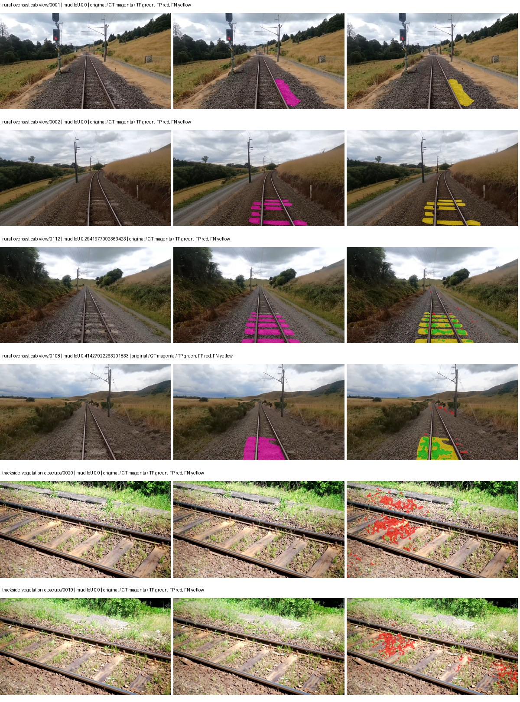
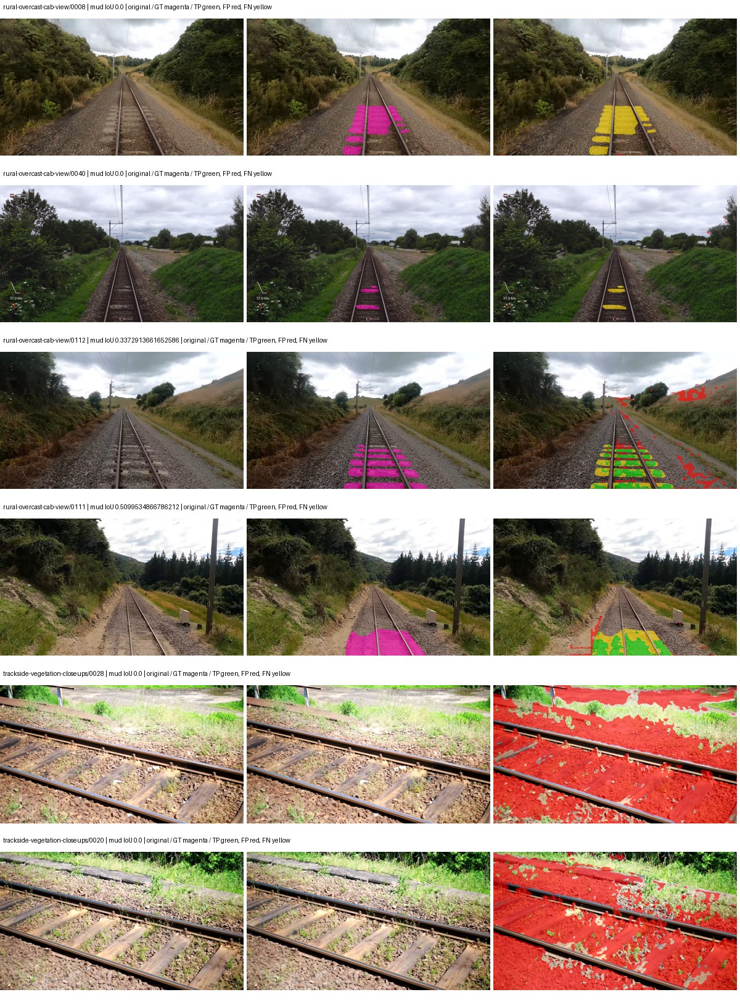
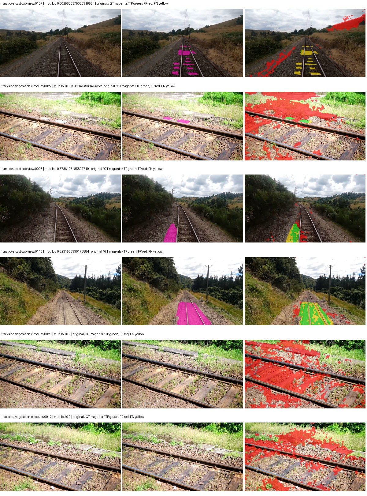
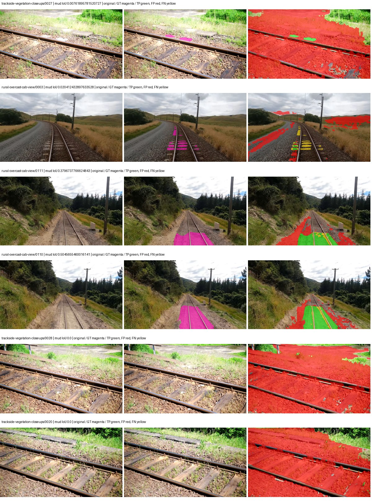

# smp_pspnet_mobilenet_v2 — rad_9_24_2026-fixed-grouped

[RAD 9/24: Scene-grouped split](../../README.md) · [Full model records](record.json)

Primary result: the **final checkpoint** after the full step budget (no early stopping). The checkpoint with the best **mud-pumping validation IoU, pixels pooled over all validation images**, is kept as secondary evidence. A job is complete only after full statistics and isolated profiling are verified.

Study metrics of the final checkpoint, counting each class only on the validation images that contain it: mud-pumping IoU is the mean per-image IoU over the images with mud-pumping, precision and recall sum pixels over those images, and mIoU averages each class over the images that contain it, then over the classes present.

| Initialization path | Seed | Mud-pumping IoU, train-camera images with mud (%, n=17) | Mud-pumping IoU, all images with mud (%, n=18) | Mud precision, all images with mud (%) | Mud recall, all images with mud (%) | mIoU (each class over images that contain it) (%) |
| --- | --- | --- | --- | --- | --- | --- |
| rtis_only | 0 | 8.27 | 7.91 | 14.46 | 10.36 | 16.81 |
| cityscapes_to_rtis | 0 | 0.34 | 0.39 | 1.59 | 1.47 | 19.25 |
| railsem19_to_rtis | 0 | 7.45 | 7.12 | 16.36 | 9.24 | 22.77 |
| cityscapes_to_railsem19_to_rtis | 0 | 1.97 | 1.96 | 5.85 | 3.75 | 18.64 |

Per-class IoU: IoU (%) of every class, each averaged only over the validation images that contain the class (n = those images); — = no image contains it. mIoU averages the classes with at least one such image.

| Initialization path | Seed | mIoU (each class over images that contain it) | person (n=0) | truck (n=0) | rail-track (n=37) | vegetation-overgrowth (n=13) | car (n=3) | on-rails (n=0) | traffic-sign (n=9) | road (n=11) | sidewalk (n=12) | construction (n=12) | tram-track (n=2) | pole (n=21) | traffic-light (n=3) | mud-pumping (n=18) | fence (n=7) | terrain (n=35) | sky (n=28) | rail-embedded (n=3) | rail-raised (n=37) | trackbed (n=37) | standing-water (n=9) |
| --- | --- | --- | --- | --- | --- | --- | --- | --- | --- | --- | --- | --- | --- | --- | --- | --- | --- | --- | --- | --- | --- | --- | --- |
| rtis_only | 0 | 16.81 | — | — | 20.24 | 13.57 | 0.34 | — | 1.49 | 0.00 | 0.08 | 2.90 | 0.00 | 29.30 | 8.66 | 7.91 | 0.47 | 52.21 | 74.67 | 1.06 | 58.84 | 30.25 | 0.62 |
| cityscapes_to_rtis | 0 | 19.25 | — | — | 32.57 | 7.07 | 0.00 | — | 1.35 | 0.34 | 0.71 | 4.96 | 0.00 | 34.04 | 3.78 | 0.39 | 0.08 | 74.87 | 87.75 | 2.52 | 54.96 | 40.64 | 0.51 |
| railsem19_to_rtis | 0 | 22.77 | — | — | 41.89 | 12.92 | 0.00 | — | 4.42 | 13.12 | 0.29 | 5.32 | 0.00 | 49.11 | 3.25 | 7.12 | 5.03 | 78.61 | 88.80 | 2.09 | 63.95 | 33.84 | 0.20 |
| cityscapes_to_railsem19_to_rtis | 0 | 18.64 | — | — | 24.05 | 14.49 | 0.00 | — | 0.91 | 0.52 | 1.68 | 2.53 | 0.00 | 32.38 | 2.28 | 1.96 | 0.53 | 76.36 | 84.31 | 2.80 | 54.41 | 36.09 | 0.16 |

Everything below is the campaign's own record, with pixels pooled over all validation images: its evaluation is the checkpoint that scored best on that pooled mud IoU (secondary evidence here); the diagnostics also cover the final checkpoint (`final-auto-val`).

| Model | Initialization path | Seed | Status | Steps | Best step | Best-checkpoint mud IoU, pixels pooled (%) | Best-checkpoint mud precision, pixels pooled (%) | Best-checkpoint mud recall, pixels pooled (%) | Final mud IoU (trainer val, pixels pooled, %) | Best-checkpoint mIoU, pixels pooled (%) | Best-checkpoint fixed GT-class mIoU, pixels pooled (%) |
| --- | --- | --- | --- | --- | --- | --- | --- | --- | --- | --- | --- |
| smp_pspnet_mobilenet_v2 | rtis_only | 0 | completed | 4000 | 2074 | 6.15 | 17.81 | 8.59 | 2.53 | 18.01 | 21.01 |
| smp_pspnet_mobilenet_v2 | cityscapes_to_rtis | 0 | completed | 4000 | 1555 | 2.75 | 3.03 | 23.20 | 0.26 | 17.01 | 19.85 |
| smp_pspnet_mobilenet_v2 | railsem19_to_rtis | 0 | completed | 4000 | 259 | 6.82 | 7.27 | 52.40 | 2.47 | 19.19 | 20.26 |
| smp_pspnet_mobilenet_v2 | cityscapes_to_railsem19_to_rtis | 0 | completed | 4000 | 259 | 3.73 | 3.86 | 52.77 | 1.02 | 17.17 | 18.13 |

Training: 217 images. Validation: 37 images. Test: 60 held out. Seeds: [0]. Seed variation measures optimization variability, not independent-recording uncertainty. Historical source checkpoints stay fixed across adaptation seeds.

Training code: `fce0ea0ac50b334d4252812c396e0e593def375d`. Split SHA-256: `12d7b367c72cda61d57686ff2ac28223530d0af49debd9fb7a0fbc68b908bc93`.

## rtis_only — seed 0

Status: **completed**. Started: 2026-10-11T15:51:21.243166+00:00. Finished: 2026-10-11T16:32:13.273063+00:00.

Recipe pretrained initializer: `{"arch": "smp", "backbone_path": null, "batch_norm_momentum": null, "checkpoint": null, "classifier_path": null, "drop_path": null, "encoder_name": "mobilenet_v2", "encoder_weights": "imagenet", "head": "unified_head", "head_paths": [], "inactive_parameter_paths": ["encoder.features.7", "encoder.features.8", "encoder.features.9", "encoder.features.10", "encoder.features.11", "encoder.features.12", "encoder.features.13", "encoder.features.14", "encoder.features.15", "encoder.features.16", "encoder.features.17", "encoder.features.18"], "local_files_only": false, "lora_alpha": 32, "lora_dropout": 0.05, "lora_r": 16, "lora_targets": [], "native": null, "revision": null, "smp_arch": "PSPNet", "subfolder": null, "trust_remote_code": false, "tuning": "full"}`.

`rtis_only` uses the recipe initializer, which may include pretrained segmentation components. Transfer paths load the exact historical source checkpoint below and reset the classifier; they do not reset all query/decoder features.

Source checkpoint: `Recipe pretrained initialization`.

Config SHA-256: `efac0ced5caf41c8c9ed0bdae02ff0ff674b33e559ececf9b1a92a1ed67b1ba5`. Weights used for validation: `raw`.

### Mud-pumping and aggregate quality

| Metric | Selected checkpoint | Final training validation |
| --- | --- | --- |
| Mud IoU | 6.15 | 2.53 |
| Mud precision | 17.81 | 3.25 |
| Mud recall | 8.59 | 10.35 |
| Mud Dice/F1 | 11.59 | 4.94 |
| mIoU | 18.01 | 15.13 |
| Mean accuracy | 30.56 | 26.14 |
| Mean precision | 44.33 | 42.30 |
| Mean Dice | 24.20 | 20.66 |
| Mean specificity | 98.12 | 97.68 |
| Pixel accuracy | 65.92 | 56.63 |
| Frequency-weighted IoU | 57.67 | 50.15 |
| Fixed GT-present class mIoU | 21.01 | 17.66 |
| Boundary F1 | 25.87 | 22.80 |

The selected checkpoint has independent evaluation evidence. Final values are the trainer's final validation record, not a new independent evaluation. mIoU averages classes with nonzero union, so false positives on absent classes can change its denominator. The fixed GT-class mean is supplementary and excludes absent classes; their false positives remain in the confusion matrix.

### Resource usage and timing

| Measurement | Value |
| --- | --- |
| Peak training VRAM, retained training invocation (GiB) | 7.28 |
| Peak evaluation VRAM (GiB) | 6.48 |
| Retained training invocation wall time (seconds) | 2339.52 |
| Retained training invocation GPU-hours (one GPU) | 0.65 |
| Evaluation wall time (seconds) | 9.80 |
| Full evaluation pipeline images/second | 3.78 |
| Best full-state checkpoint (MiB) | 19.96 |
| Final full-state checkpoint (MiB) | 19.95 |
| Verified periodic checkpoints removed (GiB) | 0.16 |

VRAM uses the recorded allocator high-water mark; it is not total device usage including CUDA context. Resumed jobs' retained training invocation times and peaks are **not whole-campaign totals**. Earlier invocation resource records are not reconstructed here. Evaluation throughput includes loader, sliding-window inference and metrics; it is not model-only latency/FPS. Missing measurements are shown as —, never inferred from another dataset's run.

### Standardized inference performance

Dedicated model-only profiling waits for an idle worker-locked L40S: BF16, batch 1, 1024x1024, 20 warmup and 100 CUDA-event-timed public forwards. It excludes loading, preprocessing, tiling and metrics.

| Status | Parameters | Weight MiB | FPS | p50 ms | p95 ms | Peak reserved GiB |
| --- | --- | --- | --- | --- | --- | --- |
| complete | 2355533 | 8.99 | 337.46 | 2.89 | 3.32 | 0.36 |

```json
{
  "schema_version": 1,
  "model_id": "smp_pspnet_mobilenet_v2",
  "measured_at": "2026-10-11T16:32:11+00:00",
  "status": "complete",
  "benchmark_scope": "rtis_selected_checkpoint_model_only",
  "applies_to": [
    "smp_pspnet_mobilenet_v2--rtis_only--seed-0"
  ],
  "source": {
    "campaign_git_sha": "fce0ea0ac50b334d4252812c396e0e593def375d",
    "git_dirty": false,
    "config_hash": "bc7b0d39dd27",
    "resolved_config": "/data/izadia1/projects/segmentary-runs/rad_9_24_2026/fgall-seed0-20261007/configs/smp_pspnet_mobilenet_v2--rtis_only--seed-0.yaml",
    "config_sha256": "efac0ced5caf41c8c9ed0bdae02ff0ff674b33e559ececf9b1a92a1ed67b1ba5",
    "checkpoint_sha256": "4e24567402fc0d85d7dd4a00b29c37ccb24bcd031f036ca2f6a46748fe62c95c",
    "checkpoint_global_step": 2074,
    "checkpoint_bytes": 20927943,
    "checkpoint_kind": "resume checkpoint with optimizer and EMA state",
    "weights": "raw",
    "measured_checkpoint_job_id": "smp_pspnet_mobilenet_v2--rtis_only--seed-0",
    "result_sha256": "e82c7bd313cc8a1ceed0291a6a29d7294552699c795f41815589711a510d48e3",
    "result_git_sha": "fce0ea0ac50b334d4252812c396e0e593def375d",
    "result_stage": "eval:rad_9_24_2026-fixed-grouped:val",
    "result_seed": 0
  },
  "hardware": {
    "gpu_name": "NVIDIA L40S",
    "gpu_uuid": "GPU-c76642eb-64c1-b0ac-b051-d2efd47b32c4",
    "logical_device": "cuda:0",
    "physical_visibility_token": "9",
    "compute_capability": [
      8,
      9
    ],
    "total_memory_bytes": 47677177856
  },
  "model": {
    "parameter_count": 2355533,
    "trainable_parameter_count": 187149,
    "resident_parameter_bytes": 9422132,
    "parameter_dtype_counts": {
      "float32": 2355533
    }
  },
  "contract": {
    "backend": "pytorch",
    "precision": "bf16_autocast",
    "batch_size": 1,
    "input_shape_nchw": [
      1,
      3,
      1024,
      1024
    ],
    "warmup_iterations": 20,
    "measured_iterations": 100,
    "timing": "per-forward CUDA events with end-event synchronization",
    "includes_preprocessing": false,
    "includes_data_loader": false,
    "includes_sliding_window": false,
    "input_resident_on_gpu": true,
    "model_only": true,
    "entrypoint": "public model(image) dense-logits forward"
  },
  "measurements": {
    "latency": {
      "p50_ms": 2.8892160654067993,
      "p95_ms": 3.3242112159729,
      "mean_ms": 2.963303370475769,
      "minimum_ms": 2.8528640270233154,
      "maximum_ms": 3.629055976867676,
      "fps": 337.46122991094444,
      "raw_ms": [
        2.9265921115875244,
        2.9112319946289062,
        2.876415967941284,
        2.875391960144043,
        2.9071359634399414,
        2.9460480213165283,
        2.889791965484619,
        2.865151882171631,
        3.2471039295196533,
        3.629055976867676,
        3.417088031768799,
        3.166208028793335,
        3.2573440074920654,
        2.899967908859253,
        2.910207986831665,
        2.8804800510406494,
        2.875391960144043,
        2.870271921157837,
        2.865151882171631,
        2.8876800537109375,
        2.8835840225219727,
        2.854912042617798,
        2.876415967941284,
        2.8743679523468018,
        2.871295928955078,
        2.861056089401245,
        3.0996479988098145,
        2.8641281127929688,
        2.860032081604004,
        3.3064959049224854,
        2.91430401802063,
        2.8928000926971436,
        2.9480960369110107,
        2.8989439010620117,
        2.8631041049957275,
        2.8620800971984863,
        2.8784639835357666,
        2.8815360069274902,
        2.894848108291626,
        3.5235838890075684,
        3.0791680812835693,
        2.8938241004943848,
        2.890752077102661,
        2.880511999130249,
        2.8641281127929688,
        2.8784639835357666,
        2.860032081604004,
        2.855936050415039,
        2.880511999130249,
        2.870271921157837,
        2.8590080738067627,
        2.8631041049957275,
        2.8528640270233154,
        2.8815360069274902,
        2.879487991333008,
        3.0607359409332275,
        3.048448085784912,
        3.404736042022705,
        2.919424057006836,
        3.066848039627075,
        3.215359926223755,
        3.368959903717041,
        3.3116159439086914,
        2.958336114883423,
        2.870271921157837,
        2.8938241004943848,
        2.890752077102661,
        2.8866560459136963,
        2.8631041049957275,
        2.8876800537109375,
        2.8723199367523193,
        2.8641281127929688,
        2.9061119556427,
        2.879487991333008,
        3.13753604888916,
        3.0208640098571777,
        2.871295928955078,
        2.876415967941284,
        2.9665279388427734,
        2.885632038116455,
        2.8835840225219727,
        2.8784639835357666,
        2.88972806930542,
        3.0003199577331543,
        3.314687967300415,
        2.91430401802063,
        3.3218560218811035,
        2.9573440551757812,
        3.0443520545959473,
        2.9071359634399414,
        2.884608030319214,
        2.860032081604004,
        2.8887040615081787,
        2.88972806930542,
        2.9071359634399414,
        2.871295928955078,
        2.884608030319214,
        2.8887040615081787,
        2.944063901901245,
        2.969599962234497
      ],
      "percentile_method": "numpy linear interpolation"
    },
    "peak_reserved_bytes": 381681664,
    "memory_kind": "pytorch_cuda_allocator_peak_reserved_excluding_context",
    "process_total_bytes": 910163968,
    "process_total_kind": "nvidia-smi used_memory of this PID on the benchmark GPU after the timed loop, including the CUDA context; null when the driver could not attribute memory to this PID",
    "benchmark_wall_clock_s": 8.352212600409985
  },
  "started_at": "2026-10-11T16:32:02+00:00",
  "finished_at": "2026-10-11T16:32:11+00:00",
  "environment": {
    "hostname": "hdrfs-app-001",
    "python": "3.11.15",
    "platform": "Linux-5.15.0-139-generic-x86_64-with-glibc2.35",
    "torch": "2.11.0+cu128",
    "torch_cuda": "12.8",
    "cudnn": 91900,
    "driver_version": "570.133.20",
    "cuda_available": true,
    "gpu_count": 1,
    "gpu_names": [
      "NVIDIA L40S"
    ],
    "cuda_visible_devices": "9",
    "packages": {
      "segmentary": "0.1.0",
      "torch": "2.11.0+cu128",
      "torchvision": "0.26.0+cu128",
      "transformers": "5.15.0",
      "timm": "1.0.28",
      "segmentation-models-pytorch": "0.5.0",
      "albumentations": "2.0.8",
      "lightning": "2.6.5",
      "numpy": "2.4.4"
    }
  }
}
```

### Per-class validation results

| Class | GT pixels | IoU (%) | Precision (%) | Recall (%) | Dice (%) | Boundary F1 (%) |
| --- | --- | --- | --- | --- | --- | --- |
| car | 29664 | 2.44 | 41.85 | 2.53 | 4.77 | 21.10 |
| construction | 311585 | 3.26 | 4.56 | 10.21 | 6.31 | 16.69 |
| fence | 265137 | 3.14 | 9.68 | 4.43 | 6.08 | 12.24 |
| mud-pumping | 1226250 | 6.15 | 17.81 | 8.59 | 11.59 | 10.62 |
| on-rails | 0 | 0.00 | 0.00 | — | 0.00 | 0.00 |
| person | 0 | 0.00 | 0.00 | — | 0.00 | 0.00 |
| pole | 628038 | 50.18 | 75.05 | 60.23 | 66.83 | 79.21 |
| rail-embedded | 16799 | 7.62 | 99.30 | 7.62 | 14.15 | 16.20 |
| rail-raised | 2969797 | 57.16 | 77.11 | 68.84 | 72.74 | 80.23 |
| rail-track | 6323197 | 25.68 | 40.99 | 40.73 | 40.86 | 46.93 |
| road | 1048831 | 0.32 | 1.06 | 0.46 | 0.64 | 1.18 |
| sidewalk | 1297367 | 3.57 | 69.25 | 3.63 | 6.89 | 3.15 |
| sky | 19121606 | 84.94 | 98.27 | 86.23 | 91.85 | 67.12 |
| standing-water | 95802 | 0.69 | 0.69 | 91.22 | 1.37 | 1.13 |
| terrain | 39239306 | 66.76 | 86.45 | 74.56 | 80.06 | 41.87 |
| trackbed | 10643081 | 39.28 | 51.42 | 62.48 | 56.41 | 38.31 |
| traffic-light | 19510 | 7.41 | 91.51 | 7.46 | 13.79 | 27.64 |
| traffic-sign | 13285 | 1.92 | 95.15 | 1.92 | 3.76 | 28.95 |
| tram-track | 56179 | 0.00 | 0.00 | 0.00 | 0.00 | 0.00 |
| truck | 0 | 0.00 | 0.00 | — | 0.00 | 0.00 |
| vegetation-overgrowth | 5901821 | 17.65 | 70.80 | 19.04 | 30.01 | 50.75 |

### Full-run accounting

| Measurement | Value |
| --- | --- |
| Full GPU-reserved wall seconds, all recorded worker attempts | 2459.77 |
| Full reserved GPU-hours | 0.68 |
| Whole-run timing complete | True |

| Phase | Wall seconds including failed attempts |
| --- | --- |
| training | 2346.20 |
| diagnostics | 73.08 |
| performance | 15.65 |

GPU-reserved time includes model loading, training, validation, collection, profiling, checkpoint I/O and orchestration while the worker owns one GPU. It is not GPU kernel-active time. Phase timings and sampled device memory/power/utilization are retained separately; sampled device memory is not the allocator high-water mark.

### Train/validation and raw/EMA diagnostics

| Checkpoint / weights / split | Images | Mud IoU (%) | Mud precision (%) | Mud recall (%) |
| --- | --- | --- | --- | --- |
| best-auto-train / raw | 217 | 77.79 | 92.69 | 82.87 |
| best-auto-val / raw | 37 | 6.15 | 17.81 | 8.59 |
| best-alternate-val / ema | 37 | 2.84 | 3.17 | 21.28 |
| final-auto-val / raw | 37 | 2.53 | 3.24 | 10.36 |

Train uses the evaluation transform without augmentation. Compare mud train/validation metrics for the same selected weights. Alternate EMA on running-stat BatchNorm is explicitly uncalibrated and is diagnostic only. Score-threshold curves use uncalibrated normalized scores and are pixel-level diagnostics, not event detection rates or a selected deployment operating point.

### Downloadable evidence

- best-auto-train: [per-image.csv](rtis_only--seed-0/best-auto-train/per-image.csv) · [per-image-confusion.json.gz](rtis_only--seed-0/best-auto-train/per-image-confusion.json.gz) · [groups.json](rtis_only--seed-0/best-auto-train/groups.json) · [mud-score-curves.json](rtis_only--seed-0/best-auto-train/mud-score-curves.json)
- best-auto-val: [per-image.csv](rtis_only--seed-0/best-auto-val/per-image.csv) · [per-image-confusion.json.gz](rtis_only--seed-0/best-auto-val/per-image-confusion.json.gz) · [groups.json](rtis_only--seed-0/best-auto-val/groups.json) · [mud-score-curves.json](rtis_only--seed-0/best-auto-val/mud-score-curves.json) · [examples.jpg](rtis_only--seed-0/best-auto-val/examples.jpg)
- best-alternate-val: [per-image.csv](rtis_only--seed-0/best-alternate-val/per-image.csv) · [per-image-confusion.json.gz](rtis_only--seed-0/best-alternate-val/per-image-confusion.json.gz) · [groups.json](rtis_only--seed-0/best-alternate-val/groups.json) · [mud-score-curves.json](rtis_only--seed-0/best-alternate-val/mud-score-curves.json)
- final-auto-val: [per-image.csv](rtis_only--seed-0/final-auto-val/per-image.csv) · [per-image-confusion.json.gz](rtis_only--seed-0/final-auto-val/per-image-confusion.json.gz) · [groups.json](rtis_only--seed-0/final-auto-val/groups.json) · [mud-score-curves.json](rtis_only--seed-0/final-auto-val/mud-score-curves.json)
- resources: [telemetry.csv](rtis_only--seed-0/resources/telemetry.csv)



Examples are two lowest and two highest mud-IoU positive images, plus up to two negative images with the most false-positive mud pixels. They are targeted diagnostic examples, not random samples. Green: true positive; red: false positive; yellow: false negative. Full predictions remain on HDRFS.

### Validation tracking

| Logged step | Overall mIoU (%) | Mud IoU (%) |
| --- | --- | --- |
| 258 | 12.67 | 0.17 |
| 518 | 13.20 | 0.37 |
| 777 | 14.78 | 0.79 |
| 1036 | 13.58 | 1.20 |
| 1295 | 14.77 | 0.15 |
| 1555 | 15.00 | 1.09 |
| 1814 | 14.33 | 0.98 |
| 2073 | 18.00 | 6.15 |
| 2332 | 15.10 | 4.68 |
| 2592 | 16.16 | 4.50 |
| 2851 | 15.36 | 3.21 |
| 3110 | 15.55 | 0.90 |
| 3369 | 17.32 | 4.23 |
| 3629 | 16.18 | 2.56 |
| 3888 | 15.89 | 5.84 |
| 4000 | 15.13 | 2.53 |

All retained scalar curves, including training loss and per-class IoU, are in record.json. Observed best mud on a curve is not necessarily a retained checkpoint: the pilot saved its selection-metric-best and final checkpoints. Step logging and checkpoint global_step may differ by one.

### Stopping and checkpoint provenance

```json
{
  "stopping": {
    "actual_steps": 4000,
    "maximum_steps": 4000,
    "min_delta": 0.0,
    "monitor": "val_iou/mud-pumping",
    "patience": null,
    "reason": "budget_complete"
  },
  "checkpoints": {
    "best": {
      "path": "/data/izadia1/projects/segmentary-runs/rad_9_24_2026/fgall-seed0-20261007/future-runs/smp_pspnet_mobilenet_v2--rtis_only--seed-0_seed0/rtis/best.ckpt",
      "sha256": "4e24567402fc0d85d7dd4a00b29c37ccb24bcd031f036ca2f6a46748fe62c95c",
      "global_step": 2074,
      "bytes": 20927943
    },
    "final": {
      "path": "/data/izadia1/projects/segmentary-runs/rad_9_24_2026/fgall-seed0-20261007/future-runs/smp_pspnet_mobilenet_v2--rtis_only--seed-0_seed0/rtis/last.ckpt",
      "sha256": "0cc34c2414543d36b8080b3b1e8f8b3efdb95f7baf85ed1c7e4ac5ce9b247a58",
      "global_step": 4000,
      "bytes": 20920007
    }
  },
  "cleanup_error": null
}
```

### Resolved training, initialization and evaluation settings

The optimizer block is the base configuration. Stage LR scales are applied at runtime, and stage warmup is capped at min(base warmup, floor(stage budget / 10), stage budget - 1): 400 steps for this 4,000-step pilot. Model-internal native input grids may differ from augmentation crops (EoMT uses its 640 grid).

```json
{
  "name": "smp_pspnet_mobilenet_v2--rtis_only--seed-0",
  "model": {
    "arch": "smp",
    "checkpoint": null,
    "tuning": "full",
    "head": "unified_head",
    "lora_r": 16,
    "lora_alpha": 32,
    "lora_dropout": 0.05,
    "lora_targets": [],
    "drop_path": null,
    "revision": null,
    "subfolder": null,
    "local_files_only": false,
    "trust_remote_code": false,
    "backbone_path": null,
    "head_paths": [],
    "classifier_path": null,
    "inactive_parameter_paths": [
      "encoder.features.7",
      "encoder.features.8",
      "encoder.features.9",
      "encoder.features.10",
      "encoder.features.11",
      "encoder.features.12",
      "encoder.features.13",
      "encoder.features.14",
      "encoder.features.15",
      "encoder.features.16",
      "encoder.features.17",
      "encoder.features.18"
    ],
    "smp_arch": "PSPNet",
    "encoder_name": "mobilenet_v2",
    "encoder_weights": "imagenet",
    "native": null,
    "batch_norm_momentum": null
  },
  "space": "paul-test-rtis",
  "taxonomy_root": "/data/izadia1/projects/segmentary-rad-fgall-fce0ea0a/taxonomy",
  "output_root": "/data/izadia1/projects/segmentary-runs/rad_9_24_2026/fgall-seed0-20261007/future-runs",
  "optim": {
    "backbone_lr": 0.0001,
    "head_lr_mult": 10.0,
    "weight_decay": 0.05,
    "llrd": 1.0,
    "warmup_iters": 1500,
    "warmup_ratio": 1e-06,
    "poly_power": 0.9,
    "min_lr_ratio": 0.0,
    "betas": [
      0.9,
      0.999
    ],
    "grad_clip": 1.0
  },
  "train": {
    "iters": 4000,
    "batch_size": 2,
    "accum": 8,
    "num_workers": 2,
    "precision": "bf16-mixed",
    "ema_decay": 0.9998,
    "val_every": 250,
    "ckpt_every": 500,
    "selection_metric": "val_iou/mud-pumping",
    "early_stopping_patience": null,
    "early_stopping_min_delta": 0.0,
    "seed": 0,
    "devices": 1
  },
  "eval": {
    "sliding_window": true,
    "window": [
      1024,
      1024
    ],
    "stride": [
      768,
      768
    ],
    "batch_size": 1,
    "num_workers": 2,
    "tta_scales": [],
    "tta_flip": false,
    "threshold": 0.5,
    "boundary_tolerance_frac": 0.0075,
    "save_confusion": true
  },
  "loss": {
    "task": "multiclass",
    "activation": "auto",
    "terms": [],
    "aux": "none",
    "aux_weight": 0.0,
    "ce_weight": 1.0,
    "label_smoothing": 0.0,
    "class_weights": null,
    "query": null
  },
  "aug": {
    "crop": [
      1024,
      1024
    ],
    "scale_min": 0.5,
    "scale_max": 2.0,
    "hflip_p": 0.5,
    "color_jitter_p": 0.5,
    "brightness": 0.25,
    "contrast": 0.25,
    "saturation": 0.25,
    "hue": 0.05
  },
  "stages": [
    {
      "name": "rtis",
      "data": [
        {
          "name": "rad_9_24_2026-fixed-grouped",
          "root": "/data/izadia1/datasets/rad_9_24_2026-fixed-grouped",
          "variant": null,
          "split_file": "splits.json",
          "train_split": "train",
          "val_split": "val",
          "limit": null,
          "loader": "folder",
          "mapping": "paul-test-rtis",
          "loader_options": {
            "require_groups": true
          }
        }
      ],
      "iters": null,
      "lr_scale": 1.0,
      "head_group_lr_scale": 1.0,
      "init_from": "pretrained",
      "reset_head": false,
      "freeze": null,
      "sample_weights": null
    }
  ]
}
```

### Hardware and software provenance

```json
{
  "training": {
    "cuda_available": true,
    "cuda_visible_devices": "9",
    "cudnn": 91900,
    "driver_version": "570.133.20",
    "gpu_count": 1,
    "gpu_names": [
      "NVIDIA L40S"
    ],
    "hostname": "hdrfs-app-001",
    "input_normalization": {
      "channel_order": "rgb",
      "mean": [
        0.485,
        0.456,
        0.406
      ],
      "source": "smp_encoder_settings",
      "std": [
        0.229,
        0.224,
        0.225
      ]
    },
    "model_origins": [
      {
        "hf_commit": null,
        "hf_name_or_path": null,
        "module": "model",
        "timm_pretrained": {}
      }
    ],
    "model_parameter_count": 2355533,
    "packages": {
      "albumentations": "2.0.8",
      "lightning": "2.6.5",
      "numpy": "2.4.4",
      "segmentary": "0.1.0",
      "segmentation-models-pytorch": "0.5.0",
      "timm": "1.0.28",
      "torch": "2.11.0+cu128",
      "torchvision": "0.26.0+cu128",
      "transformers": "5.15.0"
    },
    "platform": "Linux-5.15.0-139-generic-x86_64-with-glibc2.35",
    "python": "3.11.15",
    "torch": "2.11.0+cu128",
    "torch_cuda": "12.8",
    "trainable_parameter_count": 187149,
    "training_stop": {
      "actual_steps": 4000,
      "maximum_steps": 4000,
      "min_delta": 0.0,
      "monitor": "val_iou/mud-pumping",
      "patience": null,
      "reason": "budget_complete"
    },
    "validation_weights": "raw"
  },
  "evaluation": {
    "cuda_available": true,
    "cuda_visible_devices": "9",
    "cudnn": 91900,
    "driver_version": "570.133.20",
    "gpu_count": 1,
    "gpu_names": [
      "NVIDIA L40S"
    ],
    "hostname": "hdrfs-app-001",
    "input_normalization": {
      "channel_order": "rgb",
      "mean": [
        0.485,
        0.456,
        0.406
      ],
      "source": "smp_encoder_settings",
      "std": [
        0.229,
        0.224,
        0.225
      ]
    },
    "packages": {
      "albumentations": "2.0.8",
      "lightning": "2.6.5",
      "numpy": "2.4.4",
      "segmentary": "0.1.0",
      "segmentation-models-pytorch": "0.5.0",
      "timm": "1.0.28",
      "torch": "2.11.0+cu128",
      "torchvision": "0.26.0+cu128",
      "transformers": "5.15.0"
    },
    "platform": "Linux-5.15.0-139-generic-x86_64-with-glibc2.35",
    "python": "3.11.15",
    "torch": "2.11.0+cu128",
    "torch_cuda": "12.8"
  }
}
```

## cityscapes_to_rtis — seed 0

Status: **completed**. Started: 2026-10-11T15:51:34.631318+00:00. Finished: 2026-10-11T16:32:41.499443+00:00.

Recipe pretrained initializer: `{"arch": "smp", "backbone_path": null, "batch_norm_momentum": null, "checkpoint": null, "classifier_path": null, "drop_path": null, "encoder_name": "mobilenet_v2", "encoder_weights": "imagenet", "head": "unified_head", "head_paths": [], "inactive_parameter_paths": ["encoder.features.7", "encoder.features.8", "encoder.features.9", "encoder.features.10", "encoder.features.11", "encoder.features.12", "encoder.features.13", "encoder.features.14", "encoder.features.15", "encoder.features.16", "encoder.features.17", "encoder.features.18"], "local_files_only": false, "lora_alpha": 32, "lora_dropout": 0.05, "lora_r": 16, "lora_targets": [], "native": null, "revision": null, "smp_arch": "PSPNet", "subfolder": null, "trust_remote_code": false, "tuning": "full"}`.

`rtis_only` uses the recipe initializer, which may include pretrained segmentation components. Transfer paths load the exact historical source checkpoint below and reset the classifier; they do not reset all query/decoder features.

Source checkpoint: `{'name': 'smp_pspnet_mobilenet_v2--cityscapes--seed-0', 'model': 'smp_pspnet_mobilenet_v2', 'protocol': 'cityscapes', 'config': '/data/izadia1/projects/segmentary-runs/all-model-city-rail-seed0-rail20-b9eb3e1/jobs/smp_pspnet_mobilenet_v2--cityscapes--seed-0/attempt-001/resolved-config.yaml', 'checkpoint': '/data/izadia1/projects/segmentary-runs/all-model-city-rail-seed0-rail20-b9eb3e1/jobs/smp_pspnet_mobilenet_v2--cityscapes--seed-0/attempt-001/train/smp_pspnet_mobilenet_v2--cityscapes_seed0/cityscapes/last.ckpt', 'recorded_sha256': '1497ae6fe6fd454da2f7d48947743bef33fa7ab9411a8a0675ecff4b3b893ec4', 'exists': True}`.

Config SHA-256: `20c18a40e1006951e132935e84bf8cbf681d64a51720560313631a01b3aa5093`. Weights used for validation: `raw`.

### Mud-pumping and aggregate quality

| Metric | Selected checkpoint | Final training validation |
| --- | --- | --- |
| Mud IoU | 2.75 | 0.26 |
| Mud precision | 3.03 | 0.31 |
| Mud recall | 23.20 | 1.47 |
| Mud Dice/F1 | 5.36 | 0.52 |
| mIoU | 17.01 | 16.65 |
| Mean accuracy | 25.00 | 24.10 |
| Mean precision | 35.71 | 34.67 |
| Mean Dice | 21.72 | 21.20 |
| Mean specificity | 98.41 | 98.35 |
| Pixel accuracy | 73.00 | 73.18 |
| Frequency-weighted IoU | 63.96 | 63.13 |
| Fixed GT-present class mIoU | 19.85 | 19.42 |
| Boundary F1 | 22.30 | 20.84 |

The selected checkpoint has independent evaluation evidence. Final values are the trainer's final validation record, not a new independent evaluation. mIoU averages classes with nonzero union, so false positives on absent classes can change its denominator. The fixed GT-class mean is supplementary and excludes absent classes; their false positives remain in the confusion matrix.

### Resource usage and timing

| Measurement | Value |
| --- | --- |
| Peak training VRAM, retained training invocation (GiB) | 7.28 |
| Peak evaluation VRAM (GiB) | 6.48 |
| Retained training invocation wall time (seconds) | 2353.31 |
| Retained training invocation GPU-hours (one GPU) | 0.65 |
| Evaluation wall time (seconds) | 9.75 |
| Full evaluation pipeline images/second | 3.80 |
| Best full-state checkpoint (MiB) | 19.96 |
| Final full-state checkpoint (MiB) | 19.95 |
| Verified periodic checkpoints removed (GiB) | 0.16 |

VRAM uses the recorded allocator high-water mark; it is not total device usage including CUDA context. Resumed jobs' retained training invocation times and peaks are **not whole-campaign totals**. Earlier invocation resource records are not reconstructed here. Evaluation throughput includes loader, sliding-window inference and metrics; it is not model-only latency/FPS. Missing measurements are shown as —, never inferred from another dataset's run.

### Standardized inference performance

Dedicated model-only profiling waits for an idle worker-locked L40S: BF16, batch 1, 1024x1024, 20 warmup and 100 CUDA-event-timed public forwards. It excludes loading, preprocessing, tiling and metrics.

| Status | Parameters | Weight MiB | FPS | p50 ms | p95 ms | Peak reserved GiB |
| --- | --- | --- | --- | --- | --- | --- |
| complete | 2355533 | 8.99 | 326.83 | 2.99 | 3.51 | 0.36 |

```json
{
  "schema_version": 1,
  "model_id": "smp_pspnet_mobilenet_v2",
  "measured_at": "2026-10-11T16:32:39+00:00",
  "status": "complete",
  "benchmark_scope": "rtis_selected_checkpoint_model_only",
  "applies_to": [
    "smp_pspnet_mobilenet_v2--cityscapes_to_rtis--seed-0"
  ],
  "source": {
    "campaign_git_sha": "fce0ea0ac50b334d4252812c396e0e593def375d",
    "git_dirty": false,
    "config_hash": "18886fe81368",
    "resolved_config": "/data/izadia1/projects/segmentary-runs/rad_9_24_2026/fgall-seed0-20261007/configs/smp_pspnet_mobilenet_v2--cityscapes_to_rtis--seed-0.yaml",
    "config_sha256": "20c18a40e1006951e132935e84bf8cbf681d64a51720560313631a01b3aa5093",
    "checkpoint_sha256": "a4e78aa115092ff226ec56bb350c8ab84fccb22e1398988a05f656918f734b31",
    "checkpoint_global_step": 1555,
    "checkpoint_bytes": 20928007,
    "checkpoint_kind": "resume checkpoint with optimizer and EMA state",
    "weights": "raw",
    "measured_checkpoint_job_id": "smp_pspnet_mobilenet_v2--cityscapes_to_rtis--seed-0",
    "result_sha256": "e91690a7be9cf4979554a4f2e12f86d4ec4603eb873a19fa601cfceea4338f55",
    "result_git_sha": "fce0ea0ac50b334d4252812c396e0e593def375d",
    "result_stage": "eval:rad_9_24_2026-fixed-grouped:val",
    "result_seed": 0
  },
  "hardware": {
    "gpu_name": "NVIDIA L40S",
    "gpu_uuid": "GPU-a5ad49e5-0536-5229-ba8a-f8a902808f53",
    "logical_device": "cuda:0",
    "physical_visibility_token": "7",
    "compute_capability": [
      8,
      9
    ],
    "total_memory_bytes": 47677177856
  },
  "model": {
    "parameter_count": 2355533,
    "trainable_parameter_count": 187149,
    "resident_parameter_bytes": 9422132,
    "parameter_dtype_counts": {
      "float32": 2355533
    }
  },
  "contract": {
    "backend": "pytorch",
    "precision": "bf16_autocast",
    "batch_size": 1,
    "input_shape_nchw": [
      1,
      3,
      1024,
      1024
    ],
    "warmup_iterations": 20,
    "measured_iterations": 100,
    "timing": "per-forward CUDA events with end-event synchronization",
    "includes_preprocessing": false,
    "includes_data_loader": false,
    "includes_sliding_window": false,
    "input_resident_on_gpu": true,
    "model_only": true,
    "entrypoint": "public model(image) dense-logits forward"
  },
  "measurements": {
    "latency": {
      "p50_ms": 2.988032102584839,
      "p95_ms": 3.5082752108573914,
      "mean_ms": 3.0596815967559814,
      "minimum_ms": 2.950144052505493,
      "maximum_ms": 3.72326397895813,
      "fps": 326.83139352155047,
      "raw_ms": [
        3.0023679733276367,
        2.9962239265441895,
        2.9767680168151855,
        2.9624319076538086,
        2.9562880992889404,
        2.9808640480041504,
        2.9808640480041504,
        2.988032102584839,
        2.950144052505493,
        2.993151903152466,
        2.960416078567505,
        3.088383913040161,
        3.6239359378814697,
        3.1047680377960205,
        2.9645440578460693,
        2.9767680168151855,
        3.0361599922180176,
        2.988032102584839,
        3.009536027908325,
        3.2133119106292725,
        3.0003199577331543,
        2.968575954437256,
        2.9859840869903564,
        2.9614078998565674,
        2.9767680168151855,
        3.2860159873962402,
        3.3423359394073486,
        3.72326397895813,
        3.5389440059661865,
        3.0259199142456055,
        2.988032102584839,
        2.978816032409668,
        2.991039991378784,
        3.0320639610290527,
        2.982912063598633,
        2.9716479778289795,
        3.018752098083496,
        2.9808640480041504,
        3.1846399307250977,
        3.140608072280884,
        2.9972479343414307,
        2.9777920246124268,
        3.3464319705963135,
        3.575808048248291,
        2.9787518978118896,
        2.9573121070861816,
        2.978816032409668,
        2.9911038875579834,
        2.9573121070861816,
        2.966559886932373,
        2.969599962234497,
        3.008512020111084,
        2.9614078998565674,
        2.964479923248291,
        2.9849600791931152,
        2.9900801181793213,
        3.3208320140838623,
        2.978816032409668,
        2.9757440090179443,
        3.023871898651123,
        2.9818880558013916,
        2.959359884262085,
        3.018752098083496,
        2.994175910949707,
        2.9767680168151855,
        2.9614078998565674,
        2.9777920246124268,
        3.0003199577331543,
        2.9911038875579834,
        3.3556480407714844,
        3.2870399951934814,
        3.5082240104675293,
        3.003391981124878,
        3.0801920890808105,
        3.2430078983306885,
        3.0248959064483643,
        2.982912063598633,
        2.953216075897217,
        2.953216075897217,
        2.9655039310455322,
        3.004415988922119,
        2.950144052505493,
        2.9624319076538086,
        2.9716479778289795,
        3.0003199577331543,
        2.9706239700317383,
        2.969599962234497,
        3.1989760398864746,
        3.5092480182647705,
        3.0361599922180176,
        2.9870080947875977,
        2.96345591545105,
        2.968575954437256,
        2.9767680168151855,
        2.993151903152466,
        2.984992027282715,
        3.0197761058807373,
        3.458048105239868,
        3.0945279598236084,
        2.9921278953552246
      ],
      "percentile_method": "numpy linear interpolation"
    },
    "peak_reserved_bytes": 381681664,
    "memory_kind": "pytorch_cuda_allocator_peak_reserved_excluding_context",
    "process_total_bytes": 910163968,
    "process_total_kind": "nvidia-smi used_memory of this PID on the benchmark GPU after the timed loop, including the CUDA context; null when the driver could not attribute memory to this PID",
    "benchmark_wall_clock_s": 8.413687251508236
  },
  "started_at": "2026-10-11T16:32:31+00:00",
  "finished_at": "2026-10-11T16:32:39+00:00",
  "environment": {
    "hostname": "hdrfs-app-001",
    "python": "3.11.15",
    "platform": "Linux-5.15.0-139-generic-x86_64-with-glibc2.35",
    "torch": "2.11.0+cu128",
    "torch_cuda": "12.8",
    "cudnn": 91900,
    "driver_version": "570.133.20",
    "cuda_available": true,
    "gpu_count": 1,
    "gpu_names": [
      "NVIDIA L40S"
    ],
    "cuda_visible_devices": "7",
    "packages": {
      "segmentary": "0.1.0",
      "torch": "2.11.0+cu128",
      "torchvision": "0.26.0+cu128",
      "transformers": "5.15.0",
      "timm": "1.0.28",
      "segmentation-models-pytorch": "0.5.0",
      "albumentations": "2.0.8",
      "lightning": "2.6.5",
      "numpy": "2.4.4"
    }
  }
}
```

### Per-class validation results

| Class | GT pixels | IoU (%) | Precision (%) | Recall (%) | Dice (%) | Boundary F1 (%) |
| --- | --- | --- | --- | --- | --- | --- |
| car | 29664 | 0.29 | 24.16 | 0.29 | 0.57 | 0.00 |
| construction | 311585 | 4.02 | 6.36 | 9.89 | 7.74 | 15.57 |
| fence | 265137 | 0.63 | 6.87 | 0.69 | 1.25 | 7.04 |
| mud-pumping | 1226250 | 2.75 | 3.03 | 23.20 | 5.36 | 6.56 |
| on-rails | 0 | 0.00 | 0.00 | — | 0.00 | 0.00 |
| person | 0 | 0.00 | 0.00 | — | 0.00 | 0.00 |
| pole | 628038 | 38.47 | 79.51 | 42.71 | 55.57 | 76.96 |
| rail-embedded | 16799 | 3.52 | 93.82 | 3.52 | 6.79 | 14.26 |
| rail-raised | 2969797 | 59.14 | 70.42 | 78.68 | 74.32 | 77.78 |
| rail-track | 6323197 | 22.32 | 54.19 | 27.51 | 36.49 | 33.60 |
| road | 1048831 | 1.63 | 12.69 | 1.84 | 3.21 | 11.84 |
| sidewalk | 1297367 | 0.56 | 9.16 | 0.59 | 1.11 | 1.16 |
| sky | 19121606 | 89.93 | 99.01 | 90.75 | 94.70 | 71.41 |
| standing-water | 95802 | 0.58 | 0.63 | 7.31 | 1.15 | 3.51 |
| terrain | 39239306 | 80.01 | 85.59 | 92.47 | 88.90 | 43.99 |
| trackbed | 10643081 | 44.38 | 61.69 | 61.27 | 61.48 | 42.49 |
| traffic-light | 19510 | 0.73 | 19.36 | 0.75 | 1.44 | 12.24 |
| traffic-sign | 13285 | 3.96 | 55.46 | 4.09 | 7.61 | 27.06 |
| tram-track | 56179 | 0.00 | 0.00 | 0.00 | 0.00 | 0.00 |
| truck | 0 | 0.00 | 0.00 | — | 0.00 | 0.00 |
| vegetation-overgrowth | 5901821 | 4.38 | 67.89 | 4.47 | 8.39 | 22.90 |

### Full-run accounting

| Measurement | Value |
| --- | --- |
| Full GPU-reserved wall seconds, all recorded worker attempts | 2474.67 |
| Full reserved GPU-hours | 0.69 |
| Whole-run timing complete | True |

| Phase | Wall seconds including failed attempts |
| --- | --- |
| training | 2360.30 |
| diagnostics | 73.67 |
| performance | 15.58 |

GPU-reserved time includes model loading, training, validation, collection, profiling, checkpoint I/O and orchestration while the worker owns one GPU. It is not GPU kernel-active time. Phase timings and sampled device memory/power/utilization are retained separately; sampled device memory is not the allocator high-water mark.

### Train/validation and raw/EMA diagnostics

| Checkpoint / weights / split | Images | Mud IoU (%) | Mud precision (%) | Mud recall (%) |
| --- | --- | --- | --- | --- |
| best-auto-train / raw | 217 | 78.54 | 88.91 | 87.07 |
| best-auto-val / raw | 37 | 2.75 | 3.03 | 23.20 |
| best-alternate-val / ema | 37 | 2.29 | 2.46 | 24.20 |
| final-auto-val / raw | 37 | 0.26 | 0.31 | 1.47 |

Train uses the evaluation transform without augmentation. Compare mud train/validation metrics for the same selected weights. Alternate EMA on running-stat BatchNorm is explicitly uncalibrated and is diagnostic only. Score-threshold curves use uncalibrated normalized scores and are pixel-level diagnostics, not event detection rates or a selected deployment operating point.

### Downloadable evidence

- best-auto-train: [per-image.csv](cityscapes_to_rtis--seed-0/best-auto-train/per-image.csv) · [per-image-confusion.json.gz](cityscapes_to_rtis--seed-0/best-auto-train/per-image-confusion.json.gz) · [groups.json](cityscapes_to_rtis--seed-0/best-auto-train/groups.json) · [mud-score-curves.json](cityscapes_to_rtis--seed-0/best-auto-train/mud-score-curves.json)
- best-auto-val: [per-image.csv](cityscapes_to_rtis--seed-0/best-auto-val/per-image.csv) · [per-image-confusion.json.gz](cityscapes_to_rtis--seed-0/best-auto-val/per-image-confusion.json.gz) · [groups.json](cityscapes_to_rtis--seed-0/best-auto-val/groups.json) · [mud-score-curves.json](cityscapes_to_rtis--seed-0/best-auto-val/mud-score-curves.json) · [examples.jpg](cityscapes_to_rtis--seed-0/best-auto-val/examples.jpg)
- best-alternate-val: [per-image.csv](cityscapes_to_rtis--seed-0/best-alternate-val/per-image.csv) · [per-image-confusion.json.gz](cityscapes_to_rtis--seed-0/best-alternate-val/per-image-confusion.json.gz) · [groups.json](cityscapes_to_rtis--seed-0/best-alternate-val/groups.json) · [mud-score-curves.json](cityscapes_to_rtis--seed-0/best-alternate-val/mud-score-curves.json)
- final-auto-val: [per-image.csv](cityscapes_to_rtis--seed-0/final-auto-val/per-image.csv) · [per-image-confusion.json.gz](cityscapes_to_rtis--seed-0/final-auto-val/per-image-confusion.json.gz) · [groups.json](cityscapes_to_rtis--seed-0/final-auto-val/groups.json) · [mud-score-curves.json](cityscapes_to_rtis--seed-0/final-auto-val/mud-score-curves.json)
- resources: [telemetry.csv](cityscapes_to_rtis--seed-0/resources/telemetry.csv)



Examples are two lowest and two highest mud-IoU positive images, plus up to two negative images with the most false-positive mud pixels. They are targeted diagnostic examples, not random samples. Green: true positive; red: false positive; yellow: false negative. Full predictions remain on HDRFS.

### Validation tracking

| Logged step | Overall mIoU (%) | Mud IoU (%) |
| --- | --- | --- |
| 258 | 15.36 | 2.48 |
| 518 | 15.61 | 0.45 |
| 777 | 17.91 | 0.69 |
| 1036 | 16.04 | 0.53 |
| 1295 | 17.15 | 1.67 |
| 1555 | 17.01 | 2.75 |
| 1814 | 16.47 | 1.32 |
| 2073 | 16.55 | 2.20 |
| 2332 | 16.56 | 0.54 |
| 2592 | 16.74 | 1.75 |
| 2851 | 17.16 | 0.69 |
| 3110 | 17.26 | 0.22 |
| 3369 | 16.94 | 0.53 |
| 3629 | 17.03 | 0.45 |
| 3888 | 17.28 | 1.26 |
| 4000 | 16.65 | 0.26 |

All retained scalar curves, including training loss and per-class IoU, are in record.json. Observed best mud on a curve is not necessarily a retained checkpoint: the pilot saved its selection-metric-best and final checkpoints. Step logging and checkpoint global_step may differ by one.

### Stopping and checkpoint provenance

```json
{
  "stopping": {
    "actual_steps": 4000,
    "maximum_steps": 4000,
    "min_delta": 0.0,
    "monitor": "val_iou/mud-pumping",
    "patience": null,
    "reason": "budget_complete"
  },
  "checkpoints": {
    "best": {
      "path": "/data/izadia1/projects/segmentary-runs/rad_9_24_2026/fgall-seed0-20261007/future-runs/smp_pspnet_mobilenet_v2--cityscapes_to_rtis--seed-0_seed0/rtis/best.ckpt",
      "sha256": "a4e78aa115092ff226ec56bb350c8ab84fccb22e1398988a05f656918f734b31",
      "global_step": 1555,
      "bytes": 20928007
    },
    "final": {
      "path": "/data/izadia1/projects/segmentary-runs/rad_9_24_2026/fgall-seed0-20261007/future-runs/smp_pspnet_mobilenet_v2--cityscapes_to_rtis--seed-0_seed0/rtis/last.ckpt",
      "sha256": "04c3bb5ac5b96bb75b91f1ed3ca8ac2b9179b82828a082f4b6557bdd5af9f220",
      "global_step": 4000,
      "bytes": 20920071
    }
  },
  "cleanup_error": null
}
```

### Resolved training, initialization and evaluation settings

The optimizer block is the base configuration. Stage LR scales are applied at runtime, and stage warmup is capped at min(base warmup, floor(stage budget / 10), stage budget - 1): 400 steps for this 4,000-step pilot. Model-internal native input grids may differ from augmentation crops (EoMT uses its 640 grid).

```json
{
  "name": "smp_pspnet_mobilenet_v2--cityscapes_to_rtis--seed-0",
  "model": {
    "arch": "smp",
    "checkpoint": null,
    "tuning": "full",
    "head": "unified_head",
    "lora_r": 16,
    "lora_alpha": 32,
    "lora_dropout": 0.05,
    "lora_targets": [],
    "drop_path": null,
    "revision": null,
    "subfolder": null,
    "local_files_only": false,
    "trust_remote_code": false,
    "backbone_path": null,
    "head_paths": [],
    "classifier_path": null,
    "inactive_parameter_paths": [
      "encoder.features.7",
      "encoder.features.8",
      "encoder.features.9",
      "encoder.features.10",
      "encoder.features.11",
      "encoder.features.12",
      "encoder.features.13",
      "encoder.features.14",
      "encoder.features.15",
      "encoder.features.16",
      "encoder.features.17",
      "encoder.features.18"
    ],
    "smp_arch": "PSPNet",
    "encoder_name": "mobilenet_v2",
    "encoder_weights": "imagenet",
    "native": null,
    "batch_norm_momentum": null
  },
  "space": "paul-test-rtis",
  "taxonomy_root": "/data/izadia1/projects/segmentary-rad-fgall-fce0ea0a/taxonomy",
  "output_root": "/data/izadia1/projects/segmentary-runs/rad_9_24_2026/fgall-seed0-20261007/future-runs",
  "optim": {
    "backbone_lr": 0.0001,
    "head_lr_mult": 10.0,
    "weight_decay": 0.05,
    "llrd": 1.0,
    "warmup_iters": 1500,
    "warmup_ratio": 1e-06,
    "poly_power": 0.9,
    "min_lr_ratio": 0.0,
    "betas": [
      0.9,
      0.999
    ],
    "grad_clip": 1.0
  },
  "train": {
    "iters": 4000,
    "batch_size": 2,
    "accum": 8,
    "num_workers": 2,
    "precision": "bf16-mixed",
    "ema_decay": 0.9998,
    "val_every": 250,
    "ckpt_every": 500,
    "selection_metric": "val_iou/mud-pumping",
    "early_stopping_patience": null,
    "early_stopping_min_delta": 0.0,
    "seed": 0,
    "devices": 1
  },
  "eval": {
    "sliding_window": true,
    "window": [
      1024,
      1024
    ],
    "stride": [
      768,
      768
    ],
    "batch_size": 1,
    "num_workers": 2,
    "tta_scales": [],
    "tta_flip": false,
    "threshold": 0.5,
    "boundary_tolerance_frac": 0.0075,
    "save_confusion": true
  },
  "loss": {
    "task": "multiclass",
    "activation": "auto",
    "terms": [],
    "aux": "none",
    "aux_weight": 0.0,
    "ce_weight": 1.0,
    "label_smoothing": 0.0,
    "class_weights": null,
    "query": null
  },
  "aug": {
    "crop": [
      1024,
      1024
    ],
    "scale_min": 0.5,
    "scale_max": 2.0,
    "hflip_p": 0.5,
    "color_jitter_p": 0.5,
    "brightness": 0.25,
    "contrast": 0.25,
    "saturation": 0.25,
    "hue": 0.05
  },
  "stages": [
    {
      "name": "rtis",
      "data": [
        {
          "name": "rad_9_24_2026-fixed-grouped",
          "root": "/data/izadia1/datasets/rad_9_24_2026-fixed-grouped",
          "variant": null,
          "split_file": "splits.json",
          "train_split": "train",
          "val_split": "val",
          "limit": null,
          "loader": "folder",
          "mapping": "paul-test-rtis",
          "loader_options": {
            "require_groups": true
          }
        }
      ],
      "iters": null,
      "lr_scale": 0.1,
      "head_group_lr_scale": 1.0,
      "init_from": "/data/izadia1/projects/segmentary-runs/all-model-city-rail-seed0-rail20-b9eb3e1/jobs/smp_pspnet_mobilenet_v2--cityscapes--seed-0/attempt-001/train/smp_pspnet_mobilenet_v2--cityscapes_seed0/cityscapes/last.ckpt",
      "reset_head": true,
      "freeze": null,
      "sample_weights": null
    }
  ]
}
```

### Hardware and software provenance

```json
{
  "training": {
    "cuda_available": true,
    "cuda_visible_devices": "7",
    "cudnn": 91900,
    "driver_version": "570.133.20",
    "gpu_count": 1,
    "gpu_names": [
      "NVIDIA L40S"
    ],
    "hostname": "hdrfs-app-001",
    "input_normalization": {
      "channel_order": "rgb",
      "mean": [
        0.485,
        0.456,
        0.406
      ],
      "source": "smp_encoder_settings",
      "std": [
        0.229,
        0.224,
        0.225
      ]
    },
    "model_origins": [
      {
        "hf_commit": null,
        "hf_name_or_path": null,
        "module": "model",
        "timm_pretrained": {}
      }
    ],
    "model_parameter_count": 2355533,
    "packages": {
      "albumentations": "2.0.8",
      "lightning": "2.6.5",
      "numpy": "2.4.4",
      "segmentary": "0.1.0",
      "segmentation-models-pytorch": "0.5.0",
      "timm": "1.0.28",
      "torch": "2.11.0+cu128",
      "torchvision": "0.26.0+cu128",
      "transformers": "5.15.0"
    },
    "platform": "Linux-5.15.0-139-generic-x86_64-with-glibc2.35",
    "python": "3.11.15",
    "torch": "2.11.0+cu128",
    "torch_cuda": "12.8",
    "trainable_parameter_count": 187149,
    "training_stop": {
      "actual_steps": 4000,
      "maximum_steps": 4000,
      "min_delta": 0.0,
      "monitor": "val_iou/mud-pumping",
      "patience": null,
      "reason": "budget_complete"
    },
    "validation_weights": "raw"
  },
  "evaluation": {
    "cuda_available": true,
    "cuda_visible_devices": "7",
    "cudnn": 91900,
    "driver_version": "570.133.20",
    "gpu_count": 1,
    "gpu_names": [
      "NVIDIA L40S"
    ],
    "hostname": "hdrfs-app-001",
    "input_normalization": {
      "channel_order": "rgb",
      "mean": [
        0.485,
        0.456,
        0.406
      ],
      "source": "smp_encoder_settings",
      "std": [
        0.229,
        0.224,
        0.225
      ]
    },
    "packages": {
      "albumentations": "2.0.8",
      "lightning": "2.6.5",
      "numpy": "2.4.4",
      "segmentary": "0.1.0",
      "segmentation-models-pytorch": "0.5.0",
      "timm": "1.0.28",
      "torch": "2.11.0+cu128",
      "torchvision": "0.26.0+cu128",
      "transformers": "5.15.0"
    },
    "platform": "Linux-5.15.0-139-generic-x86_64-with-glibc2.35",
    "python": "3.11.15",
    "torch": "2.11.0+cu128",
    "torch_cuda": "12.8"
  }
}
```

## railsem19_to_rtis — seed 0

Status: **completed**. Started: 2026-10-11T15:51:52.692869+00:00. Finished: 2026-10-11T16:32:36.488035+00:00.

Recipe pretrained initializer: `{"arch": "smp", "backbone_path": null, "batch_norm_momentum": null, "checkpoint": null, "classifier_path": null, "drop_path": null, "encoder_name": "mobilenet_v2", "encoder_weights": "imagenet", "head": "unified_head", "head_paths": [], "inactive_parameter_paths": ["encoder.features.7", "encoder.features.8", "encoder.features.9", "encoder.features.10", "encoder.features.11", "encoder.features.12", "encoder.features.13", "encoder.features.14", "encoder.features.15", "encoder.features.16", "encoder.features.17", "encoder.features.18"], "local_files_only": false, "lora_alpha": 32, "lora_dropout": 0.05, "lora_r": 16, "lora_targets": [], "native": null, "revision": null, "smp_arch": "PSPNet", "subfolder": null, "trust_remote_code": false, "tuning": "full"}`.

`rtis_only` uses the recipe initializer, which may include pretrained segmentation components. Transfer paths load the exact historical source checkpoint below and reset the classifier; they do not reset all query/decoder features.

Source checkpoint: `{'name': 'smp_pspnet_mobilenet_v2--railsem19--seed-0', 'model': 'smp_pspnet_mobilenet_v2', 'protocol': 'railsem19', 'config': '/data/izadia1/projects/segmentary-runs/all-model-city-rail-seed0-rail20-b9eb3e1/jobs/smp_pspnet_mobilenet_v2--railsem19--seed-0/attempt-001/resolved-config.yaml', 'checkpoint': '/data/izadia1/projects/segmentary-runs/all-model-city-rail-seed0-rail20-b9eb3e1/jobs/smp_pspnet_mobilenet_v2--railsem19--seed-0/attempt-001/train/smp_pspnet_mobilenet_v2--railsem19_seed0/railsem19/last.ckpt', 'recorded_sha256': '27ec41d525085b0153320bd0e51c0fa96610481aff74eab46b327f3d7909f50d', 'exists': True}`.

Config SHA-256: `07519c625b89cbcb5004bad05b165e5c4411ed4c282c06f3b985e4b8c9454a6a`. Weights used for validation: `raw`.

### Mud-pumping and aggregate quality

| Metric | Selected checkpoint | Final training validation |
| --- | --- | --- |
| Mud IoU | 6.82 | 2.47 |
| Mud precision | 7.27 | 3.26 |
| Mud recall | 52.40 | 9.23 |
| Mud Dice/F1 | 12.77 | 4.82 |
| mIoU | 19.19 | 19.60 |
| Mean accuracy | 27.24 | 28.34 |
| Mean precision | 34.23 | 41.47 |
| Mean Dice | 24.87 | 25.50 |
| Mean specificity | 98.42 | 98.47 |
| Pixel accuracy | 73.63 | 75.60 |
| Frequency-weighted IoU | 63.38 | 65.17 |
| Fixed GT-present class mIoU | 20.26 | 22.86 |
| Boundary F1 | 21.65 | 24.85 |

The selected checkpoint has independent evaluation evidence. Final values are the trainer's final validation record, not a new independent evaluation. mIoU averages classes with nonzero union, so false positives on absent classes can change its denominator. The fixed GT-class mean is supplementary and excludes absent classes; their false positives remain in the confusion matrix.

### Resource usage and timing

| Measurement | Value |
| --- | --- |
| Peak training VRAM, retained training invocation (GiB) | 7.28 |
| Peak evaluation VRAM (GiB) | 6.48 |
| Retained training invocation wall time (seconds) | 2331.84 |
| Retained training invocation GPU-hours (one GPU) | 0.65 |
| Evaluation wall time (seconds) | 10.16 |
| Full evaluation pipeline images/second | 3.64 |
| Best full-state checkpoint (MiB) | 19.96 |
| Final full-state checkpoint (MiB) | 19.95 |
| Verified periodic checkpoints removed (GiB) | 0.16 |

VRAM uses the recorded allocator high-water mark; it is not total device usage including CUDA context. Resumed jobs' retained training invocation times and peaks are **not whole-campaign totals**. Earlier invocation resource records are not reconstructed here. Evaluation throughput includes loader, sliding-window inference and metrics; it is not model-only latency/FPS. Missing measurements are shown as —, never inferred from another dataset's run.

### Standardized inference performance

Dedicated model-only profiling waits for an idle worker-locked L40S: BF16, batch 1, 1024x1024, 20 warmup and 100 CUDA-event-timed public forwards. It excludes loading, preprocessing, tiling and metrics.

| Status | Parameters | Weight MiB | FPS | p50 ms | p95 ms | Peak reserved GiB |
| --- | --- | --- | --- | --- | --- | --- |
| complete | 2355533 | 8.99 | 327.35 | 2.98 | 3.48 | 0.36 |

```json
{
  "schema_version": 1,
  "model_id": "smp_pspnet_mobilenet_v2",
  "measured_at": "2026-10-11T16:32:35+00:00",
  "status": "complete",
  "benchmark_scope": "rtis_selected_checkpoint_model_only",
  "applies_to": [
    "smp_pspnet_mobilenet_v2--railsem19_to_rtis--seed-0"
  ],
  "source": {
    "campaign_git_sha": "fce0ea0ac50b334d4252812c396e0e593def375d",
    "git_dirty": false,
    "config_hash": "d5b82dea6f43",
    "resolved_config": "/data/izadia1/projects/segmentary-runs/rad_9_24_2026/fgall-seed0-20261007/configs/smp_pspnet_mobilenet_v2--railsem19_to_rtis--seed-0.yaml",
    "config_sha256": "07519c625b89cbcb5004bad05b165e5c4411ed4c282c06f3b985e4b8c9454a6a",
    "checkpoint_sha256": "5013e9d3f2220c182b749429e4b156e18a9bb4cd56e7124544ea7db607a544d6",
    "checkpoint_global_step": 259,
    "checkpoint_bytes": 20927687,
    "checkpoint_kind": "resume checkpoint with optimizer and EMA state",
    "weights": "raw",
    "measured_checkpoint_job_id": "smp_pspnet_mobilenet_v2--railsem19_to_rtis--seed-0",
    "result_sha256": "1ab6611066f278f4592f1b24bf9305b5436209700e54d8e4e2c5be85a4c3b0f1",
    "result_git_sha": "fce0ea0ac50b334d4252812c396e0e593def375d",
    "result_stage": "eval:rad_9_24_2026-fixed-grouped:val",
    "result_seed": 0
  },
  "hardware": {
    "gpu_name": "NVIDIA L40S",
    "gpu_uuid": "GPU-e2e96741-aec9-e90b-5c46-d0d58be90a56",
    "logical_device": "cuda:0",
    "physical_visibility_token": "8",
    "compute_capability": [
      8,
      9
    ],
    "total_memory_bytes": 47677177856
  },
  "model": {
    "parameter_count": 2355533,
    "trainable_parameter_count": 187149,
    "resident_parameter_bytes": 9422132,
    "parameter_dtype_counts": {
      "float32": 2355533
    }
  },
  "contract": {
    "backend": "pytorch",
    "precision": "bf16_autocast",
    "batch_size": 1,
    "input_shape_nchw": [
      1,
      3,
      1024,
      1024
    ],
    "warmup_iterations": 20,
    "measured_iterations": 100,
    "timing": "per-forward CUDA events with end-event synchronization",
    "includes_preprocessing": false,
    "includes_data_loader": false,
    "includes_sliding_window": false,
    "input_resident_on_gpu": true,
    "model_only": true,
    "entrypoint": "public model(image) dense-logits forward"
  },
  "measurements": {
    "latency": {
      "p50_ms": 2.9849600791931152,
      "p95_ms": 3.478273618221283,
      "mean_ms": 3.0548083186149597,
      "minimum_ms": 2.924544095993042,
      "maximum_ms": 3.7017600536346436,
      "fps": 327.35278148430496,
      "raw_ms": [
        2.9911038875579834,
        2.978816032409668,
        2.973695993423462,
        2.9870080947875977,
        2.9624319076538086,
        2.958336114883423,
        2.93068790435791,
        2.9911038875579834,
        2.9409279823303223,
        3.2870399951934814,
        3.4611198902130127,
        2.994175910949707,
        2.9624319076538086,
        2.9777920246124268,
        3.063807964324951,
        3.0494720935821533,
        3.08735990524292,
        2.9777920246124268,
        3.18668794631958,
        2.999295949935913,
        2.9808640480041504,
        2.978816032409668,
        2.974720001220703,
        2.944000005722046,
        2.9429759979248047,
        2.9429759979248047,
        2.983936071395874,
        2.9327359199523926,
        2.9624319076538086,
        2.9808640480041504,
        2.974720001220703,
        3.0197761058807373,
        3.530751943588257,
        3.0361599922180176,
        3.0412800312042236,
        2.9911038875579834,
        2.9696640968322754,
        3.260416030883789,
        3.1611199378967285,
        3.077120065689087,
        3.1580159664154053,
        3.1222400665283203,
        3.0904319286346436,
        2.9962239265441895,
        3.0003199577331543,
        2.9726719856262207,
        2.9808640480041504,
        2.978816032409668,
        2.9962239265441895,
        2.9470720291137695,
        2.959359884262085,
        2.958336114883423,
        2.9480960369110107,
        2.924544095993042,
        3.3228800296783447,
        3.477504014968872,
        2.95632004737854,
        2.9317119121551514,
        2.933759927749634,
        2.9706239700317383,
        3.006432056427002,
        2.9460480213165283,
        2.954240083694458,
        3.354624032974243,
        3.29420804977417,
        2.9808640480041504,
        2.960383892059326,
        2.945024013519287,
        3.039232015609741,
        3.670016050338745,
        3.7017600536346436,
        3.037184000015259,
        2.9511680603027344,
        2.9655039310455322,
        2.964479923248291,
        2.9511680603027344,
        2.969599962234497,
        2.9470720291137695,
        2.9470720291137695,
        2.973695993423462,
        2.9859840869903564,
        3.0637760162353516,
        2.974720001220703,
        2.969599962234497,
        3.057663917541504,
        3.191807985305786,
        3.49289608001709,
        3.4560000896453857,
        3.0412800312042236,
        2.9921278953552246,
        3.0054399967193604,
        2.9808640480041504,
        2.9911038875579834,
        2.972640037536621,
        2.9870080947875977,
        3.003391981124878,
        2.998271942138672,
        3.1436800956726074,
        3.5338239669799805,
        3.0054399967193604
      ],
      "percentile_method": "numpy linear interpolation"
    },
    "peak_reserved_bytes": 381681664,
    "memory_kind": "pytorch_cuda_allocator_peak_reserved_excluding_context",
    "process_total_bytes": 910163968,
    "process_total_kind": "nvidia-smi used_memory of this PID on the benchmark GPU after the timed loop, including the CUDA context; null when the driver could not attribute memory to this PID",
    "benchmark_wall_clock_s": 8.421959094703197
  },
  "started_at": "2026-10-11T16:32:26+00:00",
  "finished_at": "2026-10-11T16:32:35+00:00",
  "environment": {
    "hostname": "hdrfs-app-001",
    "python": "3.11.15",
    "platform": "Linux-5.15.0-139-generic-x86_64-with-glibc2.35",
    "torch": "2.11.0+cu128",
    "torch_cuda": "12.8",
    "cudnn": 91900,
    "driver_version": "570.133.20",
    "cuda_available": true,
    "gpu_count": 1,
    "gpu_names": [
      "NVIDIA L40S"
    ],
    "cuda_visible_devices": "8",
    "packages": {
      "segmentary": "0.1.0",
      "torch": "2.11.0+cu128",
      "torchvision": "0.26.0+cu128",
      "transformers": "5.15.0",
      "timm": "1.0.28",
      "segmentation-models-pytorch": "0.5.0",
      "albumentations": "2.0.8",
      "lightning": "2.6.5",
      "numpy": "2.4.4"
    }
  }
}
```

### Per-class validation results

| Class | GT pixels | IoU (%) | Precision (%) | Recall (%) | Dice (%) | Boundary F1 (%) |
| --- | --- | --- | --- | --- | --- | --- |
| car | 29664 | 0.00 | 0.00 | 0.00 | 0.00 | 0.00 |
| construction | 311585 | 11.55 | 16.86 | 26.87 | 20.71 | 19.98 |
| fence | 265137 | 3.38 | 10.00 | 4.86 | 6.54 | 11.22 |
| mud-pumping | 1226250 | 6.82 | 7.27 | 52.40 | 12.77 | 11.65 |
| on-rails | 0 | 0.00 | 0.00 | — | 0.00 | 0.00 |
| person | 0 | — | — | — | — | — |
| pole | 628038 | 36.35 | 78.32 | 40.42 | 53.32 | 66.81 |
| rail-embedded | 16799 | 0.00 | 0.00 | 0.00 | 0.00 | 0.00 |
| rail-raised | 2969797 | 60.77 | 73.80 | 77.48 | 75.60 | 83.60 |
| rail-track | 6323197 | 25.97 | 67.14 | 29.75 | 41.23 | 37.93 |
| road | 1048831 | 0.03 | 0.15 | 0.04 | 0.07 | 0.10 |
| sidewalk | 1297367 | 9.17 | 86.94 | 9.30 | 16.80 | 5.05 |
| sky | 19121606 | 84.31 | 98.60 | 85.34 | 91.49 | 67.28 |
| standing-water | 95802 | 0.60 | 0.80 | 2.35 | 1.19 | 3.80 |
| terrain | 39239306 | 81.11 | 85.34 | 94.24 | 89.57 | 50.12 |
| trackbed | 10643081 | 43.05 | 55.49 | 65.77 | 60.19 | 48.71 |
| traffic-light | 19510 | 0.00 | 0.00 | 0.00 | 0.00 | 0.00 |
| traffic-sign | 13285 | 0.00 | 0.00 | 0.00 | 0.00 | 0.00 |
| tram-track | 56179 | 0.00 | 0.00 | 0.00 | 0.00 | 0.00 |
| truck | 0 | — | — | — | — | — |
| vegetation-overgrowth | 5901821 | 1.51 | 69.61 | 1.52 | 2.98 | 5.01 |

### Full-run accounting

| Measurement | Value |
| --- | --- |
| Full GPU-reserved wall seconds, all recorded worker attempts | 2451.56 |
| Full reserved GPU-hours | 0.68 |
| Whole-run timing complete | True |

| Phase | Wall seconds including failed attempts |
| --- | --- |
| training | 2338.61 |
| diagnostics | 71.56 |
| performance | 15.65 |

GPU-reserved time includes model loading, training, validation, collection, profiling, checkpoint I/O and orchestration while the worker owns one GPU. It is not GPU kernel-active time. Phase timings and sampled device memory/power/utilization are retained separately; sampled device memory is not the allocator high-water mark.

### Train/validation and raw/EMA diagnostics

| Checkpoint / weights / split | Images | Mud IoU (%) | Mud precision (%) | Mud recall (%) |
| --- | --- | --- | --- | --- |
| best-auto-train / raw | 217 | 63.18 | 65.77 | 94.14 |
| best-auto-val / raw | 37 | 6.82 | 7.27 | 52.40 |
| best-alternate-val / ema | 37 | 6.32 | 6.96 | 40.80 |
| final-auto-val / raw | 37 | 2.47 | 3.26 | 9.24 |

Train uses the evaluation transform without augmentation. Compare mud train/validation metrics for the same selected weights. Alternate EMA on running-stat BatchNorm is explicitly uncalibrated and is diagnostic only. Score-threshold curves use uncalibrated normalized scores and are pixel-level diagnostics, not event detection rates or a selected deployment operating point.

### Downloadable evidence

- best-auto-train: [per-image.csv](railsem19_to_rtis--seed-0/best-auto-train/per-image.csv) · [per-image-confusion.json.gz](railsem19_to_rtis--seed-0/best-auto-train/per-image-confusion.json.gz) · [groups.json](railsem19_to_rtis--seed-0/best-auto-train/groups.json) · [mud-score-curves.json](railsem19_to_rtis--seed-0/best-auto-train/mud-score-curves.json)
- best-auto-val: [per-image.csv](railsem19_to_rtis--seed-0/best-auto-val/per-image.csv) · [per-image-confusion.json.gz](railsem19_to_rtis--seed-0/best-auto-val/per-image-confusion.json.gz) · [groups.json](railsem19_to_rtis--seed-0/best-auto-val/groups.json) · [mud-score-curves.json](railsem19_to_rtis--seed-0/best-auto-val/mud-score-curves.json) · [examples.jpg](railsem19_to_rtis--seed-0/best-auto-val/examples.jpg)
- best-alternate-val: [per-image.csv](railsem19_to_rtis--seed-0/best-alternate-val/per-image.csv) · [per-image-confusion.json.gz](railsem19_to_rtis--seed-0/best-alternate-val/per-image-confusion.json.gz) · [groups.json](railsem19_to_rtis--seed-0/best-alternate-val/groups.json) · [mud-score-curves.json](railsem19_to_rtis--seed-0/best-alternate-val/mud-score-curves.json)
- final-auto-val: [per-image.csv](railsem19_to_rtis--seed-0/final-auto-val/per-image.csv) · [per-image-confusion.json.gz](railsem19_to_rtis--seed-0/final-auto-val/per-image-confusion.json.gz) · [groups.json](railsem19_to_rtis--seed-0/final-auto-val/groups.json) · [mud-score-curves.json](railsem19_to_rtis--seed-0/final-auto-val/mud-score-curves.json)
- resources: [telemetry.csv](railsem19_to_rtis--seed-0/resources/telemetry.csv)



Examples are two lowest and two highest mud-IoU positive images, plus up to two negative images with the most false-positive mud pixels. They are targeted diagnostic examples, not random samples. Green: true positive; red: false positive; yellow: false negative. Full predictions remain on HDRFS.

### Validation tracking

| Logged step | Overall mIoU (%) | Mud IoU (%) |
| --- | --- | --- |
| 258 | 19.19 | 6.83 |
| 518 | 18.39 | 5.65 |
| 777 | 18.25 | 4.99 |
| 1036 | 18.25 | 2.49 |
| 1295 | 19.11 | 2.15 |
| 1555 | 18.40 | 3.31 |
| 1814 | 17.71 | 2.78 |
| 2073 | 18.23 | 3.52 |
| 2332 | 19.30 | 1.29 |
| 2592 | 19.29 | 2.83 |
| 2851 | 19.21 | 1.82 |
| 3110 | 19.60 | 4.85 |
| 3369 | 19.73 | 5.25 |
| 3629 | 19.56 | 2.51 |
| 3888 | 19.02 | 4.28 |
| 4000 | 19.60 | 2.47 |

All retained scalar curves, including training loss and per-class IoU, are in record.json. Observed best mud on a curve is not necessarily a retained checkpoint: the pilot saved its selection-metric-best and final checkpoints. Step logging and checkpoint global_step may differ by one.

### Stopping and checkpoint provenance

```json
{
  "stopping": {
    "actual_steps": 4000,
    "maximum_steps": 4000,
    "min_delta": 0.0,
    "monitor": "val_iou/mud-pumping",
    "patience": null,
    "reason": "budget_complete"
  },
  "checkpoints": {
    "best": {
      "path": "/data/izadia1/projects/segmentary-runs/rad_9_24_2026/fgall-seed0-20261007/future-runs/smp_pspnet_mobilenet_v2--railsem19_to_rtis--seed-0_seed0/rtis/best.ckpt",
      "sha256": "5013e9d3f2220c182b749429e4b156e18a9bb4cd56e7124544ea7db607a544d6",
      "global_step": 259,
      "bytes": 20927687
    },
    "final": {
      "path": "/data/izadia1/projects/segmentary-runs/rad_9_24_2026/fgall-seed0-20261007/future-runs/smp_pspnet_mobilenet_v2--railsem19_to_rtis--seed-0_seed0/rtis/last.ckpt",
      "sha256": "cda4ef3dbe7a62210ed06ecb054c8d6dfe8e52f9c4378a65d543cb3aedfb1ede",
      "global_step": 4000,
      "bytes": 20920071
    }
  },
  "cleanup_error": null
}
```

### Resolved training, initialization and evaluation settings

The optimizer block is the base configuration. Stage LR scales are applied at runtime, and stage warmup is capped at min(base warmup, floor(stage budget / 10), stage budget - 1): 400 steps for this 4,000-step pilot. Model-internal native input grids may differ from augmentation crops (EoMT uses its 640 grid).

```json
{
  "name": "smp_pspnet_mobilenet_v2--railsem19_to_rtis--seed-0",
  "model": {
    "arch": "smp",
    "checkpoint": null,
    "tuning": "full",
    "head": "unified_head",
    "lora_r": 16,
    "lora_alpha": 32,
    "lora_dropout": 0.05,
    "lora_targets": [],
    "drop_path": null,
    "revision": null,
    "subfolder": null,
    "local_files_only": false,
    "trust_remote_code": false,
    "backbone_path": null,
    "head_paths": [],
    "classifier_path": null,
    "inactive_parameter_paths": [
      "encoder.features.7",
      "encoder.features.8",
      "encoder.features.9",
      "encoder.features.10",
      "encoder.features.11",
      "encoder.features.12",
      "encoder.features.13",
      "encoder.features.14",
      "encoder.features.15",
      "encoder.features.16",
      "encoder.features.17",
      "encoder.features.18"
    ],
    "smp_arch": "PSPNet",
    "encoder_name": "mobilenet_v2",
    "encoder_weights": "imagenet",
    "native": null,
    "batch_norm_momentum": null
  },
  "space": "paul-test-rtis",
  "taxonomy_root": "/data/izadia1/projects/segmentary-rad-fgall-fce0ea0a/taxonomy",
  "output_root": "/data/izadia1/projects/segmentary-runs/rad_9_24_2026/fgall-seed0-20261007/future-runs",
  "optim": {
    "backbone_lr": 0.0001,
    "head_lr_mult": 10.0,
    "weight_decay": 0.05,
    "llrd": 1.0,
    "warmup_iters": 1500,
    "warmup_ratio": 1e-06,
    "poly_power": 0.9,
    "min_lr_ratio": 0.0,
    "betas": [
      0.9,
      0.999
    ],
    "grad_clip": 1.0
  },
  "train": {
    "iters": 4000,
    "batch_size": 2,
    "accum": 8,
    "num_workers": 2,
    "precision": "bf16-mixed",
    "ema_decay": 0.9998,
    "val_every": 250,
    "ckpt_every": 500,
    "selection_metric": "val_iou/mud-pumping",
    "early_stopping_patience": null,
    "early_stopping_min_delta": 0.0,
    "seed": 0,
    "devices": 1
  },
  "eval": {
    "sliding_window": true,
    "window": [
      1024,
      1024
    ],
    "stride": [
      768,
      768
    ],
    "batch_size": 1,
    "num_workers": 2,
    "tta_scales": [],
    "tta_flip": false,
    "threshold": 0.5,
    "boundary_tolerance_frac": 0.0075,
    "save_confusion": true
  },
  "loss": {
    "task": "multiclass",
    "activation": "auto",
    "terms": [],
    "aux": "none",
    "aux_weight": 0.0,
    "ce_weight": 1.0,
    "label_smoothing": 0.0,
    "class_weights": null,
    "query": null
  },
  "aug": {
    "crop": [
      1024,
      1024
    ],
    "scale_min": 0.5,
    "scale_max": 2.0,
    "hflip_p": 0.5,
    "color_jitter_p": 0.5,
    "brightness": 0.25,
    "contrast": 0.25,
    "saturation": 0.25,
    "hue": 0.05
  },
  "stages": [
    {
      "name": "rtis",
      "data": [
        {
          "name": "rad_9_24_2026-fixed-grouped",
          "root": "/data/izadia1/datasets/rad_9_24_2026-fixed-grouped",
          "variant": null,
          "split_file": "splits.json",
          "train_split": "train",
          "val_split": "val",
          "limit": null,
          "loader": "folder",
          "mapping": "paul-test-rtis",
          "loader_options": {
            "require_groups": true
          }
        }
      ],
      "iters": null,
      "lr_scale": 0.1,
      "head_group_lr_scale": 1.0,
      "init_from": "/data/izadia1/projects/segmentary-runs/all-model-city-rail-seed0-rail20-b9eb3e1/jobs/smp_pspnet_mobilenet_v2--railsem19--seed-0/attempt-001/train/smp_pspnet_mobilenet_v2--railsem19_seed0/railsem19/last.ckpt",
      "reset_head": true,
      "freeze": null,
      "sample_weights": null
    }
  ]
}
```

### Hardware and software provenance

```json
{
  "training": {
    "cuda_available": true,
    "cuda_visible_devices": "8",
    "cudnn": 91900,
    "driver_version": "570.133.20",
    "gpu_count": 1,
    "gpu_names": [
      "NVIDIA L40S"
    ],
    "hostname": "hdrfs-app-001",
    "input_normalization": {
      "channel_order": "rgb",
      "mean": [
        0.485,
        0.456,
        0.406
      ],
      "source": "smp_encoder_settings",
      "std": [
        0.229,
        0.224,
        0.225
      ]
    },
    "model_origins": [
      {
        "hf_commit": null,
        "hf_name_or_path": null,
        "module": "model",
        "timm_pretrained": {}
      }
    ],
    "model_parameter_count": 2355533,
    "packages": {
      "albumentations": "2.0.8",
      "lightning": "2.6.5",
      "numpy": "2.4.4",
      "segmentary": "0.1.0",
      "segmentation-models-pytorch": "0.5.0",
      "timm": "1.0.28",
      "torch": "2.11.0+cu128",
      "torchvision": "0.26.0+cu128",
      "transformers": "5.15.0"
    },
    "platform": "Linux-5.15.0-139-generic-x86_64-with-glibc2.35",
    "python": "3.11.15",
    "torch": "2.11.0+cu128",
    "torch_cuda": "12.8",
    "trainable_parameter_count": 187149,
    "training_stop": {
      "actual_steps": 4000,
      "maximum_steps": 4000,
      "min_delta": 0.0,
      "monitor": "val_iou/mud-pumping",
      "patience": null,
      "reason": "budget_complete"
    },
    "validation_weights": "raw"
  },
  "evaluation": {
    "cuda_available": true,
    "cuda_visible_devices": "8",
    "cudnn": 91900,
    "driver_version": "570.133.20",
    "gpu_count": 1,
    "gpu_names": [
      "NVIDIA L40S"
    ],
    "hostname": "hdrfs-app-001",
    "input_normalization": {
      "channel_order": "rgb",
      "mean": [
        0.485,
        0.456,
        0.406
      ],
      "source": "smp_encoder_settings",
      "std": [
        0.229,
        0.224,
        0.225
      ]
    },
    "packages": {
      "albumentations": "2.0.8",
      "lightning": "2.6.5",
      "numpy": "2.4.4",
      "segmentary": "0.1.0",
      "segmentation-models-pytorch": "0.5.0",
      "timm": "1.0.28",
      "torch": "2.11.0+cu128",
      "torchvision": "0.26.0+cu128",
      "transformers": "5.15.0"
    },
    "platform": "Linux-5.15.0-139-generic-x86_64-with-glibc2.35",
    "python": "3.11.15",
    "torch": "2.11.0+cu128",
    "torch_cuda": "12.8"
  }
}
```

## cityscapes_to_railsem19_to_rtis — seed 0

Status: **completed**. Started: 2026-10-11T15:52:27.875846+00:00. Finished: 2026-10-11T16:34:05.662295+00:00.

Recipe pretrained initializer: `{"arch": "smp", "backbone_path": null, "batch_norm_momentum": null, "checkpoint": null, "classifier_path": null, "drop_path": null, "encoder_name": "mobilenet_v2", "encoder_weights": "imagenet", "head": "unified_head", "head_paths": [], "inactive_parameter_paths": ["encoder.features.7", "encoder.features.8", "encoder.features.9", "encoder.features.10", "encoder.features.11", "encoder.features.12", "encoder.features.13", "encoder.features.14", "encoder.features.15", "encoder.features.16", "encoder.features.17", "encoder.features.18"], "local_files_only": false, "lora_alpha": 32, "lora_dropout": 0.05, "lora_r": 16, "lora_targets": [], "native": null, "revision": null, "smp_arch": "PSPNet", "subfolder": null, "trust_remote_code": false, "tuning": "full"}`.

`rtis_only` uses the recipe initializer, which may include pretrained segmentation components. Transfer paths load the exact historical source checkpoint below and reset the classifier; they do not reset all query/decoder features.

Source checkpoint: `{'name': 'smp_pspnet_mobilenet_v2--cityscapes_to_railsem19--seed-0', 'model': 'smp_pspnet_mobilenet_v2', 'protocol': 'cityscapes_to_railsem19', 'config': '/data/izadia1/projects/segmentary-runs/all-model-city-rail-seed0-rail20-b9eb3e1/jobs/smp_pspnet_mobilenet_v2--cityscapes_to_railsem19--seed-0/attempt-001/resolved-config.yaml', 'checkpoint': '/data/izadia1/projects/segmentary-runs/all-model-city-rail-seed0-rail20-b9eb3e1/jobs/smp_pspnet_mobilenet_v2--cityscapes_to_railsem19--seed-0/attempt-001/train/smp_pspnet_mobilenet_v2--cityscapes_to_railsem19_seed0/railsem19/last.ckpt', 'recorded_sha256': 'adb9fed3b2cc36c21cfa1f2b5b702dd0add7562df47961bd52ef2d410bc14e3f', 'exists': True}`.

Config SHA-256: `f2a2fa2f196b90b0374fc5b9e65c9dc048738d8e74b3013296caf5ba5a103a8f`. Weights used for validation: `raw`.

### Mud-pumping and aggregate quality

| Metric | Selected checkpoint | Final training validation |
| --- | --- | --- |
| Mud IoU | 3.73 | 1.02 |
| Mud precision | 3.86 | 1.37 |
| Mud recall | 52.77 | 3.75 |
| Mud Dice/F1 | 7.19 | 2.01 |
| mIoU | 17.17 | 17.32 |
| Mean accuracy | 23.02 | 24.29 |
| Mean precision | 35.05 | 43.84 |
| Mean Dice | 22.20 | 22.60 |
| Mean specificity | 98.26 | 98.37 |
| Pixel accuracy | 69.99 | 74.86 |
| Frequency-weighted IoU | 61.93 | 63.29 |
| Fixed GT-present class mIoU | 18.13 | 20.21 |
| Boundary F1 | 20.19 | 22.33 |

The selected checkpoint has independent evaluation evidence. Final values are the trainer's final validation record, not a new independent evaluation. mIoU averages classes with nonzero union, so false positives on absent classes can change its denominator. The fixed GT-class mean is supplementary and excludes absent classes; their false positives remain in the confusion matrix.

### Resource usage and timing

| Measurement | Value |
| --- | --- |
| Peak training VRAM, retained training invocation (GiB) | 7.28 |
| Peak evaluation VRAM (GiB) | 6.48 |
| Retained training invocation wall time (seconds) | 2385.29 |
| Retained training invocation GPU-hours (one GPU) | 0.66 |
| Evaluation wall time (seconds) | 10.09 |
| Full evaluation pipeline images/second | 3.67 |
| Best full-state checkpoint (MiB) | 19.96 |
| Final full-state checkpoint (MiB) | 19.95 |
| Verified periodic checkpoints removed (GiB) | 0.16 |

VRAM uses the recorded allocator high-water mark; it is not total device usage including CUDA context. Resumed jobs' retained training invocation times and peaks are **not whole-campaign totals**. Earlier invocation resource records are not reconstructed here. Evaluation throughput includes loader, sliding-window inference and metrics; it is not model-only latency/FPS. Missing measurements are shown as —, never inferred from another dataset's run.

### Standardized inference performance

Dedicated model-only profiling waits for an idle worker-locked L40S: BF16, batch 1, 1024x1024, 20 warmup and 100 CUDA-event-timed public forwards. It excludes loading, preprocessing, tiling and metrics.

| Status | Parameters | Weight MiB | FPS | p50 ms | p95 ms | Peak reserved GiB |
| --- | --- | --- | --- | --- | --- | --- |
| complete | 2355533 | 8.99 | 324.36 | 2.97 | 3.46 | 0.36 |

```json
{
  "schema_version": 1,
  "model_id": "smp_pspnet_mobilenet_v2",
  "measured_at": "2026-10-11T16:34:04+00:00",
  "status": "complete",
  "benchmark_scope": "rtis_selected_checkpoint_model_only",
  "applies_to": [
    "smp_pspnet_mobilenet_v2--cityscapes_to_railsem19_to_rtis--seed-0"
  ],
  "source": {
    "campaign_git_sha": "fce0ea0ac50b334d4252812c396e0e593def375d",
    "git_dirty": false,
    "config_hash": "d8201953fe70",
    "resolved_config": "/data/izadia1/projects/segmentary-runs/rad_9_24_2026/fgall-seed0-20261007/configs/smp_pspnet_mobilenet_v2--cityscapes_to_railsem19_to_rtis--seed-0.yaml",
    "config_sha256": "f2a2fa2f196b90b0374fc5b9e65c9dc048738d8e74b3013296caf5ba5a103a8f",
    "checkpoint_sha256": "893def8ad762cfaba596a4c53115b2096188b7117c760bf78cdb7efe419adc57",
    "checkpoint_global_step": 259,
    "checkpoint_bytes": 20927687,
    "checkpoint_kind": "resume checkpoint with optimizer and EMA state",
    "weights": "raw",
    "measured_checkpoint_job_id": "smp_pspnet_mobilenet_v2--cityscapes_to_railsem19_to_rtis--seed-0",
    "result_sha256": "83c8320a410144c56de605d2cc6b1549b2d4a5df290b89996f02db724298a44c",
    "result_git_sha": "fce0ea0ac50b334d4252812c396e0e593def375d",
    "result_stage": "eval:rad_9_24_2026-fixed-grouped:val",
    "result_seed": 0
  },
  "hardware": {
    "gpu_name": "NVIDIA L40S",
    "gpu_uuid": "GPU-931d0911-fc78-1638-e3d7-1ba868cbd286",
    "logical_device": "cuda:0",
    "physical_visibility_token": "2",
    "compute_capability": [
      8,
      9
    ],
    "total_memory_bytes": 47677177856
  },
  "model": {
    "parameter_count": 2355533,
    "trainable_parameter_count": 187149,
    "resident_parameter_bytes": 9422132,
    "parameter_dtype_counts": {
      "float32": 2355533
    }
  },
  "contract": {
    "backend": "pytorch",
    "precision": "bf16_autocast",
    "batch_size": 1,
    "input_shape_nchw": [
      1,
      3,
      1024,
      1024
    ],
    "warmup_iterations": 20,
    "measured_iterations": 100,
    "timing": "per-forward CUDA events with end-event synchronization",
    "includes_preprocessing": false,
    "includes_data_loader": false,
    "includes_sliding_window": false,
    "input_resident_on_gpu": true,
    "model_only": true,
    "entrypoint": "public model(image) dense-logits forward"
  },
  "measurements": {
    "latency": {
      "p50_ms": 2.974720001220703,
      "p95_ms": 3.4580175161361693,
      "mean_ms": 3.082965748310089,
      "minimum_ms": 2.922368049621582,
      "maximum_ms": 4.86902379989624,
      "fps": 324.362993830906,
      "raw_ms": [
        3.0013439655303955,
        3.0003199577331543,
        3.093503952026367,
        3.052544116973877,
        3.6904959678649902,
        3.3761279582977295,
        2.9921278953552246,
        2.9624319076538086,
        3.14572811126709,
        2.9716479778289795,
        2.9615039825439453,
        2.9419519901275635,
        2.9593920707702637,
        2.9849600791931152,
        2.9623360633850098,
        2.9921278953552246,
        2.96345591545105,
        2.9622719287872314,
        3.2675840854644775,
        3.4569919109344482,
        3.097599983215332,
        3.111936092376709,
        3.16211199760437,
        3.2030720710754395,
        3.0054399967193604,
        3.1088318824768066,
        3.053567886352539,
        2.9409279823303223,
        2.954240083694458,
        2.959359884262085,
        2.949120044708252,
        2.9552319049835205,
        2.9429759979248047,
        2.9849600791931152,
        2.968575954437256,
        2.9859840869903564,
        2.922368049621582,
        2.959359884262085,
        2.953216075897217,
        2.959359884262085,
        2.935807943344116,
        3.3157119750976562,
        3.1109120845794678,
        4.86902379989624,
        3.5092480182647705,
        3.2368640899658203,
        3.092479944229126,
        2.9614078998565674,
        3.0966720581054688,
        2.96345591545105,
        3.2962560653686523,
        2.968575954437256,
        2.9276480674743652,
        2.9521920680999756,
        2.953279972076416,
        2.933759927749634,
        2.945120096206665,
        2.9716479778289795,
        2.974720001220703,
        2.93887996673584,
        3.314687967300415,
        4.132863998413086,
        2.998271942138672,
        2.97273588180542,
        3.477504014968872,
        3.1824638843536377,
        2.968575954437256,
        2.9480960369110107,
        2.959359884262085,
        2.9429759979248047,
        3.311647891998291,
        3.0156800746917725,
        3.0269439220428467,
        2.9777920246124268,
        2.9429759979248047,
        2.955264091491699,
        2.9654719829559326,
        2.9706239700317383,
        2.9716479778289795,
        2.939903974533081,
        2.9655680656433105,
        2.9470720291137695,
        2.974720001220703,
        2.9614078998565674,
        3.01580810546875,
        3.3126399517059326,
        2.995136022567749,
        2.9562880992889404,
        2.9470720291137695,
        2.9675519466400146,
        2.9911038875579834,
        2.988032102584839,
        3.245055913925171,
        3.3208320140838623,
        3.4242560863494873,
        3.2716801166534424,
        2.944000005722046,
        2.96345591545105,
        2.9859519004821777,
        3.2727038860321045
      ],
      "percentile_method": "numpy linear interpolation"
    },
    "peak_reserved_bytes": 381681664,
    "memory_kind": "pytorch_cuda_allocator_peak_reserved_excluding_context",
    "process_total_bytes": 910163968,
    "process_total_kind": "nvidia-smi used_memory of this PID on the benchmark GPU after the timed loop, including the CUDA context; null when the driver could not attribute memory to this PID",
    "benchmark_wall_clock_s": 8.521348595619202
  },
  "started_at": "2026-10-11T16:33:55+00:00",
  "finished_at": "2026-10-11T16:34:04+00:00",
  "environment": {
    "hostname": "hdrfs-app-001",
    "python": "3.11.15",
    "platform": "Linux-5.15.0-139-generic-x86_64-with-glibc2.35",
    "torch": "2.11.0+cu128",
    "torch_cuda": "12.8",
    "cudnn": 91900,
    "driver_version": "570.133.20",
    "cuda_available": true,
    "gpu_count": 1,
    "gpu_names": [
      "NVIDIA L40S"
    ],
    "cuda_visible_devices": "2",
    "packages": {
      "segmentary": "0.1.0",
      "torch": "2.11.0+cu128",
      "torchvision": "0.26.0+cu128",
      "transformers": "5.15.0",
      "timm": "1.0.28",
      "segmentation-models-pytorch": "0.5.0",
      "albumentations": "2.0.8",
      "lightning": "2.6.5",
      "numpy": "2.4.4"
    }
  }
}
```

### Per-class validation results

| Class | GT pixels | IoU (%) | Precision (%) | Recall (%) | Dice (%) | Boundary F1 (%) |
| --- | --- | --- | --- | --- | --- | --- |
| car | 29664 | 0.00 | 0.00 | 0.00 | 0.00 | 0.00 |
| construction | 311585 | 4.92 | 13.80 | 7.09 | 9.37 | 20.48 |
| fence | 265137 | 0.34 | 1.67 | 0.42 | 0.67 | 3.36 |
| mud-pumping | 1226250 | 3.73 | 3.86 | 52.77 | 7.19 | 12.41 |
| on-rails | 0 | 0.00 | 0.00 | — | 0.00 | 0.00 |
| person | 0 | — | — | — | — | — |
| pole | 628038 | 27.15 | 79.44 | 29.20 | 42.71 | 63.25 |
| rail-embedded | 16799 | 0.00 | 0.00 | 0.00 | 0.00 | 0.00 |
| rail-raised | 2969797 | 51.62 | 75.56 | 61.96 | 68.09 | 80.97 |
| rail-track | 6323197 | 27.41 | 58.28 | 34.10 | 43.03 | 35.83 |
| road | 1048831 | 0.00 | 0.00 | 0.00 | 0.00 | 0.00 |
| sidewalk | 1297367 | 8.94 | 98.57 | 8.95 | 16.41 | 5.57 |
| sky | 19121606 | 90.72 | 98.62 | 91.88 | 95.13 | 71.20 |
| standing-water | 95802 | 0.23 | 0.46 | 0.44 | 0.45 | 4.31 |
| terrain | 39239306 | 78.79 | 84.28 | 92.36 | 88.14 | 44.40 |
| trackbed | 10643081 | 30.66 | 79.06 | 33.37 | 46.93 | 35.13 |
| traffic-light | 19510 | 0.00 | 0.00 | 0.00 | 0.00 | 0.00 |
| traffic-sign | 13285 | 0.00 | 0.00 | 0.00 | 0.00 | 0.00 |
| tram-track | 56179 | 0.00 | 0.00 | 0.00 | 0.00 | 0.00 |
| truck | 0 | — | — | — | — | — |
| vegetation-overgrowth | 5901821 | 1.83 | 72.29 | 1.84 | 3.59 | 6.64 |

### Full-run accounting

| Measurement | Value |
| --- | --- |
| Full GPU-reserved wall seconds, all recorded worker attempts | 2505.71 |
| Full reserved GPU-hours | 0.70 |
| Whole-run timing complete | True |

| Phase | Wall seconds including failed attempts |
| --- | --- |
| training | 2391.91 |
| diagnostics | 71.48 |
| performance | 15.90 |

GPU-reserved time includes model loading, training, validation, collection, profiling, checkpoint I/O and orchestration while the worker owns one GPU. It is not GPU kernel-active time. Phase timings and sampled device memory/power/utilization are retained separately; sampled device memory is not the allocator high-water mark.

### Train/validation and raw/EMA diagnostics

| Checkpoint / weights / split | Images | Mud IoU (%) | Mud precision (%) | Mud recall (%) |
| --- | --- | --- | --- | --- |
| best-auto-train / raw | 217 | 60.30 | 62.16 | 95.28 |
| best-auto-val / raw | 37 | 3.73 | 3.86 | 52.77 |
| best-alternate-val / ema | 37 | 3.28 | 3.47 | 37.93 |
| final-auto-val / raw | 37 | 1.02 | 1.37 | 3.75 |

Train uses the evaluation transform without augmentation. Compare mud train/validation metrics for the same selected weights. Alternate EMA on running-stat BatchNorm is explicitly uncalibrated and is diagnostic only. Score-threshold curves use uncalibrated normalized scores and are pixel-level diagnostics, not event detection rates or a selected deployment operating point.

### Downloadable evidence

- best-auto-train: [per-image.csv](cityscapes_to_railsem19_to_rtis--seed-0/best-auto-train/per-image.csv) · [per-image-confusion.json.gz](cityscapes_to_railsem19_to_rtis--seed-0/best-auto-train/per-image-confusion.json.gz) · [groups.json](cityscapes_to_railsem19_to_rtis--seed-0/best-auto-train/groups.json) · [mud-score-curves.json](cityscapes_to_railsem19_to_rtis--seed-0/best-auto-train/mud-score-curves.json)
- best-auto-val: [per-image.csv](cityscapes_to_railsem19_to_rtis--seed-0/best-auto-val/per-image.csv) · [per-image-confusion.json.gz](cityscapes_to_railsem19_to_rtis--seed-0/best-auto-val/per-image-confusion.json.gz) · [groups.json](cityscapes_to_railsem19_to_rtis--seed-0/best-auto-val/groups.json) · [mud-score-curves.json](cityscapes_to_railsem19_to_rtis--seed-0/best-auto-val/mud-score-curves.json) · [examples.jpg](cityscapes_to_railsem19_to_rtis--seed-0/best-auto-val/examples.jpg)
- best-alternate-val: [per-image.csv](cityscapes_to_railsem19_to_rtis--seed-0/best-alternate-val/per-image.csv) · [per-image-confusion.json.gz](cityscapes_to_railsem19_to_rtis--seed-0/best-alternate-val/per-image-confusion.json.gz) · [groups.json](cityscapes_to_railsem19_to_rtis--seed-0/best-alternate-val/groups.json) · [mud-score-curves.json](cityscapes_to_railsem19_to_rtis--seed-0/best-alternate-val/mud-score-curves.json)
- final-auto-val: [per-image.csv](cityscapes_to_railsem19_to_rtis--seed-0/final-auto-val/per-image.csv) · [per-image-confusion.json.gz](cityscapes_to_railsem19_to_rtis--seed-0/final-auto-val/per-image-confusion.json.gz) · [groups.json](cityscapes_to_railsem19_to_rtis--seed-0/final-auto-val/groups.json) · [mud-score-curves.json](cityscapes_to_railsem19_to_rtis--seed-0/final-auto-val/mud-score-curves.json)
- resources: [telemetry.csv](cityscapes_to_railsem19_to_rtis--seed-0/resources/telemetry.csv)



Examples are two lowest and two highest mud-IoU positive images, plus up to two negative images with the most false-positive mud pixels. They are targeted diagnostic examples, not random samples. Green: true positive; red: false positive; yellow: false negative. Full predictions remain on HDRFS.

### Validation tracking

| Logged step | Overall mIoU (%) | Mud IoU (%) |
| --- | --- | --- |
| 258 | 17.18 | 3.74 |
| 518 | 18.30 | 2.60 |
| 777 | 17.40 | 3.07 |
| 1036 | 17.69 | 1.46 |
| 1295 | 18.53 | 2.74 |
| 1555 | 18.04 | 3.13 |
| 1814 | 17.41 | 2.44 |
| 2073 | 17.17 | 3.15 |
| 2332 | 17.25 | 1.62 |
| 2592 | 16.54 | 2.11 |
| 2851 | 17.61 | 0.99 |
| 3110 | 17.48 | 0.80 |
| 3369 | 17.67 | 1.17 |
| 3629 | 17.64 | 1.29 |
| 3888 | 17.66 | 1.96 |
| 4000 | 17.32 | 1.02 |

All retained scalar curves, including training loss and per-class IoU, are in record.json. Observed best mud on a curve is not necessarily a retained checkpoint: the pilot saved its selection-metric-best and final checkpoints. Step logging and checkpoint global_step may differ by one.

### Stopping and checkpoint provenance

```json
{
  "stopping": {
    "actual_steps": 4000,
    "maximum_steps": 4000,
    "min_delta": 0.0,
    "monitor": "val_iou/mud-pumping",
    "patience": null,
    "reason": "budget_complete"
  },
  "checkpoints": {
    "best": {
      "path": "/data/izadia1/projects/segmentary-runs/rad_9_24_2026/fgall-seed0-20261007/future-runs/smp_pspnet_mobilenet_v2--cityscapes_to_railsem19_to_rtis--seed-0_seed0/rtis/best.ckpt",
      "sha256": "893def8ad762cfaba596a4c53115b2096188b7117c760bf78cdb7efe419adc57",
      "global_step": 259,
      "bytes": 20927687
    },
    "final": {
      "path": "/data/izadia1/projects/segmentary-runs/rad_9_24_2026/fgall-seed0-20261007/future-runs/smp_pspnet_mobilenet_v2--cityscapes_to_railsem19_to_rtis--seed-0_seed0/rtis/last.ckpt",
      "sha256": "4f374cc6d514d77cd99d9da953a1c47d53a73e1b020b47517ca5230431728563",
      "global_step": 4000,
      "bytes": 20920135
    }
  },
  "cleanup_error": null
}
```

### Resolved training, initialization and evaluation settings

The optimizer block is the base configuration. Stage LR scales are applied at runtime, and stage warmup is capped at min(base warmup, floor(stage budget / 10), stage budget - 1): 400 steps for this 4,000-step pilot. Model-internal native input grids may differ from augmentation crops (EoMT uses its 640 grid).

```json
{
  "name": "smp_pspnet_mobilenet_v2--cityscapes_to_railsem19_to_rtis--seed-0",
  "model": {
    "arch": "smp",
    "checkpoint": null,
    "tuning": "full",
    "head": "unified_head",
    "lora_r": 16,
    "lora_alpha": 32,
    "lora_dropout": 0.05,
    "lora_targets": [],
    "drop_path": null,
    "revision": null,
    "subfolder": null,
    "local_files_only": false,
    "trust_remote_code": false,
    "backbone_path": null,
    "head_paths": [],
    "classifier_path": null,
    "inactive_parameter_paths": [
      "encoder.features.7",
      "encoder.features.8",
      "encoder.features.9",
      "encoder.features.10",
      "encoder.features.11",
      "encoder.features.12",
      "encoder.features.13",
      "encoder.features.14",
      "encoder.features.15",
      "encoder.features.16",
      "encoder.features.17",
      "encoder.features.18"
    ],
    "smp_arch": "PSPNet",
    "encoder_name": "mobilenet_v2",
    "encoder_weights": "imagenet",
    "native": null,
    "batch_norm_momentum": null
  },
  "space": "paul-test-rtis",
  "taxonomy_root": "/data/izadia1/projects/segmentary-rad-fgall-fce0ea0a/taxonomy",
  "output_root": "/data/izadia1/projects/segmentary-runs/rad_9_24_2026/fgall-seed0-20261007/future-runs",
  "optim": {
    "backbone_lr": 0.0001,
    "head_lr_mult": 10.0,
    "weight_decay": 0.05,
    "llrd": 1.0,
    "warmup_iters": 1500,
    "warmup_ratio": 1e-06,
    "poly_power": 0.9,
    "min_lr_ratio": 0.0,
    "betas": [
      0.9,
      0.999
    ],
    "grad_clip": 1.0
  },
  "train": {
    "iters": 4000,
    "batch_size": 2,
    "accum": 8,
    "num_workers": 2,
    "precision": "bf16-mixed",
    "ema_decay": 0.9998,
    "val_every": 250,
    "ckpt_every": 500,
    "selection_metric": "val_iou/mud-pumping",
    "early_stopping_patience": null,
    "early_stopping_min_delta": 0.0,
    "seed": 0,
    "devices": 1
  },
  "eval": {
    "sliding_window": true,
    "window": [
      1024,
      1024
    ],
    "stride": [
      768,
      768
    ],
    "batch_size": 1,
    "num_workers": 2,
    "tta_scales": [],
    "tta_flip": false,
    "threshold": 0.5,
    "boundary_tolerance_frac": 0.0075,
    "save_confusion": true
  },
  "loss": {
    "task": "multiclass",
    "activation": "auto",
    "terms": [],
    "aux": "none",
    "aux_weight": 0.0,
    "ce_weight": 1.0,
    "label_smoothing": 0.0,
    "class_weights": null,
    "query": null
  },
  "aug": {
    "crop": [
      1024,
      1024
    ],
    "scale_min": 0.5,
    "scale_max": 2.0,
    "hflip_p": 0.5,
    "color_jitter_p": 0.5,
    "brightness": 0.25,
    "contrast": 0.25,
    "saturation": 0.25,
    "hue": 0.05
  },
  "stages": [
    {
      "name": "rtis",
      "data": [
        {
          "name": "rad_9_24_2026-fixed-grouped",
          "root": "/data/izadia1/datasets/rad_9_24_2026-fixed-grouped",
          "variant": null,
          "split_file": "splits.json",
          "train_split": "train",
          "val_split": "val",
          "limit": null,
          "loader": "folder",
          "mapping": "paul-test-rtis",
          "loader_options": {
            "require_groups": true
          }
        }
      ],
      "iters": null,
      "lr_scale": 0.1,
      "head_group_lr_scale": 1.0,
      "init_from": "/data/izadia1/projects/segmentary-runs/all-model-city-rail-seed0-rail20-b9eb3e1/jobs/smp_pspnet_mobilenet_v2--cityscapes_to_railsem19--seed-0/attempt-001/train/smp_pspnet_mobilenet_v2--cityscapes_to_railsem19_seed0/railsem19/last.ckpt",
      "reset_head": true,
      "freeze": null,
      "sample_weights": null
    }
  ]
}
```

### Hardware and software provenance

```json
{
  "training": {
    "cuda_available": true,
    "cuda_visible_devices": "2",
    "cudnn": 91900,
    "driver_version": "570.133.20",
    "gpu_count": 1,
    "gpu_names": [
      "NVIDIA L40S"
    ],
    "hostname": "hdrfs-app-001",
    "input_normalization": {
      "channel_order": "rgb",
      "mean": [
        0.485,
        0.456,
        0.406
      ],
      "source": "smp_encoder_settings",
      "std": [
        0.229,
        0.224,
        0.225
      ]
    },
    "model_origins": [
      {
        "hf_commit": null,
        "hf_name_or_path": null,
        "module": "model",
        "timm_pretrained": {}
      }
    ],
    "model_parameter_count": 2355533,
    "packages": {
      "albumentations": "2.0.8",
      "lightning": "2.6.5",
      "numpy": "2.4.4",
      "segmentary": "0.1.0",
      "segmentation-models-pytorch": "0.5.0",
      "timm": "1.0.28",
      "torch": "2.11.0+cu128",
      "torchvision": "0.26.0+cu128",
      "transformers": "5.15.0"
    },
    "platform": "Linux-5.15.0-139-generic-x86_64-with-glibc2.35",
    "python": "3.11.15",
    "torch": "2.11.0+cu128",
    "torch_cuda": "12.8",
    "trainable_parameter_count": 187149,
    "training_stop": {
      "actual_steps": 4000,
      "maximum_steps": 4000,
      "min_delta": 0.0,
      "monitor": "val_iou/mud-pumping",
      "patience": null,
      "reason": "budget_complete"
    },
    "validation_weights": "raw"
  },
  "evaluation": {
    "cuda_available": true,
    "cuda_visible_devices": "2",
    "cudnn": 91900,
    "driver_version": "570.133.20",
    "gpu_count": 1,
    "gpu_names": [
      "NVIDIA L40S"
    ],
    "hostname": "hdrfs-app-001",
    "input_normalization": {
      "channel_order": "rgb",
      "mean": [
        0.485,
        0.456,
        0.406
      ],
      "source": "smp_encoder_settings",
      "std": [
        0.229,
        0.224,
        0.225
      ]
    },
    "packages": {
      "albumentations": "2.0.8",
      "lightning": "2.6.5",
      "numpy": "2.4.4",
      "segmentary": "0.1.0",
      "segmentation-models-pytorch": "0.5.0",
      "timm": "1.0.28",
      "torch": "2.11.0+cu128",
      "torchvision": "0.26.0+cu128",
      "transformers": "5.15.0"
    },
    "platform": "Linux-5.15.0-139-generic-x86_64-with-glibc2.35",
    "python": "3.11.15",
    "torch": "2.11.0+cu128",
    "torch_cuda": "12.8"
  }
}
```
