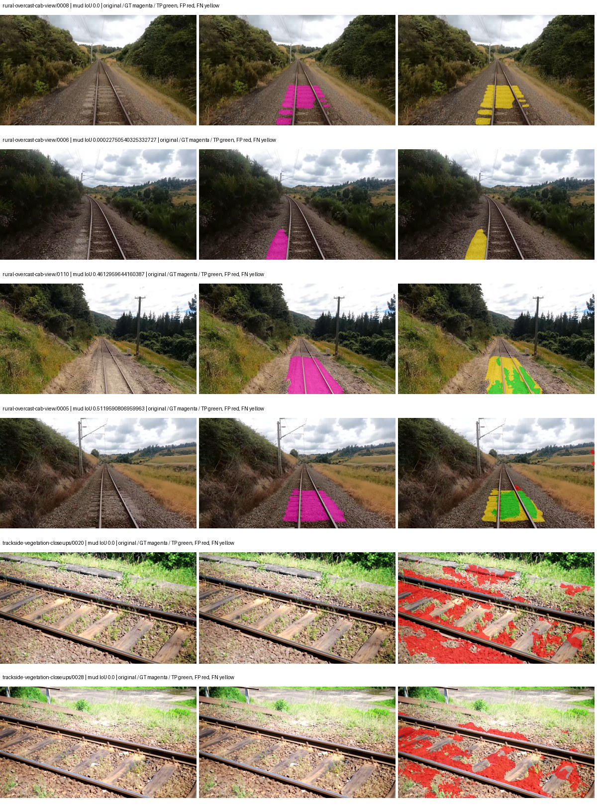
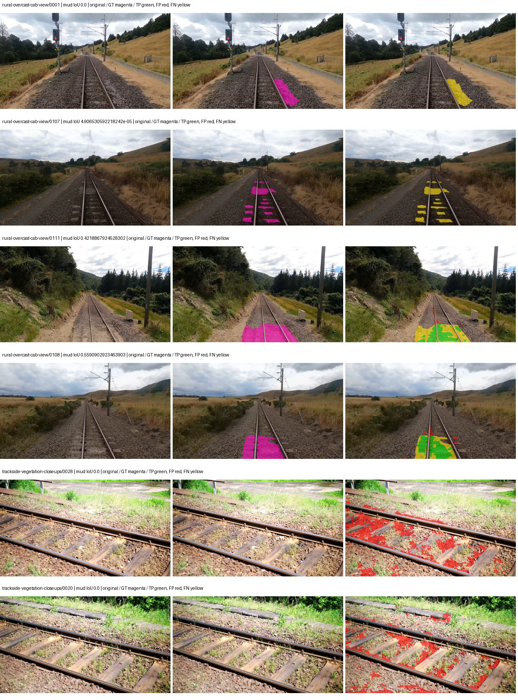
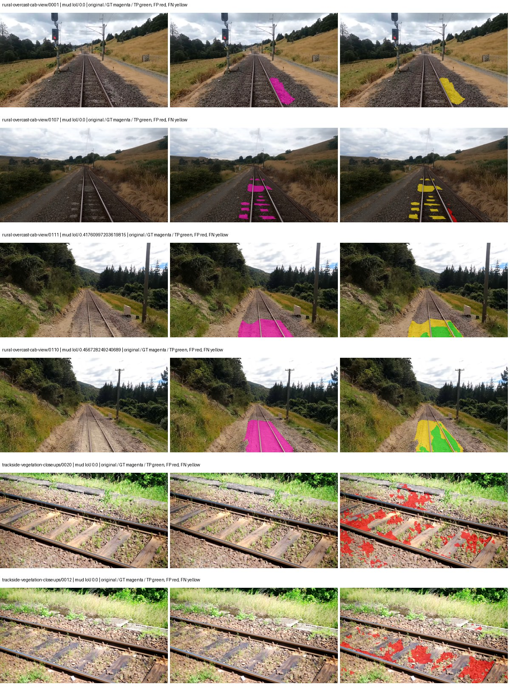
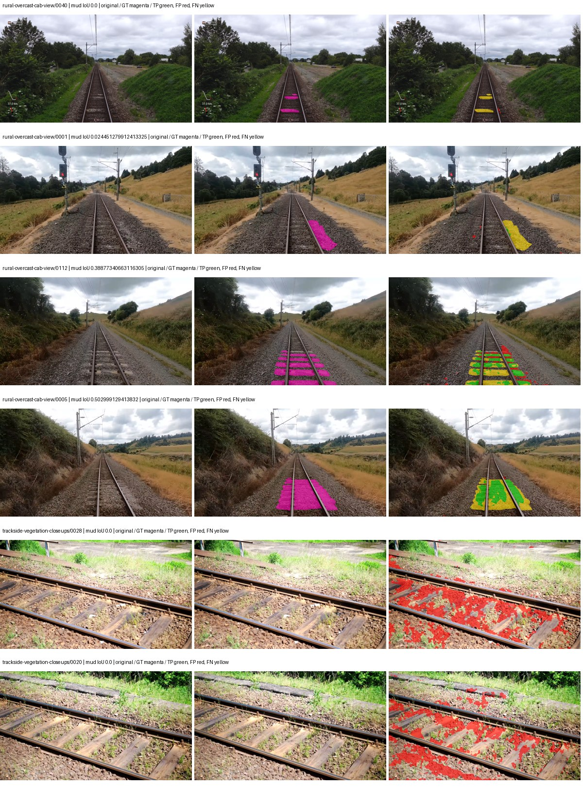

# smp_unet_resnet34 — rad_9_24_2026-fixed-grouped

[RAD 9/24: Scene-grouped split](../../README.md) · [Full model records](record.json)

Primary result: the **final checkpoint** after the full step budget (no early stopping). The checkpoint with the best **mud-pumping validation IoU, pixels pooled over all validation images**, is kept as secondary evidence. A job is complete only after full statistics and isolated profiling are verified.

Study metrics of the final checkpoint, counting each class only on the validation images that contain it: mud-pumping IoU is the mean per-image IoU over the images with mud-pumping, precision and recall sum pixels over those images, and mIoU averages each class over the images that contain it, then over the classes present.

| Initialization path | Seed | Mud-pumping IoU, train-camera images with mud (%, n=17) | Mud-pumping IoU, all images with mud (%, n=18) | Mud precision, all images with mud (%) | Mud recall, all images with mud (%) | mIoU (each class over images that contain it) (%) |
| --- | --- | --- | --- | --- | --- | --- |
| rtis_only | 0 | 10.07 | 9.66 | 25.51 | 15.02 | 31.00 |
| cityscapes_to_rtis | 0 | 7.45 | 7.52 | 51.23 | 10.76 | 30.86 |
| railsem19_to_rtis | 0 | 16.70 | 15.95 | 39.51 | 21.80 | 39.57 |
| cityscapes_to_railsem19_to_rtis | 0 | 9.04 | 8.73 | 33.36 | 12.64 | 35.99 |

Per-class IoU: IoU (%) of every class, each averaged only over the validation images that contain the class (n = those images); — = no image contains it. mIoU averages the classes with at least one such image.

| Initialization path | Seed | mIoU (each class over images that contain it) | person (n=0) | truck (n=0) | rail-track (n=37) | vegetation-overgrowth (n=13) | car (n=3) | on-rails (n=0) | traffic-sign (n=9) | road (n=11) | sidewalk (n=12) | construction (n=12) | tram-track (n=2) | pole (n=21) | traffic-light (n=3) | mud-pumping (n=18) | fence (n=7) | terrain (n=35) | sky (n=28) | rail-embedded (n=3) | rail-raised (n=37) | trackbed (n=37) | standing-water (n=9) |
| --- | --- | --- | --- | --- | --- | --- | --- | --- | --- | --- | --- | --- | --- | --- | --- | --- | --- | --- | --- | --- | --- | --- | --- |
| rtis_only | 0 | 31.00 | — | — | 54.29 | 27.21 | 0.00 | — | 0.00 | 7.77 | 13.51 | 27.18 | 15.46 | 65.39 | 11.16 | 9.66 | 10.10 | 80.64 | 91.71 | 9.09 | 70.44 | 62.74 | 1.58 |
| cityscapes_to_rtis | 0 | 30.86 | — | — | 51.02 | 18.12 | 0.00 | — | 1.48 | 6.59 | 11.36 | 44.78 | 4.66 | 67.06 | 23.05 | 7.52 | 16.82 | 78.38 | 91.80 | 1.30 | 70.86 | 59.70 | 0.91 |
| railsem19_to_rtis | 0 | 39.57 | — | — | 59.72 | 25.65 | 23.82 | — | 22.71 | 8.75 | 10.84 | 43.23 | 24.62 | 71.71 | 50.48 | 15.95 | 20.58 | 81.41 | 93.22 | 21.55 | 67.35 | 65.46 | 5.18 |
| cityscapes_to_railsem19_to_rtis | 0 | 35.99 | — | — | 56.06 | 23.30 | 11.54 | — | 23.19 | 7.09 | 9.75 | 52.46 | 3.12 | 70.73 | 43.07 | 8.73 | 27.37 | 81.91 | 94.36 | 0.37 | 71.26 | 61.03 | 2.45 |

Everything below is the campaign's own record, with pixels pooled over all validation images: its evaluation is the checkpoint that scored best on that pooled mud IoU (secondary evidence here); the diagnostics also cover the final checkpoint (`final-auto-val`).

| Model | Initialization path | Seed | Status | Steps | Best step | Best-checkpoint mud IoU, pixels pooled (%) | Best-checkpoint mud precision, pixels pooled (%) | Best-checkpoint mud recall, pixels pooled (%) | Final mud IoU (trainer val, pixels pooled, %) | Best-checkpoint mIoU, pixels pooled (%) | Best-checkpoint fixed GT-class mIoU, pixels pooled (%) |
| --- | --- | --- | --- | --- | --- | --- | --- | --- | --- | --- | --- |
| smp_unet_resnet34 | rtis_only | 0 | completed | 4000 | 3111 | 6.48 | 8.33 | 22.56 | 3.53 | 24.28 | 28.33 |
| smp_unet_resnet34 | cityscapes_to_rtis | 0 | completed | 4000 | 2074 | 11.01 | 17.77 | 22.44 | 5.83 | 22.75 | 26.54 |
| smp_unet_resnet34 | railsem19_to_rtis | 0 | completed | 4000 | 2851 | 10.63 | 17.57 | 21.18 | 6.72 | 36.08 | 42.09 |
| smp_unet_resnet34 | cityscapes_to_railsem19_to_rtis | 0 | completed | 4000 | 518 | 8.33 | 10.57 | 28.18 | 4.51 | 27.04 | 30.04 |

Training: 217 images. Validation: 37 images. Test: 60 held out. Seeds: [0]. Seed variation measures optimization variability, not independent-recording uncertainty. Historical source checkpoints stay fixed across adaptation seeds.

Training code: `fce0ea0ac50b334d4252812c396e0e593def375d`. Split SHA-256: `12d7b367c72cda61d57686ff2ac28223530d0af49debd9fb7a0fbc68b908bc93`.

## rtis_only — seed 0

Status: **completed**. Started: 2026-10-11T16:21:22.127625+00:00. Finished: 2026-10-11T17:04:18.843245+00:00.

Recipe pretrained initializer: `{"arch": "smp", "backbone_path": null, "batch_norm_momentum": null, "checkpoint": null, "classifier_path": null, "drop_path": null, "encoder_name": "resnet34", "encoder_weights": "imagenet", "head": "unified_head", "head_paths": [], "inactive_parameter_paths": [], "local_files_only": false, "lora_alpha": 32, "lora_dropout": 0.05, "lora_r": 16, "lora_targets": [], "native": null, "revision": null, "smp_arch": "Unet", "subfolder": null, "trust_remote_code": false, "tuning": "full"}`.

`rtis_only` uses the recipe initializer, which may include pretrained segmentation components. Transfer paths load the exact historical source checkpoint below and reset the classifier; they do not reset all query/decoder features.

Source checkpoint: `Recipe pretrained initialization`.

Config SHA-256: `6283c595f3bf9981c951181176d6815da5cb3c74924a103dd8fab2977f037d63`. Weights used for validation: `raw`.

### Mud-pumping and aggregate quality

| Metric | Selected checkpoint | Final training validation |
| --- | --- | --- |
| Mud IoU | 6.48 | 3.53 |
| Mud precision | 8.33 | 4.40 |
| Mud recall | 22.56 | 15.02 |
| Mud Dice/F1 | 12.16 | 6.81 |
| mIoU | 24.28 | 26.96 |
| Mean accuracy | 36.90 | 40.49 |
| Mean precision | 38.64 | 44.54 |
| Mean Dice | 31.12 | 34.90 |
| Mean specificity | 98.70 | 98.78 |
| Pixel accuracy | 78.67 | 79.86 |
| Frequency-weighted IoU | 69.29 | 71.27 |
| Fixed GT-present class mIoU | 28.33 | 31.46 |
| Boundary F1 | 26.82 | 30.11 |

The selected checkpoint has independent evaluation evidence. Final values are the trainer's final validation record, not a new independent evaluation. mIoU averages classes with nonzero union, so false positives on absent classes can change its denominator. The fixed GT-class mean is supplementary and excludes absent classes; their false positives remain in the confusion matrix.

### Resource usage and timing

| Measurement | Value |
| --- | --- |
| Peak training VRAM, retained training invocation (GiB) | 7.91 |
| Peak evaluation VRAM (GiB) | 6.50 |
| Retained training invocation wall time (seconds) | 2453.41 |
| Retained training invocation GPU-hours (one GPU) | 0.68 |
| Evaluation wall time (seconds) | 9.88 |
| Full evaluation pipeline images/second | 3.75 |
| Best full-state checkpoint (MiB) | 373.37 |
| Final full-state checkpoint (MiB) | 373.36 |
| Verified periodic checkpoints removed (GiB) | 2.92 |

VRAM uses the recorded allocator high-water mark; it is not total device usage including CUDA context. Resumed jobs' retained training invocation times and peaks are **not whole-campaign totals**. Earlier invocation resource records are not reconstructed here. Evaluation throughput includes loader, sliding-window inference and metrics; it is not model-only latency/FPS. Missing measurements are shown as —, never inferred from another dataset's run.

### Standardized inference performance

Dedicated model-only profiling waits for an idle worker-locked L40S: BF16, batch 1, 1024x1024, 20 warmup and 100 CUDA-event-timed public forwards. It excludes loading, preprocessing, tiling and metrics.

| Status | Parameters | Weight MiB | FPS | p50 ms | p95 ms | Peak reserved GiB |
| --- | --- | --- | --- | --- | --- | --- |
| complete | 24439269 | 93.23 | 144.54 | 6.82 | 7.32 | 0.67 |

```json
{
  "schema_version": 1,
  "model_id": "smp_unet_resnet34",
  "measured_at": "2026-10-11T17:04:13+00:00",
  "status": "complete",
  "benchmark_scope": "rtis_selected_checkpoint_model_only",
  "applies_to": [
    "smp_unet_resnet34--rtis_only--seed-0"
  ],
  "source": {
    "campaign_git_sha": "fce0ea0ac50b334d4252812c396e0e593def375d",
    "git_dirty": false,
    "config_hash": "ea636d59a625",
    "resolved_config": "/data/izadia1/projects/segmentary-runs/rad_9_24_2026/fgall-seed0-20261007/configs/smp_unet_resnet34--rtis_only--seed-0.yaml",
    "config_sha256": "6283c595f3bf9981c951181176d6815da5cb3c74924a103dd8fab2977f037d63",
    "checkpoint_sha256": "df8164ad35851d86b65cc0cd20ab9733f947282264db95532d57c01f193ed238",
    "checkpoint_global_step": 3111,
    "checkpoint_bytes": 391501851,
    "checkpoint_kind": "resume checkpoint with optimizer and EMA state",
    "weights": "raw",
    "measured_checkpoint_job_id": "smp_unet_resnet34--rtis_only--seed-0",
    "result_sha256": "8c0fa0d0de8637dcf50d415eb42681bb2916cf5562e4a115261afcad0726e1ea",
    "result_git_sha": "fce0ea0ac50b334d4252812c396e0e593def375d",
    "result_stage": "eval:rad_9_24_2026-fixed-grouped:val",
    "result_seed": 0
  },
  "hardware": {
    "gpu_name": "NVIDIA L40S",
    "gpu_uuid": "GPU-1c9b612f-e0b5-fbbc-150f-8c2ef13453c9",
    "logical_device": "cuda:0",
    "physical_visibility_token": "5",
    "compute_capability": [
      8,
      9
    ],
    "total_memory_bytes": 47677177856
  },
  "model": {
    "parameter_count": 24439269,
    "trainable_parameter_count": 24439269,
    "resident_parameter_bytes": 97757076,
    "parameter_dtype_counts": {
      "float32": 24439269
    }
  },
  "contract": {
    "backend": "pytorch",
    "precision": "bf16_autocast",
    "batch_size": 1,
    "input_shape_nchw": [
      1,
      3,
      1024,
      1024
    ],
    "warmup_iterations": 20,
    "measured_iterations": 100,
    "timing": "per-forward CUDA events with end-event synchronization",
    "includes_preprocessing": false,
    "includes_data_loader": false,
    "includes_sliding_window": false,
    "input_resident_on_gpu": true,
    "model_only": true,
    "entrypoint": "public model(image) dense-logits forward"
  },
  "measurements": {
    "latency": {
      "p50_ms": 6.821888208389282,
      "p95_ms": 7.3193985462188715,
      "mean_ms": 6.918265614509583,
      "minimum_ms": 6.73689603805542,
      "maximum_ms": 7.68614387512207,
      "fps": 144.54489834890322,
      "raw_ms": [
        7.429120063781738,
        6.925312042236328,
        6.860799789428711,
        6.806528091430664,
        6.82700777053833,
        6.797311782836914,
        6.7645440101623535,
        6.78707218170166,
        6.760447978973389,
        6.770624160766602,
        6.811647891998291,
        6.747136116027832,
        7.207935810089111,
        7.197696208953857,
        7.413760185241699,
        6.896639823913574,
        6.9120001792907715,
        6.993919849395752,
        7.160799980163574,
        7.68614387512207,
        6.965248107910156,
        7.245823860168457,
        6.8239359855651855,
        6.781951904296875,
        6.782976150512695,
        6.806528091430664,
        6.788095951080322,
        7.015423774719238,
        6.820864200592041,
        6.751232147216797,
        6.761472225189209,
        6.977536201477051,
        6.806528091430664,
        6.771711826324463,
        6.837247848510742,
        6.73689603805542,
        6.750207901000977,
        6.807583808898926,
        6.7491841316223145,
        6.798336029052734,
        6.822912216186523,
        7.427072048187256,
        6.974463939666748,
        7.123968124389648,
        6.989823818206787,
        6.908927917480469,
        6.788064002990723,
        6.768640041351318,
        7.041024208068848,
        6.781951904296875,
        6.743040084838867,
        7.202816009521484,
        6.825984001159668,
        6.966271877288818,
        7.266304016113281,
        6.917119979858398,
        6.887423992156982,
        6.830080032348633,
        6.743008136749268,
        6.747104167938232,
        6.805503845214844,
        6.830080032348633,
        6.760447978973389,
        6.7993597984313965,
        7.196671962738037,
        6.801407814025879,
        6.773759841918945,
        6.788095951080322,
        6.791168212890625,
        6.776832103729248,
        7.113728046417236,
        7.534592151641846,
        6.820864200592041,
        7.284736156463623,
        7.130112171173096,
        6.918144226074219,
        6.998015880584717,
        6.833151817321777,
        6.791168212890625,
        6.812672138214111,
        7.062528133392334,
        7.209983825683594,
        6.834176063537598,
        6.776832103729248,
        6.781951904296875,
        6.810624122619629,
        6.773759841918945,
        6.809599876403809,
        6.82803201675415,
        7.258111953735352,
        6.792191982269287,
        6.780928134918213,
        6.802464008331299,
        6.789120197296143,
        6.7788801193237305,
        6.87718391418457,
        7.078911781311035,
        6.846464157104492,
        6.768640041351318,
        7.314432144165039
      ],
      "percentile_method": "numpy linear interpolation"
    },
    "peak_reserved_bytes": 723517440,
    "memory_kind": "pytorch_cuda_allocator_peak_reserved_excluding_context",
    "process_total_bytes": 1245708288,
    "process_total_kind": "nvidia-smi used_memory of this PID on the benchmark GPU after the timed loop, including the CUDA context; null when the driver could not attribute memory to this PID",
    "benchmark_wall_clock_s": 8.217587761580944
  },
  "started_at": "2026-10-11T17:04:05+00:00",
  "finished_at": "2026-10-11T17:04:13+00:00",
  "environment": {
    "hostname": "hdrfs-app-001",
    "python": "3.11.15",
    "platform": "Linux-5.15.0-139-generic-x86_64-with-glibc2.35",
    "torch": "2.11.0+cu128",
    "torch_cuda": "12.8",
    "cudnn": 91900,
    "driver_version": "570.133.20",
    "cuda_available": true,
    "gpu_count": 1,
    "gpu_names": [
      "NVIDIA L40S"
    ],
    "cuda_visible_devices": "5",
    "packages": {
      "segmentary": "0.1.0",
      "torch": "2.11.0+cu128",
      "torchvision": "0.26.0+cu128",
      "transformers": "5.15.0",
      "timm": "1.0.28",
      "segmentation-models-pytorch": "0.5.0",
      "albumentations": "2.0.8",
      "lightning": "2.6.5",
      "numpy": "2.4.4"
    }
  }
}
```

### Per-class validation results

| Class | GT pixels | IoU (%) | Precision (%) | Recall (%) | Dice (%) | Boundary F1 (%) |
| --- | --- | --- | --- | --- | --- | --- |
| car | 29664 | 0.00 | 0.00 | 0.00 | 0.00 | 0.00 |
| construction | 311585 | 15.44 | 16.55 | 69.68 | 26.75 | 23.40 |
| fence | 265137 | 9.32 | 29.34 | 12.02 | 17.05 | 24.25 |
| mud-pumping | 1226250 | 6.48 | 8.33 | 22.56 | 12.16 | 10.12 |
| on-rails | 0 | 0.00 | 0.00 | — | 0.00 | 0.00 |
| person | 0 | 0.00 | 0.00 | — | 0.00 | 0.00 |
| pole | 628038 | 67.56 | 85.84 | 76.03 | 80.64 | 89.14 |
| rail-embedded | 16799 | 16.58 | 89.48 | 16.91 | 28.45 | 15.99 |
| rail-raised | 2969797 | 72.93 | 78.27 | 91.45 | 84.35 | 87.62 |
| rail-track | 6323197 | 32.87 | 77.78 | 36.27 | 49.47 | 47.82 |
| road | 1048831 | 2.06 | 3.92 | 4.17 | 4.04 | 3.73 |
| sidewalk | 1297367 | 21.10 | 47.71 | 27.45 | 34.85 | 20.18 |
| sky | 19121606 | 93.16 | 99.20 | 93.86 | 96.46 | 72.53 |
| standing-water | 95802 | 0.26 | 0.27 | 5.19 | 0.52 | 2.78 |
| terrain | 39239306 | 80.12 | 85.95 | 92.19 | 88.96 | 47.62 |
| trackbed | 10643081 | 60.37 | 70.78 | 80.40 | 75.29 | 55.51 |
| traffic-light | 19510 | 0.00 | 0.00 | 0.00 | 0.00 | 0.00 |
| traffic-sign | 13285 | 0.00 | 0.00 | 0.00 | 0.00 | 0.00 |
| tram-track | 56179 | 14.60 | 43.91 | 17.95 | 25.48 | 14.13 |
| truck | 0 | 0.00 | 0.00 | — | 0.00 | 0.00 |
| vegetation-overgrowth | 5901821 | 17.06 | 74.05 | 18.15 | 29.15 | 48.45 |

### Full-run accounting

| Measurement | Value |
| --- | --- |
| Full GPU-reserved wall seconds, all recorded worker attempts | 2584.50 |
| Full reserved GPU-hours | 0.72 |
| Whole-run timing complete | True |

| Phase | Wall seconds including failed attempts |
| --- | --- |
| training | 2460.22 |
| diagnostics | 77.83 |
| performance | 16.62 |

GPU-reserved time includes model loading, training, validation, collection, profiling, checkpoint I/O and orchestration while the worker owns one GPU. It is not GPU kernel-active time. Phase timings and sampled device memory/power/utilization are retained separately; sampled device memory is not the allocator high-water mark.

### Train/validation and raw/EMA diagnostics

| Checkpoint / weights / split | Images | Mud IoU (%) | Mud precision (%) | Mud recall (%) |
| --- | --- | --- | --- | --- |
| best-auto-train / raw | 217 | 91.84 | 97.84 | 93.74 |
| best-auto-val / raw | 37 | 6.48 | 8.33 | 22.56 |
| best-alternate-val / ema | 37 | 2.75 | 4.17 | 7.49 |
| final-auto-val / raw | 37 | 3.53 | 4.41 | 15.02 |

Train uses the evaluation transform without augmentation. Compare mud train/validation metrics for the same selected weights. Alternate EMA on running-stat BatchNorm is explicitly uncalibrated and is diagnostic only. Score-threshold curves use uncalibrated normalized scores and are pixel-level diagnostics, not event detection rates or a selected deployment operating point.

### Downloadable evidence

- best-auto-train: [per-image.csv](rtis_only--seed-0/best-auto-train/per-image.csv) · [per-image-confusion.json.gz](rtis_only--seed-0/best-auto-train/per-image-confusion.json.gz) · [groups.json](rtis_only--seed-0/best-auto-train/groups.json) · [mud-score-curves.json](rtis_only--seed-0/best-auto-train/mud-score-curves.json)
- best-auto-val: [per-image.csv](rtis_only--seed-0/best-auto-val/per-image.csv) · [per-image-confusion.json.gz](rtis_only--seed-0/best-auto-val/per-image-confusion.json.gz) · [groups.json](rtis_only--seed-0/best-auto-val/groups.json) · [mud-score-curves.json](rtis_only--seed-0/best-auto-val/mud-score-curves.json) · [examples.jpg](rtis_only--seed-0/best-auto-val/examples.jpg)
- best-alternate-val: [per-image.csv](rtis_only--seed-0/best-alternate-val/per-image.csv) · [per-image-confusion.json.gz](rtis_only--seed-0/best-alternate-val/per-image-confusion.json.gz) · [groups.json](rtis_only--seed-0/best-alternate-val/groups.json) · [mud-score-curves.json](rtis_only--seed-0/best-alternate-val/mud-score-curves.json)
- final-auto-val: [per-image.csv](rtis_only--seed-0/final-auto-val/per-image.csv) · [per-image-confusion.json.gz](rtis_only--seed-0/final-auto-val/per-image-confusion.json.gz) · [groups.json](rtis_only--seed-0/final-auto-val/groups.json) · [mud-score-curves.json](rtis_only--seed-0/final-auto-val/mud-score-curves.json)
- resources: [telemetry.csv](rtis_only--seed-0/resources/telemetry.csv)



Examples are two lowest and two highest mud-IoU positive images, plus up to two negative images with the most false-positive mud pixels. They are targeted diagnostic examples, not random samples. Green: true positive; red: false positive; yellow: false negative. Full predictions remain on HDRFS.

### Validation tracking

| Logged step | Overall mIoU (%) | Mud IoU (%) |
| --- | --- | --- |
| 258 | 18.40 | 0.19 |
| 518 | 23.51 | 3.82 |
| 777 | 25.16 | 1.13 |
| 1036 | 23.45 | 1.98 |
| 1295 | 23.60 | 3.78 |
| 1555 | 29.23 | 4.10 |
| 1814 | 25.27 | 3.84 |
| 2073 | 23.48 | 4.56 |
| 2332 | 23.17 | 3.89 |
| 2592 | 23.31 | 2.02 |
| 2851 | 23.28 | 5.19 |
| 3110 | 24.28 | 6.47 |
| 3369 | 24.77 | 2.98 |
| 3629 | 27.35 | 4.25 |
| 3888 | 28.18 | 4.42 |
| 4000 | 26.96 | 3.53 |

All retained scalar curves, including training loss and per-class IoU, are in record.json. Observed best mud on a curve is not necessarily a retained checkpoint: the pilot saved its selection-metric-best and final checkpoints. Step logging and checkpoint global_step may differ by one.

### Stopping and checkpoint provenance

```json
{
  "stopping": {
    "actual_steps": 4000,
    "maximum_steps": 4000,
    "min_delta": 0.0,
    "monitor": "val_iou/mud-pumping",
    "patience": null,
    "reason": "budget_complete"
  },
  "checkpoints": {
    "best": {
      "path": "/data/izadia1/projects/segmentary-runs/rad_9_24_2026/fgall-seed0-20261007/future-runs/smp_unet_resnet34--rtis_only--seed-0_seed0/rtis/best.ckpt",
      "sha256": "df8164ad35851d86b65cc0cd20ab9733f947282264db95532d57c01f193ed238",
      "global_step": 3111,
      "bytes": 391501851
    },
    "final": {
      "path": "/data/izadia1/projects/segmentary-runs/rad_9_24_2026/fgall-seed0-20261007/future-runs/smp_unet_resnet34--rtis_only--seed-0_seed0/rtis/last.ckpt",
      "sha256": "3ea5d975931041f98e2fc99017342205138c49f2a579ff5c535cbdfa38e3a854",
      "global_step": 4000,
      "bytes": 391492827
    }
  },
  "cleanup_error": null
}
```

### Resolved training, initialization and evaluation settings

The optimizer block is the base configuration. Stage LR scales are applied at runtime, and stage warmup is capped at min(base warmup, floor(stage budget / 10), stage budget - 1): 400 steps for this 4,000-step pilot. Model-internal native input grids may differ from augmentation crops (EoMT uses its 640 grid).

```json
{
  "name": "smp_unet_resnet34--rtis_only--seed-0",
  "model": {
    "arch": "smp",
    "checkpoint": null,
    "tuning": "full",
    "head": "unified_head",
    "lora_r": 16,
    "lora_alpha": 32,
    "lora_dropout": 0.05,
    "lora_targets": [],
    "drop_path": null,
    "revision": null,
    "subfolder": null,
    "local_files_only": false,
    "trust_remote_code": false,
    "backbone_path": null,
    "head_paths": [],
    "classifier_path": null,
    "inactive_parameter_paths": [],
    "smp_arch": "Unet",
    "encoder_name": "resnet34",
    "encoder_weights": "imagenet",
    "native": null,
    "batch_norm_momentum": null
  },
  "space": "paul-test-rtis",
  "taxonomy_root": "/data/izadia1/projects/segmentary-rad-fgall-fce0ea0a/taxonomy",
  "output_root": "/data/izadia1/projects/segmentary-runs/rad_9_24_2026/fgall-seed0-20261007/future-runs",
  "optim": {
    "backbone_lr": 0.0001,
    "head_lr_mult": 10.0,
    "weight_decay": 0.05,
    "llrd": 1.0,
    "warmup_iters": 1500,
    "warmup_ratio": 1e-06,
    "poly_power": 0.9,
    "min_lr_ratio": 0.0,
    "betas": [
      0.9,
      0.999
    ],
    "grad_clip": 1.0
  },
  "train": {
    "iters": 4000,
    "batch_size": 2,
    "accum": 8,
    "num_workers": 2,
    "precision": "bf16-mixed",
    "ema_decay": 0.9998,
    "val_every": 250,
    "ckpt_every": 500,
    "selection_metric": "val_iou/mud-pumping",
    "early_stopping_patience": null,
    "early_stopping_min_delta": 0.0,
    "seed": 0,
    "devices": 1
  },
  "eval": {
    "sliding_window": true,
    "window": [
      1024,
      1024
    ],
    "stride": [
      768,
      768
    ],
    "batch_size": 1,
    "num_workers": 2,
    "tta_scales": [],
    "tta_flip": false,
    "threshold": 0.5,
    "boundary_tolerance_frac": 0.0075,
    "save_confusion": true
  },
  "loss": {
    "task": "multiclass",
    "activation": "auto",
    "terms": [],
    "aux": "none",
    "aux_weight": 0.0,
    "ce_weight": 1.0,
    "label_smoothing": 0.0,
    "class_weights": null,
    "query": null
  },
  "aug": {
    "crop": [
      1024,
      1024
    ],
    "scale_min": 0.5,
    "scale_max": 2.0,
    "hflip_p": 0.5,
    "color_jitter_p": 0.5,
    "brightness": 0.25,
    "contrast": 0.25,
    "saturation": 0.25,
    "hue": 0.05
  },
  "stages": [
    {
      "name": "rtis",
      "data": [
        {
          "name": "rad_9_24_2026-fixed-grouped",
          "root": "/data/izadia1/datasets/rad_9_24_2026-fixed-grouped",
          "variant": null,
          "split_file": "splits.json",
          "train_split": "train",
          "val_split": "val",
          "limit": null,
          "loader": "folder",
          "mapping": "paul-test-rtis",
          "loader_options": {
            "require_groups": true
          }
        }
      ],
      "iters": null,
      "lr_scale": 1.0,
      "head_group_lr_scale": 1.0,
      "init_from": "pretrained",
      "reset_head": false,
      "freeze": null,
      "sample_weights": null
    }
  ]
}
```

### Hardware and software provenance

```json
{
  "training": {
    "cuda_available": true,
    "cuda_visible_devices": "5",
    "cudnn": 91900,
    "driver_version": "570.133.20",
    "gpu_count": 1,
    "gpu_names": [
      "NVIDIA L40S"
    ],
    "hostname": "hdrfs-app-001",
    "input_normalization": {
      "channel_order": "rgb",
      "mean": [
        0.485,
        0.456,
        0.406
      ],
      "source": "smp_encoder_settings",
      "std": [
        0.229,
        0.224,
        0.225
      ]
    },
    "model_origins": [
      {
        "hf_commit": null,
        "hf_name_or_path": null,
        "module": "model",
        "timm_pretrained": {}
      }
    ],
    "model_parameter_count": 24439269,
    "packages": {
      "albumentations": "2.0.8",
      "lightning": "2.6.5",
      "numpy": "2.4.4",
      "segmentary": "0.1.0",
      "segmentation-models-pytorch": "0.5.0",
      "timm": "1.0.28",
      "torch": "2.11.0+cu128",
      "torchvision": "0.26.0+cu128",
      "transformers": "5.15.0"
    },
    "platform": "Linux-5.15.0-139-generic-x86_64-with-glibc2.35",
    "python": "3.11.15",
    "torch": "2.11.0+cu128",
    "torch_cuda": "12.8",
    "trainable_parameter_count": 24439269,
    "training_stop": {
      "actual_steps": 4000,
      "maximum_steps": 4000,
      "min_delta": 0.0,
      "monitor": "val_iou/mud-pumping",
      "patience": null,
      "reason": "budget_complete"
    },
    "validation_weights": "raw"
  },
  "evaluation": {
    "cuda_available": true,
    "cuda_visible_devices": "5",
    "cudnn": 91900,
    "driver_version": "570.133.20",
    "gpu_count": 1,
    "gpu_names": [
      "NVIDIA L40S"
    ],
    "hostname": "hdrfs-app-001",
    "input_normalization": {
      "channel_order": "rgb",
      "mean": [
        0.485,
        0.456,
        0.406
      ],
      "source": "smp_encoder_settings",
      "std": [
        0.229,
        0.224,
        0.225
      ]
    },
    "packages": {
      "albumentations": "2.0.8",
      "lightning": "2.6.5",
      "numpy": "2.4.4",
      "segmentary": "0.1.0",
      "segmentation-models-pytorch": "0.5.0",
      "timm": "1.0.28",
      "torch": "2.11.0+cu128",
      "torchvision": "0.26.0+cu128",
      "transformers": "5.15.0"
    },
    "platform": "Linux-5.15.0-139-generic-x86_64-with-glibc2.35",
    "python": "3.11.15",
    "torch": "2.11.0+cu128",
    "torch_cuda": "12.8"
  }
}
```

## cityscapes_to_rtis — seed 0

Status: **completed**. Started: 2026-10-11T16:24:31.405046+00:00. Finished: 2026-10-11T17:06:31.409208+00:00.

Recipe pretrained initializer: `{"arch": "smp", "backbone_path": null, "batch_norm_momentum": null, "checkpoint": null, "classifier_path": null, "drop_path": null, "encoder_name": "resnet34", "encoder_weights": "imagenet", "head": "unified_head", "head_paths": [], "inactive_parameter_paths": [], "local_files_only": false, "lora_alpha": 32, "lora_dropout": 0.05, "lora_r": 16, "lora_targets": [], "native": null, "revision": null, "smp_arch": "Unet", "subfolder": null, "trust_remote_code": false, "tuning": "full"}`.

`rtis_only` uses the recipe initializer, which may include pretrained segmentation components. Transfer paths load the exact historical source checkpoint below and reset the classifier; they do not reset all query/decoder features.

Source checkpoint: `{'name': 'smp_unet_resnet34--cityscapes--seed-0', 'model': 'smp_unet_resnet34', 'protocol': 'cityscapes', 'config': '/data/izadia1/projects/segmentary-runs/all-model-city-rail-seed0-rail20-b9eb3e1/jobs/smp_unet_resnet34--cityscapes--seed-0/attempt-001/resolved-config.yaml', 'checkpoint': '/data/izadia1/projects/segmentary-runs/all-model-city-rail-seed0-rail20-b9eb3e1/jobs/smp_unet_resnet34--cityscapes--seed-0/attempt-001/train/smp_unet_resnet34--cityscapes_seed0/cityscapes/last.ckpt', 'recorded_sha256': '6fbbb9a3d23a04947b1d03d8c39643874311c2531a3455f67df7a8f09307fe72', 'exists': True}`.

Config SHA-256: `7f75aea39b27b760fa0cb11ac9f5df021c9a048b43c69e50e476696eefbe6bbd`. Weights used for validation: `raw`.

### Mud-pumping and aggregate quality

| Metric | Selected checkpoint | Final training validation |
| --- | --- | --- |
| Mud IoU | 11.01 | 5.83 |
| Mud precision | 17.77 | 11.28 |
| Mud recall | 22.44 | 10.77 |
| Mud Dice/F1 | 19.83 | 11.02 |
| mIoU | 22.75 | 25.83 |
| Mean accuracy | 33.59 | 38.62 |
| Mean precision | 40.53 | 46.98 |
| Mean Dice | 29.44 | 33.19 |
| Mean specificity | 98.28 | 98.72 |
| Pixel accuracy | 76.27 | 80.15 |
| Frequency-weighted IoU | 62.09 | 69.21 |
| Fixed GT-present class mIoU | 26.54 | 30.14 |
| Boundary F1 | 26.16 | 32.42 |

The selected checkpoint has independent evaluation evidence. Final values are the trainer's final validation record, not a new independent evaluation. mIoU averages classes with nonzero union, so false positives on absent classes can change its denominator. The fixed GT-class mean is supplementary and excludes absent classes; their false positives remain in the confusion matrix.

### Resource usage and timing

| Measurement | Value |
| --- | --- |
| Peak training VRAM, retained training invocation (GiB) | 7.91 |
| Peak evaluation VRAM (GiB) | 6.50 |
| Retained training invocation wall time (seconds) | 2403.40 |
| Retained training invocation GPU-hours (one GPU) | 0.67 |
| Evaluation wall time (seconds) | 9.66 |
| Full evaluation pipeline images/second | 3.83 |
| Best full-state checkpoint (MiB) | 373.37 |
| Final full-state checkpoint (MiB) | 373.36 |
| Verified periodic checkpoints removed (GiB) | 2.92 |

VRAM uses the recorded allocator high-water mark; it is not total device usage including CUDA context. Resumed jobs' retained training invocation times and peaks are **not whole-campaign totals**. Earlier invocation resource records are not reconstructed here. Evaluation throughput includes loader, sliding-window inference and metrics; it is not model-only latency/FPS. Missing measurements are shown as —, never inferred from another dataset's run.

### Standardized inference performance

Dedicated model-only profiling waits for an idle worker-locked L40S: BF16, batch 1, 1024x1024, 20 warmup and 100 CUDA-event-timed public forwards. It excludes loading, preprocessing, tiling and metrics.

| Status | Parameters | Weight MiB | FPS | p50 ms | p95 ms | Peak reserved GiB |
| --- | --- | --- | --- | --- | --- | --- |
| complete | 24439269 | 93.23 | 149.89 | 6.66 | 6.72 | 0.68 |

```json
{
  "schema_version": 1,
  "model_id": "smp_unet_resnet34",
  "measured_at": "2026-10-11T17:06:26+00:00",
  "status": "complete",
  "benchmark_scope": "rtis_selected_checkpoint_model_only",
  "applies_to": [
    "smp_unet_resnet34--cityscapes_to_rtis--seed-0"
  ],
  "source": {
    "campaign_git_sha": "fce0ea0ac50b334d4252812c396e0e593def375d",
    "git_dirty": false,
    "config_hash": "a24e67ca4638",
    "resolved_config": "/data/izadia1/projects/segmentary-runs/rad_9_24_2026/fgall-seed0-20261007/configs/smp_unet_resnet34--cityscapes_to_rtis--seed-0.yaml",
    "config_sha256": "7f75aea39b27b760fa0cb11ac9f5df021c9a048b43c69e50e476696eefbe6bbd",
    "checkpoint_sha256": "a46a884b82ddc519ad133f58649ae0bcbe33735a139810dbc67dbee529161ea5",
    "checkpoint_global_step": 2074,
    "checkpoint_bytes": 391501915,
    "checkpoint_kind": "resume checkpoint with optimizer and EMA state",
    "weights": "raw",
    "measured_checkpoint_job_id": "smp_unet_resnet34--cityscapes_to_rtis--seed-0",
    "result_sha256": "264c7b8954682e2a186dc6ebcbdf32ffd92e4dea80472e809e9d5dcf7c497242",
    "result_git_sha": "fce0ea0ac50b334d4252812c396e0e593def375d",
    "result_stage": "eval:rad_9_24_2026-fixed-grouped:val",
    "result_seed": 0
  },
  "hardware": {
    "gpu_name": "NVIDIA L40S",
    "gpu_uuid": "GPU-2f8008a1-9b67-11f6-987b-b393a672322c",
    "logical_device": "cuda:0",
    "physical_visibility_token": "3",
    "compute_capability": [
      8,
      9
    ],
    "total_memory_bytes": 47677177856
  },
  "model": {
    "parameter_count": 24439269,
    "trainable_parameter_count": 24439269,
    "resident_parameter_bytes": 97757076,
    "parameter_dtype_counts": {
      "float32": 24439269
    }
  },
  "contract": {
    "backend": "pytorch",
    "precision": "bf16_autocast",
    "batch_size": 1,
    "input_shape_nchw": [
      1,
      3,
      1024,
      1024
    ],
    "warmup_iterations": 20,
    "measured_iterations": 100,
    "timing": "per-forward CUDA events with end-event synchronization",
    "includes_preprocessing": false,
    "includes_data_loader": false,
    "includes_sliding_window": false,
    "input_resident_on_gpu": true,
    "model_only": true,
    "entrypoint": "public model(image) dense-logits forward"
  },
  "measurements": {
    "latency": {
      "p50_ms": 6.657503843307495,
      "p95_ms": 6.715545439720153,
      "mean_ms": 6.671701135635376,
      "minimum_ms": 6.620160102844238,
      "maximum_ms": 7.197696208953857,
      "fps": 149.88680992599132,
      "raw_ms": [
        6.848512172698975,
        6.656000137329102,
        6.6263041496276855,
        6.635519981384277,
        6.653952121734619,
        6.639616012573242,
        6.657023906707764,
        6.659071922302246,
        6.63040018081665,
        6.647808074951172,
        6.640639781951904,
        6.627327919006348,
        6.6611199378967285,
        6.674431800842285,
        6.646783828735352,
        6.660096168518066,
        6.657983779907227,
        6.651872158050537,
        6.636544227600098,
        6.660096168518066,
        6.638591766357422,
        6.647808074951172,
        6.651904106140137,
        6.63756799697876,
        6.710271835327148,
        6.659071922302246,
        6.6447038650512695,
        6.664192199707031,
        6.653952121734619,
        6.633471965789795,
        6.667136192321777,
        6.665215969085693,
        6.659071922302246,
        6.668288230895996,
        6.660096168518066,
        6.671296119689941,
        6.673408031463623,
        6.641664028167725,
        6.620160102844238,
        6.6457600593566895,
        6.633471965789795,
        6.642560005187988,
        6.644735813140869,
        6.673408031463623,
        6.652927875518799,
        6.694911956787109,
        6.656000137329102,
        6.634463787078857,
        6.633632183074951,
        6.669312000274658,
        6.651904106140137,
        6.663167953491211,
        6.67033576965332,
        6.656928062438965,
        6.644735813140869,
        6.6611199378967285,
        6.663072109222412,
        6.647808074951172,
        6.687744140625,
        6.658048152923584,
        6.639552116394043,
        6.662144184112549,
        6.677472114562988,
        6.648831844329834,
        6.663167953491211,
        6.674431800842285,
        6.681600093841553,
        6.681600093841553,
        6.671360015869141,
        6.665215969085693,
        6.660096168518066,
        6.646783828735352,
        6.624256134033203,
        6.636544227600098,
        6.650815963745117,
        6.63756799697876,
        6.639616012573242,
        6.666240215301514,
        6.628352165222168,
        6.651904106140137,
        6.652927875518799,
        6.62937593460083,
        6.67852783203125,
        6.656064033508301,
        6.664192199707031,
        7.149472236633301,
        6.67852783203125,
        6.662144184112549,
        6.68671989440918,
        6.6611199378967285,
        6.633471965789795,
        6.890495777130127,
        6.815743923187256,
        7.197696208953857,
        6.672383785247803,
        6.667263984680176,
        6.665215969085693,
        6.671360015869141,
        6.648831844329834,
        6.656000137329102
      ],
      "percentile_method": "numpy linear interpolation"
    },
    "peak_reserved_bytes": 727711744,
    "memory_kind": "pytorch_cuda_allocator_peak_reserved_excluding_context",
    "process_total_bytes": 1249902592,
    "process_total_kind": "nvidia-smi used_memory of this PID on the benchmark GPU after the timed loop, including the CUDA context; null when the driver could not attribute memory to this PID",
    "benchmark_wall_clock_s": 7.977376341819763
  },
  "started_at": "2026-10-11T17:06:18+00:00",
  "finished_at": "2026-10-11T17:06:26+00:00",
  "environment": {
    "hostname": "hdrfs-app-001",
    "python": "3.11.15",
    "platform": "Linux-5.15.0-139-generic-x86_64-with-glibc2.35",
    "torch": "2.11.0+cu128",
    "torch_cuda": "12.8",
    "cudnn": 91900,
    "driver_version": "570.133.20",
    "cuda_available": true,
    "gpu_count": 1,
    "gpu_names": [
      "NVIDIA L40S"
    ],
    "cuda_visible_devices": "3",
    "packages": {
      "segmentary": "0.1.0",
      "torch": "2.11.0+cu128",
      "torchvision": "0.26.0+cu128",
      "transformers": "5.15.0",
      "timm": "1.0.28",
      "segmentation-models-pytorch": "0.5.0",
      "albumentations": "2.0.8",
      "lightning": "2.6.5",
      "numpy": "2.4.4"
    }
  }
}
```

### Per-class validation results

| Class | GT pixels | IoU (%) | Precision (%) | Recall (%) | Dice (%) | Boundary F1 (%) |
| --- | --- | --- | --- | --- | --- | --- |
| car | 29664 | 0.00 | 0.00 | 0.00 | 0.00 | 0.00 |
| construction | 311585 | 33.61 | 40.84 | 65.52 | 50.31 | 29.14 |
| fence | 265137 | 25.56 | 63.12 | 30.05 | 40.71 | 43.60 |
| mud-pumping | 1226250 | 11.01 | 17.77 | 22.44 | 19.83 | 16.24 |
| on-rails | 0 | 0.00 | 0.00 | — | 0.00 | 0.00 |
| person | 0 | 0.00 | 0.00 | — | 0.00 | 0.00 |
| pole | 628038 | 68.35 | 83.51 | 79.01 | 81.20 | 88.62 |
| rail-embedded | 16799 | 0.07 | 100.00 | 0.07 | 0.13 | 4.73 |
| rail-raised | 2969797 | 70.03 | 77.96 | 87.31 | 82.37 | 85.38 |
| rail-track | 6323197 | 30.27 | 77.97 | 33.10 | 46.47 | 46.18 |
| road | 1048831 | 1.04 | 3.96 | 1.39 | 2.06 | 5.78 |
| sidewalk | 1297367 | 15.81 | 46.98 | 19.24 | 27.30 | 12.85 |
| sky | 19121606 | 79.94 | 99.59 | 80.21 | 88.85 | 64.72 |
| standing-water | 95802 | 0.16 | 0.18 | 1.26 | 0.32 | 0.81 |
| terrain | 39239306 | 72.69 | 74.11 | 97.43 | 84.19 | 39.14 |
| trackbed | 10643081 | 58.12 | 71.88 | 75.21 | 73.51 | 52.84 |
| traffic-light | 19510 | 0.00 | 0.00 | 0.00 | 0.00 | 0.00 |
| traffic-sign | 13285 | 0.00 | 0.00 | 0.00 | 0.00 | 0.00 |
| tram-track | 56179 | 3.51 | 12.54 | 4.65 | 6.79 | 21.99 |
| truck | 0 | 0.00 | 0.00 | — | 0.00 | 0.00 |
| vegetation-overgrowth | 5901821 | 7.60 | 80.77 | 7.74 | 14.12 | 37.36 |

### Full-run accounting

| Measurement | Value |
| --- | --- |
| Full GPU-reserved wall seconds, all recorded worker attempts | 2527.95 |
| Full reserved GPU-hours | 0.70 |
| Whole-run timing complete | True |

| Phase | Wall seconds including failed attempts |
| --- | --- |
| training | 2410.59 |
| diagnostics | 73.08 |
| performance | 15.71 |

GPU-reserved time includes model loading, training, validation, collection, profiling, checkpoint I/O and orchestration while the worker owns one GPU. It is not GPU kernel-active time. Phase timings and sampled device memory/power/utilization are retained separately; sampled device memory is not the allocator high-water mark.

### Train/validation and raw/EMA diagnostics

| Checkpoint / weights / split | Images | Mud IoU (%) | Mud precision (%) | Mud recall (%) |
| --- | --- | --- | --- | --- |
| best-auto-train / raw | 217 | 74.92 | 93.19 | 79.26 |
| best-auto-val / raw | 37 | 11.01 | 17.77 | 22.44 |
| best-alternate-val / ema | 37 | 5.51 | 10.21 | 10.71 |
| final-auto-val / raw | 37 | 5.82 | 11.25 | 10.76 |

Train uses the evaluation transform without augmentation. Compare mud train/validation metrics for the same selected weights. Alternate EMA on running-stat BatchNorm is explicitly uncalibrated and is diagnostic only. Score-threshold curves use uncalibrated normalized scores and are pixel-level diagnostics, not event detection rates or a selected deployment operating point.

### Downloadable evidence

- best-auto-train: [per-image.csv](cityscapes_to_rtis--seed-0/best-auto-train/per-image.csv) · [per-image-confusion.json.gz](cityscapes_to_rtis--seed-0/best-auto-train/per-image-confusion.json.gz) · [groups.json](cityscapes_to_rtis--seed-0/best-auto-train/groups.json) · [mud-score-curves.json](cityscapes_to_rtis--seed-0/best-auto-train/mud-score-curves.json)
- best-auto-val: [per-image.csv](cityscapes_to_rtis--seed-0/best-auto-val/per-image.csv) · [per-image-confusion.json.gz](cityscapes_to_rtis--seed-0/best-auto-val/per-image-confusion.json.gz) · [groups.json](cityscapes_to_rtis--seed-0/best-auto-val/groups.json) · [mud-score-curves.json](cityscapes_to_rtis--seed-0/best-auto-val/mud-score-curves.json) · [examples.jpg](cityscapes_to_rtis--seed-0/best-auto-val/examples.jpg)
- best-alternate-val: [per-image.csv](cityscapes_to_rtis--seed-0/best-alternate-val/per-image.csv) · [per-image-confusion.json.gz](cityscapes_to_rtis--seed-0/best-alternate-val/per-image-confusion.json.gz) · [groups.json](cityscapes_to_rtis--seed-0/best-alternate-val/groups.json) · [mud-score-curves.json](cityscapes_to_rtis--seed-0/best-alternate-val/mud-score-curves.json)
- final-auto-val: [per-image.csv](cityscapes_to_rtis--seed-0/final-auto-val/per-image.csv) · [per-image-confusion.json.gz](cityscapes_to_rtis--seed-0/final-auto-val/per-image-confusion.json.gz) · [groups.json](cityscapes_to_rtis--seed-0/final-auto-val/groups.json) · [mud-score-curves.json](cityscapes_to_rtis--seed-0/final-auto-val/mud-score-curves.json)
- resources: [telemetry.csv](cityscapes_to_rtis--seed-0/resources/telemetry.csv)



Examples are two lowest and two highest mud-IoU positive images, plus up to two negative images with the most false-positive mud pixels. They are targeted diagnostic examples, not random samples. Green: true positive; red: false positive; yellow: false negative. Full predictions remain on HDRFS.

### Validation tracking

| Logged step | Overall mIoU (%) | Mud IoU (%) |
| --- | --- | --- |
| 258 | 19.13 | 4.52 |
| 518 | 22.66 | 7.49 |
| 777 | 24.00 | 5.54 |
| 1036 | 23.01 | 3.06 |
| 1295 | 24.79 | 2.60 |
| 1555 | 23.35 | 8.21 |
| 1814 | 23.24 | 3.70 |
| 2073 | 22.75 | 11.01 |
| 2332 | 23.37 | 5.42 |
| 2592 | 22.60 | 3.03 |
| 2851 | 23.35 | 7.04 |
| 3110 | 24.74 | 7.60 |
| 3369 | 26.47 | 5.38 |
| 3629 | 24.90 | 4.47 |
| 3888 | 25.65 | 4.57 |
| 4000 | 25.83 | 5.83 |

All retained scalar curves, including training loss and per-class IoU, are in record.json. Observed best mud on a curve is not necessarily a retained checkpoint: the pilot saved its selection-metric-best and final checkpoints. Step logging and checkpoint global_step may differ by one.

### Stopping and checkpoint provenance

```json
{
  "stopping": {
    "actual_steps": 4000,
    "maximum_steps": 4000,
    "min_delta": 0.0,
    "monitor": "val_iou/mud-pumping",
    "patience": null,
    "reason": "budget_complete"
  },
  "checkpoints": {
    "best": {
      "path": "/data/izadia1/projects/segmentary-runs/rad_9_24_2026/fgall-seed0-20261007/future-runs/smp_unet_resnet34--cityscapes_to_rtis--seed-0_seed0/rtis/best.ckpt",
      "sha256": "a46a884b82ddc519ad133f58649ae0bcbe33735a139810dbc67dbee529161ea5",
      "global_step": 2074,
      "bytes": 391501915
    },
    "final": {
      "path": "/data/izadia1/projects/segmentary-runs/rad_9_24_2026/fgall-seed0-20261007/future-runs/smp_unet_resnet34--cityscapes_to_rtis--seed-0_seed0/rtis/last.ckpt",
      "sha256": "e01e74042006ecd47be9d0fe3aff5ac64dcffb58ce0de05188487bd31a22929e",
      "global_step": 4000,
      "bytes": 391492827
    }
  },
  "cleanup_error": null
}
```

### Resolved training, initialization and evaluation settings

The optimizer block is the base configuration. Stage LR scales are applied at runtime, and stage warmup is capped at min(base warmup, floor(stage budget / 10), stage budget - 1): 400 steps for this 4,000-step pilot. Model-internal native input grids may differ from augmentation crops (EoMT uses its 640 grid).

```json
{
  "name": "smp_unet_resnet34--cityscapes_to_rtis--seed-0",
  "model": {
    "arch": "smp",
    "checkpoint": null,
    "tuning": "full",
    "head": "unified_head",
    "lora_r": 16,
    "lora_alpha": 32,
    "lora_dropout": 0.05,
    "lora_targets": [],
    "drop_path": null,
    "revision": null,
    "subfolder": null,
    "local_files_only": false,
    "trust_remote_code": false,
    "backbone_path": null,
    "head_paths": [],
    "classifier_path": null,
    "inactive_parameter_paths": [],
    "smp_arch": "Unet",
    "encoder_name": "resnet34",
    "encoder_weights": "imagenet",
    "native": null,
    "batch_norm_momentum": null
  },
  "space": "paul-test-rtis",
  "taxonomy_root": "/data/izadia1/projects/segmentary-rad-fgall-fce0ea0a/taxonomy",
  "output_root": "/data/izadia1/projects/segmentary-runs/rad_9_24_2026/fgall-seed0-20261007/future-runs",
  "optim": {
    "backbone_lr": 0.0001,
    "head_lr_mult": 10.0,
    "weight_decay": 0.05,
    "llrd": 1.0,
    "warmup_iters": 1500,
    "warmup_ratio": 1e-06,
    "poly_power": 0.9,
    "min_lr_ratio": 0.0,
    "betas": [
      0.9,
      0.999
    ],
    "grad_clip": 1.0
  },
  "train": {
    "iters": 4000,
    "batch_size": 2,
    "accum": 8,
    "num_workers": 2,
    "precision": "bf16-mixed",
    "ema_decay": 0.9998,
    "val_every": 250,
    "ckpt_every": 500,
    "selection_metric": "val_iou/mud-pumping",
    "early_stopping_patience": null,
    "early_stopping_min_delta": 0.0,
    "seed": 0,
    "devices": 1
  },
  "eval": {
    "sliding_window": true,
    "window": [
      1024,
      1024
    ],
    "stride": [
      768,
      768
    ],
    "batch_size": 1,
    "num_workers": 2,
    "tta_scales": [],
    "tta_flip": false,
    "threshold": 0.5,
    "boundary_tolerance_frac": 0.0075,
    "save_confusion": true
  },
  "loss": {
    "task": "multiclass",
    "activation": "auto",
    "terms": [],
    "aux": "none",
    "aux_weight": 0.0,
    "ce_weight": 1.0,
    "label_smoothing": 0.0,
    "class_weights": null,
    "query": null
  },
  "aug": {
    "crop": [
      1024,
      1024
    ],
    "scale_min": 0.5,
    "scale_max": 2.0,
    "hflip_p": 0.5,
    "color_jitter_p": 0.5,
    "brightness": 0.25,
    "contrast": 0.25,
    "saturation": 0.25,
    "hue": 0.05
  },
  "stages": [
    {
      "name": "rtis",
      "data": [
        {
          "name": "rad_9_24_2026-fixed-grouped",
          "root": "/data/izadia1/datasets/rad_9_24_2026-fixed-grouped",
          "variant": null,
          "split_file": "splits.json",
          "train_split": "train",
          "val_split": "val",
          "limit": null,
          "loader": "folder",
          "mapping": "paul-test-rtis",
          "loader_options": {
            "require_groups": true
          }
        }
      ],
      "iters": null,
      "lr_scale": 0.1,
      "head_group_lr_scale": 1.0,
      "init_from": "/data/izadia1/projects/segmentary-runs/all-model-city-rail-seed0-rail20-b9eb3e1/jobs/smp_unet_resnet34--cityscapes--seed-0/attempt-001/train/smp_unet_resnet34--cityscapes_seed0/cityscapes/last.ckpt",
      "reset_head": true,
      "freeze": null,
      "sample_weights": null
    }
  ]
}
```

### Hardware and software provenance

```json
{
  "training": {
    "cuda_available": true,
    "cuda_visible_devices": "3",
    "cudnn": 91900,
    "driver_version": "570.133.20",
    "gpu_count": 1,
    "gpu_names": [
      "NVIDIA L40S"
    ],
    "hostname": "hdrfs-app-001",
    "input_normalization": {
      "channel_order": "rgb",
      "mean": [
        0.485,
        0.456,
        0.406
      ],
      "source": "smp_encoder_settings",
      "std": [
        0.229,
        0.224,
        0.225
      ]
    },
    "model_origins": [
      {
        "hf_commit": null,
        "hf_name_or_path": null,
        "module": "model",
        "timm_pretrained": {}
      }
    ],
    "model_parameter_count": 24439269,
    "packages": {
      "albumentations": "2.0.8",
      "lightning": "2.6.5",
      "numpy": "2.4.4",
      "segmentary": "0.1.0",
      "segmentation-models-pytorch": "0.5.0",
      "timm": "1.0.28",
      "torch": "2.11.0+cu128",
      "torchvision": "0.26.0+cu128",
      "transformers": "5.15.0"
    },
    "platform": "Linux-5.15.0-139-generic-x86_64-with-glibc2.35",
    "python": "3.11.15",
    "torch": "2.11.0+cu128",
    "torch_cuda": "12.8",
    "trainable_parameter_count": 24439269,
    "training_stop": {
      "actual_steps": 4000,
      "maximum_steps": 4000,
      "min_delta": 0.0,
      "monitor": "val_iou/mud-pumping",
      "patience": null,
      "reason": "budget_complete"
    },
    "validation_weights": "raw"
  },
  "evaluation": {
    "cuda_available": true,
    "cuda_visible_devices": "3",
    "cudnn": 91900,
    "driver_version": "570.133.20",
    "gpu_count": 1,
    "gpu_names": [
      "NVIDIA L40S"
    ],
    "hostname": "hdrfs-app-001",
    "input_normalization": {
      "channel_order": "rgb",
      "mean": [
        0.485,
        0.456,
        0.406
      ],
      "source": "smp_encoder_settings",
      "std": [
        0.229,
        0.224,
        0.225
      ]
    },
    "packages": {
      "albumentations": "2.0.8",
      "lightning": "2.6.5",
      "numpy": "2.4.4",
      "segmentary": "0.1.0",
      "segmentation-models-pytorch": "0.5.0",
      "timm": "1.0.28",
      "torch": "2.11.0+cu128",
      "torchvision": "0.26.0+cu128",
      "transformers": "5.15.0"
    },
    "platform": "Linux-5.15.0-139-generic-x86_64-with-glibc2.35",
    "python": "3.11.15",
    "torch": "2.11.0+cu128",
    "torch_cuda": "12.8"
  }
}
```

## railsem19_to_rtis — seed 0

Status: **completed**. Started: 2026-10-11T16:24:35.506831+00:00. Finished: 2026-10-11T17:06:25.532112+00:00.

Recipe pretrained initializer: `{"arch": "smp", "backbone_path": null, "batch_norm_momentum": null, "checkpoint": null, "classifier_path": null, "drop_path": null, "encoder_name": "resnet34", "encoder_weights": "imagenet", "head": "unified_head", "head_paths": [], "inactive_parameter_paths": [], "local_files_only": false, "lora_alpha": 32, "lora_dropout": 0.05, "lora_r": 16, "lora_targets": [], "native": null, "revision": null, "smp_arch": "Unet", "subfolder": null, "trust_remote_code": false, "tuning": "full"}`.

`rtis_only` uses the recipe initializer, which may include pretrained segmentation components. Transfer paths load the exact historical source checkpoint below and reset the classifier; they do not reset all query/decoder features.

Source checkpoint: `{'name': 'smp_unet_resnet34--railsem19--seed-0', 'model': 'smp_unet_resnet34', 'protocol': 'railsem19', 'config': '/data/izadia1/projects/segmentary-runs/all-model-city-rail-seed0-rail20-b9eb3e1/jobs/smp_unet_resnet34--railsem19--seed-0/attempt-001/resolved-config.yaml', 'checkpoint': '/data/izadia1/projects/segmentary-runs/all-model-city-rail-seed0-rail20-b9eb3e1/jobs/smp_unet_resnet34--railsem19--seed-0/attempt-001/train/smp_unet_resnet34--railsem19_seed0/railsem19/last.ckpt', 'recorded_sha256': '95eeb357b2b7b1736aa1350b2671afd0e443ba0ecab6a27294b8677f006b4530', 'exists': True}`.

Config SHA-256: `750dec0315cfbd6c036baf9ab3b9e34f4842e20c185ba43a2aa272920fa6ff77`. Weights used for validation: `raw`.

### Mud-pumping and aggregate quality

| Metric | Selected checkpoint | Final training validation |
| --- | --- | --- |
| Mud IoU | 10.63 | 6.72 |
| Mud precision | 17.57 | 8.85 |
| Mud recall | 21.18 | 21.83 |
| Mud Dice/F1 | 19.21 | 12.59 |
| mIoU | 36.08 | 35.04 |
| Mean accuracy | 53.92 | 52.52 |
| Mean precision | 55.05 | 54.78 |
| Mean Dice | 46.31 | 44.93 |
| Mean specificity | 98.77 | 98.83 |
| Pixel accuracy | 81.46 | 81.08 |
| Frequency-weighted IoU | 70.66 | 71.88 |
| Fixed GT-present class mIoU | 42.09 | 40.88 |
| Boundary F1 | 42.54 | 41.88 |

The selected checkpoint has independent evaluation evidence. Final values are the trainer's final validation record, not a new independent evaluation. mIoU averages classes with nonzero union, so false positives on absent classes can change its denominator. The fixed GT-class mean is supplementary and excludes absent classes; their false positives remain in the confusion matrix.

### Resource usage and timing

| Measurement | Value |
| --- | --- |
| Peak training VRAM, retained training invocation (GiB) | 7.91 |
| Peak evaluation VRAM (GiB) | 6.50 |
| Retained training invocation wall time (seconds) | 2393.22 |
| Retained training invocation GPU-hours (one GPU) | 0.66 |
| Evaluation wall time (seconds) | 9.86 |
| Full evaluation pipeline images/second | 3.75 |
| Best full-state checkpoint (MiB) | 373.37 |
| Final full-state checkpoint (MiB) | 373.36 |
| Verified periodic checkpoints removed (GiB) | 2.92 |

VRAM uses the recorded allocator high-water mark; it is not total device usage including CUDA context. Resumed jobs' retained training invocation times and peaks are **not whole-campaign totals**. Earlier invocation resource records are not reconstructed here. Evaluation throughput includes loader, sliding-window inference and metrics; it is not model-only latency/FPS. Missing measurements are shown as —, never inferred from another dataset's run.

### Standardized inference performance

Dedicated model-only profiling waits for an idle worker-locked L40S: BF16, batch 1, 1024x1024, 20 warmup and 100 CUDA-event-timed public forwards. It excludes loading, preprocessing, tiling and metrics.

| Status | Parameters | Weight MiB | FPS | p50 ms | p95 ms | Peak reserved GiB |
| --- | --- | --- | --- | --- | --- | --- |
| complete | 24439269 | 93.23 | 145.22 | 6.85 | 7.08 | 0.67 |

```json
{
  "schema_version": 1,
  "model_id": "smp_unet_resnet34",
  "measured_at": "2026-10-11T17:06:20+00:00",
  "status": "complete",
  "benchmark_scope": "rtis_selected_checkpoint_model_only",
  "applies_to": [
    "smp_unet_resnet34--railsem19_to_rtis--seed-0"
  ],
  "source": {
    "campaign_git_sha": "fce0ea0ac50b334d4252812c396e0e593def375d",
    "git_dirty": false,
    "config_hash": "899f42aa098e",
    "resolved_config": "/data/izadia1/projects/segmentary-runs/rad_9_24_2026/fgall-seed0-20261007/configs/smp_unet_resnet34--railsem19_to_rtis--seed-0.yaml",
    "config_sha256": "750dec0315cfbd6c036baf9ab3b9e34f4842e20c185ba43a2aa272920fa6ff77",
    "checkpoint_sha256": "1fa66b3b39db93f95ccd83626a18fae560e18a81ca60405b2afbfd766b44de80",
    "checkpoint_global_step": 2851,
    "checkpoint_bytes": 391501915,
    "checkpoint_kind": "resume checkpoint with optimizer and EMA state",
    "weights": "raw",
    "measured_checkpoint_job_id": "smp_unet_resnet34--railsem19_to_rtis--seed-0",
    "result_sha256": "23a641836af1ac1f3947874b467240f17834ae4ba407819035810839558c4d53",
    "result_git_sha": "fce0ea0ac50b334d4252812c396e0e593def375d",
    "result_stage": "eval:rad_9_24_2026-fixed-grouped:val",
    "result_seed": 0
  },
  "hardware": {
    "gpu_name": "NVIDIA L40S",
    "gpu_uuid": "GPU-804aea8b-5f62-423e-72c6-49e1ed15c4e4",
    "logical_device": "cuda:0",
    "physical_visibility_token": "6",
    "compute_capability": [
      8,
      9
    ],
    "total_memory_bytes": 47677177856
  },
  "model": {
    "parameter_count": 24439269,
    "trainable_parameter_count": 24439269,
    "resident_parameter_bytes": 97757076,
    "parameter_dtype_counts": {
      "float32": 24439269
    }
  },
  "contract": {
    "backend": "pytorch",
    "precision": "bf16_autocast",
    "batch_size": 1,
    "input_shape_nchw": [
      1,
      3,
      1024,
      1024
    ],
    "warmup_iterations": 20,
    "measured_iterations": 100,
    "timing": "per-forward CUDA events with end-event synchronization",
    "includes_preprocessing": false,
    "includes_data_loader": false,
    "includes_sliding_window": false,
    "input_resident_on_gpu": true,
    "model_only": true,
    "entrypoint": "public model(image) dense-logits forward"
  },
  "measurements": {
    "latency": {
      "p50_ms": 6.853631973266602,
      "p95_ms": 7.079219222068787,
      "mean_ms": 6.886082258224487,
      "minimum_ms": 6.812672138214111,
      "maximum_ms": 7.714816093444824,
      "fps": 145.2204551878009,
      "raw_ms": [
        7.714816093444824,
        7.534592151641846,
        6.899712085723877,
        6.840320110321045,
        6.880256175994873,
        6.862847805023193,
        6.845439910888672,
        6.834176063537598,
        6.890495777130127,
        6.845439910888672,
        6.83519983291626,
        6.831103801727295,
        6.841343879699707,
        6.849535942077637,
        7.597055912017822,
        7.165952205657959,
        7.1045122146606445,
        6.850560188293457,
        6.848512172698975,
        6.812672138214111,
        6.8587517738342285,
        6.8526082038879395,
        6.8526082038879395,
        6.856704235076904,
        6.847487926483154,
        6.850560188293457,
        6.848512172698975,
        6.847487926483154,
        6.8526082038879395,
        6.832128047943115,
        6.861824035644531,
        6.865920066833496,
        6.84441614151001,
        6.837247848510742,
        6.865920066833496,
        6.864895820617676,
        6.875135898590088,
        6.84441614151001,
        6.853631973266602,
        6.83622407913208,
        6.841375827789307,
        6.83519983291626,
        7.077888011932373,
        6.887423992156982,
        6.860799789428711,
        6.851583957672119,
        6.854656219482422,
        6.876160144805908,
        6.849535942077637,
        6.837247848510742,
        6.862847805023193,
        6.832128047943115,
        6.880256175994873,
        6.8812479972839355,
        6.870016098022461,
        6.816768169403076,
        6.883327960968018,
        6.866943836212158,
        6.839295864105225,
        6.846464157104492,
        6.856704235076904,
        6.857728004455566,
        6.8526082038879395,
        6.82803201675415,
        6.870016098022461,
        6.840320110321045,
        6.856704235076904,
        6.8679680824279785,
        6.851583957672119,
        6.853631973266602,
        6.83519983291626,
        6.859776020050049,
        6.84441614151001,
        6.83622407913208,
        6.82803201675415,
        6.8433918952941895,
        6.847487926483154,
        6.865920066833496,
        6.857728004455566,
        6.863872051239014,
        6.853631973266602,
        6.8679680824279785,
        6.865920066833496,
        6.834176063537598,
        6.848512172698975,
        6.9027838706970215,
        6.847487926483154,
        6.863872051239014,
        6.872064113616943,
        6.865920066833496,
        6.839295864105225,
        6.8587517738342285,
        6.899712085723877,
        6.909952163696289,
        6.866943836212158,
        6.8526082038879395,
        6.850527763366699,
        6.866943836212158,
        6.859776020050049,
        6.879231929779053
      ],
      "percentile_method": "numpy linear interpolation"
    },
    "peak_reserved_bytes": 723517440,
    "memory_kind": "pytorch_cuda_allocator_peak_reserved_excluding_context",
    "process_total_bytes": 1245708288,
    "process_total_kind": "nvidia-smi used_memory of this PID on the benchmark GPU after the timed loop, including the CUDA context; null when the driver could not attribute memory to this PID",
    "benchmark_wall_clock_s": 7.89989597350359
  },
  "started_at": "2026-10-11T17:06:12+00:00",
  "finished_at": "2026-10-11T17:06:20+00:00",
  "environment": {
    "hostname": "hdrfs-app-001",
    "python": "3.11.15",
    "platform": "Linux-5.15.0-139-generic-x86_64-with-glibc2.35",
    "torch": "2.11.0+cu128",
    "torch_cuda": "12.8",
    "cudnn": 91900,
    "driver_version": "570.133.20",
    "cuda_available": true,
    "gpu_count": 1,
    "gpu_names": [
      "NVIDIA L40S"
    ],
    "cuda_visible_devices": "6",
    "packages": {
      "segmentary": "0.1.0",
      "torch": "2.11.0+cu128",
      "torchvision": "0.26.0+cu128",
      "transformers": "5.15.0",
      "timm": "1.0.28",
      "segmentation-models-pytorch": "0.5.0",
      "albumentations": "2.0.8",
      "lightning": "2.6.5",
      "numpy": "2.4.4"
    }
  }
}
```

### Per-class validation results

| Class | GT pixels | IoU (%) | Precision (%) | Recall (%) | Dice (%) | Boundary F1 (%) |
| --- | --- | --- | --- | --- | --- | --- |
| car | 29664 | 55.91 | 82.15 | 63.64 | 71.72 | 61.03 |
| construction | 311585 | 14.50 | 14.88 | 84.81 | 25.32 | 14.67 |
| fence | 265137 | 18.34 | 43.92 | 23.96 | 31.00 | 36.70 |
| mud-pumping | 1226250 | 10.63 | 17.57 | 21.18 | 19.21 | 14.56 |
| on-rails | 0 | 0.00 | 0.00 | — | 0.00 | 0.00 |
| person | 0 | 0.00 | 0.00 | — | 0.00 | 0.00 |
| pole | 628038 | 72.59 | 86.05 | 82.27 | 84.12 | 91.65 |
| rail-embedded | 16799 | 32.51 | 85.28 | 34.44 | 49.07 | 63.07 |
| rail-raised | 2969797 | 52.77 | 56.03 | 90.05 | 69.08 | 68.57 |
| rail-track | 6323197 | 39.13 | 77.38 | 44.19 | 56.25 | 48.66 |
| road | 1048831 | 6.86 | 20.66 | 9.32 | 12.84 | 20.09 |
| sidewalk | 1297367 | 31.26 | 82.39 | 33.50 | 47.63 | 20.83 |
| sky | 19121606 | 94.21 | 99.39 | 94.76 | 97.02 | 81.25 |
| standing-water | 95802 | 4.13 | 6.08 | 11.40 | 7.93 | 13.97 |
| terrain | 39239306 | 82.49 | 83.45 | 98.63 | 90.40 | 50.16 |
| trackbed | 10643081 | 60.14 | 78.70 | 71.83 | 75.11 | 57.42 |
| traffic-light | 19510 | 82.70 | 93.82 | 87.46 | 90.53 | 80.00 |
| traffic-sign | 13285 | 37.01 | 77.39 | 41.49 | 54.02 | 61.33 |
| tram-track | 56179 | 45.95 | 65.48 | 60.64 | 62.97 | 56.01 |
| truck | 0 | 0.00 | 0.00 | — | 0.00 | 0.00 |
| vegetation-overgrowth | 5901821 | 16.52 | 85.39 | 17.00 | 28.36 | 53.45 |

### Full-run accounting

| Measurement | Value |
| --- | --- |
| Full GPU-reserved wall seconds, all recorded worker attempts | 2518.07 |
| Full reserved GPU-hours | 0.70 |
| Whole-run timing complete | True |

| Phase | Wall seconds including failed attempts |
| --- | --- |
| training | 2400.21 |
| diagnostics | 72.54 |
| performance | 15.50 |

GPU-reserved time includes model loading, training, validation, collection, profiling, checkpoint I/O and orchestration while the worker owns one GPU. It is not GPU kernel-active time. Phase timings and sampled device memory/power/utilization are retained separately; sampled device memory is not the allocator high-water mark.

### Train/validation and raw/EMA diagnostics

| Checkpoint / weights / split | Images | Mud IoU (%) | Mud precision (%) | Mud recall (%) |
| --- | --- | --- | --- | --- |
| best-auto-train / raw | 217 | 71.61 | 96.77 | 73.37 |
| best-auto-val / raw | 37 | 10.63 | 17.57 | 21.18 |
| best-alternate-val / ema | 37 | 6.21 | 18.15 | 8.63 |
| final-auto-val / raw | 37 | 6.71 | 8.84 | 21.80 |

Train uses the evaluation transform without augmentation. Compare mud train/validation metrics for the same selected weights. Alternate EMA on running-stat BatchNorm is explicitly uncalibrated and is diagnostic only. Score-threshold curves use uncalibrated normalized scores and are pixel-level diagnostics, not event detection rates or a selected deployment operating point.

### Downloadable evidence

- best-auto-train: [per-image.csv](railsem19_to_rtis--seed-0/best-auto-train/per-image.csv) · [per-image-confusion.json.gz](railsem19_to_rtis--seed-0/best-auto-train/per-image-confusion.json.gz) · [groups.json](railsem19_to_rtis--seed-0/best-auto-train/groups.json) · [mud-score-curves.json](railsem19_to_rtis--seed-0/best-auto-train/mud-score-curves.json)
- best-auto-val: [per-image.csv](railsem19_to_rtis--seed-0/best-auto-val/per-image.csv) · [per-image-confusion.json.gz](railsem19_to_rtis--seed-0/best-auto-val/per-image-confusion.json.gz) · [groups.json](railsem19_to_rtis--seed-0/best-auto-val/groups.json) · [mud-score-curves.json](railsem19_to_rtis--seed-0/best-auto-val/mud-score-curves.json) · [examples.jpg](railsem19_to_rtis--seed-0/best-auto-val/examples.jpg)
- best-alternate-val: [per-image.csv](railsem19_to_rtis--seed-0/best-alternate-val/per-image.csv) · [per-image-confusion.json.gz](railsem19_to_rtis--seed-0/best-alternate-val/per-image-confusion.json.gz) · [groups.json](railsem19_to_rtis--seed-0/best-alternate-val/groups.json) · [mud-score-curves.json](railsem19_to_rtis--seed-0/best-alternate-val/mud-score-curves.json)
- final-auto-val: [per-image.csv](railsem19_to_rtis--seed-0/final-auto-val/per-image.csv) · [per-image-confusion.json.gz](railsem19_to_rtis--seed-0/final-auto-val/per-image-confusion.json.gz) · [groups.json](railsem19_to_rtis--seed-0/final-auto-val/groups.json) · [mud-score-curves.json](railsem19_to_rtis--seed-0/final-auto-val/mud-score-curves.json)
- resources: [telemetry.csv](railsem19_to_rtis--seed-0/resources/telemetry.csv)



Examples are two lowest and two highest mud-IoU positive images, plus up to two negative images with the most false-positive mud pixels. They are targeted diagnostic examples, not random samples. Green: true positive; red: false positive; yellow: false negative. Full predictions remain on HDRFS.

### Validation tracking

| Logged step | Overall mIoU (%) | Mud IoU (%) |
| --- | --- | --- |
| 258 | 24.16 | 1.07 |
| 518 | 27.53 | 8.21 |
| 777 | 25.32 | 4.16 |
| 1036 | 26.31 | 9.25 |
| 1295 | 25.80 | 4.09 |
| 1555 | 27.47 | 8.22 |
| 1814 | 29.03 | 5.97 |
| 2073 | 34.69 | 7.55 |
| 2332 | 32.03 | 8.77 |
| 2592 | 35.43 | 4.25 |
| 2851 | 36.07 | 10.61 |
| 3110 | 37.09 | 5.92 |
| 3369 | 35.77 | 6.59 |
| 3629 | 34.64 | 5.97 |
| 3888 | 34.43 | 6.24 |
| 4000 | 35.04 | 6.72 |

All retained scalar curves, including training loss and per-class IoU, are in record.json. Observed best mud on a curve is not necessarily a retained checkpoint: the pilot saved its selection-metric-best and final checkpoints. Step logging and checkpoint global_step may differ by one.

### Stopping and checkpoint provenance

```json
{
  "stopping": {
    "actual_steps": 4000,
    "maximum_steps": 4000,
    "min_delta": 0.0,
    "monitor": "val_iou/mud-pumping",
    "patience": null,
    "reason": "budget_complete"
  },
  "checkpoints": {
    "best": {
      "path": "/data/izadia1/projects/segmentary-runs/rad_9_24_2026/fgall-seed0-20261007/future-runs/smp_unet_resnet34--railsem19_to_rtis--seed-0_seed0/rtis/best.ckpt",
      "sha256": "1fa66b3b39db93f95ccd83626a18fae560e18a81ca60405b2afbfd766b44de80",
      "global_step": 2851,
      "bytes": 391501915
    },
    "final": {
      "path": "/data/izadia1/projects/segmentary-runs/rad_9_24_2026/fgall-seed0-20261007/future-runs/smp_unet_resnet34--railsem19_to_rtis--seed-0_seed0/rtis/last.ckpt",
      "sha256": "71e5d728080d0208804c46ec12cd731574f8574f7f170573830ad43d4cb2ab63",
      "global_step": 4000,
      "bytes": 391492827
    }
  },
  "cleanup_error": null
}
```

### Resolved training, initialization and evaluation settings

The optimizer block is the base configuration. Stage LR scales are applied at runtime, and stage warmup is capped at min(base warmup, floor(stage budget / 10), stage budget - 1): 400 steps for this 4,000-step pilot. Model-internal native input grids may differ from augmentation crops (EoMT uses its 640 grid).

```json
{
  "name": "smp_unet_resnet34--railsem19_to_rtis--seed-0",
  "model": {
    "arch": "smp",
    "checkpoint": null,
    "tuning": "full",
    "head": "unified_head",
    "lora_r": 16,
    "lora_alpha": 32,
    "lora_dropout": 0.05,
    "lora_targets": [],
    "drop_path": null,
    "revision": null,
    "subfolder": null,
    "local_files_only": false,
    "trust_remote_code": false,
    "backbone_path": null,
    "head_paths": [],
    "classifier_path": null,
    "inactive_parameter_paths": [],
    "smp_arch": "Unet",
    "encoder_name": "resnet34",
    "encoder_weights": "imagenet",
    "native": null,
    "batch_norm_momentum": null
  },
  "space": "paul-test-rtis",
  "taxonomy_root": "/data/izadia1/projects/segmentary-rad-fgall-fce0ea0a/taxonomy",
  "output_root": "/data/izadia1/projects/segmentary-runs/rad_9_24_2026/fgall-seed0-20261007/future-runs",
  "optim": {
    "backbone_lr": 0.0001,
    "head_lr_mult": 10.0,
    "weight_decay": 0.05,
    "llrd": 1.0,
    "warmup_iters": 1500,
    "warmup_ratio": 1e-06,
    "poly_power": 0.9,
    "min_lr_ratio": 0.0,
    "betas": [
      0.9,
      0.999
    ],
    "grad_clip": 1.0
  },
  "train": {
    "iters": 4000,
    "batch_size": 2,
    "accum": 8,
    "num_workers": 2,
    "precision": "bf16-mixed",
    "ema_decay": 0.9998,
    "val_every": 250,
    "ckpt_every": 500,
    "selection_metric": "val_iou/mud-pumping",
    "early_stopping_patience": null,
    "early_stopping_min_delta": 0.0,
    "seed": 0,
    "devices": 1
  },
  "eval": {
    "sliding_window": true,
    "window": [
      1024,
      1024
    ],
    "stride": [
      768,
      768
    ],
    "batch_size": 1,
    "num_workers": 2,
    "tta_scales": [],
    "tta_flip": false,
    "threshold": 0.5,
    "boundary_tolerance_frac": 0.0075,
    "save_confusion": true
  },
  "loss": {
    "task": "multiclass",
    "activation": "auto",
    "terms": [],
    "aux": "none",
    "aux_weight": 0.0,
    "ce_weight": 1.0,
    "label_smoothing": 0.0,
    "class_weights": null,
    "query": null
  },
  "aug": {
    "crop": [
      1024,
      1024
    ],
    "scale_min": 0.5,
    "scale_max": 2.0,
    "hflip_p": 0.5,
    "color_jitter_p": 0.5,
    "brightness": 0.25,
    "contrast": 0.25,
    "saturation": 0.25,
    "hue": 0.05
  },
  "stages": [
    {
      "name": "rtis",
      "data": [
        {
          "name": "rad_9_24_2026-fixed-grouped",
          "root": "/data/izadia1/datasets/rad_9_24_2026-fixed-grouped",
          "variant": null,
          "split_file": "splits.json",
          "train_split": "train",
          "val_split": "val",
          "limit": null,
          "loader": "folder",
          "mapping": "paul-test-rtis",
          "loader_options": {
            "require_groups": true
          }
        }
      ],
      "iters": null,
      "lr_scale": 0.1,
      "head_group_lr_scale": 1.0,
      "init_from": "/data/izadia1/projects/segmentary-runs/all-model-city-rail-seed0-rail20-b9eb3e1/jobs/smp_unet_resnet34--railsem19--seed-0/attempt-001/train/smp_unet_resnet34--railsem19_seed0/railsem19/last.ckpt",
      "reset_head": true,
      "freeze": null,
      "sample_weights": null
    }
  ]
}
```

### Hardware and software provenance

```json
{
  "training": {
    "cuda_available": true,
    "cuda_visible_devices": "6",
    "cudnn": 91900,
    "driver_version": "570.133.20",
    "gpu_count": 1,
    "gpu_names": [
      "NVIDIA L40S"
    ],
    "hostname": "hdrfs-app-001",
    "input_normalization": {
      "channel_order": "rgb",
      "mean": [
        0.485,
        0.456,
        0.406
      ],
      "source": "smp_encoder_settings",
      "std": [
        0.229,
        0.224,
        0.225
      ]
    },
    "model_origins": [
      {
        "hf_commit": null,
        "hf_name_or_path": null,
        "module": "model",
        "timm_pretrained": {}
      }
    ],
    "model_parameter_count": 24439269,
    "packages": {
      "albumentations": "2.0.8",
      "lightning": "2.6.5",
      "numpy": "2.4.4",
      "segmentary": "0.1.0",
      "segmentation-models-pytorch": "0.5.0",
      "timm": "1.0.28",
      "torch": "2.11.0+cu128",
      "torchvision": "0.26.0+cu128",
      "transformers": "5.15.0"
    },
    "platform": "Linux-5.15.0-139-generic-x86_64-with-glibc2.35",
    "python": "3.11.15",
    "torch": "2.11.0+cu128",
    "torch_cuda": "12.8",
    "trainable_parameter_count": 24439269,
    "training_stop": {
      "actual_steps": 4000,
      "maximum_steps": 4000,
      "min_delta": 0.0,
      "monitor": "val_iou/mud-pumping",
      "patience": null,
      "reason": "budget_complete"
    },
    "validation_weights": "raw"
  },
  "evaluation": {
    "cuda_available": true,
    "cuda_visible_devices": "6",
    "cudnn": 91900,
    "driver_version": "570.133.20",
    "gpu_count": 1,
    "gpu_names": [
      "NVIDIA L40S"
    ],
    "hostname": "hdrfs-app-001",
    "input_normalization": {
      "channel_order": "rgb",
      "mean": [
        0.485,
        0.456,
        0.406
      ],
      "source": "smp_encoder_settings",
      "std": [
        0.229,
        0.224,
        0.225
      ]
    },
    "packages": {
      "albumentations": "2.0.8",
      "lightning": "2.6.5",
      "numpy": "2.4.4",
      "segmentary": "0.1.0",
      "segmentation-models-pytorch": "0.5.0",
      "timm": "1.0.28",
      "torch": "2.11.0+cu128",
      "torchvision": "0.26.0+cu128",
      "transformers": "5.15.0"
    },
    "platform": "Linux-5.15.0-139-generic-x86_64-with-glibc2.35",
    "python": "3.11.15",
    "torch": "2.11.0+cu128",
    "torch_cuda": "12.8"
  }
}
```

## cityscapes_to_railsem19_to_rtis — seed 0

Status: **completed**. Started: 2026-10-11T16:24:39.383252+00:00. Finished: 2026-10-11T17:06:58.251137+00:00.

Recipe pretrained initializer: `{"arch": "smp", "backbone_path": null, "batch_norm_momentum": null, "checkpoint": null, "classifier_path": null, "drop_path": null, "encoder_name": "resnet34", "encoder_weights": "imagenet", "head": "unified_head", "head_paths": [], "inactive_parameter_paths": [], "local_files_only": false, "lora_alpha": 32, "lora_dropout": 0.05, "lora_r": 16, "lora_targets": [], "native": null, "revision": null, "smp_arch": "Unet", "subfolder": null, "trust_remote_code": false, "tuning": "full"}`.

`rtis_only` uses the recipe initializer, which may include pretrained segmentation components. Transfer paths load the exact historical source checkpoint below and reset the classifier; they do not reset all query/decoder features.

Source checkpoint: `{'name': 'smp_unet_resnet34--cityscapes_to_railsem19--seed-0', 'model': 'smp_unet_resnet34', 'protocol': 'cityscapes_to_railsem19', 'config': '/data/izadia1/projects/segmentary-runs/all-model-city-rail-seed0-rail20-b9eb3e1/jobs/smp_unet_resnet34--cityscapes_to_railsem19--seed-0/attempt-001/resolved-config.yaml', 'checkpoint': '/data/izadia1/projects/segmentary-runs/all-model-city-rail-seed0-rail20-b9eb3e1/jobs/smp_unet_resnet34--cityscapes_to_railsem19--seed-0/attempt-001/train/smp_unet_resnet34--cityscapes_to_railsem19_seed0/railsem19/last.ckpt', 'recorded_sha256': 'f60003929ba2e106456d6bd308795a21052207aabe946b9aef02bfb9934dd507', 'exists': True}`.

Config SHA-256: `11ffb170413245a12620c57cac48937dbebbd2b21955d09d4400edf947872121`. Weights used for validation: `raw`.

### Mud-pumping and aggregate quality

| Metric | Selected checkpoint | Final training validation |
| --- | --- | --- |
| Mud IoU | 8.33 | 4.51 |
| Mud precision | 10.57 | 6.56 |
| Mud recall | 28.18 | 12.62 |
| Mud Dice/F1 | 15.37 | 8.63 |
| mIoU | 27.04 | 29.86 |
| Mean accuracy | 39.12 | 43.75 |
| Mean precision | 40.50 | 53.35 |
| Mean Dice | 34.62 | 38.44 |
| Mean specificity | 98.71 | 98.84 |
| Pixel accuracy | 80.60 | 81.75 |
| Frequency-weighted IoU | 69.83 | 71.78 |
| Fixed GT-present class mIoU | 30.04 | 34.83 |
| Boundary F1 | 27.68 | 38.15 |

The selected checkpoint has independent evaluation evidence. Final values are the trainer's final validation record, not a new independent evaluation. mIoU averages classes with nonzero union, so false positives on absent classes can change its denominator. The fixed GT-class mean is supplementary and excludes absent classes; their false positives remain in the confusion matrix.

### Resource usage and timing

| Measurement | Value |
| --- | --- |
| Peak training VRAM, retained training invocation (GiB) | 7.91 |
| Peak evaluation VRAM (GiB) | 6.50 |
| Retained training invocation wall time (seconds) | 2420.81 |
| Retained training invocation GPU-hours (one GPU) | 0.67 |
| Evaluation wall time (seconds) | 9.49 |
| Full evaluation pipeline images/second | 3.90 |
| Best full-state checkpoint (MiB) | 373.37 |
| Final full-state checkpoint (MiB) | 373.36 |
| Verified periodic checkpoints removed (GiB) | 2.92 |

VRAM uses the recorded allocator high-water mark; it is not total device usage including CUDA context. Resumed jobs' retained training invocation times and peaks are **not whole-campaign totals**. Earlier invocation resource records are not reconstructed here. Evaluation throughput includes loader, sliding-window inference and metrics; it is not model-only latency/FPS. Missing measurements are shown as —, never inferred from another dataset's run.

### Standardized inference performance

Dedicated model-only profiling waits for an idle worker-locked L40S: BF16, batch 1, 1024x1024, 20 warmup and 100 CUDA-event-timed public forwards. It excludes loading, preprocessing, tiling and metrics.

| Status | Parameters | Weight MiB | FPS | p50 ms | p95 ms | Peak reserved GiB |
| --- | --- | --- | --- | --- | --- | --- |
| complete | 24439269 | 93.23 | 144.52 | 6.84 | 7.24 | 0.67 |

```json
{
  "schema_version": 1,
  "model_id": "smp_unet_resnet34",
  "measured_at": "2026-10-11T17:06:53+00:00",
  "status": "complete",
  "benchmark_scope": "rtis_selected_checkpoint_model_only",
  "applies_to": [
    "smp_unet_resnet34--cityscapes_to_railsem19_to_rtis--seed-0"
  ],
  "source": {
    "campaign_git_sha": "fce0ea0ac50b334d4252812c396e0e593def375d",
    "git_dirty": false,
    "config_hash": "fb63ae639035",
    "resolved_config": "/data/izadia1/projects/segmentary-runs/rad_9_24_2026/fgall-seed0-20261007/configs/smp_unet_resnet34--cityscapes_to_railsem19_to_rtis--seed-0.yaml",
    "config_sha256": "11ffb170413245a12620c57cac48937dbebbd2b21955d09d4400edf947872121",
    "checkpoint_sha256": "eb4d9078483568990a1164da1bc7b21d8df44be447324da0ca339ba7aa966084",
    "checkpoint_global_step": 518,
    "checkpoint_bytes": 391501979,
    "checkpoint_kind": "resume checkpoint with optimizer and EMA state",
    "weights": "raw",
    "measured_checkpoint_job_id": "smp_unet_resnet34--cityscapes_to_railsem19_to_rtis--seed-0",
    "result_sha256": "43f6ad1feba3fc759422e7f537c24e2d0dc9a3f3b11da38256d4c279adedfdc1",
    "result_git_sha": "fce0ea0ac50b334d4252812c396e0e593def375d",
    "result_stage": "eval:rad_9_24_2026-fixed-grouped:val",
    "result_seed": 0
  },
  "hardware": {
    "gpu_name": "NVIDIA L40S",
    "gpu_uuid": "GPU-fc5dde96-210d-0afa-ac74-7f88477d622b",
    "logical_device": "cuda:0",
    "physical_visibility_token": "4",
    "compute_capability": [
      8,
      9
    ],
    "total_memory_bytes": 47677177856
  },
  "model": {
    "parameter_count": 24439269,
    "trainable_parameter_count": 24439269,
    "resident_parameter_bytes": 97757076,
    "parameter_dtype_counts": {
      "float32": 24439269
    }
  },
  "contract": {
    "backend": "pytorch",
    "precision": "bf16_autocast",
    "batch_size": 1,
    "input_shape_nchw": [
      1,
      3,
      1024,
      1024
    ],
    "warmup_iterations": 20,
    "measured_iterations": 100,
    "timing": "per-forward CUDA events with end-event synchronization",
    "includes_preprocessing": false,
    "includes_data_loader": false,
    "includes_sliding_window": false,
    "input_resident_on_gpu": true,
    "model_only": true,
    "entrypoint": "public model(image) dense-logits forward"
  },
  "measurements": {
    "latency": {
      "p50_ms": 6.839296102523804,
      "p95_ms": 7.240755248069763,
      "mean_ms": 6.919523539543152,
      "minimum_ms": 6.7748799324035645,
      "maximum_ms": 7.762944221496582,
      "fps": 144.51862101274432,
      "raw_ms": [
        7.320576190948486,
        7.204864025115967,
        6.806528091430664,
        6.8382720947265625,
        6.822912216186523,
        6.800384044647217,
        7.230463981628418,
        6.872064113616943,
        6.807551860809326,
        6.878208160400391,
        7.205887794494629,
        7.147520065307617,
        6.855679988861084,
        6.805503845214844,
        6.807551860809326,
        7.762944221496582,
        6.963200092315674,
        6.811647891998291,
        7.051263809204102,
        6.834176063537598,
        7.158783912658691,
        6.8587517738342285,
        6.809599876403809,
        6.833151817321777,
        6.816768169403076,
        6.820864200592041,
        6.806528091430664,
        6.832128047943115,
        6.922239780426025,
        7.122943878173828,
        6.834176063537598,
        6.832128047943115,
        6.798336029052734,
        6.832128047943115,
        6.806528091430664,
        6.805503845214844,
        6.933504104614258,
        7.296000003814697,
        6.872064113616943,
        6.842368125915527,
        6.818816184997559,
        6.810624122619629,
        6.818816184997559,
        6.79747200012207,
        6.831103801727295,
        7.4812798500061035,
        6.840320110321045,
        6.925312042236328,
        6.8791680335998535,
        6.854656219482422,
        6.781951904296875,
        6.7748799324035645,
        7.133056163787842,
        6.840320110321045,
        6.792191982269287,
        7.192448139190674,
        6.860799789428711,
        6.82803201675415,
        6.813695907592773,
        6.83519983291626,
        7.238656044006348,
        6.848512172698975,
        6.792191982269287,
        6.8012800216674805,
        7.112768173217773,
        6.915071964263916,
        7.1802239418029785,
        6.834176063537598,
        6.82803201675415,
        6.944672107696533,
        6.791168212890625,
        7.121920108795166,
        6.945792198181152,
        7.280640125274658,
        7.206048011779785,
        6.816768169403076,
        6.847424030303955,
        7.145472049713135,
        6.859776020050049,
        6.831103801727295,
        6.831103801727295,
        7.162879943847656,
        6.8433918952941895,
        6.845536231994629,
        6.798336029052734,
        6.816768169403076,
        6.83519983291626,
        6.825984001159668,
        6.851583957672119,
        6.84438419342041,
        6.812672138214111,
        6.841472148895264,
        6.799295902252197,
        6.82803201675415,
        6.828927993774414,
        6.845439910888672,
        6.83519983291626,
        6.858719825744629,
        6.9273600578308105,
        6.806528091430664
      ],
      "percentile_method": "numpy linear interpolation"
    },
    "peak_reserved_bytes": 723517440,
    "memory_kind": "pytorch_cuda_allocator_peak_reserved_excluding_context",
    "process_total_bytes": 1245708288,
    "process_total_kind": "nvidia-smi used_memory of this PID on the benchmark GPU after the timed loop, including the CUDA context; null when the driver could not attribute memory to this PID",
    "benchmark_wall_clock_s": 7.944653175771236
  },
  "started_at": "2026-10-11T17:06:45+00:00",
  "finished_at": "2026-10-11T17:06:53+00:00",
  "environment": {
    "hostname": "hdrfs-app-001",
    "python": "3.11.15",
    "platform": "Linux-5.15.0-139-generic-x86_64-with-glibc2.35",
    "torch": "2.11.0+cu128",
    "torch_cuda": "12.8",
    "cudnn": 91900,
    "driver_version": "570.133.20",
    "cuda_available": true,
    "gpu_count": 1,
    "gpu_names": [
      "NVIDIA L40S"
    ],
    "cuda_visible_devices": "4",
    "packages": {
      "segmentary": "0.1.0",
      "torch": "2.11.0+cu128",
      "torchvision": "0.26.0+cu128",
      "transformers": "5.15.0",
      "timm": "1.0.28",
      "segmentation-models-pytorch": "0.5.0",
      "albumentations": "2.0.8",
      "lightning": "2.6.5",
      "numpy": "2.4.4"
    }
  }
}
```

### Per-class validation results

| Class | GT pixels | IoU (%) | Precision (%) | Recall (%) | Dice (%) | Boundary F1 (%) |
| --- | --- | --- | --- | --- | --- | --- |
| car | 29664 | 0.00 | 0.00 | 0.00 | 0.00 | 0.00 |
| construction | 311585 | 25.68 | 26.81 | 85.94 | 40.87 | 27.51 |
| fence | 265137 | 19.61 | 46.68 | 25.26 | 32.78 | 28.32 |
| mud-pumping | 1226250 | 8.33 | 10.57 | 28.18 | 15.37 | 12.82 |
| on-rails | 0 | 0.00 | 0.00 | — | 0.00 | 0.00 |
| person | 0 | — | — | — | — | — |
| pole | 628038 | 70.16 | 91.11 | 75.32 | 82.46 | 89.21 |
| rail-embedded | 16799 | 0.00 | 0.00 | 0.00 | 0.00 | 0.00 |
| rail-raised | 2969797 | 69.19 | 78.24 | 85.68 | 81.79 | 85.68 |
| rail-track | 6323197 | 32.97 | 68.12 | 38.98 | 49.59 | 39.35 |
| road | 1048831 | 15.76 | 40.56 | 20.50 | 27.23 | 23.65 |
| sidewalk | 1297367 | 40.11 | 66.88 | 50.06 | 57.26 | 11.41 |
| sky | 19121606 | 94.76 | 99.49 | 95.22 | 97.31 | 78.90 |
| standing-water | 95802 | 0.55 | 0.80 | 1.74 | 1.10 | 2.09 |
| terrain | 39239306 | 81.13 | 82.66 | 97.77 | 89.58 | 43.63 |
| trackbed | 10643081 | 57.98 | 75.41 | 71.49 | 73.40 | 54.24 |
| traffic-light | 19510 | 0.00 | 0.00 | 0.00 | 0.00 | 0.00 |
| traffic-sign | 13285 | 0.00 | 0.00 | 0.00 | 0.00 | 0.00 |
| tram-track | 56179 | 13.28 | 40.44 | 16.52 | 23.45 | 13.18 |
| truck | 0 | 0.00 | 0.00 | — | 0.00 | 0.00 |
| vegetation-overgrowth | 5901821 | 11.22 | 82.29 | 11.50 | 20.18 | 43.67 |

### Full-run accounting

| Measurement | Value |
| --- | --- |
| Full GPU-reserved wall seconds, all recorded worker attempts | 2546.90 |
| Full reserved GPU-hours | 0.71 |
| Whole-run timing complete | True |

| Phase | Wall seconds including failed attempts |
| --- | --- |
| training | 2427.66 |
| diagnostics | 73.54 |
| performance | 15.77 |

GPU-reserved time includes model loading, training, validation, collection, profiling, checkpoint I/O and orchestration while the worker owns one GPU. It is not GPU kernel-active time. Phase timings and sampled device memory/power/utilization are retained separately; sampled device memory is not the allocator high-water mark.

### Train/validation and raw/EMA diagnostics

| Checkpoint / weights / split | Images | Mud IoU (%) | Mud precision (%) | Mud recall (%) |
| --- | --- | --- | --- | --- |
| best-auto-train / raw | 217 | 69.53 | 89.69 | 75.57 |
| best-auto-val / raw | 37 | 8.33 | 10.57 | 28.18 |
| best-alternate-val / ema | 37 | 2.94 | 4.36 | 8.23 |
| final-auto-val / raw | 37 | 4.52 | 6.57 | 12.64 |

Train uses the evaluation transform without augmentation. Compare mud train/validation metrics for the same selected weights. Alternate EMA on running-stat BatchNorm is explicitly uncalibrated and is diagnostic only. Score-threshold curves use uncalibrated normalized scores and are pixel-level diagnostics, not event detection rates or a selected deployment operating point.

### Downloadable evidence

- best-auto-train: [per-image.csv](cityscapes_to_railsem19_to_rtis--seed-0/best-auto-train/per-image.csv) · [per-image-confusion.json.gz](cityscapes_to_railsem19_to_rtis--seed-0/best-auto-train/per-image-confusion.json.gz) · [groups.json](cityscapes_to_railsem19_to_rtis--seed-0/best-auto-train/groups.json) · [mud-score-curves.json](cityscapes_to_railsem19_to_rtis--seed-0/best-auto-train/mud-score-curves.json)
- best-auto-val: [per-image.csv](cityscapes_to_railsem19_to_rtis--seed-0/best-auto-val/per-image.csv) · [per-image-confusion.json.gz](cityscapes_to_railsem19_to_rtis--seed-0/best-auto-val/per-image-confusion.json.gz) · [groups.json](cityscapes_to_railsem19_to_rtis--seed-0/best-auto-val/groups.json) · [mud-score-curves.json](cityscapes_to_railsem19_to_rtis--seed-0/best-auto-val/mud-score-curves.json) · [examples.jpg](cityscapes_to_railsem19_to_rtis--seed-0/best-auto-val/examples.jpg)
- best-alternate-val: [per-image.csv](cityscapes_to_railsem19_to_rtis--seed-0/best-alternate-val/per-image.csv) · [per-image-confusion.json.gz](cityscapes_to_railsem19_to_rtis--seed-0/best-alternate-val/per-image-confusion.json.gz) · [groups.json](cityscapes_to_railsem19_to_rtis--seed-0/best-alternate-val/groups.json) · [mud-score-curves.json](cityscapes_to_railsem19_to_rtis--seed-0/best-alternate-val/mud-score-curves.json)
- final-auto-val: [per-image.csv](cityscapes_to_railsem19_to_rtis--seed-0/final-auto-val/per-image.csv) · [per-image-confusion.json.gz](cityscapes_to_railsem19_to_rtis--seed-0/final-auto-val/per-image-confusion.json.gz) · [groups.json](cityscapes_to_railsem19_to_rtis--seed-0/final-auto-val/groups.json) · [mud-score-curves.json](cityscapes_to_railsem19_to_rtis--seed-0/final-auto-val/mud-score-curves.json)
- resources: [telemetry.csv](cityscapes_to_railsem19_to_rtis--seed-0/resources/telemetry.csv)



Examples are two lowest and two highest mud-IoU positive images, plus up to two negative images with the most false-positive mud pixels. They are targeted diagnostic examples, not random samples. Green: true positive; red: false positive; yellow: false negative. Full predictions remain on HDRFS.

### Validation tracking

| Logged step | Overall mIoU (%) | Mud IoU (%) |
| --- | --- | --- |
| 258 | 23.96 | 5.08 |
| 518 | 27.04 | 8.33 |
| 777 | 24.49 | 1.49 |
| 1036 | 23.31 | 5.13 |
| 1295 | 23.51 | 1.85 |
| 1555 | 26.94 | 2.44 |
| 1814 | 26.80 | 3.71 |
| 2073 | 27.74 | 3.34 |
| 2332 | 29.55 | 5.42 |
| 2592 | 29.40 | 2.50 |
| 2851 | 30.79 | 5.14 |
| 3110 | 29.34 | 3.60 |
| 3369 | 30.06 | 2.75 |
| 3629 | 29.80 | 3.71 |
| 3888 | 30.51 | 4.15 |
| 4000 | 29.86 | 4.51 |

All retained scalar curves, including training loss and per-class IoU, are in record.json. Observed best mud on a curve is not necessarily a retained checkpoint: the pilot saved its selection-metric-best and final checkpoints. Step logging and checkpoint global_step may differ by one.

### Stopping and checkpoint provenance

```json
{
  "stopping": {
    "actual_steps": 4000,
    "maximum_steps": 4000,
    "min_delta": 0.0,
    "monitor": "val_iou/mud-pumping",
    "patience": null,
    "reason": "budget_complete"
  },
  "checkpoints": {
    "best": {
      "path": "/data/izadia1/projects/segmentary-runs/rad_9_24_2026/fgall-seed0-20261007/future-runs/smp_unet_resnet34--cityscapes_to_railsem19_to_rtis--seed-0_seed0/rtis/best.ckpt",
      "sha256": "eb4d9078483568990a1164da1bc7b21d8df44be447324da0ca339ba7aa966084",
      "global_step": 518,
      "bytes": 391501979
    },
    "final": {
      "path": "/data/izadia1/projects/segmentary-runs/rad_9_24_2026/fgall-seed0-20261007/future-runs/smp_unet_resnet34--cityscapes_to_railsem19_to_rtis--seed-0_seed0/rtis/last.ckpt",
      "sha256": "613ef66abc1098ffc8c3be151a20214c52b49e8c7832ed77495b362aba09c31e",
      "global_step": 4000,
      "bytes": 391492891
    }
  },
  "cleanup_error": null
}
```

### Resolved training, initialization and evaluation settings

The optimizer block is the base configuration. Stage LR scales are applied at runtime, and stage warmup is capped at min(base warmup, floor(stage budget / 10), stage budget - 1): 400 steps for this 4,000-step pilot. Model-internal native input grids may differ from augmentation crops (EoMT uses its 640 grid).

```json
{
  "name": "smp_unet_resnet34--cityscapes_to_railsem19_to_rtis--seed-0",
  "model": {
    "arch": "smp",
    "checkpoint": null,
    "tuning": "full",
    "head": "unified_head",
    "lora_r": 16,
    "lora_alpha": 32,
    "lora_dropout": 0.05,
    "lora_targets": [],
    "drop_path": null,
    "revision": null,
    "subfolder": null,
    "local_files_only": false,
    "trust_remote_code": false,
    "backbone_path": null,
    "head_paths": [],
    "classifier_path": null,
    "inactive_parameter_paths": [],
    "smp_arch": "Unet",
    "encoder_name": "resnet34",
    "encoder_weights": "imagenet",
    "native": null,
    "batch_norm_momentum": null
  },
  "space": "paul-test-rtis",
  "taxonomy_root": "/data/izadia1/projects/segmentary-rad-fgall-fce0ea0a/taxonomy",
  "output_root": "/data/izadia1/projects/segmentary-runs/rad_9_24_2026/fgall-seed0-20261007/future-runs",
  "optim": {
    "backbone_lr": 0.0001,
    "head_lr_mult": 10.0,
    "weight_decay": 0.05,
    "llrd": 1.0,
    "warmup_iters": 1500,
    "warmup_ratio": 1e-06,
    "poly_power": 0.9,
    "min_lr_ratio": 0.0,
    "betas": [
      0.9,
      0.999
    ],
    "grad_clip": 1.0
  },
  "train": {
    "iters": 4000,
    "batch_size": 2,
    "accum": 8,
    "num_workers": 2,
    "precision": "bf16-mixed",
    "ema_decay": 0.9998,
    "val_every": 250,
    "ckpt_every": 500,
    "selection_metric": "val_iou/mud-pumping",
    "early_stopping_patience": null,
    "early_stopping_min_delta": 0.0,
    "seed": 0,
    "devices": 1
  },
  "eval": {
    "sliding_window": true,
    "window": [
      1024,
      1024
    ],
    "stride": [
      768,
      768
    ],
    "batch_size": 1,
    "num_workers": 2,
    "tta_scales": [],
    "tta_flip": false,
    "threshold": 0.5,
    "boundary_tolerance_frac": 0.0075,
    "save_confusion": true
  },
  "loss": {
    "task": "multiclass",
    "activation": "auto",
    "terms": [],
    "aux": "none",
    "aux_weight": 0.0,
    "ce_weight": 1.0,
    "label_smoothing": 0.0,
    "class_weights": null,
    "query": null
  },
  "aug": {
    "crop": [
      1024,
      1024
    ],
    "scale_min": 0.5,
    "scale_max": 2.0,
    "hflip_p": 0.5,
    "color_jitter_p": 0.5,
    "brightness": 0.25,
    "contrast": 0.25,
    "saturation": 0.25,
    "hue": 0.05
  },
  "stages": [
    {
      "name": "rtis",
      "data": [
        {
          "name": "rad_9_24_2026-fixed-grouped",
          "root": "/data/izadia1/datasets/rad_9_24_2026-fixed-grouped",
          "variant": null,
          "split_file": "splits.json",
          "train_split": "train",
          "val_split": "val",
          "limit": null,
          "loader": "folder",
          "mapping": "paul-test-rtis",
          "loader_options": {
            "require_groups": true
          }
        }
      ],
      "iters": null,
      "lr_scale": 0.1,
      "head_group_lr_scale": 1.0,
      "init_from": "/data/izadia1/projects/segmentary-runs/all-model-city-rail-seed0-rail20-b9eb3e1/jobs/smp_unet_resnet34--cityscapes_to_railsem19--seed-0/attempt-001/train/smp_unet_resnet34--cityscapes_to_railsem19_seed0/railsem19/last.ckpt",
      "reset_head": true,
      "freeze": null,
      "sample_weights": null
    }
  ]
}
```

### Hardware and software provenance

```json
{
  "training": {
    "cuda_available": true,
    "cuda_visible_devices": "4",
    "cudnn": 91900,
    "driver_version": "570.133.20",
    "gpu_count": 1,
    "gpu_names": [
      "NVIDIA L40S"
    ],
    "hostname": "hdrfs-app-001",
    "input_normalization": {
      "channel_order": "rgb",
      "mean": [
        0.485,
        0.456,
        0.406
      ],
      "source": "smp_encoder_settings",
      "std": [
        0.229,
        0.224,
        0.225
      ]
    },
    "model_origins": [
      {
        "hf_commit": null,
        "hf_name_or_path": null,
        "module": "model",
        "timm_pretrained": {}
      }
    ],
    "model_parameter_count": 24439269,
    "packages": {
      "albumentations": "2.0.8",
      "lightning": "2.6.5",
      "numpy": "2.4.4",
      "segmentary": "0.1.0",
      "segmentation-models-pytorch": "0.5.0",
      "timm": "1.0.28",
      "torch": "2.11.0+cu128",
      "torchvision": "0.26.0+cu128",
      "transformers": "5.15.0"
    },
    "platform": "Linux-5.15.0-139-generic-x86_64-with-glibc2.35",
    "python": "3.11.15",
    "torch": "2.11.0+cu128",
    "torch_cuda": "12.8",
    "trainable_parameter_count": 24439269,
    "training_stop": {
      "actual_steps": 4000,
      "maximum_steps": 4000,
      "min_delta": 0.0,
      "monitor": "val_iou/mud-pumping",
      "patience": null,
      "reason": "budget_complete"
    },
    "validation_weights": "raw"
  },
  "evaluation": {
    "cuda_available": true,
    "cuda_visible_devices": "4",
    "cudnn": 91900,
    "driver_version": "570.133.20",
    "gpu_count": 1,
    "gpu_names": [
      "NVIDIA L40S"
    ],
    "hostname": "hdrfs-app-001",
    "input_normalization": {
      "channel_order": "rgb",
      "mean": [
        0.485,
        0.456,
        0.406
      ],
      "source": "smp_encoder_settings",
      "std": [
        0.229,
        0.224,
        0.225
      ]
    },
    "packages": {
      "albumentations": "2.0.8",
      "lightning": "2.6.5",
      "numpy": "2.4.4",
      "segmentary": "0.1.0",
      "segmentation-models-pytorch": "0.5.0",
      "timm": "1.0.28",
      "torch": "2.11.0+cu128",
      "torchvision": "0.26.0+cu128",
      "transformers": "5.15.0"
    },
    "platform": "Linux-5.15.0-139-generic-x86_64-with-glibc2.35",
    "python": "3.11.15",
    "torch": "2.11.0+cu128",
    "torch_cuda": "12.8"
  }
}
```
