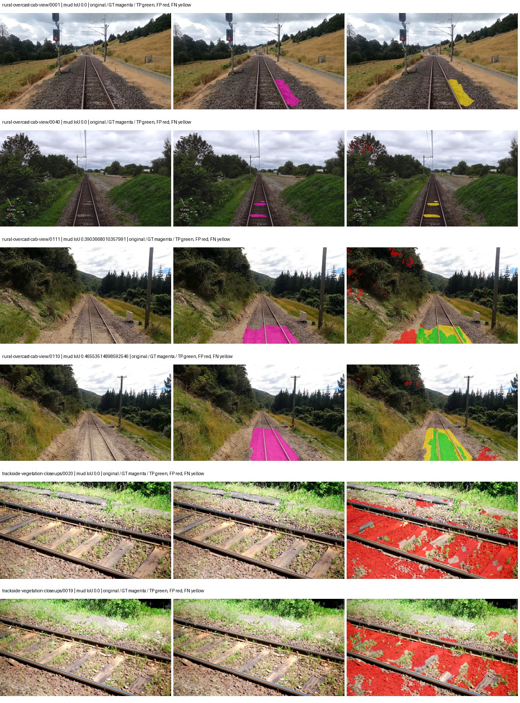
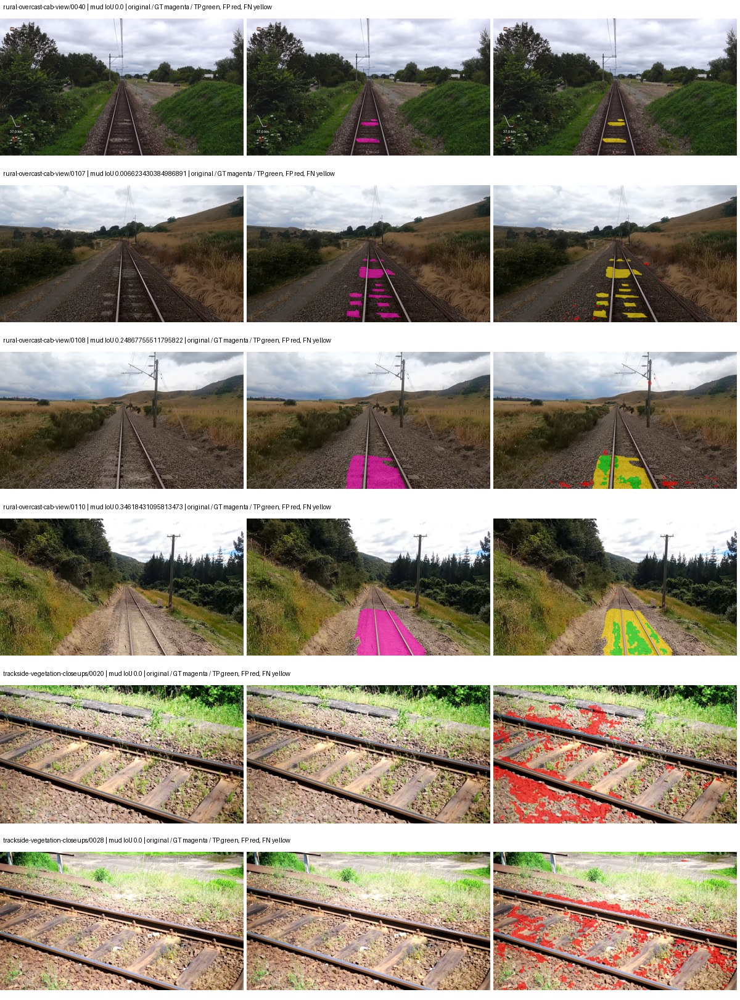
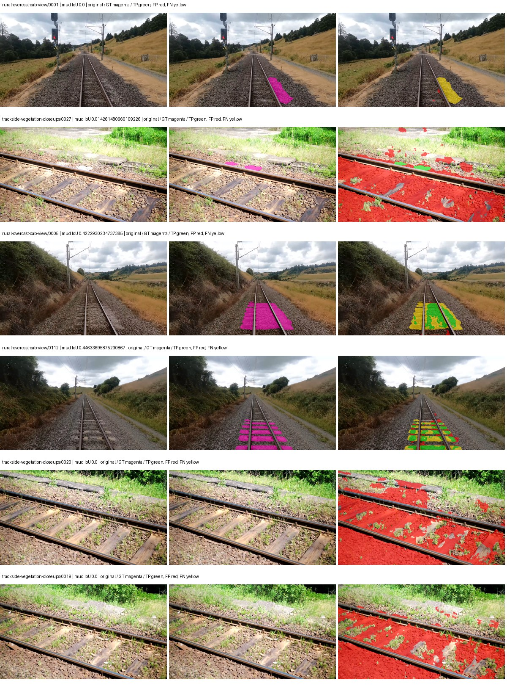
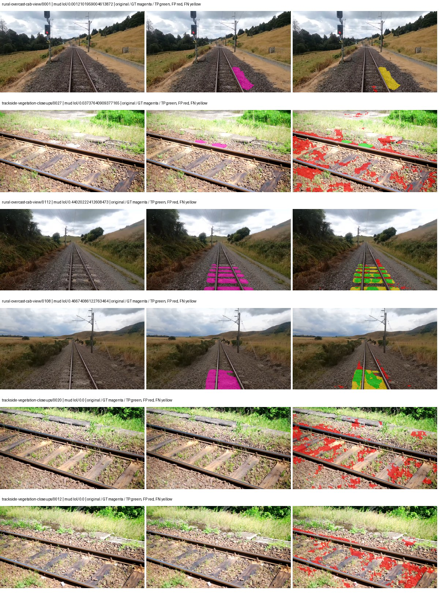

# smp_unetplusplus_efficientnet_b0 — rad_9_24_2026-fixed-grouped

[RAD 9/24: Scene-grouped split](../../README.md) · [Full model records](record.json)

Primary result: the **final checkpoint** after the full step budget (no early stopping). The checkpoint with the best **mud-pumping validation IoU, pixels pooled over all validation images**, is kept as secondary evidence. A job is complete only after full statistics and isolated profiling are verified.

Study metrics of the final checkpoint, counting each class only on the validation images that contain it: mud-pumping IoU is the mean per-image IoU over the images with mud-pumping, precision and recall sum pixels over those images, and mIoU averages each class over the images that contain it, then over the classes present.

| Initialization path | Seed | Mud-pumping IoU, train-camera images with mud (%, n=17) | Mud-pumping IoU, all images with mud (%, n=18) | Mud precision, all images with mud (%) | Mud recall, all images with mud (%) | mIoU (each class over images that contain it) (%) |
| --- | --- | --- | --- | --- | --- | --- |
| rtis_only | 0 | 0.83 | 1.21 | 20.26 | 2.07 | 28.45 |
| cityscapes_to_rtis | 0 | 4.38 | 4.37 | 18.91 | 5.86 | 27.82 |
| railsem19_to_rtis | 0 | 1.85 | 1.87 | 6.38 | 3.30 | 36.05 |
| cityscapes_to_railsem19_to_rtis | 0 | 10.44 | 10.02 | 26.35 | 12.81 | 31.79 |

Per-class IoU: IoU (%) of every class, each averaged only over the validation images that contain the class (n = those images); — = no image contains it. mIoU averages the classes with at least one such image.

| Initialization path | Seed | mIoU (each class over images that contain it) | person (n=0) | truck (n=0) | rail-track (n=37) | vegetation-overgrowth (n=13) | car (n=3) | on-rails (n=0) | traffic-sign (n=9) | road (n=11) | sidewalk (n=12) | construction (n=12) | tram-track (n=2) | pole (n=21) | traffic-light (n=3) | mud-pumping (n=18) | fence (n=7) | terrain (n=35) | sky (n=28) | rail-embedded (n=3) | rail-raised (n=37) | trackbed (n=37) | standing-water (n=9) |
| --- | --- | --- | --- | --- | --- | --- | --- | --- | --- | --- | --- | --- | --- | --- | --- | --- | --- | --- | --- | --- | --- | --- | --- |
| rtis_only | 0 | 28.45 | — | — | 51.80 | 19.22 | 0.00 | — | 0.00 | 15.58 | 4.11 | 37.99 | 8.36 | 64.43 | 0.03 | 1.21 | 4.54 | 79.87 | 93.70 | 0.00 | 69.98 | 58.92 | 2.31 |
| cityscapes_to_rtis | 0 | 27.82 | — | — | 48.41 | 15.57 | 0.00 | — | 0.00 | 11.08 | 6.32 | 37.82 | 0.00 | 66.37 | 0.00 | 4.37 | 4.25 | 75.69 | 85.29 | 0.38 | 70.82 | 59.74 | 14.66 |
| railsem19_to_rtis | 0 | 36.05 | — | — | 56.60 | 18.67 | 3.94 | — | 16.23 | 24.27 | 9.03 | 46.87 | 30.96 | 70.24 | 33.52 | 1.87 | 5.15 | 80.63 | 96.36 | 19.82 | 73.44 | 58.66 | 2.57 |
| cityscapes_to_railsem19_to_rtis | 0 | 31.79 | — | — | 52.81 | 23.04 | 11.73 | — | 10.66 | 12.46 | 6.54 | 40.86 | 5.18 | 66.95 | 15.87 | 10.02 | 8.69 | 76.62 | 87.89 | 0.33 | 71.97 | 58.50 | 12.13 |

Everything below is the campaign's own record, with pixels pooled over all validation images: its evaluation is the checkpoint that scored best on that pooled mud IoU (secondary evidence here); the diagnostics also cover the final checkpoint (`final-auto-val`).

| Model | Initialization path | Seed | Status | Steps | Best step | Best-checkpoint mud IoU, pixels pooled (%) | Best-checkpoint mud precision, pixels pooled (%) | Best-checkpoint mud recall, pixels pooled (%) | Final mud IoU (trainer val, pixels pooled, %) | Best-checkpoint mIoU, pixels pooled (%) | Best-checkpoint fixed GT-class mIoU, pixels pooled (%) |
| --- | --- | --- | --- | --- | --- | --- | --- | --- | --- | --- | --- |
| smp_unetplusplus_efficientnet_b0 | rtis_only | 0 | completed | 4000 | 777 | 4.45 | 5.32 | 21.38 | 1.21 | 21.39 | 22.57 |
| smp_unetplusplus_efficientnet_b0 | cityscapes_to_rtis | 0 | completed | 4000 | 3370 | 7.09 | 11.17 | 16.26 | 2.87 | 22.20 | 25.90 |
| smp_unetplusplus_efficientnet_b0 | railsem19_to_rtis | 0 | completed | 4000 | 1555 | 4.90 | 5.56 | 29.02 | 0.83 | 30.45 | 35.53 |
| smp_unetplusplus_efficientnet_b0 | cityscapes_to_railsem19_to_rtis | 0 | completed | 4000 | 1555 | 14.73 | 20.11 | 35.48 | 4.47 | 28.90 | 33.72 |

Training: 217 images. Validation: 37 images. Test: 60 held out. Seeds: [0]. Seed variation measures optimization variability, not independent-recording uncertainty. Historical source checkpoints stay fixed across adaptation seeds.

Training code: `fce0ea0ac50b334d4252812c396e0e593def375d`. Split SHA-256: `12d7b367c72cda61d57686ff2ac28223530d0af49debd9fb7a0fbc68b908bc93`.

## rtis_only — seed 0

Status: **completed**. Started: 2026-10-11T16:32:21.345270+00:00. Finished: 2026-10-11T17:31:46.353837+00:00.

Recipe pretrained initializer: `{"arch": "smp", "backbone_path": null, "batch_norm_momentum": null, "checkpoint": null, "classifier_path": null, "drop_path": null, "encoder_name": "efficientnet-b0", "encoder_weights": "imagenet", "head": "unified_head", "head_paths": [], "inactive_parameter_paths": ["encoder._conv_head", "encoder._bn1"], "local_files_only": false, "lora_alpha": 32, "lora_dropout": 0.05, "lora_r": 16, "lora_targets": [], "native": null, "revision": null, "smp_arch": "UnetPlusPlus", "subfolder": null, "trust_remote_code": false, "tuning": "full"}`.

`rtis_only` uses the recipe initializer, which may include pretrained segmentation components. Transfer paths load the exact historical source checkpoint below and reset the classifier; they do not reset all query/decoder features.

Source checkpoint: `Recipe pretrained initialization`.

Config SHA-256: `c4ac17579a8371a3a4bf9e7c2ac1f59df3856a9ef40660c2c8b3f009188321ca`. Weights used for validation: `raw`.

### Mud-pumping and aggregate quality

| Metric | Selected checkpoint | Final training validation |
| --- | --- | --- |
| Mud IoU | 4.45 | 1.21 |
| Mud precision | 5.32 | 2.87 |
| Mud recall | 21.38 | 2.06 |
| Mud Dice/F1 | 8.51 | 2.40 |
| mIoU | 21.39 | 22.60 |
| Mean accuracy | 28.59 | 33.81 |
| Mean precision | 33.73 | 34.51 |
| Mean Dice | 26.60 | 28.59 |
| Mean specificity | 98.76 | 98.73 |
| Pixel accuracy | 79.88 | 80.34 |
| Frequency-weighted IoU | 70.09 | 69.92 |
| Fixed GT-present class mIoU | 22.57 | 26.36 |
| Boundary F1 | 24.84 | 26.23 |

The selected checkpoint has independent evaluation evidence. Final values are the trainer's final validation record, not a new independent evaluation. mIoU averages classes with nonzero union, so false positives on absent classes can change its denominator. The fixed GT-class mean is supplementary and excludes absent classes; their false positives remain in the confusion matrix.

### Resource usage and timing

| Measurement | Value |
| --- | --- |
| Peak training VRAM, retained training invocation (GiB) | 9.29 |
| Peak evaluation VRAM (GiB) | 6.44 |
| Retained training invocation wall time (seconds) | 3427.67 |
| Retained training invocation GPU-hours (one GPU) | 0.95 |
| Evaluation wall time (seconds) | 11.05 |
| Full evaluation pipeline images/second | 3.35 |
| Best full-state checkpoint (MiB) | 98.05 |
| Final full-state checkpoint (MiB) | 98.04 |
| Verified periodic checkpoints removed (GiB) | 0.77 |

VRAM uses the recorded allocator high-water mark; it is not total device usage including CUDA context. Resumed jobs' retained training invocation times and peaks are **not whole-campaign totals**. Earlier invocation resource records are not reconstructed here. Evaluation throughput includes loader, sliding-window inference and metrics; it is not model-only latency/FPS. Missing measurements are shown as —, never inferred from another dataset's run.

### Standardized inference performance

Dedicated model-only profiling waits for an idle worker-locked L40S: BF16, batch 1, 1024x1024, 20 warmup and 100 CUDA-event-timed public forwards. It excludes loading, preprocessing, tiling and metrics.

| Status | Parameters | Weight MiB | FPS | p50 ms | p95 ms | Peak reserved GiB |
| --- | --- | --- | --- | --- | --- | --- |
| complete | 6572481 | 25.07 | 71.23 | 14.01 | 14.19 | 0.89 |

```json
{
  "schema_version": 1,
  "model_id": "smp_unetplusplus_efficientnet_b0",
  "measured_at": "2026-10-11T17:31:43+00:00",
  "status": "complete",
  "benchmark_scope": "rtis_selected_checkpoint_model_only",
  "applies_to": [
    "smp_unetplusplus_efficientnet_b0--rtis_only--seed-0"
  ],
  "source": {
    "campaign_git_sha": "fce0ea0ac50b334d4252812c396e0e593def375d",
    "git_dirty": false,
    "config_hash": "842691a9c62b",
    "resolved_config": "/data/izadia1/projects/segmentary-runs/rad_9_24_2026/fgall-seed0-20261007/configs/smp_unetplusplus_efficientnet_b0--rtis_only--seed-0.yaml",
    "config_sha256": "c4ac17579a8371a3a4bf9e7c2ac1f59df3856a9ef40660c2c8b3f009188321ca",
    "checkpoint_sha256": "4e747d596aa9764068f0b8ddbb5b9065e9534845ab841bb584f11ff6b6cf3e1a",
    "checkpoint_global_step": 777,
    "checkpoint_bytes": 102817921,
    "checkpoint_kind": "resume checkpoint with optimizer and EMA state",
    "weights": "raw",
    "measured_checkpoint_job_id": "smp_unetplusplus_efficientnet_b0--rtis_only--seed-0",
    "result_sha256": "eee3eefcd5011bdefad6ecea69b80a6ca444f055771d17d5bbfea50b385611cc",
    "result_git_sha": "fce0ea0ac50b334d4252812c396e0e593def375d",
    "result_stage": "eval:rad_9_24_2026-fixed-grouped:val",
    "result_seed": 0
  },
  "hardware": {
    "gpu_name": "NVIDIA L40S",
    "gpu_uuid": "GPU-c76642eb-64c1-b0ac-b051-d2efd47b32c4",
    "logical_device": "cuda:0",
    "physical_visibility_token": "9",
    "compute_capability": [
      8,
      9
    ],
    "total_memory_bytes": 47677177856
  },
  "model": {
    "parameter_count": 6572481,
    "trainable_parameter_count": 6160321,
    "resident_parameter_bytes": 26289924,
    "parameter_dtype_counts": {
      "float32": 6572481
    }
  },
  "contract": {
    "backend": "pytorch",
    "precision": "bf16_autocast",
    "batch_size": 1,
    "input_shape_nchw": [
      1,
      3,
      1024,
      1024
    ],
    "warmup_iterations": 20,
    "measured_iterations": 100,
    "timing": "per-forward CUDA events with end-event synchronization",
    "includes_preprocessing": false,
    "includes_data_loader": false,
    "includes_sliding_window": false,
    "input_resident_on_gpu": true,
    "model_only": true,
    "entrypoint": "public model(image) dense-logits forward"
  },
  "measurements": {
    "latency": {
      "p50_ms": 14.006783962249756,
      "p95_ms": 14.189466047286986,
      "mean_ms": 14.038159351348877,
      "minimum_ms": 13.933568000793457,
      "maximum_ms": 14.534655570983887,
      "fps": 71.23441007983098,
      "raw_ms": [
        14.155743598937988,
        13.962240219116211,
        13.95199966430664,
        13.96019172668457,
        14.534655570983887,
        13.944831848144531,
        14.046208381652832,
        13.937664031982422,
        13.933568000793457,
        14.063615798950195,
        14.003199577331543,
        14.011391639709473,
        13.941760063171387,
        13.957119941711426,
        13.96121597290039,
        14.038016319274902,
        14.007295608520508,
        14.030847549438477,
        14.056447982788086,
        14.003199577331543,
        13.972479820251465,
        13.988863945007324,
        14.002176284790039,
        14.027775764465332,
        14.008319854736328,
        14.129152297973633,
        14.112768173217773,
        14.071807861328125,
        13.97862434387207,
        13.97862434387207,
        14.087167739868164,
        13.955072402954102,
        13.956095695495605,
        13.998080253601074,
        14.045184135437012,
        14.343168258666992,
        13.955072402954102,
        14.009344100952148,
        14.043135643005371,
        14.003199577331543,
        13.959168434143066,
        13.937664031982422,
        14.134271621704102,
        13.96019172668457,
        14.046208381652832,
        13.981696128845215,
        14.099455833435059,
        13.989888191223145,
        13.97657585144043,
        14.012415885925293,
        13.956095695495605,
        14.451711654663086,
        14.028800010681152,
        14.031871795654297,
        14.082048416137695,
        14.008319854736328,
        14.49062442779541,
        13.958144187927246,
        14.173184394836426,
        14.162943840026855,
        14.003199577331543,
        14.006272315979004,
        14.008319854736328,
        13.948927879333496,
        14.441472053527832,
        14.057472229003906,
        14.022656440734863,
        14.063615798950195,
        13.964287757873535,
        13.981696128845215,
        13.973504066467285,
        14.015487670898438,
        14.149632453918457,
        14.012415885925293,
        13.981696128845215,
        14.025728225708008,
        13.979647636413574,
        13.991935729980469,
        14.000127792358398,
        13.939711570739746,
        14.004223823547363,
        14.058496475219727,
        13.981696128845215,
        14.0697603225708,
        14.07692813873291,
        13.97760009765625,
        13.95299243927002,
        14.104576110839844,
        13.98476791381836,
        14.040063858032227,
        14.041088104248047,
        13.958144187927246,
        14.014464378356934,
        13.999103546142578,
        14.166015625,
        13.97657585144043,
        13.973504066467285,
        14.181376457214355,
        14.132224082946777,
        13.94591999053955
      ],
      "percentile_method": "numpy linear interpolation"
    },
    "peak_reserved_bytes": 958398464,
    "memory_kind": "pytorch_cuda_allocator_peak_reserved_excluding_context",
    "process_total_bytes": 1486880768,
    "process_total_kind": "nvidia-smi used_memory of this PID on the benchmark GPU after the timed loop, including the CUDA context; null when the driver could not attribute memory to this PID",
    "benchmark_wall_clock_s": 20.089977763593197
  },
  "started_at": "2026-10-11T17:31:23+00:00",
  "finished_at": "2026-10-11T17:31:43+00:00",
  "environment": {
    "hostname": "hdrfs-app-001",
    "python": "3.11.15",
    "platform": "Linux-5.15.0-139-generic-x86_64-with-glibc2.35",
    "torch": "2.11.0+cu128",
    "torch_cuda": "12.8",
    "cudnn": 91900,
    "driver_version": "570.133.20",
    "cuda_available": true,
    "gpu_count": 1,
    "gpu_names": [
      "NVIDIA L40S"
    ],
    "cuda_visible_devices": "9",
    "packages": {
      "segmentary": "0.1.0",
      "torch": "2.11.0+cu128",
      "torchvision": "0.26.0+cu128",
      "transformers": "5.15.0",
      "timm": "1.0.28",
      "segmentation-models-pytorch": "0.5.0",
      "albumentations": "2.0.8",
      "lightning": "2.6.5",
      "numpy": "2.4.4"
    }
  }
}
```

### Per-class validation results

| Class | GT pixels | IoU (%) | Precision (%) | Recall (%) | Dice (%) | Boundary F1 (%) |
| --- | --- | --- | --- | --- | --- | --- |
| car | 29664 | 0.00 | 0.00 | 0.00 | 0.00 | 0.00 |
| construction | 311585 | 13.59 | 16.92 | 40.83 | 23.92 | 16.70 |
| fence | 265137 | 0.00 | 0.00 | 0.00 | 0.00 | 0.00 |
| mud-pumping | 1226250 | 4.45 | 5.32 | 21.38 | 8.51 | 8.93 |
| on-rails | 0 | 0.00 | 0.00 | — | 0.00 | 0.00 |
| person | 0 | — | — | — | — | — |
| pole | 628038 | 33.60 | 82.39 | 36.20 | 50.30 | 71.37 |
| rail-embedded | 16799 | 0.00 | 0.00 | 0.00 | 0.00 | 0.00 |
| rail-raised | 2969797 | 69.55 | 76.31 | 88.70 | 82.04 | 85.75 |
| rail-track | 6323197 | 32.59 | 66.00 | 39.16 | 49.16 | 46.83 |
| road | 1048831 | 0.00 | 0.00 | 0.00 | 0.00 | 0.00 |
| sidewalk | 1297367 | 7.68 | 56.53 | 8.16 | 14.26 | 20.98 |
| sky | 19121606 | 96.59 | 98.37 | 98.16 | 98.26 | 84.00 |
| standing-water | 95802 | 0.01 | 0.03 | 0.01 | 0.01 | 0.11 |
| terrain | 39239306 | 84.52 | 86.85 | 96.92 | 91.61 | 43.07 |
| trackbed | 10643081 | 54.72 | 66.16 | 75.99 | 70.74 | 51.61 |
| traffic-light | 19510 | 0.00 | 0.00 | 0.00 | 0.00 | 0.00 |
| traffic-sign | 13285 | 0.00 | 0.00 | 0.00 | 0.00 | 0.00 |
| tram-track | 56179 | 0.00 | 0.00 | 0.00 | 0.00 | 0.00 |
| truck | 0 | — | — | — | — | — |
| vegetation-overgrowth | 5901821 | 9.06 | 85.93 | 9.19 | 16.61 | 42.59 |

### Full-run accounting

| Measurement | Value |
| --- | --- |
| Full GPU-reserved wall seconds, all recorded worker attempts | 3572.74 |
| Full reserved GPU-hours | 0.99 |
| Whole-run timing complete | True |

| Phase | Wall seconds including failed attempts |
| --- | --- |
| training | 3434.45 |
| diagnostics | 83.90 |
| performance | 27.14 |

GPU-reserved time includes model loading, training, validation, collection, profiling, checkpoint I/O and orchestration while the worker owns one GPU. It is not GPU kernel-active time. Phase timings and sampled device memory/power/utilization are retained separately; sampled device memory is not the allocator high-water mark.

### Train/validation and raw/EMA diagnostics

| Checkpoint / weights / split | Images | Mud IoU (%) | Mud precision (%) | Mud recall (%) |
| --- | --- | --- | --- | --- |
| best-auto-train / raw | 217 | 81.25 | 84.17 | 95.90 |
| best-auto-val / raw | 37 | 4.45 | 5.32 | 21.38 |
| best-alternate-val / ema | 37 | 1.17 | 1.61 | 4.09 |
| final-auto-val / raw | 37 | 1.22 | 2.88 | 2.07 |

Train uses the evaluation transform without augmentation. Compare mud train/validation metrics for the same selected weights. Alternate EMA on running-stat BatchNorm is explicitly uncalibrated and is diagnostic only. Score-threshold curves use uncalibrated normalized scores and are pixel-level diagnostics, not event detection rates or a selected deployment operating point.

### Downloadable evidence

- best-auto-train: [per-image.csv](rtis_only--seed-0/best-auto-train/per-image.csv) · [per-image-confusion.json.gz](rtis_only--seed-0/best-auto-train/per-image-confusion.json.gz) · [groups.json](rtis_only--seed-0/best-auto-train/groups.json) · [mud-score-curves.json](rtis_only--seed-0/best-auto-train/mud-score-curves.json)
- best-auto-val: [per-image.csv](rtis_only--seed-0/best-auto-val/per-image.csv) · [per-image-confusion.json.gz](rtis_only--seed-0/best-auto-val/per-image-confusion.json.gz) · [groups.json](rtis_only--seed-0/best-auto-val/groups.json) · [mud-score-curves.json](rtis_only--seed-0/best-auto-val/mud-score-curves.json) · [examples.jpg](rtis_only--seed-0/best-auto-val/examples.jpg)
- best-alternate-val: [per-image.csv](rtis_only--seed-0/best-alternate-val/per-image.csv) · [per-image-confusion.json.gz](rtis_only--seed-0/best-alternate-val/per-image-confusion.json.gz) · [groups.json](rtis_only--seed-0/best-alternate-val/groups.json) · [mud-score-curves.json](rtis_only--seed-0/best-alternate-val/mud-score-curves.json)
- final-auto-val: [per-image.csv](rtis_only--seed-0/final-auto-val/per-image.csv) · [per-image-confusion.json.gz](rtis_only--seed-0/final-auto-val/per-image-confusion.json.gz) · [groups.json](rtis_only--seed-0/final-auto-val/groups.json) · [mud-score-curves.json](rtis_only--seed-0/final-auto-val/mud-score-curves.json)
- resources: [telemetry.csv](rtis_only--seed-0/resources/telemetry.csv)



Examples are two lowest and two highest mud-IoU positive images, plus up to two negative images with the most false-positive mud pixels. They are targeted diagnostic examples, not random samples. Green: true positive; red: false positive; yellow: false negative. Full predictions remain on HDRFS.

### Validation tracking

| Logged step | Overall mIoU (%) | Mud IoU (%) |
| --- | --- | --- |
| 258 | 17.17 | 0.27 |
| 518 | 19.49 | 0.28 |
| 777 | 21.39 | 4.45 |
| 1036 | 21.46 | 3.08 |
| 1295 | 22.31 | 0.70 |
| 1555 | 23.41 | 2.82 |
| 1814 | 22.96 | 2.87 |
| 2073 | 21.37 | 1.77 |
| 2332 | 23.07 | 2.22 |
| 2592 | 22.78 | 0.73 |
| 2851 | 23.42 | 3.38 |
| 3110 | 23.47 | 2.94 |
| 3369 | 21.89 | 2.32 |
| 3629 | 22.75 | 1.30 |
| 3888 | 22.51 | 1.48 |
| 4000 | 22.60 | 1.21 |

All retained scalar curves, including training loss and per-class IoU, are in record.json. Observed best mud on a curve is not necessarily a retained checkpoint: the pilot saved its selection-metric-best and final checkpoints. Step logging and checkpoint global_step may differ by one.

### Stopping and checkpoint provenance

```json
{
  "stopping": {
    "actual_steps": 4000,
    "maximum_steps": 4000,
    "min_delta": 0.0,
    "monitor": "val_iou/mud-pumping",
    "patience": null,
    "reason": "budget_complete"
  },
  "checkpoints": {
    "best": {
      "path": "/data/izadia1/projects/segmentary-runs/rad_9_24_2026/fgall-seed0-20261007/future-runs/smp_unetplusplus_efficientnet_b0--rtis_only--seed-0_seed0/rtis/best.ckpt",
      "sha256": "4e747d596aa9764068f0b8ddbb5b9065e9534845ab841bb584f11ff6b6cf3e1a",
      "global_step": 777,
      "bytes": 102817921
    },
    "final": {
      "path": "/data/izadia1/projects/segmentary-runs/rad_9_24_2026/fgall-seed0-20261007/future-runs/smp_unetplusplus_efficientnet_b0--rtis_only--seed-0_seed0/rtis/last.ckpt",
      "sha256": "4414472fc3ceef16fb40ce05ae90b522ff10e2ffdde4c0938bd2adc1e64d53aa",
      "global_step": 4000,
      "bytes": 102801025
    }
  },
  "cleanup_error": null
}
```

### Resolved training, initialization and evaluation settings

The optimizer block is the base configuration. Stage LR scales are applied at runtime, and stage warmup is capped at min(base warmup, floor(stage budget / 10), stage budget - 1): 400 steps for this 4,000-step pilot. Model-internal native input grids may differ from augmentation crops (EoMT uses its 640 grid).

```json
{
  "name": "smp_unetplusplus_efficientnet_b0--rtis_only--seed-0",
  "model": {
    "arch": "smp",
    "checkpoint": null,
    "tuning": "full",
    "head": "unified_head",
    "lora_r": 16,
    "lora_alpha": 32,
    "lora_dropout": 0.05,
    "lora_targets": [],
    "drop_path": null,
    "revision": null,
    "subfolder": null,
    "local_files_only": false,
    "trust_remote_code": false,
    "backbone_path": null,
    "head_paths": [],
    "classifier_path": null,
    "inactive_parameter_paths": [
      "encoder._conv_head",
      "encoder._bn1"
    ],
    "smp_arch": "UnetPlusPlus",
    "encoder_name": "efficientnet-b0",
    "encoder_weights": "imagenet",
    "native": null,
    "batch_norm_momentum": null
  },
  "space": "paul-test-rtis",
  "taxonomy_root": "/data/izadia1/projects/segmentary-rad-fgall-fce0ea0a/taxonomy",
  "output_root": "/data/izadia1/projects/segmentary-runs/rad_9_24_2026/fgall-seed0-20261007/future-runs",
  "optim": {
    "backbone_lr": 0.0001,
    "head_lr_mult": 10.0,
    "weight_decay": 0.05,
    "llrd": 1.0,
    "warmup_iters": 1500,
    "warmup_ratio": 1e-06,
    "poly_power": 0.9,
    "min_lr_ratio": 0.0,
    "betas": [
      0.9,
      0.999
    ],
    "grad_clip": 1.0
  },
  "train": {
    "iters": 4000,
    "batch_size": 2,
    "accum": 8,
    "num_workers": 2,
    "precision": "bf16-mixed",
    "ema_decay": 0.9998,
    "val_every": 250,
    "ckpt_every": 500,
    "selection_metric": "val_iou/mud-pumping",
    "early_stopping_patience": null,
    "early_stopping_min_delta": 0.0,
    "seed": 0,
    "devices": 1
  },
  "eval": {
    "sliding_window": true,
    "window": [
      1024,
      1024
    ],
    "stride": [
      768,
      768
    ],
    "batch_size": 1,
    "num_workers": 2,
    "tta_scales": [],
    "tta_flip": false,
    "threshold": 0.5,
    "boundary_tolerance_frac": 0.0075,
    "save_confusion": true
  },
  "loss": {
    "task": "multiclass",
    "activation": "auto",
    "terms": [],
    "aux": "none",
    "aux_weight": 0.0,
    "ce_weight": 1.0,
    "label_smoothing": 0.0,
    "class_weights": null,
    "query": null
  },
  "aug": {
    "crop": [
      1024,
      1024
    ],
    "scale_min": 0.5,
    "scale_max": 2.0,
    "hflip_p": 0.5,
    "color_jitter_p": 0.5,
    "brightness": 0.25,
    "contrast": 0.25,
    "saturation": 0.25,
    "hue": 0.05
  },
  "stages": [
    {
      "name": "rtis",
      "data": [
        {
          "name": "rad_9_24_2026-fixed-grouped",
          "root": "/data/izadia1/datasets/rad_9_24_2026-fixed-grouped",
          "variant": null,
          "split_file": "splits.json",
          "train_split": "train",
          "val_split": "val",
          "limit": null,
          "loader": "folder",
          "mapping": "paul-test-rtis",
          "loader_options": {
            "require_groups": true
          }
        }
      ],
      "iters": null,
      "lr_scale": 1.0,
      "head_group_lr_scale": 1.0,
      "init_from": "pretrained",
      "reset_head": false,
      "freeze": null,
      "sample_weights": null
    }
  ]
}
```

### Hardware and software provenance

```json
{
  "training": {
    "cuda_available": true,
    "cuda_visible_devices": "9",
    "cudnn": 91900,
    "driver_version": "570.133.20",
    "gpu_count": 1,
    "gpu_names": [
      "NVIDIA L40S"
    ],
    "hostname": "hdrfs-app-001",
    "input_normalization": {
      "channel_order": "rgb",
      "mean": [
        0.485,
        0.456,
        0.406
      ],
      "source": "smp_encoder_settings",
      "std": [
        0.229,
        0.224,
        0.225
      ]
    },
    "model_origins": [
      {
        "hf_commit": null,
        "hf_name_or_path": null,
        "module": "model",
        "timm_pretrained": {}
      }
    ],
    "model_parameter_count": 6572481,
    "packages": {
      "albumentations": "2.0.8",
      "lightning": "2.6.5",
      "numpy": "2.4.4",
      "segmentary": "0.1.0",
      "segmentation-models-pytorch": "0.5.0",
      "timm": "1.0.28",
      "torch": "2.11.0+cu128",
      "torchvision": "0.26.0+cu128",
      "transformers": "5.15.0"
    },
    "platform": "Linux-5.15.0-139-generic-x86_64-with-glibc2.35",
    "python": "3.11.15",
    "torch": "2.11.0+cu128",
    "torch_cuda": "12.8",
    "trainable_parameter_count": 6160321,
    "training_stop": {
      "actual_steps": 4000,
      "maximum_steps": 4000,
      "min_delta": 0.0,
      "monitor": "val_iou/mud-pumping",
      "patience": null,
      "reason": "budget_complete"
    },
    "validation_weights": "raw"
  },
  "evaluation": {
    "cuda_available": true,
    "cuda_visible_devices": "9",
    "cudnn": 91900,
    "driver_version": "570.133.20",
    "gpu_count": 1,
    "gpu_names": [
      "NVIDIA L40S"
    ],
    "hostname": "hdrfs-app-001",
    "input_normalization": {
      "channel_order": "rgb",
      "mean": [
        0.485,
        0.456,
        0.406
      ],
      "source": "smp_encoder_settings",
      "std": [
        0.229,
        0.224,
        0.225
      ]
    },
    "packages": {
      "albumentations": "2.0.8",
      "lightning": "2.6.5",
      "numpy": "2.4.4",
      "segmentary": "0.1.0",
      "segmentation-models-pytorch": "0.5.0",
      "timm": "1.0.28",
      "torch": "2.11.0+cu128",
      "torchvision": "0.26.0+cu128",
      "transformers": "5.15.0"
    },
    "platform": "Linux-5.15.0-139-generic-x86_64-with-glibc2.35",
    "python": "3.11.15",
    "torch": "2.11.0+cu128",
    "torch_cuda": "12.8"
  }
}
```

## cityscapes_to_rtis — seed 0

Status: **completed**. Started: 2026-10-11T16:32:44.541926+00:00. Finished: 2026-10-11T17:31:40.418384+00:00.

Recipe pretrained initializer: `{"arch": "smp", "backbone_path": null, "batch_norm_momentum": null, "checkpoint": null, "classifier_path": null, "drop_path": null, "encoder_name": "efficientnet-b0", "encoder_weights": "imagenet", "head": "unified_head", "head_paths": [], "inactive_parameter_paths": ["encoder._conv_head", "encoder._bn1"], "local_files_only": false, "lora_alpha": 32, "lora_dropout": 0.05, "lora_r": 16, "lora_targets": [], "native": null, "revision": null, "smp_arch": "UnetPlusPlus", "subfolder": null, "trust_remote_code": false, "tuning": "full"}`.

`rtis_only` uses the recipe initializer, which may include pretrained segmentation components. Transfer paths load the exact historical source checkpoint below and reset the classifier; they do not reset all query/decoder features.

Source checkpoint: `{'name': 'smp_unetplusplus_efficientnet_b0--cityscapes--seed-0', 'model': 'smp_unetplusplus_efficientnet_b0', 'protocol': 'cityscapes', 'config': '/data/izadia1/projects/segmentary-runs/all-model-city-rail-seed0-rail20-b9eb3e1/jobs/smp_unetplusplus_efficientnet_b0--cityscapes--seed-0/attempt-001/resolved-config.yaml', 'checkpoint': '/data/izadia1/projects/segmentary-runs/all-model-city-rail-seed0-rail20-b9eb3e1/jobs/smp_unetplusplus_efficientnet_b0--cityscapes--seed-0/attempt-001/train/smp_unetplusplus_efficientnet_b0--cityscapes_seed0/cityscapes/last.ckpt', 'recorded_sha256': 'af0359a15da63814d52e95356a33220584bc6751bb14cfdf82601e0b7b7e6ae1', 'exists': True}`.

Config SHA-256: `9614eb41a615ca9afeefee44f4d2cfab3ebc3c8701f54a5bc638b42bd11fd735`. Weights used for validation: `raw`.

### Mud-pumping and aggregate quality

| Metric | Selected checkpoint | Final training validation |
| --- | --- | --- |
| Mud IoU | 7.09 | 2.87 |
| Mud precision | 11.17 | 5.31 |
| Mud recall | 16.26 | 5.87 |
| Mud Dice/F1 | 13.24 | 5.57 |
| mIoU | 22.20 | 21.96 |
| Mean accuracy | 35.70 | 33.67 |
| Mean precision | 36.99 | 37.75 |
| Mean Dice | 28.26 | 27.83 |
| Mean specificity | 98.58 | 98.51 |
| Pixel accuracy | 78.37 | 78.42 |
| Frequency-weighted IoU | 66.72 | 66.01 |
| Fixed GT-present class mIoU | 25.90 | 25.62 |
| Boundary F1 | 24.41 | 24.18 |

The selected checkpoint has independent evaluation evidence. Final values are the trainer's final validation record, not a new independent evaluation. mIoU averages classes with nonzero union, so false positives on absent classes can change its denominator. The fixed GT-class mean is supplementary and excludes absent classes; their false positives remain in the confusion matrix.

### Resource usage and timing

| Measurement | Value |
| --- | --- |
| Peak training VRAM, retained training invocation (GiB) | 9.30 |
| Peak evaluation VRAM (GiB) | 6.44 |
| Retained training invocation wall time (seconds) | 3397.60 |
| Retained training invocation GPU-hours (one GPU) | 0.94 |
| Evaluation wall time (seconds) | 11.27 |
| Full evaluation pipeline images/second | 3.28 |
| Best full-state checkpoint (MiB) | 98.05 |
| Final full-state checkpoint (MiB) | 98.04 |
| Verified periodic checkpoints removed (GiB) | 0.77 |

VRAM uses the recorded allocator high-water mark; it is not total device usage including CUDA context. Resumed jobs' retained training invocation times and peaks are **not whole-campaign totals**. Earlier invocation resource records are not reconstructed here. Evaluation throughput includes loader, sliding-window inference and metrics; it is not model-only latency/FPS. Missing measurements are shown as —, never inferred from another dataset's run.

### Standardized inference performance

Dedicated model-only profiling waits for an idle worker-locked L40S: BF16, batch 1, 1024x1024, 20 warmup and 100 CUDA-event-timed public forwards. It excludes loading, preprocessing, tiling and metrics.

| Status | Parameters | Weight MiB | FPS | p50 ms | p95 ms | Peak reserved GiB |
| --- | --- | --- | --- | --- | --- | --- |
| complete | 6572481 | 25.07 | 69.20 | 14.30 | 15.20 | 0.89 |

```json
{
  "schema_version": 1,
  "model_id": "smp_unetplusplus_efficientnet_b0",
  "measured_at": "2026-10-11T17:31:38+00:00",
  "status": "complete",
  "benchmark_scope": "rtis_selected_checkpoint_model_only",
  "applies_to": [
    "smp_unetplusplus_efficientnet_b0--cityscapes_to_rtis--seed-0"
  ],
  "source": {
    "campaign_git_sha": "fce0ea0ac50b334d4252812c396e0e593def375d",
    "git_dirty": false,
    "config_hash": "a12c2af5646e",
    "resolved_config": "/data/izadia1/projects/segmentary-runs/rad_9_24_2026/fgall-seed0-20261007/configs/smp_unetplusplus_efficientnet_b0--cityscapes_to_rtis--seed-0.yaml",
    "config_sha256": "9614eb41a615ca9afeefee44f4d2cfab3ebc3c8701f54a5bc638b42bd11fd735",
    "checkpoint_sha256": "17b90ea2fc1e98d6cf12bfd96377cf842994af02439ad79c8076f9cad304b258",
    "checkpoint_global_step": 3370,
    "checkpoint_bytes": 102817985,
    "checkpoint_kind": "resume checkpoint with optimizer and EMA state",
    "weights": "raw",
    "measured_checkpoint_job_id": "smp_unetplusplus_efficientnet_b0--cityscapes_to_rtis--seed-0",
    "result_sha256": "54384fe2c672c5cc9db50231509ca0f6b4017cbfa209c9f987330bba8075103f",
    "result_git_sha": "fce0ea0ac50b334d4252812c396e0e593def375d",
    "result_stage": "eval:rad_9_24_2026-fixed-grouped:val",
    "result_seed": 0
  },
  "hardware": {
    "gpu_name": "NVIDIA L40S",
    "gpu_uuid": "GPU-e2e96741-aec9-e90b-5c46-d0d58be90a56",
    "logical_device": "cuda:0",
    "physical_visibility_token": "8",
    "compute_capability": [
      8,
      9
    ],
    "total_memory_bytes": 47677177856
  },
  "model": {
    "parameter_count": 6572481,
    "trainable_parameter_count": 6160321,
    "resident_parameter_bytes": 26289924,
    "parameter_dtype_counts": {
      "float32": 6572481
    }
  },
  "contract": {
    "backend": "pytorch",
    "precision": "bf16_autocast",
    "batch_size": 1,
    "input_shape_nchw": [
      1,
      3,
      1024,
      1024
    ],
    "warmup_iterations": 20,
    "measured_iterations": 100,
    "timing": "per-forward CUDA events with end-event synchronization",
    "includes_preprocessing": false,
    "includes_data_loader": false,
    "includes_sliding_window": false,
    "input_resident_on_gpu": true,
    "model_only": true,
    "entrypoint": "public model(image) dense-logits forward"
  },
  "measurements": {
    "latency": {
      "p50_ms": 14.304255962371826,
      "p95_ms": 15.195084810256958,
      "mean_ms": 14.451017274856568,
      "minimum_ms": 14.07590389251709,
      "maximum_ms": 16.16486358642578,
      "fps": 69.19928064440884,
      "raw_ms": [
        14.317567825317383,
        14.09331226348877,
        14.113792419433594,
        14.532608032226562,
        14.094304084777832,
        14.1015043258667,
        14.112768173217773,
        14.07590389251709,
        14.10979175567627,
        14.152704238891602,
        14.145536422729492,
        14.098496437072754,
        14.087167739868164,
        14.115839958190918,
        14.08512020111084,
        14.097408294677734,
        14.166015625,
        14.089216232299805,
        14.109696388244629,
        14.358528137207031,
        14.16703987121582,
        14.754783630371094,
        14.728192329406738,
        14.237695693969727,
        14.185471534729004,
        14.318592071533203,
        16.16486358642578,
        14.48243236541748,
        14.312447547912598,
        15.369215965270996,
        14.748671531677246,
        14.545920372009277,
        14.858240127563477,
        15.027199745178223,
        14.447615623474121,
        15.186944007873535,
        14.45580768585205,
        14.58892822265625,
        14.569472312927246,
        14.277631759643555,
        14.576640129089355,
        14.130175590515137,
        14.119935989379883,
        14.227456092834473,
        14.412799835205078,
        14.234623908996582,
        14.520319938659668,
        14.331904411315918,
        14.615551948547363,
        14.9104642868042,
        15.444992065429688,
        14.121983528137207,
        14.11075210571289,
        14.145536422729492,
        14.57868766784668,
        14.253055572509766,
        14.186495780944824,
        14.648320198059082,
        14.28377628326416,
        14.089216232299805,
        14.081024169921875,
        14.129152297973633,
        14.291935920715332,
        14.960639953613281,
        14.58687973022461,
        14.296064376831055,
        14.63599967956543,
        14.237759590148926,
        14.866432189941406,
        14.133248329162598,
        14.600192070007324,
        14.125056266784668,
        14.28172779083252,
        14.499839782714844,
        14.379008293151855,
        15.153216361999512,
        14.820351600646973,
        15.349760055541992,
        15.078399658203125,
        14.804991722106934,
        14.656512260437012,
        14.26534366607666,
        14.169088363647461,
        14.140416145324707,
        14.25817584991455,
        14.233599662780762,
        14.899200439453125,
        15.367168426513672,
        14.090208053588867,
        14.128128051757812,
        14.111743927001953,
        15.122431755065918,
        14.38003158569336,
        14.402560234069824,
        14.76915168762207,
        14.56230354309082,
        14.154751777648926,
        14.225407600402832,
        14.433279991149902,
        14.993408203125
      ],
      "percentile_method": "numpy linear interpolation"
    },
    "peak_reserved_bytes": 958398464,
    "memory_kind": "pytorch_cuda_allocator_peak_reserved_excluding_context",
    "process_total_bytes": 1486880768,
    "process_total_kind": "nvidia-smi used_memory of this PID on the benchmark GPU after the timed loop, including the CUDA context; null when the driver could not attribute memory to this PID",
    "benchmark_wall_clock_s": 20.155711464583874
  },
  "started_at": "2026-10-11T17:31:17+00:00",
  "finished_at": "2026-10-11T17:31:38+00:00",
  "environment": {
    "hostname": "hdrfs-app-001",
    "python": "3.11.15",
    "platform": "Linux-5.15.0-139-generic-x86_64-with-glibc2.35",
    "torch": "2.11.0+cu128",
    "torch_cuda": "12.8",
    "cudnn": 91900,
    "driver_version": "570.133.20",
    "cuda_available": true,
    "gpu_count": 1,
    "gpu_names": [
      "NVIDIA L40S"
    ],
    "cuda_visible_devices": "8",
    "packages": {
      "segmentary": "0.1.0",
      "torch": "2.11.0+cu128",
      "torchvision": "0.26.0+cu128",
      "transformers": "5.15.0",
      "timm": "1.0.28",
      "segmentation-models-pytorch": "0.5.0",
      "albumentations": "2.0.8",
      "lightning": "2.6.5",
      "numpy": "2.4.4"
    }
  }
}
```

### Per-class validation results

| Class | GT pixels | IoU (%) | Precision (%) | Recall (%) | Dice (%) | Boundary F1 (%) |
| --- | --- | --- | --- | --- | --- | --- |
| car | 29664 | 0.00 | 0.00 | 0.00 | 0.00 | 0.00 |
| construction | 311585 | 15.69 | 16.81 | 70.03 | 27.12 | 21.27 |
| fence | 265137 | 8.65 | 19.61 | 13.41 | 15.93 | 23.34 |
| mud-pumping | 1226250 | 7.09 | 11.17 | 16.26 | 13.24 | 9.51 |
| on-rails | 0 | 0.00 | 0.00 | — | 0.00 | 0.00 |
| person | 0 | 0.00 | 0.00 | — | 0.00 | 0.00 |
| pole | 628038 | 66.24 | 78.22 | 81.21 | 79.69 | 86.08 |
| rail-embedded | 16799 | 0.57 | 87.16 | 0.57 | 1.12 | 6.60 |
| rail-raised | 2969797 | 70.40 | 80.79 | 84.55 | 82.63 | 85.90 |
| rail-track | 6323197 | 30.80 | 65.81 | 36.66 | 47.09 | 40.57 |
| road | 1048831 | 7.79 | 26.12 | 9.99 | 14.45 | 17.53 |
| sidewalk | 1297367 | 24.38 | 59.97 | 29.11 | 39.20 | 14.70 |
| sky | 19121606 | 91.28 | 99.07 | 92.07 | 95.44 | 73.84 |
| standing-water | 95802 | 2.62 | 2.80 | 28.75 | 5.11 | 3.72 |
| terrain | 39239306 | 78.39 | 81.67 | 95.12 | 87.89 | 41.57 |
| trackbed | 10643081 | 55.01 | 65.52 | 77.41 | 70.97 | 49.59 |
| traffic-light | 19510 | 0.00 | 0.00 | 0.00 | 0.00 | 0.00 |
| traffic-sign | 13285 | 0.00 | 0.00 | 0.00 | 0.00 | 0.00 |
| tram-track | 56179 | 0.00 | 0.00 | 0.00 | 0.00 | 0.00 |
| truck | 0 | 0.00 | 0.00 | — | 0.00 | 0.00 |
| vegetation-overgrowth | 5901821 | 7.33 | 82.10 | 7.45 | 13.67 | 38.39 |

### Full-run accounting

| Measurement | Value |
| --- | --- |
| Full GPU-reserved wall seconds, all recorded worker attempts | 3543.62 |
| Full reserved GPU-hours | 0.98 |
| Whole-run timing complete | True |

| Phase | Wall seconds including failed attempts |
| --- | --- |
| training | 3404.27 |
| diagnostics | 84.52 |
| performance | 27.48 |

GPU-reserved time includes model loading, training, validation, collection, profiling, checkpoint I/O and orchestration while the worker owns one GPU. It is not GPU kernel-active time. Phase timings and sampled device memory/power/utilization are retained separately; sampled device memory is not the allocator high-water mark.

### Train/validation and raw/EMA diagnostics

| Checkpoint / weights / split | Images | Mud IoU (%) | Mud precision (%) | Mud recall (%) |
| --- | --- | --- | --- | --- |
| best-auto-train / raw | 217 | 82.98 | 95.08 | 86.70 |
| best-auto-val / raw | 37 | 7.09 | 11.17 | 16.26 |
| best-alternate-val / ema | 37 | 0.92 | 3.81 | 1.21 |
| final-auto-val / raw | 37 | 2.86 | 5.30 | 5.86 |

Train uses the evaluation transform without augmentation. Compare mud train/validation metrics for the same selected weights. Alternate EMA on running-stat BatchNorm is explicitly uncalibrated and is diagnostic only. Score-threshold curves use uncalibrated normalized scores and are pixel-level diagnostics, not event detection rates or a selected deployment operating point.

### Downloadable evidence

- best-auto-train: [per-image.csv](cityscapes_to_rtis--seed-0/best-auto-train/per-image.csv) · [per-image-confusion.json.gz](cityscapes_to_rtis--seed-0/best-auto-train/per-image-confusion.json.gz) · [groups.json](cityscapes_to_rtis--seed-0/best-auto-train/groups.json) · [mud-score-curves.json](cityscapes_to_rtis--seed-0/best-auto-train/mud-score-curves.json)
- best-auto-val: [per-image.csv](cityscapes_to_rtis--seed-0/best-auto-val/per-image.csv) · [per-image-confusion.json.gz](cityscapes_to_rtis--seed-0/best-auto-val/per-image-confusion.json.gz) · [groups.json](cityscapes_to_rtis--seed-0/best-auto-val/groups.json) · [mud-score-curves.json](cityscapes_to_rtis--seed-0/best-auto-val/mud-score-curves.json) · [examples.jpg](cityscapes_to_rtis--seed-0/best-auto-val/examples.jpg)
- best-alternate-val: [per-image.csv](cityscapes_to_rtis--seed-0/best-alternate-val/per-image.csv) · [per-image-confusion.json.gz](cityscapes_to_rtis--seed-0/best-alternate-val/per-image-confusion.json.gz) · [groups.json](cityscapes_to_rtis--seed-0/best-alternate-val/groups.json) · [mud-score-curves.json](cityscapes_to_rtis--seed-0/best-alternate-val/mud-score-curves.json)
- final-auto-val: [per-image.csv](cityscapes_to_rtis--seed-0/final-auto-val/per-image.csv) · [per-image-confusion.json.gz](cityscapes_to_rtis--seed-0/final-auto-val/per-image-confusion.json.gz) · [groups.json](cityscapes_to_rtis--seed-0/final-auto-val/groups.json) · [mud-score-curves.json](cityscapes_to_rtis--seed-0/final-auto-val/mud-score-curves.json)
- resources: [telemetry.csv](cityscapes_to_rtis--seed-0/resources/telemetry.csv)



Examples are two lowest and two highest mud-IoU positive images, plus up to two negative images with the most false-positive mud pixels. They are targeted diagnostic examples, not random samples. Green: true positive; red: false positive; yellow: false negative. Full predictions remain on HDRFS.

### Validation tracking

| Logged step | Overall mIoU (%) | Mud IoU (%) |
| --- | --- | --- |
| 258 | 19.23 | 3.22 |
| 518 | 23.05 | 2.62 |
| 777 | 22.75 | 1.27 |
| 1036 | 21.97 | 0.77 |
| 1295 | 22.00 | 4.88 |
| 1555 | 22.99 | 4.48 |
| 1814 | 22.31 | 4.26 |
| 2073 | 22.14 | 3.99 |
| 2332 | 21.42 | 4.44 |
| 2592 | 21.74 | 4.46 |
| 2851 | 22.39 | 4.48 |
| 3110 | 21.67 | 3.26 |
| 3369 | 22.20 | 7.11 |
| 3629 | 21.98 | 6.37 |
| 3888 | 22.40 | 3.78 |
| 4000 | 21.96 | 2.87 |

All retained scalar curves, including training loss and per-class IoU, are in record.json. Observed best mud on a curve is not necessarily a retained checkpoint: the pilot saved its selection-metric-best and final checkpoints. Step logging and checkpoint global_step may differ by one.

### Stopping and checkpoint provenance

```json
{
  "stopping": {
    "actual_steps": 4000,
    "maximum_steps": 4000,
    "min_delta": 0.0,
    "monitor": "val_iou/mud-pumping",
    "patience": null,
    "reason": "budget_complete"
  },
  "checkpoints": {
    "best": {
      "path": "/data/izadia1/projects/segmentary-runs/rad_9_24_2026/fgall-seed0-20261007/future-runs/smp_unetplusplus_efficientnet_b0--cityscapes_to_rtis--seed-0_seed0/rtis/best.ckpt",
      "sha256": "17b90ea2fc1e98d6cf12bfd96377cf842994af02439ad79c8076f9cad304b258",
      "global_step": 3370,
      "bytes": 102817985
    },
    "final": {
      "path": "/data/izadia1/projects/segmentary-runs/rad_9_24_2026/fgall-seed0-20261007/future-runs/smp_unetplusplus_efficientnet_b0--cityscapes_to_rtis--seed-0_seed0/rtis/last.ckpt",
      "sha256": "5be0e75fe99f4b970764f3f262a8a5a82601ec0d0e48a5947f6850b19768937e",
      "global_step": 4000,
      "bytes": 102801089
    }
  },
  "cleanup_error": null
}
```

### Resolved training, initialization and evaluation settings

The optimizer block is the base configuration. Stage LR scales are applied at runtime, and stage warmup is capped at min(base warmup, floor(stage budget / 10), stage budget - 1): 400 steps for this 4,000-step pilot. Model-internal native input grids may differ from augmentation crops (EoMT uses its 640 grid).

```json
{
  "name": "smp_unetplusplus_efficientnet_b0--cityscapes_to_rtis--seed-0",
  "model": {
    "arch": "smp",
    "checkpoint": null,
    "tuning": "full",
    "head": "unified_head",
    "lora_r": 16,
    "lora_alpha": 32,
    "lora_dropout": 0.05,
    "lora_targets": [],
    "drop_path": null,
    "revision": null,
    "subfolder": null,
    "local_files_only": false,
    "trust_remote_code": false,
    "backbone_path": null,
    "head_paths": [],
    "classifier_path": null,
    "inactive_parameter_paths": [
      "encoder._conv_head",
      "encoder._bn1"
    ],
    "smp_arch": "UnetPlusPlus",
    "encoder_name": "efficientnet-b0",
    "encoder_weights": "imagenet",
    "native": null,
    "batch_norm_momentum": null
  },
  "space": "paul-test-rtis",
  "taxonomy_root": "/data/izadia1/projects/segmentary-rad-fgall-fce0ea0a/taxonomy",
  "output_root": "/data/izadia1/projects/segmentary-runs/rad_9_24_2026/fgall-seed0-20261007/future-runs",
  "optim": {
    "backbone_lr": 0.0001,
    "head_lr_mult": 10.0,
    "weight_decay": 0.05,
    "llrd": 1.0,
    "warmup_iters": 1500,
    "warmup_ratio": 1e-06,
    "poly_power": 0.9,
    "min_lr_ratio": 0.0,
    "betas": [
      0.9,
      0.999
    ],
    "grad_clip": 1.0
  },
  "train": {
    "iters": 4000,
    "batch_size": 2,
    "accum": 8,
    "num_workers": 2,
    "precision": "bf16-mixed",
    "ema_decay": 0.9998,
    "val_every": 250,
    "ckpt_every": 500,
    "selection_metric": "val_iou/mud-pumping",
    "early_stopping_patience": null,
    "early_stopping_min_delta": 0.0,
    "seed": 0,
    "devices": 1
  },
  "eval": {
    "sliding_window": true,
    "window": [
      1024,
      1024
    ],
    "stride": [
      768,
      768
    ],
    "batch_size": 1,
    "num_workers": 2,
    "tta_scales": [],
    "tta_flip": false,
    "threshold": 0.5,
    "boundary_tolerance_frac": 0.0075,
    "save_confusion": true
  },
  "loss": {
    "task": "multiclass",
    "activation": "auto",
    "terms": [],
    "aux": "none",
    "aux_weight": 0.0,
    "ce_weight": 1.0,
    "label_smoothing": 0.0,
    "class_weights": null,
    "query": null
  },
  "aug": {
    "crop": [
      1024,
      1024
    ],
    "scale_min": 0.5,
    "scale_max": 2.0,
    "hflip_p": 0.5,
    "color_jitter_p": 0.5,
    "brightness": 0.25,
    "contrast": 0.25,
    "saturation": 0.25,
    "hue": 0.05
  },
  "stages": [
    {
      "name": "rtis",
      "data": [
        {
          "name": "rad_9_24_2026-fixed-grouped",
          "root": "/data/izadia1/datasets/rad_9_24_2026-fixed-grouped",
          "variant": null,
          "split_file": "splits.json",
          "train_split": "train",
          "val_split": "val",
          "limit": null,
          "loader": "folder",
          "mapping": "paul-test-rtis",
          "loader_options": {
            "require_groups": true
          }
        }
      ],
      "iters": null,
      "lr_scale": 0.1,
      "head_group_lr_scale": 1.0,
      "init_from": "/data/izadia1/projects/segmentary-runs/all-model-city-rail-seed0-rail20-b9eb3e1/jobs/smp_unetplusplus_efficientnet_b0--cityscapes--seed-0/attempt-001/train/smp_unetplusplus_efficientnet_b0--cityscapes_seed0/cityscapes/last.ckpt",
      "reset_head": true,
      "freeze": null,
      "sample_weights": null
    }
  ]
}
```

### Hardware and software provenance

```json
{
  "training": {
    "cuda_available": true,
    "cuda_visible_devices": "8",
    "cudnn": 91900,
    "driver_version": "570.133.20",
    "gpu_count": 1,
    "gpu_names": [
      "NVIDIA L40S"
    ],
    "hostname": "hdrfs-app-001",
    "input_normalization": {
      "channel_order": "rgb",
      "mean": [
        0.485,
        0.456,
        0.406
      ],
      "source": "smp_encoder_settings",
      "std": [
        0.229,
        0.224,
        0.225
      ]
    },
    "model_origins": [
      {
        "hf_commit": null,
        "hf_name_or_path": null,
        "module": "model",
        "timm_pretrained": {}
      }
    ],
    "model_parameter_count": 6572481,
    "packages": {
      "albumentations": "2.0.8",
      "lightning": "2.6.5",
      "numpy": "2.4.4",
      "segmentary": "0.1.0",
      "segmentation-models-pytorch": "0.5.0",
      "timm": "1.0.28",
      "torch": "2.11.0+cu128",
      "torchvision": "0.26.0+cu128",
      "transformers": "5.15.0"
    },
    "platform": "Linux-5.15.0-139-generic-x86_64-with-glibc2.35",
    "python": "3.11.15",
    "torch": "2.11.0+cu128",
    "torch_cuda": "12.8",
    "trainable_parameter_count": 6160321,
    "training_stop": {
      "actual_steps": 4000,
      "maximum_steps": 4000,
      "min_delta": 0.0,
      "monitor": "val_iou/mud-pumping",
      "patience": null,
      "reason": "budget_complete"
    },
    "validation_weights": "raw"
  },
  "evaluation": {
    "cuda_available": true,
    "cuda_visible_devices": "8",
    "cudnn": 91900,
    "driver_version": "570.133.20",
    "gpu_count": 1,
    "gpu_names": [
      "NVIDIA L40S"
    ],
    "hostname": "hdrfs-app-001",
    "input_normalization": {
      "channel_order": "rgb",
      "mean": [
        0.485,
        0.456,
        0.406
      ],
      "source": "smp_encoder_settings",
      "std": [
        0.229,
        0.224,
        0.225
      ]
    },
    "packages": {
      "albumentations": "2.0.8",
      "lightning": "2.6.5",
      "numpy": "2.4.4",
      "segmentary": "0.1.0",
      "segmentation-models-pytorch": "0.5.0",
      "timm": "1.0.28",
      "torch": "2.11.0+cu128",
      "torchvision": "0.26.0+cu128",
      "transformers": "5.15.0"
    },
    "platform": "Linux-5.15.0-139-generic-x86_64-with-glibc2.35",
    "python": "3.11.15",
    "torch": "2.11.0+cu128",
    "torch_cuda": "12.8"
  }
}
```

## railsem19_to_rtis — seed 0

Status: **completed**. Started: 2026-10-11T16:32:49.695670+00:00. Finished: 2026-10-11T17:32:05.111677+00:00.

Recipe pretrained initializer: `{"arch": "smp", "backbone_path": null, "batch_norm_momentum": null, "checkpoint": null, "classifier_path": null, "drop_path": null, "encoder_name": "efficientnet-b0", "encoder_weights": "imagenet", "head": "unified_head", "head_paths": [], "inactive_parameter_paths": ["encoder._conv_head", "encoder._bn1"], "local_files_only": false, "lora_alpha": 32, "lora_dropout": 0.05, "lora_r": 16, "lora_targets": [], "native": null, "revision": null, "smp_arch": "UnetPlusPlus", "subfolder": null, "trust_remote_code": false, "tuning": "full"}`.

`rtis_only` uses the recipe initializer, which may include pretrained segmentation components. Transfer paths load the exact historical source checkpoint below and reset the classifier; they do not reset all query/decoder features.

Source checkpoint: `{'name': 'smp_unetplusplus_efficientnet_b0--railsem19--seed-0', 'model': 'smp_unetplusplus_efficientnet_b0', 'protocol': 'railsem19', 'config': '/data/izadia1/projects/segmentary-runs/all-model-city-rail-seed0-rail20-b9eb3e1/jobs/smp_unetplusplus_efficientnet_b0--railsem19--seed-0/attempt-001/resolved-config.yaml', 'checkpoint': '/data/izadia1/projects/segmentary-runs/all-model-city-rail-seed0-rail20-b9eb3e1/jobs/smp_unetplusplus_efficientnet_b0--railsem19--seed-0/attempt-001/train/smp_unetplusplus_efficientnet_b0--railsem19_seed0/railsem19/last.ckpt', 'recorded_sha256': '8aa2e84d06719ddd14bb4a690df63ae7aedadb97f826f862324ddab99972ccca', 'exists': True}`.

Config SHA-256: `23e15962955d6601ccd7b57ba042e0c1a6f80f55a9a05731909a17b9fa348887`. Weights used for validation: `raw`.

### Mud-pumping and aggregate quality

| Metric | Selected checkpoint | Final training validation |
| --- | --- | --- |
| Mud IoU | 4.90 | 0.83 |
| Mud precision | 5.56 | 1.09 |
| Mud recall | 29.02 | 3.31 |
| Mud Dice/F1 | 9.34 | 1.64 |
| mIoU | 30.45 | 32.43 |
| Mean accuracy | 43.05 | 45.92 |
| Mean precision | 47.09 | 55.61 |
| Mean Dice | 38.62 | 42.01 |
| Mean specificity | 98.87 | 98.72 |
| Pixel accuracy | 81.87 | 80.98 |
| Frequency-weighted IoU | 73.79 | 70.93 |
| Fixed GT-present class mIoU | 35.53 | 37.83 |
| Boundary F1 | 36.06 | 40.75 |

The selected checkpoint has independent evaluation evidence. Final values are the trainer's final validation record, not a new independent evaluation. mIoU averages classes with nonzero union, so false positives on absent classes can change its denominator. The fixed GT-class mean is supplementary and excludes absent classes; their false positives remain in the confusion matrix.

### Resource usage and timing

| Measurement | Value |
| --- | --- |
| Peak training VRAM, retained training invocation (GiB) | 9.30 |
| Peak evaluation VRAM (GiB) | 6.44 |
| Retained training invocation wall time (seconds) | 3419.19 |
| Retained training invocation GPU-hours (one GPU) | 0.95 |
| Evaluation wall time (seconds) | 11.17 |
| Full evaluation pipeline images/second | 3.31 |
| Best full-state checkpoint (MiB) | 98.05 |
| Final full-state checkpoint (MiB) | 98.04 |
| Verified periodic checkpoints removed (GiB) | 0.77 |

VRAM uses the recorded allocator high-water mark; it is not total device usage including CUDA context. Resumed jobs' retained training invocation times and peaks are **not whole-campaign totals**. Earlier invocation resource records are not reconstructed here. Evaluation throughput includes loader, sliding-window inference and metrics; it is not model-only latency/FPS. Missing measurements are shown as —, never inferred from another dataset's run.

### Standardized inference performance

Dedicated model-only profiling waits for an idle worker-locked L40S: BF16, batch 1, 1024x1024, 20 warmup and 100 CUDA-event-timed public forwards. It excludes loading, preprocessing, tiling and metrics.

| Status | Parameters | Weight MiB | FPS | p50 ms | p95 ms | Peak reserved GiB |
| --- | --- | --- | --- | --- | --- | --- |
| complete | 6572481 | 25.07 | 71.71 | 13.92 | 14.20 | 0.89 |

```json
{
  "schema_version": 1,
  "model_id": "smp_unetplusplus_efficientnet_b0",
  "measured_at": "2026-10-11T17:32:02+00:00",
  "status": "complete",
  "benchmark_scope": "rtis_selected_checkpoint_model_only",
  "applies_to": [
    "smp_unetplusplus_efficientnet_b0--railsem19_to_rtis--seed-0"
  ],
  "source": {
    "campaign_git_sha": "fce0ea0ac50b334d4252812c396e0e593def375d",
    "git_dirty": false,
    "config_hash": "a289fb4dbacd",
    "resolved_config": "/data/izadia1/projects/segmentary-runs/rad_9_24_2026/fgall-seed0-20261007/configs/smp_unetplusplus_efficientnet_b0--railsem19_to_rtis--seed-0.yaml",
    "config_sha256": "23e15962955d6601ccd7b57ba042e0c1a6f80f55a9a05731909a17b9fa348887",
    "checkpoint_sha256": "235c0299f0d72356e16aa9a355ec40115211eaf90cdc63eff30b73a874d2d53f",
    "checkpoint_global_step": 1555,
    "checkpoint_bytes": 102817985,
    "checkpoint_kind": "resume checkpoint with optimizer and EMA state",
    "weights": "raw",
    "measured_checkpoint_job_id": "smp_unetplusplus_efficientnet_b0--railsem19_to_rtis--seed-0",
    "result_sha256": "6c5c6ea9088994ff49c65248cb78a7e90abc9174bfdb427940b438f904842680",
    "result_git_sha": "fce0ea0ac50b334d4252812c396e0e593def375d",
    "result_stage": "eval:rad_9_24_2026-fixed-grouped:val",
    "result_seed": 0
  },
  "hardware": {
    "gpu_name": "NVIDIA L40S",
    "gpu_uuid": "GPU-a5ad49e5-0536-5229-ba8a-f8a902808f53",
    "logical_device": "cuda:0",
    "physical_visibility_token": "7",
    "compute_capability": [
      8,
      9
    ],
    "total_memory_bytes": 47677177856
  },
  "model": {
    "parameter_count": 6572481,
    "trainable_parameter_count": 6160321,
    "resident_parameter_bytes": 26289924,
    "parameter_dtype_counts": {
      "float32": 6572481
    }
  },
  "contract": {
    "backend": "pytorch",
    "precision": "bf16_autocast",
    "batch_size": 1,
    "input_shape_nchw": [
      1,
      3,
      1024,
      1024
    ],
    "warmup_iterations": 20,
    "measured_iterations": 100,
    "timing": "per-forward CUDA events with end-event synchronization",
    "includes_preprocessing": false,
    "includes_data_loader": false,
    "includes_sliding_window": false,
    "input_resident_on_gpu": true,
    "model_only": true,
    "entrypoint": "public model(image) dense-logits forward"
  },
  "measurements": {
    "latency": {
      "p50_ms": 13.916159629821777,
      "p95_ms": 14.20328950881958,
      "mean_ms": 13.945159015655518,
      "minimum_ms": 13.87014389038086,
      "maximum_ms": 14.4650239944458,
      "fps": 71.70947271933946,
      "raw_ms": [
        14.06873607635498,
        14.010368347167969,
        13.990912437438965,
        13.87929630279541,
        13.920255661010742,
        13.874176025390625,
        13.901823997497559,
        13.908991813659668,
        13.92636775970459,
        13.900799751281738,
        14.219264030456543,
        13.991935729980469,
        13.884415626525879,
        13.888511657714844,
        13.89465618133545,
        14.27455997467041,
        13.898752212524414,
        13.902848243713379,
        13.889535903930664,
        13.87014389038086,
        13.917183876037598,
        13.958144187927246,
        13.944831848144531,
        13.93455982208252,
        13.91100788116455,
        13.910016059875488,
        13.905920028686523,
        13.913087844848633,
        14.06668758392334,
        13.947903633117676,
        13.87929630279541,
        13.911040306091309,
        14.003199577331543,
        13.900799751281738,
        13.917183876037598,
        14.211071968078613,
        13.905920028686523,
        13.872127532958984,
        13.906944274902344,
        13.971455574035645,
        13.927424430847168,
        13.912063598632812,
        13.912063598632812,
        13.908991813659668,
        13.901823997497559,
        13.981696128845215,
        13.898752212524414,
        13.963264465332031,
        13.891584396362305,
        13.944831848144531,
        13.88748836517334,
        13.945856094360352,
        13.911999702453613,
        13.914112091064453,
        13.904895782470703,
        13.927488327026367,
        14.202879905700684,
        13.883392333984375,
        13.908991813659668,
        13.923328399658203,
        13.950976371765137,
        13.88748836517334,
        13.946880340576172,
        13.916159629821777,
        13.977567672729492,
        13.916159629821777,
        13.891584396362305,
        13.921279907226562,
        13.971455574035645,
        13.901823997497559,
        13.930496215820312,
        13.905920028686523,
        14.4650239944458,
        13.929471969604492,
        13.962240219116211,
        13.971455574035645,
        13.931520462036133,
        14.019583702087402,
        13.892607688903809,
        13.924351692199707,
        13.896703720092773,
        13.987839698791504,
        13.916159629821777,
        13.927424430847168,
        13.907967567443848,
        13.928447723388672,
        13.949952125549316,
        13.932543754577637,
        13.897727966308594,
        13.921279907226562,
        13.901823997497559,
        13.96019172668457,
        13.87827205657959,
        13.890560150146484,
        13.889535903930664,
        13.873151779174805,
        14.29196834564209,
        13.905920028686523,
        13.883392333984375,
        13.923328399658203
      ],
      "percentile_method": "numpy linear interpolation"
    },
    "peak_reserved_bytes": 958398464,
    "memory_kind": "pytorch_cuda_allocator_peak_reserved_excluding_context",
    "process_total_bytes": 1486880768,
    "process_total_kind": "nvidia-smi used_memory of this PID on the benchmark GPU after the timed loop, including the CUDA context; null when the driver could not attribute memory to this PID",
    "benchmark_wall_clock_s": 19.84500466287136
  },
  "started_at": "2026-10-11T17:31:42+00:00",
  "finished_at": "2026-10-11T17:32:02+00:00",
  "environment": {
    "hostname": "hdrfs-app-001",
    "python": "3.11.15",
    "platform": "Linux-5.15.0-139-generic-x86_64-with-glibc2.35",
    "torch": "2.11.0+cu128",
    "torch_cuda": "12.8",
    "cudnn": 91900,
    "driver_version": "570.133.20",
    "cuda_available": true,
    "gpu_count": 1,
    "gpu_names": [
      "NVIDIA L40S"
    ],
    "cuda_visible_devices": "7",
    "packages": {
      "segmentary": "0.1.0",
      "torch": "2.11.0+cu128",
      "torchvision": "0.26.0+cu128",
      "transformers": "5.15.0",
      "timm": "1.0.28",
      "segmentation-models-pytorch": "0.5.0",
      "albumentations": "2.0.8",
      "lightning": "2.6.5",
      "numpy": "2.4.4"
    }
  }
}
```

### Per-class validation results

| Class | GT pixels | IoU (%) | Precision (%) | Recall (%) | Dice (%) | Boundary F1 (%) |
| --- | --- | --- | --- | --- | --- | --- |
| car | 29664 | 0.00 | 0.00 | 0.00 | 0.00 | 0.00 |
| construction | 311585 | 53.34 | 64.56 | 75.44 | 69.57 | 54.46 |
| fence | 265137 | 19.14 | 44.38 | 25.18 | 32.13 | 35.08 |
| mud-pumping | 1226250 | 4.90 | 5.56 | 29.02 | 9.34 | 12.79 |
| on-rails | 0 | 0.00 | 0.00 | — | 0.00 | 0.00 |
| person | 0 | 0.00 | 0.00 | — | 0.00 | 0.00 |
| pole | 628038 | 69.48 | 78.31 | 86.04 | 81.99 | 86.90 |
| rail-embedded | 16799 | 19.77 | 88.68 | 20.28 | 33.01 | 55.52 |
| rail-raised | 2969797 | 75.94 | 84.78 | 87.93 | 86.32 | 91.13 |
| rail-track | 6323197 | 34.70 | 80.40 | 37.91 | 51.52 | 47.87 |
| road | 1048831 | 23.53 | 45.61 | 32.71 | 38.10 | 27.22 |
| sidewalk | 1297367 | 24.14 | 81.26 | 25.56 | 38.89 | 15.72 |
| sky | 19121606 | 98.57 | 99.40 | 99.15 | 99.28 | 95.78 |
| standing-water | 95802 | 1.46 | 1.81 | 7.07 | 2.89 | 6.26 |
| terrain | 39239306 | 84.95 | 86.51 | 97.92 | 91.86 | 51.59 |
| trackbed | 10643081 | 60.88 | 86.14 | 67.49 | 75.68 | 64.09 |
| traffic-light | 19510 | 0.00 | 0.00 | 0.00 | 0.00 | 0.00 |
| traffic-sign | 13285 | 0.00 | 0.00 | 0.00 | 0.00 | 0.00 |
| tram-track | 56179 | 44.69 | 67.43 | 56.99 | 61.77 | 58.58 |
| truck | 0 | 0.00 | 0.00 | — | 0.00 | 0.00 |
| vegetation-overgrowth | 5901821 | 23.98 | 74.00 | 26.18 | 38.68 | 54.28 |

### Full-run accounting

| Measurement | Value |
| --- | --- |
| Full GPU-reserved wall seconds, all recorded worker attempts | 3563.35 |
| Full reserved GPU-hours | 0.99 |
| Whole-run timing complete | True |

| Phase | Wall seconds including failed attempts |
| --- | --- |
| training | 3425.80 |
| diagnostics | 82.90 |
| performance | 26.93 |

GPU-reserved time includes model loading, training, validation, collection, profiling, checkpoint I/O and orchestration while the worker owns one GPU. It is not GPU kernel-active time. Phase timings and sampled device memory/power/utilization are retained separately; sampled device memory is not the allocator high-water mark.

### Train/validation and raw/EMA diagnostics

| Checkpoint / weights / split | Images | Mud IoU (%) | Mud precision (%) | Mud recall (%) |
| --- | --- | --- | --- | --- |
| best-auto-train / raw | 217 | 82.91 | 84.61 | 97.63 |
| best-auto-val / raw | 37 | 4.90 | 5.56 | 29.02 |
| best-alternate-val / ema | 37 | 0.94 | 1.18 | 4.39 |
| final-auto-val / raw | 37 | 0.83 | 1.09 | 3.30 |

Train uses the evaluation transform without augmentation. Compare mud train/validation metrics for the same selected weights. Alternate EMA on running-stat BatchNorm is explicitly uncalibrated and is diagnostic only. Score-threshold curves use uncalibrated normalized scores and are pixel-level diagnostics, not event detection rates or a selected deployment operating point.

### Downloadable evidence

- best-auto-train: [per-image.csv](railsem19_to_rtis--seed-0/best-auto-train/per-image.csv) · [per-image-confusion.json.gz](railsem19_to_rtis--seed-0/best-auto-train/per-image-confusion.json.gz) · [groups.json](railsem19_to_rtis--seed-0/best-auto-train/groups.json) · [mud-score-curves.json](railsem19_to_rtis--seed-0/best-auto-train/mud-score-curves.json)
- best-auto-val: [per-image.csv](railsem19_to_rtis--seed-0/best-auto-val/per-image.csv) · [per-image-confusion.json.gz](railsem19_to_rtis--seed-0/best-auto-val/per-image-confusion.json.gz) · [groups.json](railsem19_to_rtis--seed-0/best-auto-val/groups.json) · [mud-score-curves.json](railsem19_to_rtis--seed-0/best-auto-val/mud-score-curves.json) · [examples.jpg](railsem19_to_rtis--seed-0/best-auto-val/examples.jpg)
- best-alternate-val: [per-image.csv](railsem19_to_rtis--seed-0/best-alternate-val/per-image.csv) · [per-image-confusion.json.gz](railsem19_to_rtis--seed-0/best-alternate-val/per-image-confusion.json.gz) · [groups.json](railsem19_to_rtis--seed-0/best-alternate-val/groups.json) · [mud-score-curves.json](railsem19_to_rtis--seed-0/best-alternate-val/mud-score-curves.json)
- final-auto-val: [per-image.csv](railsem19_to_rtis--seed-0/final-auto-val/per-image.csv) · [per-image-confusion.json.gz](railsem19_to_rtis--seed-0/final-auto-val/per-image-confusion.json.gz) · [groups.json](railsem19_to_rtis--seed-0/final-auto-val/groups.json) · [mud-score-curves.json](railsem19_to_rtis--seed-0/final-auto-val/mud-score-curves.json)
- resources: [telemetry.csv](railsem19_to_rtis--seed-0/resources/telemetry.csv)



Examples are two lowest and two highest mud-IoU positive images, plus up to two negative images with the most false-positive mud pixels. They are targeted diagnostic examples, not random samples. Green: true positive; red: false positive; yellow: false negative. Full predictions remain on HDRFS.

### Validation tracking

| Logged step | Overall mIoU (%) | Mud IoU (%) |
| --- | --- | --- |
| 258 | 26.08 | 0.22 |
| 518 | 31.51 | 0.30 |
| 777 | 28.87 | 1.21 |
| 1036 | 27.53 | 1.78 |
| 1295 | 28.45 | 2.30 |
| 1555 | 30.46 | 4.90 |
| 1814 | 30.16 | 1.16 |
| 2073 | 29.19 | 2.68 |
| 2332 | 31.55 | 1.97 |
| 2592 | 32.15 | 0.79 |
| 2851 | 33.16 | 0.74 |
| 3110 | 32.22 | 1.47 |
| 3369 | 32.86 | 0.78 |
| 3629 | 32.39 | 1.76 |
| 3888 | 32.63 | 1.06 |
| 4000 | 32.43 | 0.83 |

All retained scalar curves, including training loss and per-class IoU, are in record.json. Observed best mud on a curve is not necessarily a retained checkpoint: the pilot saved its selection-metric-best and final checkpoints. Step logging and checkpoint global_step may differ by one.

### Stopping and checkpoint provenance

```json
{
  "stopping": {
    "actual_steps": 4000,
    "maximum_steps": 4000,
    "min_delta": 0.0,
    "monitor": "val_iou/mud-pumping",
    "patience": null,
    "reason": "budget_complete"
  },
  "checkpoints": {
    "best": {
      "path": "/data/izadia1/projects/segmentary-runs/rad_9_24_2026/fgall-seed0-20261007/future-runs/smp_unetplusplus_efficientnet_b0--railsem19_to_rtis--seed-0_seed0/rtis/best.ckpt",
      "sha256": "235c0299f0d72356e16aa9a355ec40115211eaf90cdc63eff30b73a874d2d53f",
      "global_step": 1555,
      "bytes": 102817985
    },
    "final": {
      "path": "/data/izadia1/projects/segmentary-runs/rad_9_24_2026/fgall-seed0-20261007/future-runs/smp_unetplusplus_efficientnet_b0--railsem19_to_rtis--seed-0_seed0/rtis/last.ckpt",
      "sha256": "68ffb04972bae7709fec1d8214fe9b7eef51237f8bf976bc09049f6b9af68b3c",
      "global_step": 4000,
      "bytes": 102801089
    }
  },
  "cleanup_error": null
}
```

### Resolved training, initialization and evaluation settings

The optimizer block is the base configuration. Stage LR scales are applied at runtime, and stage warmup is capped at min(base warmup, floor(stage budget / 10), stage budget - 1): 400 steps for this 4,000-step pilot. Model-internal native input grids may differ from augmentation crops (EoMT uses its 640 grid).

```json
{
  "name": "smp_unetplusplus_efficientnet_b0--railsem19_to_rtis--seed-0",
  "model": {
    "arch": "smp",
    "checkpoint": null,
    "tuning": "full",
    "head": "unified_head",
    "lora_r": 16,
    "lora_alpha": 32,
    "lora_dropout": 0.05,
    "lora_targets": [],
    "drop_path": null,
    "revision": null,
    "subfolder": null,
    "local_files_only": false,
    "trust_remote_code": false,
    "backbone_path": null,
    "head_paths": [],
    "classifier_path": null,
    "inactive_parameter_paths": [
      "encoder._conv_head",
      "encoder._bn1"
    ],
    "smp_arch": "UnetPlusPlus",
    "encoder_name": "efficientnet-b0",
    "encoder_weights": "imagenet",
    "native": null,
    "batch_norm_momentum": null
  },
  "space": "paul-test-rtis",
  "taxonomy_root": "/data/izadia1/projects/segmentary-rad-fgall-fce0ea0a/taxonomy",
  "output_root": "/data/izadia1/projects/segmentary-runs/rad_9_24_2026/fgall-seed0-20261007/future-runs",
  "optim": {
    "backbone_lr": 0.0001,
    "head_lr_mult": 10.0,
    "weight_decay": 0.05,
    "llrd": 1.0,
    "warmup_iters": 1500,
    "warmup_ratio": 1e-06,
    "poly_power": 0.9,
    "min_lr_ratio": 0.0,
    "betas": [
      0.9,
      0.999
    ],
    "grad_clip": 1.0
  },
  "train": {
    "iters": 4000,
    "batch_size": 2,
    "accum": 8,
    "num_workers": 2,
    "precision": "bf16-mixed",
    "ema_decay": 0.9998,
    "val_every": 250,
    "ckpt_every": 500,
    "selection_metric": "val_iou/mud-pumping",
    "early_stopping_patience": null,
    "early_stopping_min_delta": 0.0,
    "seed": 0,
    "devices": 1
  },
  "eval": {
    "sliding_window": true,
    "window": [
      1024,
      1024
    ],
    "stride": [
      768,
      768
    ],
    "batch_size": 1,
    "num_workers": 2,
    "tta_scales": [],
    "tta_flip": false,
    "threshold": 0.5,
    "boundary_tolerance_frac": 0.0075,
    "save_confusion": true
  },
  "loss": {
    "task": "multiclass",
    "activation": "auto",
    "terms": [],
    "aux": "none",
    "aux_weight": 0.0,
    "ce_weight": 1.0,
    "label_smoothing": 0.0,
    "class_weights": null,
    "query": null
  },
  "aug": {
    "crop": [
      1024,
      1024
    ],
    "scale_min": 0.5,
    "scale_max": 2.0,
    "hflip_p": 0.5,
    "color_jitter_p": 0.5,
    "brightness": 0.25,
    "contrast": 0.25,
    "saturation": 0.25,
    "hue": 0.05
  },
  "stages": [
    {
      "name": "rtis",
      "data": [
        {
          "name": "rad_9_24_2026-fixed-grouped",
          "root": "/data/izadia1/datasets/rad_9_24_2026-fixed-grouped",
          "variant": null,
          "split_file": "splits.json",
          "train_split": "train",
          "val_split": "val",
          "limit": null,
          "loader": "folder",
          "mapping": "paul-test-rtis",
          "loader_options": {
            "require_groups": true
          }
        }
      ],
      "iters": null,
      "lr_scale": 0.1,
      "head_group_lr_scale": 1.0,
      "init_from": "/data/izadia1/projects/segmentary-runs/all-model-city-rail-seed0-rail20-b9eb3e1/jobs/smp_unetplusplus_efficientnet_b0--railsem19--seed-0/attempt-001/train/smp_unetplusplus_efficientnet_b0--railsem19_seed0/railsem19/last.ckpt",
      "reset_head": true,
      "freeze": null,
      "sample_weights": null
    }
  ]
}
```

### Hardware and software provenance

```json
{
  "training": {
    "cuda_available": true,
    "cuda_visible_devices": "7",
    "cudnn": 91900,
    "driver_version": "570.133.20",
    "gpu_count": 1,
    "gpu_names": [
      "NVIDIA L40S"
    ],
    "hostname": "hdrfs-app-001",
    "input_normalization": {
      "channel_order": "rgb",
      "mean": [
        0.485,
        0.456,
        0.406
      ],
      "source": "smp_encoder_settings",
      "std": [
        0.229,
        0.224,
        0.225
      ]
    },
    "model_origins": [
      {
        "hf_commit": null,
        "hf_name_or_path": null,
        "module": "model",
        "timm_pretrained": {}
      }
    ],
    "model_parameter_count": 6572481,
    "packages": {
      "albumentations": "2.0.8",
      "lightning": "2.6.5",
      "numpy": "2.4.4",
      "segmentary": "0.1.0",
      "segmentation-models-pytorch": "0.5.0",
      "timm": "1.0.28",
      "torch": "2.11.0+cu128",
      "torchvision": "0.26.0+cu128",
      "transformers": "5.15.0"
    },
    "platform": "Linux-5.15.0-139-generic-x86_64-with-glibc2.35",
    "python": "3.11.15",
    "torch": "2.11.0+cu128",
    "torch_cuda": "12.8",
    "trainable_parameter_count": 6160321,
    "training_stop": {
      "actual_steps": 4000,
      "maximum_steps": 4000,
      "min_delta": 0.0,
      "monitor": "val_iou/mud-pumping",
      "patience": null,
      "reason": "budget_complete"
    },
    "validation_weights": "raw"
  },
  "evaluation": {
    "cuda_available": true,
    "cuda_visible_devices": "7",
    "cudnn": 91900,
    "driver_version": "570.133.20",
    "gpu_count": 1,
    "gpu_names": [
      "NVIDIA L40S"
    ],
    "hostname": "hdrfs-app-001",
    "input_normalization": {
      "channel_order": "rgb",
      "mean": [
        0.485,
        0.456,
        0.406
      ],
      "source": "smp_encoder_settings",
      "std": [
        0.229,
        0.224,
        0.225
      ]
    },
    "packages": {
      "albumentations": "2.0.8",
      "lightning": "2.6.5",
      "numpy": "2.4.4",
      "segmentary": "0.1.0",
      "segmentation-models-pytorch": "0.5.0",
      "timm": "1.0.28",
      "torch": "2.11.0+cu128",
      "torchvision": "0.26.0+cu128",
      "transformers": "5.15.0"
    },
    "platform": "Linux-5.15.0-139-generic-x86_64-with-glibc2.35",
    "python": "3.11.15",
    "torch": "2.11.0+cu128",
    "torch_cuda": "12.8"
  }
}
```

## cityscapes_to_railsem19_to_rtis — seed 0

Status: **completed**. Started: 2026-10-11T16:34:13.835131+00:00. Finished: 2026-10-11T17:33:33.205654+00:00.

Recipe pretrained initializer: `{"arch": "smp", "backbone_path": null, "batch_norm_momentum": null, "checkpoint": null, "classifier_path": null, "drop_path": null, "encoder_name": "efficientnet-b0", "encoder_weights": "imagenet", "head": "unified_head", "head_paths": [], "inactive_parameter_paths": ["encoder._conv_head", "encoder._bn1"], "local_files_only": false, "lora_alpha": 32, "lora_dropout": 0.05, "lora_r": 16, "lora_targets": [], "native": null, "revision": null, "smp_arch": "UnetPlusPlus", "subfolder": null, "trust_remote_code": false, "tuning": "full"}`.

`rtis_only` uses the recipe initializer, which may include pretrained segmentation components. Transfer paths load the exact historical source checkpoint below and reset the classifier; they do not reset all query/decoder features.

Source checkpoint: `{'name': 'smp_unetplusplus_efficientnet_b0--cityscapes_to_railsem19--seed-0', 'model': 'smp_unetplusplus_efficientnet_b0', 'protocol': 'cityscapes_to_railsem19', 'config': '/data/izadia1/projects/segmentary-runs/all-model-city-rail-seed0-rail20-b9eb3e1/jobs/smp_unetplusplus_efficientnet_b0--cityscapes_to_railsem19--seed-0/attempt-001/resolved-config.yaml', 'checkpoint': '/data/izadia1/projects/segmentary-runs/all-model-city-rail-seed0-rail20-b9eb3e1/jobs/smp_unetplusplus_efficientnet_b0--cityscapes_to_railsem19--seed-0/attempt-001/train/smp_unetplusplus_efficientnet_b0--cityscapes_to_railsem19_seed0/railsem19/last.ckpt', 'recorded_sha256': 'eb8133d4cbcd8beb23774ebfd167f0d7cd77335a8498dbcd015677989eff19cc', 'exists': True}`.

Config SHA-256: `1abccf1c36daab2824cf8c6e7cf165473a4dd892b37aac8d057a1fc48366c09d`. Weights used for validation: `raw`.

### Mud-pumping and aggregate quality

| Metric | Selected checkpoint | Final training validation |
| --- | --- | --- |
| Mud IoU | 14.73 | 4.47 |
| Mud precision | 20.11 | 6.43 |
| Mud recall | 35.48 | 12.78 |
| Mud Dice/F1 | 25.67 | 8.56 |
| mIoU | 28.90 | 27.32 |
| Mean accuracy | 41.50 | 39.48 |
| Mean precision | 44.60 | 54.52 |
| Mean Dice | 37.02 | 35.97 |
| Mean specificity | 98.81 | 98.59 |
| Pixel accuracy | 82.11 | 79.63 |
| Frequency-weighted IoU | 71.37 | 67.89 |
| Fixed GT-present class mIoU | 33.72 | 31.87 |
| Boundary F1 | 32.03 | 33.62 |

The selected checkpoint has independent evaluation evidence. Final values are the trainer's final validation record, not a new independent evaluation. mIoU averages classes with nonzero union, so false positives on absent classes can change its denominator. The fixed GT-class mean is supplementary and excludes absent classes; their false positives remain in the confusion matrix.

### Resource usage and timing

| Measurement | Value |
| --- | --- |
| Peak training VRAM, retained training invocation (GiB) | 9.30 |
| Peak evaluation VRAM (GiB) | 6.44 |
| Retained training invocation wall time (seconds) | 3421.63 |
| Retained training invocation GPU-hours (one GPU) | 0.95 |
| Evaluation wall time (seconds) | 10.89 |
| Full evaluation pipeline images/second | 3.40 |
| Best full-state checkpoint (MiB) | 98.05 |
| Final full-state checkpoint (MiB) | 98.04 |
| Verified periodic checkpoints removed (GiB) | 0.77 |

VRAM uses the recorded allocator high-water mark; it is not total device usage including CUDA context. Resumed jobs' retained training invocation times and peaks are **not whole-campaign totals**. Earlier invocation resource records are not reconstructed here. Evaluation throughput includes loader, sliding-window inference and metrics; it is not model-only latency/FPS. Missing measurements are shown as —, never inferred from another dataset's run.

### Standardized inference performance

Dedicated model-only profiling waits for an idle worker-locked L40S: BF16, batch 1, 1024x1024, 20 warmup and 100 CUDA-event-timed public forwards. It excludes loading, preprocessing, tiling and metrics.

| Status | Parameters | Weight MiB | FPS | p50 ms | p95 ms | Peak reserved GiB |
| --- | --- | --- | --- | --- | --- | --- |
| complete | 6572481 | 25.07 | 70.61 | 13.99 | 14.93 | 0.89 |

```json
{
  "schema_version": 1,
  "model_id": "smp_unetplusplus_efficientnet_b0",
  "measured_at": "2026-10-11T17:33:30+00:00",
  "status": "complete",
  "benchmark_scope": "rtis_selected_checkpoint_model_only",
  "applies_to": [
    "smp_unetplusplus_efficientnet_b0--cityscapes_to_railsem19_to_rtis--seed-0"
  ],
  "source": {
    "campaign_git_sha": "fce0ea0ac50b334d4252812c396e0e593def375d",
    "git_dirty": false,
    "config_hash": "2245d800a778",
    "resolved_config": "/data/izadia1/projects/segmentary-runs/rad_9_24_2026/fgall-seed0-20261007/configs/smp_unetplusplus_efficientnet_b0--cityscapes_to_railsem19_to_rtis--seed-0.yaml",
    "config_sha256": "1abccf1c36daab2824cf8c6e7cf165473a4dd892b37aac8d057a1fc48366c09d",
    "checkpoint_sha256": "091bf262e3d6d968e8e135bb0de561cb74bd7ed12e518fd73d1f482b86c04f5d",
    "checkpoint_global_step": 1555,
    "checkpoint_bytes": 102818049,
    "checkpoint_kind": "resume checkpoint with optimizer and EMA state",
    "weights": "raw",
    "measured_checkpoint_job_id": "smp_unetplusplus_efficientnet_b0--cityscapes_to_railsem19_to_rtis--seed-0",
    "result_sha256": "84a1395d744bdee9b06f4dd8f3c6a73759fb64dc97f07822c3ccf26e840c1d6c",
    "result_git_sha": "fce0ea0ac50b334d4252812c396e0e593def375d",
    "result_stage": "eval:rad_9_24_2026-fixed-grouped:val",
    "result_seed": 0
  },
  "hardware": {
    "gpu_name": "NVIDIA L40S",
    "gpu_uuid": "GPU-931d0911-fc78-1638-e3d7-1ba868cbd286",
    "logical_device": "cuda:0",
    "physical_visibility_token": "2",
    "compute_capability": [
      8,
      9
    ],
    "total_memory_bytes": 47677177856
  },
  "model": {
    "parameter_count": 6572481,
    "trainable_parameter_count": 6160321,
    "resident_parameter_bytes": 26289924,
    "parameter_dtype_counts": {
      "float32": 6572481
    }
  },
  "contract": {
    "backend": "pytorch",
    "precision": "bf16_autocast",
    "batch_size": 1,
    "input_shape_nchw": [
      1,
      3,
      1024,
      1024
    ],
    "warmup_iterations": 20,
    "measured_iterations": 100,
    "timing": "per-forward CUDA events with end-event synchronization",
    "includes_preprocessing": false,
    "includes_data_loader": false,
    "includes_sliding_window": false,
    "input_resident_on_gpu": true,
    "model_only": true,
    "entrypoint": "public model(image) dense-logits forward"
  },
  "measurements": {
    "latency": {
      "p50_ms": 13.99449634552002,
      "p95_ms": 14.932787609100341,
      "mean_ms": 14.162073612213135,
      "minimum_ms": 13.835264205932617,
      "maximum_ms": 15.964159965515137,
      "fps": 70.61112852411787,
      "raw_ms": [
        14.326848030090332,
        14.357503890991211,
        13.920255661010742,
        13.96019172668457,
        13.96121597290039,
        13.97862434387207,
        13.900799751281738,
        13.98681640625,
        13.925375938415527,
        14.033920288085938,
        15.657983779907227,
        14.003199577331543,
        13.943807601928711,
        13.96940803527832,
        15.131648063659668,
        13.96009635925293,
        13.991935729980469,
        13.907967567443848,
        14.47116756439209,
        14.367744445800781,
        14.057567596435547,
        13.980671882629395,
        14.356608390808105,
        13.915136337280273,
        13.932415962219238,
        14.59609603881836,
        14.272512435913086,
        13.940735816955566,
        13.945856094360352,
        14.276543617248535,
        14.235648155212402,
        13.942784309387207,
        13.927424430847168,
        14.599167823791504,
        14.48755168914795,
        13.835264205932617,
        13.907967567443848,
        14.09331226348877,
        14.406656265258789,
        14.323712348937988,
        14.444543838500977,
        13.953023910522461,
        13.95199966430664,
        14.930944442749023,
        14.090239524841309,
        13.935680389404297,
        14.035967826843262,
        13.932543754577637,
        13.948927879333496,
        14.342144012451172,
        14.06054401397705,
        14.641152381896973,
        13.963264465332031,
        14.1015043258667,
        13.98681640625,
        14.710783958435059,
        13.963264465332031,
        14.458880424499512,
        14.0032958984375,
        14.05951976776123,
        13.939711570739746,
        13.971455574035645,
        14.169088363647461,
        14.021632194519043,
        14.96780776977539,
        14.362624168395996,
        13.935615539550781,
        13.929471969604492,
        13.913087844848633,
        13.941760063171387,
        13.925472259521484,
        14.005248069763184,
        13.938688278198242,
        13.99500846862793,
        14.076959609985352,
        13.928319931030273,
        14.007295608520508,
        13.950016021728516,
        15.964159965515137,
        13.972384452819824,
        13.997056007385254,
        13.95199966430664,
        13.98476791381836,
        14.061568260192871,
        13.963264465332031,
        13.962176322937012,
        13.966336250305176,
        14.664704322814941,
        14.285823822021484,
        14.010239601135254,
        13.943807601928711,
        13.938688278198242,
        14.302207946777344,
        14.48038387298584,
        14.395392417907715,
        15.137855529785156,
        13.943807601928711,
        13.99398422241211,
        14.020607948303223,
        13.981696128845215
      ],
      "percentile_method": "numpy linear interpolation"
    },
    "peak_reserved_bytes": 958398464,
    "memory_kind": "pytorch_cuda_allocator_peak_reserved_excluding_context",
    "process_total_bytes": 1486880768,
    "process_total_kind": "nvidia-smi used_memory of this PID on the benchmark GPU after the timed loop, including the CUDA context; null when the driver could not attribute memory to this PID",
    "benchmark_wall_clock_s": 20.387679025530815
  },
  "started_at": "2026-10-11T17:33:10+00:00",
  "finished_at": "2026-10-11T17:33:30+00:00",
  "environment": {
    "hostname": "hdrfs-app-001",
    "python": "3.11.15",
    "platform": "Linux-5.15.0-139-generic-x86_64-with-glibc2.35",
    "torch": "2.11.0+cu128",
    "torch_cuda": "12.8",
    "cudnn": 91900,
    "driver_version": "570.133.20",
    "cuda_available": true,
    "gpu_count": 1,
    "gpu_names": [
      "NVIDIA L40S"
    ],
    "cuda_visible_devices": "2",
    "packages": {
      "segmentary": "0.1.0",
      "torch": "2.11.0+cu128",
      "torchvision": "0.26.0+cu128",
      "transformers": "5.15.0",
      "timm": "1.0.28",
      "segmentation-models-pytorch": "0.5.0",
      "albumentations": "2.0.8",
      "lightning": "2.6.5",
      "numpy": "2.4.4"
    }
  }
}
```

### Per-class validation results

| Class | GT pixels | IoU (%) | Precision (%) | Recall (%) | Dice (%) | Boundary F1 (%) |
| --- | --- | --- | --- | --- | --- | --- |
| car | 29664 | 0.00 | 0.00 | 0.00 | 0.00 | 0.00 |
| construction | 311585 | 36.39 | 48.57 | 59.21 | 53.36 | 42.21 |
| fence | 265137 | 13.62 | 23.72 | 24.25 | 23.98 | 24.09 |
| mud-pumping | 1226250 | 14.73 | 20.11 | 35.48 | 25.67 | 19.56 |
| on-rails | 0 | 0.00 | 0.00 | — | 0.00 | 0.00 |
| person | 0 | 0.00 | 0.00 | — | 0.00 | 0.00 |
| pole | 628038 | 65.63 | 75.87 | 82.94 | 79.25 | 87.40 |
| rail-embedded | 16799 | 0.00 | 0.00 | 0.00 | 0.00 | 0.00 |
| rail-raised | 2969797 | 74.62 | 84.31 | 86.65 | 85.47 | 90.08 |
| rail-track | 6323197 | 32.12 | 78.45 | 35.23 | 48.62 | 42.56 |
| road | 1048831 | 7.51 | 23.94 | 9.86 | 13.96 | 14.77 |
| sidewalk | 1297367 | 25.49 | 73.43 | 28.08 | 40.63 | 9.30 |
| sky | 19121606 | 93.33 | 99.59 | 93.69 | 96.55 | 81.06 |
| standing-water | 95802 | 4.99 | 7.81 | 12.15 | 9.51 | 12.98 |
| terrain | 39239306 | 83.24 | 84.48 | 98.27 | 90.85 | 47.28 |
| trackbed | 10643081 | 55.52 | 65.87 | 77.96 | 71.40 | 51.94 |
| traffic-light | 19510 | 60.39 | 98.40 | 60.99 | 75.31 | 75.73 |
| traffic-sign | 13285 | 0.00 | 0.00 | 0.00 | 0.00 | 0.00 |
| tram-track | 56179 | 8.42 | 71.58 | 8.71 | 15.53 | 17.22 |
| truck | 0 | 0.00 | 0.00 | — | 0.00 | 0.00 |
| vegetation-overgrowth | 5901821 | 30.99 | 80.53 | 33.50 | 47.32 | 56.47 |

### Full-run accounting

| Measurement | Value |
| --- | --- |
| Full GPU-reserved wall seconds, all recorded worker attempts | 3567.20 |
| Full reserved GPU-hours | 0.99 |
| Whole-run timing complete | True |

| Phase | Wall seconds including failed attempts |
| --- | --- |
| training | 3428.56 |
| diagnostics | 83.34 |
| performance | 28.40 |

GPU-reserved time includes model loading, training, validation, collection, profiling, checkpoint I/O and orchestration while the worker owns one GPU. It is not GPU kernel-active time. Phase timings and sampled device memory/power/utilization are retained separately; sampled device memory is not the allocator high-water mark.

### Train/validation and raw/EMA diagnostics

| Checkpoint / weights / split | Images | Mud IoU (%) | Mud precision (%) | Mud recall (%) |
| --- | --- | --- | --- | --- |
| best-auto-train / raw | 217 | 85.33 | 90.54 | 93.68 |
| best-auto-val / raw | 37 | 14.73 | 20.11 | 35.48 |
| best-alternate-val / ema | 37 | 9.77 | 13.50 | 26.10 |
| final-auto-val / raw | 37 | 4.48 | 6.44 | 12.81 |

Train uses the evaluation transform without augmentation. Compare mud train/validation metrics for the same selected weights. Alternate EMA on running-stat BatchNorm is explicitly uncalibrated and is diagnostic only. Score-threshold curves use uncalibrated normalized scores and are pixel-level diagnostics, not event detection rates or a selected deployment operating point.

### Downloadable evidence

- best-auto-train: [per-image.csv](cityscapes_to_railsem19_to_rtis--seed-0/best-auto-train/per-image.csv) · [per-image-confusion.json.gz](cityscapes_to_railsem19_to_rtis--seed-0/best-auto-train/per-image-confusion.json.gz) · [groups.json](cityscapes_to_railsem19_to_rtis--seed-0/best-auto-train/groups.json) · [mud-score-curves.json](cityscapes_to_railsem19_to_rtis--seed-0/best-auto-train/mud-score-curves.json)
- best-auto-val: [per-image.csv](cityscapes_to_railsem19_to_rtis--seed-0/best-auto-val/per-image.csv) · [per-image-confusion.json.gz](cityscapes_to_railsem19_to_rtis--seed-0/best-auto-val/per-image-confusion.json.gz) · [groups.json](cityscapes_to_railsem19_to_rtis--seed-0/best-auto-val/groups.json) · [mud-score-curves.json](cityscapes_to_railsem19_to_rtis--seed-0/best-auto-val/mud-score-curves.json) · [examples.jpg](cityscapes_to_railsem19_to_rtis--seed-0/best-auto-val/examples.jpg)
- best-alternate-val: [per-image.csv](cityscapes_to_railsem19_to_rtis--seed-0/best-alternate-val/per-image.csv) · [per-image-confusion.json.gz](cityscapes_to_railsem19_to_rtis--seed-0/best-alternate-val/per-image-confusion.json.gz) · [groups.json](cityscapes_to_railsem19_to_rtis--seed-0/best-alternate-val/groups.json) · [mud-score-curves.json](cityscapes_to_railsem19_to_rtis--seed-0/best-alternate-val/mud-score-curves.json)
- final-auto-val: [per-image.csv](cityscapes_to_railsem19_to_rtis--seed-0/final-auto-val/per-image.csv) · [per-image-confusion.json.gz](cityscapes_to_railsem19_to_rtis--seed-0/final-auto-val/per-image-confusion.json.gz) · [groups.json](cityscapes_to_railsem19_to_rtis--seed-0/final-auto-val/groups.json) · [mud-score-curves.json](cityscapes_to_railsem19_to_rtis--seed-0/final-auto-val/mud-score-curves.json)
- resources: [telemetry.csv](cityscapes_to_railsem19_to_rtis--seed-0/resources/telemetry.csv)



Examples are two lowest and two highest mud-IoU positive images, plus up to two negative images with the most false-positive mud pixels. They are targeted diagnostic examples, not random samples. Green: true positive; red: false positive; yellow: false negative. Full predictions remain on HDRFS.

### Validation tracking

| Logged step | Overall mIoU (%) | Mud IoU (%) |
| --- | --- | --- |
| 258 | 25.76 | 2.85 |
| 518 | 23.12 | 4.30 |
| 777 | 23.11 | 4.87 |
| 1036 | 23.34 | 4.31 |
| 1295 | 23.82 | 12.78 |
| 1555 | 28.91 | 14.74 |
| 1814 | 27.34 | 5.45 |
| 2073 | 28.17 | 7.79 |
| 2332 | 26.63 | 6.69 |
| 2592 | 26.35 | 5.36 |
| 2851 | 27.79 | 4.22 |
| 3110 | 27.62 | 5.40 |
| 3369 | 28.10 | 3.48 |
| 3629 | 27.25 | 4.88 |
| 3888 | 29.12 | 4.96 |
| 4000 | 27.32 | 4.47 |

All retained scalar curves, including training loss and per-class IoU, are in record.json. Observed best mud on a curve is not necessarily a retained checkpoint: the pilot saved its selection-metric-best and final checkpoints. Step logging and checkpoint global_step may differ by one.

### Stopping and checkpoint provenance

```json
{
  "stopping": {
    "actual_steps": 4000,
    "maximum_steps": 4000,
    "min_delta": 0.0,
    "monitor": "val_iou/mud-pumping",
    "patience": null,
    "reason": "budget_complete"
  },
  "checkpoints": {
    "best": {
      "path": "/data/izadia1/projects/segmentary-runs/rad_9_24_2026/fgall-seed0-20261007/future-runs/smp_unetplusplus_efficientnet_b0--cityscapes_to_railsem19_to_rtis--seed-0_seed0/rtis/best.ckpt",
      "sha256": "091bf262e3d6d968e8e135bb0de561cb74bd7ed12e518fd73d1f482b86c04f5d",
      "global_step": 1555,
      "bytes": 102818049
    },
    "final": {
      "path": "/data/izadia1/projects/segmentary-runs/rad_9_24_2026/fgall-seed0-20261007/future-runs/smp_unetplusplus_efficientnet_b0--cityscapes_to_railsem19_to_rtis--seed-0_seed0/rtis/last.ckpt",
      "sha256": "0d42c18fcdf3f87ce2585d34f6da6f68f29daa332c16b9c1901deff1b25905df",
      "global_step": 4000,
      "bytes": 102801153
    }
  },
  "cleanup_error": null
}
```

### Resolved training, initialization and evaluation settings

The optimizer block is the base configuration. Stage LR scales are applied at runtime, and stage warmup is capped at min(base warmup, floor(stage budget / 10), stage budget - 1): 400 steps for this 4,000-step pilot. Model-internal native input grids may differ from augmentation crops (EoMT uses its 640 grid).

```json
{
  "name": "smp_unetplusplus_efficientnet_b0--cityscapes_to_railsem19_to_rtis--seed-0",
  "model": {
    "arch": "smp",
    "checkpoint": null,
    "tuning": "full",
    "head": "unified_head",
    "lora_r": 16,
    "lora_alpha": 32,
    "lora_dropout": 0.05,
    "lora_targets": [],
    "drop_path": null,
    "revision": null,
    "subfolder": null,
    "local_files_only": false,
    "trust_remote_code": false,
    "backbone_path": null,
    "head_paths": [],
    "classifier_path": null,
    "inactive_parameter_paths": [
      "encoder._conv_head",
      "encoder._bn1"
    ],
    "smp_arch": "UnetPlusPlus",
    "encoder_name": "efficientnet-b0",
    "encoder_weights": "imagenet",
    "native": null,
    "batch_norm_momentum": null
  },
  "space": "paul-test-rtis",
  "taxonomy_root": "/data/izadia1/projects/segmentary-rad-fgall-fce0ea0a/taxonomy",
  "output_root": "/data/izadia1/projects/segmentary-runs/rad_9_24_2026/fgall-seed0-20261007/future-runs",
  "optim": {
    "backbone_lr": 0.0001,
    "head_lr_mult": 10.0,
    "weight_decay": 0.05,
    "llrd": 1.0,
    "warmup_iters": 1500,
    "warmup_ratio": 1e-06,
    "poly_power": 0.9,
    "min_lr_ratio": 0.0,
    "betas": [
      0.9,
      0.999
    ],
    "grad_clip": 1.0
  },
  "train": {
    "iters": 4000,
    "batch_size": 2,
    "accum": 8,
    "num_workers": 2,
    "precision": "bf16-mixed",
    "ema_decay": 0.9998,
    "val_every": 250,
    "ckpt_every": 500,
    "selection_metric": "val_iou/mud-pumping",
    "early_stopping_patience": null,
    "early_stopping_min_delta": 0.0,
    "seed": 0,
    "devices": 1
  },
  "eval": {
    "sliding_window": true,
    "window": [
      1024,
      1024
    ],
    "stride": [
      768,
      768
    ],
    "batch_size": 1,
    "num_workers": 2,
    "tta_scales": [],
    "tta_flip": false,
    "threshold": 0.5,
    "boundary_tolerance_frac": 0.0075,
    "save_confusion": true
  },
  "loss": {
    "task": "multiclass",
    "activation": "auto",
    "terms": [],
    "aux": "none",
    "aux_weight": 0.0,
    "ce_weight": 1.0,
    "label_smoothing": 0.0,
    "class_weights": null,
    "query": null
  },
  "aug": {
    "crop": [
      1024,
      1024
    ],
    "scale_min": 0.5,
    "scale_max": 2.0,
    "hflip_p": 0.5,
    "color_jitter_p": 0.5,
    "brightness": 0.25,
    "contrast": 0.25,
    "saturation": 0.25,
    "hue": 0.05
  },
  "stages": [
    {
      "name": "rtis",
      "data": [
        {
          "name": "rad_9_24_2026-fixed-grouped",
          "root": "/data/izadia1/datasets/rad_9_24_2026-fixed-grouped",
          "variant": null,
          "split_file": "splits.json",
          "train_split": "train",
          "val_split": "val",
          "limit": null,
          "loader": "folder",
          "mapping": "paul-test-rtis",
          "loader_options": {
            "require_groups": true
          }
        }
      ],
      "iters": null,
      "lr_scale": 0.1,
      "head_group_lr_scale": 1.0,
      "init_from": "/data/izadia1/projects/segmentary-runs/all-model-city-rail-seed0-rail20-b9eb3e1/jobs/smp_unetplusplus_efficientnet_b0--cityscapes_to_railsem19--seed-0/attempt-001/train/smp_unetplusplus_efficientnet_b0--cityscapes_to_railsem19_seed0/railsem19/last.ckpt",
      "reset_head": true,
      "freeze": null,
      "sample_weights": null
    }
  ]
}
```

### Hardware and software provenance

```json
{
  "training": {
    "cuda_available": true,
    "cuda_visible_devices": "2",
    "cudnn": 91900,
    "driver_version": "570.133.20",
    "gpu_count": 1,
    "gpu_names": [
      "NVIDIA L40S"
    ],
    "hostname": "hdrfs-app-001",
    "input_normalization": {
      "channel_order": "rgb",
      "mean": [
        0.485,
        0.456,
        0.406
      ],
      "source": "smp_encoder_settings",
      "std": [
        0.229,
        0.224,
        0.225
      ]
    },
    "model_origins": [
      {
        "hf_commit": null,
        "hf_name_or_path": null,
        "module": "model",
        "timm_pretrained": {}
      }
    ],
    "model_parameter_count": 6572481,
    "packages": {
      "albumentations": "2.0.8",
      "lightning": "2.6.5",
      "numpy": "2.4.4",
      "segmentary": "0.1.0",
      "segmentation-models-pytorch": "0.5.0",
      "timm": "1.0.28",
      "torch": "2.11.0+cu128",
      "torchvision": "0.26.0+cu128",
      "transformers": "5.15.0"
    },
    "platform": "Linux-5.15.0-139-generic-x86_64-with-glibc2.35",
    "python": "3.11.15",
    "torch": "2.11.0+cu128",
    "torch_cuda": "12.8",
    "trainable_parameter_count": 6160321,
    "training_stop": {
      "actual_steps": 4000,
      "maximum_steps": 4000,
      "min_delta": 0.0,
      "monitor": "val_iou/mud-pumping",
      "patience": null,
      "reason": "budget_complete"
    },
    "validation_weights": "raw"
  },
  "evaluation": {
    "cuda_available": true,
    "cuda_visible_devices": "2",
    "cudnn": 91900,
    "driver_version": "570.133.20",
    "gpu_count": 1,
    "gpu_names": [
      "NVIDIA L40S"
    ],
    "hostname": "hdrfs-app-001",
    "input_normalization": {
      "channel_order": "rgb",
      "mean": [
        0.485,
        0.456,
        0.406
      ],
      "source": "smp_encoder_settings",
      "std": [
        0.229,
        0.224,
        0.225
      ]
    },
    "packages": {
      "albumentations": "2.0.8",
      "lightning": "2.6.5",
      "numpy": "2.4.4",
      "segmentary": "0.1.0",
      "segmentation-models-pytorch": "0.5.0",
      "timm": "1.0.28",
      "torch": "2.11.0+cu128",
      "torchvision": "0.26.0+cu128",
      "transformers": "5.15.0"
    },
    "platform": "Linux-5.15.0-139-generic-x86_64-with-glibc2.35",
    "python": "3.11.15",
    "torch": "2.11.0+cu128",
    "torch_cuda": "12.8"
  }
}
```
