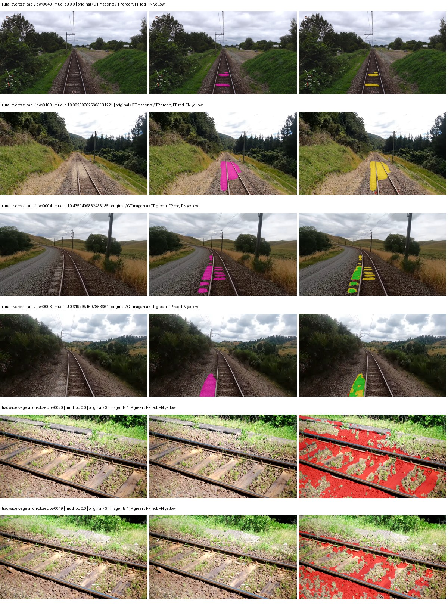
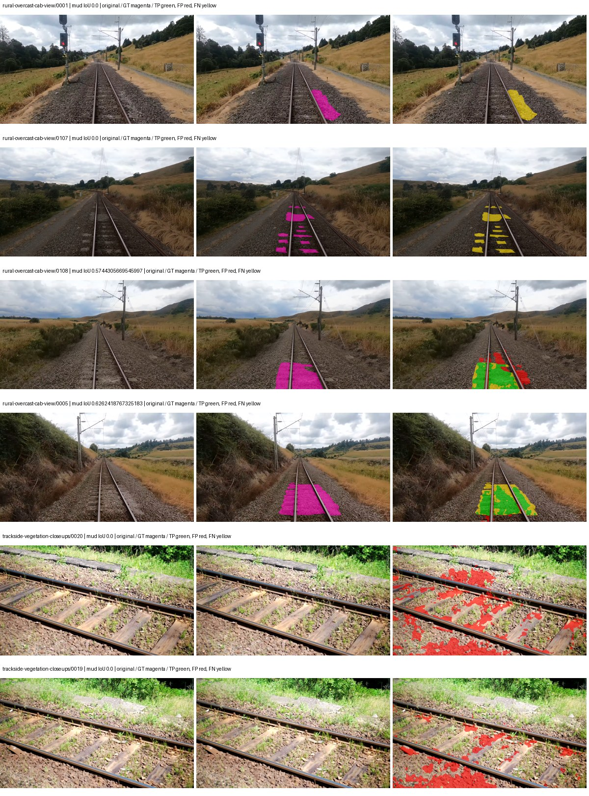
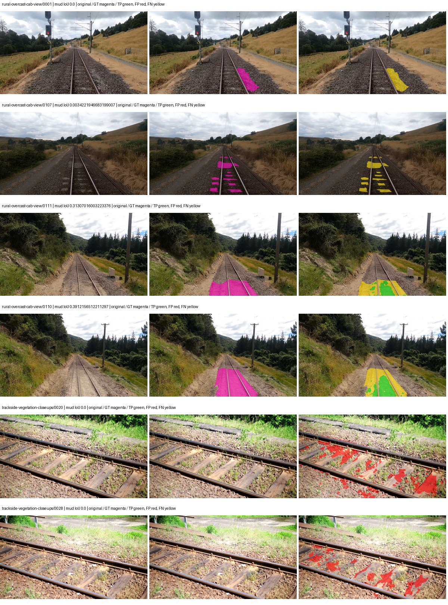
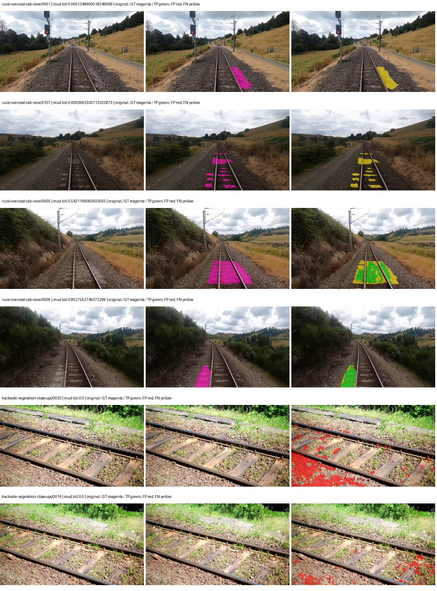

# smp_upernet_mit_b0 — rad_9_24_2026-fixed-grouped

[RAD 9/24: Scene-grouped split](../../README.md) · [Full model records](record.json)

Primary result: the **final checkpoint** after the full step budget (no early stopping). The checkpoint with the best **mud-pumping validation IoU, pixels pooled over all validation images**, is kept as secondary evidence. A job is complete only after full statistics and isolated profiling are verified.

Study metrics of the final checkpoint, counting each class only on the validation images that contain it: mud-pumping IoU is the mean per-image IoU over the images with mud-pumping, precision and recall sum pixels over those images, and mIoU averages each class over the images that contain it, then over the classes present.

| Initialization path | Seed | Mud-pumping IoU, train-camera images with mud (%, n=17) | Mud-pumping IoU, all images with mud (%, n=18) | Mud precision, all images with mud (%) | Mud recall, all images with mud (%) | mIoU (each class over images that contain it) (%) |
| --- | --- | --- | --- | --- | --- | --- |
| rtis_only | 0 | 3.32 | 3.23 | 7.63 | 5.19 | 35.95 |
| cityscapes_to_rtis | 0 | 11.15 | 10.80 | 47.63 | 14.20 | 35.36 |
| railsem19_to_rtis | 0 | 6.52 | 6.30 | 28.22 | 6.54 | 39.58 |
| cityscapes_to_railsem19_to_rtis | 0 | 20.07 | 19.48 | 77.33 | 24.21 | 38.78 |

Per-class IoU: IoU (%) of every class, each averaged only over the validation images that contain the class (n = those images); — = no image contains it. mIoU averages the classes with at least one such image.

| Initialization path | Seed | mIoU (each class over images that contain it) | person (n=0) | truck (n=0) | rail-track (n=37) | vegetation-overgrowth (n=13) | car (n=3) | on-rails (n=0) | traffic-sign (n=9) | road (n=11) | sidewalk (n=12) | construction (n=12) | tram-track (n=2) | pole (n=21) | traffic-light (n=3) | mud-pumping (n=18) | fence (n=7) | terrain (n=35) | sky (n=28) | rail-embedded (n=3) | rail-raised (n=37) | trackbed (n=37) | standing-water (n=9) |
| --- | --- | --- | --- | --- | --- | --- | --- | --- | --- | --- | --- | --- | --- | --- | --- | --- | --- | --- | --- | --- | --- | --- | --- |
| rtis_only | 0 | 35.95 | — | — | 53.33 | 42.87 | 31.40 | — | 20.11 | 12.48 | 16.44 | 31.30 | 7.82 | 61.64 | 26.12 | 3.23 | 22.51 | 83.84 | 95.77 | 6.74 | 73.23 | 54.70 | 3.61 |
| cityscapes_to_rtis | 0 | 35.36 | — | — | 51.52 | 41.39 | 22.44 | — | 16.65 | 11.84 | 12.41 | 41.45 | 0.00 | 63.15 | 41.87 | 10.80 | 11.44 | 82.18 | 95.39 | 1.78 | 70.74 | 53.77 | 7.65 |
| railsem19_to_rtis | 0 | 39.58 | — | — | 59.96 | 34.55 | 23.62 | — | 30.66 | 5.46 | 15.93 | 42.83 | 27.42 | 69.00 | 47.64 | 6.30 | 17.25 | 81.46 | 96.43 | 15.65 | 72.27 | 65.84 | 0.24 |
| cityscapes_to_railsem19_to_rtis | 0 | 38.78 | — | — | 57.78 | 40.08 | 28.34 | — | 28.37 | 13.12 | 11.95 | 44.30 | 1.40 | 67.96 | 52.52 | 19.48 | 20.74 | 82.32 | 96.50 | 2.69 | 71.36 | 55.96 | 3.14 |

Everything below is the campaign's own record, with pixels pooled over all validation images: its evaluation is the checkpoint that scored best on that pooled mud IoU (secondary evidence here); the diagnostics also cover the final checkpoint (`final-auto-val`).

| Model | Initialization path | Seed | Status | Steps | Best step | Best-checkpoint mud IoU, pixels pooled (%) | Best-checkpoint mud precision, pixels pooled (%) | Best-checkpoint mud recall, pixels pooled (%) | Final mud IoU (trainer val, pixels pooled, %) | Best-checkpoint mIoU, pixels pooled (%) | Best-checkpoint fixed GT-class mIoU, pixels pooled (%) |
| --- | --- | --- | --- | --- | --- | --- | --- | --- | --- | --- | --- |
| smp_upernet_mit_b0 | rtis_only | 0 | completed | 4000 | 1814 | 4.05 | 5.54 | 13.13 | 1.00 | 29.88 | 34.86 |
| smp_upernet_mit_b0 | cityscapes_to_rtis | 0 | completed | 4000 | 1296 | 17.10 | 25.41 | 34.34 | 7.57 | 26.30 | 30.69 |
| smp_upernet_mit_b0 | railsem19_to_rtis | 0 | completed | 4000 | 1555 | 9.95 | 19.99 | 16.53 | 3.34 | 39.49 | 43.88 |
| smp_upernet_mit_b0 | cityscapes_to_railsem19_to_rtis | 0 | completed | 4000 | 2851 | 18.24 | 35.03 | 27.57 | 18.17 | 37.36 | 43.58 |

Training: 217 images. Validation: 37 images. Test: 60 held out. Seeds: [0]. Seed variation measures optimization variability, not independent-recording uncertainty. Historical source checkpoints stay fixed across adaptation seeds.

Training code: `fce0ea0ac50b334d4252812c396e0e593def375d`. Split SHA-256: `12d7b367c72cda61d57686ff2ac28223530d0af49debd9fb7a0fbc68b908bc93`.

## rtis_only — seed 0

Status: **completed**. Started: 2026-10-11T17:04:26.989537+00:00. Finished: 2026-10-11T18:13:38.832292+00:00.

Recipe pretrained initializer: `{"arch": "smp", "backbone_path": null, "batch_norm_momentum": null, "checkpoint": null, "classifier_path": null, "drop_path": null, "encoder_name": "mit_b0", "encoder_weights": "imagenet", "head": "unified_head", "head_paths": [], "inactive_parameter_paths": [], "local_files_only": false, "lora_alpha": 32, "lora_dropout": 0.05, "lora_r": 16, "lora_targets": [], "native": null, "revision": null, "smp_arch": "UPerNet", "subfolder": null, "trust_remote_code": false, "tuning": "full"}`.

`rtis_only` uses the recipe initializer, which may include pretrained segmentation components. Transfer paths load the exact historical source checkpoint below and reset the classifier; they do not reset all query/decoder features.

Source checkpoint: `Recipe pretrained initialization`.

Config SHA-256: `a84f134218fd7b97f185557b474e34b0de1ea9891bbf28e0d5ceff1cc0fd5bf1`. Weights used for validation: `raw`.

### Mud-pumping and aggregate quality

| Metric | Selected checkpoint | Final training validation |
| --- | --- | --- |
| Mud IoU | 4.05 | 1.00 |
| Mud precision | 5.54 | 1.22 |
| Mud recall | 13.13 | 5.18 |
| Mud Dice/F1 | 7.79 | 1.97 |
| mIoU | 29.88 | 34.01 |
| Mean accuracy | 41.73 | 45.17 |
| Mean precision | 56.91 | 59.66 |
| Mean Dice | 38.48 | 43.95 |
| Mean specificity | 98.95 | 98.96 |
| Pixel accuracy | 83.11 | 82.93 |
| Frequency-weighted IoU | 74.38 | 75.49 |
| Fixed GT-present class mIoU | 34.86 | 39.67 |
| Boundary F1 | 35.12 | 40.94 |

The selected checkpoint has independent evaluation evidence. Final values are the trainer's final validation record, not a new independent evaluation. mIoU averages classes with nonzero union, so false positives on absent classes can change its denominator. The fixed GT-class mean is supplementary and excludes absent classes; their false positives remain in the confusion matrix.

### Resource usage and timing

| Measurement | Value |
| --- | --- |
| Peak training VRAM, retained training invocation (GiB) | 11.14 |
| Peak evaluation VRAM (GiB) | 6.22 |
| Retained training invocation wall time (seconds) | 3956.24 |
| Retained training invocation GPU-hours (one GPU) | 1.10 |
| Evaluation wall time (seconds) | 17.92 |
| Full evaluation pipeline images/second | 2.06 |
| Best full-state checkpoint (MiB) | 164.26 |
| Final full-state checkpoint (MiB) | 164.25 |
| Verified periodic checkpoints removed (GiB) | 1.28 |

VRAM uses the recorded allocator high-water mark; it is not total device usage including CUDA context. Resumed jobs' retained training invocation times and peaks are **not whole-campaign totals**. Earlier invocation resource records are not reconstructed here. Evaluation throughput includes loader, sliding-window inference and metrics; it is not model-only latency/FPS. Missing measurements are shown as —, never inferred from another dataset's run.

### Standardized inference performance

Dedicated model-only profiling waits for an idle worker-locked L40S: BF16, batch 1, 1024x1024, 20 warmup and 100 CUDA-event-timed public forwards. It excludes loading, preprocessing, tiling and metrics.

| Status | Parameters | Weight MiB | FPS | p50 ms | p95 ms | Peak reserved GiB |
| --- | --- | --- | --- | --- | --- | --- |
| complete | 10737525 | 40.96 | 54.29 | 18.41 | 18.47 | 1.09 |

```json
{
  "schema_version": 1,
  "model_id": "smp_upernet_mit_b0",
  "measured_at": "2026-10-11T18:13:35+00:00",
  "status": "complete",
  "benchmark_scope": "rtis_selected_checkpoint_model_only",
  "applies_to": [
    "smp_upernet_mit_b0--rtis_only--seed-0"
  ],
  "source": {
    "campaign_git_sha": "fce0ea0ac50b334d4252812c396e0e593def375d",
    "git_dirty": false,
    "config_hash": "e09e8b7c6094",
    "resolved_config": "/data/izadia1/projects/segmentary-runs/rad_9_24_2026/fgall-seed0-20261007/configs/smp_upernet_mit_b0--rtis_only--seed-0.yaml",
    "config_sha256": "a84f134218fd7b97f185557b474e34b0de1ea9891bbf28e0d5ceff1cc0fd5bf1",
    "checkpoint_sha256": "bddf1e8a2809a4c843f8e314dbaced9a2f68954f957e9e4d129dd641a88f28d3",
    "checkpoint_global_step": 1814,
    "checkpoint_bytes": 172236471,
    "checkpoint_kind": "resume checkpoint with optimizer and EMA state",
    "weights": "raw",
    "measured_checkpoint_job_id": "smp_upernet_mit_b0--rtis_only--seed-0",
    "result_sha256": "3f8d3958daf31e9b78b38aa59e9e7c5a23ec2fba44da312eb9bdcdd9255b00ab",
    "result_git_sha": "fce0ea0ac50b334d4252812c396e0e593def375d",
    "result_stage": "eval:rad_9_24_2026-fixed-grouped:val",
    "result_seed": 0
  },
  "hardware": {
    "gpu_name": "NVIDIA L40S",
    "gpu_uuid": "GPU-1c9b612f-e0b5-fbbc-150f-8c2ef13453c9",
    "logical_device": "cuda:0",
    "physical_visibility_token": "5",
    "compute_capability": [
      8,
      9
    ],
    "total_memory_bytes": 47677177856
  },
  "model": {
    "parameter_count": 10737525,
    "trainable_parameter_count": 10737525,
    "resident_parameter_bytes": 42950100,
    "parameter_dtype_counts": {
      "float32": 10737525
    }
  },
  "contract": {
    "backend": "pytorch",
    "precision": "bf16_autocast",
    "batch_size": 1,
    "input_shape_nchw": [
      1,
      3,
      1024,
      1024
    ],
    "warmup_iterations": 20,
    "measured_iterations": 100,
    "timing": "per-forward CUDA events with end-event synchronization",
    "includes_preprocessing": false,
    "includes_data_loader": false,
    "includes_sliding_window": false,
    "input_resident_on_gpu": true,
    "model_only": true,
    "entrypoint": "public model(image) dense-logits forward"
  },
  "measurements": {
    "latency": {
      "p50_ms": 18.41254425048828,
      "p95_ms": 18.470605182647706,
      "mean_ms": 18.41965005874634,
      "minimum_ms": 18.363391876220703,
      "maximum_ms": 18.59891128540039,
      "fps": 54.28984789671195,
      "raw_ms": [
        18.59891128540039,
        18.44121551513672,
        18.44121551513672,
        18.379776000976562,
        18.44940757751465,
        18.386943817138672,
        18.554880142211914,
        18.390016555786133,
        18.398208618164062,
        18.38489532470703,
        18.407424926757812,
        18.44633674621582,
        18.407424926757812,
        18.40947151184082,
        18.399232864379883,
        18.406400680541992,
        18.367488861083984,
        18.379776000976562,
        18.43097686767578,
        18.38489532470703,
        18.45452880859375,
        18.38591957092285,
        18.43302345275879,
        18.390016555786133,
        18.38489532470703,
        18.40025520324707,
        18.42073631286621,
        18.45964813232422,
        18.391040802001953,
        18.42278480529785,
        18.391040802001953,
        18.387968063354492,
        18.391040802001953,
        18.406400680541992,
        18.382816314697266,
        18.41971206665039,
        18.418655395507812,
        18.44940757751465,
        18.46272087097168,
        18.414592742919922,
        18.545663833618164,
        18.390016555786133,
        18.38591957092285,
        18.40230369567871,
        18.41254425048828,
        18.41868782043457,
        18.45964813232422,
        18.4135684967041,
        18.399232864379883,
        18.386943817138672,
        18.46886444091797,
        18.41049575805664,
        18.41561508178711,
        18.4453125,
        18.465791702270508,
        18.42995262145996,
        18.43609619140625,
        18.4135684967041,
        18.4135684967041,
        18.45145606994629,
        18.40947151184082,
        18.4135684967041,
        18.42073631286621,
        18.40230369567871,
        18.40332794189453,
        18.41971206665039,
        18.41152000427246,
        18.40230369567871,
        18.4135684967041,
        18.42892837524414,
        18.405376434326172,
        18.382848739624023,
        18.40435218811035,
        18.511871337890625,
        18.41254425048828,
        18.43814468383789,
        18.363391876220703,
        18.42073631286621,
        18.39308738708496,
        18.40127944946289,
        18.45350456237793,
        18.396160125732422,
        18.381824493408203,
        18.42380714416504,
        18.41152000427246,
        18.41766357421875,
        18.503679275512695,
        18.406400680541992,
        18.4453125,
        18.43302345275879,
        18.365440368652344,
        18.399232864379883,
        18.45452880859375,
        18.42585563659668,
        18.447359085083008,
        18.375680923461914,
        18.41049575805664,
        18.42176055908203,
        18.43916893005371,
        18.396160125732422
      ],
      "percentile_method": "numpy linear interpolation"
    },
    "peak_reserved_bytes": 1172307968,
    "memory_kind": "pytorch_cuda_allocator_peak_reserved_excluding_context",
    "process_total_bytes": 1709178880,
    "process_total_kind": "nvidia-smi used_memory of this PID on the benchmark GPU after the timed loop, including the CUDA context; null when the driver could not attribute memory to this PID",
    "benchmark_wall_clock_s": 9.110240198671818
  },
  "started_at": "2026-10-11T18:13:26+00:00",
  "finished_at": "2026-10-11T18:13:35+00:00",
  "environment": {
    "hostname": "hdrfs-app-001",
    "python": "3.11.15",
    "platform": "Linux-5.15.0-139-generic-x86_64-with-glibc2.35",
    "torch": "2.11.0+cu128",
    "torch_cuda": "12.8",
    "cudnn": 91900,
    "driver_version": "570.133.20",
    "cuda_available": true,
    "gpu_count": 1,
    "gpu_names": [
      "NVIDIA L40S"
    ],
    "cuda_visible_devices": "5",
    "packages": {
      "segmentary": "0.1.0",
      "torch": "2.11.0+cu128",
      "torchvision": "0.26.0+cu128",
      "transformers": "5.15.0",
      "timm": "1.0.28",
      "segmentation-models-pytorch": "0.5.0",
      "albumentations": "2.0.8",
      "lightning": "2.6.5",
      "numpy": "2.4.4"
    }
  }
}
```

### Per-class validation results

| Class | GT pixels | IoU (%) | Precision (%) | Recall (%) | Dice (%) | Boundary F1 (%) |
| --- | --- | --- | --- | --- | --- | --- |
| car | 29664 | 29.37 | 75.25 | 32.51 | 45.40 | 29.16 |
| construction | 311585 | 35.00 | 43.02 | 65.25 | 51.85 | 60.36 |
| fence | 265137 | 16.84 | 75.28 | 17.83 | 28.83 | 39.18 |
| mud-pumping | 1226250 | 4.05 | 5.54 | 13.13 | 7.79 | 6.93 |
| on-rails | 0 | 0.00 | 0.00 | — | 0.00 | 0.00 |
| person | 0 | 0.00 | 0.00 | — | 0.00 | 0.00 |
| pole | 628038 | 63.14 | 84.85 | 71.17 | 77.41 | 87.67 |
| rail-embedded | 16799 | 3.38 | 100.00 | 3.38 | 6.53 | 11.75 |
| rail-raised | 2969797 | 74.98 | 86.92 | 84.52 | 85.70 | 92.16 |
| rail-track | 6323197 | 40.10 | 65.76 | 50.68 | 57.24 | 48.09 |
| road | 1048831 | 12.05 | 40.34 | 14.66 | 21.51 | 23.09 |
| sidewalk | 1297367 | 44.21 | 86.40 | 47.52 | 61.31 | 18.80 |
| sky | 19121606 | 98.25 | 99.25 | 98.99 | 99.12 | 95.43 |
| standing-water | 95802 | 1.59 | 2.08 | 6.30 | 3.12 | 5.10 |
| terrain | 39239306 | 85.41 | 88.07 | 96.58 | 92.13 | 61.14 |
| trackbed | 10643081 | 47.22 | 83.88 | 51.94 | 64.15 | 55.07 |
| traffic-light | 19510 | 12.36 | 100.00 | 12.36 | 22.01 | 23.11 |
| traffic-sign | 13285 | 9.38 | 98.27 | 9.39 | 17.15 | 19.82 |
| tram-track | 56179 | 0.00 | 0.00 | 0.00 | 0.00 | 0.00 |
| truck | 0 | 0.00 | 0.00 | — | 0.00 | 0.00 |
| vegetation-overgrowth | 5901821 | 50.06 | 60.15 | 74.90 | 66.72 | 60.74 |

### Full-run accounting

| Measurement | Value |
| --- | --- |
| Full GPU-reserved wall seconds, all recorded worker attempts | 4159.60 |
| Full reserved GPU-hours | 1.16 |
| Whole-run timing complete | True |

| Phase | Wall seconds including failed attempts |
| --- | --- |
| training | 3963.56 |
| diagnostics | 143.31 |
| performance | 16.91 |

GPU-reserved time includes model loading, training, validation, collection, profiling, checkpoint I/O and orchestration while the worker owns one GPU. It is not GPU kernel-active time. Phase timings and sampled device memory/power/utilization are retained separately; sampled device memory is not the allocator high-water mark.

### Train/validation and raw/EMA diagnostics

| Checkpoint / weights / split | Images | Mud IoU (%) | Mud precision (%) | Mud recall (%) |
| --- | --- | --- | --- | --- |
| best-auto-train / raw | 217 | 91.50 | 93.24 | 98.01 |
| best-auto-val / raw | 37 | 4.05 | 5.54 | 13.13 |
| best-alternate-val / ema | 37 | 0.96 | 1.53 | 2.53 |
| final-auto-val / raw | 37 | 1.00 | 1.22 | 5.19 |

Train uses the evaluation transform without augmentation. Compare mud train/validation metrics for the same selected weights. Alternate EMA on running-stat BatchNorm is explicitly uncalibrated and is diagnostic only. Score-threshold curves use uncalibrated normalized scores and are pixel-level diagnostics, not event detection rates or a selected deployment operating point.

### Downloadable evidence

- best-auto-train: [per-image.csv](rtis_only--seed-0/best-auto-train/per-image.csv) · [per-image-confusion.json.gz](rtis_only--seed-0/best-auto-train/per-image-confusion.json.gz) · [groups.json](rtis_only--seed-0/best-auto-train/groups.json) · [mud-score-curves.json](rtis_only--seed-0/best-auto-train/mud-score-curves.json)
- best-auto-val: [per-image.csv](rtis_only--seed-0/best-auto-val/per-image.csv) · [per-image-confusion.json.gz](rtis_only--seed-0/best-auto-val/per-image-confusion.json.gz) · [groups.json](rtis_only--seed-0/best-auto-val/groups.json) · [mud-score-curves.json](rtis_only--seed-0/best-auto-val/mud-score-curves.json) · [examples.jpg](rtis_only--seed-0/best-auto-val/examples.jpg)
- best-alternate-val: [per-image.csv](rtis_only--seed-0/best-alternate-val/per-image.csv) · [per-image-confusion.json.gz](rtis_only--seed-0/best-alternate-val/per-image-confusion.json.gz) · [groups.json](rtis_only--seed-0/best-alternate-val/groups.json) · [mud-score-curves.json](rtis_only--seed-0/best-alternate-val/mud-score-curves.json)
- final-auto-val: [per-image.csv](rtis_only--seed-0/final-auto-val/per-image.csv) · [per-image-confusion.json.gz](rtis_only--seed-0/final-auto-val/per-image-confusion.json.gz) · [groups.json](rtis_only--seed-0/final-auto-val/groups.json) · [mud-score-curves.json](rtis_only--seed-0/final-auto-val/mud-score-curves.json)
- resources: [telemetry.csv](rtis_only--seed-0/resources/telemetry.csv)



Examples are two lowest and two highest mud-IoU positive images, plus up to two negative images with the most false-positive mud pixels. They are targeted diagnostic examples, not random samples. Green: true positive; red: false positive; yellow: false negative. Full predictions remain on HDRFS.

### Validation tracking

| Logged step | Overall mIoU (%) | Mud IoU (%) |
| --- | --- | --- |
| 258 | 21.08 | 0.71 |
| 518 | 23.57 | 1.22 |
| 777 | 25.44 | 0.50 |
| 1036 | 30.85 | 1.26 |
| 1295 | 31.06 | 0.55 |
| 1555 | 32.29 | 1.46 |
| 1814 | 29.89 | 4.05 |
| 2073 | 29.90 | 1.35 |
| 2332 | 30.29 | 0.35 |
| 2592 | 32.42 | 1.77 |
| 2851 | 32.22 | 0.80 |
| 3110 | 32.86 | 2.79 |
| 3369 | 33.05 | 1.80 |
| 3629 | 32.60 | 0.79 |
| 3888 | 32.88 | 1.09 |
| 4000 | 34.01 | 1.00 |

All retained scalar curves, including training loss and per-class IoU, are in record.json. Observed best mud on a curve is not necessarily a retained checkpoint: the pilot saved its selection-metric-best and final checkpoints. Step logging and checkpoint global_step may differ by one.

### Stopping and checkpoint provenance

```json
{
  "stopping": {
    "actual_steps": 4000,
    "maximum_steps": 4000,
    "min_delta": 0.0,
    "monitor": "val_iou/mud-pumping",
    "patience": null,
    "reason": "budget_complete"
  },
  "checkpoints": {
    "best": {
      "path": "/data/izadia1/projects/segmentary-runs/rad_9_24_2026/fgall-seed0-20261007/future-runs/smp_upernet_mit_b0--rtis_only--seed-0_seed0/rtis/best.ckpt",
      "sha256": "bddf1e8a2809a4c843f8e314dbaced9a2f68954f957e9e4d129dd641a88f28d3",
      "global_step": 1814,
      "bytes": 172236471
    },
    "final": {
      "path": "/data/izadia1/projects/segmentary-runs/rad_9_24_2026/fgall-seed0-20261007/future-runs/smp_upernet_mit_b0--rtis_only--seed-0_seed0/rtis/last.ckpt",
      "sha256": "cab54c2744f8310922aad970b9aa60620416e0ba4ad960ddfc1879c6c771c1f6",
      "global_step": 4000,
      "bytes": 172225207
    }
  },
  "cleanup_error": null
}
```

### Resolved training, initialization and evaluation settings

The optimizer block is the base configuration. Stage LR scales are applied at runtime, and stage warmup is capped at min(base warmup, floor(stage budget / 10), stage budget - 1): 400 steps for this 4,000-step pilot. Model-internal native input grids may differ from augmentation crops (EoMT uses its 640 grid).

```json
{
  "name": "smp_upernet_mit_b0--rtis_only--seed-0",
  "model": {
    "arch": "smp",
    "checkpoint": null,
    "tuning": "full",
    "head": "unified_head",
    "lora_r": 16,
    "lora_alpha": 32,
    "lora_dropout": 0.05,
    "lora_targets": [],
    "drop_path": null,
    "revision": null,
    "subfolder": null,
    "local_files_only": false,
    "trust_remote_code": false,
    "backbone_path": null,
    "head_paths": [],
    "classifier_path": null,
    "inactive_parameter_paths": [],
    "smp_arch": "UPerNet",
    "encoder_name": "mit_b0",
    "encoder_weights": "imagenet",
    "native": null,
    "batch_norm_momentum": null
  },
  "space": "paul-test-rtis",
  "taxonomy_root": "/data/izadia1/projects/segmentary-rad-fgall-fce0ea0a/taxonomy",
  "output_root": "/data/izadia1/projects/segmentary-runs/rad_9_24_2026/fgall-seed0-20261007/future-runs",
  "optim": {
    "backbone_lr": 6e-05,
    "head_lr_mult": 10.0,
    "weight_decay": 0.05,
    "llrd": 1.0,
    "warmup_iters": 1500,
    "warmup_ratio": 1e-06,
    "poly_power": 0.9,
    "min_lr_ratio": 0.0,
    "betas": [
      0.9,
      0.999
    ],
    "grad_clip": 1.0
  },
  "train": {
    "iters": 4000,
    "batch_size": 2,
    "accum": 8,
    "num_workers": 2,
    "precision": "bf16-mixed",
    "ema_decay": 0.9998,
    "val_every": 250,
    "ckpt_every": 500,
    "selection_metric": "val_iou/mud-pumping",
    "early_stopping_patience": null,
    "early_stopping_min_delta": 0.0,
    "seed": 0,
    "devices": 1
  },
  "eval": {
    "sliding_window": true,
    "window": [
      1024,
      1024
    ],
    "stride": [
      768,
      768
    ],
    "batch_size": 1,
    "num_workers": 2,
    "tta_scales": [],
    "tta_flip": false,
    "threshold": 0.5,
    "boundary_tolerance_frac": 0.0075,
    "save_confusion": true
  },
  "loss": {
    "task": "multiclass",
    "activation": "auto",
    "terms": [],
    "aux": "none",
    "aux_weight": 0.0,
    "ce_weight": 1.0,
    "label_smoothing": 0.0,
    "class_weights": null,
    "query": null
  },
  "aug": {
    "crop": [
      1024,
      1024
    ],
    "scale_min": 0.5,
    "scale_max": 2.0,
    "hflip_p": 0.5,
    "color_jitter_p": 0.5,
    "brightness": 0.25,
    "contrast": 0.25,
    "saturation": 0.25,
    "hue": 0.05
  },
  "stages": [
    {
      "name": "rtis",
      "data": [
        {
          "name": "rad_9_24_2026-fixed-grouped",
          "root": "/data/izadia1/datasets/rad_9_24_2026-fixed-grouped",
          "variant": null,
          "split_file": "splits.json",
          "train_split": "train",
          "val_split": "val",
          "limit": null,
          "loader": "folder",
          "mapping": "paul-test-rtis",
          "loader_options": {
            "require_groups": true
          }
        }
      ],
      "iters": null,
      "lr_scale": 1.0,
      "head_group_lr_scale": 1.0,
      "init_from": "pretrained",
      "reset_head": false,
      "freeze": null,
      "sample_weights": null
    }
  ]
}
```

### Hardware and software provenance

```json
{
  "training": {
    "cuda_available": true,
    "cuda_visible_devices": "5",
    "cudnn": 91900,
    "driver_version": "570.133.20",
    "gpu_count": 1,
    "gpu_names": [
      "NVIDIA L40S"
    ],
    "hostname": "hdrfs-app-001",
    "input_normalization": {
      "channel_order": "rgb",
      "mean": [
        0.485,
        0.456,
        0.406
      ],
      "source": "smp_encoder_settings",
      "std": [
        0.229,
        0.224,
        0.225
      ]
    },
    "model_origins": [
      {
        "hf_commit": null,
        "hf_name_or_path": null,
        "module": "model",
        "timm_pretrained": {}
      }
    ],
    "model_parameter_count": 10737525,
    "packages": {
      "albumentations": "2.0.8",
      "lightning": "2.6.5",
      "numpy": "2.4.4",
      "segmentary": "0.1.0",
      "segmentation-models-pytorch": "0.5.0",
      "timm": "1.0.28",
      "torch": "2.11.0+cu128",
      "torchvision": "0.26.0+cu128",
      "transformers": "5.15.0"
    },
    "platform": "Linux-5.15.0-139-generic-x86_64-with-glibc2.35",
    "python": "3.11.15",
    "torch": "2.11.0+cu128",
    "torch_cuda": "12.8",
    "trainable_parameter_count": 10737525,
    "training_stop": {
      "actual_steps": 4000,
      "maximum_steps": 4000,
      "min_delta": 0.0,
      "monitor": "val_iou/mud-pumping",
      "patience": null,
      "reason": "budget_complete"
    },
    "validation_weights": "raw"
  },
  "evaluation": {
    "cuda_available": true,
    "cuda_visible_devices": "5",
    "cudnn": 91900,
    "driver_version": "570.133.20",
    "gpu_count": 1,
    "gpu_names": [
      "NVIDIA L40S"
    ],
    "hostname": "hdrfs-app-001",
    "input_normalization": {
      "channel_order": "rgb",
      "mean": [
        0.485,
        0.456,
        0.406
      ],
      "source": "smp_encoder_settings",
      "std": [
        0.229,
        0.224,
        0.225
      ]
    },
    "packages": {
      "albumentations": "2.0.8",
      "lightning": "2.6.5",
      "numpy": "2.4.4",
      "segmentary": "0.1.0",
      "segmentation-models-pytorch": "0.5.0",
      "timm": "1.0.28",
      "torch": "2.11.0+cu128",
      "torchvision": "0.26.0+cu128",
      "transformers": "5.15.0"
    },
    "platform": "Linux-5.15.0-139-generic-x86_64-with-glibc2.35",
    "python": "3.11.15",
    "torch": "2.11.0+cu128",
    "torch_cuda": "12.8"
  }
}
```

## cityscapes_to_rtis — seed 0

Status: **completed**. Started: 2026-10-11T17:06:33.645226+00:00. Finished: 2026-10-11T18:15:07.255705+00:00.

Recipe pretrained initializer: `{"arch": "smp", "backbone_path": null, "batch_norm_momentum": null, "checkpoint": null, "classifier_path": null, "drop_path": null, "encoder_name": "mit_b0", "encoder_weights": "imagenet", "head": "unified_head", "head_paths": [], "inactive_parameter_paths": [], "local_files_only": false, "lora_alpha": 32, "lora_dropout": 0.05, "lora_r": 16, "lora_targets": [], "native": null, "revision": null, "smp_arch": "UPerNet", "subfolder": null, "trust_remote_code": false, "tuning": "full"}`.

`rtis_only` uses the recipe initializer, which may include pretrained segmentation components. Transfer paths load the exact historical source checkpoint below and reset the classifier; they do not reset all query/decoder features.

Source checkpoint: `{'name': 'smp_upernet_mit_b0--cityscapes--seed-0', 'model': 'smp_upernet_mit_b0', 'protocol': 'cityscapes', 'config': '/data/izadia1/projects/segmentary-runs/all-model-city-rail-seed0-rail20-b9eb3e1/accepted/smp_upernet_mit_b0--cityscapes--seed-0/resolved-config.yaml', 'checkpoint': '/data/izadia1/projects/segmentary-runs/current-main-fill-v2/jobs/smp_upernet_mit_b0--cityscapes--seed-0/train/smp_upernet_mit_b0--cityscapes_seed0/cityscapes/last.ckpt', 'recorded_sha256': 'ce7fde4b4b7c8e1c9c8d1c1e441ffbc2eb42489afb71e09b0bc4128153a4a5df', 'exists': True}`.

Config SHA-256: `e62365e993c43170fbab060474a335affe245a4010b95fa763dfc1472329d0e8`. Weights used for validation: `raw`.

### Mud-pumping and aggregate quality

| Metric | Selected checkpoint | Final training validation |
| --- | --- | --- |
| Mud IoU | 17.10 | 7.57 |
| Mud precision | 25.41 | 13.95 |
| Mud recall | 34.34 | 14.20 |
| Mud Dice/F1 | 29.21 | 14.07 |
| mIoU | 26.30 | 33.31 |
| Mean accuracy | 38.34 | 47.07 |
| Mean precision | 49.13 | 48.32 |
| Mean Dice | 33.22 | 42.22 |
| Mean specificity | 98.91 | 98.95 |
| Pixel accuracy | 82.62 | 83.60 |
| Frequency-weighted IoU | 73.20 | 74.18 |
| Fixed GT-present class mIoU | 30.69 | 38.86 |
| Boundary F1 | 31.58 | 37.65 |

The selected checkpoint has independent evaluation evidence. Final values are the trainer's final validation record, not a new independent evaluation. mIoU averages classes with nonzero union, so false positives on absent classes can change its denominator. The fixed GT-class mean is supplementary and excludes absent classes; their false positives remain in the confusion matrix.

### Resource usage and timing

| Measurement | Value |
| --- | --- |
| Peak training VRAM, retained training invocation (GiB) | 11.14 |
| Peak evaluation VRAM (GiB) | 6.22 |
| Retained training invocation wall time (seconds) | 3923.54 |
| Retained training invocation GPU-hours (one GPU) | 1.09 |
| Evaluation wall time (seconds) | 17.76 |
| Full evaluation pipeline images/second | 2.08 |
| Best full-state checkpoint (MiB) | 164.26 |
| Final full-state checkpoint (MiB) | 164.25 |
| Verified periodic checkpoints removed (GiB) | 1.28 |

VRAM uses the recorded allocator high-water mark; it is not total device usage including CUDA context. Resumed jobs' retained training invocation times and peaks are **not whole-campaign totals**. Earlier invocation resource records are not reconstructed here. Evaluation throughput includes loader, sliding-window inference and metrics; it is not model-only latency/FPS. Missing measurements are shown as —, never inferred from another dataset's run.

### Standardized inference performance

Dedicated model-only profiling waits for an idle worker-locked L40S: BF16, batch 1, 1024x1024, 20 warmup and 100 CUDA-event-timed public forwards. It excludes loading, preprocessing, tiling and metrics.

| Status | Parameters | Weight MiB | FPS | p50 ms | p95 ms | Peak reserved GiB |
| --- | --- | --- | --- | --- | --- | --- |
| complete | 10737525 | 40.96 | 54.28 | 18.42 | 18.50 | 1.09 |

```json
{
  "schema_version": 1,
  "model_id": "smp_upernet_mit_b0",
  "measured_at": "2026-10-11T18:15:04+00:00",
  "status": "complete",
  "benchmark_scope": "rtis_selected_checkpoint_model_only",
  "applies_to": [
    "smp_upernet_mit_b0--cityscapes_to_rtis--seed-0"
  ],
  "source": {
    "campaign_git_sha": "fce0ea0ac50b334d4252812c396e0e593def375d",
    "git_dirty": false,
    "config_hash": "963ef8f4082c",
    "resolved_config": "/data/izadia1/projects/segmentary-runs/rad_9_24_2026/fgall-seed0-20261007/configs/smp_upernet_mit_b0--cityscapes_to_rtis--seed-0.yaml",
    "config_sha256": "e62365e993c43170fbab060474a335affe245a4010b95fa763dfc1472329d0e8",
    "checkpoint_sha256": "1422c2805d94962b0a49d4df7dbdc25bdcbc7938ca2a40917db4984dbad2311c",
    "checkpoint_global_step": 1296,
    "checkpoint_bytes": 172236471,
    "checkpoint_kind": "resume checkpoint with optimizer and EMA state",
    "weights": "raw",
    "measured_checkpoint_job_id": "smp_upernet_mit_b0--cityscapes_to_rtis--seed-0",
    "result_sha256": "4504fe64a61bfec0ca17a71d5df2697a327ba6106f8c9379e5709b7796df645d",
    "result_git_sha": "fce0ea0ac50b334d4252812c396e0e593def375d",
    "result_stage": "eval:rad_9_24_2026-fixed-grouped:val",
    "result_seed": 0
  },
  "hardware": {
    "gpu_name": "NVIDIA L40S",
    "gpu_uuid": "GPU-804aea8b-5f62-423e-72c6-49e1ed15c4e4",
    "logical_device": "cuda:0",
    "physical_visibility_token": "6",
    "compute_capability": [
      8,
      9
    ],
    "total_memory_bytes": 47677177856
  },
  "model": {
    "parameter_count": 10737525,
    "trainable_parameter_count": 10737525,
    "resident_parameter_bytes": 42950100,
    "parameter_dtype_counts": {
      "float32": 10737525
    }
  },
  "contract": {
    "backend": "pytorch",
    "precision": "bf16_autocast",
    "batch_size": 1,
    "input_shape_nchw": [
      1,
      3,
      1024,
      1024
    ],
    "warmup_iterations": 20,
    "measured_iterations": 100,
    "timing": "per-forward CUDA events with end-event synchronization",
    "includes_preprocessing": false,
    "includes_data_loader": false,
    "includes_sliding_window": false,
    "input_resident_on_gpu": true,
    "model_only": true,
    "entrypoint": "public model(image) dense-logits forward"
  },
  "measurements": {
    "latency": {
      "p50_ms": 18.41561508178711,
      "p95_ms": 18.50178623199463,
      "mean_ms": 18.42416639328003,
      "minimum_ms": 18.367488861083984,
      "maximum_ms": 18.915327072143555,
      "fps": 54.27653977141331,
      "raw_ms": [
        18.501632690429688,
        18.38800048828125,
        18.447359085083008,
        18.378751754760742,
        18.414592742919922,
        18.375680923461914,
        18.367488861083984,
        18.499584197998047,
        18.43404769897461,
        18.4586238861084,
        18.388992309570312,
        18.40230369567871,
        18.41766357421875,
        18.39411163330078,
        18.42585563659668,
        18.41766357421875,
        18.371583938598633,
        18.39308738708496,
        18.40025520324707,
        18.407424926757812,
        18.46169662475586,
        18.42073631286621,
        18.41766357421875,
        18.45964813232422,
        18.408447265625,
        18.41049575805664,
        18.41868782043457,
        18.371583938598633,
        18.39308738708496,
        18.388992309570312,
        18.44326400756836,
        18.378751754760742,
        18.915327072143555,
        18.40947151184082,
        18.3951358795166,
        18.41868782043457,
        18.504703521728516,
        18.440160751342773,
        18.398208618164062,
        18.480127334594727,
        18.38591957092285,
        18.39206314086914,
        18.379776000976562,
        18.42892837524414,
        18.390016555786133,
        18.41868782043457,
        18.41971206665039,
        18.42176055908203,
        18.368511199951172,
        18.373632431030273,
        18.43609619140625,
        18.42073631286621,
        18.390016555786133,
        18.45452880859375,
        18.41868782043457,
        18.43916893005371,
        18.41049575805664,
        18.41663932800293,
        18.408447265625,
        18.41868782043457,
        18.41561508178711,
        18.4770565032959,
        18.38387107849121,
        18.43199920654297,
        18.44223976135254,
        18.40947151184082,
        18.40230369567871,
        18.388992309570312,
        18.43712043762207,
        18.43712043762207,
        18.4268798828125,
        18.43199920654297,
        18.47091293334961,
        18.398208618164062,
        18.463743209838867,
        18.407424926757812,
        18.371583938598633,
        18.43814468383789,
        18.543615341186523,
        18.368480682373047,
        18.379776000976562,
        18.3951358795166,
        18.407424926757812,
        18.42585563659668,
        18.38489532470703,
        18.42176055908203,
        18.38591957092285,
        18.4268798828125,
        18.41561508178711,
        18.40435218811035,
        18.406400680541992,
        18.47808074951172,
        18.406400680541992,
        18.513919830322266,
        18.398208618164062,
        18.408447265625,
        18.44326400756836,
        18.522111892700195,
        18.41971206665039,
        18.41360092163086
      ],
      "percentile_method": "numpy linear interpolation"
    },
    "peak_reserved_bytes": 1172307968,
    "memory_kind": "pytorch_cuda_allocator_peak_reserved_excluding_context",
    "process_total_bytes": 1709178880,
    "process_total_kind": "nvidia-smi used_memory of this PID on the benchmark GPU after the timed loop, including the CUDA context; null when the driver could not attribute memory to this PID",
    "benchmark_wall_clock_s": 9.094115123152733
  },
  "started_at": "2026-10-11T18:14:55+00:00",
  "finished_at": "2026-10-11T18:15:04+00:00",
  "environment": {
    "hostname": "hdrfs-app-001",
    "python": "3.11.15",
    "platform": "Linux-5.15.0-139-generic-x86_64-with-glibc2.35",
    "torch": "2.11.0+cu128",
    "torch_cuda": "12.8",
    "cudnn": 91900,
    "driver_version": "570.133.20",
    "cuda_available": true,
    "gpu_count": 1,
    "gpu_names": [
      "NVIDIA L40S"
    ],
    "cuda_visible_devices": "6",
    "packages": {
      "segmentary": "0.1.0",
      "torch": "2.11.0+cu128",
      "torchvision": "0.26.0+cu128",
      "transformers": "5.15.0",
      "timm": "1.0.28",
      "segmentation-models-pytorch": "0.5.0",
      "albumentations": "2.0.8",
      "lightning": "2.6.5",
      "numpy": "2.4.4"
    }
  }
}
```

### Per-class validation results

| Class | GT pixels | IoU (%) | Precision (%) | Recall (%) | Dice (%) | Boundary F1 (%) |
| --- | --- | --- | --- | --- | --- | --- |
| car | 29664 | 0.00 | 0.00 | 0.00 | 0.00 | 0.00 |
| construction | 311585 | 44.32 | 55.26 | 69.12 | 61.42 | 50.17 |
| fence | 265137 | 4.27 | 14.42 | 5.72 | 8.19 | 14.38 |
| mud-pumping | 1226250 | 17.10 | 25.41 | 34.34 | 29.21 | 21.64 |
| on-rails | 0 | 0.00 | 0.00 | — | 0.00 | 0.00 |
| person | 0 | 0.00 | 0.00 | — | 0.00 | 0.00 |
| pole | 628038 | 66.16 | 81.89 | 77.50 | 79.64 | 89.40 |
| rail-embedded | 16799 | 0.21 | 100.00 | 0.21 | 0.43 | 9.76 |
| rail-raised | 2969797 | 68.00 | 82.24 | 79.70 | 80.95 | 87.38 |
| rail-track | 6323197 | 32.27 | 72.73 | 36.72 | 48.80 | 46.96 |
| road | 1048831 | 4.40 | 16.04 | 5.71 | 8.42 | 6.55 |
| sidewalk | 1297367 | 32.96 | 80.66 | 35.79 | 49.58 | 14.36 |
| sky | 19121606 | 97.96 | 99.39 | 98.55 | 98.97 | 94.59 |
| standing-water | 95802 | 2.13 | 2.30 | 22.06 | 4.17 | 10.02 |
| terrain | 39239306 | 85.07 | 88.23 | 95.96 | 91.94 | 57.25 |
| trackbed | 10643081 | 50.75 | 61.26 | 74.73 | 67.33 | 50.32 |
| traffic-light | 19510 | 2.87 | 32.53 | 3.05 | 5.58 | 4.92 |
| traffic-sign | 13285 | 0.13 | 100.00 | 0.13 | 0.26 | 15.79 |
| tram-track | 56179 | 1.98 | 44.80 | 2.03 | 3.88 | 20.50 |
| truck | 0 | 0.00 | 0.00 | — | 0.00 | 0.00 |
| vegetation-overgrowth | 5901821 | 41.81 | 74.59 | 48.75 | 58.97 | 69.14 |

### Full-run accounting

| Measurement | Value |
| --- | --- |
| Full GPU-reserved wall seconds, all recorded worker attempts | 4121.41 |
| Full reserved GPU-hours | 1.14 |
| Whole-run timing complete | True |

| Phase | Wall seconds including failed attempts |
| --- | --- |
| training | 3930.18 |
| diagnostics | 140.34 |
| performance | 16.47 |

GPU-reserved time includes model loading, training, validation, collection, profiling, checkpoint I/O and orchestration while the worker owns one GPU. It is not GPU kernel-active time. Phase timings and sampled device memory/power/utilization are retained separately; sampled device memory is not the allocator high-water mark.

### Train/validation and raw/EMA diagnostics

| Checkpoint / weights / split | Images | Mud IoU (%) | Mud precision (%) | Mud recall (%) |
| --- | --- | --- | --- | --- |
| best-auto-train / raw | 217 | 90.48 | 91.93 | 98.28 |
| best-auto-val / raw | 37 | 17.10 | 25.41 | 34.34 |
| best-alternate-val / ema | 37 | 6.99 | 11.58 | 14.97 |
| final-auto-val / raw | 37 | 7.56 | 13.93 | 14.20 |

Train uses the evaluation transform without augmentation. Compare mud train/validation metrics for the same selected weights. Alternate EMA on running-stat BatchNorm is explicitly uncalibrated and is diagnostic only. Score-threshold curves use uncalibrated normalized scores and are pixel-level diagnostics, not event detection rates or a selected deployment operating point.

### Downloadable evidence

- best-auto-train: [per-image.csv](cityscapes_to_rtis--seed-0/best-auto-train/per-image.csv) · [per-image-confusion.json.gz](cityscapes_to_rtis--seed-0/best-auto-train/per-image-confusion.json.gz) · [groups.json](cityscapes_to_rtis--seed-0/best-auto-train/groups.json) · [mud-score-curves.json](cityscapes_to_rtis--seed-0/best-auto-train/mud-score-curves.json)
- best-auto-val: [per-image.csv](cityscapes_to_rtis--seed-0/best-auto-val/per-image.csv) · [per-image-confusion.json.gz](cityscapes_to_rtis--seed-0/best-auto-val/per-image-confusion.json.gz) · [groups.json](cityscapes_to_rtis--seed-0/best-auto-val/groups.json) · [mud-score-curves.json](cityscapes_to_rtis--seed-0/best-auto-val/mud-score-curves.json) · [examples.jpg](cityscapes_to_rtis--seed-0/best-auto-val/examples.jpg)
- best-alternate-val: [per-image.csv](cityscapes_to_rtis--seed-0/best-alternate-val/per-image.csv) · [per-image-confusion.json.gz](cityscapes_to_rtis--seed-0/best-alternate-val/per-image-confusion.json.gz) · [groups.json](cityscapes_to_rtis--seed-0/best-alternate-val/groups.json) · [mud-score-curves.json](cityscapes_to_rtis--seed-0/best-alternate-val/mud-score-curves.json)
- final-auto-val: [per-image.csv](cityscapes_to_rtis--seed-0/final-auto-val/per-image.csv) · [per-image-confusion.json.gz](cityscapes_to_rtis--seed-0/final-auto-val/per-image-confusion.json.gz) · [groups.json](cityscapes_to_rtis--seed-0/final-auto-val/groups.json) · [mud-score-curves.json](cityscapes_to_rtis--seed-0/final-auto-val/mud-score-curves.json)
- resources: [telemetry.csv](cityscapes_to_rtis--seed-0/resources/telemetry.csv)



Examples are two lowest and two highest mud-IoU positive images, plus up to two negative images with the most false-positive mud pixels. They are targeted diagnostic examples, not random samples. Green: true positive; red: false positive; yellow: false negative. Full predictions remain on HDRFS.

### Validation tracking

| Logged step | Overall mIoU (%) | Mud IoU (%) |
| --- | --- | --- |
| 258 | 20.60 | 2.47 |
| 518 | 24.92 | 9.37 |
| 777 | 24.15 | 4.20 |
| 1036 | 25.82 | 4.18 |
| 1295 | 26.30 | 17.09 |
| 1555 | 28.45 | 6.02 |
| 1814 | 29.70 | 15.66 |
| 2073 | 28.41 | 6.01 |
| 2332 | 31.74 | 6.19 |
| 2592 | 31.63 | 4.85 |
| 2851 | 32.68 | 8.29 |
| 3110 | 33.51 | 6.87 |
| 3369 | 33.14 | 8.87 |
| 3629 | 33.29 | 6.04 |
| 3888 | 33.31 | 4.74 |
| 4000 | 33.31 | 7.57 |

All retained scalar curves, including training loss and per-class IoU, are in record.json. Observed best mud on a curve is not necessarily a retained checkpoint: the pilot saved its selection-metric-best and final checkpoints. Step logging and checkpoint global_step may differ by one.

### Stopping and checkpoint provenance

```json
{
  "stopping": {
    "actual_steps": 4000,
    "maximum_steps": 4000,
    "min_delta": 0.0,
    "monitor": "val_iou/mud-pumping",
    "patience": null,
    "reason": "budget_complete"
  },
  "checkpoints": {
    "best": {
      "path": "/data/izadia1/projects/segmentary-runs/rad_9_24_2026/fgall-seed0-20261007/future-runs/smp_upernet_mit_b0--cityscapes_to_rtis--seed-0_seed0/rtis/best.ckpt",
      "sha256": "1422c2805d94962b0a49d4df7dbdc25bdcbc7938ca2a40917db4984dbad2311c",
      "global_step": 1296,
      "bytes": 172236471
    },
    "final": {
      "path": "/data/izadia1/projects/segmentary-runs/rad_9_24_2026/fgall-seed0-20261007/future-runs/smp_upernet_mit_b0--cityscapes_to_rtis--seed-0_seed0/rtis/last.ckpt",
      "sha256": "f3ecd9adb1ef0f9db84f0b18339114aa4e0ec7af80ec7fc65c5473228b7efc98",
      "global_step": 4000,
      "bytes": 172225207
    }
  },
  "cleanup_error": null
}
```

### Resolved training, initialization and evaluation settings

The optimizer block is the base configuration. Stage LR scales are applied at runtime, and stage warmup is capped at min(base warmup, floor(stage budget / 10), stage budget - 1): 400 steps for this 4,000-step pilot. Model-internal native input grids may differ from augmentation crops (EoMT uses its 640 grid).

```json
{
  "name": "smp_upernet_mit_b0--cityscapes_to_rtis--seed-0",
  "model": {
    "arch": "smp",
    "checkpoint": null,
    "tuning": "full",
    "head": "unified_head",
    "lora_r": 16,
    "lora_alpha": 32,
    "lora_dropout": 0.05,
    "lora_targets": [],
    "drop_path": null,
    "revision": null,
    "subfolder": null,
    "local_files_only": false,
    "trust_remote_code": false,
    "backbone_path": null,
    "head_paths": [],
    "classifier_path": null,
    "inactive_parameter_paths": [],
    "smp_arch": "UPerNet",
    "encoder_name": "mit_b0",
    "encoder_weights": "imagenet",
    "native": null,
    "batch_norm_momentum": null
  },
  "space": "paul-test-rtis",
  "taxonomy_root": "/data/izadia1/projects/segmentary-rad-fgall-fce0ea0a/taxonomy",
  "output_root": "/data/izadia1/projects/segmentary-runs/rad_9_24_2026/fgall-seed0-20261007/future-runs",
  "optim": {
    "backbone_lr": 6e-05,
    "head_lr_mult": 10.0,
    "weight_decay": 0.05,
    "llrd": 1.0,
    "warmup_iters": 1500,
    "warmup_ratio": 1e-06,
    "poly_power": 0.9,
    "min_lr_ratio": 0.0,
    "betas": [
      0.9,
      0.999
    ],
    "grad_clip": 1.0
  },
  "train": {
    "iters": 4000,
    "batch_size": 2,
    "accum": 8,
    "num_workers": 2,
    "precision": "bf16-mixed",
    "ema_decay": 0.9998,
    "val_every": 250,
    "ckpt_every": 500,
    "selection_metric": "val_iou/mud-pumping",
    "early_stopping_patience": null,
    "early_stopping_min_delta": 0.0,
    "seed": 0,
    "devices": 1
  },
  "eval": {
    "sliding_window": true,
    "window": [
      1024,
      1024
    ],
    "stride": [
      768,
      768
    ],
    "batch_size": 1,
    "num_workers": 2,
    "tta_scales": [],
    "tta_flip": false,
    "threshold": 0.5,
    "boundary_tolerance_frac": 0.0075,
    "save_confusion": true
  },
  "loss": {
    "task": "multiclass",
    "activation": "auto",
    "terms": [],
    "aux": "none",
    "aux_weight": 0.0,
    "ce_weight": 1.0,
    "label_smoothing": 0.0,
    "class_weights": null,
    "query": null
  },
  "aug": {
    "crop": [
      1024,
      1024
    ],
    "scale_min": 0.5,
    "scale_max": 2.0,
    "hflip_p": 0.5,
    "color_jitter_p": 0.5,
    "brightness": 0.25,
    "contrast": 0.25,
    "saturation": 0.25,
    "hue": 0.05
  },
  "stages": [
    {
      "name": "rtis",
      "data": [
        {
          "name": "rad_9_24_2026-fixed-grouped",
          "root": "/data/izadia1/datasets/rad_9_24_2026-fixed-grouped",
          "variant": null,
          "split_file": "splits.json",
          "train_split": "train",
          "val_split": "val",
          "limit": null,
          "loader": "folder",
          "mapping": "paul-test-rtis",
          "loader_options": {
            "require_groups": true
          }
        }
      ],
      "iters": null,
      "lr_scale": 0.1,
      "head_group_lr_scale": 1.0,
      "init_from": "/data/izadia1/projects/segmentary-runs/current-main-fill-v2/jobs/smp_upernet_mit_b0--cityscapes--seed-0/train/smp_upernet_mit_b0--cityscapes_seed0/cityscapes/last.ckpt",
      "reset_head": true,
      "freeze": null,
      "sample_weights": null
    }
  ]
}
```

### Hardware and software provenance

```json
{
  "training": {
    "cuda_available": true,
    "cuda_visible_devices": "6",
    "cudnn": 91900,
    "driver_version": "570.133.20",
    "gpu_count": 1,
    "gpu_names": [
      "NVIDIA L40S"
    ],
    "hostname": "hdrfs-app-001",
    "input_normalization": {
      "channel_order": "rgb",
      "mean": [
        0.485,
        0.456,
        0.406
      ],
      "source": "smp_encoder_settings",
      "std": [
        0.229,
        0.224,
        0.225
      ]
    },
    "model_origins": [
      {
        "hf_commit": null,
        "hf_name_or_path": null,
        "module": "model",
        "timm_pretrained": {}
      }
    ],
    "model_parameter_count": 10737525,
    "packages": {
      "albumentations": "2.0.8",
      "lightning": "2.6.5",
      "numpy": "2.4.4",
      "segmentary": "0.1.0",
      "segmentation-models-pytorch": "0.5.0",
      "timm": "1.0.28",
      "torch": "2.11.0+cu128",
      "torchvision": "0.26.0+cu128",
      "transformers": "5.15.0"
    },
    "platform": "Linux-5.15.0-139-generic-x86_64-with-glibc2.35",
    "python": "3.11.15",
    "torch": "2.11.0+cu128",
    "torch_cuda": "12.8",
    "trainable_parameter_count": 10737525,
    "training_stop": {
      "actual_steps": 4000,
      "maximum_steps": 4000,
      "min_delta": 0.0,
      "monitor": "val_iou/mud-pumping",
      "patience": null,
      "reason": "budget_complete"
    },
    "validation_weights": "raw"
  },
  "evaluation": {
    "cuda_available": true,
    "cuda_visible_devices": "6",
    "cudnn": 91900,
    "driver_version": "570.133.20",
    "gpu_count": 1,
    "gpu_names": [
      "NVIDIA L40S"
    ],
    "hostname": "hdrfs-app-001",
    "input_normalization": {
      "channel_order": "rgb",
      "mean": [
        0.485,
        0.456,
        0.406
      ],
      "source": "smp_encoder_settings",
      "std": [
        0.229,
        0.224,
        0.225
      ]
    },
    "packages": {
      "albumentations": "2.0.8",
      "lightning": "2.6.5",
      "numpy": "2.4.4",
      "segmentary": "0.1.0",
      "segmentation-models-pytorch": "0.5.0",
      "timm": "1.0.28",
      "torch": "2.11.0+cu128",
      "torchvision": "0.26.0+cu128",
      "transformers": "5.15.0"
    },
    "platform": "Linux-5.15.0-139-generic-x86_64-with-glibc2.35",
    "python": "3.11.15",
    "torch": "2.11.0+cu128",
    "torch_cuda": "12.8"
  }
}
```

## railsem19_to_rtis — seed 0

Status: **completed**. Started: 2026-10-11T17:06:39.555307+00:00. Finished: 2026-10-11T18:15:05.384388+00:00.

Recipe pretrained initializer: `{"arch": "smp", "backbone_path": null, "batch_norm_momentum": null, "checkpoint": null, "classifier_path": null, "drop_path": null, "encoder_name": "mit_b0", "encoder_weights": "imagenet", "head": "unified_head", "head_paths": [], "inactive_parameter_paths": [], "local_files_only": false, "lora_alpha": 32, "lora_dropout": 0.05, "lora_r": 16, "lora_targets": [], "native": null, "revision": null, "smp_arch": "UPerNet", "subfolder": null, "trust_remote_code": false, "tuning": "full"}`.

`rtis_only` uses the recipe initializer, which may include pretrained segmentation components. Transfer paths load the exact historical source checkpoint below and reset the classifier; they do not reset all query/decoder features.

Source checkpoint: `{'name': 'smp_upernet_mit_b0--railsem19--seed-0', 'model': 'smp_upernet_mit_b0', 'protocol': 'railsem19', 'config': '/data/izadia1/projects/segmentary-runs/all-model-city-rail-seed0-rail20-b9eb3e1/accepted/smp_upernet_mit_b0--railsem19--seed-0/resolved-config.yaml', 'checkpoint': '/data/izadia1/projects/segmentary-runs/all-model-city-rail-seed0-a7c0b67/jobs/smp_upernet_mit_b0--railsem19--seed-0/attempt-001/train/smp_upernet_mit_b0--railsem19_seed0/railsem19/last.ckpt', 'recorded_sha256': '014d1285f36704422cc145d728c43946d5418e9af260e276a081ef26b2cf6c8f', 'exists': True}`.

Config SHA-256: `71d1d0e9e2e875a9b74c7304a9339affeaa362fb7a25daa78c036f8140cd5803`. Weights used for validation: `raw`.

### Mud-pumping and aggregate quality

| Metric | Selected checkpoint | Final training validation |
| --- | --- | --- |
| Mud IoU | 9.95 | 3.34 |
| Mud precision | 19.99 | 6.39 |
| Mud recall | 16.53 | 6.54 |
| Mud Dice/F1 | 18.10 | 6.46 |
| mIoU | 39.49 | 41.93 |
| Mean accuracy | 50.82 | 53.78 |
| Mean precision | 60.80 | 60.39 |
| Mean Dice | 50.17 | 52.20 |
| Mean specificity | 98.95 | 98.93 |
| Pixel accuracy | 84.54 | 84.46 |
| Frequency-weighted IoU | 74.61 | 74.67 |
| Fixed GT-present class mIoU | 43.88 | 46.58 |
| Boundary F1 | 48.07 | 48.22 |

The selected checkpoint has independent evaluation evidence. Final values are the trainer's final validation record, not a new independent evaluation. mIoU averages classes with nonzero union, so false positives on absent classes can change its denominator. The fixed GT-class mean is supplementary and excludes absent classes; their false positives remain in the confusion matrix.

### Resource usage and timing

| Measurement | Value |
| --- | --- |
| Peak training VRAM, retained training invocation (GiB) | 11.14 |
| Peak evaluation VRAM (GiB) | 6.22 |
| Retained training invocation wall time (seconds) | 3916.40 |
| Retained training invocation GPU-hours (one GPU) | 1.09 |
| Evaluation wall time (seconds) | 17.56 |
| Full evaluation pipeline images/second | 2.11 |
| Best full-state checkpoint (MiB) | 164.26 |
| Final full-state checkpoint (MiB) | 164.25 |
| Verified periodic checkpoints removed (GiB) | 1.28 |

VRAM uses the recorded allocator high-water mark; it is not total device usage including CUDA context. Resumed jobs' retained training invocation times and peaks are **not whole-campaign totals**. Earlier invocation resource records are not reconstructed here. Evaluation throughput includes loader, sliding-window inference and metrics; it is not model-only latency/FPS. Missing measurements are shown as —, never inferred from another dataset's run.

### Standardized inference performance

Dedicated model-only profiling waits for an idle worker-locked L40S: BF16, batch 1, 1024x1024, 20 warmup and 100 CUDA-event-timed public forwards. It excludes loading, preprocessing, tiling and metrics.

| Status | Parameters | Weight MiB | FPS | p50 ms | p95 ms | Peak reserved GiB |
| --- | --- | --- | --- | --- | --- | --- |
| complete | 10737525 | 40.96 | 54.46 | 18.36 | 18.42 | 1.09 |

```json
{
  "schema_version": 1,
  "model_id": "smp_upernet_mit_b0",
  "measured_at": "2026-10-11T18:15:02+00:00",
  "status": "complete",
  "benchmark_scope": "rtis_selected_checkpoint_model_only",
  "applies_to": [
    "smp_upernet_mit_b0--railsem19_to_rtis--seed-0"
  ],
  "source": {
    "campaign_git_sha": "fce0ea0ac50b334d4252812c396e0e593def375d",
    "git_dirty": false,
    "config_hash": "e236c8c6755b",
    "resolved_config": "/data/izadia1/projects/segmentary-runs/rad_9_24_2026/fgall-seed0-20261007/configs/smp_upernet_mit_b0--railsem19_to_rtis--seed-0.yaml",
    "config_sha256": "71d1d0e9e2e875a9b74c7304a9339affeaa362fb7a25daa78c036f8140cd5803",
    "checkpoint_sha256": "ba92141ed9b35339bc8a558666f9a8d496841764343ad9a086638ddd1c5f2b3f",
    "checkpoint_global_step": 1555,
    "checkpoint_bytes": 172236471,
    "checkpoint_kind": "resume checkpoint with optimizer and EMA state",
    "weights": "raw",
    "measured_checkpoint_job_id": "smp_upernet_mit_b0--railsem19_to_rtis--seed-0",
    "result_sha256": "6f765bbb0465a695ea643f60fe600d19e4b3479c05ecf1011bbf90b80e76f223",
    "result_git_sha": "fce0ea0ac50b334d4252812c396e0e593def375d",
    "result_stage": "eval:rad_9_24_2026-fixed-grouped:val",
    "result_seed": 0
  },
  "hardware": {
    "gpu_name": "NVIDIA L40S",
    "gpu_uuid": "GPU-2f8008a1-9b67-11f6-987b-b393a672322c",
    "logical_device": "cuda:0",
    "physical_visibility_token": "3",
    "compute_capability": [
      8,
      9
    ],
    "total_memory_bytes": 47677177856
  },
  "model": {
    "parameter_count": 10737525,
    "trainable_parameter_count": 10737525,
    "resident_parameter_bytes": 42950100,
    "parameter_dtype_counts": {
      "float32": 10737525
    }
  },
  "contract": {
    "backend": "pytorch",
    "precision": "bf16_autocast",
    "batch_size": 1,
    "input_shape_nchw": [
      1,
      3,
      1024,
      1024
    ],
    "warmup_iterations": 20,
    "measured_iterations": 100,
    "timing": "per-forward CUDA events with end-event synchronization",
    "includes_preprocessing": false,
    "includes_data_loader": false,
    "includes_sliding_window": false,
    "input_resident_on_gpu": true,
    "model_only": true,
    "entrypoint": "public model(image) dense-logits forward"
  },
  "measurements": {
    "latency": {
      "p50_ms": 18.355695724487305,
      "p95_ms": 18.42227249145508,
      "mean_ms": 18.360505180358885,
      "minimum_ms": 18.310144424438477,
      "maximum_ms": 18.526304244995117,
      "fps": 54.46473232499877,
      "raw_ms": [
        18.526304244995117,
        18.355199813842773,
        18.360319137573242,
        18.347007751464844,
        18.362367630004883,
        18.41049575805664,
        18.353151321411133,
        18.338815689086914,
        18.363391876220703,
        18.350080490112305,
        18.372608184814453,
        18.312192916870117,
        18.351104736328125,
        18.361343383789062,
        18.326528549194336,
        18.334720611572266,
        18.326528549194336,
        18.369535446166992,
        18.33673667907715,
        18.473983764648438,
        18.351104736328125,
        18.330623626708984,
        18.310144424438477,
        18.315263748168945,
        18.320383071899414,
        18.361343383789062,
        18.42176055908203,
        18.377727508544922,
        18.361248016357422,
        18.3767032623291,
        18.320383071899414,
        18.339839935302734,
        18.361343383789062,
        18.338687896728516,
        18.35094451904297,
        18.350080490112305,
        18.342912673950195,
        18.364416122436523,
        18.337791442871094,
        18.364416122436523,
        18.38489532470703,
        18.43199920654297,
        18.377727508544922,
        18.355072021484375,
        18.323455810546875,
        18.339839935302734,
        18.361248016357422,
        18.347007751464844,
        18.369535446166992,
        18.38489532470703,
        18.339839935302734,
        18.345983505249023,
        18.463743209838867,
        18.370559692382812,
        18.356191635131836,
        18.360319137573242,
        18.311168670654297,
        18.488319396972656,
        18.322431564331055,
        18.370559692382812,
        18.339839935302734,
        18.333696365356445,
        18.347007751464844,
        18.3571834564209,
        18.361343383789062,
        18.411392211914062,
        18.324480056762695,
        18.327552795410156,
        18.353151321411133,
        18.374656677246094,
        18.345888137817383,
        18.342912673950195,
        18.319360733032227,
        18.402240753173828,
        18.40025520324707,
        18.359296798706055,
        18.365440368652344,
        18.341856002807617,
        18.366464614868164,
        18.366464614868164,
        18.367551803588867,
        18.356224060058594,
        18.328575134277344,
        18.335712432861328,
        18.366464614868164,
        18.353151321411133,
        18.348031997680664,
        18.354175567626953,
        18.347007751464844,
        18.356224060058594,
        18.345983505249023,
        18.414592742919922,
        18.352127075195312,
        18.368511199951172,
        18.369535446166992,
        18.360319137573242,
        18.372608184814453,
        18.352127075195312,
        18.370559692382812,
        18.356224060058594
      ],
      "percentile_method": "numpy linear interpolation"
    },
    "peak_reserved_bytes": 1172307968,
    "memory_kind": "pytorch_cuda_allocator_peak_reserved_excluding_context",
    "process_total_bytes": 1709178880,
    "process_total_kind": "nvidia-smi used_memory of this PID on the benchmark GPU after the timed loop, including the CUDA context; null when the driver could not attribute memory to this PID",
    "benchmark_wall_clock_s": 9.106271773576736
  },
  "started_at": "2026-10-11T18:14:53+00:00",
  "finished_at": "2026-10-11T18:15:02+00:00",
  "environment": {
    "hostname": "hdrfs-app-001",
    "python": "3.11.15",
    "platform": "Linux-5.15.0-139-generic-x86_64-with-glibc2.35",
    "torch": "2.11.0+cu128",
    "torch_cuda": "12.8",
    "cudnn": 91900,
    "driver_version": "570.133.20",
    "cuda_available": true,
    "gpu_count": 1,
    "gpu_names": [
      "NVIDIA L40S"
    ],
    "cuda_visible_devices": "3",
    "packages": {
      "segmentary": "0.1.0",
      "torch": "2.11.0+cu128",
      "torchvision": "0.26.0+cu128",
      "transformers": "5.15.0",
      "timm": "1.0.28",
      "segmentation-models-pytorch": "0.5.0",
      "albumentations": "2.0.8",
      "lightning": "2.6.5",
      "numpy": "2.4.4"
    }
  }
}
```

### Per-class validation results

| Class | GT pixels | IoU (%) | Precision (%) | Recall (%) | Dice (%) | Boundary F1 (%) |
| --- | --- | --- | --- | --- | --- | --- |
| car | 29664 | 14.51 | 63.19 | 15.85 | 25.34 | 38.30 |
| construction | 311585 | 60.50 | 73.32 | 77.57 | 75.39 | 69.08 |
| fence | 265137 | 22.73 | 59.38 | 26.92 | 37.04 | 48.01 |
| mud-pumping | 1226250 | 9.95 | 19.99 | 16.53 | 18.10 | 12.46 |
| on-rails | 0 | — | — | — | — | — |
| person | 0 | 0.00 | 0.00 | — | 0.00 | 0.00 |
| pole | 628038 | 69.29 | 86.91 | 77.36 | 81.86 | 91.11 |
| rail-embedded | 16799 | 32.03 | 83.36 | 34.22 | 48.52 | 80.15 |
| rail-raised | 2969797 | 74.00 | 84.46 | 85.67 | 85.06 | 90.90 |
| rail-track | 6323197 | 40.75 | 76.19 | 46.70 | 57.91 | 56.79 |
| road | 1048831 | 2.30 | 14.02 | 2.68 | 4.49 | 15.86 |
| sidewalk | 1297367 | 48.72 | 86.19 | 52.85 | 65.52 | 14.62 |
| sky | 19121606 | 98.67 | 99.41 | 99.25 | 99.33 | 96.62 |
| standing-water | 95802 | 0.21 | 0.24 | 1.49 | 0.41 | 0.62 |
| terrain | 39239306 | 83.51 | 85.20 | 97.69 | 91.02 | 51.12 |
| trackbed | 10643081 | 62.63 | 72.54 | 82.09 | 77.02 | 57.82 |
| traffic-light | 19510 | 45.21 | 89.12 | 47.85 | 62.26 | 57.87 |
| traffic-sign | 13285 | 35.22 | 64.85 | 43.53 | 52.09 | 49.29 |
| tram-track | 56179 | 56.31 | 73.02 | 71.09 | 72.05 | 65.50 |
| truck | 0 | 0.00 | 0.00 | — | 0.00 | 0.00 |
| vegetation-overgrowth | 5901821 | 33.25 | 84.70 | 35.38 | 49.91 | 65.20 |

### Full-run accounting

| Measurement | Value |
| --- | --- |
| Full GPU-reserved wall seconds, all recorded worker attempts | 4113.67 |
| Full reserved GPU-hours | 1.14 |
| Whole-run timing complete | True |

| Phase | Wall seconds including failed attempts |
| --- | --- |
| training | 3923.26 |
| diagnostics | 139.50 |
| performance | 16.54 |

GPU-reserved time includes model loading, training, validation, collection, profiling, checkpoint I/O and orchestration while the worker owns one GPU. It is not GPU kernel-active time. Phase timings and sampled device memory/power/utilization are retained separately; sampled device memory is not the allocator high-water mark.

### Train/validation and raw/EMA diagnostics

| Checkpoint / weights / split | Images | Mud IoU (%) | Mud precision (%) | Mud recall (%) |
| --- | --- | --- | --- | --- |
| best-auto-train / raw | 217 | 92.36 | 93.49 | 98.72 |
| best-auto-val / raw | 37 | 9.95 | 19.99 | 16.53 |
| best-alternate-val / ema | 37 | 6.19 | 9.37 | 15.44 |
| final-auto-val / raw | 37 | 3.34 | 6.39 | 6.54 |

Train uses the evaluation transform without augmentation. Compare mud train/validation metrics for the same selected weights. Alternate EMA on running-stat BatchNorm is explicitly uncalibrated and is diagnostic only. Score-threshold curves use uncalibrated normalized scores and are pixel-level diagnostics, not event detection rates or a selected deployment operating point.

### Downloadable evidence

- best-auto-train: [per-image.csv](railsem19_to_rtis--seed-0/best-auto-train/per-image.csv) · [per-image-confusion.json.gz](railsem19_to_rtis--seed-0/best-auto-train/per-image-confusion.json.gz) · [groups.json](railsem19_to_rtis--seed-0/best-auto-train/groups.json) · [mud-score-curves.json](railsem19_to_rtis--seed-0/best-auto-train/mud-score-curves.json)
- best-auto-val: [per-image.csv](railsem19_to_rtis--seed-0/best-auto-val/per-image.csv) · [per-image-confusion.json.gz](railsem19_to_rtis--seed-0/best-auto-val/per-image-confusion.json.gz) · [groups.json](railsem19_to_rtis--seed-0/best-auto-val/groups.json) · [mud-score-curves.json](railsem19_to_rtis--seed-0/best-auto-val/mud-score-curves.json) · [examples.jpg](railsem19_to_rtis--seed-0/best-auto-val/examples.jpg)
- best-alternate-val: [per-image.csv](railsem19_to_rtis--seed-0/best-alternate-val/per-image.csv) · [per-image-confusion.json.gz](railsem19_to_rtis--seed-0/best-alternate-val/per-image-confusion.json.gz) · [groups.json](railsem19_to_rtis--seed-0/best-alternate-val/groups.json) · [mud-score-curves.json](railsem19_to_rtis--seed-0/best-alternate-val/mud-score-curves.json)
- final-auto-val: [per-image.csv](railsem19_to_rtis--seed-0/final-auto-val/per-image.csv) · [per-image-confusion.json.gz](railsem19_to_rtis--seed-0/final-auto-val/per-image-confusion.json.gz) · [groups.json](railsem19_to_rtis--seed-0/final-auto-val/groups.json) · [mud-score-curves.json](railsem19_to_rtis--seed-0/final-auto-val/mud-score-curves.json)
- resources: [telemetry.csv](railsem19_to_rtis--seed-0/resources/telemetry.csv)



Examples are two lowest and two highest mud-IoU positive images, plus up to two negative images with the most false-positive mud pixels. They are targeted diagnostic examples, not random samples. Green: true positive; red: false positive; yellow: false negative. Full predictions remain on HDRFS.

### Validation tracking

| Logged step | Overall mIoU (%) | Mud IoU (%) |
| --- | --- | --- |
| 258 | 27.40 | 0.36 |
| 518 | 30.60 | 1.60 |
| 777 | 30.91 | 3.80 |
| 1036 | 37.12 | 4.98 |
| 1295 | 37.00 | 4.95 |
| 1555 | 39.51 | 9.95 |
| 1814 | 42.19 | 6.40 |
| 2073 | 38.84 | 3.77 |
| 2332 | 39.58 | 3.31 |
| 2592 | 41.47 | 3.40 |
| 2851 | 40.57 | 3.31 |
| 3110 | 39.54 | 2.61 |
| 3369 | 39.43 | 2.93 |
| 3629 | 40.35 | 2.20 |
| 3888 | 41.99 | 3.34 |
| 4000 | 41.93 | 3.34 |

All retained scalar curves, including training loss and per-class IoU, are in record.json. Observed best mud on a curve is not necessarily a retained checkpoint: the pilot saved its selection-metric-best and final checkpoints. Step logging and checkpoint global_step may differ by one.

### Stopping and checkpoint provenance

```json
{
  "stopping": {
    "actual_steps": 4000,
    "maximum_steps": 4000,
    "min_delta": 0.0,
    "monitor": "val_iou/mud-pumping",
    "patience": null,
    "reason": "budget_complete"
  },
  "checkpoints": {
    "best": {
      "path": "/data/izadia1/projects/segmentary-runs/rad_9_24_2026/fgall-seed0-20261007/future-runs/smp_upernet_mit_b0--railsem19_to_rtis--seed-0_seed0/rtis/best.ckpt",
      "sha256": "ba92141ed9b35339bc8a558666f9a8d496841764343ad9a086638ddd1c5f2b3f",
      "global_step": 1555,
      "bytes": 172236471
    },
    "final": {
      "path": "/data/izadia1/projects/segmentary-runs/rad_9_24_2026/fgall-seed0-20261007/future-runs/smp_upernet_mit_b0--railsem19_to_rtis--seed-0_seed0/rtis/last.ckpt",
      "sha256": "55593caaa81ec928f6a76b1183a32ec03aaa89ee82e3318f48e5ab906ac95a8d",
      "global_step": 4000,
      "bytes": 172225207
    }
  },
  "cleanup_error": null
}
```

### Resolved training, initialization and evaluation settings

The optimizer block is the base configuration. Stage LR scales are applied at runtime, and stage warmup is capped at min(base warmup, floor(stage budget / 10), stage budget - 1): 400 steps for this 4,000-step pilot. Model-internal native input grids may differ from augmentation crops (EoMT uses its 640 grid).

```json
{
  "name": "smp_upernet_mit_b0--railsem19_to_rtis--seed-0",
  "model": {
    "arch": "smp",
    "checkpoint": null,
    "tuning": "full",
    "head": "unified_head",
    "lora_r": 16,
    "lora_alpha": 32,
    "lora_dropout": 0.05,
    "lora_targets": [],
    "drop_path": null,
    "revision": null,
    "subfolder": null,
    "local_files_only": false,
    "trust_remote_code": false,
    "backbone_path": null,
    "head_paths": [],
    "classifier_path": null,
    "inactive_parameter_paths": [],
    "smp_arch": "UPerNet",
    "encoder_name": "mit_b0",
    "encoder_weights": "imagenet",
    "native": null,
    "batch_norm_momentum": null
  },
  "space": "paul-test-rtis",
  "taxonomy_root": "/data/izadia1/projects/segmentary-rad-fgall-fce0ea0a/taxonomy",
  "output_root": "/data/izadia1/projects/segmentary-runs/rad_9_24_2026/fgall-seed0-20261007/future-runs",
  "optim": {
    "backbone_lr": 6e-05,
    "head_lr_mult": 10.0,
    "weight_decay": 0.05,
    "llrd": 1.0,
    "warmup_iters": 1500,
    "warmup_ratio": 1e-06,
    "poly_power": 0.9,
    "min_lr_ratio": 0.0,
    "betas": [
      0.9,
      0.999
    ],
    "grad_clip": 1.0
  },
  "train": {
    "iters": 4000,
    "batch_size": 2,
    "accum": 8,
    "num_workers": 2,
    "precision": "bf16-mixed",
    "ema_decay": 0.9998,
    "val_every": 250,
    "ckpt_every": 500,
    "selection_metric": "val_iou/mud-pumping",
    "early_stopping_patience": null,
    "early_stopping_min_delta": 0.0,
    "seed": 0,
    "devices": 1
  },
  "eval": {
    "sliding_window": true,
    "window": [
      1024,
      1024
    ],
    "stride": [
      768,
      768
    ],
    "batch_size": 1,
    "num_workers": 2,
    "tta_scales": [],
    "tta_flip": false,
    "threshold": 0.5,
    "boundary_tolerance_frac": 0.0075,
    "save_confusion": true
  },
  "loss": {
    "task": "multiclass",
    "activation": "auto",
    "terms": [],
    "aux": "none",
    "aux_weight": 0.0,
    "ce_weight": 1.0,
    "label_smoothing": 0.0,
    "class_weights": null,
    "query": null
  },
  "aug": {
    "crop": [
      1024,
      1024
    ],
    "scale_min": 0.5,
    "scale_max": 2.0,
    "hflip_p": 0.5,
    "color_jitter_p": 0.5,
    "brightness": 0.25,
    "contrast": 0.25,
    "saturation": 0.25,
    "hue": 0.05
  },
  "stages": [
    {
      "name": "rtis",
      "data": [
        {
          "name": "rad_9_24_2026-fixed-grouped",
          "root": "/data/izadia1/datasets/rad_9_24_2026-fixed-grouped",
          "variant": null,
          "split_file": "splits.json",
          "train_split": "train",
          "val_split": "val",
          "limit": null,
          "loader": "folder",
          "mapping": "paul-test-rtis",
          "loader_options": {
            "require_groups": true
          }
        }
      ],
      "iters": null,
      "lr_scale": 0.1,
      "head_group_lr_scale": 1.0,
      "init_from": "/data/izadia1/projects/segmentary-runs/all-model-city-rail-seed0-a7c0b67/jobs/smp_upernet_mit_b0--railsem19--seed-0/attempt-001/train/smp_upernet_mit_b0--railsem19_seed0/railsem19/last.ckpt",
      "reset_head": true,
      "freeze": null,
      "sample_weights": null
    }
  ]
}
```

### Hardware and software provenance

```json
{
  "training": {
    "cuda_available": true,
    "cuda_visible_devices": "3",
    "cudnn": 91900,
    "driver_version": "570.133.20",
    "gpu_count": 1,
    "gpu_names": [
      "NVIDIA L40S"
    ],
    "hostname": "hdrfs-app-001",
    "input_normalization": {
      "channel_order": "rgb",
      "mean": [
        0.485,
        0.456,
        0.406
      ],
      "source": "smp_encoder_settings",
      "std": [
        0.229,
        0.224,
        0.225
      ]
    },
    "model_origins": [
      {
        "hf_commit": null,
        "hf_name_or_path": null,
        "module": "model",
        "timm_pretrained": {}
      }
    ],
    "model_parameter_count": 10737525,
    "packages": {
      "albumentations": "2.0.8",
      "lightning": "2.6.5",
      "numpy": "2.4.4",
      "segmentary": "0.1.0",
      "segmentation-models-pytorch": "0.5.0",
      "timm": "1.0.28",
      "torch": "2.11.0+cu128",
      "torchvision": "0.26.0+cu128",
      "transformers": "5.15.0"
    },
    "platform": "Linux-5.15.0-139-generic-x86_64-with-glibc2.35",
    "python": "3.11.15",
    "torch": "2.11.0+cu128",
    "torch_cuda": "12.8",
    "trainable_parameter_count": 10737525,
    "training_stop": {
      "actual_steps": 4000,
      "maximum_steps": 4000,
      "min_delta": 0.0,
      "monitor": "val_iou/mud-pumping",
      "patience": null,
      "reason": "budget_complete"
    },
    "validation_weights": "raw"
  },
  "evaluation": {
    "cuda_available": true,
    "cuda_visible_devices": "3",
    "cudnn": 91900,
    "driver_version": "570.133.20",
    "gpu_count": 1,
    "gpu_names": [
      "NVIDIA L40S"
    ],
    "hostname": "hdrfs-app-001",
    "input_normalization": {
      "channel_order": "rgb",
      "mean": [
        0.485,
        0.456,
        0.406
      ],
      "source": "smp_encoder_settings",
      "std": [
        0.229,
        0.224,
        0.225
      ]
    },
    "packages": {
      "albumentations": "2.0.8",
      "lightning": "2.6.5",
      "numpy": "2.4.4",
      "segmentary": "0.1.0",
      "segmentation-models-pytorch": "0.5.0",
      "timm": "1.0.28",
      "torch": "2.11.0+cu128",
      "torchvision": "0.26.0+cu128",
      "transformers": "5.15.0"
    },
    "platform": "Linux-5.15.0-139-generic-x86_64-with-glibc2.35",
    "python": "3.11.15",
    "torch": "2.11.0+cu128",
    "torch_cuda": "12.8"
  }
}
```

## cityscapes_to_railsem19_to_rtis — seed 0

Status: **completed**. Started: 2026-10-11T17:07:06.396544+00:00. Finished: 2026-10-11T18:16:07.709150+00:00.

Recipe pretrained initializer: `{"arch": "smp", "backbone_path": null, "batch_norm_momentum": null, "checkpoint": null, "classifier_path": null, "drop_path": null, "encoder_name": "mit_b0", "encoder_weights": "imagenet", "head": "unified_head", "head_paths": [], "inactive_parameter_paths": [], "local_files_only": false, "lora_alpha": 32, "lora_dropout": 0.05, "lora_r": 16, "lora_targets": [], "native": null, "revision": null, "smp_arch": "UPerNet", "subfolder": null, "trust_remote_code": false, "tuning": "full"}`.

`rtis_only` uses the recipe initializer, which may include pretrained segmentation components. Transfer paths load the exact historical source checkpoint below and reset the classifier; they do not reset all query/decoder features.

Source checkpoint: `{'name': 'smp_upernet_mit_b0--cityscapes_to_railsem19--seed-0', 'model': 'smp_upernet_mit_b0', 'protocol': 'cityscapes_to_railsem19', 'config': '/data/izadia1/projects/segmentary-runs/all-model-city-rail-seed0-rail20-b9eb3e1/jobs/smp_upernet_mit_b0--cityscapes_to_railsem19--seed-0/attempt-001/resolved-config.yaml', 'checkpoint': '/data/izadia1/projects/segmentary-runs/all-model-city-rail-seed0-rail20-b9eb3e1/jobs/smp_upernet_mit_b0--cityscapes_to_railsem19--seed-0/attempt-001/train/smp_upernet_mit_b0--cityscapes_to_railsem19_seed0/railsem19/last.ckpt', 'recorded_sha256': 'baf9743ae0f7006c77cc5df750d02edfd91640969b4c86e15699419e3f03b246', 'exists': True}`.

Config SHA-256: `948c103823cdd3618b627abe90232b49ea9c7442474727f4c79bb847ff6a2f7c`. Weights used for validation: `raw`.

### Mud-pumping and aggregate quality

| Metric | Selected checkpoint | Final training validation |
| --- | --- | --- |
| Mud IoU | 18.24 | 18.17 |
| Mud precision | 35.03 | 42.15 |
| Mud recall | 27.57 | 24.21 |
| Mud Dice/F1 | 30.86 | 30.75 |
| mIoU | 37.36 | 37.23 |
| Mean accuracy | 51.75 | 50.49 |
| Mean precision | 57.52 | 58.40 |
| Mean Dice | 46.69 | 46.60 |
| Mean specificity | 98.91 | 98.96 |
| Pixel accuracy | 83.92 | 84.35 |
| Frequency-weighted IoU | 73.66 | 74.51 |
| Fixed GT-present class mIoU | 43.58 | 43.44 |
| Boundary F1 | 42.38 | 44.30 |

The selected checkpoint has independent evaluation evidence. Final values are the trainer's final validation record, not a new independent evaluation. mIoU averages classes with nonzero union, so false positives on absent classes can change its denominator. The fixed GT-class mean is supplementary and excludes absent classes; their false positives remain in the confusion matrix.

### Resource usage and timing

| Measurement | Value |
| --- | --- |
| Peak training VRAM, retained training invocation (GiB) | 11.14 |
| Peak evaluation VRAM (GiB) | 6.22 |
| Retained training invocation wall time (seconds) | 3944.16 |
| Retained training invocation GPU-hours (one GPU) | 1.10 |
| Evaluation wall time (seconds) | 18.12 |
| Full evaluation pipeline images/second | 2.04 |
| Best full-state checkpoint (MiB) | 164.26 |
| Final full-state checkpoint (MiB) | 164.25 |
| Verified periodic checkpoints removed (GiB) | 1.28 |

VRAM uses the recorded allocator high-water mark; it is not total device usage including CUDA context. Resumed jobs' retained training invocation times and peaks are **not whole-campaign totals**. Earlier invocation resource records are not reconstructed here. Evaluation throughput includes loader, sliding-window inference and metrics; it is not model-only latency/FPS. Missing measurements are shown as —, never inferred from another dataset's run.

### Standardized inference performance

Dedicated model-only profiling waits for an idle worker-locked L40S: BF16, batch 1, 1024x1024, 20 warmup and 100 CUDA-event-timed public forwards. It excludes loading, preprocessing, tiling and metrics.

| Status | Parameters | Weight MiB | FPS | p50 ms | p95 ms | Peak reserved GiB |
| --- | --- | --- | --- | --- | --- | --- |
| complete | 10737525 | 40.96 | 54.19 | 18.45 | 18.61 | 1.09 |

```json
{
  "schema_version": 1,
  "model_id": "smp_upernet_mit_b0",
  "measured_at": "2026-10-11T18:16:04+00:00",
  "status": "complete",
  "benchmark_scope": "rtis_selected_checkpoint_model_only",
  "applies_to": [
    "smp_upernet_mit_b0--cityscapes_to_railsem19_to_rtis--seed-0"
  ],
  "source": {
    "campaign_git_sha": "fce0ea0ac50b334d4252812c396e0e593def375d",
    "git_dirty": false,
    "config_hash": "b7bb36a39961",
    "resolved_config": "/data/izadia1/projects/segmentary-runs/rad_9_24_2026/fgall-seed0-20261007/configs/smp_upernet_mit_b0--cityscapes_to_railsem19_to_rtis--seed-0.yaml",
    "config_sha256": "948c103823cdd3618b627abe90232b49ea9c7442474727f4c79bb847ff6a2f7c",
    "checkpoint_sha256": "e0f9492f2138825b2b912a4e3cde18a37a075ad6e940c5715075e187ba9c873d",
    "checkpoint_global_step": 2851,
    "checkpoint_bytes": 172236535,
    "checkpoint_kind": "resume checkpoint with optimizer and EMA state",
    "weights": "raw",
    "measured_checkpoint_job_id": "smp_upernet_mit_b0--cityscapes_to_railsem19_to_rtis--seed-0",
    "result_sha256": "21be1705ff9905de1592a5c5054a7ab24da58942ec650991be77a03ae92d47a4",
    "result_git_sha": "fce0ea0ac50b334d4252812c396e0e593def375d",
    "result_stage": "eval:rad_9_24_2026-fixed-grouped:val",
    "result_seed": 0
  },
  "hardware": {
    "gpu_name": "NVIDIA L40S",
    "gpu_uuid": "GPU-fc5dde96-210d-0afa-ac74-7f88477d622b",
    "logical_device": "cuda:0",
    "physical_visibility_token": "4",
    "compute_capability": [
      8,
      9
    ],
    "total_memory_bytes": 47677177856
  },
  "model": {
    "parameter_count": 10737525,
    "trainable_parameter_count": 10737525,
    "resident_parameter_bytes": 42950100,
    "parameter_dtype_counts": {
      "float32": 10737525
    }
  },
  "contract": {
    "backend": "pytorch",
    "precision": "bf16_autocast",
    "batch_size": 1,
    "input_shape_nchw": [
      1,
      3,
      1024,
      1024
    ],
    "warmup_iterations": 20,
    "measured_iterations": 100,
    "timing": "per-forward CUDA events with end-event synchronization",
    "includes_preprocessing": false,
    "includes_data_loader": false,
    "includes_sliding_window": false,
    "input_resident_on_gpu": true,
    "model_only": true,
    "entrypoint": "public model(image) dense-logits forward"
  },
  "measurements": {
    "latency": {
      "p50_ms": 18.447360038757324,
      "p95_ms": 18.60863103866577,
      "mean_ms": 18.45432067871094,
      "minimum_ms": 18.336767196655273,
      "maximum_ms": 18.745311737060547,
      "fps": 54.18785212471183,
      "raw_ms": [
        18.63167953491211,
        18.41663932800293,
        18.490367889404297,
        18.421663284301758,
        18.608064651489258,
        18.386943817138672,
        18.63372802734375,
        18.44633674621582,
        18.357248306274414,
        18.42790412902832,
        18.377695083618164,
        18.47091293334961,
        18.64192008972168,
        18.475008010864258,
        18.43814468383789,
        18.42278480529785,
        18.345983505249023,
        18.526208877563477,
        18.390016555786133,
        18.483200073242188,
        18.45350456237793,
        18.484224319458008,
        18.44223976135254,
        18.40230369567871,
        18.45043182373047,
        18.45030403137207,
        18.454431533813477,
        18.414592742919922,
        18.45452880859375,
        18.41561508178711,
        18.344959259033203,
        18.46486473083496,
        18.42790412902832,
        18.4135684967041,
        18.45350456237793,
        18.457599639892578,
        18.44223976135254,
        18.38591957092285,
        18.472959518432617,
        18.45043182373047,
        18.4401912689209,
        18.44633674621582,
        18.745311737060547,
        18.46067237854004,
        18.380672454833984,
        18.44940757751465,
        18.422815322875977,
        18.45452880859375,
        18.471904754638672,
        18.493440628051758,
        18.44121551513672,
        18.43110466003418,
        18.44940757751465,
        18.4453125,
        18.41868782043457,
        18.45043182373047,
        18.466815948486328,
        18.43097686767578,
        18.46272087097168,
        18.605056762695312,
        18.48633575439453,
        18.506752014160156,
        18.43916893005371,
        18.43712043762207,
        18.445375442504883,
        18.46784019470215,
        18.455551147460938,
        18.47808074951172,
        18.44428825378418,
        18.44223976135254,
        18.44428825378418,
        18.43814468383789,
        18.491392135620117,
        18.492416381835938,
        18.45043182373047,
        18.41152000427246,
        18.42380714416504,
        18.481151580810547,
        18.468896865844727,
        18.536447525024414,
        18.369535446166992,
        18.43302345275879,
        18.39308738708496,
        18.336767196655273,
        18.4586238861084,
        18.479103088378906,
        18.43916893005371,
        18.40435218811035,
        18.42790412902832,
        18.348031997680664,
        18.40127944946289,
        18.448383331298828,
        18.4770565032959,
        18.465791702270508,
        18.448383331298828,
        18.455488204956055,
        18.43609619140625,
        18.44428825378418,
        18.61939239501953,
        18.40947151184082
      ],
      "percentile_method": "numpy linear interpolation"
    },
    "peak_reserved_bytes": 1172307968,
    "memory_kind": "pytorch_cuda_allocator_peak_reserved_excluding_context",
    "process_total_bytes": 1709178880,
    "process_total_kind": "nvidia-smi used_memory of this PID on the benchmark GPU after the timed loop, including the CUDA context; null when the driver could not attribute memory to this PID",
    "benchmark_wall_clock_s": 9.231504276394844
  },
  "started_at": "2026-10-11T18:15:55+00:00",
  "finished_at": "2026-10-11T18:16:04+00:00",
  "environment": {
    "hostname": "hdrfs-app-001",
    "python": "3.11.15",
    "platform": "Linux-5.15.0-139-generic-x86_64-with-glibc2.35",
    "torch": "2.11.0+cu128",
    "torch_cuda": "12.8",
    "cudnn": 91900,
    "driver_version": "570.133.20",
    "cuda_available": true,
    "gpu_count": 1,
    "gpu_names": [
      "NVIDIA L40S"
    ],
    "cuda_visible_devices": "4",
    "packages": {
      "segmentary": "0.1.0",
      "torch": "2.11.0+cu128",
      "torchvision": "0.26.0+cu128",
      "transformers": "5.15.0",
      "timm": "1.0.28",
      "segmentation-models-pytorch": "0.5.0",
      "albumentations": "2.0.8",
      "lightning": "2.6.5",
      "numpy": "2.4.4"
    }
  }
}
```

### Per-class validation results

| Class | GT pixels | IoU (%) | Precision (%) | Recall (%) | Dice (%) | Boundary F1 (%) |
| --- | --- | --- | --- | --- | --- | --- |
| car | 29664 | 55.35 | 80.39 | 63.99 | 71.26 | 57.31 |
| construction | 311585 | 40.64 | 45.23 | 80.01 | 57.79 | 38.47 |
| fence | 265137 | 18.24 | 60.25 | 20.73 | 30.85 | 41.40 |
| mud-pumping | 1226250 | 18.24 | 35.03 | 27.57 | 30.86 | 21.52 |
| on-rails | 0 | 0.00 | 0.00 | — | 0.00 | 0.00 |
| person | 0 | 0.00 | 0.00 | — | 0.00 | 0.00 |
| pole | 628038 | 72.65 | 84.00 | 84.31 | 84.16 | 92.04 |
| rail-embedded | 16799 | 2.20 | 80.52 | 2.21 | 4.31 | 14.39 |
| rail-raised | 2969797 | 73.82 | 87.96 | 82.12 | 84.94 | 91.19 |
| rail-track | 6323197 | 39.69 | 76.54 | 45.18 | 56.82 | 51.55 |
| road | 1048831 | 18.27 | 49.53 | 22.45 | 30.90 | 26.87 |
| sidewalk | 1297367 | 43.48 | 84.12 | 47.37 | 60.61 | 14.51 |
| sky | 19121606 | 98.38 | 99.56 | 98.81 | 99.18 | 95.95 |
| standing-water | 95802 | 1.40 | 1.83 | 5.56 | 2.76 | 4.97 |
| terrain | 39239306 | 83.53 | 84.82 | 98.21 | 91.03 | 52.27 |
| trackbed | 10643081 | 53.78 | 66.39 | 73.91 | 69.95 | 52.13 |
| traffic-light | 19510 | 87.66 | 92.56 | 94.30 | 93.42 | 95.82 |
| traffic-sign | 13285 | 42.05 | 80.18 | 46.93 | 59.21 | 66.88 |
| tram-track | 56179 | 0.58 | 15.93 | 0.59 | 1.15 | 7.11 |
| truck | 0 | 0.00 | 0.00 | — | 0.00 | 0.00 |
| vegetation-overgrowth | 5901821 | 34.57 | 83.08 | 37.19 | 51.38 | 65.60 |

### Full-run accounting

| Measurement | Value |
| --- | --- |
| Full GPU-reserved wall seconds, all recorded worker attempts | 4149.13 |
| Full reserved GPU-hours | 1.15 |
| Whole-run timing complete | True |

| Phase | Wall seconds including failed attempts |
| --- | --- |
| training | 3951.10 |
| diagnostics | 145.75 |
| performance | 16.78 |

GPU-reserved time includes model loading, training, validation, collection, profiling, checkpoint I/O and orchestration while the worker owns one GPU. It is not GPU kernel-active time. Phase timings and sampled device memory/power/utilization are retained separately; sampled device memory is not the allocator high-water mark.

### Train/validation and raw/EMA diagnostics

| Checkpoint / weights / split | Images | Mud IoU (%) | Mud precision (%) | Mud recall (%) |
| --- | --- | --- | --- | --- |
| best-auto-train / raw | 217 | 94.42 | 95.44 | 98.88 |
| best-auto-val / raw | 37 | 18.24 | 35.03 | 27.57 |
| best-alternate-val / ema | 37 | 5.45 | 51.09 | 5.74 |
| final-auto-val / raw | 37 | 18.17 | 42.12 | 24.21 |

Train uses the evaluation transform without augmentation. Compare mud train/validation metrics for the same selected weights. Alternate EMA on running-stat BatchNorm is explicitly uncalibrated and is diagnostic only. Score-threshold curves use uncalibrated normalized scores and are pixel-level diagnostics, not event detection rates or a selected deployment operating point.

### Downloadable evidence

- best-auto-train: [per-image.csv](cityscapes_to_railsem19_to_rtis--seed-0/best-auto-train/per-image.csv) · [per-image-confusion.json.gz](cityscapes_to_railsem19_to_rtis--seed-0/best-auto-train/per-image-confusion.json.gz) · [groups.json](cityscapes_to_railsem19_to_rtis--seed-0/best-auto-train/groups.json) · [mud-score-curves.json](cityscapes_to_railsem19_to_rtis--seed-0/best-auto-train/mud-score-curves.json)
- best-auto-val: [per-image.csv](cityscapes_to_railsem19_to_rtis--seed-0/best-auto-val/per-image.csv) · [per-image-confusion.json.gz](cityscapes_to_railsem19_to_rtis--seed-0/best-auto-val/per-image-confusion.json.gz) · [groups.json](cityscapes_to_railsem19_to_rtis--seed-0/best-auto-val/groups.json) · [mud-score-curves.json](cityscapes_to_railsem19_to_rtis--seed-0/best-auto-val/mud-score-curves.json) · [examples.jpg](cityscapes_to_railsem19_to_rtis--seed-0/best-auto-val/examples.jpg)
- best-alternate-val: [per-image.csv](cityscapes_to_railsem19_to_rtis--seed-0/best-alternate-val/per-image.csv) · [per-image-confusion.json.gz](cityscapes_to_railsem19_to_rtis--seed-0/best-alternate-val/per-image-confusion.json.gz) · [groups.json](cityscapes_to_railsem19_to_rtis--seed-0/best-alternate-val/groups.json) · [mud-score-curves.json](cityscapes_to_railsem19_to_rtis--seed-0/best-alternate-val/mud-score-curves.json)
- final-auto-val: [per-image.csv](cityscapes_to_railsem19_to_rtis--seed-0/final-auto-val/per-image.csv) · [per-image-confusion.json.gz](cityscapes_to_railsem19_to_rtis--seed-0/final-auto-val/per-image-confusion.json.gz) · [groups.json](cityscapes_to_railsem19_to_rtis--seed-0/final-auto-val/groups.json) · [mud-score-curves.json](cityscapes_to_railsem19_to_rtis--seed-0/final-auto-val/mud-score-curves.json)
- resources: [telemetry.csv](cityscapes_to_railsem19_to_rtis--seed-0/resources/telemetry.csv)



Examples are two lowest and two highest mud-IoU positive images, plus up to two negative images with the most false-positive mud pixels. They are targeted diagnostic examples, not random samples. Green: true positive; red: false positive; yellow: false negative. Full predictions remain on HDRFS.

### Validation tracking

| Logged step | Overall mIoU (%) | Mud IoU (%) |
| --- | --- | --- |
| 258 | 26.69 | 1.04 |
| 518 | 27.79 | 6.99 |
| 777 | 31.01 | 10.88 |
| 1036 | 34.77 | 4.68 |
| 1295 | 36.44 | 18.03 |
| 1555 | 37.14 | 15.69 |
| 1814 | 36.44 | 17.50 |
| 2073 | 35.86 | 15.29 |
| 2332 | 36.84 | 10.04 |
| 2592 | 36.45 | 9.29 |
| 2851 | 37.36 | 18.25 |
| 3110 | 37.50 | 16.98 |
| 3369 | 37.70 | 14.38 |
| 3629 | 37.59 | 14.96 |
| 3888 | 37.73 | 17.07 |
| 4000 | 37.23 | 18.17 |

All retained scalar curves, including training loss and per-class IoU, are in record.json. Observed best mud on a curve is not necessarily a retained checkpoint: the pilot saved its selection-metric-best and final checkpoints. Step logging and checkpoint global_step may differ by one.

### Stopping and checkpoint provenance

```json
{
  "stopping": {
    "actual_steps": 4000,
    "maximum_steps": 4000,
    "min_delta": 0.0,
    "monitor": "val_iou/mud-pumping",
    "patience": null,
    "reason": "budget_complete"
  },
  "checkpoints": {
    "best": {
      "path": "/data/izadia1/projects/segmentary-runs/rad_9_24_2026/fgall-seed0-20261007/future-runs/smp_upernet_mit_b0--cityscapes_to_railsem19_to_rtis--seed-0_seed0/rtis/best.ckpt",
      "sha256": "e0f9492f2138825b2b912a4e3cde18a37a075ad6e940c5715075e187ba9c873d",
      "global_step": 2851,
      "bytes": 172236535
    },
    "final": {
      "path": "/data/izadia1/projects/segmentary-runs/rad_9_24_2026/fgall-seed0-20261007/future-runs/smp_upernet_mit_b0--cityscapes_to_railsem19_to_rtis--seed-0_seed0/rtis/last.ckpt",
      "sha256": "df257f2896161ae94ce9c70a16c918d60e17767daef7637b3acc70af4671b7b5",
      "global_step": 4000,
      "bytes": 172225271
    }
  },
  "cleanup_error": null
}
```

### Resolved training, initialization and evaluation settings

The optimizer block is the base configuration. Stage LR scales are applied at runtime, and stage warmup is capped at min(base warmup, floor(stage budget / 10), stage budget - 1): 400 steps for this 4,000-step pilot. Model-internal native input grids may differ from augmentation crops (EoMT uses its 640 grid).

```json
{
  "name": "smp_upernet_mit_b0--cityscapes_to_railsem19_to_rtis--seed-0",
  "model": {
    "arch": "smp",
    "checkpoint": null,
    "tuning": "full",
    "head": "unified_head",
    "lora_r": 16,
    "lora_alpha": 32,
    "lora_dropout": 0.05,
    "lora_targets": [],
    "drop_path": null,
    "revision": null,
    "subfolder": null,
    "local_files_only": false,
    "trust_remote_code": false,
    "backbone_path": null,
    "head_paths": [],
    "classifier_path": null,
    "inactive_parameter_paths": [],
    "smp_arch": "UPerNet",
    "encoder_name": "mit_b0",
    "encoder_weights": "imagenet",
    "native": null,
    "batch_norm_momentum": null
  },
  "space": "paul-test-rtis",
  "taxonomy_root": "/data/izadia1/projects/segmentary-rad-fgall-fce0ea0a/taxonomy",
  "output_root": "/data/izadia1/projects/segmentary-runs/rad_9_24_2026/fgall-seed0-20261007/future-runs",
  "optim": {
    "backbone_lr": 6e-05,
    "head_lr_mult": 10.0,
    "weight_decay": 0.05,
    "llrd": 1.0,
    "warmup_iters": 1500,
    "warmup_ratio": 1e-06,
    "poly_power": 0.9,
    "min_lr_ratio": 0.0,
    "betas": [
      0.9,
      0.999
    ],
    "grad_clip": 1.0
  },
  "train": {
    "iters": 4000,
    "batch_size": 2,
    "accum": 8,
    "num_workers": 2,
    "precision": "bf16-mixed",
    "ema_decay": 0.9998,
    "val_every": 250,
    "ckpt_every": 500,
    "selection_metric": "val_iou/mud-pumping",
    "early_stopping_patience": null,
    "early_stopping_min_delta": 0.0,
    "seed": 0,
    "devices": 1
  },
  "eval": {
    "sliding_window": true,
    "window": [
      1024,
      1024
    ],
    "stride": [
      768,
      768
    ],
    "batch_size": 1,
    "num_workers": 2,
    "tta_scales": [],
    "tta_flip": false,
    "threshold": 0.5,
    "boundary_tolerance_frac": 0.0075,
    "save_confusion": true
  },
  "loss": {
    "task": "multiclass",
    "activation": "auto",
    "terms": [],
    "aux": "none",
    "aux_weight": 0.0,
    "ce_weight": 1.0,
    "label_smoothing": 0.0,
    "class_weights": null,
    "query": null
  },
  "aug": {
    "crop": [
      1024,
      1024
    ],
    "scale_min": 0.5,
    "scale_max": 2.0,
    "hflip_p": 0.5,
    "color_jitter_p": 0.5,
    "brightness": 0.25,
    "contrast": 0.25,
    "saturation": 0.25,
    "hue": 0.05
  },
  "stages": [
    {
      "name": "rtis",
      "data": [
        {
          "name": "rad_9_24_2026-fixed-grouped",
          "root": "/data/izadia1/datasets/rad_9_24_2026-fixed-grouped",
          "variant": null,
          "split_file": "splits.json",
          "train_split": "train",
          "val_split": "val",
          "limit": null,
          "loader": "folder",
          "mapping": "paul-test-rtis",
          "loader_options": {
            "require_groups": true
          }
        }
      ],
      "iters": null,
      "lr_scale": 0.1,
      "head_group_lr_scale": 1.0,
      "init_from": "/data/izadia1/projects/segmentary-runs/all-model-city-rail-seed0-rail20-b9eb3e1/jobs/smp_upernet_mit_b0--cityscapes_to_railsem19--seed-0/attempt-001/train/smp_upernet_mit_b0--cityscapes_to_railsem19_seed0/railsem19/last.ckpt",
      "reset_head": true,
      "freeze": null,
      "sample_weights": null
    }
  ]
}
```

### Hardware and software provenance

```json
{
  "training": {
    "cuda_available": true,
    "cuda_visible_devices": "4",
    "cudnn": 91900,
    "driver_version": "570.133.20",
    "gpu_count": 1,
    "gpu_names": [
      "NVIDIA L40S"
    ],
    "hostname": "hdrfs-app-001",
    "input_normalization": {
      "channel_order": "rgb",
      "mean": [
        0.485,
        0.456,
        0.406
      ],
      "source": "smp_encoder_settings",
      "std": [
        0.229,
        0.224,
        0.225
      ]
    },
    "model_origins": [
      {
        "hf_commit": null,
        "hf_name_or_path": null,
        "module": "model",
        "timm_pretrained": {}
      }
    ],
    "model_parameter_count": 10737525,
    "packages": {
      "albumentations": "2.0.8",
      "lightning": "2.6.5",
      "numpy": "2.4.4",
      "segmentary": "0.1.0",
      "segmentation-models-pytorch": "0.5.0",
      "timm": "1.0.28",
      "torch": "2.11.0+cu128",
      "torchvision": "0.26.0+cu128",
      "transformers": "5.15.0"
    },
    "platform": "Linux-5.15.0-139-generic-x86_64-with-glibc2.35",
    "python": "3.11.15",
    "torch": "2.11.0+cu128",
    "torch_cuda": "12.8",
    "trainable_parameter_count": 10737525,
    "training_stop": {
      "actual_steps": 4000,
      "maximum_steps": 4000,
      "min_delta": 0.0,
      "monitor": "val_iou/mud-pumping",
      "patience": null,
      "reason": "budget_complete"
    },
    "validation_weights": "raw"
  },
  "evaluation": {
    "cuda_available": true,
    "cuda_visible_devices": "4",
    "cudnn": 91900,
    "driver_version": "570.133.20",
    "gpu_count": 1,
    "gpu_names": [
      "NVIDIA L40S"
    ],
    "hostname": "hdrfs-app-001",
    "input_normalization": {
      "channel_order": "rgb",
      "mean": [
        0.485,
        0.456,
        0.406
      ],
      "source": "smp_encoder_settings",
      "std": [
        0.229,
        0.224,
        0.225
      ]
    },
    "packages": {
      "albumentations": "2.0.8",
      "lightning": "2.6.5",
      "numpy": "2.4.4",
      "segmentary": "0.1.0",
      "segmentation-models-pytorch": "0.5.0",
      "timm": "1.0.28",
      "torch": "2.11.0+cu128",
      "torchvision": "0.26.0+cu128",
      "transformers": "5.15.0"
    },
    "platform": "Linux-5.15.0-139-generic-x86_64-with-glibc2.35",
    "python": "3.11.15",
    "torch": "2.11.0+cu128",
    "torch_cuda": "12.8"
  }
}
```
