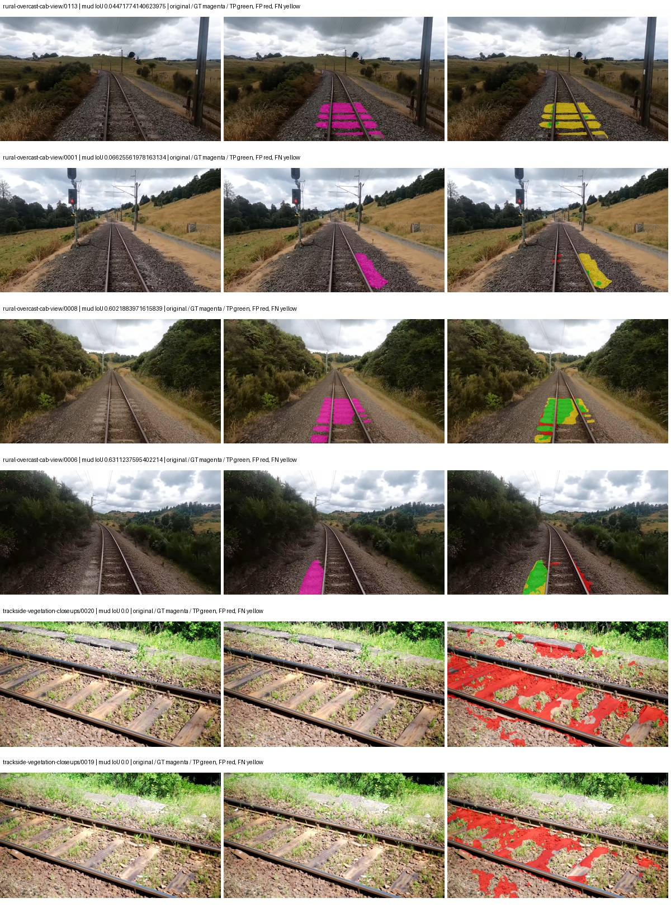
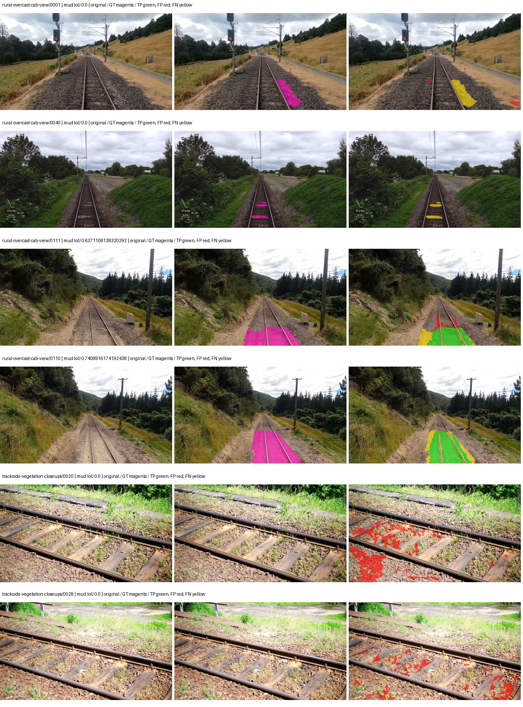
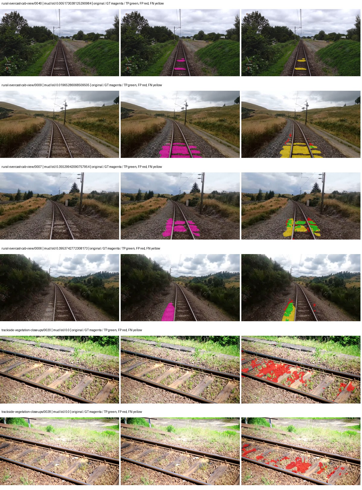
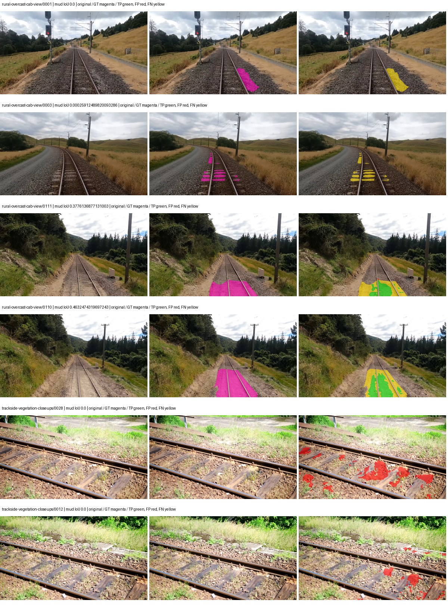

# smp_upernet_resnet101 — rad_9_24_2026-fixed-grouped

[RAD 9/24: Scene-grouped split](../../README.md) · [Full model records](record.json)

Primary result: the **final checkpoint** after the full step budget (no early stopping). The checkpoint with the best **mud-pumping validation IoU, pixels pooled over all validation images**, is kept as secondary evidence. A job is complete only after full statistics and isolated profiling are verified.

Study metrics of the final checkpoint, counting each class only on the validation images that contain it: mud-pumping IoU is the mean per-image IoU over the images with mud-pumping, precision and recall sum pixels over those images, and mIoU averages each class over the images that contain it, then over the classes present.

| Initialization path | Seed | Mud-pumping IoU, train-camera images with mud (%, n=17) | Mud-pumping IoU, all images with mud (%, n=18) | Mud precision, all images with mud (%) | Mud recall, all images with mud (%) | mIoU (each class over images that contain it) (%) |
| --- | --- | --- | --- | --- | --- | --- |
| rtis_only | 0 | 8.08 | 8.14 | 64.09 | 9.79 | 34.95 |
| cityscapes_to_rtis | 0 | 9.09 | 8.71 | 22.06 | 12.58 | 34.98 |
| railsem19_to_rtis | 0 | 9.45 | 9.19 | 46.02 | 11.89 | 45.51 |
| cityscapes_to_railsem19_to_rtis | 0 | 2.33 | 2.67 | 31.85 | 4.00 | 40.53 |

Per-class IoU: IoU (%) of every class, each averaged only over the validation images that contain the class (n = those images); — = no image contains it. mIoU averages the classes with at least one such image.

| Initialization path | Seed | mIoU (each class over images that contain it) | person (n=0) | truck (n=0) | rail-track (n=37) | vegetation-overgrowth (n=13) | car (n=3) | on-rails (n=0) | traffic-sign (n=9) | road (n=11) | sidewalk (n=12) | construction (n=12) | tram-track (n=2) | pole (n=21) | traffic-light (n=3) | mud-pumping (n=18) | fence (n=7) | terrain (n=35) | sky (n=28) | rail-embedded (n=3) | rail-raised (n=37) | trackbed (n=37) | standing-water (n=9) |
| --- | --- | --- | --- | --- | --- | --- | --- | --- | --- | --- | --- | --- | --- | --- | --- | --- | --- | --- | --- | --- | --- | --- | --- |
| rtis_only | 0 | 34.95 | — | — | 57.10 | 25.17 | 13.54 | — | 23.13 | 8.71 | 13.81 | 27.87 | 7.51 | 66.81 | 38.21 | 8.14 | 21.66 | 84.17 | 94.37 | 3.24 | 71.49 | 64.14 | 0.12 |
| cityscapes_to_rtis | 0 | 34.98 | — | — | 55.19 | 29.52 | 23.08 | — | 27.97 | 10.98 | 5.98 | 32.30 | 1.60 | 65.83 | 42.44 | 8.71 | 22.34 | 79.89 | 89.50 | 1.22 | 70.79 | 60.60 | 1.69 |
| railsem19_to_rtis | 0 | 45.51 | — | — | 59.82 | 32.45 | 38.69 | — | 42.12 | 10.93 | 3.43 | 56.32 | 46.84 | 70.53 | 53.59 | 9.19 | 23.99 | 84.13 | 96.23 | 52.75 | 72.71 | 63.89 | 1.61 |
| cityscapes_to_railsem19_to_rtis | 0 | 40.53 | — | — | 56.52 | 35.37 | 36.60 | — | 45.96 | 15.14 | 6.65 | 45.13 | 15.74 | 69.61 | 52.83 | 2.67 | 20.83 | 86.04 | 95.78 | 9.61 | 71.48 | 62.15 | 1.52 |

Everything below is the campaign's own record, with pixels pooled over all validation images: its evaluation is the checkpoint that scored best on that pooled mud IoU (secondary evidence here); the diagnostics also cover the final checkpoint (`final-auto-val`).

| Model | Initialization path | Seed | Status | Steps | Best step | Best-checkpoint mud IoU, pixels pooled (%) | Best-checkpoint mud precision, pixels pooled (%) | Best-checkpoint mud recall, pixels pooled (%) | Final mud IoU (trainer val, pixels pooled, %) | Best-checkpoint mIoU, pixels pooled (%) | Best-checkpoint fixed GT-class mIoU, pixels pooled (%) |
| --- | --- | --- | --- | --- | --- | --- | --- | --- | --- | --- | --- |
| smp_upernet_resnet101 | rtis_only | 0 | completed | 4000 | 2074 | 14.13 | 17.76 | 40.82 | 5.30 | 30.09 | 35.11 |
| smp_upernet_resnet101 | cityscapes_to_rtis | 0 | completed | 4000 | 518 | 22.45 | 36.12 | 37.23 | 3.45 | 22.53 | 26.28 |
| smp_upernet_resnet101 | railsem19_to_rtis | 0 | completed | 4000 | 3888 | 9.35 | 22.71 | 13.71 | 6.46 | 45.20 | 52.74 |
| smp_upernet_resnet101 | cityscapes_to_railsem19_to_rtis | 0 | completed | 4000 | 518 | 13.31 | 38.48 | 16.91 | 2.48 | 33.66 | 37.40 |

Training: 217 images. Validation: 37 images. Test: 60 held out. Seeds: [0]. Seed variation measures optimization variability, not independent-recording uncertainty. Historical source checkpoints stay fixed across adaptation seeds.

Training code: `fce0ea0ac50b334d4252812c396e0e593def375d`. Split SHA-256: `12d7b367c72cda61d57686ff2ac28223530d0af49debd9fb7a0fbc68b908bc93`.

## rtis_only — seed 0

Status: **completed**. Started: 2026-10-11T17:31:48.571145+00:00. Finished: 2026-10-11T18:31:05.144684+00:00.

Recipe pretrained initializer: `{"arch": "smp", "backbone_path": null, "batch_norm_momentum": null, "checkpoint": null, "classifier_path": null, "drop_path": null, "encoder_name": "resnet101", "encoder_weights": "imagenet", "head": "unified_head", "head_paths": [], "inactive_parameter_paths": [], "local_files_only": false, "lora_alpha": 32, "lora_dropout": 0.05, "lora_r": 16, "lora_targets": [], "native": null, "revision": null, "smp_arch": "UPerNet", "subfolder": null, "trust_remote_code": false, "tuning": "full"}`.

`rtis_only` uses the recipe initializer, which may include pretrained segmentation components. Transfer paths load the exact historical source checkpoint below and reset the classifier; they do not reset all query/decoder features.

Source checkpoint: `Recipe pretrained initialization`.

Config SHA-256: `b0542aedc23cafb9f4868052a59cd39bd000d98ccc918048e38cd062e952ff2c`. Weights used for validation: `raw`.

### Mud-pumping and aggregate quality

| Metric | Selected checkpoint | Final training validation |
| --- | --- | --- |
| Mud IoU | 14.13 | 5.30 |
| Mud precision | 17.76 | 10.36 |
| Mud recall | 40.82 | 9.78 |
| Mud Dice/F1 | 24.76 | 10.06 |
| mIoU | 30.09 | 32.59 |
| Mean accuracy | 43.86 | 45.46 |
| Mean precision | 55.76 | 55.28 |
| Mean Dice | 39.49 | 42.07 |
| Mean specificity | 98.86 | 98.95 |
| Pixel accuracy | 82.08 | 83.22 |
| Frequency-weighted IoU | 72.35 | 73.96 |
| Fixed GT-present class mIoU | 35.11 | 38.02 |
| Boundary F1 | 37.02 | 38.41 |

The selected checkpoint has independent evaluation evidence. Final values are the trainer's final validation record, not a new independent evaluation. mIoU averages classes with nonzero union, so false positives on absent classes can change its denominator. The fixed GT-class mean is supplementary and excludes absent classes; their false positives remain in the confusion matrix.

### Resource usage and timing

| Measurement | Value |
| --- | --- |
| Peak training VRAM, retained training invocation (GiB) | 11.09 |
| Peak evaluation VRAM (GiB) | 7.69 |
| Retained training invocation wall time (seconds) | 3363.93 |
| Retained training invocation GPU-hours (one GPU) | 0.93 |
| Evaluation wall time (seconds) | 15.75 |
| Full evaluation pipeline images/second | 2.35 |
| Best full-state checkpoint (MiB) | 860.41 |
| Final full-state checkpoint (MiB) | 860.39 |
| Verified periodic checkpoints removed (GiB) | 6.72 |

VRAM uses the recorded allocator high-water mark; it is not total device usage including CUDA context. Resumed jobs' retained training invocation times and peaks are **not whole-campaign totals**. Earlier invocation resource records are not reconstructed here. Evaluation throughput includes loader, sliding-window inference and metrics; it is not model-only latency/FPS. Missing measurements are shown as —, never inferred from another dataset's run.

### Standardized inference performance

Dedicated model-only profiling waits for an idle worker-locked L40S: BF16, batch 1, 1024x1024, 20 warmup and 100 CUDA-event-timed public forwards. It excludes loading, preprocessing, tiling and metrics.

| Status | Parameters | Weight MiB | FPS | p50 ms | p95 ms | Peak reserved GiB |
| --- | --- | --- | --- | --- | --- | --- |
| complete | 56281941 | 214.70 | 72.76 | 13.69 | 14.04 | 1.54 |

```json
{
  "schema_version": 1,
  "model_id": "smp_upernet_resnet101",
  "measured_at": "2026-10-11T18:30:55+00:00",
  "status": "complete",
  "benchmark_scope": "rtis_selected_checkpoint_model_only",
  "applies_to": [
    "smp_upernet_resnet101--rtis_only--seed-0"
  ],
  "source": {
    "campaign_git_sha": "fce0ea0ac50b334d4252812c396e0e593def375d",
    "git_dirty": false,
    "config_hash": "21631ae388ba",
    "resolved_config": "/data/izadia1/projects/segmentary-runs/rad_9_24_2026/fgall-seed0-20261007/configs/smp_upernet_resnet101--rtis_only--seed-0.yaml",
    "config_sha256": "b0542aedc23cafb9f4868052a59cd39bd000d98ccc918048e38cd062e952ff2c",
    "checkpoint_sha256": "4e4b94a6534cfed8b54ee24dcc90c1701ce76c5c82bc193e997c5542101c57a9",
    "checkpoint_global_step": 2074,
    "checkpoint_bytes": 902209759,
    "checkpoint_kind": "resume checkpoint with optimizer and EMA state",
    "weights": "raw",
    "measured_checkpoint_job_id": "smp_upernet_resnet101--rtis_only--seed-0",
    "result_sha256": "3f249f9a7913c99414b7742c27174f8dbc609a6126a10dd52c9d53ff509360d6",
    "result_git_sha": "fce0ea0ac50b334d4252812c396e0e593def375d",
    "result_stage": "eval:rad_9_24_2026-fixed-grouped:val",
    "result_seed": 0
  },
  "hardware": {
    "gpu_name": "NVIDIA L40S",
    "gpu_uuid": "GPU-e2e96741-aec9-e90b-5c46-d0d58be90a56",
    "logical_device": "cuda:0",
    "physical_visibility_token": "8",
    "compute_capability": [
      8,
      9
    ],
    "total_memory_bytes": 47677177856
  },
  "model": {
    "parameter_count": 56281941,
    "trainable_parameter_count": 56281941,
    "resident_parameter_bytes": 225127764,
    "parameter_dtype_counts": {
      "float32": 56281941
    }
  },
  "contract": {
    "backend": "pytorch",
    "precision": "bf16_autocast",
    "batch_size": 1,
    "input_shape_nchw": [
      1,
      3,
      1024,
      1024
    ],
    "warmup_iterations": 20,
    "measured_iterations": 100,
    "timing": "per-forward CUDA events with end-event synchronization",
    "includes_preprocessing": false,
    "includes_data_loader": false,
    "includes_sliding_window": false,
    "input_resident_on_gpu": true,
    "model_only": true,
    "entrypoint": "public model(image) dense-logits forward"
  },
  "measurements": {
    "latency": {
      "p50_ms": 13.686783790588379,
      "p95_ms": 14.036377191543579,
      "mean_ms": 13.743616285324096,
      "minimum_ms": 13.595647811889648,
      "maximum_ms": 15.747072219848633,
      "fps": 72.76105351310152,
      "raw_ms": [
        14.583807945251465,
        13.757472038269043,
        13.660160064697266,
        13.668352127075195,
        13.67142391204834,
        14.063615798950195,
        13.638655662536621,
        13.686783790588379,
        13.658111572265625,
        14.166015625,
        13.69702434539795,
        13.78816032409668,
        13.721599578857422,
        13.634559631347656,
        13.790207862854004,
        13.659135818481445,
        13.720576286315918,
        13.710335731506348,
        13.693951606750488,
        13.634559631347656,
        13.637632369995117,
        13.966336250305176,
        13.635583877563477,
        13.696000099182129,
        13.636608123779297,
        13.6560640335083,
        13.648896217346191,
        13.68064022064209,
        13.659135818481445,
        14.034943580627441,
        13.702143669128418,
        13.608960151672363,
        13.675519943237305,
        13.67347240447998,
        13.68166446685791,
        13.595647811889648,
        13.624320030212402,
        13.682687759399414,
        13.683712005615234,
        13.6560640335083,
        13.659135818481445,
        13.641728401184082,
        13.775872230529785,
        13.611007690429688,
        13.684736251831055,
        13.735936164855957,
        13.691904067993164,
        13.68064022064209,
        13.641695976257324,
        13.696000099182129,
        13.651968002319336,
        13.721599578857422,
        13.730815887451172,
        13.68883228302002,
        13.66323184967041,
        13.757439613342285,
        13.689855575561523,
        13.67961597442627,
        14.027775764465332,
        13.676544189453125,
        13.727744102478027,
        13.708288192749023,
        13.719552040100098,
        13.692928314208984,
        13.658111572265625,
        13.68064022064209,
        13.661184310913086,
        13.744128227233887,
        15.747072219848633,
        13.6878080368042,
        13.689855575561523,
        13.786111831665039,
        13.637632369995117,
        13.691904067993164,
        13.983743667602539,
        13.717503547668457,
        13.66323184967041,
        14.145536422729492,
        13.686783790588379,
        13.698047637939453,
        13.710335731506348,
        13.943807601928711,
        13.711359977722168,
        13.686783790588379,
        13.66528034210205,
        13.694975852966309,
        13.682687759399414,
        13.623295783996582,
        13.701120376586914,
        13.636672019958496,
        13.605888366699219,
        13.729791641235352,
        13.674495697021484,
        13.652992248535156,
        13.634559631347656,
        13.96019172668457,
        13.701087951660156,
        13.674495697021484,
        13.68064022064209,
        13.716480255126953
      ],
      "percentile_method": "numpy linear interpolation"
    },
    "peak_reserved_bytes": 1652555776,
    "memory_kind": "pytorch_cuda_allocator_peak_reserved_excluding_context",
    "process_total_bytes": 2181038080,
    "process_total_kind": "nvidia-smi used_memory of this PID on the benchmark GPU after the timed loop, including the CUDA context; null when the driver could not attribute memory to this PID",
    "benchmark_wall_clock_s": 13.96296489983797
  },
  "started_at": "2026-10-11T18:30:41+00:00",
  "finished_at": "2026-10-11T18:30:55+00:00",
  "environment": {
    "hostname": "hdrfs-app-001",
    "python": "3.11.15",
    "platform": "Linux-5.15.0-139-generic-x86_64-with-glibc2.35",
    "torch": "2.11.0+cu128",
    "torch_cuda": "12.8",
    "cudnn": 91900,
    "driver_version": "570.133.20",
    "cuda_available": true,
    "gpu_count": 1,
    "gpu_names": [
      "NVIDIA L40S"
    ],
    "cuda_visible_devices": "8",
    "packages": {
      "segmentary": "0.1.0",
      "torch": "2.11.0+cu128",
      "torchvision": "0.26.0+cu128",
      "transformers": "5.15.0",
      "timm": "1.0.28",
      "segmentation-models-pytorch": "0.5.0",
      "albumentations": "2.0.8",
      "lightning": "2.6.5",
      "numpy": "2.4.4"
    }
  }
}
```

### Per-class validation results

| Class | GT pixels | IoU (%) | Precision (%) | Recall (%) | Dice (%) | Boundary F1 (%) |
| --- | --- | --- | --- | --- | --- | --- |
| car | 29664 | 25.25 | 73.75 | 27.75 | 40.32 | 39.23 |
| construction | 311585 | 18.18 | 20.12 | 65.38 | 30.77 | 32.56 |
| fence | 265137 | 8.43 | 40.24 | 9.63 | 15.55 | 25.60 |
| mud-pumping | 1226250 | 14.13 | 17.76 | 40.82 | 24.76 | 20.19 |
| on-rails | 0 | 0.00 | 0.00 | — | 0.00 | 0.00 |
| person | 0 | 0.00 | 0.00 | — | 0.00 | 0.00 |
| pole | 628038 | 64.86 | 83.85 | 74.11 | 78.68 | 89.84 |
| rail-embedded | 16799 | 2.25 | 100.00 | 2.25 | 4.40 | 7.47 |
| rail-raised | 2969797 | 77.45 | 87.27 | 87.32 | 87.29 | 92.33 |
| rail-track | 6323197 | 33.20 | 59.69 | 42.80 | 49.85 | 50.70 |
| road | 1048831 | 2.20 | 6.34 | 3.25 | 4.30 | 5.33 |
| sidewalk | 1297367 | 23.77 | 59.24 | 28.42 | 38.41 | 7.44 |
| sky | 19121606 | 94.90 | 99.34 | 95.51 | 97.39 | 84.31 |
| standing-water | 95802 | 7.14 | 15.70 | 11.59 | 13.33 | 22.25 |
| terrain | 39239306 | 84.58 | 86.61 | 97.30 | 91.64 | 57.79 |
| trackbed | 10643081 | 58.00 | 70.24 | 76.90 | 73.42 | 57.25 |
| traffic-light | 19510 | 39.02 | 75.02 | 44.85 | 56.14 | 61.66 |
| traffic-sign | 13285 | 34.10 | 84.15 | 36.44 | 50.86 | 58.69 |
| tram-track | 56179 | 17.20 | 100.00 | 17.20 | 29.35 | 4.26 |
| truck | 0 | 0.00 | 0.00 | — | 0.00 | 0.00 |
| vegetation-overgrowth | 5901821 | 27.28 | 91.55 | 27.99 | 42.87 | 60.46 |

### Full-run accounting

| Measurement | Value |
| --- | --- |
| Full GPU-reserved wall seconds, all recorded worker attempts | 3564.34 |
| Full reserved GPU-hours | 0.99 |
| Whole-run timing complete | True |

| Phase | Wall seconds including failed attempts |
| --- | --- |
| training | 3370.97 |
| diagnostics | 128.20 |
| performance | 23.09 |

GPU-reserved time includes model loading, training, validation, collection, profiling, checkpoint I/O and orchestration while the worker owns one GPU. It is not GPU kernel-active time. Phase timings and sampled device memory/power/utilization are retained separately; sampled device memory is not the allocator high-water mark.

### Train/validation and raw/EMA diagnostics

| Checkpoint / weights / split | Images | Mud IoU (%) | Mud precision (%) | Mud recall (%) |
| --- | --- | --- | --- | --- |
| best-auto-train / raw | 217 | 94.86 | 97.07 | 97.66 |
| best-auto-val / raw | 37 | 14.13 | 17.76 | 40.82 |
| best-alternate-val / ema | 37 | 0.82 | 29.74 | 0.84 |
| final-auto-val / raw | 37 | 5.30 | 10.37 | 9.79 |

Train uses the evaluation transform without augmentation. Compare mud train/validation metrics for the same selected weights. Alternate EMA on running-stat BatchNorm is explicitly uncalibrated and is diagnostic only. Score-threshold curves use uncalibrated normalized scores and are pixel-level diagnostics, not event detection rates or a selected deployment operating point.

### Downloadable evidence

- best-auto-train: [per-image.csv](rtis_only--seed-0/best-auto-train/per-image.csv) · [per-image-confusion.json.gz](rtis_only--seed-0/best-auto-train/per-image-confusion.json.gz) · [groups.json](rtis_only--seed-0/best-auto-train/groups.json) · [mud-score-curves.json](rtis_only--seed-0/best-auto-train/mud-score-curves.json)
- best-auto-val: [per-image.csv](rtis_only--seed-0/best-auto-val/per-image.csv) · [per-image-confusion.json.gz](rtis_only--seed-0/best-auto-val/per-image-confusion.json.gz) · [groups.json](rtis_only--seed-0/best-auto-val/groups.json) · [mud-score-curves.json](rtis_only--seed-0/best-auto-val/mud-score-curves.json) · [examples.jpg](rtis_only--seed-0/best-auto-val/examples.jpg)
- best-alternate-val: [per-image.csv](rtis_only--seed-0/best-alternate-val/per-image.csv) · [per-image-confusion.json.gz](rtis_only--seed-0/best-alternate-val/per-image-confusion.json.gz) · [groups.json](rtis_only--seed-0/best-alternate-val/groups.json) · [mud-score-curves.json](rtis_only--seed-0/best-alternate-val/mud-score-curves.json)
- final-auto-val: [per-image.csv](rtis_only--seed-0/final-auto-val/per-image.csv) · [per-image-confusion.json.gz](rtis_only--seed-0/final-auto-val/per-image-confusion.json.gz) · [groups.json](rtis_only--seed-0/final-auto-val/groups.json) · [mud-score-curves.json](rtis_only--seed-0/final-auto-val/mud-score-curves.json)
- resources: [telemetry.csv](rtis_only--seed-0/resources/telemetry.csv)



Examples are two lowest and two highest mud-IoU positive images, plus up to two negative images with the most false-positive mud pixels. They are targeted diagnostic examples, not random samples. Green: true positive; red: false positive; yellow: false negative. Full predictions remain on HDRFS.

### Validation tracking

| Logged step | Overall mIoU (%) | Mud IoU (%) |
| --- | --- | --- |
| 258 | 22.97 | 4.72 |
| 518 | 24.37 | 7.27 |
| 777 | 26.84 | 0.75 |
| 1036 | 29.95 | 0.70 |
| 1295 | 30.98 | 1.95 |
| 1555 | 32.64 | 3.31 |
| 1814 | 29.71 | 6.34 |
| 2073 | 30.10 | 14.13 |
| 2332 | 32.29 | 5.80 |
| 2592 | 32.91 | 0.85 |
| 2851 | 31.50 | 1.45 |
| 3110 | 33.23 | 2.55 |
| 3369 | 33.82 | 2.19 |
| 3629 | 33.15 | 2.01 |
| 3888 | 32.85 | 2.94 |
| 4000 | 32.59 | 5.30 |

All retained scalar curves, including training loss and per-class IoU, are in record.json. Observed best mud on a curve is not necessarily a retained checkpoint: the pilot saved its selection-metric-best and final checkpoints. Step logging and checkpoint global_step may differ by one.

### Stopping and checkpoint provenance

```json
{
  "stopping": {
    "actual_steps": 4000,
    "maximum_steps": 4000,
    "min_delta": 0.0,
    "monitor": "val_iou/mud-pumping",
    "patience": null,
    "reason": "budget_complete"
  },
  "checkpoints": {
    "best": {
      "path": "/data/izadia1/projects/segmentary-runs/rad_9_24_2026/fgall-seed0-20261007/future-runs/smp_upernet_resnet101--rtis_only--seed-0_seed0/rtis/best.ckpt",
      "sha256": "4e4b94a6534cfed8b54ee24dcc90c1701ce76c5c82bc193e997c5542101c57a9",
      "global_step": 2074,
      "bytes": 902209759
    },
    "final": {
      "path": "/data/izadia1/projects/segmentary-runs/rad_9_24_2026/fgall-seed0-20261007/future-runs/smp_upernet_resnet101--rtis_only--seed-0_seed0/rtis/last.ckpt",
      "sha256": "3006237b2f37a8f2eb76ac4efdba6b1001e63cf0a9a3b9a0ba040b1b94d2e0c4",
      "global_step": 4000,
      "bytes": 902186719
    }
  },
  "cleanup_error": null
}
```

### Resolved training, initialization and evaluation settings

The optimizer block is the base configuration. Stage LR scales are applied at runtime, and stage warmup is capped at min(base warmup, floor(stage budget / 10), stage budget - 1): 400 steps for this 4,000-step pilot. Model-internal native input grids may differ from augmentation crops (EoMT uses its 640 grid).

```json
{
  "name": "smp_upernet_resnet101--rtis_only--seed-0",
  "model": {
    "arch": "smp",
    "checkpoint": null,
    "tuning": "full",
    "head": "unified_head",
    "lora_r": 16,
    "lora_alpha": 32,
    "lora_dropout": 0.05,
    "lora_targets": [],
    "drop_path": null,
    "revision": null,
    "subfolder": null,
    "local_files_only": false,
    "trust_remote_code": false,
    "backbone_path": null,
    "head_paths": [],
    "classifier_path": null,
    "inactive_parameter_paths": [],
    "smp_arch": "UPerNet",
    "encoder_name": "resnet101",
    "encoder_weights": "imagenet",
    "native": null,
    "batch_norm_momentum": null
  },
  "space": "paul-test-rtis",
  "taxonomy_root": "/data/izadia1/projects/segmentary-rad-fgall-fce0ea0a/taxonomy",
  "output_root": "/data/izadia1/projects/segmentary-runs/rad_9_24_2026/fgall-seed0-20261007/future-runs",
  "optim": {
    "backbone_lr": 0.0001,
    "head_lr_mult": 10.0,
    "weight_decay": 0.05,
    "llrd": 1.0,
    "warmup_iters": 1500,
    "warmup_ratio": 1e-06,
    "poly_power": 0.9,
    "min_lr_ratio": 0.0,
    "betas": [
      0.9,
      0.999
    ],
    "grad_clip": 1.0
  },
  "train": {
    "iters": 4000,
    "batch_size": 2,
    "accum": 8,
    "num_workers": 2,
    "precision": "bf16-mixed",
    "ema_decay": 0.9998,
    "val_every": 250,
    "ckpt_every": 500,
    "selection_metric": "val_iou/mud-pumping",
    "early_stopping_patience": null,
    "early_stopping_min_delta": 0.0,
    "seed": 0,
    "devices": 1
  },
  "eval": {
    "sliding_window": true,
    "window": [
      1024,
      1024
    ],
    "stride": [
      768,
      768
    ],
    "batch_size": 1,
    "num_workers": 2,
    "tta_scales": [],
    "tta_flip": false,
    "threshold": 0.5,
    "boundary_tolerance_frac": 0.0075,
    "save_confusion": true
  },
  "loss": {
    "task": "multiclass",
    "activation": "auto",
    "terms": [],
    "aux": "none",
    "aux_weight": 0.0,
    "ce_weight": 1.0,
    "label_smoothing": 0.0,
    "class_weights": null,
    "query": null
  },
  "aug": {
    "crop": [
      1024,
      1024
    ],
    "scale_min": 0.5,
    "scale_max": 2.0,
    "hflip_p": 0.5,
    "color_jitter_p": 0.5,
    "brightness": 0.25,
    "contrast": 0.25,
    "saturation": 0.25,
    "hue": 0.05
  },
  "stages": [
    {
      "name": "rtis",
      "data": [
        {
          "name": "rad_9_24_2026-fixed-grouped",
          "root": "/data/izadia1/datasets/rad_9_24_2026-fixed-grouped",
          "variant": null,
          "split_file": "splits.json",
          "train_split": "train",
          "val_split": "val",
          "limit": null,
          "loader": "folder",
          "mapping": "paul-test-rtis",
          "loader_options": {
            "require_groups": true
          }
        }
      ],
      "iters": null,
      "lr_scale": 1.0,
      "head_group_lr_scale": 1.0,
      "init_from": "pretrained",
      "reset_head": false,
      "freeze": null,
      "sample_weights": null
    }
  ]
}
```

### Hardware and software provenance

```json
{
  "training": {
    "cuda_available": true,
    "cuda_visible_devices": "8",
    "cudnn": 91900,
    "driver_version": "570.133.20",
    "gpu_count": 1,
    "gpu_names": [
      "NVIDIA L40S"
    ],
    "hostname": "hdrfs-app-001",
    "input_normalization": {
      "channel_order": "rgb",
      "mean": [
        0.485,
        0.456,
        0.406
      ],
      "source": "smp_encoder_settings",
      "std": [
        0.229,
        0.224,
        0.225
      ]
    },
    "model_origins": [
      {
        "hf_commit": null,
        "hf_name_or_path": null,
        "module": "model",
        "timm_pretrained": {}
      }
    ],
    "model_parameter_count": 56281941,
    "packages": {
      "albumentations": "2.0.8",
      "lightning": "2.6.5",
      "numpy": "2.4.4",
      "segmentary": "0.1.0",
      "segmentation-models-pytorch": "0.5.0",
      "timm": "1.0.28",
      "torch": "2.11.0+cu128",
      "torchvision": "0.26.0+cu128",
      "transformers": "5.15.0"
    },
    "platform": "Linux-5.15.0-139-generic-x86_64-with-glibc2.35",
    "python": "3.11.15",
    "torch": "2.11.0+cu128",
    "torch_cuda": "12.8",
    "trainable_parameter_count": 56281941,
    "training_stop": {
      "actual_steps": 4000,
      "maximum_steps": 4000,
      "min_delta": 0.0,
      "monitor": "val_iou/mud-pumping",
      "patience": null,
      "reason": "budget_complete"
    },
    "validation_weights": "raw"
  },
  "evaluation": {
    "cuda_available": true,
    "cuda_visible_devices": "8",
    "cudnn": 91900,
    "driver_version": "570.133.20",
    "gpu_count": 1,
    "gpu_names": [
      "NVIDIA L40S"
    ],
    "hostname": "hdrfs-app-001",
    "input_normalization": {
      "channel_order": "rgb",
      "mean": [
        0.485,
        0.456,
        0.406
      ],
      "source": "smp_encoder_settings",
      "std": [
        0.229,
        0.224,
        0.225
      ]
    },
    "packages": {
      "albumentations": "2.0.8",
      "lightning": "2.6.5",
      "numpy": "2.4.4",
      "segmentary": "0.1.0",
      "segmentation-models-pytorch": "0.5.0",
      "timm": "1.0.28",
      "torch": "2.11.0+cu128",
      "torchvision": "0.26.0+cu128",
      "transformers": "5.15.0"
    },
    "platform": "Linux-5.15.0-139-generic-x86_64-with-glibc2.35",
    "python": "3.11.15",
    "torch": "2.11.0+cu128",
    "torch_cuda": "12.8"
  }
}
```

## cityscapes_to_rtis — seed 0

Status: **completed**. Started: 2026-10-11T17:31:55.005329+00:00. Finished: 2026-10-11T18:30:55.358868+00:00.

Recipe pretrained initializer: `{"arch": "smp", "backbone_path": null, "batch_norm_momentum": null, "checkpoint": null, "classifier_path": null, "drop_path": null, "encoder_name": "resnet101", "encoder_weights": "imagenet", "head": "unified_head", "head_paths": [], "inactive_parameter_paths": [], "local_files_only": false, "lora_alpha": 32, "lora_dropout": 0.05, "lora_r": 16, "lora_targets": [], "native": null, "revision": null, "smp_arch": "UPerNet", "subfolder": null, "trust_remote_code": false, "tuning": "full"}`.

`rtis_only` uses the recipe initializer, which may include pretrained segmentation components. Transfer paths load the exact historical source checkpoint below and reset the classifier; they do not reset all query/decoder features.

Source checkpoint: `{'name': 'smp_upernet_resnet101--cityscapes--seed-0', 'model': 'smp_upernet_resnet101', 'protocol': 'cityscapes', 'config': '/data/izadia1/projects/segmentary-runs/all-model-city-rail-seed0-rail20-b9eb3e1/accepted/smp_upernet_resnet101--cityscapes--seed-0/resolved-config.yaml', 'checkpoint': '/data/izadia1/projects/segmentary-runs/all-model-city-rail-seed0-a7c0b67/jobs/smp_upernet_resnet101--cityscapes--seed-0/attempt-001/train/smp_upernet_resnet101--cityscapes_seed0/cityscapes/last.ckpt', 'recorded_sha256': '18a79d5ff0e4b11842213d5546a334f1e7e30b81c87679fab1659eecb12bcb7a', 'exists': True}`.

Config SHA-256: `b0c4296ee2d7d6502faf2efe78a1d3a5854c1fae4745a63c42a860f6e843b955`. Weights used for validation: `raw`.

### Mud-pumping and aggregate quality

| Metric | Selected checkpoint | Final training validation |
| --- | --- | --- |
| Mud IoU | 22.45 | 3.45 |
| Mud precision | 36.12 | 4.54 |
| Mud recall | 37.23 | 12.55 |
| Mud Dice/F1 | 36.67 | 6.66 |
| mIoU | 22.53 | 31.32 |
| Mean accuracy | 34.53 | 45.70 |
| Mean precision | 36.68 | 50.84 |
| Mean Dice | 28.86 | 40.41 |
| Mean specificity | 98.48 | 98.78 |
| Pixel accuracy | 78.67 | 80.51 |
| Frequency-weighted IoU | 65.97 | 70.82 |
| Fixed GT-present class mIoU | 26.28 | 36.54 |
| Boundary F1 | 25.83 | 36.45 |

The selected checkpoint has independent evaluation evidence. Final values are the trainer's final validation record, not a new independent evaluation. mIoU averages classes with nonzero union, so false positives on absent classes can change its denominator. The fixed GT-class mean is supplementary and excludes absent classes; their false positives remain in the confusion matrix.

### Resource usage and timing

| Measurement | Value |
| --- | --- |
| Peak training VRAM, retained training invocation (GiB) | 11.09 |
| Peak evaluation VRAM (GiB) | 7.69 |
| Retained training invocation wall time (seconds) | 3347.32 |
| Retained training invocation GPU-hours (one GPU) | 0.93 |
| Evaluation wall time (seconds) | 15.62 |
| Full evaluation pipeline images/second | 2.37 |
| Best full-state checkpoint (MiB) | 860.41 |
| Final full-state checkpoint (MiB) | 860.39 |
| Verified periodic checkpoints removed (GiB) | 6.72 |

VRAM uses the recorded allocator high-water mark; it is not total device usage including CUDA context. Resumed jobs' retained training invocation times and peaks are **not whole-campaign totals**. Earlier invocation resource records are not reconstructed here. Evaluation throughput includes loader, sliding-window inference and metrics; it is not model-only latency/FPS. Missing measurements are shown as —, never inferred from another dataset's run.

### Standardized inference performance

Dedicated model-only profiling waits for an idle worker-locked L40S: BF16, batch 1, 1024x1024, 20 warmup and 100 CUDA-event-timed public forwards. It excludes loading, preprocessing, tiling and metrics.

| Status | Parameters | Weight MiB | FPS | p50 ms | p95 ms | Peak reserved GiB |
| --- | --- | --- | --- | --- | --- | --- |
| complete | 56281941 | 214.70 | 74.27 | 13.41 | 13.91 | 1.54 |

```json
{
  "schema_version": 1,
  "model_id": "smp_upernet_resnet101",
  "measured_at": "2026-10-11T18:30:46+00:00",
  "status": "complete",
  "benchmark_scope": "rtis_selected_checkpoint_model_only",
  "applies_to": [
    "smp_upernet_resnet101--cityscapes_to_rtis--seed-0"
  ],
  "source": {
    "campaign_git_sha": "fce0ea0ac50b334d4252812c396e0e593def375d",
    "git_dirty": false,
    "config_hash": "ceafa8dfaeb3",
    "resolved_config": "/data/izadia1/projects/segmentary-runs/rad_9_24_2026/fgall-seed0-20261007/configs/smp_upernet_resnet101--cityscapes_to_rtis--seed-0.yaml",
    "config_sha256": "b0c4296ee2d7d6502faf2efe78a1d3a5854c1fae4745a63c42a860f6e843b955",
    "checkpoint_sha256": "dd406a725a8fd3c378f80875b8d8591fed601ddbabb487820ff25fb449973dfe",
    "checkpoint_global_step": 518,
    "checkpoint_bytes": 902209823,
    "checkpoint_kind": "resume checkpoint with optimizer and EMA state",
    "weights": "raw",
    "measured_checkpoint_job_id": "smp_upernet_resnet101--cityscapes_to_rtis--seed-0",
    "result_sha256": "7e17840861fdab6a88f8fba3f15cad545b1a13e0112a5671063e5e506a2011a8",
    "result_git_sha": "fce0ea0ac50b334d4252812c396e0e593def375d",
    "result_stage": "eval:rad_9_24_2026-fixed-grouped:val",
    "result_seed": 0
  },
  "hardware": {
    "gpu_name": "NVIDIA L40S",
    "gpu_uuid": "GPU-c76642eb-64c1-b0ac-b051-d2efd47b32c4",
    "logical_device": "cuda:0",
    "physical_visibility_token": "9",
    "compute_capability": [
      8,
      9
    ],
    "total_memory_bytes": 47677177856
  },
  "model": {
    "parameter_count": 56281941,
    "trainable_parameter_count": 56281941,
    "resident_parameter_bytes": 225127764,
    "parameter_dtype_counts": {
      "float32": 56281941
    }
  },
  "contract": {
    "backend": "pytorch",
    "precision": "bf16_autocast",
    "batch_size": 1,
    "input_shape_nchw": [
      1,
      3,
      1024,
      1024
    ],
    "warmup_iterations": 20,
    "measured_iterations": 100,
    "timing": "per-forward CUDA events with end-event synchronization",
    "includes_preprocessing": false,
    "includes_data_loader": false,
    "includes_sliding_window": false,
    "input_resident_on_gpu": true,
    "model_only": true,
    "entrypoint": "public model(image) dense-logits forward"
  },
  "measurements": {
    "latency": {
      "p50_ms": 13.40825605392456,
      "p95_ms": 13.911347484588623,
      "mean_ms": 13.464894418716431,
      "minimum_ms": 13.306879997253418,
      "maximum_ms": 14.545920372009277,
      "fps": 74.2671994969365,
      "raw_ms": [
        13.660160064697266,
        13.369343757629395,
        13.362175941467285,
        13.333503723144531,
        13.911040306091309,
        14.545920372009277,
        13.917183876037598,
        13.363200187683105,
        13.378560066223145,
        13.715456008911133,
        13.409343719482422,
        13.464608192443848,
        13.424639701843262,
        13.379584312438965,
        13.418496131896973,
        13.395936012268066,
        13.431808471679688,
        13.945856094360352,
        13.423616409301758,
        13.402112007141113,
        13.392895698547363,
        13.462528228759766,
        13.475839614868164,
        13.39187240600586,
        13.395968437194824,
        13.419520378112793,
        13.390848159790039,
        13.37343978881836,
        13.388799667358398,
        13.756416320800781,
        13.36729621887207,
        13.395968437194824,
        13.438976287841797,
        13.419520378112793,
        13.398048400878906,
        13.409279823303223,
        13.403136253356934,
        13.441023826599121,
        13.384703636169434,
        13.415424346923828,
        13.393919944763184,
        13.539327621459961,
        13.388799667358398,
        13.343744277954102,
        13.46662425994873,
        13.396991729736328,
        13.387743949890137,
        13.811712265014648,
        13.388799667358398,
        13.379584312438965,
        13.410271644592285,
        13.321215629577637,
        13.306879997253418,
        13.371423721313477,
        13.413375854492188,
        13.4584321975708,
        13.370368003845215,
        13.381664276123047,
        13.4901762008667,
        13.403136253356934,
        13.434880256652832,
        13.420543670654297,
        13.420543670654297,
        13.34886360168457,
        13.396991729736328,
        13.724672317504883,
        13.389823913574219,
        13.426688194274902,
        13.372415542602539,
        13.403136253356934,
        13.399040222167969,
        13.350943565368652,
        13.438976287841797,
        13.40009593963623,
        13.372415542602539,
        13.420543670654297,
        13.400064468383789,
        13.390848159790039,
        13.418432235717773,
        13.936639785766602,
        13.418496131896973,
        13.415424346923828,
        13.395968437194824,
        13.4399995803833,
        13.414400100708008,
        13.422592163085938,
        13.441023826599121,
        13.392895698547363,
        14.180352210998535,
        13.409279823303223,
        13.444095611572266,
        13.447168350219727,
        13.407232284545898,
        13.392895698547363,
        13.785087585449219,
        13.418496131896973,
        13.381631851196289,
        13.442048072814941,
        13.399040222167969,
        13.376511573791504
      ],
      "percentile_method": "numpy linear interpolation"
    },
    "peak_reserved_bytes": 1652555776,
    "memory_kind": "pytorch_cuda_allocator_peak_reserved_excluding_context",
    "process_total_bytes": 2181038080,
    "process_total_kind": "nvidia-smi used_memory of this PID on the benchmark GPU after the timed loop, including the CUDA context; null when the driver could not attribute memory to this PID",
    "benchmark_wall_clock_s": 14.147642113268375
  },
  "started_at": "2026-10-11T18:30:31+00:00",
  "finished_at": "2026-10-11T18:30:46+00:00",
  "environment": {
    "hostname": "hdrfs-app-001",
    "python": "3.11.15",
    "platform": "Linux-5.15.0-139-generic-x86_64-with-glibc2.35",
    "torch": "2.11.0+cu128",
    "torch_cuda": "12.8",
    "cudnn": 91900,
    "driver_version": "570.133.20",
    "cuda_available": true,
    "gpu_count": 1,
    "gpu_names": [
      "NVIDIA L40S"
    ],
    "cuda_visible_devices": "9",
    "packages": {
      "segmentary": "0.1.0",
      "torch": "2.11.0+cu128",
      "torchvision": "0.26.0+cu128",
      "transformers": "5.15.0",
      "timm": "1.0.28",
      "segmentation-models-pytorch": "0.5.0",
      "albumentations": "2.0.8",
      "lightning": "2.6.5",
      "numpy": "2.4.4"
    }
  }
}
```

### Per-class validation results

| Class | GT pixels | IoU (%) | Precision (%) | Recall (%) | Dice (%) | Boundary F1 (%) |
| --- | --- | --- | --- | --- | --- | --- |
| car | 29664 | 0.00 | 0.00 | 0.00 | 0.00 | 0.00 |
| construction | 311585 | 15.54 | 16.52 | 72.49 | 26.90 | 18.81 |
| fence | 265137 | 25.45 | 44.71 | 37.13 | 40.57 | 35.69 |
| mud-pumping | 1226250 | 22.45 | 36.12 | 37.23 | 36.67 | 25.19 |
| on-rails | 0 | 0.00 | 0.00 | — | 0.00 | 0.00 |
| person | 0 | 0.00 | 0.00 | — | 0.00 | 0.00 |
| pole | 628038 | 64.60 | 86.37 | 71.93 | 78.49 | 90.93 |
| rail-embedded | 16799 | 0.00 | 0.00 | 0.00 | 0.00 | 0.00 |
| rail-raised | 2969797 | 65.19 | 81.72 | 76.33 | 78.93 | 86.56 |
| rail-track | 6323197 | 34.59 | 60.18 | 44.86 | 51.41 | 44.77 |
| road | 1048831 | 3.81 | 11.56 | 5.37 | 7.34 | 11.72 |
| sidewalk | 1297367 | 9.88 | 93.21 | 9.95 | 17.98 | 7.04 |
| sky | 19121606 | 94.67 | 99.49 | 95.13 | 97.26 | 88.19 |
| standing-water | 95802 | 0.41 | 0.63 | 1.16 | 0.81 | 3.66 |
| terrain | 39239306 | 75.12 | 76.91 | 97.00 | 85.80 | 43.50 |
| trackbed | 10643081 | 53.93 | 75.49 | 65.38 | 70.07 | 54.73 |
| traffic-light | 19510 | 0.00 | 0.00 | 0.00 | 0.00 | 0.00 |
| traffic-sign | 13285 | 0.00 | 0.00 | 0.00 | 0.00 | 0.00 |
| tram-track | 56179 | 0.00 | 0.00 | 0.00 | 0.00 | 0.00 |
| truck | 0 | 0.00 | 0.00 | — | 0.00 | 0.00 |
| vegetation-overgrowth | 5901821 | 7.42 | 87.48 | 7.50 | 13.82 | 31.68 |

### Full-run accounting

| Measurement | Value |
| --- | --- |
| Full GPU-reserved wall seconds, all recorded worker attempts | 3548.77 |
| Full reserved GPU-hours | 0.99 |
| Whole-run timing complete | True |

| Phase | Wall seconds including failed attempts |
| --- | --- |
| training | 3355.39 |
| diagnostics | 127.88 |
| performance | 23.35 |

GPU-reserved time includes model loading, training, validation, collection, profiling, checkpoint I/O and orchestration while the worker owns one GPU. It is not GPU kernel-active time. Phase timings and sampled device memory/power/utilization are retained separately; sampled device memory is not the allocator high-water mark.

### Train/validation and raw/EMA diagnostics

| Checkpoint / weights / split | Images | Mud IoU (%) | Mud precision (%) | Mud recall (%) |
| --- | --- | --- | --- | --- |
| best-auto-train / raw | 217 | 83.09 | 94.64 | 87.19 |
| best-auto-val / raw | 37 | 22.45 | 36.12 | 37.23 |
| best-alternate-val / ema | 37 | 9.96 | 18.45 | 17.79 |
| final-auto-val / raw | 37 | 3.45 | 4.54 | 12.58 |

Train uses the evaluation transform without augmentation. Compare mud train/validation metrics for the same selected weights. Alternate EMA on running-stat BatchNorm is explicitly uncalibrated and is diagnostic only. Score-threshold curves use uncalibrated normalized scores and are pixel-level diagnostics, not event detection rates or a selected deployment operating point.

### Downloadable evidence

- best-auto-train: [per-image.csv](cityscapes_to_rtis--seed-0/best-auto-train/per-image.csv) · [per-image-confusion.json.gz](cityscapes_to_rtis--seed-0/best-auto-train/per-image-confusion.json.gz) · [groups.json](cityscapes_to_rtis--seed-0/best-auto-train/groups.json) · [mud-score-curves.json](cityscapes_to_rtis--seed-0/best-auto-train/mud-score-curves.json)
- best-auto-val: [per-image.csv](cityscapes_to_rtis--seed-0/best-auto-val/per-image.csv) · [per-image-confusion.json.gz](cityscapes_to_rtis--seed-0/best-auto-val/per-image-confusion.json.gz) · [groups.json](cityscapes_to_rtis--seed-0/best-auto-val/groups.json) · [mud-score-curves.json](cityscapes_to_rtis--seed-0/best-auto-val/mud-score-curves.json) · [examples.jpg](cityscapes_to_rtis--seed-0/best-auto-val/examples.jpg)
- best-alternate-val: [per-image.csv](cityscapes_to_rtis--seed-0/best-alternate-val/per-image.csv) · [per-image-confusion.json.gz](cityscapes_to_rtis--seed-0/best-alternate-val/per-image-confusion.json.gz) · [groups.json](cityscapes_to_rtis--seed-0/best-alternate-val/groups.json) · [mud-score-curves.json](cityscapes_to_rtis--seed-0/best-alternate-val/mud-score-curves.json)
- final-auto-val: [per-image.csv](cityscapes_to_rtis--seed-0/final-auto-val/per-image.csv) · [per-image-confusion.json.gz](cityscapes_to_rtis--seed-0/final-auto-val/per-image-confusion.json.gz) · [groups.json](cityscapes_to_rtis--seed-0/final-auto-val/groups.json) · [mud-score-curves.json](cityscapes_to_rtis--seed-0/final-auto-val/mud-score-curves.json)
- resources: [telemetry.csv](cityscapes_to_rtis--seed-0/resources/telemetry.csv)



Examples are two lowest and two highest mud-IoU positive images, plus up to two negative images with the most false-positive mud pixels. They are targeted diagnostic examples, not random samples. Green: true positive; red: false positive; yellow: false negative. Full predictions remain on HDRFS.

### Validation tracking

| Logged step | Overall mIoU (%) | Mud IoU (%) |
| --- | --- | --- |
| 258 | 23.46 | 4.65 |
| 518 | 22.53 | 22.45 |
| 777 | 22.52 | 4.29 |
| 1036 | 27.58 | 4.20 |
| 1295 | 28.96 | 6.53 |
| 1555 | 31.11 | 3.06 |
| 1814 | 30.85 | 7.23 |
| 2073 | 30.11 | 12.73 |
| 2332 | 31.20 | 7.53 |
| 2592 | 30.52 | 3.48 |
| 2851 | 31.44 | 3.44 |
| 3110 | 30.90 | 4.25 |
| 3369 | 33.55 | 8.72 |
| 3629 | 31.50 | 6.17 |
| 3888 | 31.82 | 4.42 |
| 4000 | 31.32 | 3.45 |

All retained scalar curves, including training loss and per-class IoU, are in record.json. Observed best mud on a curve is not necessarily a retained checkpoint: the pilot saved its selection-metric-best and final checkpoints. Step logging and checkpoint global_step may differ by one.

### Stopping and checkpoint provenance

```json
{
  "stopping": {
    "actual_steps": 4000,
    "maximum_steps": 4000,
    "min_delta": 0.0,
    "monitor": "val_iou/mud-pumping",
    "patience": null,
    "reason": "budget_complete"
  },
  "checkpoints": {
    "best": {
      "path": "/data/izadia1/projects/segmentary-runs/rad_9_24_2026/fgall-seed0-20261007/future-runs/smp_upernet_resnet101--cityscapes_to_rtis--seed-0_seed0/rtis/best.ckpt",
      "sha256": "dd406a725a8fd3c378f80875b8d8591fed601ddbabb487820ff25fb449973dfe",
      "global_step": 518,
      "bytes": 902209823
    },
    "final": {
      "path": "/data/izadia1/projects/segmentary-runs/rad_9_24_2026/fgall-seed0-20261007/future-runs/smp_upernet_resnet101--cityscapes_to_rtis--seed-0_seed0/rtis/last.ckpt",
      "sha256": "683af97858790524142c67a1de4d0a48c7a1c9408cbb9e0c13a91f2e6969fb85",
      "global_step": 4000,
      "bytes": 902186719
    }
  },
  "cleanup_error": null
}
```

### Resolved training, initialization and evaluation settings

The optimizer block is the base configuration. Stage LR scales are applied at runtime, and stage warmup is capped at min(base warmup, floor(stage budget / 10), stage budget - 1): 400 steps for this 4,000-step pilot. Model-internal native input grids may differ from augmentation crops (EoMT uses its 640 grid).

```json
{
  "name": "smp_upernet_resnet101--cityscapes_to_rtis--seed-0",
  "model": {
    "arch": "smp",
    "checkpoint": null,
    "tuning": "full",
    "head": "unified_head",
    "lora_r": 16,
    "lora_alpha": 32,
    "lora_dropout": 0.05,
    "lora_targets": [],
    "drop_path": null,
    "revision": null,
    "subfolder": null,
    "local_files_only": false,
    "trust_remote_code": false,
    "backbone_path": null,
    "head_paths": [],
    "classifier_path": null,
    "inactive_parameter_paths": [],
    "smp_arch": "UPerNet",
    "encoder_name": "resnet101",
    "encoder_weights": "imagenet",
    "native": null,
    "batch_norm_momentum": null
  },
  "space": "paul-test-rtis",
  "taxonomy_root": "/data/izadia1/projects/segmentary-rad-fgall-fce0ea0a/taxonomy",
  "output_root": "/data/izadia1/projects/segmentary-runs/rad_9_24_2026/fgall-seed0-20261007/future-runs",
  "optim": {
    "backbone_lr": 0.0001,
    "head_lr_mult": 10.0,
    "weight_decay": 0.05,
    "llrd": 1.0,
    "warmup_iters": 1500,
    "warmup_ratio": 1e-06,
    "poly_power": 0.9,
    "min_lr_ratio": 0.0,
    "betas": [
      0.9,
      0.999
    ],
    "grad_clip": 1.0
  },
  "train": {
    "iters": 4000,
    "batch_size": 2,
    "accum": 8,
    "num_workers": 2,
    "precision": "bf16-mixed",
    "ema_decay": 0.9998,
    "val_every": 250,
    "ckpt_every": 500,
    "selection_metric": "val_iou/mud-pumping",
    "early_stopping_patience": null,
    "early_stopping_min_delta": 0.0,
    "seed": 0,
    "devices": 1
  },
  "eval": {
    "sliding_window": true,
    "window": [
      1024,
      1024
    ],
    "stride": [
      768,
      768
    ],
    "batch_size": 1,
    "num_workers": 2,
    "tta_scales": [],
    "tta_flip": false,
    "threshold": 0.5,
    "boundary_tolerance_frac": 0.0075,
    "save_confusion": true
  },
  "loss": {
    "task": "multiclass",
    "activation": "auto",
    "terms": [],
    "aux": "none",
    "aux_weight": 0.0,
    "ce_weight": 1.0,
    "label_smoothing": 0.0,
    "class_weights": null,
    "query": null
  },
  "aug": {
    "crop": [
      1024,
      1024
    ],
    "scale_min": 0.5,
    "scale_max": 2.0,
    "hflip_p": 0.5,
    "color_jitter_p": 0.5,
    "brightness": 0.25,
    "contrast": 0.25,
    "saturation": 0.25,
    "hue": 0.05
  },
  "stages": [
    {
      "name": "rtis",
      "data": [
        {
          "name": "rad_9_24_2026-fixed-grouped",
          "root": "/data/izadia1/datasets/rad_9_24_2026-fixed-grouped",
          "variant": null,
          "split_file": "splits.json",
          "train_split": "train",
          "val_split": "val",
          "limit": null,
          "loader": "folder",
          "mapping": "paul-test-rtis",
          "loader_options": {
            "require_groups": true
          }
        }
      ],
      "iters": null,
      "lr_scale": 0.1,
      "head_group_lr_scale": 1.0,
      "init_from": "/data/izadia1/projects/segmentary-runs/all-model-city-rail-seed0-a7c0b67/jobs/smp_upernet_resnet101--cityscapes--seed-0/attempt-001/train/smp_upernet_resnet101--cityscapes_seed0/cityscapes/last.ckpt",
      "reset_head": true,
      "freeze": null,
      "sample_weights": null
    }
  ]
}
```

### Hardware and software provenance

```json
{
  "training": {
    "cuda_available": true,
    "cuda_visible_devices": "9",
    "cudnn": 91900,
    "driver_version": "570.133.20",
    "gpu_count": 1,
    "gpu_names": [
      "NVIDIA L40S"
    ],
    "hostname": "hdrfs-app-001",
    "input_normalization": {
      "channel_order": "rgb",
      "mean": [
        0.485,
        0.456,
        0.406
      ],
      "source": "smp_encoder_settings",
      "std": [
        0.229,
        0.224,
        0.225
      ]
    },
    "model_origins": [
      {
        "hf_commit": null,
        "hf_name_or_path": null,
        "module": "model",
        "timm_pretrained": {}
      }
    ],
    "model_parameter_count": 56281941,
    "packages": {
      "albumentations": "2.0.8",
      "lightning": "2.6.5",
      "numpy": "2.4.4",
      "segmentary": "0.1.0",
      "segmentation-models-pytorch": "0.5.0",
      "timm": "1.0.28",
      "torch": "2.11.0+cu128",
      "torchvision": "0.26.0+cu128",
      "transformers": "5.15.0"
    },
    "platform": "Linux-5.15.0-139-generic-x86_64-with-glibc2.35",
    "python": "3.11.15",
    "torch": "2.11.0+cu128",
    "torch_cuda": "12.8",
    "trainable_parameter_count": 56281941,
    "training_stop": {
      "actual_steps": 4000,
      "maximum_steps": 4000,
      "min_delta": 0.0,
      "monitor": "val_iou/mud-pumping",
      "patience": null,
      "reason": "budget_complete"
    },
    "validation_weights": "raw"
  },
  "evaluation": {
    "cuda_available": true,
    "cuda_visible_devices": "9",
    "cudnn": 91900,
    "driver_version": "570.133.20",
    "gpu_count": 1,
    "gpu_names": [
      "NVIDIA L40S"
    ],
    "hostname": "hdrfs-app-001",
    "input_normalization": {
      "channel_order": "rgb",
      "mean": [
        0.485,
        0.456,
        0.406
      ],
      "source": "smp_encoder_settings",
      "std": [
        0.229,
        0.224,
        0.225
      ]
    },
    "packages": {
      "albumentations": "2.0.8",
      "lightning": "2.6.5",
      "numpy": "2.4.4",
      "segmentary": "0.1.0",
      "segmentation-models-pytorch": "0.5.0",
      "timm": "1.0.28",
      "torch": "2.11.0+cu128",
      "torchvision": "0.26.0+cu128",
      "transformers": "5.15.0"
    },
    "platform": "Linux-5.15.0-139-generic-x86_64-with-glibc2.35",
    "python": "3.11.15",
    "torch": "2.11.0+cu128",
    "torch_cuda": "12.8"
  }
}
```

## railsem19_to_rtis — seed 0

Status: **completed**. Started: 2026-10-11T17:32:14.134461+00:00. Finished: 2026-10-11T18:32:26.274554+00:00.

Recipe pretrained initializer: `{"arch": "smp", "backbone_path": null, "batch_norm_momentum": null, "checkpoint": null, "classifier_path": null, "drop_path": null, "encoder_name": "resnet101", "encoder_weights": "imagenet", "head": "unified_head", "head_paths": [], "inactive_parameter_paths": [], "local_files_only": false, "lora_alpha": 32, "lora_dropout": 0.05, "lora_r": 16, "lora_targets": [], "native": null, "revision": null, "smp_arch": "UPerNet", "subfolder": null, "trust_remote_code": false, "tuning": "full"}`.

`rtis_only` uses the recipe initializer, which may include pretrained segmentation components. Transfer paths load the exact historical source checkpoint below and reset the classifier; they do not reset all query/decoder features.

Source checkpoint: `{'name': 'smp_upernet_resnet101--railsem19--seed-0', 'model': 'smp_upernet_resnet101', 'protocol': 'railsem19', 'config': '/data/izadia1/projects/segmentary-runs/all-model-city-rail-seed0-rail20-b9eb3e1/accepted/smp_upernet_resnet101--railsem19--seed-0/resolved-config.yaml', 'checkpoint': '/data/izadia1/projects/segmentary-runs/all-model-city-rail-seed0-a7c0b67/jobs/smp_upernet_resnet101--railsem19--seed-0/attempt-001/train/smp_upernet_resnet101--railsem19_seed0/railsem19/last.ckpt', 'recorded_sha256': '786e3d81df9181457bb198b058bfd34662540be50b92ea3c4a9c4a3f361f8087', 'exists': True}`.

Config SHA-256: `c8dd4762e5ec6f48ff3f208d727e38e814285ead9fd673a7935a57b01dbade73`. Weights used for validation: `raw`.

### Mud-pumping and aggregate quality

| Metric | Selected checkpoint | Final training validation |
| --- | --- | --- |
| Mud IoU | 9.35 | 6.46 |
| Mud precision | 22.71 | 12.36 |
| Mud recall | 13.71 | 11.91 |
| Mud Dice/F1 | 17.10 | 12.13 |
| mIoU | 45.20 | 45.84 |
| Mean accuracy | 62.23 | 61.64 |
| Mean precision | 59.33 | 58.40 |
| Mean Dice | 54.58 | 55.08 |
| Mean specificity | 99.01 | 98.97 |
| Pixel accuracy | 84.83 | 84.10 |
| Frequency-weighted IoU | 75.20 | 74.57 |
| Fixed GT-present class mIoU | 52.74 | 50.93 |
| Boundary F1 | 50.85 | 51.54 |

The selected checkpoint has independent evaluation evidence. Final values are the trainer's final validation record, not a new independent evaluation. mIoU averages classes with nonzero union, so false positives on absent classes can change its denominator. The fixed GT-class mean is supplementary and excludes absent classes; their false positives remain in the confusion matrix.

### Resource usage and timing

| Measurement | Value |
| --- | --- |
| Peak training VRAM, retained training invocation (GiB) | 11.09 |
| Peak evaluation VRAM (GiB) | 7.69 |
| Retained training invocation wall time (seconds) | 3418.98 |
| Retained training invocation GPU-hours (one GPU) | 0.95 |
| Evaluation wall time (seconds) | 15.42 |
| Full evaluation pipeline images/second | 2.40 |
| Best full-state checkpoint (MiB) | 860.41 |
| Final full-state checkpoint (MiB) | 860.39 |
| Verified periodic checkpoints removed (GiB) | 6.72 |

VRAM uses the recorded allocator high-water mark; it is not total device usage including CUDA context. Resumed jobs' retained training invocation times and peaks are **not whole-campaign totals**. Earlier invocation resource records are not reconstructed here. Evaluation throughput includes loader, sliding-window inference and metrics; it is not model-only latency/FPS. Missing measurements are shown as —, never inferred from another dataset's run.

### Standardized inference performance

Dedicated model-only profiling waits for an idle worker-locked L40S: BF16, batch 1, 1024x1024, 20 warmup and 100 CUDA-event-timed public forwards. It excludes loading, preprocessing, tiling and metrics.

| Status | Parameters | Weight MiB | FPS | p50 ms | p95 ms | Peak reserved GiB |
| --- | --- | --- | --- | --- | --- | --- |
| complete | 56281941 | 214.70 | 72.52 | 13.69 | 14.33 | 1.54 |

```json
{
  "schema_version": 1,
  "model_id": "smp_upernet_resnet101",
  "measured_at": "2026-10-11T18:32:16+00:00",
  "status": "complete",
  "benchmark_scope": "rtis_selected_checkpoint_model_only",
  "applies_to": [
    "smp_upernet_resnet101--railsem19_to_rtis--seed-0"
  ],
  "source": {
    "campaign_git_sha": "fce0ea0ac50b334d4252812c396e0e593def375d",
    "git_dirty": false,
    "config_hash": "f1a80827bd42",
    "resolved_config": "/data/izadia1/projects/segmentary-runs/rad_9_24_2026/fgall-seed0-20261007/configs/smp_upernet_resnet101--railsem19_to_rtis--seed-0.yaml",
    "config_sha256": "c8dd4762e5ec6f48ff3f208d727e38e814285ead9fd673a7935a57b01dbade73",
    "checkpoint_sha256": "8d8db8bbd7a35748809ce3260e43543ac22903e89cc50e4d85745b5931ae8a5c",
    "checkpoint_global_step": 3888,
    "checkpoint_bytes": 902209823,
    "checkpoint_kind": "resume checkpoint with optimizer and EMA state",
    "weights": "raw",
    "measured_checkpoint_job_id": "smp_upernet_resnet101--railsem19_to_rtis--seed-0",
    "result_sha256": "54c7a73fa9cfee7852b41c5815d896a1ad861f5a7af84c70a235d01f33a0415d",
    "result_git_sha": "fce0ea0ac50b334d4252812c396e0e593def375d",
    "result_stage": "eval:rad_9_24_2026-fixed-grouped:val",
    "result_seed": 0
  },
  "hardware": {
    "gpu_name": "NVIDIA L40S",
    "gpu_uuid": "GPU-a5ad49e5-0536-5229-ba8a-f8a902808f53",
    "logical_device": "cuda:0",
    "physical_visibility_token": "7",
    "compute_capability": [
      8,
      9
    ],
    "total_memory_bytes": 47677177856
  },
  "model": {
    "parameter_count": 56281941,
    "trainable_parameter_count": 56281941,
    "resident_parameter_bytes": 225127764,
    "parameter_dtype_counts": {
      "float32": 56281941
    }
  },
  "contract": {
    "backend": "pytorch",
    "precision": "bf16_autocast",
    "batch_size": 1,
    "input_shape_nchw": [
      1,
      3,
      1024,
      1024
    ],
    "warmup_iterations": 20,
    "measured_iterations": 100,
    "timing": "per-forward CUDA events with end-event synchronization",
    "includes_preprocessing": false,
    "includes_data_loader": false,
    "includes_sliding_window": false,
    "input_resident_on_gpu": true,
    "model_only": true,
    "entrypoint": "public model(image) dense-logits forward"
  },
  "measurements": {
    "latency": {
      "p50_ms": 13.68832015991211,
      "p95_ms": 14.331238079071046,
      "mean_ms": 13.788711986541749,
      "minimum_ms": 13.560832023620605,
      "maximum_ms": 14.503935813903809,
      "fps": 72.5230899721478,
      "raw_ms": [
        14.49062442779541,
        13.724639892578125,
        13.815808296203613,
        14.39129638671875,
        13.949952125549316,
        13.698047637939453,
        13.658111572265625,
        13.602751731872559,
        13.612031936645508,
        13.692928314208984,
        13.691967964172363,
        13.698016166687012,
        13.683712005615234,
        13.658111572265625,
        13.617152214050293,
        13.700096130371094,
        13.642751693725586,
        13.715456008911133,
        13.728768348693848,
        13.669376373291016,
        13.560832023620605,
        14.07590389251709,
        13.634559631347656,
        13.683712005615234,
        13.68883228302002,
        14.032896041870117,
        14.376959800720215,
        13.6560640335083,
        13.833215713500977,
        14.245887756347656,
        14.129152297973633,
        13.676544189453125,
        13.591615676879883,
        13.617152214050293,
        13.675519943237305,
        13.666303634643555,
        14.328831672668457,
        13.765631675720215,
        13.684736251831055,
        13.617152214050293,
        13.632512092590332,
        13.6878080368042,
        13.707263946533203,
        14.128128051757812,
        13.668352127075195,
        13.67142391204834,
        13.829119682312012,
        13.68166446685791,
        13.6560640335083,
        14.045184135437012,
        13.983743667602539,
        13.67142391204834,
        13.64684772491455,
        13.666303634643555,
        13.749216079711914,
        13.981696128845215,
        13.637632369995117,
        13.686783790588379,
        13.606911659240723,
        13.634559631347656,
        13.682687759399414,
        13.649920463562012,
        13.632512092590332,
        13.682687759399414,
        13.616095542907715,
        13.726719856262207,
        13.676544189453125,
        13.66528034210205,
        14.072832107543945,
        13.675519943237305,
        13.712384223937988,
        13.820927619934082,
        14.279647827148438,
        14.28377628326416,
        13.702143669128418,
        13.725695610046387,
        14.503935813903809,
        14.422016143798828,
        13.635583877563477,
        14.028800010681152,
        13.647871971130371,
        13.759488105773926,
        13.733887672424316,
        13.642751693725586,
        13.712384223937988,
        13.701120376586914,
        13.651968002319336,
        13.67961597442627,
        13.631487846374512,
        13.804544448852539,
        13.76358413696289,
        13.686783790588379,
        13.685759544372559,
        13.645824432373047,
        13.652992248535156,
        13.708288192749023,
        13.802495956420898,
        14.28275203704834,
        13.800448417663574,
        13.725695610046387
      ],
      "percentile_method": "numpy linear interpolation"
    },
    "peak_reserved_bytes": 1652555776,
    "memory_kind": "pytorch_cuda_allocator_peak_reserved_excluding_context",
    "process_total_bytes": 2181038080,
    "process_total_kind": "nvidia-smi used_memory of this PID on the benchmark GPU after the timed loop, including the CUDA context; null when the driver could not attribute memory to this PID",
    "benchmark_wall_clock_s": 14.254202112555504
  },
  "started_at": "2026-10-11T18:32:02+00:00",
  "finished_at": "2026-10-11T18:32:16+00:00",
  "environment": {
    "hostname": "hdrfs-app-001",
    "python": "3.11.15",
    "platform": "Linux-5.15.0-139-generic-x86_64-with-glibc2.35",
    "torch": "2.11.0+cu128",
    "torch_cuda": "12.8",
    "cudnn": 91900,
    "driver_version": "570.133.20",
    "cuda_available": true,
    "gpu_count": 1,
    "gpu_names": [
      "NVIDIA L40S"
    ],
    "cuda_visible_devices": "7",
    "packages": {
      "segmentary": "0.1.0",
      "torch": "2.11.0+cu128",
      "torchvision": "0.26.0+cu128",
      "transformers": "5.15.0",
      "timm": "1.0.28",
      "segmentation-models-pytorch": "0.5.0",
      "albumentations": "2.0.8",
      "lightning": "2.6.5",
      "numpy": "2.4.4"
    }
  }
}
```

### Per-class validation results

| Class | GT pixels | IoU (%) | Precision (%) | Recall (%) | Dice (%) | Boundary F1 (%) |
| --- | --- | --- | --- | --- | --- | --- |
| car | 29664 | 78.63 | 83.92 | 92.58 | 88.04 | 77.36 |
| construction | 311585 | 39.39 | 43.21 | 81.68 | 56.52 | 37.99 |
| fence | 265137 | 29.29 | 59.89 | 36.44 | 45.31 | 47.95 |
| mud-pumping | 1226250 | 9.35 | 22.71 | 13.71 | 17.10 | 16.86 |
| on-rails | 0 | 0.00 | 0.00 | — | 0.00 | 0.00 |
| person | 0 | 0.00 | 0.00 | — | 0.00 | 0.00 |
| pole | 628038 | 73.42 | 88.30 | 81.33 | 84.67 | 92.50 |
| rail-embedded | 16799 | 63.48 | 86.19 | 70.66 | 77.66 | 95.24 |
| rail-raised | 2969797 | 73.61 | 86.23 | 83.41 | 84.80 | 90.75 |
| rail-track | 6323197 | 40.27 | 69.38 | 48.98 | 57.42 | 52.17 |
| road | 1048831 | 5.72 | 17.50 | 7.84 | 10.83 | 23.26 |
| sidewalk | 1297367 | 35.82 | 77.52 | 39.97 | 52.74 | 18.73 |
| sky | 19121606 | 98.44 | 99.35 | 99.08 | 99.21 | 95.75 |
| standing-water | 95802 | 1.33 | 6.28 | 1.66 | 2.62 | 9.98 |
| terrain | 39239306 | 86.66 | 87.75 | 98.59 | 92.85 | 58.01 |
| trackbed | 10643081 | 57.84 | 66.72 | 81.29 | 73.29 | 53.86 |
| traffic-light | 19510 | 90.04 | 96.74 | 92.86 | 94.76 | 95.12 |
| traffic-sign | 13285 | 55.11 | 86.15 | 60.47 | 71.06 | 73.74 |
| tram-track | 56179 | 77.66 | 81.20 | 94.69 | 87.43 | 62.95 |
| truck | 0 | 0.00 | 0.00 | — | 0.00 | 0.00 |
| vegetation-overgrowth | 5901821 | 33.21 | 86.89 | 34.96 | 49.86 | 65.65 |

### Full-run accounting

| Measurement | Value |
| --- | --- |
| Full GPU-reserved wall seconds, all recorded worker attempts | 3620.87 |
| Full reserved GPU-hours | 1.01 |
| Whole-run timing complete | True |

| Phase | Wall seconds including failed attempts |
| --- | --- |
| training | 3426.41 |
| diagnostics | 128.67 |
| performance | 23.73 |

GPU-reserved time includes model loading, training, validation, collection, profiling, checkpoint I/O and orchestration while the worker owns one GPU. It is not GPU kernel-active time. Phase timings and sampled device memory/power/utilization are retained separately; sampled device memory is not the allocator high-water mark.

### Train/validation and raw/EMA diagnostics

| Checkpoint / weights / split | Images | Mud IoU (%) | Mud precision (%) | Mud recall (%) |
| --- | --- | --- | --- | --- |
| best-auto-train / raw | 217 | 94.46 | 98.03 | 96.30 |
| best-auto-val / raw | 37 | 9.35 | 22.71 | 13.71 |
| best-alternate-val / ema | 37 | 2.58 | 4.19 | 6.31 |
| final-auto-val / raw | 37 | 6.45 | 12.35 | 11.89 |

Train uses the evaluation transform without augmentation. Compare mud train/validation metrics for the same selected weights. Alternate EMA on running-stat BatchNorm is explicitly uncalibrated and is diagnostic only. Score-threshold curves use uncalibrated normalized scores and are pixel-level diagnostics, not event detection rates or a selected deployment operating point.

### Downloadable evidence

- best-auto-train: [per-image.csv](railsem19_to_rtis--seed-0/best-auto-train/per-image.csv) · [per-image-confusion.json.gz](railsem19_to_rtis--seed-0/best-auto-train/per-image-confusion.json.gz) · [groups.json](railsem19_to_rtis--seed-0/best-auto-train/groups.json) · [mud-score-curves.json](railsem19_to_rtis--seed-0/best-auto-train/mud-score-curves.json)
- best-auto-val: [per-image.csv](railsem19_to_rtis--seed-0/best-auto-val/per-image.csv) · [per-image-confusion.json.gz](railsem19_to_rtis--seed-0/best-auto-val/per-image-confusion.json.gz) · [groups.json](railsem19_to_rtis--seed-0/best-auto-val/groups.json) · [mud-score-curves.json](railsem19_to_rtis--seed-0/best-auto-val/mud-score-curves.json) · [examples.jpg](railsem19_to_rtis--seed-0/best-auto-val/examples.jpg)
- best-alternate-val: [per-image.csv](railsem19_to_rtis--seed-0/best-alternate-val/per-image.csv) · [per-image-confusion.json.gz](railsem19_to_rtis--seed-0/best-alternate-val/per-image-confusion.json.gz) · [groups.json](railsem19_to_rtis--seed-0/best-alternate-val/groups.json) · [mud-score-curves.json](railsem19_to_rtis--seed-0/best-alternate-val/mud-score-curves.json)
- final-auto-val: [per-image.csv](railsem19_to_rtis--seed-0/final-auto-val/per-image.csv) · [per-image-confusion.json.gz](railsem19_to_rtis--seed-0/final-auto-val/per-image-confusion.json.gz) · [groups.json](railsem19_to_rtis--seed-0/final-auto-val/groups.json) · [mud-score-curves.json](railsem19_to_rtis--seed-0/final-auto-val/mud-score-curves.json)
- resources: [telemetry.csv](railsem19_to_rtis--seed-0/resources/telemetry.csv)



Examples are two lowest and two highest mud-IoU positive images, plus up to two negative images with the most false-positive mud pixels. They are targeted diagnostic examples, not random samples. Green: true positive; red: false positive; yellow: false negative. Full predictions remain on HDRFS.

### Validation tracking

| Logged step | Overall mIoU (%) | Mud IoU (%) |
| --- | --- | --- |
| 258 | 29.05 | 0.15 |
| 518 | 30.67 | 3.05 |
| 777 | 40.71 | 0.99 |
| 1036 | 42.89 | 1.09 |
| 1295 | 47.67 | 0.22 |
| 1555 | 41.81 | 2.16 |
| 1814 | 44.47 | 3.74 |
| 2073 | 45.79 | 5.46 |
| 2332 | 46.23 | 8.71 |
| 2592 | 44.31 | 3.08 |
| 2851 | 47.01 | 7.43 |
| 3110 | 44.38 | 6.03 |
| 3369 | 44.43 | 6.68 |
| 3629 | 44.85 | 9.27 |
| 3888 | 45.21 | 9.35 |
| 4000 | 45.84 | 6.46 |

All retained scalar curves, including training loss and per-class IoU, are in record.json. Observed best mud on a curve is not necessarily a retained checkpoint: the pilot saved its selection-metric-best and final checkpoints. Step logging and checkpoint global_step may differ by one.

### Stopping and checkpoint provenance

```json
{
  "stopping": {
    "actual_steps": 4000,
    "maximum_steps": 4000,
    "min_delta": 0.0,
    "monitor": "val_iou/mud-pumping",
    "patience": null,
    "reason": "budget_complete"
  },
  "checkpoints": {
    "best": {
      "path": "/data/izadia1/projects/segmentary-runs/rad_9_24_2026/fgall-seed0-20261007/future-runs/smp_upernet_resnet101--railsem19_to_rtis--seed-0_seed0/rtis/best.ckpt",
      "sha256": "8d8db8bbd7a35748809ce3260e43543ac22903e89cc50e4d85745b5931ae8a5c",
      "global_step": 3888,
      "bytes": 902209823
    },
    "final": {
      "path": "/data/izadia1/projects/segmentary-runs/rad_9_24_2026/fgall-seed0-20261007/future-runs/smp_upernet_resnet101--railsem19_to_rtis--seed-0_seed0/rtis/last.ckpt",
      "sha256": "bf84657cc29370f3dca8304eabe7bd994a066b1b9c359c1c571ef2204d29e1b5",
      "global_step": 4000,
      "bytes": 902186719
    }
  },
  "cleanup_error": null
}
```

### Resolved training, initialization and evaluation settings

The optimizer block is the base configuration. Stage LR scales are applied at runtime, and stage warmup is capped at min(base warmup, floor(stage budget / 10), stage budget - 1): 400 steps for this 4,000-step pilot. Model-internal native input grids may differ from augmentation crops (EoMT uses its 640 grid).

```json
{
  "name": "smp_upernet_resnet101--railsem19_to_rtis--seed-0",
  "model": {
    "arch": "smp",
    "checkpoint": null,
    "tuning": "full",
    "head": "unified_head",
    "lora_r": 16,
    "lora_alpha": 32,
    "lora_dropout": 0.05,
    "lora_targets": [],
    "drop_path": null,
    "revision": null,
    "subfolder": null,
    "local_files_only": false,
    "trust_remote_code": false,
    "backbone_path": null,
    "head_paths": [],
    "classifier_path": null,
    "inactive_parameter_paths": [],
    "smp_arch": "UPerNet",
    "encoder_name": "resnet101",
    "encoder_weights": "imagenet",
    "native": null,
    "batch_norm_momentum": null
  },
  "space": "paul-test-rtis",
  "taxonomy_root": "/data/izadia1/projects/segmentary-rad-fgall-fce0ea0a/taxonomy",
  "output_root": "/data/izadia1/projects/segmentary-runs/rad_9_24_2026/fgall-seed0-20261007/future-runs",
  "optim": {
    "backbone_lr": 0.0001,
    "head_lr_mult": 10.0,
    "weight_decay": 0.05,
    "llrd": 1.0,
    "warmup_iters": 1500,
    "warmup_ratio": 1e-06,
    "poly_power": 0.9,
    "min_lr_ratio": 0.0,
    "betas": [
      0.9,
      0.999
    ],
    "grad_clip": 1.0
  },
  "train": {
    "iters": 4000,
    "batch_size": 2,
    "accum": 8,
    "num_workers": 2,
    "precision": "bf16-mixed",
    "ema_decay": 0.9998,
    "val_every": 250,
    "ckpt_every": 500,
    "selection_metric": "val_iou/mud-pumping",
    "early_stopping_patience": null,
    "early_stopping_min_delta": 0.0,
    "seed": 0,
    "devices": 1
  },
  "eval": {
    "sliding_window": true,
    "window": [
      1024,
      1024
    ],
    "stride": [
      768,
      768
    ],
    "batch_size": 1,
    "num_workers": 2,
    "tta_scales": [],
    "tta_flip": false,
    "threshold": 0.5,
    "boundary_tolerance_frac": 0.0075,
    "save_confusion": true
  },
  "loss": {
    "task": "multiclass",
    "activation": "auto",
    "terms": [],
    "aux": "none",
    "aux_weight": 0.0,
    "ce_weight": 1.0,
    "label_smoothing": 0.0,
    "class_weights": null,
    "query": null
  },
  "aug": {
    "crop": [
      1024,
      1024
    ],
    "scale_min": 0.5,
    "scale_max": 2.0,
    "hflip_p": 0.5,
    "color_jitter_p": 0.5,
    "brightness": 0.25,
    "contrast": 0.25,
    "saturation": 0.25,
    "hue": 0.05
  },
  "stages": [
    {
      "name": "rtis",
      "data": [
        {
          "name": "rad_9_24_2026-fixed-grouped",
          "root": "/data/izadia1/datasets/rad_9_24_2026-fixed-grouped",
          "variant": null,
          "split_file": "splits.json",
          "train_split": "train",
          "val_split": "val",
          "limit": null,
          "loader": "folder",
          "mapping": "paul-test-rtis",
          "loader_options": {
            "require_groups": true
          }
        }
      ],
      "iters": null,
      "lr_scale": 0.1,
      "head_group_lr_scale": 1.0,
      "init_from": "/data/izadia1/projects/segmentary-runs/all-model-city-rail-seed0-a7c0b67/jobs/smp_upernet_resnet101--railsem19--seed-0/attempt-001/train/smp_upernet_resnet101--railsem19_seed0/railsem19/last.ckpt",
      "reset_head": true,
      "freeze": null,
      "sample_weights": null
    }
  ]
}
```

### Hardware and software provenance

```json
{
  "training": {
    "cuda_available": true,
    "cuda_visible_devices": "7",
    "cudnn": 91900,
    "driver_version": "570.133.20",
    "gpu_count": 1,
    "gpu_names": [
      "NVIDIA L40S"
    ],
    "hostname": "hdrfs-app-001",
    "input_normalization": {
      "channel_order": "rgb",
      "mean": [
        0.485,
        0.456,
        0.406
      ],
      "source": "smp_encoder_settings",
      "std": [
        0.229,
        0.224,
        0.225
      ]
    },
    "model_origins": [
      {
        "hf_commit": null,
        "hf_name_or_path": null,
        "module": "model",
        "timm_pretrained": {}
      }
    ],
    "model_parameter_count": 56281941,
    "packages": {
      "albumentations": "2.0.8",
      "lightning": "2.6.5",
      "numpy": "2.4.4",
      "segmentary": "0.1.0",
      "segmentation-models-pytorch": "0.5.0",
      "timm": "1.0.28",
      "torch": "2.11.0+cu128",
      "torchvision": "0.26.0+cu128",
      "transformers": "5.15.0"
    },
    "platform": "Linux-5.15.0-139-generic-x86_64-with-glibc2.35",
    "python": "3.11.15",
    "torch": "2.11.0+cu128",
    "torch_cuda": "12.8",
    "trainable_parameter_count": 56281941,
    "training_stop": {
      "actual_steps": 4000,
      "maximum_steps": 4000,
      "min_delta": 0.0,
      "monitor": "val_iou/mud-pumping",
      "patience": null,
      "reason": "budget_complete"
    },
    "validation_weights": "raw"
  },
  "evaluation": {
    "cuda_available": true,
    "cuda_visible_devices": "7",
    "cudnn": 91900,
    "driver_version": "570.133.20",
    "gpu_count": 1,
    "gpu_names": [
      "NVIDIA L40S"
    ],
    "hostname": "hdrfs-app-001",
    "input_normalization": {
      "channel_order": "rgb",
      "mean": [
        0.485,
        0.456,
        0.406
      ],
      "source": "smp_encoder_settings",
      "std": [
        0.229,
        0.224,
        0.225
      ]
    },
    "packages": {
      "albumentations": "2.0.8",
      "lightning": "2.6.5",
      "numpy": "2.4.4",
      "segmentary": "0.1.0",
      "segmentation-models-pytorch": "0.5.0",
      "timm": "1.0.28",
      "torch": "2.11.0+cu128",
      "torchvision": "0.26.0+cu128",
      "transformers": "5.15.0"
    },
    "platform": "Linux-5.15.0-139-generic-x86_64-with-glibc2.35",
    "python": "3.11.15",
    "torch": "2.11.0+cu128",
    "torch_cuda": "12.8"
  }
}
```

## cityscapes_to_railsem19_to_rtis — seed 0

Status: **completed**. Started: 2026-10-11T17:33:42.389034+00:00. Finished: 2026-10-11T18:32:24.826991+00:00.

Recipe pretrained initializer: `{"arch": "smp", "backbone_path": null, "batch_norm_momentum": null, "checkpoint": null, "classifier_path": null, "drop_path": null, "encoder_name": "resnet101", "encoder_weights": "imagenet", "head": "unified_head", "head_paths": [], "inactive_parameter_paths": [], "local_files_only": false, "lora_alpha": 32, "lora_dropout": 0.05, "lora_r": 16, "lora_targets": [], "native": null, "revision": null, "smp_arch": "UPerNet", "subfolder": null, "trust_remote_code": false, "tuning": "full"}`.

`rtis_only` uses the recipe initializer, which may include pretrained segmentation components. Transfer paths load the exact historical source checkpoint below and reset the classifier; they do not reset all query/decoder features.

Source checkpoint: `{'name': 'smp_upernet_resnet101--cityscapes_to_railsem19--seed-0', 'model': 'smp_upernet_resnet101', 'protocol': 'cityscapes_to_railsem19', 'config': '/data/izadia1/projects/segmentary-runs/all-model-city-rail-seed0-rail20-b9eb3e1/accepted/smp_upernet_resnet101--cityscapes_to_railsem19--seed-0/resolved-config.yaml', 'checkpoint': '/data/izadia1/projects/segmentary-runs/city-rail-transfer-rail20/smp_upernet_resnet101/railsem19/last.ckpt', 'recorded_sha256': 'bf38a8644b50069166169dc4cbbf1f86c68fa67b2ee40952131b104c44c9c103', 'exists': True}`.

Config SHA-256: `1b22dac07b56193a7ec06abdd5537535258316e12babef66c150eefa5f4cc1ef`. Weights used for validation: `raw`.

### Mud-pumping and aggregate quality

| Metric | Selected checkpoint | Final training validation |
| --- | --- | --- |
| Mud IoU | 13.31 | 2.48 |
| Mud precision | 38.48 | 6.15 |
| Mud recall | 16.91 | 4.00 |
| Mud Dice/F1 | 23.50 | 4.85 |
| mIoU | 33.66 | 40.02 |
| Mean accuracy | 44.82 | 53.97 |
| Mean precision | 51.51 | 57.85 |
| Mean Dice | 42.74 | 49.85 |
| Mean specificity | 98.93 | 99.01 |
| Pixel accuracy | 84.01 | 84.10 |
| Frequency-weighted IoU | 73.75 | 74.96 |
| Fixed GT-present class mIoU | 37.40 | 44.46 |
| Boundary F1 | 39.46 | 47.15 |

The selected checkpoint has independent evaluation evidence. Final values are the trainer's final validation record, not a new independent evaluation. mIoU averages classes with nonzero union, so false positives on absent classes can change its denominator. The fixed GT-class mean is supplementary and excludes absent classes; their false positives remain in the confusion matrix.

### Resource usage and timing

| Measurement | Value |
| --- | --- |
| Peak training VRAM, retained training invocation (GiB) | 11.09 |
| Peak evaluation VRAM (GiB) | 7.69 |
| Retained training invocation wall time (seconds) | 3330.75 |
| Retained training invocation GPU-hours (one GPU) | 0.93 |
| Evaluation wall time (seconds) | 15.32 |
| Full evaluation pipeline images/second | 2.42 |
| Best full-state checkpoint (MiB) | 860.41 |
| Final full-state checkpoint (MiB) | 860.39 |
| Verified periodic checkpoints removed (GiB) | 6.72 |

VRAM uses the recorded allocator high-water mark; it is not total device usage including CUDA context. Resumed jobs' retained training invocation times and peaks are **not whole-campaign totals**. Earlier invocation resource records are not reconstructed here. Evaluation throughput includes loader, sliding-window inference and metrics; it is not model-only latency/FPS. Missing measurements are shown as —, never inferred from another dataset's run.

### Standardized inference performance

Dedicated model-only profiling waits for an idle worker-locked L40S: BF16, batch 1, 1024x1024, 20 warmup and 100 CUDA-event-timed public forwards. It excludes loading, preprocessing, tiling and metrics.

| Status | Parameters | Weight MiB | FPS | p50 ms | p95 ms | Peak reserved GiB |
| --- | --- | --- | --- | --- | --- | --- |
| complete | 56281941 | 214.70 | 73.09 | 13.60 | 14.11 | 1.54 |

```json
{
  "schema_version": 1,
  "model_id": "smp_upernet_resnet101",
  "measured_at": "2026-10-11T18:32:15+00:00",
  "status": "complete",
  "benchmark_scope": "rtis_selected_checkpoint_model_only",
  "applies_to": [
    "smp_upernet_resnet101--cityscapes_to_railsem19_to_rtis--seed-0"
  ],
  "source": {
    "campaign_git_sha": "fce0ea0ac50b334d4252812c396e0e593def375d",
    "git_dirty": false,
    "config_hash": "a742907122b1",
    "resolved_config": "/data/izadia1/projects/segmentary-runs/rad_9_24_2026/fgall-seed0-20261007/configs/smp_upernet_resnet101--cityscapes_to_railsem19_to_rtis--seed-0.yaml",
    "config_sha256": "1b22dac07b56193a7ec06abdd5537535258316e12babef66c150eefa5f4cc1ef",
    "checkpoint_sha256": "255afe48e58d43c2c3a9b4b6ec48be7e68f053407c26fdf6a9a212c55be4ca63",
    "checkpoint_global_step": 518,
    "checkpoint_bytes": 902209887,
    "checkpoint_kind": "resume checkpoint with optimizer and EMA state",
    "weights": "raw",
    "measured_checkpoint_job_id": "smp_upernet_resnet101--cityscapes_to_railsem19_to_rtis--seed-0",
    "result_sha256": "cda24823ca8916720e0640fa140695c0f8ec6b74b8f03d64c8b074a46df522c3",
    "result_git_sha": "fce0ea0ac50b334d4252812c396e0e593def375d",
    "result_stage": "eval:rad_9_24_2026-fixed-grouped:val",
    "result_seed": 0
  },
  "hardware": {
    "gpu_name": "NVIDIA L40S",
    "gpu_uuid": "GPU-931d0911-fc78-1638-e3d7-1ba868cbd286",
    "logical_device": "cuda:0",
    "physical_visibility_token": "2",
    "compute_capability": [
      8,
      9
    ],
    "total_memory_bytes": 47677177856
  },
  "model": {
    "parameter_count": 56281941,
    "trainable_parameter_count": 56281941,
    "resident_parameter_bytes": 225127764,
    "parameter_dtype_counts": {
      "float32": 56281941
    }
  },
  "contract": {
    "backend": "pytorch",
    "precision": "bf16_autocast",
    "batch_size": 1,
    "input_shape_nchw": [
      1,
      3,
      1024,
      1024
    ],
    "warmup_iterations": 20,
    "measured_iterations": 100,
    "timing": "per-forward CUDA events with end-event synchronization",
    "includes_preprocessing": false,
    "includes_data_loader": false,
    "includes_sliding_window": false,
    "input_resident_on_gpu": true,
    "model_only": true,
    "entrypoint": "public model(image) dense-logits forward"
  },
  "measurements": {
    "latency": {
      "p50_ms": 13.595103740692139,
      "p95_ms": 14.111897516250611,
      "mean_ms": 13.681095342636109,
      "minimum_ms": 13.48300838470459,
      "maximum_ms": 15.613951683044434,
      "fps": 73.09356268306784,
      "raw_ms": [
        14.546943664550781,
        13.902848243713379,
        13.932543754577637,
        13.531135559082031,
        13.516799926757812,
        13.553664207458496,
        13.517824172973633,
        13.511679649353027,
        13.570048332214355,
        13.55673599243164,
        15.613951683044434,
        13.522944450378418,
        13.538304328918457,
        14.47424030303955,
        13.54537582397461,
        13.554688453674316,
        13.750271797180176,
        13.550592422485352,
        14.098431587219238,
        13.579263687133789,
        13.537280082702637,
        13.59558391571045,
        13.560832023620605,
        13.586432456970215,
        13.599743843078613,
        13.5731201171875,
        13.534208297729492,
        13.533184051513672,
        13.595647811889648,
        13.829119682312012,
        13.710335731506348,
        13.538304328918457,
        13.549471855163574,
        13.586432456970215,
        13.66528034210205,
        13.607935905456543,
        13.597696304321289,
        13.57414436340332,
        14.034943580627441,
        13.631487846374512,
        13.598719596862793,
        13.57414436340332,
        13.619199752807617,
        13.623295783996582,
        13.628416061401367,
        13.609984397888184,
        13.602815628051758,
        13.602815628051758,
        13.610976219177246,
        13.598624229431152,
        13.900799751281738,
        13.566975593566895,
        13.590527534484863,
        13.693951606750488,
        13.58233642578125,
        13.626239776611328,
        13.67039966583252,
        13.541376113891602,
        13.566047668457031,
        13.588479995727539,
        13.642751693725586,
        13.661184310913086,
        13.621248245239258,
        13.529088020324707,
        13.575167655944824,
        14.575551986694336,
        14.094335556030273,
        14.07795238494873,
        13.600768089294434,
        13.594623565673828,
        13.576191902160645,
        13.652992248535156,
        14.114815711975098,
        13.603839874267578,
        13.579263687133789,
        13.566975593566895,
        13.58950424194336,
        13.631487846374512,
        13.605888366699219,
        13.524991989135742,
        14.111743927001953,
        13.48300838470459,
        13.524991989135742,
        13.575167655944824,
        13.602815628051758,
        13.585408210754395,
        13.832192420959473,
        13.551615715026855,
        13.56595230102539,
        13.619199752807617,
        13.540351867675781,
        13.770751953125,
        13.665216445922852,
        13.613056182861328,
        13.56287956237793,
        13.58233642578125,
        13.634559631347656,
        13.559807777404785,
        13.570048332214355,
        13.534208297729492
      ],
      "percentile_method": "numpy linear interpolation"
    },
    "peak_reserved_bytes": 1652555776,
    "memory_kind": "pytorch_cuda_allocator_peak_reserved_excluding_context",
    "process_total_bytes": 2181038080,
    "process_total_kind": "nvidia-smi used_memory of this PID on the benchmark GPU after the timed loop, including the CUDA context; null when the driver could not attribute memory to this PID",
    "benchmark_wall_clock_s": 13.91360142827034
  },
  "started_at": "2026-10-11T18:32:01+00:00",
  "finished_at": "2026-10-11T18:32:15+00:00",
  "environment": {
    "hostname": "hdrfs-app-001",
    "python": "3.11.15",
    "platform": "Linux-5.15.0-139-generic-x86_64-with-glibc2.35",
    "torch": "2.11.0+cu128",
    "torch_cuda": "12.8",
    "cudnn": 91900,
    "driver_version": "570.133.20",
    "cuda_available": true,
    "gpu_count": 1,
    "gpu_names": [
      "NVIDIA L40S"
    ],
    "cuda_visible_devices": "2",
    "packages": {
      "segmentary": "0.1.0",
      "torch": "2.11.0+cu128",
      "torchvision": "0.26.0+cu128",
      "transformers": "5.15.0",
      "timm": "1.0.28",
      "segmentation-models-pytorch": "0.5.0",
      "albumentations": "2.0.8",
      "lightning": "2.6.5",
      "numpy": "2.4.4"
    }
  }
}
```

### Per-class validation results

| Class | GT pixels | IoU (%) | Precision (%) | Recall (%) | Dice (%) | Boundary F1 (%) |
| --- | --- | --- | --- | --- | --- | --- |
| car | 29664 | 0.00 | 0.00 | 0.00 | 0.00 | 0.00 |
| construction | 311585 | 38.22 | 42.24 | 80.08 | 55.30 | 43.55 |
| fence | 265137 | 15.68 | 27.00 | 27.21 | 27.10 | 24.93 |
| mud-pumping | 1226250 | 13.31 | 38.48 | 16.91 | 23.50 | 19.54 |
| on-rails | 0 | 0.00 | 0.00 | — | 0.00 | 0.00 |
| person | 0 | — | — | — | — | — |
| pole | 628038 | 71.97 | 88.73 | 79.21 | 83.70 | 91.88 |
| rail-embedded | 16799 | 0.00 | 0.00 | 0.00 | 0.00 | 0.00 |
| rail-raised | 2969797 | 76.55 | 84.27 | 89.32 | 86.72 | 92.07 |
| rail-track | 6323197 | 34.38 | 69.82 | 40.38 | 51.17 | 42.81 |
| road | 1048831 | 18.50 | 34.83 | 28.30 | 31.22 | 15.44 |
| sidewalk | 1297367 | 33.54 | 87.09 | 35.29 | 50.23 | 12.72 |
| sky | 19121606 | 98.17 | 99.54 | 98.62 | 99.08 | 94.63 |
| standing-water | 95802 | 0.28 | 0.92 | 0.39 | 0.55 | 11.69 |
| terrain | 39239306 | 84.48 | 85.54 | 98.54 | 91.58 | 54.73 |
| trackbed | 10643081 | 57.17 | 67.72 | 78.59 | 72.75 | 55.31 |
| traffic-light | 19510 | 54.20 | 99.93 | 54.22 | 70.30 | 74.96 |
| traffic-sign | 13285 | 43.13 | 96.93 | 43.73 | 60.27 | 76.31 |
| tram-track | 56179 | 1.18 | 24.25 | 1.22 | 2.33 | 15.62 |
| truck | 0 | 0.00 | 0.00 | — | 0.00 | 0.00 |
| vegetation-overgrowth | 5901821 | 32.44 | 82.94 | 34.76 | 48.99 | 63.08 |

### Full-run accounting

| Measurement | Value |
| --- | --- |
| Full GPU-reserved wall seconds, all recorded worker attempts | 3531.28 |
| Full reserved GPU-hours | 0.98 |
| Whole-run timing complete | True |

| Phase | Wall seconds including failed attempts |
| --- | --- |
| training | 3338.56 |
| diagnostics | 128.23 |
| performance | 23.20 |

GPU-reserved time includes model loading, training, validation, collection, profiling, checkpoint I/O and orchestration while the worker owns one GPU. It is not GPU kernel-active time. Phase timings and sampled device memory/power/utilization are retained separately; sampled device memory is not the allocator high-water mark.

### Train/validation and raw/EMA diagnostics

| Checkpoint / weights / split | Images | Mud IoU (%) | Mud precision (%) | Mud recall (%) |
| --- | --- | --- | --- | --- |
| best-auto-train / raw | 217 | 85.54 | 97.29 | 87.63 |
| best-auto-val / raw | 37 | 13.31 | 38.48 | 16.91 |
| best-alternate-val / ema | 37 | 3.17 | 17.35 | 3.74 |
| final-auto-val / raw | 37 | 2.48 | 6.14 | 4.00 |

Train uses the evaluation transform without augmentation. Compare mud train/validation metrics for the same selected weights. Alternate EMA on running-stat BatchNorm is explicitly uncalibrated and is diagnostic only. Score-threshold curves use uncalibrated normalized scores and are pixel-level diagnostics, not event detection rates or a selected deployment operating point.

### Downloadable evidence

- best-auto-train: [per-image.csv](cityscapes_to_railsem19_to_rtis--seed-0/best-auto-train/per-image.csv) · [per-image-confusion.json.gz](cityscapes_to_railsem19_to_rtis--seed-0/best-auto-train/per-image-confusion.json.gz) · [groups.json](cityscapes_to_railsem19_to_rtis--seed-0/best-auto-train/groups.json) · [mud-score-curves.json](cityscapes_to_railsem19_to_rtis--seed-0/best-auto-train/mud-score-curves.json)
- best-auto-val: [per-image.csv](cityscapes_to_railsem19_to_rtis--seed-0/best-auto-val/per-image.csv) · [per-image-confusion.json.gz](cityscapes_to_railsem19_to_rtis--seed-0/best-auto-val/per-image-confusion.json.gz) · [groups.json](cityscapes_to_railsem19_to_rtis--seed-0/best-auto-val/groups.json) · [mud-score-curves.json](cityscapes_to_railsem19_to_rtis--seed-0/best-auto-val/mud-score-curves.json) · [examples.jpg](cityscapes_to_railsem19_to_rtis--seed-0/best-auto-val/examples.jpg)
- best-alternate-val: [per-image.csv](cityscapes_to_railsem19_to_rtis--seed-0/best-alternate-val/per-image.csv) · [per-image-confusion.json.gz](cityscapes_to_railsem19_to_rtis--seed-0/best-alternate-val/per-image-confusion.json.gz) · [groups.json](cityscapes_to_railsem19_to_rtis--seed-0/best-alternate-val/groups.json) · [mud-score-curves.json](cityscapes_to_railsem19_to_rtis--seed-0/best-alternate-val/mud-score-curves.json)
- final-auto-val: [per-image.csv](cityscapes_to_railsem19_to_rtis--seed-0/final-auto-val/per-image.csv) · [per-image-confusion.json.gz](cityscapes_to_railsem19_to_rtis--seed-0/final-auto-val/per-image-confusion.json.gz) · [groups.json](cityscapes_to_railsem19_to_rtis--seed-0/final-auto-val/groups.json) · [mud-score-curves.json](cityscapes_to_railsem19_to_rtis--seed-0/final-auto-val/mud-score-curves.json)
- resources: [telemetry.csv](cityscapes_to_railsem19_to_rtis--seed-0/resources/telemetry.csv)



Examples are two lowest and two highest mud-IoU positive images, plus up to two negative images with the most false-positive mud pixels. They are targeted diagnostic examples, not random samples. Green: true positive; red: false positive; yellow: false negative. Full predictions remain on HDRFS.

### Validation tracking

| Logged step | Overall mIoU (%) | Mud IoU (%) |
| --- | --- | --- |
| 258 | 29.10 | 10.86 |
| 518 | 33.67 | 13.29 |
| 777 | 35.94 | 8.09 |
| 1036 | 34.02 | 9.00 |
| 1295 | 37.53 | 0.54 |
| 1555 | 37.18 | 3.07 |
| 1814 | 40.25 | 8.66 |
| 2073 | 38.23 | 6.79 |
| 2332 | 37.90 | 8.54 |
| 2592 | 39.17 | 1.93 |
| 2851 | 38.13 | 4.02 |
| 3110 | 37.31 | 4.91 |
| 3369 | 39.33 | 2.39 |
| 3629 | 38.68 | 5.75 |
| 3888 | 38.42 | 3.83 |
| 4000 | 40.02 | 2.48 |

All retained scalar curves, including training loss and per-class IoU, are in record.json. Observed best mud on a curve is not necessarily a retained checkpoint: the pilot saved its selection-metric-best and final checkpoints. Step logging and checkpoint global_step may differ by one.

### Stopping and checkpoint provenance

```json
{
  "stopping": {
    "actual_steps": 4000,
    "maximum_steps": 4000,
    "min_delta": 0.0,
    "monitor": "val_iou/mud-pumping",
    "patience": null,
    "reason": "budget_complete"
  },
  "checkpoints": {
    "best": {
      "path": "/data/izadia1/projects/segmentary-runs/rad_9_24_2026/fgall-seed0-20261007/future-runs/smp_upernet_resnet101--cityscapes_to_railsem19_to_rtis--seed-0_seed0/rtis/best.ckpt",
      "sha256": "255afe48e58d43c2c3a9b4b6ec48be7e68f053407c26fdf6a9a212c55be4ca63",
      "global_step": 518,
      "bytes": 902209887
    },
    "final": {
      "path": "/data/izadia1/projects/segmentary-runs/rad_9_24_2026/fgall-seed0-20261007/future-runs/smp_upernet_resnet101--cityscapes_to_railsem19_to_rtis--seed-0_seed0/rtis/last.ckpt",
      "sha256": "4476b5fc7ac6b92035233858fc9816940174c523354d5a57dea920846bce61e9",
      "global_step": 4000,
      "bytes": 902186783
    }
  },
  "cleanup_error": null
}
```

### Resolved training, initialization and evaluation settings

The optimizer block is the base configuration. Stage LR scales are applied at runtime, and stage warmup is capped at min(base warmup, floor(stage budget / 10), stage budget - 1): 400 steps for this 4,000-step pilot. Model-internal native input grids may differ from augmentation crops (EoMT uses its 640 grid).

```json
{
  "name": "smp_upernet_resnet101--cityscapes_to_railsem19_to_rtis--seed-0",
  "model": {
    "arch": "smp",
    "checkpoint": null,
    "tuning": "full",
    "head": "unified_head",
    "lora_r": 16,
    "lora_alpha": 32,
    "lora_dropout": 0.05,
    "lora_targets": [],
    "drop_path": null,
    "revision": null,
    "subfolder": null,
    "local_files_only": false,
    "trust_remote_code": false,
    "backbone_path": null,
    "head_paths": [],
    "classifier_path": null,
    "inactive_parameter_paths": [],
    "smp_arch": "UPerNet",
    "encoder_name": "resnet101",
    "encoder_weights": "imagenet",
    "native": null,
    "batch_norm_momentum": null
  },
  "space": "paul-test-rtis",
  "taxonomy_root": "/data/izadia1/projects/segmentary-rad-fgall-fce0ea0a/taxonomy",
  "output_root": "/data/izadia1/projects/segmentary-runs/rad_9_24_2026/fgall-seed0-20261007/future-runs",
  "optim": {
    "backbone_lr": 0.0001,
    "head_lr_mult": 10.0,
    "weight_decay": 0.05,
    "llrd": 1.0,
    "warmup_iters": 1500,
    "warmup_ratio": 1e-06,
    "poly_power": 0.9,
    "min_lr_ratio": 0.0,
    "betas": [
      0.9,
      0.999
    ],
    "grad_clip": 1.0
  },
  "train": {
    "iters": 4000,
    "batch_size": 2,
    "accum": 8,
    "num_workers": 2,
    "precision": "bf16-mixed",
    "ema_decay": 0.9998,
    "val_every": 250,
    "ckpt_every": 500,
    "selection_metric": "val_iou/mud-pumping",
    "early_stopping_patience": null,
    "early_stopping_min_delta": 0.0,
    "seed": 0,
    "devices": 1
  },
  "eval": {
    "sliding_window": true,
    "window": [
      1024,
      1024
    ],
    "stride": [
      768,
      768
    ],
    "batch_size": 1,
    "num_workers": 2,
    "tta_scales": [],
    "tta_flip": false,
    "threshold": 0.5,
    "boundary_tolerance_frac": 0.0075,
    "save_confusion": true
  },
  "loss": {
    "task": "multiclass",
    "activation": "auto",
    "terms": [],
    "aux": "none",
    "aux_weight": 0.0,
    "ce_weight": 1.0,
    "label_smoothing": 0.0,
    "class_weights": null,
    "query": null
  },
  "aug": {
    "crop": [
      1024,
      1024
    ],
    "scale_min": 0.5,
    "scale_max": 2.0,
    "hflip_p": 0.5,
    "color_jitter_p": 0.5,
    "brightness": 0.25,
    "contrast": 0.25,
    "saturation": 0.25,
    "hue": 0.05
  },
  "stages": [
    {
      "name": "rtis",
      "data": [
        {
          "name": "rad_9_24_2026-fixed-grouped",
          "root": "/data/izadia1/datasets/rad_9_24_2026-fixed-grouped",
          "variant": null,
          "split_file": "splits.json",
          "train_split": "train",
          "val_split": "val",
          "limit": null,
          "loader": "folder",
          "mapping": "paul-test-rtis",
          "loader_options": {
            "require_groups": true
          }
        }
      ],
      "iters": null,
      "lr_scale": 0.1,
      "head_group_lr_scale": 1.0,
      "init_from": "/data/izadia1/projects/segmentary-runs/city-rail-transfer-rail20/smp_upernet_resnet101/railsem19/last.ckpt",
      "reset_head": true,
      "freeze": null,
      "sample_weights": null
    }
  ]
}
```

### Hardware and software provenance

```json
{
  "training": {
    "cuda_available": true,
    "cuda_visible_devices": "2",
    "cudnn": 91900,
    "driver_version": "570.133.20",
    "gpu_count": 1,
    "gpu_names": [
      "NVIDIA L40S"
    ],
    "hostname": "hdrfs-app-001",
    "input_normalization": {
      "channel_order": "rgb",
      "mean": [
        0.485,
        0.456,
        0.406
      ],
      "source": "smp_encoder_settings",
      "std": [
        0.229,
        0.224,
        0.225
      ]
    },
    "model_origins": [
      {
        "hf_commit": null,
        "hf_name_or_path": null,
        "module": "model",
        "timm_pretrained": {}
      }
    ],
    "model_parameter_count": 56281941,
    "packages": {
      "albumentations": "2.0.8",
      "lightning": "2.6.5",
      "numpy": "2.4.4",
      "segmentary": "0.1.0",
      "segmentation-models-pytorch": "0.5.0",
      "timm": "1.0.28",
      "torch": "2.11.0+cu128",
      "torchvision": "0.26.0+cu128",
      "transformers": "5.15.0"
    },
    "platform": "Linux-5.15.0-139-generic-x86_64-with-glibc2.35",
    "python": "3.11.15",
    "torch": "2.11.0+cu128",
    "torch_cuda": "12.8",
    "trainable_parameter_count": 56281941,
    "training_stop": {
      "actual_steps": 4000,
      "maximum_steps": 4000,
      "min_delta": 0.0,
      "monitor": "val_iou/mud-pumping",
      "patience": null,
      "reason": "budget_complete"
    },
    "validation_weights": "raw"
  },
  "evaluation": {
    "cuda_available": true,
    "cuda_visible_devices": "2",
    "cudnn": 91900,
    "driver_version": "570.133.20",
    "gpu_count": 1,
    "gpu_names": [
      "NVIDIA L40S"
    ],
    "hostname": "hdrfs-app-001",
    "input_normalization": {
      "channel_order": "rgb",
      "mean": [
        0.485,
        0.456,
        0.406
      ],
      "source": "smp_encoder_settings",
      "std": [
        0.229,
        0.224,
        0.225
      ]
    },
    "packages": {
      "albumentations": "2.0.8",
      "lightning": "2.6.5",
      "numpy": "2.4.4",
      "segmentary": "0.1.0",
      "segmentation-models-pytorch": "0.5.0",
      "timm": "1.0.28",
      "torch": "2.11.0+cu128",
      "torchvision": "0.26.0+cu128",
      "transformers": "5.15.0"
    },
    "platform": "Linux-5.15.0-139-generic-x86_64-with-glibc2.35",
    "python": "3.11.15",
    "torch": "2.11.0+cu128",
    "torch_cuda": "12.8"
  }
}
```
