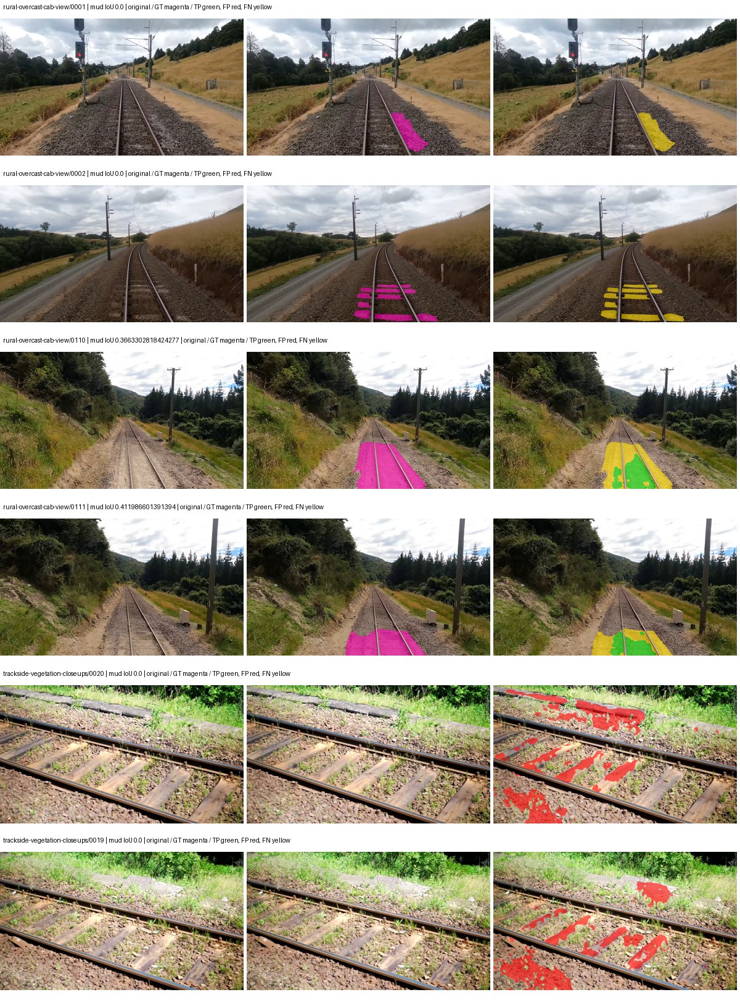
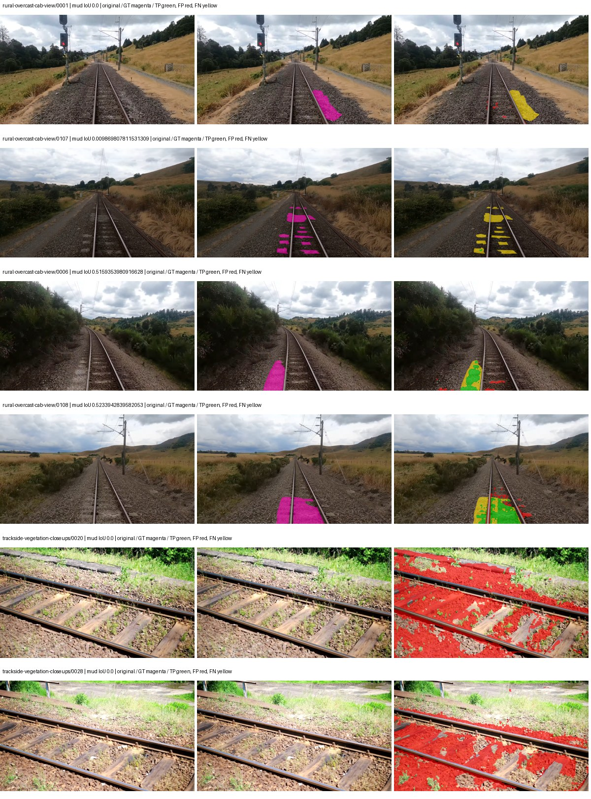
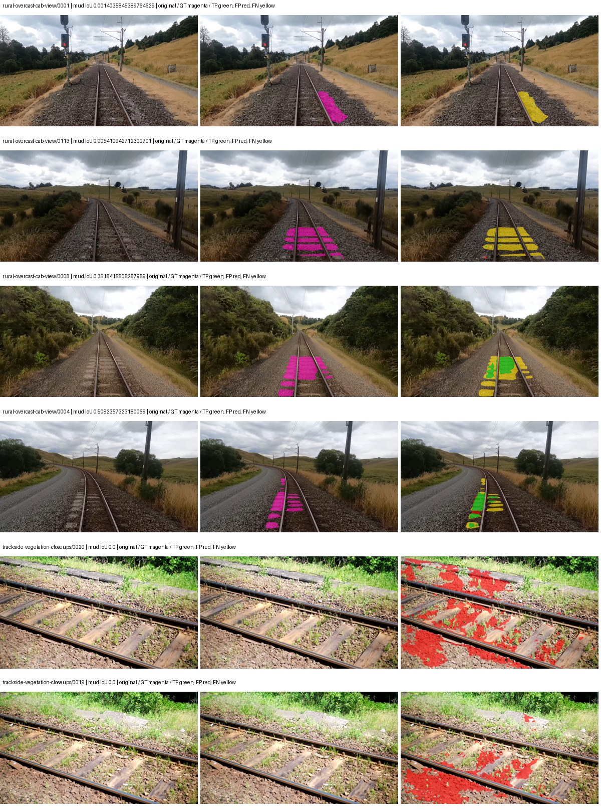
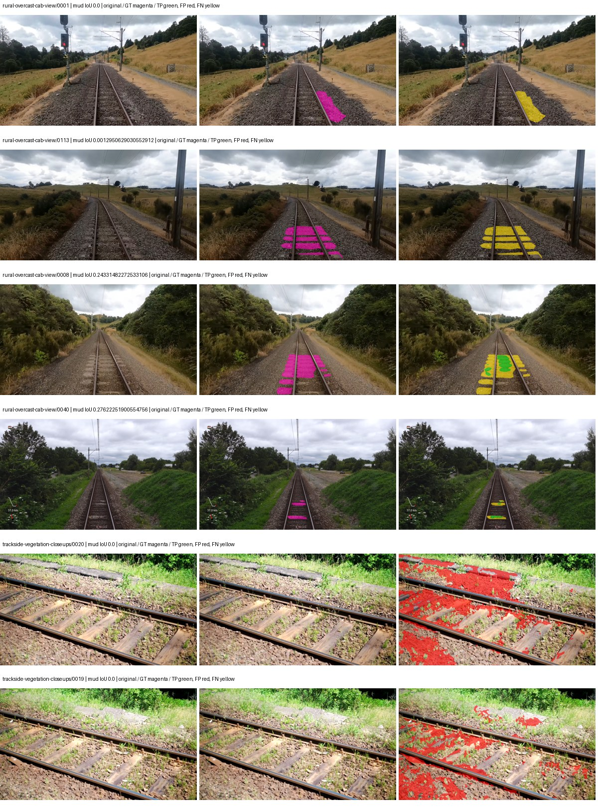

# upernet_convnext — rad_9_24_2026-fixed-grouped

[RAD 9/24: Scene-grouped split](../../README.md) · [Full model records](record.json)

Primary result: the **final checkpoint** after the full step budget (no early stopping). The checkpoint with the best **mud-pumping validation IoU, pixels pooled over all validation images**, is kept as secondary evidence. A job is complete only after full statistics and isolated profiling are verified.

Study metrics of the final checkpoint, counting each class only on the validation images that contain it: mud-pumping IoU is the mean per-image IoU over the images with mud-pumping, precision and recall sum pixels over those images, and mIoU averages each class over the images that contain it, then over the classes present.

| Initialization path | Seed | Mud-pumping IoU, train-camera images with mud (%, n=17) | Mud-pumping IoU, all images with mud (%, n=18) | Mud precision, all images with mud (%) | Mud recall, all images with mud (%) | mIoU (each class over images that contain it) (%) |
| --- | --- | --- | --- | --- | --- | --- |
| rtis_only | 0 | 2.02 | 2.02 | 5.95 | 2.97 | 38.77 |
| cityscapes_to_rtis | 0 | 6.04 | 5.84 | 15.84 | 7.12 | 36.35 |
| railsem19_to_rtis | 0 | 7.91 | 7.58 | 18.97 | 8.36 | 43.46 |
| cityscapes_to_railsem19_to_rtis | 0 | 7.32 | 7.03 | 15.72 | 8.90 | 40.37 |

Per-class IoU: IoU (%) of every class, each averaged only over the validation images that contain the class (n = those images); — = no image contains it. mIoU averages the classes with at least one such image.

| Initialization path | Seed | mIoU (each class over images that contain it) | person (n=0) | truck (n=0) | rail-track (n=37) | vegetation-overgrowth (n=13) | car (n=3) | on-rails (n=0) | traffic-sign (n=9) | road (n=11) | sidewalk (n=12) | construction (n=12) | tram-track (n=2) | pole (n=21) | traffic-light (n=3) | mud-pumping (n=18) | fence (n=7) | terrain (n=35) | sky (n=28) | rail-embedded (n=3) | rail-raised (n=37) | trackbed (n=37) | standing-water (n=9) |
| --- | --- | --- | --- | --- | --- | --- | --- | --- | --- | --- | --- | --- | --- | --- | --- | --- | --- | --- | --- | --- | --- | --- | --- |
| rtis_only | 0 | 38.77 | — | — | 54.68 | 24.09 | 24.19 | — | 34.98 | 8.13 | 10.89 | 55.72 | 4.17 | 70.12 | 49.17 | 2.02 | 25.15 | 83.37 | 96.68 | 13.14 | 76.02 | 60.52 | 4.72 |
| cityscapes_to_rtis | 0 | 36.35 | — | — | 51.83 | 18.62 | 32.22 | — | 26.95 | 10.53 | 9.09 | 47.26 | 1.99 | 70.71 | 42.03 | 5.84 | 22.60 | 81.37 | 96.78 | 7.59 | 69.45 | 58.08 | 1.37 |
| railsem19_to_rtis | 0 | 43.46 | — | — | 56.91 | 23.53 | 34.91 | — | 32.58 | 5.65 | 13.93 | 54.95 | 38.95 | 72.15 | 55.10 | 7.58 | 31.45 | 82.32 | 96.53 | 31.52 | 73.17 | 63.63 | 7.48 |
| cityscapes_to_railsem19_to_rtis | 0 | 40.37 | — | — | 56.17 | 16.32 | 37.11 | — | 41.54 | 6.71 | 14.56 | 55.37 | 16.10 | 71.42 | 51.86 | 7.03 | 20.43 | 82.01 | 96.50 | 15.27 | 72.48 | 62.85 | 2.96 |

Everything below is the campaign's own record, with pixels pooled over all validation images: its evaluation is the checkpoint that scored best on that pooled mud IoU (secondary evidence here); the diagnostics also cover the final checkpoint (`final-auto-val`).

| Model | Initialization path | Seed | Status | Steps | Best step | Best-checkpoint mud IoU, pixels pooled (%) | Best-checkpoint mud precision, pixels pooled (%) | Best-checkpoint mud recall, pixels pooled (%) | Final mud IoU (trainer val, pixels pooled, %) | Best-checkpoint mIoU, pixels pooled (%) | Best-checkpoint fixed GT-class mIoU, pixels pooled (%) |
| --- | --- | --- | --- | --- | --- | --- | --- | --- | --- | --- | --- |
| upernet_convnext | rtis_only | 0 | completed | 4000 | 777 | 8.21 | 19.11 | 12.57 | 0.53 | 41.62 | 43.93 |
| upernet_convnext | cityscapes_to_rtis | 0 | completed | 4000 | 1037 | 5.95 | 6.79 | 32.45 | 2.30 | 31.05 | 36.23 |
| upernet_convnext | railsem19_to_rtis | 0 | completed | 4000 | 2333 | 6.74 | 10.96 | 14.91 | 2.68 | 44.94 | 49.94 |
| upernet_convnext | cityscapes_to_railsem19_to_rtis | 0 | completed | 4000 | 3111 | 2.62 | 3.77 | 7.85 | 2.65 | 38.08 | 44.43 |

Training: 217 images. Validation: 37 images. Test: 60 held out. Seeds: [0]. Seed variation measures optimization variability, not independent-recording uncertainty. Historical source checkpoints stay fixed across adaptation seeds.

Training code: `fce0ea0ac50b334d4252812c396e0e593def375d`. Split SHA-256: `12d7b367c72cda61d57686ff2ac28223530d0af49debd9fb7a0fbc68b908bc93`.

## rtis_only — seed 0

Status: **completed**. Started: 2026-10-11T18:13:46.846536+00:00. Finished: 2026-10-11T19:50:36.040427+00:00.

Recipe pretrained initializer: `openmmlab/upernet-convnext-small`.

`rtis_only` uses the recipe initializer, which may include pretrained segmentation components. Transfer paths load the exact historical source checkpoint below and reset the classifier; they do not reset all query/decoder features.

Source checkpoint: `Recipe pretrained initialization`.

Config SHA-256: `c721d10b557e05a3aed4161d99877e19c624222fe9fadb17e6ca04967e9ab39d`. Weights used for validation: `raw`.

### Mud-pumping and aggregate quality

| Metric | Selected checkpoint | Final training validation |
| --- | --- | --- |
| Mud IoU | 8.21 | 0.53 |
| Mud precision | 19.11 | 0.64 |
| Mud recall | 12.57 | 2.98 |
| Mud Dice/F1 | 15.17 | 1.05 |
| mIoU | 41.62 | 35.08 |
| Mean accuracy | 53.64 | 49.34 |
| Mean precision | 61.50 | 56.79 |
| Mean Dice | 52.35 | 44.60 |
| Mean specificity | 99.03 | 98.84 |
| Pixel accuracy | 84.79 | 81.52 |
| Frequency-weighted IoU | 75.44 | 73.31 |
| Fixed GT-present class mIoU | 43.93 | 40.92 |
| Boundary F1 | 47.52 | 41.69 |

The selected checkpoint has independent evaluation evidence. Final values are the trainer's final validation record, not a new independent evaluation. mIoU averages classes with nonzero union, so false positives on absent classes can change its denominator. The fixed GT-class mean is supplementary and excludes absent classes; their false positives remain in the confusion matrix.

### Resource usage and timing

| Measurement | Value |
| --- | --- |
| Peak training VRAM, retained training invocation (GiB) | 13.46 |
| Peak evaluation VRAM (GiB) | 7.68 |
| Retained training invocation wall time (seconds) | 5562.51 |
| Retained training invocation GPU-hours (one GPU) | 1.55 |
| Evaluation wall time (seconds) | 21.42 |
| Full evaluation pipeline images/second | 1.73 |
| Best full-state checkpoint (MiB) | 1234.99 |
| Final full-state checkpoint (MiB) | 1234.97 |
| Verified periodic checkpoints removed (GiB) | 9.65 |

VRAM uses the recorded allocator high-water mark; it is not total device usage including CUDA context. Resumed jobs' retained training invocation times and peaks are **not whole-campaign totals**. Earlier invocation resource records are not reconstructed here. Evaluation throughput includes loader, sliding-window inference and metrics; it is not model-only latency/FPS. Missing measurements are shown as —, never inferred from another dataset's run.

### Standardized inference performance

Dedicated model-only profiling waits for an idle worker-locked L40S: BF16, batch 1, 1024x1024, 20 warmup and 100 CUDA-event-timed public forwards. It excludes loading, preprocessing, tiling and metrics.

| Status | Parameters | Weight MiB | FPS | p50 ms | p95 ms | Peak reserved GiB |
| --- | --- | --- | --- | --- | --- | --- |
| complete | 80887221 | 308.56 | 41.92 | 23.85 | 23.94 | 2.48 |

```json
{
  "schema_version": 1,
  "model_id": "upernet_convnext",
  "measured_at": "2026-10-11T19:50:23+00:00",
  "status": "complete",
  "benchmark_scope": "rtis_selected_checkpoint_model_only",
  "applies_to": [
    "upernet_convnext--rtis_only--seed-0"
  ],
  "source": {
    "campaign_git_sha": "fce0ea0ac50b334d4252812c396e0e593def375d",
    "git_dirty": false,
    "config_hash": "6227ee259e45",
    "resolved_config": "/data/izadia1/projects/segmentary-runs/rad_9_24_2026/fgall-seed0-20261007/configs/upernet_convnext--rtis_only--seed-0.yaml",
    "config_sha256": "c721d10b557e05a3aed4161d99877e19c624222fe9fadb17e6ca04967e9ab39d",
    "checkpoint_sha256": "5f7fbfd5a88fcea92ce137aecfe898baa33d090b0c61438977d34763f2e63fe8",
    "checkpoint_global_step": 777,
    "checkpoint_bytes": 1294981635,
    "checkpoint_kind": "resume checkpoint with optimizer and EMA state",
    "weights": "raw",
    "measured_checkpoint_job_id": "upernet_convnext--rtis_only--seed-0",
    "result_sha256": "f95b42ecb98c2de3db1dba48e9a88eebfeac530e997ff50f257294a5ab8d8080",
    "result_git_sha": "fce0ea0ac50b334d4252812c396e0e593def375d",
    "result_stage": "eval:rad_9_24_2026-fixed-grouped:val",
    "result_seed": 0
  },
  "hardware": {
    "gpu_name": "NVIDIA L40S",
    "gpu_uuid": "GPU-1c9b612f-e0b5-fbbc-150f-8c2ef13453c9",
    "logical_device": "cuda:0",
    "physical_visibility_token": "5",
    "compute_capability": [
      8,
      9
    ],
    "total_memory_bytes": 47677177856
  },
  "model": {
    "parameter_count": 80887221,
    "trainable_parameter_count": 80887221,
    "resident_parameter_bytes": 323548884,
    "parameter_dtype_counts": {
      "float32": 80887221
    }
  },
  "contract": {
    "backend": "pytorch",
    "precision": "bf16_autocast",
    "batch_size": 1,
    "input_shape_nchw": [
      1,
      3,
      1024,
      1024
    ],
    "warmup_iterations": 20,
    "measured_iterations": 100,
    "timing": "per-forward CUDA events with end-event synchronization",
    "includes_preprocessing": false,
    "includes_data_loader": false,
    "includes_sliding_window": false,
    "input_resident_on_gpu": true,
    "model_only": true,
    "entrypoint": "public model(image) dense-logits forward"
  },
  "measurements": {
    "latency": {
      "p50_ms": 23.852543830871582,
      "p95_ms": 23.93507890701294,
      "mean_ms": 23.856066341400147,
      "minimum_ms": 23.73529624938965,
      "maximum_ms": 24.006656646728516,
      "fps": 41.918059150623094,
      "raw_ms": [
        23.9237117767334,
        23.89094352722168,
        23.818239212036133,
        23.863296508789062,
        23.813119888305664,
        23.833599090576172,
        23.864320755004883,
        23.781375885009766,
        23.78339195251465,
        23.801855087280273,
        23.818239212036133,
        23.880704879760742,
        23.73529624938965,
        23.775232315063477,
        23.808000564575195,
        23.863296508789062,
        23.93497657775879,
        23.839744567871094,
        23.839744567871094,
        23.816192626953125,
        23.810047149658203,
        23.91961669921875,
        23.82953643798828,
        23.769088745117188,
        23.797760009765625,
        23.812095642089844,
        23.86636734008789,
        23.90425682067871,
        23.830528259277344,
        23.85817527770996,
        23.832576751708984,
        23.871488571166992,
        23.89401626586914,
        23.799808502197266,
        23.791616439819336,
        23.793664932250977,
        23.89811134338379,
        23.93395233154297,
        23.810047149658203,
        23.88582420349121,
        23.805952072143555,
        23.89708709716797,
        23.91961669921875,
        23.823360443115234,
        23.814144134521484,
        23.810016632080078,
        23.823360443115234,
        23.948287963867188,
        23.855104446411133,
        23.870464324951172,
        23.819263458251953,
        23.8786563873291,
        23.955455780029297,
        23.862335205078125,
        23.830528259277344,
        23.854080200195312,
        23.826431274414062,
        23.87763214111328,
        23.815168380737305,
        23.797760009765625,
        23.89606475830078,
        23.84998321533203,
        23.928831100463867,
        23.89606475830078,
        23.85100746154785,
        23.816192626953125,
        23.888896942138672,
        23.87763214111328,
        23.86534309387207,
        23.794687271118164,
        23.820287704467773,
        23.808000564575195,
        23.86534309387207,
        23.88275146484375,
        23.817216873168945,
        23.88377571105957,
        23.880704879760742,
        23.90835189819336,
        23.92064094543457,
        23.822336196899414,
        23.85100746154785,
        23.90732765197754,
        23.88377571105957,
        23.906272888183594,
        23.809024810791016,
        23.838720321655273,
        23.820255279541016,
        23.872512817382812,
        23.976959228515625,
        23.864320755004883,
        23.937023162841797,
        23.8786563873291,
        23.90425682067871,
        24.006656646728516,
        23.838720321655273,
        23.846912384033203,
        23.847936630249023,
        23.90732765197754,
        23.92780876159668,
        23.828479766845703
      ],
      "percentile_method": "numpy linear interpolation"
    },
    "peak_reserved_bytes": 2663383040,
    "memory_kind": "pytorch_cuda_allocator_peak_reserved_excluding_context",
    "process_total_bytes": 3200253952,
    "process_total_kind": "nvidia-smi used_memory of this PID on the benchmark GPU after the timed loop, including the CUDA context; null when the driver could not attribute memory to this PID",
    "benchmark_wall_clock_s": 9.738436840474606
  },
  "started_at": "2026-10-11T19:50:13+00:00",
  "finished_at": "2026-10-11T19:50:23+00:00",
  "environment": {
    "hostname": "hdrfs-app-001",
    "python": "3.11.15",
    "platform": "Linux-5.15.0-139-generic-x86_64-with-glibc2.35",
    "torch": "2.11.0+cu128",
    "torch_cuda": "12.8",
    "cudnn": 91900,
    "driver_version": "570.133.20",
    "cuda_available": true,
    "gpu_count": 1,
    "gpu_names": [
      "NVIDIA L40S"
    ],
    "cuda_visible_devices": "5",
    "packages": {
      "segmentary": "0.1.0",
      "torch": "2.11.0+cu128",
      "torchvision": "0.26.0+cu128",
      "transformers": "5.15.0",
      "timm": "1.0.28",
      "segmentation-models-pytorch": "0.5.0",
      "albumentations": "2.0.8",
      "lightning": "2.6.5",
      "numpy": "2.4.4"
    }
  }
}
```

### Per-class validation results

| Class | GT pixels | IoU (%) | Precision (%) | Recall (%) | Dice (%) | Boundary F1 (%) |
| --- | --- | --- | --- | --- | --- | --- |
| car | 29664 | 62.60 | 70.75 | 84.46 | 77.00 | 55.94 |
| construction | 311585 | 36.89 | 40.82 | 79.32 | 53.90 | 45.43 |
| fence | 265137 | 33.20 | 57.39 | 44.07 | 49.85 | 48.78 |
| mud-pumping | 1226250 | 8.21 | 19.11 | 12.57 | 15.17 | 7.96 |
| on-rails | 0 | — | — | — | — | — |
| person | 0 | — | — | — | — | — |
| pole | 628038 | 74.35 | 86.21 | 84.38 | 85.29 | 90.94 |
| rail-embedded | 16799 | 15.06 | 72.68 | 15.97 | 26.18 | 14.86 |
| rail-raised | 2969797 | 79.81 | 89.47 | 88.07 | 88.77 | 94.63 |
| rail-track | 6323197 | 33.87 | 78.31 | 37.38 | 50.60 | 42.20 |
| road | 1048831 | 2.61 | 9.53 | 3.47 | 5.09 | 12.41 |
| sidewalk | 1297367 | 21.56 | 79.02 | 22.87 | 35.47 | 10.42 |
| sky | 19121606 | 97.31 | 99.49 | 97.79 | 98.63 | 93.96 |
| standing-water | 95802 | 1.65 | 2.12 | 6.85 | 3.24 | 10.00 |
| terrain | 39239306 | 87.76 | 89.03 | 98.39 | 93.48 | 69.28 |
| trackbed | 10643081 | 59.83 | 65.38 | 87.57 | 74.86 | 59.88 |
| traffic-light | 19510 | 71.57 | 85.34 | 81.60 | 83.43 | 87.54 |
| traffic-sign | 13285 | 41.57 | 70.26 | 50.44 | 58.72 | 64.23 |
| tram-track | 56179 | 24.87 | 79.10 | 26.62 | 39.84 | 27.26 |
| truck | 0 | 0.00 | 0.00 | — | 0.00 | 0.00 |
| vegetation-overgrowth | 5901821 | 38.02 | 74.42 | 43.74 | 55.10 | 67.14 |

### Full-run accounting

| Measurement | Value |
| --- | --- |
| Full GPU-reserved wall seconds, all recorded worker attempts | 5816.86 |
| Full reserved GPU-hours | 1.62 |
| Whole-run timing complete | True |

| Phase | Wall seconds including failed attempts |
| --- | --- |
| training | 5569.24 |
| diagnostics | 178.94 |
| performance | 18.81 |

GPU-reserved time includes model loading, training, validation, collection, profiling, checkpoint I/O and orchestration while the worker owns one GPU. It is not GPU kernel-active time. Phase timings and sampled device memory/power/utilization are retained separately; sampled device memory is not the allocator high-water mark.

### Train/validation and raw/EMA diagnostics

| Checkpoint / weights / split | Images | Mud IoU (%) | Mud precision (%) | Mud recall (%) |
| --- | --- | --- | --- | --- |
| best-auto-train / raw | 217 | 95.08 | 97.20 | 97.75 |
| best-auto-val / raw | 37 | 8.21 | 19.11 | 12.57 |
| best-alternate-val / ema | 37 | 0.01 | 0.37 | 0.01 |
| final-auto-val / raw | 37 | 0.53 | 0.64 | 2.97 |

Train uses the evaluation transform without augmentation. Compare mud train/validation metrics for the same selected weights. Alternate EMA on running-stat BatchNorm is explicitly uncalibrated and is diagnostic only. Score-threshold curves use uncalibrated normalized scores and are pixel-level diagnostics, not event detection rates or a selected deployment operating point.

### Downloadable evidence

- best-auto-train: [per-image.csv](rtis_only--seed-0/best-auto-train/per-image.csv) · [per-image-confusion.json.gz](rtis_only--seed-0/best-auto-train/per-image-confusion.json.gz) · [groups.json](rtis_only--seed-0/best-auto-train/groups.json) · [mud-score-curves.json](rtis_only--seed-0/best-auto-train/mud-score-curves.json)
- best-auto-val: [per-image.csv](rtis_only--seed-0/best-auto-val/per-image.csv) · [per-image-confusion.json.gz](rtis_only--seed-0/best-auto-val/per-image-confusion.json.gz) · [groups.json](rtis_only--seed-0/best-auto-val/groups.json) · [mud-score-curves.json](rtis_only--seed-0/best-auto-val/mud-score-curves.json) · [examples.jpg](rtis_only--seed-0/best-auto-val/examples.jpg)
- best-alternate-val: [per-image.csv](rtis_only--seed-0/best-alternate-val/per-image.csv) · [per-image-confusion.json.gz](rtis_only--seed-0/best-alternate-val/per-image-confusion.json.gz) · [groups.json](rtis_only--seed-0/best-alternate-val/groups.json) · [mud-score-curves.json](rtis_only--seed-0/best-alternate-val/mud-score-curves.json)
- final-auto-val: [per-image.csv](rtis_only--seed-0/final-auto-val/per-image.csv) · [per-image-confusion.json.gz](rtis_only--seed-0/final-auto-val/per-image-confusion.json.gz) · [groups.json](rtis_only--seed-0/final-auto-val/groups.json) · [mud-score-curves.json](rtis_only--seed-0/final-auto-val/mud-score-curves.json)
- resources: [telemetry.csv](rtis_only--seed-0/resources/telemetry.csv)



Examples are two lowest and two highest mud-IoU positive images, plus up to two negative images with the most false-positive mud pixels. They are targeted diagnostic examples, not random samples. Green: true positive; red: false positive; yellow: false negative. Full predictions remain on HDRFS.

### Validation tracking

| Logged step | Overall mIoU (%) | Mud IoU (%) |
| --- | --- | --- |
| 258 | 30.60 | 0.06 |
| 518 | 34.35 | 4.51 |
| 777 | 41.63 | 8.21 |
| 1036 | 35.10 | 2.30 |
| 1295 | 34.56 | 0.72 |
| 1555 | 34.85 | 2.66 |
| 1814 | 37.01 | 2.15 |
| 2073 | 35.29 | 1.74 |
| 2332 | 35.51 | 0.60 |
| 2592 | 35.28 | 0.40 |
| 2851 | 34.99 | 0.39 |
| 3110 | 34.80 | 0.72 |
| 3369 | 34.40 | 0.79 |
| 3629 | 36.17 | 0.63 |
| 3888 | 35.60 | 0.52 |
| 4000 | 35.08 | 0.53 |

All retained scalar curves, including training loss and per-class IoU, are in record.json. Observed best mud on a curve is not necessarily a retained checkpoint: the pilot saved its selection-metric-best and final checkpoints. Step logging and checkpoint global_step may differ by one.

### Stopping and checkpoint provenance

```json
{
  "stopping": {
    "actual_steps": 4000,
    "maximum_steps": 4000,
    "min_delta": 0.0,
    "monitor": "val_iou/mud-pumping",
    "patience": null,
    "reason": "budget_complete"
  },
  "checkpoints": {
    "best": {
      "path": "/data/izadia1/projects/segmentary-runs/rad_9_24_2026/fgall-seed0-20261007/future-runs/upernet_convnext--rtis_only--seed-0_seed0/rtis/best.ckpt",
      "sha256": "5f7fbfd5a88fcea92ce137aecfe898baa33d090b0c61438977d34763f2e63fe8",
      "global_step": 777,
      "bytes": 1294981635
    },
    "final": {
      "path": "/data/izadia1/projects/segmentary-runs/rad_9_24_2026/fgall-seed0-20261007/future-runs/upernet_convnext--rtis_only--seed-0_seed0/rtis/last.ckpt",
      "sha256": "bcdb32155747d8ed7d5bd8ca2d1ab156adc36b81bdc8a21b14291826e2f035fe",
      "global_step": 4000,
      "bytes": 1294962499
    }
  },
  "cleanup_error": null
}
```

### Resolved training, initialization and evaluation settings

The optimizer block is the base configuration. Stage LR scales are applied at runtime, and stage warmup is capped at min(base warmup, floor(stage budget / 10), stage budget - 1): 400 steps for this 4,000-step pilot. Model-internal native input grids may differ from augmentation crops (EoMT uses its 640 grid).

```json
{
  "name": "upernet_convnext--rtis_only--seed-0",
  "model": {
    "arch": "upernet_convnext",
    "checkpoint": "openmmlab/upernet-convnext-small",
    "tuning": "full",
    "head": "unified_head",
    "lora_r": 16,
    "lora_alpha": 32,
    "lora_dropout": 0.05,
    "lora_targets": [],
    "drop_path": null,
    "revision": null,
    "subfolder": null,
    "local_files_only": false,
    "trust_remote_code": false,
    "backbone_path": null,
    "head_paths": [],
    "classifier_path": null,
    "inactive_parameter_paths": [],
    "smp_arch": null,
    "encoder_name": null,
    "encoder_weights": null,
    "native": null,
    "batch_norm_momentum": null
  },
  "space": "paul-test-rtis",
  "taxonomy_root": "/data/izadia1/projects/segmentary-rad-fgall-fce0ea0a/taxonomy",
  "output_root": "/data/izadia1/projects/segmentary-runs/rad_9_24_2026/fgall-seed0-20261007/future-runs",
  "optim": {
    "backbone_lr": 6e-05,
    "head_lr_mult": 10.0,
    "weight_decay": 0.05,
    "llrd": 1.0,
    "warmup_iters": 1500,
    "warmup_ratio": 1e-06,
    "poly_power": 0.9,
    "min_lr_ratio": 0.0,
    "betas": [
      0.9,
      0.999
    ],
    "grad_clip": 1.0
  },
  "train": {
    "iters": 4000,
    "batch_size": 2,
    "accum": 8,
    "num_workers": 2,
    "precision": "bf16-mixed",
    "ema_decay": 0.9998,
    "val_every": 250,
    "ckpt_every": 500,
    "selection_metric": "val_iou/mud-pumping",
    "early_stopping_patience": null,
    "early_stopping_min_delta": 0.0,
    "seed": 0,
    "devices": 1
  },
  "eval": {
    "sliding_window": true,
    "window": [
      1024,
      1024
    ],
    "stride": [
      768,
      768
    ],
    "batch_size": 1,
    "num_workers": 2,
    "tta_scales": [],
    "tta_flip": false,
    "threshold": 0.5,
    "boundary_tolerance_frac": 0.0075,
    "save_confusion": true
  },
  "loss": {
    "task": "multiclass",
    "activation": "auto",
    "terms": [],
    "aux": "none",
    "aux_weight": 0.0,
    "ce_weight": 1.0,
    "label_smoothing": 0.0,
    "class_weights": null,
    "query": null
  },
  "aug": {
    "crop": [
      1024,
      1024
    ],
    "scale_min": 0.5,
    "scale_max": 2.0,
    "hflip_p": 0.5,
    "color_jitter_p": 0.5,
    "brightness": 0.25,
    "contrast": 0.25,
    "saturation": 0.25,
    "hue": 0.05
  },
  "stages": [
    {
      "name": "rtis",
      "data": [
        {
          "name": "rad_9_24_2026-fixed-grouped",
          "root": "/data/izadia1/datasets/rad_9_24_2026-fixed-grouped",
          "variant": null,
          "split_file": "splits.json",
          "train_split": "train",
          "val_split": "val",
          "limit": null,
          "loader": "folder",
          "mapping": "paul-test-rtis",
          "loader_options": {
            "require_groups": true
          }
        }
      ],
      "iters": null,
      "lr_scale": 1.0,
      "head_group_lr_scale": 1.0,
      "init_from": "pretrained",
      "reset_head": false,
      "freeze": null,
      "sample_weights": null
    }
  ]
}
```

### Hardware and software provenance

```json
{
  "training": {
    "cuda_available": true,
    "cuda_visible_devices": "5",
    "cudnn": 91900,
    "driver_version": "570.133.20",
    "gpu_count": 1,
    "gpu_names": [
      "NVIDIA L40S"
    ],
    "hostname": "hdrfs-app-001",
    "input_normalization": {
      "channel_order": "rgb",
      "mean": [
        0.485,
        0.456,
        0.406
      ],
      "source": "imagenet",
      "std": [
        0.229,
        0.224,
        0.225
      ]
    },
    "model_origins": [
      {
        "hf_commit": "550b68d291f9a7e4874065c6eec0676b2ba821e6",
        "hf_name_or_path": "openmmlab/upernet-convnext-small",
        "module": "model",
        "timm_pretrained": {}
      },
      {
        "hf_commit": null,
        "hf_name_or_path": "",
        "module": "model.backbone",
        "timm_pretrained": {}
      },
      {
        "hf_commit": null,
        "hf_name_or_path": "",
        "module": "model.backbone.encoder",
        "timm_pretrained": {}
      },
      {
        "hf_commit": "550b68d291f9a7e4874065c6eec0676b2ba821e6",
        "hf_name_or_path": "openmmlab/upernet-convnext-small",
        "module": "model.decode_head",
        "timm_pretrained": {}
      }
    ],
    "model_parameter_count": 80887221,
    "packages": {
      "albumentations": "2.0.8",
      "lightning": "2.6.5",
      "numpy": "2.4.4",
      "segmentary": "0.1.0",
      "segmentation-models-pytorch": "0.5.0",
      "timm": "1.0.28",
      "torch": "2.11.0+cu128",
      "torchvision": "0.26.0+cu128",
      "transformers": "5.15.0"
    },
    "platform": "Linux-5.15.0-139-generic-x86_64-with-glibc2.35",
    "python": "3.11.15",
    "torch": "2.11.0+cu128",
    "torch_cuda": "12.8",
    "trainable_parameter_count": 80887221,
    "training_stop": {
      "actual_steps": 4000,
      "maximum_steps": 4000,
      "min_delta": 0.0,
      "monitor": "val_iou/mud-pumping",
      "patience": null,
      "reason": "budget_complete"
    },
    "validation_weights": "raw"
  },
  "evaluation": {
    "cuda_available": true,
    "cuda_visible_devices": "5",
    "cudnn": 91900,
    "driver_version": "570.133.20",
    "gpu_count": 1,
    "gpu_names": [
      "NVIDIA L40S"
    ],
    "hostname": "hdrfs-app-001",
    "input_normalization": {
      "channel_order": "rgb",
      "mean": [
        0.485,
        0.456,
        0.406
      ],
      "source": "imagenet",
      "std": [
        0.229,
        0.224,
        0.225
      ]
    },
    "packages": {
      "albumentations": "2.0.8",
      "lightning": "2.6.5",
      "numpy": "2.4.4",
      "segmentary": "0.1.0",
      "segmentation-models-pytorch": "0.5.0",
      "timm": "1.0.28",
      "torch": "2.11.0+cu128",
      "torchvision": "0.26.0+cu128",
      "transformers": "5.15.0"
    },
    "platform": "Linux-5.15.0-139-generic-x86_64-with-glibc2.35",
    "python": "3.11.15",
    "torch": "2.11.0+cu128",
    "torch_cuda": "12.8"
  }
}
```

## cityscapes_to_rtis — seed 0

Status: **completed**. Started: 2026-10-11T18:15:14.211160+00:00. Finished: 2026-10-11T19:51:51.732192+00:00.

Recipe pretrained initializer: `openmmlab/upernet-convnext-small`.

`rtis_only` uses the recipe initializer, which may include pretrained segmentation components. Transfer paths load the exact historical source checkpoint below and reset the classifier; they do not reset all query/decoder features.

Source checkpoint: `{'name': 'upernet_convnext--cityscapes--seed-0', 'model': 'upernet_convnext', 'protocol': 'cityscapes', 'config': '/data/izadia1/projects/segmentary-runs/all-model-city-rail-seed0-rail20-b9eb3e1/accepted/upernet_convnext--cityscapes--seed-0/resolved-config.yaml', 'checkpoint': '/data/izadia1/projects/segmentary-runs/all-model-city-rail-seed0-a7c0b67/jobs/upernet_convnext--cityscapes--seed-0/attempt-001/train/upernet_convnext--cityscapes_seed0/cityscapes/last.ckpt', 'recorded_sha256': 'fb45ace4437433d1713d6afef5ee260284b053b7301e6be003f89249012dc698', 'exists': True}`.

Config SHA-256: `314b509240afd09d7649fe6f72d248f2b19b5e3a4d759e7103aba0084d4c4592`. Weights used for validation: `raw`.

### Mud-pumping and aggregate quality

| Metric | Selected checkpoint | Final training validation |
| --- | --- | --- |
| Mud IoU | 5.95 | 2.30 |
| Mud precision | 6.79 | 3.28 |
| Mud recall | 32.45 | 7.13 |
| Mud Dice/F1 | 11.23 | 4.49 |
| mIoU | 31.05 | 32.46 |
| Mean accuracy | 44.07 | 46.57 |
| Mean precision | 57.16 | 55.95 |
| Mean Dice | 40.56 | 41.85 |
| Mean specificity | 98.70 | 98.68 |
| Pixel accuracy | 80.18 | 80.78 |
| Frequency-weighted IoU | 70.46 | 69.74 |
| Fixed GT-present class mIoU | 36.23 | 37.87 |
| Boundary F1 | 38.40 | 37.80 |

The selected checkpoint has independent evaluation evidence. Final values are the trainer's final validation record, not a new independent evaluation. mIoU averages classes with nonzero union, so false positives on absent classes can change its denominator. The fixed GT-class mean is supplementary and excludes absent classes; their false positives remain in the confusion matrix.

### Resource usage and timing

| Measurement | Value |
| --- | --- |
| Peak training VRAM, retained training invocation (GiB) | 13.46 |
| Peak evaluation VRAM (GiB) | 7.68 |
| Retained training invocation wall time (seconds) | 5546.58 |
| Retained training invocation GPU-hours (one GPU) | 1.54 |
| Evaluation wall time (seconds) | 21.70 |
| Full evaluation pipeline images/second | 1.71 |
| Best full-state checkpoint (MiB) | 1234.99 |
| Final full-state checkpoint (MiB) | 1234.97 |
| Verified periodic checkpoints removed (GiB) | 9.65 |

VRAM uses the recorded allocator high-water mark; it is not total device usage including CUDA context. Resumed jobs' retained training invocation times and peaks are **not whole-campaign totals**. Earlier invocation resource records are not reconstructed here. Evaluation throughput includes loader, sliding-window inference and metrics; it is not model-only latency/FPS. Missing measurements are shown as —, never inferred from another dataset's run.

### Standardized inference performance

Dedicated model-only profiling waits for an idle worker-locked L40S: BF16, batch 1, 1024x1024, 20 warmup and 100 CUDA-event-timed public forwards. It excludes loading, preprocessing, tiling and metrics.

| Status | Parameters | Weight MiB | FPS | p50 ms | p95 ms | Peak reserved GiB |
| --- | --- | --- | --- | --- | --- | --- |
| complete | 80887221 | 308.56 | 42.34 | 23.61 | 23.68 | 2.48 |

```json
{
  "schema_version": 1,
  "model_id": "upernet_convnext",
  "measured_at": "2026-10-11T19:51:39+00:00",
  "status": "complete",
  "benchmark_scope": "rtis_selected_checkpoint_model_only",
  "applies_to": [
    "upernet_convnext--cityscapes_to_rtis--seed-0"
  ],
  "source": {
    "campaign_git_sha": "fce0ea0ac50b334d4252812c396e0e593def375d",
    "git_dirty": false,
    "config_hash": "ead4bedf87d7",
    "resolved_config": "/data/izadia1/projects/segmentary-runs/rad_9_24_2026/fgall-seed0-20261007/configs/upernet_convnext--cityscapes_to_rtis--seed-0.yaml",
    "config_sha256": "314b509240afd09d7649fe6f72d248f2b19b5e3a4d759e7103aba0084d4c4592",
    "checkpoint_sha256": "f977476f4280f98db3870baf6501f0662eaa81041e91b28e18153381c6ad0d07",
    "checkpoint_global_step": 1037,
    "checkpoint_bytes": 1294981635,
    "checkpoint_kind": "resume checkpoint with optimizer and EMA state",
    "weights": "raw",
    "measured_checkpoint_job_id": "upernet_convnext--cityscapes_to_rtis--seed-0",
    "result_sha256": "1029d5917aa56e32e798e14181de7d2668d602232099a3a9c11df3cc230bcbfd",
    "result_git_sha": "fce0ea0ac50b334d4252812c396e0e593def375d",
    "result_stage": "eval:rad_9_24_2026-fixed-grouped:val",
    "result_seed": 0
  },
  "hardware": {
    "gpu_name": "NVIDIA L40S",
    "gpu_uuid": "GPU-2f8008a1-9b67-11f6-987b-b393a672322c",
    "logical_device": "cuda:0",
    "physical_visibility_token": "3",
    "compute_capability": [
      8,
      9
    ],
    "total_memory_bytes": 47677177856
  },
  "model": {
    "parameter_count": 80887221,
    "trainable_parameter_count": 80887221,
    "resident_parameter_bytes": 323548884,
    "parameter_dtype_counts": {
      "float32": 80887221
    }
  },
  "contract": {
    "backend": "pytorch",
    "precision": "bf16_autocast",
    "batch_size": 1,
    "input_shape_nchw": [
      1,
      3,
      1024,
      1024
    ],
    "warmup_iterations": 20,
    "measured_iterations": 100,
    "timing": "per-forward CUDA events with end-event synchronization",
    "includes_preprocessing": false,
    "includes_data_loader": false,
    "includes_sliding_window": false,
    "input_resident_on_gpu": true,
    "model_only": true,
    "entrypoint": "public model(image) dense-logits forward"
  },
  "measurements": {
    "latency": {
      "p50_ms": 23.6113920211792,
      "p95_ms": 23.682355976104738,
      "mean_ms": 23.619044170379638,
      "minimum_ms": 23.532543182373047,
      "maximum_ms": 23.87455940246582,
      "fps": 42.33871585938639,
      "raw_ms": [
        23.663616180419922,
        23.59209632873535,
        23.563264846801758,
        23.658496856689453,
        23.671775817871094,
        23.558048248291016,
        23.566335678100586,
        23.558143615722656,
        23.572479248046875,
        23.6441593170166,
        23.630847930908203,
        23.532543182373047,
        23.65235137939453,
        23.570432662963867,
        23.625728607177734,
        23.65951919555664,
        23.596031188964844,
        23.561216354370117,
        23.566335678100586,
        23.580768585205078,
        23.613439559936523,
        23.607295989990234,
        23.588863372802734,
        23.648256301879883,
        23.598079681396484,
        23.649280548095703,
        23.65340805053711,
        23.563264846801758,
        23.581600189208984,
        23.607295989990234,
        23.609344482421875,
        23.658496856689453,
        23.606176376342773,
        23.579647064208984,
        23.581695556640625,
        23.583744049072266,
        23.599103927612305,
        23.68819236755371,
        23.592832565307617,
        23.589887619018555,
        23.603200912475586,
        23.622655868530273,
        23.65337562561035,
        23.601024627685547,
        23.549951553344727,
        23.553024291992188,
        23.583744049072266,
        23.64313507080078,
        23.67487907409668,
        23.597055435180664,
        23.616512298583984,
        23.87455940246582,
        23.558143615722656,
        23.664640426635742,
        23.595008850097656,
        23.545856475830078,
        23.635967254638672,
        23.635967254638672,
        23.642112731933594,
        23.641088485717773,
        23.580671310424805,
        23.588863372802734,
        23.587839126586914,
        23.628799438476562,
        23.71993637084961,
        23.633920669555664,
        23.632896423339844,
        23.608320236206055,
        23.610368728637695,
        23.648256301879883,
        23.650304794311523,
        23.588735580444336,
        23.640064239501953,
        23.629823684692383,
        23.682048797607422,
        23.71072006225586,
        23.601152420043945,
        23.610368728637695,
        23.624704360961914,
        23.663488388061523,
        23.639039993286133,
        23.605247497558594,
        23.579647064208984,
        23.612415313720703,
        23.602176666259766,
        23.6810245513916,
        23.649280548095703,
        23.597984313964844,
        23.615488052368164,
        23.580671310424805,
        23.624704360961914,
        23.66156768798828,
        23.618560791015625,
        23.569408416748047,
        23.64201545715332,
        23.630847930908203,
        23.67487907409668,
        23.68819236755371,
        23.599103927612305,
        23.67487907409668
      ],
      "percentile_method": "numpy linear interpolation"
    },
    "peak_reserved_bytes": 2663383040,
    "memory_kind": "pytorch_cuda_allocator_peak_reserved_excluding_context",
    "process_total_bytes": 3200253952,
    "process_total_kind": "nvidia-smi used_memory of this PID on the benchmark GPU after the timed loop, including the CUDA context; null when the driver could not attribute memory to this PID",
    "benchmark_wall_clock_s": 9.736405618488789
  },
  "started_at": "2026-10-11T19:51:29+00:00",
  "finished_at": "2026-10-11T19:51:39+00:00",
  "environment": {
    "hostname": "hdrfs-app-001",
    "python": "3.11.15",
    "platform": "Linux-5.15.0-139-generic-x86_64-with-glibc2.35",
    "torch": "2.11.0+cu128",
    "torch_cuda": "12.8",
    "cudnn": 91900,
    "driver_version": "570.133.20",
    "cuda_available": true,
    "gpu_count": 1,
    "gpu_names": [
      "NVIDIA L40S"
    ],
    "cuda_visible_devices": "3",
    "packages": {
      "segmentary": "0.1.0",
      "torch": "2.11.0+cu128",
      "torchvision": "0.26.0+cu128",
      "transformers": "5.15.0",
      "timm": "1.0.28",
      "segmentation-models-pytorch": "0.5.0",
      "albumentations": "2.0.8",
      "lightning": "2.6.5",
      "numpy": "2.4.4"
    }
  }
}
```

### Per-class validation results

| Class | GT pixels | IoU (%) | Precision (%) | Recall (%) | Dice (%) | Boundary F1 (%) |
| --- | --- | --- | --- | --- | --- | --- |
| car | 29664 | 30.82 | 60.11 | 38.74 | 47.12 | 45.25 |
| construction | 311585 | 40.70 | 44.73 | 81.86 | 57.85 | 42.99 |
| fence | 265137 | 19.37 | 64.58 | 21.67 | 32.45 | 40.61 |
| mud-pumping | 1226250 | 5.95 | 6.79 | 32.45 | 11.23 | 11.98 |
| on-rails | 0 | 0.00 | 0.00 | — | 0.00 | 0.00 |
| person | 0 | 0.00 | 0.00 | — | 0.00 | 0.00 |
| pole | 628038 | 73.87 | 86.19 | 83.78 | 84.97 | 91.19 |
| rail-embedded | 16799 | 10.26 | 99.08 | 10.27 | 18.61 | 16.23 |
| rail-raised | 2969797 | 67.04 | 92.70 | 70.77 | 80.27 | 89.61 |
| rail-track | 6323197 | 33.20 | 72.99 | 37.85 | 49.85 | 51.13 |
| road | 1048831 | 2.55 | 7.85 | 3.64 | 4.97 | 10.76 |
| sidewalk | 1297367 | 24.81 | 96.22 | 25.05 | 39.76 | 12.30 |
| sky | 19121606 | 97.02 | 99.58 | 97.42 | 98.49 | 92.26 |
| standing-water | 95802 | 0.51 | 1.12 | 0.93 | 1.02 | 6.16 |
| terrain | 39239306 | 81.61 | 82.89 | 98.15 | 89.87 | 51.72 |
| trackbed | 10643081 | 58.08 | 79.05 | 68.65 | 73.48 | 54.23 |
| traffic-light | 19510 | 43.91 | 91.98 | 45.66 | 61.03 | 73.06 |
| traffic-sign | 13285 | 33.15 | 54.22 | 46.04 | 49.80 | 54.72 |
| tram-track | 56179 | 13.77 | 77.11 | 14.36 | 24.21 | 13.27 |
| truck | 0 | 0.00 | 0.00 | — | 0.00 | 0.00 |
| vegetation-overgrowth | 5901821 | 15.51 | 83.20 | 16.01 | 26.86 | 48.94 |

### Full-run accounting

| Measurement | Value |
| --- | --- |
| Full GPU-reserved wall seconds, all recorded worker attempts | 5806.07 |
| Full reserved GPU-hours | 1.61 |
| Whole-run timing complete | True |

| Phase | Wall seconds including failed attempts |
| --- | --- |
| training | 5554.45 |
| diagnostics | 181.18 |
| performance | 18.97 |

GPU-reserved time includes model loading, training, validation, collection, profiling, checkpoint I/O and orchestration while the worker owns one GPU. It is not GPU kernel-active time. Phase timings and sampled device memory/power/utilization are retained separately; sampled device memory is not the allocator high-water mark.

### Train/validation and raw/EMA diagnostics

| Checkpoint / weights / split | Images | Mud IoU (%) | Mud precision (%) | Mud recall (%) |
| --- | --- | --- | --- | --- |
| best-auto-train / raw | 217 | 93.96 | 95.17 | 98.67 |
| best-auto-val / raw | 37 | 5.95 | 6.79 | 32.45 |
| best-alternate-val / ema | 37 | 1.45 | 2.36 | 3.64 |
| final-auto-val / raw | 37 | 2.29 | 3.27 | 7.12 |

Train uses the evaluation transform without augmentation. Compare mud train/validation metrics for the same selected weights. Alternate EMA on running-stat BatchNorm is explicitly uncalibrated and is diagnostic only. Score-threshold curves use uncalibrated normalized scores and are pixel-level diagnostics, not event detection rates or a selected deployment operating point.

### Downloadable evidence

- best-auto-train: [per-image.csv](cityscapes_to_rtis--seed-0/best-auto-train/per-image.csv) · [per-image-confusion.json.gz](cityscapes_to_rtis--seed-0/best-auto-train/per-image-confusion.json.gz) · [groups.json](cityscapes_to_rtis--seed-0/best-auto-train/groups.json) · [mud-score-curves.json](cityscapes_to_rtis--seed-0/best-auto-train/mud-score-curves.json)
- best-auto-val: [per-image.csv](cityscapes_to_rtis--seed-0/best-auto-val/per-image.csv) · [per-image-confusion.json.gz](cityscapes_to_rtis--seed-0/best-auto-val/per-image-confusion.json.gz) · [groups.json](cityscapes_to_rtis--seed-0/best-auto-val/groups.json) · [mud-score-curves.json](cityscapes_to_rtis--seed-0/best-auto-val/mud-score-curves.json) · [examples.jpg](cityscapes_to_rtis--seed-0/best-auto-val/examples.jpg)
- best-alternate-val: [per-image.csv](cityscapes_to_rtis--seed-0/best-alternate-val/per-image.csv) · [per-image-confusion.json.gz](cityscapes_to_rtis--seed-0/best-alternate-val/per-image-confusion.json.gz) · [groups.json](cityscapes_to_rtis--seed-0/best-alternate-val/groups.json) · [mud-score-curves.json](cityscapes_to_rtis--seed-0/best-alternate-val/mud-score-curves.json)
- final-auto-val: [per-image.csv](cityscapes_to_rtis--seed-0/final-auto-val/per-image.csv) · [per-image-confusion.json.gz](cityscapes_to_rtis--seed-0/final-auto-val/per-image-confusion.json.gz) · [groups.json](cityscapes_to_rtis--seed-0/final-auto-val/groups.json) · [mud-score-curves.json](cityscapes_to_rtis--seed-0/final-auto-val/mud-score-curves.json)
- resources: [telemetry.csv](cityscapes_to_rtis--seed-0/resources/telemetry.csv)



Examples are two lowest and two highest mud-IoU positive images, plus up to two negative images with the most false-positive mud pixels. They are targeted diagnostic examples, not random samples. Green: true positive; red: false positive; yellow: false negative. Full predictions remain on HDRFS.

### Validation tracking

| Logged step | Overall mIoU (%) | Mud IoU (%) |
| --- | --- | --- |
| 258 | 24.78 | 1.91 |
| 518 | 28.02 | 4.93 |
| 777 | 31.85 | 2.37 |
| 1036 | 31.06 | 5.95 |
| 1295 | 33.34 | 1.89 |
| 1555 | 32.05 | 1.85 |
| 1814 | 34.08 | 1.29 |
| 2073 | 32.74 | 0.94 |
| 2332 | 32.81 | 2.96 |
| 2592 | 34.38 | 1.42 |
| 2851 | 33.65 | 1.40 |
| 3110 | 33.25 | 2.34 |
| 3369 | 33.15 | 0.93 |
| 3629 | 32.40 | 0.98 |
| 3888 | 32.69 | 1.63 |
| 4000 | 32.46 | 2.30 |

All retained scalar curves, including training loss and per-class IoU, are in record.json. Observed best mud on a curve is not necessarily a retained checkpoint: the pilot saved its selection-metric-best and final checkpoints. Step logging and checkpoint global_step may differ by one.

### Stopping and checkpoint provenance

```json
{
  "stopping": {
    "actual_steps": 4000,
    "maximum_steps": 4000,
    "min_delta": 0.0,
    "monitor": "val_iou/mud-pumping",
    "patience": null,
    "reason": "budget_complete"
  },
  "checkpoints": {
    "best": {
      "path": "/data/izadia1/projects/segmentary-runs/rad_9_24_2026/fgall-seed0-20261007/future-runs/upernet_convnext--cityscapes_to_rtis--seed-0_seed0/rtis/best.ckpt",
      "sha256": "f977476f4280f98db3870baf6501f0662eaa81041e91b28e18153381c6ad0d07",
      "global_step": 1037,
      "bytes": 1294981635
    },
    "final": {
      "path": "/data/izadia1/projects/segmentary-runs/rad_9_24_2026/fgall-seed0-20261007/future-runs/upernet_convnext--cityscapes_to_rtis--seed-0_seed0/rtis/last.ckpt",
      "sha256": "382bd28a050c7d522928efb9e545ccffe0851d8f778ceb6555f628e8c1506ae1",
      "global_step": 4000,
      "bytes": 1294962499
    }
  },
  "cleanup_error": null
}
```

### Resolved training, initialization and evaluation settings

The optimizer block is the base configuration. Stage LR scales are applied at runtime, and stage warmup is capped at min(base warmup, floor(stage budget / 10), stage budget - 1): 400 steps for this 4,000-step pilot. Model-internal native input grids may differ from augmentation crops (EoMT uses its 640 grid).

```json
{
  "name": "upernet_convnext--cityscapes_to_rtis--seed-0",
  "model": {
    "arch": "upernet_convnext",
    "checkpoint": "openmmlab/upernet-convnext-small",
    "tuning": "full",
    "head": "unified_head",
    "lora_r": 16,
    "lora_alpha": 32,
    "lora_dropout": 0.05,
    "lora_targets": [],
    "drop_path": null,
    "revision": null,
    "subfolder": null,
    "local_files_only": false,
    "trust_remote_code": false,
    "backbone_path": null,
    "head_paths": [],
    "classifier_path": null,
    "inactive_parameter_paths": [],
    "smp_arch": null,
    "encoder_name": null,
    "encoder_weights": null,
    "native": null,
    "batch_norm_momentum": null
  },
  "space": "paul-test-rtis",
  "taxonomy_root": "/data/izadia1/projects/segmentary-rad-fgall-fce0ea0a/taxonomy",
  "output_root": "/data/izadia1/projects/segmentary-runs/rad_9_24_2026/fgall-seed0-20261007/future-runs",
  "optim": {
    "backbone_lr": 6e-05,
    "head_lr_mult": 10.0,
    "weight_decay": 0.05,
    "llrd": 1.0,
    "warmup_iters": 1500,
    "warmup_ratio": 1e-06,
    "poly_power": 0.9,
    "min_lr_ratio": 0.0,
    "betas": [
      0.9,
      0.999
    ],
    "grad_clip": 1.0
  },
  "train": {
    "iters": 4000,
    "batch_size": 2,
    "accum": 8,
    "num_workers": 2,
    "precision": "bf16-mixed",
    "ema_decay": 0.9998,
    "val_every": 250,
    "ckpt_every": 500,
    "selection_metric": "val_iou/mud-pumping",
    "early_stopping_patience": null,
    "early_stopping_min_delta": 0.0,
    "seed": 0,
    "devices": 1
  },
  "eval": {
    "sliding_window": true,
    "window": [
      1024,
      1024
    ],
    "stride": [
      768,
      768
    ],
    "batch_size": 1,
    "num_workers": 2,
    "tta_scales": [],
    "tta_flip": false,
    "threshold": 0.5,
    "boundary_tolerance_frac": 0.0075,
    "save_confusion": true
  },
  "loss": {
    "task": "multiclass",
    "activation": "auto",
    "terms": [],
    "aux": "none",
    "aux_weight": 0.0,
    "ce_weight": 1.0,
    "label_smoothing": 0.0,
    "class_weights": null,
    "query": null
  },
  "aug": {
    "crop": [
      1024,
      1024
    ],
    "scale_min": 0.5,
    "scale_max": 2.0,
    "hflip_p": 0.5,
    "color_jitter_p": 0.5,
    "brightness": 0.25,
    "contrast": 0.25,
    "saturation": 0.25,
    "hue": 0.05
  },
  "stages": [
    {
      "name": "rtis",
      "data": [
        {
          "name": "rad_9_24_2026-fixed-grouped",
          "root": "/data/izadia1/datasets/rad_9_24_2026-fixed-grouped",
          "variant": null,
          "split_file": "splits.json",
          "train_split": "train",
          "val_split": "val",
          "limit": null,
          "loader": "folder",
          "mapping": "paul-test-rtis",
          "loader_options": {
            "require_groups": true
          }
        }
      ],
      "iters": null,
      "lr_scale": 0.1,
      "head_group_lr_scale": 1.0,
      "init_from": "/data/izadia1/projects/segmentary-runs/all-model-city-rail-seed0-a7c0b67/jobs/upernet_convnext--cityscapes--seed-0/attempt-001/train/upernet_convnext--cityscapes_seed0/cityscapes/last.ckpt",
      "reset_head": true,
      "freeze": null,
      "sample_weights": null
    }
  ]
}
```

### Hardware and software provenance

```json
{
  "training": {
    "cuda_available": true,
    "cuda_visible_devices": "3",
    "cudnn": 91900,
    "driver_version": "570.133.20",
    "gpu_count": 1,
    "gpu_names": [
      "NVIDIA L40S"
    ],
    "hostname": "hdrfs-app-001",
    "input_normalization": {
      "channel_order": "rgb",
      "mean": [
        0.485,
        0.456,
        0.406
      ],
      "source": "imagenet",
      "std": [
        0.229,
        0.224,
        0.225
      ]
    },
    "model_origins": [
      {
        "hf_commit": "550b68d291f9a7e4874065c6eec0676b2ba821e6",
        "hf_name_or_path": "openmmlab/upernet-convnext-small",
        "module": "model",
        "timm_pretrained": {}
      },
      {
        "hf_commit": null,
        "hf_name_or_path": "",
        "module": "model.backbone",
        "timm_pretrained": {}
      },
      {
        "hf_commit": null,
        "hf_name_or_path": "",
        "module": "model.backbone.encoder",
        "timm_pretrained": {}
      },
      {
        "hf_commit": "550b68d291f9a7e4874065c6eec0676b2ba821e6",
        "hf_name_or_path": "openmmlab/upernet-convnext-small",
        "module": "model.decode_head",
        "timm_pretrained": {}
      }
    ],
    "model_parameter_count": 80887221,
    "packages": {
      "albumentations": "2.0.8",
      "lightning": "2.6.5",
      "numpy": "2.4.4",
      "segmentary": "0.1.0",
      "segmentation-models-pytorch": "0.5.0",
      "timm": "1.0.28",
      "torch": "2.11.0+cu128",
      "torchvision": "0.26.0+cu128",
      "transformers": "5.15.0"
    },
    "platform": "Linux-5.15.0-139-generic-x86_64-with-glibc2.35",
    "python": "3.11.15",
    "torch": "2.11.0+cu128",
    "torch_cuda": "12.8",
    "trainable_parameter_count": 80887221,
    "training_stop": {
      "actual_steps": 4000,
      "maximum_steps": 4000,
      "min_delta": 0.0,
      "monitor": "val_iou/mud-pumping",
      "patience": null,
      "reason": "budget_complete"
    },
    "validation_weights": "raw"
  },
  "evaluation": {
    "cuda_available": true,
    "cuda_visible_devices": "3",
    "cudnn": 91900,
    "driver_version": "570.133.20",
    "gpu_count": 1,
    "gpu_names": [
      "NVIDIA L40S"
    ],
    "hostname": "hdrfs-app-001",
    "input_normalization": {
      "channel_order": "rgb",
      "mean": [
        0.485,
        0.456,
        0.406
      ],
      "source": "imagenet",
      "std": [
        0.229,
        0.224,
        0.225
      ]
    },
    "packages": {
      "albumentations": "2.0.8",
      "lightning": "2.6.5",
      "numpy": "2.4.4",
      "segmentary": "0.1.0",
      "segmentation-models-pytorch": "0.5.0",
      "timm": "1.0.28",
      "torch": "2.11.0+cu128",
      "torchvision": "0.26.0+cu128",
      "transformers": "5.15.0"
    },
    "platform": "Linux-5.15.0-139-generic-x86_64-with-glibc2.35",
    "python": "3.11.15",
    "torch": "2.11.0+cu128",
    "torch_cuda": "12.8"
  }
}
```

## railsem19_to_rtis — seed 0

Status: **completed**. Started: 2026-10-11T18:15:16.213061+00:00. Finished: 2026-10-11T19:53:09.369847+00:00.

Recipe pretrained initializer: `openmmlab/upernet-convnext-small`.

`rtis_only` uses the recipe initializer, which may include pretrained segmentation components. Transfer paths load the exact historical source checkpoint below and reset the classifier; they do not reset all query/decoder features.

Source checkpoint: `{'name': 'upernet_convnext--railsem19--seed-0', 'model': 'upernet_convnext', 'protocol': 'railsem19', 'config': '/data/izadia1/projects/segmentary-runs/all-model-city-rail-seed0-rail20-b9eb3e1/accepted/upernet_convnext--railsem19--seed-0/resolved-config.yaml', 'checkpoint': '/data/izadia1/projects/segmentary-runs/all-model-city-rail-seed0-a7c0b67/jobs/upernet_convnext--railsem19--seed-0/attempt-001/train/upernet_convnext--railsem19_seed0/railsem19/last.ckpt', 'recorded_sha256': '6e246e8e61f02c4359f944d776168359392cec5c1c750d4ba29c6637f80b9f3a', 'exists': True}`.

Config SHA-256: `f30cdc9f67ebcda987e066fb841dfe0a5153e6239fcabd96feddafa7eeae6fa4`. Weights used for validation: `raw`.

### Mud-pumping and aggregate quality

| Metric | Selected checkpoint | Final training validation |
| --- | --- | --- |
| Mud IoU | 6.74 | 2.68 |
| Mud precision | 10.96 | 3.79 |
| Mud recall | 14.91 | 8.36 |
| Mud Dice/F1 | 12.63 | 5.22 |
| mIoU | 44.94 | 45.17 |
| Mean accuracy | 59.39 | 60.17 |
| Mean precision | 61.92 | 60.69 |
| Mean Dice | 55.22 | 55.13 |
| Mean specificity | 98.79 | 98.86 |
| Pixel accuracy | 82.63 | 82.87 |
| Frequency-weighted IoU | 71.77 | 72.96 |
| Fixed GT-present class mIoU | 49.94 | 50.18 |
| Boundary F1 | 52.94 | 51.74 |

The selected checkpoint has independent evaluation evidence. Final values are the trainer's final validation record, not a new independent evaluation. mIoU averages classes with nonzero union, so false positives on absent classes can change its denominator. The fixed GT-class mean is supplementary and excludes absent classes; their false positives remain in the confusion matrix.

### Resource usage and timing

| Measurement | Value |
| --- | --- |
| Peak training VRAM, retained training invocation (GiB) | 13.46 |
| Peak evaluation VRAM (GiB) | 7.68 |
| Retained training invocation wall time (seconds) | 5624.59 |
| Retained training invocation GPU-hours (one GPU) | 1.56 |
| Evaluation wall time (seconds) | 21.59 |
| Full evaluation pipeline images/second | 1.71 |
| Best full-state checkpoint (MiB) | 1234.99 |
| Final full-state checkpoint (MiB) | 1234.97 |
| Verified periodic checkpoints removed (GiB) | 9.65 |

VRAM uses the recorded allocator high-water mark; it is not total device usage including CUDA context. Resumed jobs' retained training invocation times and peaks are **not whole-campaign totals**. Earlier invocation resource records are not reconstructed here. Evaluation throughput includes loader, sliding-window inference and metrics; it is not model-only latency/FPS. Missing measurements are shown as —, never inferred from another dataset's run.

### Standardized inference performance

Dedicated model-only profiling waits for an idle worker-locked L40S: BF16, batch 1, 1024x1024, 20 warmup and 100 CUDA-event-timed public forwards. It excludes loading, preprocessing, tiling and metrics.

| Status | Parameters | Weight MiB | FPS | p50 ms | p95 ms | Peak reserved GiB |
| --- | --- | --- | --- | --- | --- | --- |
| complete | 80887221 | 308.56 | 41.69 | 23.90 | 24.30 | 2.48 |

```json
{
  "schema_version": 1,
  "model_id": "upernet_convnext",
  "measured_at": "2026-10-11T19:52:57+00:00",
  "status": "complete",
  "benchmark_scope": "rtis_selected_checkpoint_model_only",
  "applies_to": [
    "upernet_convnext--railsem19_to_rtis--seed-0"
  ],
  "source": {
    "campaign_git_sha": "fce0ea0ac50b334d4252812c396e0e593def375d",
    "git_dirty": false,
    "config_hash": "8265818db30f",
    "resolved_config": "/data/izadia1/projects/segmentary-runs/rad_9_24_2026/fgall-seed0-20261007/configs/upernet_convnext--railsem19_to_rtis--seed-0.yaml",
    "config_sha256": "f30cdc9f67ebcda987e066fb841dfe0a5153e6239fcabd96feddafa7eeae6fa4",
    "checkpoint_sha256": "79dadfbf0347062c5b62c8403e97dba782f88311263376a041c2fbb354fe19d3",
    "checkpoint_global_step": 2333,
    "checkpoint_bytes": 1294981635,
    "checkpoint_kind": "resume checkpoint with optimizer and EMA state",
    "weights": "raw",
    "measured_checkpoint_job_id": "upernet_convnext--railsem19_to_rtis--seed-0",
    "result_sha256": "b96fd30d4c04a760c4cb6427aded1c9c55b7fdbb4ac791226cdc5063cd80f001",
    "result_git_sha": "fce0ea0ac50b334d4252812c396e0e593def375d",
    "result_stage": "eval:rad_9_24_2026-fixed-grouped:val",
    "result_seed": 0
  },
  "hardware": {
    "gpu_name": "NVIDIA L40S",
    "gpu_uuid": "GPU-804aea8b-5f62-423e-72c6-49e1ed15c4e4",
    "logical_device": "cuda:0",
    "physical_visibility_token": "6",
    "compute_capability": [
      8,
      9
    ],
    "total_memory_bytes": 47677177856
  },
  "model": {
    "parameter_count": 80887221,
    "trainable_parameter_count": 80887221,
    "resident_parameter_bytes": 323548884,
    "parameter_dtype_counts": {
      "float32": 80887221
    }
  },
  "contract": {
    "backend": "pytorch",
    "precision": "bf16_autocast",
    "batch_size": 1,
    "input_shape_nchw": [
      1,
      3,
      1024,
      1024
    ],
    "warmup_iterations": 20,
    "measured_iterations": 100,
    "timing": "per-forward CUDA events with end-event synchronization",
    "includes_preprocessing": false,
    "includes_data_loader": false,
    "includes_sliding_window": false,
    "input_resident_on_gpu": true,
    "model_only": true,
    "entrypoint": "public model(image) dense-logits forward"
  },
  "measurements": {
    "latency": {
      "p50_ms": 23.898608207702637,
      "p95_ms": 24.303973960876466,
      "mean_ms": 23.983728294372558,
      "minimum_ms": 23.742464065551758,
      "maximum_ms": 24.51251220703125,
      "fps": 41.69493532140438,
      "raw_ms": [
        24.373247146606445,
        23.773183822631836,
        23.795711517333984,
        24.183807373046875,
        23.958528518676758,
        23.799808502197266,
        23.749631881713867,
        23.757823944091797,
        24.161279678344727,
        23.795711517333984,
        23.947263717651367,
        23.789567947387695,
        23.742464065551758,
        23.954431533813477,
        24.142847061157227,
        23.823328018188477,
        24.146944046020508,
        23.830528259277344,
        23.801855087280273,
        24.226816177368164,
        23.842815399169922,
        24.043519973754883,
        24.204288482666016,
        24.238079071044922,
        24.2554874420166,
        24.27187156677246,
        24.259584426879883,
        23.89299201965332,
        23.797760009765625,
        23.786495208740234,
        23.871488571166992,
        23.84998321533203,
        23.870464324951172,
        23.775232315063477,
        23.880704879760742,
        24.08448028564453,
        23.780351638793945,
        23.820287704467773,
        24.036352157592773,
        23.93600082397461,
        23.837696075439453,
        23.801855087280273,
        24.09369659423828,
        24.050687789916992,
        24.08550453186035,
        24.13465690612793,
        23.89299201965332,
        23.840768814086914,
        24.208383560180664,
        24.275968551635742,
        24.28211212158203,
        24.14080047607422,
        24.172544479370117,
        24.210432052612305,
        24.311840057373047,
        24.13257598876953,
        23.784448623657227,
        23.775232315063477,
        24.071168899536133,
        23.808000564575195,
        23.836671829223633,
        23.90630340576172,
        23.988224029541016,
        23.91449546813965,
        24.168447494506836,
        23.815168380737305,
        23.803903579711914,
        23.8602237701416,
        23.789567947387695,
        23.88479995727539,
        23.904224395751953,
        23.831552505493164,
        24.33228874206543,
        24.09779167175293,
        24.2872314453125,
        24.09676742553711,
        24.2554874420166,
        24.222719192504883,
        24.211456298828125,
        24.11008071899414,
        23.780351638793945,
        23.760927200317383,
        23.782400131225586,
        23.95136070251465,
        23.844863891601562,
        23.787519454956055,
        23.788543701171875,
        23.862272262573242,
        23.86944007873535,
        23.821311950683594,
        23.806976318359375,
        23.767040252685547,
        23.840768814086914,
        23.854080200195312,
        23.87558364868164,
        24.51251220703125,
        24.10086441040039,
        24.26982307434082,
        24.31078338623047,
        24.30361557006836
      ],
      "percentile_method": "numpy linear interpolation"
    },
    "peak_reserved_bytes": 2663383040,
    "memory_kind": "pytorch_cuda_allocator_peak_reserved_excluding_context",
    "process_total_bytes": 3200253952,
    "process_total_kind": "nvidia-smi used_memory of this PID on the benchmark GPU after the timed loop, including the CUDA context; null when the driver could not attribute memory to this PID",
    "benchmark_wall_clock_s": 9.834640972316265
  },
  "started_at": "2026-10-11T19:52:47+00:00",
  "finished_at": "2026-10-11T19:52:57+00:00",
  "environment": {
    "hostname": "hdrfs-app-001",
    "python": "3.11.15",
    "platform": "Linux-5.15.0-139-generic-x86_64-with-glibc2.35",
    "torch": "2.11.0+cu128",
    "torch_cuda": "12.8",
    "cudnn": 91900,
    "driver_version": "570.133.20",
    "cuda_available": true,
    "gpu_count": 1,
    "gpu_names": [
      "NVIDIA L40S"
    ],
    "cuda_visible_devices": "6",
    "packages": {
      "segmentary": "0.1.0",
      "torch": "2.11.0+cu128",
      "torchvision": "0.26.0+cu128",
      "transformers": "5.15.0",
      "timm": "1.0.28",
      "segmentation-models-pytorch": "0.5.0",
      "albumentations": "2.0.8",
      "lightning": "2.6.5",
      "numpy": "2.4.4"
    }
  }
}
```

### Per-class validation results

| Class | GT pixels | IoU (%) | Precision (%) | Recall (%) | Dice (%) | Boundary F1 (%) |
| --- | --- | --- | --- | --- | --- | --- |
| car | 29664 | 69.54 | 73.98 | 92.06 | 82.03 | 59.10 |
| construction | 311585 | 53.98 | 60.88 | 82.65 | 70.12 | 52.84 |
| fence | 265137 | 30.24 | 68.60 | 35.09 | 46.43 | 57.21 |
| mud-pumping | 1226250 | 6.74 | 10.96 | 14.91 | 12.63 | 11.17 |
| on-rails | 0 | 0.00 | 0.00 | — | 0.00 | 0.00 |
| person | 0 | — | — | — | — | — |
| pole | 628038 | 76.22 | 89.76 | 83.48 | 86.50 | 93.48 |
| rail-embedded | 16799 | 52.92 | 79.74 | 61.14 | 69.21 | 89.96 |
| rail-raised | 2969797 | 79.46 | 89.66 | 87.48 | 88.56 | 94.07 |
| rail-track | 6323197 | 37.20 | 76.01 | 42.14 | 54.22 | 50.61 |
| road | 1048831 | 2.84 | 7.45 | 4.38 | 5.52 | 9.40 |
| sidewalk | 1297367 | 37.23 | 81.08 | 40.78 | 54.26 | 16.66 |
| sky | 19121606 | 98.62 | 99.37 | 99.24 | 99.31 | 96.83 |
| standing-water | 95802 | 10.09 | 19.00 | 17.71 | 18.33 | 34.69 |
| terrain | 39239306 | 81.56 | 82.38 | 98.79 | 89.84 | 48.17 |
| trackbed | 10643081 | 58.13 | 71.17 | 76.03 | 73.52 | 55.51 |
| traffic-light | 19510 | 84.86 | 93.88 | 89.83 | 91.81 | 94.92 |
| traffic-sign | 13285 | 44.84 | 65.20 | 58.95 | 61.92 | 71.43 |
| tram-track | 56179 | 59.99 | 81.31 | 69.58 | 74.99 | 71.98 |
| truck | 0 | 0.00 | 0.00 | — | 0.00 | 0.00 |
| vegetation-overgrowth | 5901821 | 14.41 | 87.97 | 14.70 | 25.19 | 50.75 |

### Full-run accounting

| Measurement | Value |
| --- | --- |
| Full GPU-reserved wall seconds, all recorded worker attempts | 5881.74 |
| Full reserved GPU-hours | 1.63 |
| Whole-run timing complete | True |

| Phase | Wall seconds including failed attempts |
| --- | --- |
| training | 5632.33 |
| diagnostics | 179.30 |
| performance | 19.31 |

GPU-reserved time includes model loading, training, validation, collection, profiling, checkpoint I/O and orchestration while the worker owns one GPU. It is not GPU kernel-active time. Phase timings and sampled device memory/power/utilization are retained separately; sampled device memory is not the allocator high-water mark.

### Train/validation and raw/EMA diagnostics

| Checkpoint / weights / split | Images | Mud IoU (%) | Mud precision (%) | Mud recall (%) |
| --- | --- | --- | --- | --- |
| best-auto-train / raw | 217 | 96.90 | 97.55 | 99.31 |
| best-auto-val / raw | 37 | 6.74 | 10.96 | 14.91 |
| best-alternate-val / ema | 37 | 3.65 | 5.21 | 10.84 |
| final-auto-val / raw | 37 | 2.68 | 3.79 | 8.36 |

Train uses the evaluation transform without augmentation. Compare mud train/validation metrics for the same selected weights. Alternate EMA on running-stat BatchNorm is explicitly uncalibrated and is diagnostic only. Score-threshold curves use uncalibrated normalized scores and are pixel-level diagnostics, not event detection rates or a selected deployment operating point.

### Downloadable evidence

- best-auto-train: [per-image.csv](railsem19_to_rtis--seed-0/best-auto-train/per-image.csv) · [per-image-confusion.json.gz](railsem19_to_rtis--seed-0/best-auto-train/per-image-confusion.json.gz) · [groups.json](railsem19_to_rtis--seed-0/best-auto-train/groups.json) · [mud-score-curves.json](railsem19_to_rtis--seed-0/best-auto-train/mud-score-curves.json)
- best-auto-val: [per-image.csv](railsem19_to_rtis--seed-0/best-auto-val/per-image.csv) · [per-image-confusion.json.gz](railsem19_to_rtis--seed-0/best-auto-val/per-image-confusion.json.gz) · [groups.json](railsem19_to_rtis--seed-0/best-auto-val/groups.json) · [mud-score-curves.json](railsem19_to_rtis--seed-0/best-auto-val/mud-score-curves.json) · [examples.jpg](railsem19_to_rtis--seed-0/best-auto-val/examples.jpg)
- best-alternate-val: [per-image.csv](railsem19_to_rtis--seed-0/best-alternate-val/per-image.csv) · [per-image-confusion.json.gz](railsem19_to_rtis--seed-0/best-alternate-val/per-image-confusion.json.gz) · [groups.json](railsem19_to_rtis--seed-0/best-alternate-val/groups.json) · [mud-score-curves.json](railsem19_to_rtis--seed-0/best-alternate-val/mud-score-curves.json)
- final-auto-val: [per-image.csv](railsem19_to_rtis--seed-0/final-auto-val/per-image.csv) · [per-image-confusion.json.gz](railsem19_to_rtis--seed-0/final-auto-val/per-image-confusion.json.gz) · [groups.json](railsem19_to_rtis--seed-0/final-auto-val/groups.json) · [mud-score-curves.json](railsem19_to_rtis--seed-0/final-auto-val/mud-score-curves.json)
- resources: [telemetry.csv](railsem19_to_rtis--seed-0/resources/telemetry.csv)



Examples are two lowest and two highest mud-IoU positive images, plus up to two negative images with the most false-positive mud pixels. They are targeted diagnostic examples, not random samples. Green: true positive; red: false positive; yellow: false negative. Full predictions remain on HDRFS.

### Validation tracking

| Logged step | Overall mIoU (%) | Mud IoU (%) |
| --- | --- | --- |
| 258 | 32.92 | 0.11 |
| 518 | 43.74 | 1.29 |
| 777 | 45.06 | 1.91 |
| 1036 | 44.50 | 4.80 |
| 1295 | 41.45 | 3.50 |
| 1555 | 44.82 | 1.30 |
| 1814 | 44.72 | 2.58 |
| 2073 | 44.49 | 2.39 |
| 2332 | 44.95 | 6.75 |
| 2592 | 42.24 | 3.61 |
| 2851 | 42.04 | 3.89 |
| 3110 | 41.88 | 3.57 |
| 3369 | 43.70 | 2.54 |
| 3629 | 42.65 | 2.26 |
| 3888 | 42.69 | 1.89 |
| 4000 | 45.17 | 2.68 |

All retained scalar curves, including training loss and per-class IoU, are in record.json. Observed best mud on a curve is not necessarily a retained checkpoint: the pilot saved its selection-metric-best and final checkpoints. Step logging and checkpoint global_step may differ by one.

### Stopping and checkpoint provenance

```json
{
  "stopping": {
    "actual_steps": 4000,
    "maximum_steps": 4000,
    "min_delta": 0.0,
    "monitor": "val_iou/mud-pumping",
    "patience": null,
    "reason": "budget_complete"
  },
  "checkpoints": {
    "best": {
      "path": "/data/izadia1/projects/segmentary-runs/rad_9_24_2026/fgall-seed0-20261007/future-runs/upernet_convnext--railsem19_to_rtis--seed-0_seed0/rtis/best.ckpt",
      "sha256": "79dadfbf0347062c5b62c8403e97dba782f88311263376a041c2fbb354fe19d3",
      "global_step": 2333,
      "bytes": 1294981635
    },
    "final": {
      "path": "/data/izadia1/projects/segmentary-runs/rad_9_24_2026/fgall-seed0-20261007/future-runs/upernet_convnext--railsem19_to_rtis--seed-0_seed0/rtis/last.ckpt",
      "sha256": "a3e00884957d7bcd54d21dc66054b9de3ac5b05a1b0e0c89cc47ba8a7d81f203",
      "global_step": 4000,
      "bytes": 1294962499
    }
  },
  "cleanup_error": null
}
```

### Resolved training, initialization and evaluation settings

The optimizer block is the base configuration. Stage LR scales are applied at runtime, and stage warmup is capped at min(base warmup, floor(stage budget / 10), stage budget - 1): 400 steps for this 4,000-step pilot. Model-internal native input grids may differ from augmentation crops (EoMT uses its 640 grid).

```json
{
  "name": "upernet_convnext--railsem19_to_rtis--seed-0",
  "model": {
    "arch": "upernet_convnext",
    "checkpoint": "openmmlab/upernet-convnext-small",
    "tuning": "full",
    "head": "unified_head",
    "lora_r": 16,
    "lora_alpha": 32,
    "lora_dropout": 0.05,
    "lora_targets": [],
    "drop_path": null,
    "revision": null,
    "subfolder": null,
    "local_files_only": false,
    "trust_remote_code": false,
    "backbone_path": null,
    "head_paths": [],
    "classifier_path": null,
    "inactive_parameter_paths": [],
    "smp_arch": null,
    "encoder_name": null,
    "encoder_weights": null,
    "native": null,
    "batch_norm_momentum": null
  },
  "space": "paul-test-rtis",
  "taxonomy_root": "/data/izadia1/projects/segmentary-rad-fgall-fce0ea0a/taxonomy",
  "output_root": "/data/izadia1/projects/segmentary-runs/rad_9_24_2026/fgall-seed0-20261007/future-runs",
  "optim": {
    "backbone_lr": 6e-05,
    "head_lr_mult": 10.0,
    "weight_decay": 0.05,
    "llrd": 1.0,
    "warmup_iters": 1500,
    "warmup_ratio": 1e-06,
    "poly_power": 0.9,
    "min_lr_ratio": 0.0,
    "betas": [
      0.9,
      0.999
    ],
    "grad_clip": 1.0
  },
  "train": {
    "iters": 4000,
    "batch_size": 2,
    "accum": 8,
    "num_workers": 2,
    "precision": "bf16-mixed",
    "ema_decay": 0.9998,
    "val_every": 250,
    "ckpt_every": 500,
    "selection_metric": "val_iou/mud-pumping",
    "early_stopping_patience": null,
    "early_stopping_min_delta": 0.0,
    "seed": 0,
    "devices": 1
  },
  "eval": {
    "sliding_window": true,
    "window": [
      1024,
      1024
    ],
    "stride": [
      768,
      768
    ],
    "batch_size": 1,
    "num_workers": 2,
    "tta_scales": [],
    "tta_flip": false,
    "threshold": 0.5,
    "boundary_tolerance_frac": 0.0075,
    "save_confusion": true
  },
  "loss": {
    "task": "multiclass",
    "activation": "auto",
    "terms": [],
    "aux": "none",
    "aux_weight": 0.0,
    "ce_weight": 1.0,
    "label_smoothing": 0.0,
    "class_weights": null,
    "query": null
  },
  "aug": {
    "crop": [
      1024,
      1024
    ],
    "scale_min": 0.5,
    "scale_max": 2.0,
    "hflip_p": 0.5,
    "color_jitter_p": 0.5,
    "brightness": 0.25,
    "contrast": 0.25,
    "saturation": 0.25,
    "hue": 0.05
  },
  "stages": [
    {
      "name": "rtis",
      "data": [
        {
          "name": "rad_9_24_2026-fixed-grouped",
          "root": "/data/izadia1/datasets/rad_9_24_2026-fixed-grouped",
          "variant": null,
          "split_file": "splits.json",
          "train_split": "train",
          "val_split": "val",
          "limit": null,
          "loader": "folder",
          "mapping": "paul-test-rtis",
          "loader_options": {
            "require_groups": true
          }
        }
      ],
      "iters": null,
      "lr_scale": 0.1,
      "head_group_lr_scale": 1.0,
      "init_from": "/data/izadia1/projects/segmentary-runs/all-model-city-rail-seed0-a7c0b67/jobs/upernet_convnext--railsem19--seed-0/attempt-001/train/upernet_convnext--railsem19_seed0/railsem19/last.ckpt",
      "reset_head": true,
      "freeze": null,
      "sample_weights": null
    }
  ]
}
```

### Hardware and software provenance

```json
{
  "training": {
    "cuda_available": true,
    "cuda_visible_devices": "6",
    "cudnn": 91900,
    "driver_version": "570.133.20",
    "gpu_count": 1,
    "gpu_names": [
      "NVIDIA L40S"
    ],
    "hostname": "hdrfs-app-001",
    "input_normalization": {
      "channel_order": "rgb",
      "mean": [
        0.485,
        0.456,
        0.406
      ],
      "source": "imagenet",
      "std": [
        0.229,
        0.224,
        0.225
      ]
    },
    "model_origins": [
      {
        "hf_commit": "550b68d291f9a7e4874065c6eec0676b2ba821e6",
        "hf_name_or_path": "openmmlab/upernet-convnext-small",
        "module": "model",
        "timm_pretrained": {}
      },
      {
        "hf_commit": null,
        "hf_name_or_path": "",
        "module": "model.backbone",
        "timm_pretrained": {}
      },
      {
        "hf_commit": null,
        "hf_name_or_path": "",
        "module": "model.backbone.encoder",
        "timm_pretrained": {}
      },
      {
        "hf_commit": "550b68d291f9a7e4874065c6eec0676b2ba821e6",
        "hf_name_or_path": "openmmlab/upernet-convnext-small",
        "module": "model.decode_head",
        "timm_pretrained": {}
      }
    ],
    "model_parameter_count": 80887221,
    "packages": {
      "albumentations": "2.0.8",
      "lightning": "2.6.5",
      "numpy": "2.4.4",
      "segmentary": "0.1.0",
      "segmentation-models-pytorch": "0.5.0",
      "timm": "1.0.28",
      "torch": "2.11.0+cu128",
      "torchvision": "0.26.0+cu128",
      "transformers": "5.15.0"
    },
    "platform": "Linux-5.15.0-139-generic-x86_64-with-glibc2.35",
    "python": "3.11.15",
    "torch": "2.11.0+cu128",
    "torch_cuda": "12.8",
    "trainable_parameter_count": 80887221,
    "training_stop": {
      "actual_steps": 4000,
      "maximum_steps": 4000,
      "min_delta": 0.0,
      "monitor": "val_iou/mud-pumping",
      "patience": null,
      "reason": "budget_complete"
    },
    "validation_weights": "raw"
  },
  "evaluation": {
    "cuda_available": true,
    "cuda_visible_devices": "6",
    "cudnn": 91900,
    "driver_version": "570.133.20",
    "gpu_count": 1,
    "gpu_names": [
      "NVIDIA L40S"
    ],
    "hostname": "hdrfs-app-001",
    "input_normalization": {
      "channel_order": "rgb",
      "mean": [
        0.485,
        0.456,
        0.406
      ],
      "source": "imagenet",
      "std": [
        0.229,
        0.224,
        0.225
      ]
    },
    "packages": {
      "albumentations": "2.0.8",
      "lightning": "2.6.5",
      "numpy": "2.4.4",
      "segmentary": "0.1.0",
      "segmentation-models-pytorch": "0.5.0",
      "timm": "1.0.28",
      "torch": "2.11.0+cu128",
      "torchvision": "0.26.0+cu128",
      "transformers": "5.15.0"
    },
    "platform": "Linux-5.15.0-139-generic-x86_64-with-glibc2.35",
    "python": "3.11.15",
    "torch": "2.11.0+cu128",
    "torch_cuda": "12.8"
  }
}
```

## cityscapes_to_railsem19_to_rtis — seed 0

Status: **completed**. Started: 2026-10-11T18:16:16.687678+00:00. Finished: 2026-10-11T19:53:52.894380+00:00.

Recipe pretrained initializer: `openmmlab/upernet-convnext-small`.

`rtis_only` uses the recipe initializer, which may include pretrained segmentation components. Transfer paths load the exact historical source checkpoint below and reset the classifier; they do not reset all query/decoder features.

Source checkpoint: `{'name': 'upernet_convnext--cityscapes_to_railsem19--seed-0', 'model': 'upernet_convnext', 'protocol': 'cityscapes_to_railsem19', 'config': '/data/izadia1/projects/segmentary-runs/all-model-city-rail-seed0-rail20-b9eb3e1/jobs/upernet_convnext--cityscapes_to_railsem19--seed-0/attempt-001/resolved-config.yaml', 'checkpoint': '/data/izadia1/projects/segmentary-runs/all-model-city-rail-seed0-rail20-b9eb3e1/jobs/upernet_convnext--cityscapes_to_railsem19--seed-0/attempt-001/train/upernet_convnext--cityscapes_to_railsem19_seed0/railsem19/last.ckpt', 'recorded_sha256': '34bf26bec67bfd5835de6d65f89d12653539ddf276166dc985cfdf5103bb27eb', 'exists': True}`.

Config SHA-256: `7900267041084d669cc0ffbbdcba961614959c1d5cce6ca6183163a02221ef28`. Weights used for validation: `raw`.

### Mud-pumping and aggregate quality

| Metric | Selected checkpoint | Final training validation |
| --- | --- | --- |
| Mud IoU | 2.62 | 2.65 |
| Mud precision | 3.77 | 3.64 |
| Mud recall | 7.85 | 8.90 |
| Mud Dice/F1 | 5.10 | 5.17 |
| mIoU | 38.08 | 37.67 |
| Mean accuracy | 52.99 | 52.71 |
| Mean precision | 58.02 | 58.02 |
| Mean Dice | 47.56 | 47.17 |
| Mean specificity | 98.70 | 98.75 |
| Pixel accuracy | 81.51 | 81.74 |
| Frequency-weighted IoU | 70.59 | 71.35 |
| Fixed GT-present class mIoU | 44.43 | 43.95 |
| Boundary F1 | 43.33 | 42.63 |

The selected checkpoint has independent evaluation evidence. Final values are the trainer's final validation record, not a new independent evaluation. mIoU averages classes with nonzero union, so false positives on absent classes can change its denominator. The fixed GT-class mean is supplementary and excludes absent classes; their false positives remain in the confusion matrix.

### Resource usage and timing

| Measurement | Value |
| --- | --- |
| Peak training VRAM, retained training invocation (GiB) | 13.46 |
| Peak evaluation VRAM (GiB) | 7.68 |
| Retained training invocation wall time (seconds) | 5606.89 |
| Retained training invocation GPU-hours (one GPU) | 1.56 |
| Evaluation wall time (seconds) | 21.55 |
| Full evaluation pipeline images/second | 1.72 |
| Best full-state checkpoint (MiB) | 1234.99 |
| Final full-state checkpoint (MiB) | 1234.97 |
| Verified periodic checkpoints removed (GiB) | 9.65 |

VRAM uses the recorded allocator high-water mark; it is not total device usage including CUDA context. Resumed jobs' retained training invocation times and peaks are **not whole-campaign totals**. Earlier invocation resource records are not reconstructed here. Evaluation throughput includes loader, sliding-window inference and metrics; it is not model-only latency/FPS. Missing measurements are shown as —, never inferred from another dataset's run.

### Standardized inference performance

Dedicated model-only profiling waits for an idle worker-locked L40S: BF16, batch 1, 1024x1024, 20 warmup and 100 CUDA-event-timed public forwards. It excludes loading, preprocessing, tiling and metrics.

| Status | Parameters | Weight MiB | FPS | p50 ms | p95 ms | Peak reserved GiB |
| --- | --- | --- | --- | --- | --- | --- |
| complete | 80887221 | 308.56 | 38.80 | 23.82 | 23.96 | 2.48 |

```json
{
  "schema_version": 1,
  "model_id": "upernet_convnext",
  "measured_at": "2026-10-11T19:53:40+00:00",
  "status": "complete",
  "benchmark_scope": "rtis_selected_checkpoint_model_only",
  "applies_to": [
    "upernet_convnext--cityscapes_to_railsem19_to_rtis--seed-0"
  ],
  "source": {
    "campaign_git_sha": "fce0ea0ac50b334d4252812c396e0e593def375d",
    "git_dirty": false,
    "config_hash": "a5fb70d459bc",
    "resolved_config": "/data/izadia1/projects/segmentary-runs/rad_9_24_2026/fgall-seed0-20261007/configs/upernet_convnext--cityscapes_to_railsem19_to_rtis--seed-0.yaml",
    "config_sha256": "7900267041084d669cc0ffbbdcba961614959c1d5cce6ca6183163a02221ef28",
    "checkpoint_sha256": "8590180988abaa53d45753e301bdf3c585198d55ec1a33e82acafb071f8bed0a",
    "checkpoint_global_step": 3111,
    "checkpoint_bytes": 1294981699,
    "checkpoint_kind": "resume checkpoint with optimizer and EMA state",
    "weights": "raw",
    "measured_checkpoint_job_id": "upernet_convnext--cityscapes_to_railsem19_to_rtis--seed-0",
    "result_sha256": "bc3d28b006a0cf9ef43f965d200a867f2309eb4f52f6c6dc771aa6884a887cc3",
    "result_git_sha": "fce0ea0ac50b334d4252812c396e0e593def375d",
    "result_stage": "eval:rad_9_24_2026-fixed-grouped:val",
    "result_seed": 0
  },
  "hardware": {
    "gpu_name": "NVIDIA L40S",
    "gpu_uuid": "GPU-fc5dde96-210d-0afa-ac74-7f88477d622b",
    "logical_device": "cuda:0",
    "physical_visibility_token": "4",
    "compute_capability": [
      8,
      9
    ],
    "total_memory_bytes": 47677177856
  },
  "model": {
    "parameter_count": 80887221,
    "trainable_parameter_count": 80887221,
    "resident_parameter_bytes": 323548884,
    "parameter_dtype_counts": {
      "float32": 80887221
    }
  },
  "contract": {
    "backend": "pytorch",
    "precision": "bf16_autocast",
    "batch_size": 1,
    "input_shape_nchw": [
      1,
      3,
      1024,
      1024
    ],
    "warmup_iterations": 20,
    "measured_iterations": 100,
    "timing": "per-forward CUDA events with end-event synchronization",
    "includes_preprocessing": false,
    "includes_data_loader": false,
    "includes_sliding_window": false,
    "input_resident_on_gpu": true,
    "model_only": true,
    "entrypoint": "public model(image) dense-logits forward"
  },
  "measurements": {
    "latency": {
      "p50_ms": 23.820287704467773,
      "p95_ms": 23.95770902633667,
      "mean_ms": 25.770316200256346,
      "minimum_ms": 23.642112731933594,
      "maximum_ms": 217.1197509765625,
      "fps": 38.804335663916014,
      "raw_ms": [
        23.843839645385742,
        23.775232315063477,
        23.78233528137207,
        23.834623336791992,
        23.788543701171875,
        23.751680374145508,
        23.766016006469727,
        23.797760009765625,
        23.825408935546875,
        23.810047149658203,
        23.787519454956055,
        23.778303146362305,
        23.78544044494629,
        23.871488571166992,
        23.855104446411133,
        23.72096061706543,
        23.798784255981445,
        23.822303771972656,
        23.819263458251953,
        23.899168014526367,
        23.771135330200195,
        23.784448623657227,
        23.786495208740234,
        217.1197509765625,
        23.642112731933594,
        23.646207809448242,
        23.803903579711914,
        23.67180824279785,
        23.734272003173828,
        23.761920928955078,
        23.862272262573242,
        23.940095901489258,
        23.79769515991211,
        23.73632049560547,
        23.732223510742188,
        23.8417911529541,
        23.8919677734375,
        23.800735473632812,
        23.781375885009766,
        23.827455520629883,
        23.823360443115234,
        23.930816650390625,
        23.90220832824707,
        23.740415573120117,
        23.759807586669922,
        23.782400131225586,
        23.905248641967773,
        23.86841583251953,
        23.782400131225586,
        23.762943267822266,
        23.775232315063477,
        23.913471221923828,
        23.94099235534668,
        23.819263458251953,
        23.90732765197754,
        24.078336715698242,
        23.89708709716797,
        23.89606475830078,
        23.793664932250977,
        23.809024810791016,
        23.79475212097168,
        23.924640655517578,
        23.91449546813965,
        23.791616439819336,
        23.861248016357422,
        23.798784255981445,
        23.879680633544922,
        23.945215225219727,
        23.779327392578125,
        23.834623336791992,
        23.792640686035156,
        23.845888137817383,
        23.938047409057617,
        23.852031707763672,
        23.773183822631836,
        23.774208068847656,
        23.86944007873535,
        23.957504272460938,
        23.821311950683594,
        23.805952072143555,
        23.784448623657227,
        23.826431274414062,
        23.89913558959961,
        23.854080200195312,
        23.822336196899414,
        23.788543701171875,
        24.49612808227539,
        23.981056213378906,
        23.813152313232422,
        23.809024810791016,
        23.90630340576172,
        23.87763214111328,
        23.961599349975586,
        23.90732765197754,
        23.788543701171875,
        23.930879592895508,
        23.857120513916016,
        23.955455780029297,
        23.87558364868164,
        23.805952072143555
      ],
      "percentile_method": "numpy linear interpolation"
    },
    "peak_reserved_bytes": 2663383040,
    "memory_kind": "pytorch_cuda_allocator_peak_reserved_excluding_context",
    "process_total_bytes": 3200253952,
    "process_total_kind": "nvidia-smi used_memory of this PID on the benchmark GPU after the timed loop, including the CUDA context; null when the driver could not attribute memory to this PID",
    "benchmark_wall_clock_s": 9.961139090359211
  },
  "started_at": "2026-10-11T19:53:30+00:00",
  "finished_at": "2026-10-11T19:53:40+00:00",
  "environment": {
    "hostname": "hdrfs-app-001",
    "python": "3.11.15",
    "platform": "Linux-5.15.0-139-generic-x86_64-with-glibc2.35",
    "torch": "2.11.0+cu128",
    "torch_cuda": "12.8",
    "cudnn": 91900,
    "driver_version": "570.133.20",
    "cuda_available": true,
    "gpu_count": 1,
    "gpu_names": [
      "NVIDIA L40S"
    ],
    "cuda_visible_devices": "4",
    "packages": {
      "segmentary": "0.1.0",
      "torch": "2.11.0+cu128",
      "torchvision": "0.26.0+cu128",
      "transformers": "5.15.0",
      "timm": "1.0.28",
      "segmentation-models-pytorch": "0.5.0",
      "albumentations": "2.0.8",
      "lightning": "2.6.5",
      "numpy": "2.4.4"
    }
  }
}
```

### Per-class validation results

| Class | GT pixels | IoU (%) | Precision (%) | Recall (%) | Dice (%) | Boundary F1 (%) |
| --- | --- | --- | --- | --- | --- | --- |
| car | 29664 | 69.00 | 77.82 | 85.89 | 81.66 | 61.24 |
| construction | 311585 | 40.88 | 44.42 | 83.68 | 58.03 | 38.54 |
| fence | 265137 | 15.04 | 55.82 | 17.07 | 26.14 | 46.46 |
| mud-pumping | 1226250 | 2.62 | 3.77 | 7.85 | 5.10 | 4.73 |
| on-rails | 0 | 0.00 | 0.00 | — | 0.00 | 0.00 |
| person | 0 | 0.00 | 0.00 | — | 0.00 | 0.00 |
| pole | 628038 | 75.92 | 90.20 | 82.74 | 86.31 | 93.18 |
| rail-embedded | 16799 | 26.73 | 93.22 | 27.26 | 42.19 | 44.37 |
| rail-raised | 2969797 | 75.82 | 88.67 | 83.95 | 86.24 | 91.71 |
| rail-track | 6323197 | 37.25 | 66.24 | 45.98 | 54.28 | 46.32 |
| road | 1048831 | 6.94 | 23.77 | 8.93 | 12.98 | 18.64 |
| sidewalk | 1297367 | 42.69 | 88.19 | 45.28 | 59.84 | 14.88 |
| sky | 19121606 | 98.52 | 99.39 | 99.12 | 99.26 | 96.58 |
| standing-water | 95802 | 1.97 | 3.19 | 4.87 | 3.86 | 10.74 |
| terrain | 39239306 | 78.99 | 80.15 | 98.20 | 88.26 | 52.86 |
| trackbed | 10643081 | 63.43 | 83.35 | 72.63 | 77.62 | 61.01 |
| traffic-light | 19510 | 67.69 | 88.85 | 73.98 | 80.74 | 76.92 |
| traffic-sign | 13285 | 47.81 | 66.20 | 63.25 | 64.69 | 72.02 |
| tram-track | 56179 | 41.65 | 80.89 | 46.19 | 58.80 | 45.30 |
| truck | 0 | 0.00 | 0.00 | — | 0.00 | 0.00 |
| vegetation-overgrowth | 5901821 | 6.83 | 84.31 | 6.92 | 12.79 | 34.37 |

### Full-run accounting

| Measurement | Value |
| --- | --- |
| Full GPU-reserved wall seconds, all recorded worker attempts | 5864.87 |
| Full reserved GPU-hours | 1.63 |
| Whole-run timing complete | True |

| Phase | Wall seconds including failed attempts |
| --- | --- |
| training | 5615.05 |
| diagnostics | 180.19 |
| performance | 18.83 |

GPU-reserved time includes model loading, training, validation, collection, profiling, checkpoint I/O and orchestration while the worker owns one GPU. It is not GPU kernel-active time. Phase timings and sampled device memory/power/utilization are retained separately; sampled device memory is not the allocator high-water mark.

### Train/validation and raw/EMA diagnostics

| Checkpoint / weights / split | Images | Mud IoU (%) | Mud precision (%) | Mud recall (%) |
| --- | --- | --- | --- | --- |
| best-auto-train / raw | 217 | 97.50 | 98.44 | 99.02 |
| best-auto-val / raw | 37 | 2.62 | 3.77 | 7.85 |
| best-alternate-val / ema | 37 | 0.77 | 1.03 | 2.91 |
| final-auto-val / raw | 37 | 2.65 | 3.64 | 8.90 |

Train uses the evaluation transform without augmentation. Compare mud train/validation metrics for the same selected weights. Alternate EMA on running-stat BatchNorm is explicitly uncalibrated and is diagnostic only. Score-threshold curves use uncalibrated normalized scores and are pixel-level diagnostics, not event detection rates or a selected deployment operating point.

### Downloadable evidence

- best-auto-train: [per-image.csv](cityscapes_to_railsem19_to_rtis--seed-0/best-auto-train/per-image.csv) · [per-image-confusion.json.gz](cityscapes_to_railsem19_to_rtis--seed-0/best-auto-train/per-image-confusion.json.gz) · [groups.json](cityscapes_to_railsem19_to_rtis--seed-0/best-auto-train/groups.json) · [mud-score-curves.json](cityscapes_to_railsem19_to_rtis--seed-0/best-auto-train/mud-score-curves.json)
- best-auto-val: [per-image.csv](cityscapes_to_railsem19_to_rtis--seed-0/best-auto-val/per-image.csv) · [per-image-confusion.json.gz](cityscapes_to_railsem19_to_rtis--seed-0/best-auto-val/per-image-confusion.json.gz) · [groups.json](cityscapes_to_railsem19_to_rtis--seed-0/best-auto-val/groups.json) · [mud-score-curves.json](cityscapes_to_railsem19_to_rtis--seed-0/best-auto-val/mud-score-curves.json) · [examples.jpg](cityscapes_to_railsem19_to_rtis--seed-0/best-auto-val/examples.jpg)
- best-alternate-val: [per-image.csv](cityscapes_to_railsem19_to_rtis--seed-0/best-alternate-val/per-image.csv) · [per-image-confusion.json.gz](cityscapes_to_railsem19_to_rtis--seed-0/best-alternate-val/per-image-confusion.json.gz) · [groups.json](cityscapes_to_railsem19_to_rtis--seed-0/best-alternate-val/groups.json) · [mud-score-curves.json](cityscapes_to_railsem19_to_rtis--seed-0/best-alternate-val/mud-score-curves.json)
- final-auto-val: [per-image.csv](cityscapes_to_railsem19_to_rtis--seed-0/final-auto-val/per-image.csv) · [per-image-confusion.json.gz](cityscapes_to_railsem19_to_rtis--seed-0/final-auto-val/per-image-confusion.json.gz) · [groups.json](cityscapes_to_railsem19_to_rtis--seed-0/final-auto-val/groups.json) · [mud-score-curves.json](cityscapes_to_railsem19_to_rtis--seed-0/final-auto-val/mud-score-curves.json)
- resources: [telemetry.csv](cityscapes_to_railsem19_to_rtis--seed-0/resources/telemetry.csv)



Examples are two lowest and two highest mud-IoU positive images, plus up to two negative images with the most false-positive mud pixels. They are targeted diagnostic examples, not random samples. Green: true positive; red: false positive; yellow: false negative. Full predictions remain on HDRFS.

### Validation tracking

| Logged step | Overall mIoU (%) | Mud IoU (%) |
| --- | --- | --- |
| 258 | 29.49 | 0.28 |
| 518 | 39.87 | 1.20 |
| 777 | 40.98 | 0.83 |
| 1036 | 38.92 | 2.20 |
| 1295 | 38.84 | 1.83 |
| 1555 | 37.90 | 0.41 |
| 1814 | 37.93 | 0.40 |
| 2073 | 38.16 | 1.05 |
| 2332 | 39.57 | 1.55 |
| 2592 | 38.34 | 2.18 |
| 2851 | 38.77 | 2.58 |
| 3110 | 38.09 | 2.62 |
| 3369 | 38.52 | 2.24 |
| 3629 | 38.21 | 2.05 |
| 3888 | 38.37 | 2.26 |
| 4000 | 37.67 | 2.65 |

All retained scalar curves, including training loss and per-class IoU, are in record.json. Observed best mud on a curve is not necessarily a retained checkpoint: the pilot saved its selection-metric-best and final checkpoints. Step logging and checkpoint global_step may differ by one.

### Stopping and checkpoint provenance

```json
{
  "stopping": {
    "actual_steps": 4000,
    "maximum_steps": 4000,
    "min_delta": 0.0,
    "monitor": "val_iou/mud-pumping",
    "patience": null,
    "reason": "budget_complete"
  },
  "checkpoints": {
    "best": {
      "path": "/data/izadia1/projects/segmentary-runs/rad_9_24_2026/fgall-seed0-20261007/future-runs/upernet_convnext--cityscapes_to_railsem19_to_rtis--seed-0_seed0/rtis/best.ckpt",
      "sha256": "8590180988abaa53d45753e301bdf3c585198d55ec1a33e82acafb071f8bed0a",
      "global_step": 3111,
      "bytes": 1294981699
    },
    "final": {
      "path": "/data/izadia1/projects/segmentary-runs/rad_9_24_2026/fgall-seed0-20261007/future-runs/upernet_convnext--cityscapes_to_railsem19_to_rtis--seed-0_seed0/rtis/last.ckpt",
      "sha256": "2d14c33fba1cf415f3606589de4ded25433fe2ec89f7f0a6dfa71d1681f877ff",
      "global_step": 4000,
      "bytes": 1294962563
    }
  },
  "cleanup_error": null
}
```

### Resolved training, initialization and evaluation settings

The optimizer block is the base configuration. Stage LR scales are applied at runtime, and stage warmup is capped at min(base warmup, floor(stage budget / 10), stage budget - 1): 400 steps for this 4,000-step pilot. Model-internal native input grids may differ from augmentation crops (EoMT uses its 640 grid).

```json
{
  "name": "upernet_convnext--cityscapes_to_railsem19_to_rtis--seed-0",
  "model": {
    "arch": "upernet_convnext",
    "checkpoint": "openmmlab/upernet-convnext-small",
    "tuning": "full",
    "head": "unified_head",
    "lora_r": 16,
    "lora_alpha": 32,
    "lora_dropout": 0.05,
    "lora_targets": [],
    "drop_path": null,
    "revision": null,
    "subfolder": null,
    "local_files_only": false,
    "trust_remote_code": false,
    "backbone_path": null,
    "head_paths": [],
    "classifier_path": null,
    "inactive_parameter_paths": [],
    "smp_arch": null,
    "encoder_name": null,
    "encoder_weights": null,
    "native": null,
    "batch_norm_momentum": null
  },
  "space": "paul-test-rtis",
  "taxonomy_root": "/data/izadia1/projects/segmentary-rad-fgall-fce0ea0a/taxonomy",
  "output_root": "/data/izadia1/projects/segmentary-runs/rad_9_24_2026/fgall-seed0-20261007/future-runs",
  "optim": {
    "backbone_lr": 6e-05,
    "head_lr_mult": 10.0,
    "weight_decay": 0.05,
    "llrd": 1.0,
    "warmup_iters": 1500,
    "warmup_ratio": 1e-06,
    "poly_power": 0.9,
    "min_lr_ratio": 0.0,
    "betas": [
      0.9,
      0.999
    ],
    "grad_clip": 1.0
  },
  "train": {
    "iters": 4000,
    "batch_size": 2,
    "accum": 8,
    "num_workers": 2,
    "precision": "bf16-mixed",
    "ema_decay": 0.9998,
    "val_every": 250,
    "ckpt_every": 500,
    "selection_metric": "val_iou/mud-pumping",
    "early_stopping_patience": null,
    "early_stopping_min_delta": 0.0,
    "seed": 0,
    "devices": 1
  },
  "eval": {
    "sliding_window": true,
    "window": [
      1024,
      1024
    ],
    "stride": [
      768,
      768
    ],
    "batch_size": 1,
    "num_workers": 2,
    "tta_scales": [],
    "tta_flip": false,
    "threshold": 0.5,
    "boundary_tolerance_frac": 0.0075,
    "save_confusion": true
  },
  "loss": {
    "task": "multiclass",
    "activation": "auto",
    "terms": [],
    "aux": "none",
    "aux_weight": 0.0,
    "ce_weight": 1.0,
    "label_smoothing": 0.0,
    "class_weights": null,
    "query": null
  },
  "aug": {
    "crop": [
      1024,
      1024
    ],
    "scale_min": 0.5,
    "scale_max": 2.0,
    "hflip_p": 0.5,
    "color_jitter_p": 0.5,
    "brightness": 0.25,
    "contrast": 0.25,
    "saturation": 0.25,
    "hue": 0.05
  },
  "stages": [
    {
      "name": "rtis",
      "data": [
        {
          "name": "rad_9_24_2026-fixed-grouped",
          "root": "/data/izadia1/datasets/rad_9_24_2026-fixed-grouped",
          "variant": null,
          "split_file": "splits.json",
          "train_split": "train",
          "val_split": "val",
          "limit": null,
          "loader": "folder",
          "mapping": "paul-test-rtis",
          "loader_options": {
            "require_groups": true
          }
        }
      ],
      "iters": null,
      "lr_scale": 0.1,
      "head_group_lr_scale": 1.0,
      "init_from": "/data/izadia1/projects/segmentary-runs/all-model-city-rail-seed0-rail20-b9eb3e1/jobs/upernet_convnext--cityscapes_to_railsem19--seed-0/attempt-001/train/upernet_convnext--cityscapes_to_railsem19_seed0/railsem19/last.ckpt",
      "reset_head": true,
      "freeze": null,
      "sample_weights": null
    }
  ]
}
```

### Hardware and software provenance

```json
{
  "training": {
    "cuda_available": true,
    "cuda_visible_devices": "4",
    "cudnn": 91900,
    "driver_version": "570.133.20",
    "gpu_count": 1,
    "gpu_names": [
      "NVIDIA L40S"
    ],
    "hostname": "hdrfs-app-001",
    "input_normalization": {
      "channel_order": "rgb",
      "mean": [
        0.485,
        0.456,
        0.406
      ],
      "source": "imagenet",
      "std": [
        0.229,
        0.224,
        0.225
      ]
    },
    "model_origins": [
      {
        "hf_commit": "550b68d291f9a7e4874065c6eec0676b2ba821e6",
        "hf_name_or_path": "openmmlab/upernet-convnext-small",
        "module": "model",
        "timm_pretrained": {}
      },
      {
        "hf_commit": null,
        "hf_name_or_path": "",
        "module": "model.backbone",
        "timm_pretrained": {}
      },
      {
        "hf_commit": null,
        "hf_name_or_path": "",
        "module": "model.backbone.encoder",
        "timm_pretrained": {}
      },
      {
        "hf_commit": "550b68d291f9a7e4874065c6eec0676b2ba821e6",
        "hf_name_or_path": "openmmlab/upernet-convnext-small",
        "module": "model.decode_head",
        "timm_pretrained": {}
      }
    ],
    "model_parameter_count": 80887221,
    "packages": {
      "albumentations": "2.0.8",
      "lightning": "2.6.5",
      "numpy": "2.4.4",
      "segmentary": "0.1.0",
      "segmentation-models-pytorch": "0.5.0",
      "timm": "1.0.28",
      "torch": "2.11.0+cu128",
      "torchvision": "0.26.0+cu128",
      "transformers": "5.15.0"
    },
    "platform": "Linux-5.15.0-139-generic-x86_64-with-glibc2.35",
    "python": "3.11.15",
    "torch": "2.11.0+cu128",
    "torch_cuda": "12.8",
    "trainable_parameter_count": 80887221,
    "training_stop": {
      "actual_steps": 4000,
      "maximum_steps": 4000,
      "min_delta": 0.0,
      "monitor": "val_iou/mud-pumping",
      "patience": null,
      "reason": "budget_complete"
    },
    "validation_weights": "raw"
  },
  "evaluation": {
    "cuda_available": true,
    "cuda_visible_devices": "4",
    "cudnn": 91900,
    "driver_version": "570.133.20",
    "gpu_count": 1,
    "gpu_names": [
      "NVIDIA L40S"
    ],
    "hostname": "hdrfs-app-001",
    "input_normalization": {
      "channel_order": "rgb",
      "mean": [
        0.485,
        0.456,
        0.406
      ],
      "source": "imagenet",
      "std": [
        0.229,
        0.224,
        0.225
      ]
    },
    "packages": {
      "albumentations": "2.0.8",
      "lightning": "2.6.5",
      "numpy": "2.4.4",
      "segmentary": "0.1.0",
      "segmentation-models-pytorch": "0.5.0",
      "timm": "1.0.28",
      "torch": "2.11.0+cu128",
      "torchvision": "0.26.0+cu128",
      "transformers": "5.15.0"
    },
    "platform": "Linux-5.15.0-139-generic-x86_64-with-glibc2.35",
    "python": "3.11.15",
    "torch": "2.11.0+cu128",
    "torch_cuda": "12.8"
  }
}
```
